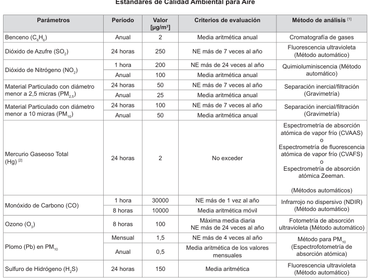

# DS-003-2017-MINAM Estándares de Calidad Ambiental de Aire

> **Fuente:** `DS-003-2017-MINAM Estándares de Calidad Ambiental de Aire.pdf`. Conversión de PDF a Markdown conservando el texto, la división por páginas y las tablas detectables. Esta transcripción automatizada no verifica vigencia normativa ni reemplaza el documento oficial.

<!-- Página original del PDF: 1 de 4 -->

datos, delincuencia organizada transnacional, cooperación internacional en materia de corrupción y buenas prácticas en materia de acceso a la justicia, entre otros; todo ello mediante el aprendizaje recíproco de experiencias y buenas prácticas entre los países participantes; asimismo, contribuirá a la unificación de los lazos entre la República del Perú y la República Argentina; Que, los gastos que genere el viaje de la Ministra de Justicia y Derechos Humanos serán sufragados, en parte, con cargo al presupuesto institucional del Ministerio de Justicia y Derechos Humanos, por cuanto el gasto correspondiente a sus viáticos será cubierto por la Presidencia Pro Témpore Argentina del MERCOSUR; asimismo, por razones de itinerario, es pertinente autorizar el presente viaje del 08 al 09 de junio de 2017; Que, de acuerdo a lo previsto en el artículo 127 de la Constitución Política del Perú, es necesario encargar la Cartera del Ministerio de Justicia y Derechos Humanos, en tanto dure la ausencia de su Titular; De conformidad con lo dispuesto en la Ley Nº 30518, Ley de Presupuesto del Sector Público para el Año Fiscal 2017; la Ley Nº 29809, Ley de Organización y Funciones del Ministerio de Justicia y Derechos Humanos; el Decreto Supremo Nº 011-2012-JUS, que aprueba el Reglamento de Organización y Funciones del Ministerio de Justicia y Derechos Humanos; la Ley Nº 27619, Ley que regula la autorización de viajes al exterior de servidores y funcionarios públicos y el Decreto Supremo Nº 047-2002-PCM, que aprueba normas reglamentarias sobre autorización de viajes al exterior de servidores y funcionarios públicos;

## SE RESUELVE:

### Artículo 1.- Autorizar el viaje de la señora María

Soledad Pérez Tello de Rodríguez, Ministra de Justicia y Derechos Humanos, a la Ciudad Autónoma de Buenos Aires, República de Argentina, del 08 al 09 de junio de 2017, por los motivos expuestos en la parte considerativa de la presente resolución.

### Artículo 2.- Los gastos que irrogue el cumplimiento

de lo dispuesto en la presente resolución, serán cubiertos, en parte, con recursos del presupuesto del Ministerio de Justicia y Derechos Humanos, de acuerdo al siguiente detalle: Pasajes US$ 1 137.22

### Artículo 3.- Encargar la Cartera del Ministerio de

Justicia y Derechos Humanos al señor Alfonso Fernando Grados Carraro, Ministro de Trabajo y Promoción del Empleo, a partir del 08 de junio de 2017, y en tanto dure la ausencia de su Titular.

### Artículo 4.- La presente autorización no otorga

derecho a exoneración o liberación de impuestos de aduana de cualquier clase o denominación.

### Artículo 5.- La presente Resolución Suprema es

refrendada por el Presidente del Consejo de Ministros y por la Ministra de Justicia y Derechos Humanos. Regístrese, comuníquese y publíquese.

## PEDRO PABLO KUCZYNSKI GODARD

Presidente de la República

## FERNANDO ZAVALA LOMBARDI

Presidente del Consejo de Ministros

## MARÍA SOLEDAD PÉREZ TELLO

Ministra de Justicia y Derechos Humanos

1529828-2

Modifican el artículo 3 de la R.S. N° 075- 2017-PCM

## RESOLUCIÓN SUPREMA

Nº 084-2017-PCM

Lima, 6 de junio de 2017

## CONSIDERANDO:

Que, mediante Resolución Suprema N° 075-2017- PCM se autorizó el viaje, en misión oficial, del Ministro de Estado en el Despacho de Relaciones Exteriores, Embajador Víctor Ricardo Luna Mendoza, a las ciudades de Nueva York y Washington D.C., Estados Unidos de América, del 28 de mayo al 2 de junio de 2017; y, a las ciudades de París, República Francesa; y Madrid, Reino de España, del 6 al 13 de junio de 2017, autorizando su salida del país del 27 de mayo al 14 de junio de 2017; Que, mediante el artículo 3 de la referida Resolución Suprema, se encargó el Despacho Ministerial de Relaciones Exteriores a la señora María Soledad Pérez Tello de Rodríguez, Ministra de Estado en el Despacho de Justicia y Derechos Humanos, a partir del 27 de mayo de 2017, y en tanto dure la ausencia del titular, siendo necesario modificar dicha encargatura; De conformidad con el artículo 127 de la Constitución Política del Perú; la Ley N.° 29158, Ley Orgánica del Poder Ejecutivo;

## SE RESUELVE:

### Artículo 1.- Modificar el artículo 3 de la Resolución

Suprema N° 075-2017-PCM, el que queda redactado de la siguiente manera: “Artículo 3.- Encargar el Despacho de Relaciones Exteriores a la señora María Soledad Pérez Tello de Rodríguez, Ministra de Estado en el Despacho de Justicia y Derechos Humanos, del 27 de mayo al 07 de junio de 2017. Asimismo, encargar el Despacho de Relaciones Exteriores al señor Eduardo Ferreyros Küppers, Ministro de Estado en el Despacho de Comercio Exterior y Turismo, a partir del 08 de junio de 2017, y en tanto dure la ausencia del titular.”

### Artículo 2.- Los demás extremos de la Resolución

Suprema N° 075-2017-PCM, quedan subsistentes y mantienen plena vigencia.

### Artículo 3.- La presente Resolución Suprema es

refrendada por el Presidente del Consejo de Ministros y por el Ministro de Relaciones Exteriores.

Regístrese, comuníquese y publíquese.

## PEDRO PABLO KUCZYNSKI GODARD

Presidente de la República

## FERNANDO ZAVALA LOMBARDI

Presidente del Consejo de Ministros

## MARÍA SOLEDAD PÉREZ TELLO

Ministra de Justicia y Derechos Humanos Encargada del Despacho del Ministerio de Relaciones Exteriores

1529828-3

## AMBIENTE

Aprueban Estándares de Calidad Ambiental (ECA) para Aire y establecen Disposiciones Complementarias

## DECRETO SUPREMO

Nº 003-2017-MINAM

## EL PRESIDENTE DE LA REPÚBLICA

## CONSIDERANDO:

Que, el numeral 22 del artículo 2 de la Constitución Política del Perú establece que toda persona tiene derecho a gozar de un ambiente equilibrado y adecuado al desarrollo de su vida; Que, de acuerdo a lo establecido en el artículo 3 de la Ley Nº 28611, Ley General del Ambiente, en adelante

---

<!-- Página original del PDF: 2 de 4 -->

la Ley, el Estado, a través de sus entidades y órganos correspondientes, diseña y aplica, entre otros, las normas que sean necesarias para garantizar el efectivo ejercicio de los derechos y el cumplimiento de las obligaciones y responsabilidades contenidas en la citada Ley; Que, el numeral 31.1 del artículo 31 de la Ley, define al Estándar de Calidad Ambiental (ECA) como la medida que establece el nivel de concentración o del grado de elementos, sustancias o parámetros físicos, químicos y biológicos, presentes en el aire, agua o suelo, en su condición de cuerpo receptor, que no representa riesgo significativo para la salud de las personas ni al ambiente; asimismo, el numeral 31.2 del artículo 31 de la Ley, establece que el ECA es obligatorio en el diseño de las normas legales y las políticas públicas y es un referente obligatorio en el diseño y aplicación de todos los instrumentos de gestión ambiental; Que, de acuerdo con lo señalado en el numeral 33.1 del artículo 33 de la Ley, la Autoridad Ambiental Nacional dirige el proceso de elaboración y revisión de ECA y Límites Máximos Permisibles (LMP) y, en coordinación con los sectores correspondientes, elabora o encarga las propuestas de ECA y LMP, los que serán remitidos a la Presidencia del Consejo de Ministros para su aprobación mediante Decreto Supremo; Que, en virtud a lo dispuesto por el numeral 33.4 del artículo 33 de la Ley, en el proceso de revisión de los parámetros de contaminación ambiental, con la finalidad de determinar nuevos niveles de calidad, se aplica el principio de gradualidad, permitiendo ajustes progresivos a dichos niveles para las actividades en curso; Que, de conformidad con lo establecido en el literal

d) del artículo 7 del Decreto Legislativo Nº 1013, Ley de Creación, Organización, y Funciones del Ministerio del Ambiente, este ministerio tiene como función específica elaborar los ECA y LMP, los cuales deberán contar con la opinión del sector correspondiente y ser aprobados mediante Decreto Supremo; Que, mediante Decreto Supremo Nº 074-2001-PCM se aprueba el Reglamento de Estándares Nacionales de Calidad Ambiental del Aire, el cual tiene por objetivo establecer los ECA para Aire y los lineamientos de estrategia para alcanzarlos progresivamente; Que, a través del Decreto Supremo Nº 069-2003- PCM, se adiciona el valor anual de concentración de Plomo a los ECA para Aire establecidos en el Reglamento de Estándares Nacionales de Calidad Ambiental del Aire, aprobado por Decreto Supremo Nº 074-2001-PCM; Que, mediante Decreto Supremo Nº 003-2008-MINAM, se aprueban nuevos parámetros y valores en los ECA para Aire y se modifica, entre otros, el valor del Dióxido de Azufre; Que, mediante Decreto Supremo Nº 006-2013-MINAM, se aprueban las disposiciones complementarias para la aplicación del ECA de Aire para el Dióxido de Azufre; Que, a través de la Resolución Ministerial Nº 205-2013-MINAM se establecen las cuencas atmosféricas a las cuales les será aplicable los numerales 2.2 y 2.3 del artículo 2 del Decreto Supremo Nº 006-2013-MINAM; mediante Que, Resolución Ministerial Nº 331-2016-MINAM se crea el Grupo de Trabajo encargado de establecer medidas para optimizar la calidad ambiental, estableciendo como una de sus funciones específicas, el analizar y proponer medidas para mejorar la calidad ambiental en el país; Que, en mérito del análisis técnico realizado por el citado Grupo de Trabajo se ha identificado la necesidad de actualizar y unificar la normatividad vigente que regula los ECA para Aire; Que, por otro lado, mediante Resolución Suprema Nº 768-98-PCM, modificada por Resolución Suprema Nº 588- 99-PCM y Resolución Suprema Nº 007-2004-VIVIENDA, se creó el Comité de Gestión de la Iniciativa del Aire Limpio para Lima y Callao, con la finalidad de proponer mecanismos de coordinación interinstitucional y los cambios normativos orientados a la mejora de la calidad del aire de Lima y Callao; Que, resulta necesario que el referido Comité se enmarque dentro de lo dispuesto en el numeral 3 del artículo 36 de la Ley Nº 29158, Ley Orgánica del Poder Ejecutivo, que establece que las Comisiones Multisectoriales de

naturaleza permanente son creadas con fines específicos para cumplir funciones de seguimiento, fiscalización, o emisión de informes técnicos. Se crean formalmente mediante decreto supremo refrendado por el Presidente del Consejo de Ministros y los titulares de los Sectores involucrados. Cuentan con Reglamento Interno aprobado por Resolución Ministerial del Sector al cual están adscritas; Que, mediante Resolución Ministerial Nº 094-2017- MINAM, el Ministerio del Ambiente dispuso la prepublicación del proyecto de Decreto Supremo que aprueba los ECA para aire y establece disposiciones complementarias, en cumplimiento del Reglamento sobre Transparencia, Acceso a la Información Pública Ambiental y Participación y Consulta Ciudadana en Asuntos Ambientales, aprobado por Decreto Supremo Nº 002-2009-MINAM, y el artículo 14 del Reglamento que establece disposiciones relativas a la publicidad, publicación de Proyectos Normativos y difusión de Normas Legales de Carácter General, aprobado por Decreto Supremo Nº 001-2009-JUS; en virtud de la cual se recibieron aportes y comentarios al mismo; De conformidad con lo dispuesto en el numeral 8 del artículo 118 de la Constitución Política del Perú, así como el numeral 3 del artículo 11 de la Ley Nº 29158, Ley Orgánica del Poder Ejecutivo;

## DECRETA:

### Artículo 1.- Aprobación de los Estándares de

Calidad Ambiental para Aire Apruébase los Estándares de Calidad Ambiental (ECA) para Aire, que como Anexo forman parte integrante del presente Decreto Supremo.

### Artículo 2.- Los Estándares de Calidad Ambiental

para Aire como referente obligatorio

2.1 Los ECA para Aire son un referente obligatorio para el diseño y aplicación de los instrumentos de gestión ambiental, a cargo de los titulares de actividades productivas, extractivas y de servicios.

2.2 Los ECA para Aire, como referente obligatorio, son aplicables para aquellos parámetros que caracterizan las emisiones de las actividades productivas, extractivas y de servicios.

### Artículo 3.- Financiamiento

El financiamiento para la aplicación de lo dispuesto en la presente norma, se realizará con cargo al presupuesto institucional de los pliegos involucrados, sin demandar recursos adicionales al Tesoro Público.

### Artículo 4.- Refrendo

El presente Decreto Supremo es refrendado por la Ministra del Ambiente, la Ministra de Salud, el Ministro de Transportes y Comunicaciones, el Ministro de Energía y Minas, el Ministro de la Producción y el Ministro de Vivienda, Construcción y Saneamiento.

## DISPOSICIONES COMPLEMENTARIAS

## FINALES

Primera.- Aplicación de los ECA para Aire en los instrumentos de gestión ambiental aprobados La aplicación de los ECA para Aire en los instrumentos de gestión ambiental aprobados, que sean de carácter preventivo, se realiza en la actualización o modificación de los mismos, en el marco de la normativa vigente del Sistema Nacional de Evaluación del Impacto Ambiental (SEIA). En el caso de instrumentos correctivos, la aplicación de los ECA para Aire se realiza conforme a la normativa ambiental sectorial.

Segunda.- Monitoreo de la calidad del aire Mediante Decreto Supremo, a propuesta del Ministerio del Ambiente, en coordinación con las autoridades competentes, se aprobará el Protocolo Nacional de Monitoreo de la Calidad Ambiental del Aire, en un plazo máximo de ciento ochenta (180) días calendario, contados desde la entrada en vigencia del presente dispositivo. En tanto se apruebe el citado Protocolo Nacional, el monitoreo de la calidad del aire se realizará conforme a la normativa vigente.

---

<!-- Página original del PDF: 3 de 4 -->

Tercera.- Grupos de Estudio Técnico Ambiental de Calidad del Aire El Ministerio del Ambiente, mediante resolución ministerial, en el plazo máximo de noventa (90) días calendario, contados desde la entrada en vigencia del presente Decreto Supremo, aprobará los lineamientos para fortalecer e incorporar a los Grupos de Estudio Técnico Ambiental de la Calidad del Aire en las Comisiones Ambientales Municipales (CAM) Provinciales, en el marco del Sistema Nacional de Gestión Ambiental. En tanto se apruebe los citados lineamientos, los Grupos de Estudio Técnico Ambiental de la Calidad del Aire continuarán ejerciendo las siguientes funciones: a) Supervisar los diagnósticos de línea base; b) Formular los planes de acción para el mejoramiento de la calidad del aire; y c) Proponer las medidas inmediatas que deban realizarse en los estados de alerta nacionales para contaminantes del aire.

Cuarta.- Zonas de Atención Prioritaria Las Zonas de Atención Prioritaria son aquellos centros poblados que cuenten con actividades económicas que planteen real o potencial afectación en la calidad del aire, que posean actividad vehicular ambientalmente relevante, o que cuenten con una dinámica urbana que implique un potencial incremento de emisiones atmosféricas. El Ministerio del Ambiente, mediante resolución ministerial, desarrollará los lineamientos para la determinación de las Zonas de Atención Prioritaria en un plazo máximo de ciento veinte (120) días calendario, contados desde la entrada en vigencia del presente decreto supremo. Asimismo, el Ministerio del Ambiente, mediante resolución ministerial, establecerá las Zonas de Atención Prioritaria, en coordinación con las autoridades competentes, Las Zonas de Atención Prioritaria creadas con anterioridad mantienen su vigencia.

Quinta.- Planes de Acción para el Mejoramiento de la Calidad del Aire Los Planes de Acción para el Mejoramiento de la Calidad del Aire de las provincias conurbadas de Lima y el Callao, son formulados por la Comisión Multisectorial de Gestión de la Iniciativa de Aire Limpio para Lima y Callao, y aprobados por el Ministerio del Ambiente. Los Planes de Acción para el Mejoramiento de la Calidad del Aire de las demás provincias serán aprobados mediante Ordenanza Municipal del Gobierno Local competente. En tanto se aprueben los lineamientos a los que se hacen referencia en la tercera disposición complementaria final, los Planes de Acción aprobados con anterioridad, deberán continuar con su implementación. La Dirección General de Calidad Ambiental del Ministerio del Ambiente realizará el seguimiento de la implementación de los Planes de Acción.

Sexta.- Estados de Alerta Nacionales para contaminantes del aire El Ministerio de Salud es la autoridad competente para declarar los Estados de Alerta Nacionales para contaminantes del aire que tengan por objeto activar, en forma inmediata, un conjunto de medidas destinadas a prevenir el riesgo a la salud y evitar la exposición excesiva de la población a los contaminantes del aire, durante episodios de contaminación aguda. El Ministerio de Salud, en coordinación con el Ministerio del Ambiente, establece los niveles de Estados de Alerta.

Sétima.- Estándar de Calidad Ambiental para Aire de Mercurio Gaseoso Total El ECA para Aire del parámetro Mercurio Gaseoso Total, aprobado mediante el presente Decreto Supremo, entrará en vigencia al día siguiente de la publicación del Protocolo Nacional de Monitoreo de la Calidad Ambiental del Aire.

## DISPOSICIÓN COMPLEMENTARIA

## TRANSITORIA

Única.- Instrumento de gestión ambiental en trámite ante la Autoridad Competente Los titulares que antes de la fecha de entrada en vigencia de la norma, hayan iniciado un procedimiento

administrativo para aprobación del instrumento de gestión ambiental ante la autoridad competente, tomarán en consideración los ECA para Aire vigentes a la fecha de inicio del procedimiento. Luego de aprobado el instrumento de gestión ambiental por la autoridad competente, los titulares deberán considerar lo establecido en la Primera Disposición Complementaria Final, a afectos de aplicar los ECA para Aire aprobados mediante el presente Decreto Supremo.

## DISPOSICIONES COMPLEMENTARIAS

## MODIFICATORIAS

Primera.- Adecuación del Comité de Gestión de la Iniciativa del Aire Limpio para Lima y Callao a Comisión Multisectorial de naturaleza permanente Modifícase el artículo 1 de la Resolución Suprema Nº 768-98-PCM, modificada por las Resoluciones Supremas Nº 588-99-PCM y Nº 007-2004-VIVIENDA, así como los artículos 2, 3 y 4 de la Resolución Suprema Nº 007-2004-VIVIENDA, e incorporase el artículo 5 en la Resolución Suprema Nº 007-2004-VIVIENDA, los mismos que quedan redactados conforme al siguiente texto: “Artículo 1.- Constituir la Comisión Multisectorial para la Gestión de la Iniciativa del Aire Limpio para Lima y Callao, la cual está adscrita al Ministerio del Ambiente e integrado por:

- El/la Viceministro (a) de Gestión Ambiental del Ministerio del Ambiente, quien lo presidirá.

- El/la Directora(a) General de Asuntos Ambientales de Industria del Ministerio de la Producción.

- El/la Director(a) General de Asuntos Ambientales Pesqueros y Acuícolas del Ministerio de la Producción.

- El/la Director(a) General de Asuntos Ambientales Energéticos del Ministerio de Energía y Minas.

- El/La Director(a) General de la Dirección General de Calidad Ambiental del Ministerio del Ambiente.

- El/La Director(a) General de la Dirección General de Asuntos Ambientales del Ministerio de Vivienda, Construcción y Saneamiento.

- El/La Director(a) General de la Dirección General de Transporte Terrestre del Ministerio de Transportes y Comunicaciones.

- El/La Director(a) General de la Dirección General de Asuntos Socio-Ambientales del Ministerio de Transportes y Comunicaciones.

- El/La Director(a) General de la Dirección General de Salud Ambiental e Inocuidad Alimentaria del Ministerio de Salud.

- El/La Presidente(a) Ejecutivo(a) del Servicio Nacional de Meteorología e Hidrología del Perú - SENAMHI.

- Dos representantes de la Municipalidad Metropolitana de Lima.

- Dos representantes de la Municipalidad Provincial del Callao.

- Dos representantes de la Confederación Nacional de Instituciones Empresariales Privadas - CONFIEP.

- Un representante de la Asociación Peruana de Consumidores y Usuarios - ASPEC. Los representantes podrán acreditar ante la Secretaría Técnica a sus representantes alternos. La Comisión podrá convocar, a personas naturales o jurídicas de derecho privado o público, a participar en sus reuniones, de acuerdo a la materia a ser tratada”.

“Artículo 2.- Creación de la Secretaría Técnica Créase la Secretaría Técnica de la Comisión Multisectorial para la Gestión de la Iniciativa del Aire Limpio para Lima y Callao, la cual dependerá del Viceministerio de Gestión Ambiental.”

“Artículo 3.- Reglamento Interno La Comisión Multisectorial para la Gestión de la Iniciativa del Aire Limpio para Lima y Callao, formulará su Reglamento Interno, el cual será aprobado mediante

---

<!-- Página original del PDF: 4 de 4 -->

Resolución Ministerial expedida por el Ministerio del Ambiente.”

“Artículo 4.- Finalidad La Comisión Multisectorial para la Gestión de la Iniciativa del Aire Limpio para Lima y Callao emitirá los informes técnicos que contengan las propuestas de mecanismos de coordinación interinstitucional y las modificaciones normativas orientadas a mejorar la calidad del aire de Lima y Callao.”

“Artículo 5.- Financiamiento El cumplimiento de las funciones de la Comisión Multisectorial para la Gestión de la Iniciativa del Aire Limpio para Lima y Callao se financia con cargo al presupuesto institucional del Ministerio del Ambiente, sin demandar recursos adicionales al Tesoro Público. Asimismo, los gastos que pueda involucrar la participación de los representantes de la citada Comisión Multisectorial se financian con cargo al presupuesto de las entidades a las cuales pertenecen”.

Segunda.- Modificación del Reglamento Interno de la Comisión Multisectorial para la Gestión de la Iniciativa del Aire Limpio para Lima y Callao Mediante Resolución Ministerial emitida por el Ministerio del Ambiente, en el plazo máximo de treinta

(30) días hábiles contados desde la entrada en vigencia del presente Decreto Supremo, la Comisión Multisectorial para la Gestión de la Iniciativa del Aire Limpio para Lima y Callao modificará su Reglamento Interno, aprobado por Resolución Ministerial Nº 229-2013-VIVIENDA.

## DISPOSICIÓN COMPLEMENTARIA

## DEROGATORIA

Única.- Derogación de normas referidas al ECA para Aire Derógase el Decreto Supremo Nº 074-2001-PCM, el Decreto Supremo Nº 069-2003-PCM, el Decreto Supremo Nº 003-2008-MINAM y el Decreto Supremo Nº 006-2013-MINAM. Dado en la Casa de Gobierno, en Lima, a los seis días del mes de junio del año dos mil diecisiete.

## PEDRO PABLO KUCZYNSKI GODARD

Presidente de la República

## ELSA GALARZA CONTRERAS

Ministra del Ambiente

## GONZALO TAMAYO FLORES

Ministro de Energía y Minas

## PEDRO OLAECHEA ÁLVAREZ CALDERÓN

Ministro de la Producción

## PATRICIA J. GARCÍA FUNEGRA

Ministra de Salud

## BRUNO GIUFFRA MONTEVERDE

Ministro de Transportes y Comunicaciones

## EDMER TRUJILLO MORI

Ministro de Vivienda, Construcción y Saneamiento

## Anexo

Estándares de Calidad Ambiental para Aire

| Parámetros | Período | Valor   [µg/m3] | Criterios de evaluación | Método de análisis [1] |
| --- | --- | --- | --- | --- |
| Benceno (CH)   6 6 | Anual | 2 | Media aritmética anual | Cromatografía de gases |
| Dióxido de Azufre (SO)   2 | 24 horas | 250 | NE más de 7 veces al año | Fluorescencia ultravioleta   (Método automático) |
| Dióxido de Nitrógeno (NO)   2 | 1 hora | 200 | NE más de 24 veces al año | Quimioluminiscencia (Método   automático) |
|  | Anual | 100 | Media aritmética anual |  |
| Material Particulado con diámetro   menor a 2,5 micras (PM )   2,5 | 24 horas | 50 | NE más de 7 veces al año | Separación inercial/filtración   (Gravimetría) |
|  | Anual | 25 | Media aritmética anual |  |
| Material Particulado con diámetro   menor a 10 micras (PM )   10 | 24 horas | 100 | NE más de 7 veces al año | Separación inercial/filtración   (Gravimetría) |
|  | Anual | 50 | Media aritmética anual |  |
| Mercurio Gaseoso Total   (Hg) [2] | 24 horas | 2 | No exceder | Espectrometría de absorción   atómica de vapor frío (CVAAS)   o   Espectrometría de fluorescencia   atómica de vapor frío (CVAFS)   o   Espectrometría de absorción   atómica Zeeman.   (Métodos automáticos) |
| Monóxido de Carbono (CO) | 1 hora | 30000 | NE más de 1 vez al año | Infrarrojo no dispersivo (NDIR)   (Método automático) |
|  | 8 horas | 10000 | Media aritmética móvil |  |
| Ozono (O)   3 | 8 horas | 100 | Máxima media diaria   NE más de 24 veces al año | Fotometría de absorción   ultravioleta (Método automático) |
| Plomo (Pb) en PM   10 | Mensual | 1,5 | NE más de 4 veces al año | Método para PM   10   (Espectrofotometría de   absorción atómica) |
|  | Anual | 0,5 | Media aritmética de los valores   mensuales |  |
| Sulfuro de Hidrógeno (HS)   2 | 24 horas | 150 | Media aritmética | Fluorescencia ultravioleta   (Método automático) |

NE: No Exceder. [1] o método equivalente aprobado.

El estándar de calidad ambiental para Mercurio Gaseoso Total entrará en vigencia al día siguiente de la publicación del Protocolo Nacional de Monitoreo de la Calidad Ambiental del Aire, de conformidad con lo establecido en la Sétima Disposición Complementaria

1529835-1
