# DS-004-2017-MINAM Estándares de Calidad Ambiental de Agua

> **Fuente:** `DS-004-2017-MINAM Estándares de Calidad Ambiental de Agua.pdf`. Conversión de PDF a Markdown conservando el texto, la división por páginas y las tablas detectables. Esta transcripción automatizada no verifica vigencia normativa ni reemplaza el documento oficial.

<!-- Página original del PDF: 1 de 10 -->

Aprueban Estándares de Calidad Ambiental (ECA) para Agua y establecen Disposiciones Complementarias

## DECRETO SUPREMO

## N° 004-2017-MINAM

## EL PRESIDENTE DE LA REPÚBLICA

## CONSIDERANDO:

Que, el numeral 22 del artículo 2 de la Constitución Política del Perú establece que toda persona tiene derecho a gozar de un ambiente equilibrado y adecuado al desarrollo de su vida; Que, de acuerdo a lo establecido en el artículo 3 de la Ley N° 28611, Ley General del Ambiente, en adelante la Ley, el Estado, a través de sus entidades y órganos correspondientes, diseña y aplica, entre otros, las normas que sean necesarias para garantizar el efectivo ejercicio de los derechos y el cumplimiento de las obligaciones y responsabilidades contenidas en la Ley; Que, el numeral 31.1 del artículo 31 de la Ley, define al Estándar de Calidad Ambiental (ECA) como la medida que establece el nivel de concentración o del grado de elementos, sustancias o parámetros físicos, químicos y biológicos, presentes en el aire, agua o suelo, en su condición de cuerpo receptor, que no representa riesgo significativo para la salud de las personas ni al ambiente; asimismo, el numeral 31.2 del artículo 31 de la Ley establece que el ECA es obligatorio en el diseño de las normas legales y las políticas públicas, así como un referente obligatorio en el diseño y aplicación de todos los instrumentos de gestión ambiental; Que, de acuerdo con lo establecido en el numeral 33.1 del artículo 33 de la Ley, la Autoridad Ambiental Nacional dirige el proceso de elaboración y revisión de ECA y Límites Máximos Permisibles (LMP) y, en coordinación con los sectores correspondientes, elabora o encarga las propuestas de ECA y LMP, los que serán remitidos a la Presidencia del Consejo de Ministros para su aprobación mediante Decreto Supremo; Que, en virtud a lo dispuesto por el numeral 33.4 del artículo 33 de la Ley, en el proceso de revisión de los parámetros de contaminación ambiental, con la finalidad de determinar nuevos niveles de calidad, se aplica el principio de gradualidad, permitiendo ajustes progresivos a dichos niveles para las actividades en curso; Que, de conformidad con lo establecido en el literal

d) del artículo 7 del Decreto Legislativo N° 1013, Ley de Creación, Organización, y Funciones del Ministerio del Ambiente, este ministerio tiene como función específica elaborar los ECA y LMP, los cuales deberán contar con la opinión del sector correspondiente y ser aprobados mediante Decreto Supremo; Que, mediante Decreto Supremo Nº 002-2008-MINAM se aprueban los ECA para Agua y, a través del Decreto Supremo Nº 023-2009-MINAM, se aprueban las disposiciones para su aplicación; Que, asimismo, mediante Decreto Supremo Nº 015-2015-MINAM se modifican los ECA para Agua y se establecen disposiciones complementarias para su aplicación; Que, mediante Resolución Ministerial Nº 331-2016-MINAM se crea el Grupo de Trabajo encargado de establecer medidas para optimizar la calidad ambiental, estableciendo como una de sus funciones específicas, el analizar y proponer medidas para mejorar la calidad ambiental en el país; Que, en mérito del análisis técnico realizado se ha identificado la necesidad de modificar, precisar y unificar la normatividad vigente que regula los ECA para agua; Que, mediante Resolución Ministerial N° 072-2017-MINAM, se dispuso la prepublicación del proyecto normativo, en cumplimiento del Reglamento sobre Transparencia, Acceso a la Información Pública Ambiental y Participación y Consulta Ciudadana en Asuntos Ambientales, aprobado por Decreto Supremo N° 002-2009-MINAM, y el artículo 14 del Reglamento que establece disposiciones relativas a la publicidad,

publicación de Proyectos Normativos y difusión de Normas Legales de Carácter General, aprobado por Decreto Supremo N° 001-2009-JUS; en virtud de la cual se recibieron aportes y comentarios al mismo; De conformidad con lo dispuesto en el numeral 8 del artículo 118 de la Constitución Política del Perú, así como el numeral 3 del artículo 11 de la Ley Nº 29158, Ley Orgánica del Poder Ejecutivo;

## DECRETA:

### Artículo 1.- Objeto de la norma

La presente norma tiene por objeto compilar las disposiciones aprobadas mediante el Decreto Supremo N° 002-2008-MINAM, el Decreto Supremo N° 023-2009-MINAM y el Decreto Supremo N° 015-2015-MINAM, que aprueban los Estándares de Calidad Ambiental (ECA) para Agua, quedando sujetos a lo establecido en el presente Decreto Supremo y el Anexo que forma parte integrante del mismo. Esta compilación normativa modifica y elimina algunos valores, parámetros, categorías y subcategorías de los ECA, y mantiene otros, que fueron aprobados por los referidos decretos supremos.

### Artículo 2.- Aprobación de los Estándares de

Calidad Ambiental para Agua Apruébase los Estándares de Calidad Ambiental (ECA) para Agua, que como Anexo forman parte integrante del presente Decreto Supremo.

### Artículo 3.- Categorías de los Estándares de

Calidad Ambiental para Agua Para la aplicación de los ECA para Agua se debe considerar las siguientes precisiones sobre sus categorías:

3.1 Categoría 1: Poblacional y recreacional

a) Subcategoría A: Aguas superficiales destinadas a la producción de agua potable Entiéndase como aquellas aguas que, previo tratamiento, son destinadas para el abastecimiento de agua para consumo humano:

- A1. Aguas que pueden ser potabilizadas con desinfección Entiéndase como aquellas aguas que, por sus características de calidad, reúnen las condiciones para ser destinadas al abastecimiento de agua para consumo humano con simple desinfección, de conformidad con la normativa vigente.

- A2. Aguas que pueden ser potabilizadas con tratamiento convencional Entiéndase como aquellas aguas destinadas al abastecimiento de agua para consumo humano, sometidas a un tratamiento convencional, mediante dos o más de los siguientes procesos: Coagulación, floculación, decantación, sedimentación, y/o filtración o procesos equivalentes; incluyendo su desinfección, de conformidad con la normativa vigente.

- A3. Aguas que pueden ser potabilizadas con tratamiento avanzado Entiéndase como aquellas aguas destinadas al abastecimiento de agua para consumo humano, sometidas a un tratamiento convencional que incluye procesos físicos y químicos avanzados como precloración, micro filtración, ultra filtración, nanofiltración, carbón activado, ósmosis inversa o procesos equivalentes establecidos por el sector competente.

b) Subcategoría B: Aguas superficiales destinadas para recreación Entiéndase como aquellas aguas destinadas al uso recreativo que se ubican en zonas marino costeras o continentales. La amplitud de las zonas marino costeras es variable y comprende la franja del mar entre el límite de la tierra hasta los 500 m de la línea paralela de baja marea. La amplitud de las zonas continentales es definida por la autoridad competente:

---

<!-- Página original del PDF: 2 de 10 -->

- B1. Contacto primario Entiéndase como aquellas aguas destinadas al uso recreativo de contacto primario por la Autoridad de Salud, para el desarrollo de actividades como la natación, el esquí acuático, el buceo libre, el surf, el canotaje, la navegación en tabla a vela, la moto acuática, la pesca submarina o similares.

- B2. Contacto secundario Entiéndase como aquellas aguas destinadas al uso recreativo de contacto secundario por la Autoridad de Salud, para el desarrollo de deportes acuáticos con botes, lanchas o similares.

3.2 Categoría 2: Extracción, cultivo y otras actividades marino costeras y continentales

a) Subcategoría C1: Extracción y cultivo de moluscos, equinodermos y tunicados en aguas marino costeras Entiéndase como aquellas aguas cuyo uso está destinado a la extracción o cultivo de moluscos (Ej.: ostras, almejas, choros, navajas, machas, conchas de abanico, palabritas, mejillones, caracol, lapa, entre otros), equinodermos (Ej.: erizos y estrella de mar) y tunicados.

b) Subcategoría C2: Extracción y cultivo de otras especies hidrobiológicas en aguas marino costeras Entiéndase como aquellas aguas destinadas a la extracción o cultivo de otras especies hidrobiológicas para el consumo humano directo e indirecto. Esta subcategoría comprende a los peces y las algas comestibles.

c) Subcategoría C3: Actividades marino portuarias, industriales o de saneamiento en aguas marino costeras Entiéndase como aquellas aguas aledañas a las infraestructuras marino portuarias, actividades industriales o servicios de saneamiento como los emisarios submarinos.

d) Subcategoría C4: Extracción y cultivo de especies hidrobiológicas en lagos o lagunas Entiéndase como aquellas aguas cuyo uso está destinado a la extracción o cultivo de especies hidrobiológicas para consumo humano.

3.3 Categoría 3: Riego de vegetales y bebida de animales

a) Subcategoría D1: Riego de vegetales Entiéndase como aquellas aguas utilizadas para el riego de los cultivos vegetales, las cuales, dependiendo de factores como el tipo de riego empleado en los cultivos, la clase de consumo utilizado (crudo o cocido) y los posibles procesos industriales o de transformación a los que puedan ser sometidos los productos agrícolas:

- Agua para riego no restringido Entiéndase como aquellas aguas cuya calidad permite su utilización en el riego de: cultivos alimenticios que se consumen crudos (Ej.: hortalizas, plantas frutales de tallo bajo o similares); cultivos de árboles o arbustos frutales con sistema de riego por aspersión, donde el fruto o partes comestibles entran en contacto directo con el agua de riego, aun cuando estos sean de tallo alto; parques públicos, campos deportivos, áreas verdes y plantas ornamentales; o cualquier otro tipo de cultivo.

- Agua para riego restringido Entiéndase como aquellas aguas cuya calidad permite su utilización en el riego de: cultivos alimenticios que se consumen cocidos (Ej.: habas); cultivos de tallo alto en los que el agua de riego no entra en contacto con el fruto (Ej.: árboles frutales); cultivos a ser procesados, envasados y/o industrializados (Ej.: trigo, arroz, avena y quinua); cultivos industriales no comestibles (Ej.: algodón), y; cultivos forestales, forrajes, pastos o similares (Ej.: maíz forrajero y alfalfa).

b) Subcategoría D2: Bebida de animales Entiéndase como aquellas aguas utilizadas para bebida de animales mayores como ganado vacuno,

equino o camélido, y para animales menores como ganado porcino, ovino, caprino, cuyes, aves y conejos.

3.4 Categoría 4: Conservación del ambiente acuático Entiéndase como aquellos cuerpos naturales de agua superficiales que forman parte de ecosistemas frágiles, áreas naturales protegidas y/o zonas de amortiguamiento, cuyas características requieren ser protegidas.

a) Subcategoría E1: Lagunas y lagos Entiéndase como aquellos cuerpos naturales de agua lénticos, que no presentan corriente continua, incluyendo humedales.

b) Subcategoría E2: Ríos Entiéndase como aquellos cuerpos naturales de agua lóticos, que se mueven continuamente en una misma dirección:

- Ríos de la costa y sierra Entiéndase como aquellos ríos y sus afluentes, comprendidos en la vertiente hidrográfica del Pacífico y del Titicaca, y en la parte alta de la vertiente oriental de la Cordillera de los Andes, por encima de los 600 msnm.

- Ríos de la selva Entiéndase como aquellos ríos y sus afluentes, comprendidos en la parte baja de la vertiente oriental de la Cordillera de los Andes, por debajo de los 600 msnm, incluyendo las zonas meándricas.

c) Subcategoría E3: Ecosistemas costeros y marinos

- Estuarios Entiéndase como aquellas zonas donde el agua de mar ingresa en valles o cauces de ríos hasta el límite superior del nivel de marea. Esta clasificación incluye marismas y manglares.

- Marinos Entiéndase como aquellas zonas del mar comprendidas desde la línea paralela de baja marea hasta el límite marítimo nacional. Precísese que no se encuentran comprendidas dentro de las categorías señaladas, las aguas marinas con fines de potabilización, las aguas subterráneas, las aguas de origen minero - medicinal, aguas geotermales, aguas atmosféricas y las aguas residuales tratadas para reuso.

### Artículo 4.- Asignación de categorías a los cuerpos

naturales de agua

4.1 La Autoridad Nacional del Agua es la entidad encargada de asignar a cada cuerpo natural de agua las categorías establecidas en el presente Decreto Supremo atendiendo a sus condiciones naturales o niveles de fondo, de acuerdo al marco normativo vigente.

4.2 En caso se identifique dos o más posibles categorías para una zona determinada de un cuerpo natural de agua, la Autoridad Nacional del Agua define la categoría aplicable, priorizando el uso poblacional.

### Artículo 5.- Los Estándares de Calidad Ambiental

para Agua como referente obligatorio

5.1 Los parámetros de los ECA para Agua que se aplican como referente obligatorio en el diseño y aplicación de los instrumentos de gestión ambiental, se determinan considerando las siguientes variables, según corresponda:

a) Los parámetros asociados a los contaminantes que caracterizan al efluente del proyecto o la actividad productiva, extractiva o de servicios.

b) Las condiciones naturales que caracterizan el estado de la calidad ambiental de las aguas superficiales que no han sido alteradas por causas antrópicas.

c) Los niveles de fondo de los cuerpos naturales de agua; que proporcionan información acerca de las concentraciones de sustancias o agentes físicos,

---

<!-- Página original del PDF: 3 de 10 -->

químicos o biológicos presentes en el agua y que puedan ser de origen natural o antrópico.

d) El efecto de otras descargas en la zona, tomando en consideración los impactos ambientales acumulativos y sinérgicos que se presenten aguas arriba y aguas abajo de la descarga del efluente, y que influyan en el estado actual de la calidad ambiental de los cuerpos naturales de agua donde se realiza la actividad.

e) Otras características particulares de la actividad o el entorno que pueden influir en la calidad ambiental de los cuerpos naturales de agua.

5.2 La aplicación de los ECA para Agua como referente obligatorio está referida a los parámetros que se identificaron considerando las variables del numeral anterior, según corresponda, sin incluir necesariamente todos los parámetros establecidos para la categoría o subcategoría correspondiente.

### Artículo 6.- Consideraciones de excepción para

la aplicación de los Estándares de Calidad Ambiental para Agua En aquellos cuerpos naturales de agua que por sus condiciones naturales o, por la influencia de fenómenos naturales, presenten parámetros en concentraciones superiores a la categoría de ECA para Agua asignada, se exceptúa la aplicación de los mismos para efectos del monitoreo de la calidad ambiental, en tanto se mantenga uno o más de los siguientes supuestos:

a) Características geológicas de los suelos y subsuelos que influyen en la calidad ambiental de determinados cuerpos naturales de aguas superficiales. Para estos casos, se demostrará esta condición natural con estudios técnicos científicos que sustenten la influencia natural de una zona en particular sobre la calidad ambiental de los cuerpos naturales de agua, aprobados por la Autoridad Nacional del Agua.

b) Ocurrencia de fenómenos naturales extremos, que determina condiciones por exceso (inundaciones) o por carencia (sequías) de sustancias o elementos que componen el cuerpo natural de agua, las cuales deben ser reportadas con el respectivo sustento técnico.

c) Desbalance de nutrientes debido a causas naturales, que a su vez genera eutrofización o el crecimiento excesivo de organismos acuáticos, en algunos casos potencialmente tóxicos (mareas rojas). Para tal efecto, se debe demostrar el origen natural del desbalance de nutrientes, mediante estudios técnicos científicos aprobados por la autoridad competente.

d) Otras condiciones debidamente comprobadas mediante estudios o informes técnicos científicos actualizados y aprobados por la autoridad competente.

### Artículo 7.- Verificación de los Estándares de

Calidad Ambiental para Agua fuera de la zona de mezcla

7.1 En cuerpos naturales de agua donde se vierten aguas tratadas, la Autoridad Nacional del Agua verifica el cumplimiento de los ECA para Agua fuera de la zona de mezcla, entendida esta zona como aquella que contiene el volumen de agua en el cuerpo receptor donde se logra la dilución del vertimiento por procesos hidrodinámicos y dispersión, sin considerar otros factores como el decaimiento bacteriano, sedimentación, asimilación en materia orgánica y precipitación química.

7.2 Durante la evaluación de los instrumentos de gestión ambiental, las autoridades competentes consideran y/o verifican el cumplimiento de los ECA para Agua fuera de la zona de mezcla, en aquellos parámetros asociados prioritariamente a los contaminantes que caracterizan al efluente del proyecto o actividad.

7.3 La metodología y aspectos técnicos para la determinación de las zonas de mezcla serán establecidos por la Autoridad Nacional del Agua, en coordinación con el Ministerio del Ambiente y la autoridad competente.

### Artículo 8.- Sistematización de la información

8.1 Las autoridades competentes de los tres niveles de gobierno, que realicen acciones de vigilancia, monitoreo, control, supervisión y/o fiscalización ambiental remitirán

al Ministerio del Ambiente la información generada en el desarrollo de estas actividades con relación a la calidad ambiental de los cuerpos naturales de agua, a fin de que sirva como insumo para la elaboración del Informe Nacional del Estado del Ambiente y para el Sistema Nacional de Información Ambiental (SINIA).

8.2 La autoridad competente debe remitir al Ministerio del Ambiente la relación de aquellos cuerpos naturales de agua exceptuados de la aplicación del ECA para Agua, referidos en los literales a) y c) del artículo 6 del presente Decreto Supremo, adjuntando el sustento técnico correspondiente.

8.3 EI Ministerio del Ambiente establece los procedimientos, plazos y los formatos para la remisión de la información.

### Artículo 9.- Refrendo

El presente Decreto Supremo es refrendado por la Ministra del Ambiente, el Ministro de Agricultura y Riego, el Ministro de Energía y Minas, la Ministra de Salud, el Ministro de la Producción y el Ministro de Vivienda, Construcción y Saneamiento.

## DISPOSICIONES COMPLEMENTARIAS FINALES

Primera.- Aplicación de los Estándares de Calidad Ambiental para Agua en los instrumentos de gestión ambiental aprobados La aplicación de los ECA para Agua en los instrumentos de gestión ambiental aprobados, que sean de carácter preventivo, se realiza en la actualización o modificación de los mismos, en el marco de la normativa vigente del Sistema Nacional de Evaluación del Impacto Ambiental (SEIA). En el caso de instrumentos correctivos, la aplicación de los ECA para Agua se realiza conforme a la normativa ambiental sectorial.

Segunda.- Del Monitoreo de la Calidad Ambiental del Agua Las acciones de vigilancia y monitoreo de la calidad del agua debe realizarse de acuerdo al Protocolo Nacional para el Monitoreo de la Calidad de los Recursos Hídricos Superficiales aprobado por la Autoridad Nacional del Agua.

Tercera.- Métodos de ensayo o técnicas analíticas El Ministerio del Ambiente, en un plazo no mayor a seis (6) meses contado desde la vigencia de la presente norma, establece los métodos de ensayo o técnicas analíticas aplicables a la medición de los ECA para Agua aprobados por la presente norma, en coordinación con el Instituto Nacional de Calidad (INACAL) y las autoridades competentes.

## DISPOSICIONES COMPLEMENTARIAS

## TRANSITORIAS

Primera.- Instrumento de gestión ambiental y/o plan integral en trámite ante la Autoridad Competente Los titulares que antes de la fecha de entrada en vigencia de la norma, hayan iniciado un procedimiento administrativo para la aprobación del instrumento de gestión ambiental y/o plan integral ante la autoridad competente, tomarán en consideración los ECA para Agua vigentes a la fecha de inicio del procedimiento. Luego de aprobado el instrumento de gestión ambiental por la autoridad competente, los titulares deberán considerar lo establecido en la Primera Disposición Complementaria Final, a afectos de aplicar los ECA para Agua aprobados mediante el presente Decreto Supremo.

Segunda.- De la autorización de vertimiento de aguas residuales tratadas Para la autorización de vertimiento de aguas residuales tratadas, la Autoridad Nacional del Agua, tomará en cuenta los ECA para Agua considerados en la aprobación del instrumento de gestión ambiental correspondiente.

Tercera.- De la aplicación de los Estándares de Calidad Ambiental para Agua en cuerpos naturales de agua no categorizados En tanto la Autoridad Nacional del Agua no haya asignado una categoría a un determinado cuerpo natural de agua, se debe aplicar la categoría del

---

<!-- Página original del PDF: 4 de 10 -->

recurso hídrico al que este tributa, previo análisis de dicha Autoridad.

## DISPOSICIÓN COMPLEMENTARIA

## DEROGATORIA

Única.- Derogación de normas referidas a Estándares de Calidad Ambiental para Agua Derógase el Decreto Supremo N° 002-2008-MINAM, el Decreto Supremo N° 023-2009-MINAM y el Decreto Supremo N° 015-2015-MINAM. Dado en la Casa de Gobierno, en Lima, a los seis días del mes de junio del año dos mil diecisiete.

## PEDRO PABLO KUCZYNSKI GODARD

Presidente de la República

## JOSÉ MANUEL HERNÁNDEZ CALDERÓN

Ministro de Agricultura y Riego

## ELSA GALARZA CONTRERAS

Ministra del Ambiente

## GONZALO TAMAYO FLORES

Ministro de Energía y Minas

## PEDRO OLAECHEA ÁLVAREZ-CALDERÓN

Ministro de la Producción

## PATRICIA J. GARCÍA FUNEGRA

Ministra de Salud

## EDMER TRUJILLO MORI

Ministro de Vivienda, Construcción y Saneamiento

## ANEXO

Categoría 1: Poblacional y Recreacional

Subcategoría A: Aguas superficiales destinadas a la producción de agua potable

| Parámetros | Unidad de medida | A1 | A2 | A3 |
| --- | --- | --- | --- | --- |
|  |  | Aguas que pueden   ser potabilizadas con   desinfección | Aguas que pueden ser   potabilizadas con tratamiento   convencional | Aguas que pueden   ser potabilizadas con   tratamiento avanzado |
| FÍSICOS- QUÍMICOS |  |  |  |  |
| Aceites y Grasas | mg/L | 0,5 | 1,7 | 1,7 |
| Cianuro Total | mg/L | 0,07 | ** | ** |
| Cianuro Libre | mg/L | ** | 0,2 | 0,2 |
| Cloruros | mg/L | 250 | 250 | 250 |
| Color (b) | Color verdadero   Escala Pt/Co | 15 | 100 (a) | ** |
| Conductividad | (µS/cm) | 1 500 | 1 600 | ** |
| Demanda Bioquímica de   Oxígeno (DBO)   5 | mg/L | 3 | 5 | 10 |
| Dureza | mg/L | 500 | ** | ** |
| Demanda Química de Oxígen   (DQO) | o   mg/L | 10 | 20 | 30 |
| Fenoles | mg/L | 0,003 | ** | ** |
| Fluoruros | mg/L | 1,5 | ** | ** |
| Fósforo Total | mg/L | 0,1 | 0,15 | 0,15 |
| Materiales Flotantes de Orige   Antropogénico | n | Ausencia de material flotante de   origen antrópico | Ausencia de material flotante de   origen antrópico | Ausencia de material flotante   de origen antrópico |
| Nitratos (NO-) (c)   3 | mg/L | 50 | 50 | 50 |
| Nitritos (NO-) (d)   2 | mg/L | 3 | 3 | ** |
| Amoniaco- N | mg/L | 1,5 | 1,5 | ** |
| Oxígeno Disuelto   (valor mínimo) | mg/L | ≥ 6 | ≥ 5 | ≥ 4 |
| Potencial de Hidrógeno (pH) | Unidad de pH | 6,5 – 8,5 | 5,5 – 9,0 | 5,5 - 9,0 |
| Sólidos Disueltos Totales | mg/L | 1 000 | 1 000 | 1 500 |
| Sulfatos | mg/L | 250 | 500 | ** |
| Temperatura | °C | Δ 3 | Δ 3 | ** |
| Turbiedad | UNT | 5 | 100 | ** |
| INORGÁNICOS |  |  |  |  |
| Aluminio | mg/L | 0,9 | 5 | 5 |
| Antimonio | mg/L | 0,02 | 0,02 | ** |
| Arsénico | mg/L | 0,01 | 0,01 | 0,15 |
| Bario | mg/L | 0,7 | 1 | ** |
| Berilio | mg/L | 0,012 | 0,04 | 0,1 |
| Boro | mg/L | 2,4 | 2,4 | 2,4 |
| Cadmio | mg/L | 0,003 | 0,005 | 0,01 |
| Cobre | mg/L | 2 | 2 | 2 |
| Cromo Total | mg/L | 0,05 | 0,05 | 0,05 |
| Hierro | mg/L | 0,3 | 1 | 5 |
| Manganeso | mg/L | 0,4 | 0,4 | 0,5 |
| Mercurio | mg/L | 0,001 | 0,002 | 0,002 |
| Molibdeno | mg/L | 0,07 | ** | ** |

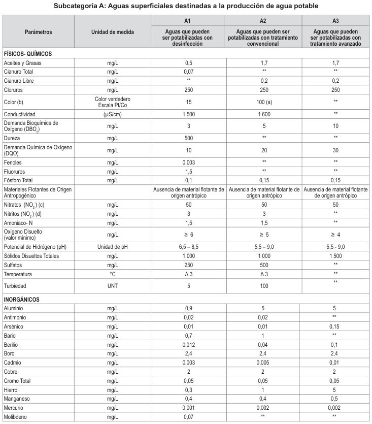

---

<!-- Página original del PDF: 5 de 10 -->

| Parámetros | Unidad de medida | A1   Aguas que pueden   ser potabilizadas con   desinfección | A2   Aguas que pueden ser   potabilizadas con tratamiento   convencional | A3   Aguas que pueden   ser potabilizadas con   tratamiento avanzado |
| --- | --- | --- | --- | --- |
| Níquel | mg/L | 0,07 | ** | ** |
| Plomo | mg/L | 0,01 | 0,05 | 0,05 |
| Selenio | mg/L | 0,04 | 0,04 | 0,05 |
| Uranio | mg/L | 0,02 | 0,02 | 0,02 |
| Zinc | mg/L | 3 | 5 | 5 |
| ORGÁNICOS |  |  |  |  |
| Hidrocarburos Totales de   Petróleo (C - C )   8 40 | mg/L | 0,01 | 0,2 | 1,0 |
| Trihalometanos | ( e ) | 1,0 | 1,0 | 1,0 |
| Bromoformo | mg/L | 0,1 | ** | ** |
| Cloroformo | mg/L | 0,3 | ** | ** |
| Dibromoclorometano | mg/L | 0,1 | ** | ** |
| Bromodiclorometano | mg/L | 0,06 | ** | ** |
| I. COMPUESTOS ORGÁNICOS VOLÁTILES |  |  |  |  |
| 1,1,1-Tricloroetano | mg/L | 0,2 | 0,2 | ** |
| 1,1-Dicloroeteno | mg/L | 0,03 | ** | ** |
| 1,2 Dicloroetano | mg/L | 0,03 | 0,03 | ** |
| 1,2 Diclorobenceno | mg/L | 1 | ** | ** |
| Hexaclorobutadieno | mg/L | 0,0006 | 0,0006 | ** |
| Tetracloroeteno | mg/L | 0,04 | ** | ** |
| Tetracloruro de carbono | mg/L | 0,004 | 0,004 | ** |
| Tricloroeteno | mg/L | 0,07 | 0,07 | ** |
| BTEX |  |  |  |  |
| Benceno | mg/L | 0,01 | 0,01 | ** |
| Etilbenceno | mg/L | 0,3 | 0,3 | ** |
| Tolueno | mg/L | 0,7 | 0,7 | ** |
| Xilenos | mg/L | 0,5 | 0,5 | ** |
| Hidrocarburos Aromáticos |  |  |  |  |
| Benzo(a)pireno | mg/L | 0,0007 | 0,0007 | ** |
| Pentaclorofenol (PCP) | mg/L | 0,009 | 0,009 | ** |
| Organofosforados |  |  |  |  |
| Malatión | mg/L | 0,19 | 0,0001 | ** |
| Organoclorados |  |  |  |  |
| Aldrín + Dieldrín | mg/L | 0,00003 | 0,00003 | ** |
| Clordano | mg/L | 0,0002 | 0,0002 | ** |
| Dicloro Difenil Tricloroetano   (DDT) | mg/L | 0,001 | 0,001 | ** |
| Endrin | mg/L | 0,0006 | 0,0006 | ** |
| Heptacloro + Heptacloro   Epóxido | mg/L | 0,00003 | 0,00003 | ** |
| Lindano | mg/L | 0,002 | 0,002 | ** |
| Carbamato |  |  |  |  |
| Aldicarb | mg/L | 0,01 | 0,01 | ** |
| II. CIANOTOXINAS |  |  |  |  |
| Microcistina-LR | mg/L | 0,001 | 0,001 | ** |
| III. BIFENILOS POLICLORADOS |  |  |  |  |
| Bifenilos Policlorados (PCB) | mg/L | 0,0005 | 0,0005 | ** |
| MICROBIOLÓGICOS Y PARASITOLÓGICOS |  |  |  |  |
| Coliformes Totales | NMP/100 ml | 50 | ** | ** |
| Coliformes Termotolerantes | NMP/100 ml | 20 | 2 000 | 20 000 |
| Formas Parasitarias | N° Organismo/L | 0 | ** | ** |
| Escherichia coli | NMP/100 ml | 0 | ** | ** |
| Vibrio cholerae | Presencia/100 ml | Ausencia | Ausencia | Ausencia |
| Organismos de vida libre   (algas, protozoarios,   copépodos, rotíferos,   nemátodos, en todos sus   estadios evolutivos) (f) | N° Organismo/L | 0 | <5x106 | <5x106 |

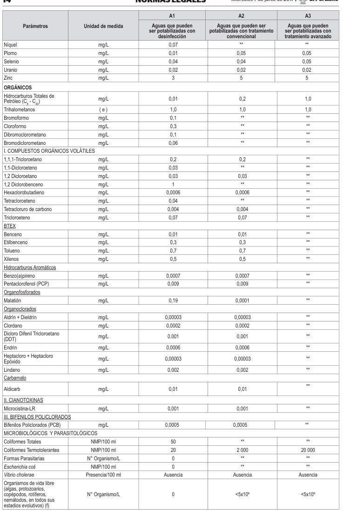

(a) 100 (para aguas claras). Sin cambio anormal (para aguas que presentan coloración natural).

(c) En caso las técnicas analíticas determinen la concentración en unidades de Nitratos-N (NO3

---

<!-- Página original del PDF: 6 de 10 -->

(d) En el caso las técnicas analíticas determinen la concentración en unidades de Nitritos-N (NO2

(e) Para el cálculo de los Trihalometanos, se obtiene a partir de la suma de los cocientes de la concentración de cada uno de los parámetros (Bromoformo, Cloroformo, Dibromoclorometano y Bromodiclorometano), con respecto a sus estándares de calidad ambiental; que no deberán exceder el valor de 1 de acuerdo con la siguiente fórmula:

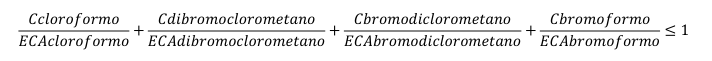

Dónde: C= concentración en mg/L y

ECA= Estándar de Calidad Ambiental en mg/L (Se mantiene las concentraciones del Bromoformo, cloroformo,

(f) Aquellos organismos microscópicos que se presentan en forma unicelular, en colonias, en filamentos o pluricelulares. ∆ 3: significa variación de 3 grados Celsius respecto al promedio mensual multianual del área evaluada.

Nota 1:

- El símbolo ** dentro de la tabla significa que el parámetro no aplica para esta Subcategoría.

- Los valores de los parámetros se encuentran en concentraciones totales, salvo que se indique lo contrario.

Subcategoría B: Aguas superficiales destinadas para recreación

| Parámetros | Unidad de medida | B1 | B2 |
| --- | --- | --- | --- |
|  |  | Contacto   primario | Contacto   secundario |
| FÍSICOS- QUÍMICOS |  |  |  |
| Aceites y Grasas | mg/L | Ausencia   de película   visible | ** |
| Cianuro Libre | mg/L | 0,022 | 0,022 |
| Cianuro Wad | mg/L | 0,08 | ** |
| Color | Color verdadero   Escala Pt/Co | Sin cambio   normal | Sin cambio   normal |
| Demanda Bioquímica de   Oxígeno (DBO)   5 | mg/L | 5 | 10 |
| Demanda Química de   Oxígeno (DQO) | mg/L | 30 | 50 |
| Detergentes (SAAM) | mg/L | 0,5 | Ausencia   de espuma   persistente |
| Materiales Flotantes de   Origen Antropogénico |  | Ausencia   de material   flotante | Ausencia   de material   flotante |
| Nitratos (NO--N)   3 | mg/L | 10 | ** |
| Nitritos (NO--N)   2 | mg/L | 1 | ** |
| Olor | Factor de dilución   a 25° C | Aceptable | ** |
| Oxígeno Disuelto   (valor mínimo) | mg/L | ≥ 5 | ≥ 4 |
| Potencial de Hidrógeno   (pH) | Unidad de pH | 6,0 a 9,0 | ** |
| Sulfuros | mg/L | 0,05 | ** |
| Turbiedad | UNT | 100 | ** |
| INORGÁNICOS |  |  |  |
| Aluminio | mg/L | 0,2 | ** |
| Antimonio | mg/L | 0,006 | ** |
| Arsénico | mg/L | 0,01 | ** |
| Bario | mg/L | 0,7 | ** |

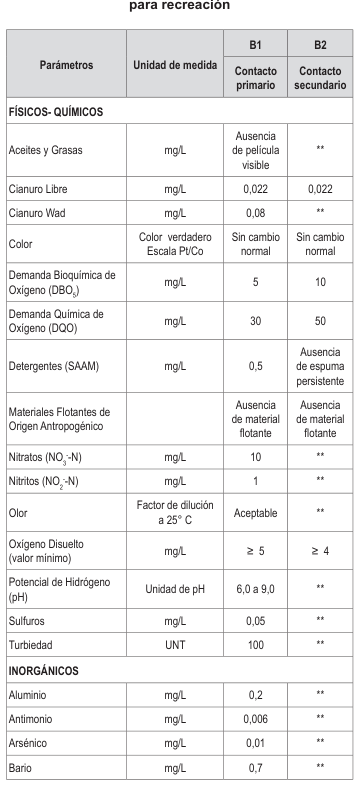

| Parámetros | Unidad de medida | B1 | B2 |
| --- | --- | --- | --- |
|  |  | Contacto   primario | Contacto   secundario |
| Berilio | mg/L | 0,04 | ** |
| Boro | mg/L | 0,5 | ** |
| Cadmio | mg/L | 0,01 | ** |
| Cobre | mg/L | 2 | ** |
| Cromo Total | mg/L | 0,05 | ** |
| Cromo VI | mg/L | 0,05 | ** |
| Hierro | mg/L | 0,3 | ** |
| Manganeso | mg/L | 0,1 | ** |
| Mercurio | mg/L | 0,001 | ** |
| Níquel | mg/L | 0,02 | ** |
| Plata | mg/L | 0,01 | 0,05 |
| Plomo | mg/L | 0,01 | ** |
| Selenio | mg/L | 0,01 | ** |
| Uranio | mg/L | 0,02 | 0,02 |
| Vanadio | mg/L | 0,1 | 0,1 |
| Zinc | mg/L | 3 | ** |
| MICROBIOLÓGICOS Y PARASITOLÓGICO |  |  |  |
| Coliformes   Termotolerantes | NMP/100 ml | 200 | 1 000 |
| Escherichia coli | NMP/100 ml | Ausencia | Ausencia |
| Formas Parasitarias | N° Organismo/L | 0 | ** |
| Giardia duodenalis | N° Organismo/L | Ausencia | Ausencia |
| Enterococos intestinales | NMP/100 ml | 200 | ** |
| Salmonella spp | Presencia/100 ml | 0 | 0 |
| Vibrio cholerae | Presencia/100 ml | Ausencia | Ausencia |

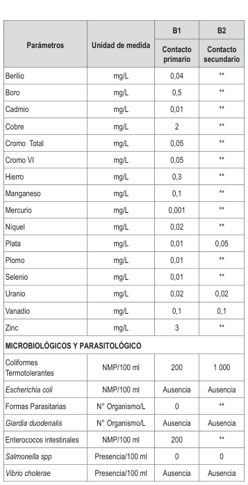

Nota 2:

- UNT: Unidad Nefelométrica de Turbiedad.

- NMP/100 ml: Número más probable en 100 ml.

- El símbolo ** dentro de la tabla significa que el parámetro no aplica para esta Subcategoría.

- Los valores de los parámetros se encuentran en concentraciones totales, salvo que se indique lo contrario.

---

<!-- Página original del PDF: 7 de 10 -->

Categoría 2: Extracción, cultivo y otras actividades marino costeras y continentales

C1 Extracción y cultivo de Parámetros Unidad de medida moluscos, equinodermos y tunicados en aguas marino costeras

## FÍSICOS- QUÍMICOS

C2 C3 C4 Extracción y cultivo Actividades marino Extracción y de otras especies portuarias, industriales cultivo de especies hidrobiológicas en o de saneamiento en hidrobiológicas en aguas marino costeras aguas marino costeras lagos o lagunas

| Aceites y Grasas | mg/L | 1,0 | 1,0 | 2,0 |
| --- | --- | --- | --- | --- |
| Cianuro Wad | mg/L | 0,004 | 0,004 | ** |
| Color (después de filtración   simple) (b) | Color verdadero   Escala Pt/Co | 100 (a) | 100 (a) | ** |
| Materiales Flotantes de Origen   Antropogénico |  | Ausencia de material   flotante | Ausencia de material   flotante | Ausencia de material   flotante |
| Demanda Bioquímica de Oxígeno   (DBO)   5 | mg/L | ** | 10 | 10 |
| Fósforo Total | mg/L | 0,062 | 0,062 | ** |
| Nitratos (NO-) (c)   3 | mg/L | 16 | 16 | ** |
| Oxígeno Disuelto (valor mínimo) | mg/L | ≥ 4 | ≥ 3 | ≥ 2,5 |
| Potencial de Hidrógeno (pH) | Unidad de pH | 7 – 8,5 | 6,8 – 8,5 | 6,8 – 8,5 |
| Sólidos Suspendidos Totales | mg/L | 80 | 60 | 70 |
| Sulfuros | mg/L | 0,05 | 0,05 | 0,05 |
| Temperatura | °C | ∆ 3 | ∆ 3 | ∆ 3 |

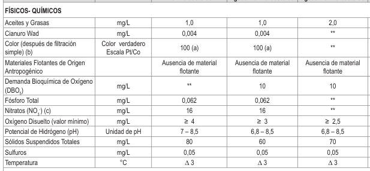

## INORGÁNICOS

| Amoniaco Total (NH)   3 | mg/L | ** | ** | ** |
| --- | --- | --- | --- | --- |
| Antimonio | mg/L | 0,64 | 0,64 | 0,64 |
| Arsénico | mg/L | 0,05 | 0,05 | 0,05 |
| Boro | mg/L | 5 | 5 | ** |
| Cadmio | mg/L | 0,01 | 0,01 | ** |
| Cobre | mg/L | 0,0031 | 0,05 | 0,05 |
| Cromo VI | mg/L | 0,05 | 0,05 | 0,05 |
| Mercurio | mg/L | 0,00094 | 0,0001 | 0,0018 |
| Níquel | mg/L | 0,0082 | 0,1 | 0,074 |
| Plomo | mg/L | 0,0081 | 0,0081 | 0,03 |
| Selenio | mg/L | 0,071 | 0,071 | ** |
| Talio | mg/L | ** | ** | ** |
| Zinc | mg/L | 0,081 | 0,081 | 0,12 |

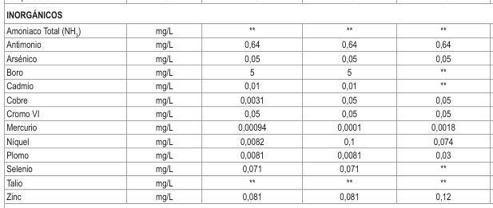

## ORGÁNICO

Hidrocarburos Totales de Petróleo mg/L 0,007 (fracción aromática)

Bifenilos Policlorados

Bifenilos Policlorados (PCB) mg/L 0,00003

## ORGANOLÉPTICO

Hidrocarburos de Petróleo mg/L No visible

## MICROBIOLÓGICO

NMP/100 ml ≤ 14 (área aprobada) (d) Coliformes Termotolerantes NMP/100 ml ≤ 88 (área restringida) (d)

0,007 0,01 **

0,00003 0,00003 0,000014

No visible No visible **

≤ 30 1 000 200

(a) 100 (para aguas claras). Sin cambio anormal (para aguas que presentan coloración natural).

(c) En caso las técnicas analíticas determinen la concentración en unidades de Nitratos-N (NO3

(d) Área Aprobada: Áreas de donde se extraen o cultivan moluscos bivalvos seguros para el comercio directo y consumo, libres de contaminación fecal humana o animal, de organismos patógenos o cualquier sustancia deletérea o

Área Restringida: Áreas acuáticas impactadas por un grado de contaminación donde se extraen moluscos bivalvos ∆ 3: significa variación de 3 grados Celsius respecto al promedio mensual multianual del área evaluada.

Nota 3:

- El símbolo ** dentro de la tabla significa que el parámetro no aplica para esta Subcategoría.

- Los valores de los parámetros se encuentran en concentraciones totales, salvo que se indique lo contrario.

(1) Aplicar la Tabla N° 1 sobre el estándar de calidad de concentración de Amoniaco Total en función del pH y

---

<!-- Página original del PDF: 8 de 10 -->

Tabla Nº 1: Estándar de calidad de Amoniaco Total en función de pH y temperatura para la protección de la vida acuática en agua dulce (mg/L de NH3)

| Temperatura   (°C) | pH |  |  |  |  |  |  |
| --- | --- | --- | --- | --- | --- | --- | --- |
|  | 6 6,5 | 7,0 | 7,5 | 8,0 | 8,5 | 9,0 | 10,0 |
| 0 | 231 73, | 0 23,1 | 7,32 | 2,33 | 0,749 | 0,250 | 0,042 |
| 5 | 153 48, | 3 15,3 | 4,84 | 1,54 | 0,502 | 0,172 | 0,034 |
| 10 | 102 32, | 4 10,3 | 3,26 | 1,04 | 0,343 | 0,121 | 0,029 |
| 15 | 69,7 22, | 0 6,98 | 2,22 | 0,715 | 0,239 | 0,089 | 0,026 |
| 20 | 48,0 15, | 2 4,82 | 1,54 | 0,499 | 0,171 | 0,067 | 0,024 |
| 25 | 33,5 10, | 6 3,37 | 1,08 | 0,354 | 0,125 | 0,053 | 0,022 |
| 30 | 23,7 7,5 | 0 2,39 | 0,767 | 0,256 | 0,094 | 0,043 | 0,021 |

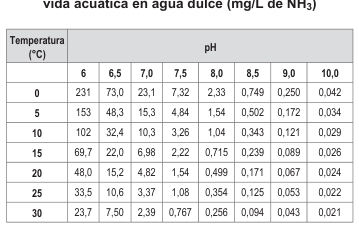

Nota:

(*)El estándar de calidad de Amoniaco total en función de pH y temperatura para la protección de la vida acuática en agua dulce, presentan una tabla de valores para rangos de pH de 6 a 10 y Temperatura de 0 a 30°C. Para comparar la temperatura y pH de las muestras de agua superficial, se deben tomar la temperatura y pH próximo superior al valor obtenido en campo, ya que la condición más extrema se da a mayor temperatura y pH. En tal sentido, no es necesario establecer rangos. (**)En caso las técnicas analíticas determinen la concentración en unidades de Amoniaco-N (NH3-N), multiplicar el resultado por el factor 1,22 para expresarlo en las unidades de Amoniaco (NH3).

Categoría 3: Riego de vegetales y bebida de animales

| Unid   Parámetros   me | D1: Riego de vegetales   ad de Agua para   dida riego no Agua   para riego   restringido   restringido   (c) |  | D2: Bebida de   animales |
| --- | --- | --- | --- |
|  |  | Agua   para riego   restringido | Bebida de   animales |
| FÍSICOS- QUÍMICOS |  |  |  |
| Aceites y Grasas m | g/L 5 |  | 10 |
| Bicarbonatos m | g/L 518 |  | ** |
| Cianuro Wad m | g/L 0,1 |  | 0,1 |
| Cloruros m | g/L 500 |  | ** |
| C   verd   Color (b)   Esca   C | olor   adero   100 (a)   la Pt/   o |  | 100 (a) |
| Conductividad (µS | /cm) 2 500 |  | 5 000 |
| Demanda   Bioquímica de m   Oxígeno (DBO)   5 | g/L 15 |  | 15 |
| Demanda Química   m   de Oxígeno (DQO) | g/L 40 |  | 40 |
| Detergentes   m   (SAAM) | g/L 0,2 |  | 0,5 |
| Fenoles m | g/L 0,002 |  | 0,01 |
| Fluoruros m | g/L 1 |  | ** |
| Nitratos (NO--N) +   3 m   Nitritos (NO--N)   2 | g/L 100 |  | 100 |
| Nitritos (NO--N) m   2 | g/L 10 |  | 10 |
| Oxígeno Disuelto   m   (valor mínimo) | g/L ≥ 4 |  | ≥ 5 |
| Potencial de Unid   Hidrógeno (pH) p | ad de   6,5 – 8,5   H |  | 6,5 – 8,4 |
| Sulfatos m | g/L 1 000 |  | 1 000 |
| Temperatura ° | C Δ 3 |  | Δ 3 |
| INORGÁNICOS |  |  |  |
| Aluminio m | g/L 5 |  | 5 |

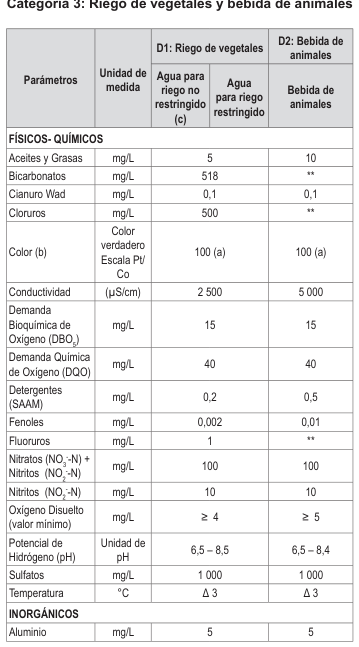

| Parámetros | Unidad de   medida | D1: Riego de vegetales |  | D2: Bebida de   animales |
| --- | --- | --- | --- | --- |
|  |  | Agua para   riego no   restringido   (c) | Agua   para riego   restringido | Bebida de   animales |
| Arsénico | mg/L | 0,1 |  | 0,2 |
| Bario | mg/L | 0,7 |  | ** |
| Berilio | mg/L | 0,1 |  | 0,1 |
| Boro | mg/L | 1 |  | 5 |
| Cadmio | mg/L | 0,01 |  | 0,05 |
| Cobre | mg/L | 0,2 |  | 0,5 |
| Cobalto | mg/L | 0,05 |  | 1 |
| Cromo Total | mg/L | 0,1 |  | 1 |
| Hierro | mg/L | 5 |  | ** |
| Litio | mg/L | 2,5 |  | 2,5 |
| Magnesio | mg/L | ** |  | 250 |
| Manganeso | mg/L | 0,2 |  | 0,2 |
| Mercurio | mg/L | 0,001 |  | 0,01 |
| Níquel | mg/L | 0,2 |  | 1 |
| Plomo | mg/L | 0,05 |  | 0,05 |
| Selenio | mg/L | 0,02 |  | 0,05 |
| Zinc | mg/L | 2 |  | 24 |
| ORGÁNICO |  |  |  |  |
| Bifenilos Policlorados |  |  |  |  |
| Bifenilos   Policlorados (PCB) | µg/L | 0,04 |  | 0,045 |
| PLAGUICIDAS |  |  |  |  |
| Paratión | µg/L | 35 |  | 35 |
| Organoclorados |  |  |  |  |
| Aldrín | µg/L | 0,004 |  | 0,7 |
| Clordano | µg/L | 0,006 |  | 7 |
| Dicloro Difenil   Tricloroetano   (DDT) | µg/L | 0,001 |  | 30 |
| Dieldrín | µg/L | 0,5 |  | 0,5 |
| Endosulfán | µg/L | 0,01 |  | 0,01 |
| Endrin | µg/L | 0,004 |  | 0,2 |
| Heptacloro y   Heptacloro   Epóxido | µg/L | 0,01 |  | 0,03 |
| Lindano | µg/L | 4 |  | 4 |
| Carbamato |  |  |  |  |
| Aldicarb | µg/L | 1 |  | 11 |
| MICROBIOLÓGICOS Y PARASITOLÓGICO |  |  |  |  |
| Coliformes   Termotolerantes | NMP/100   ml | 1 000 | 2 000 | 1 000 |
| Escherichia coli | NMP/100   ml | 1 000 | ** | ** |
| Huevos de   Helmintos | Huevo/L | 1 | 1 | ** |

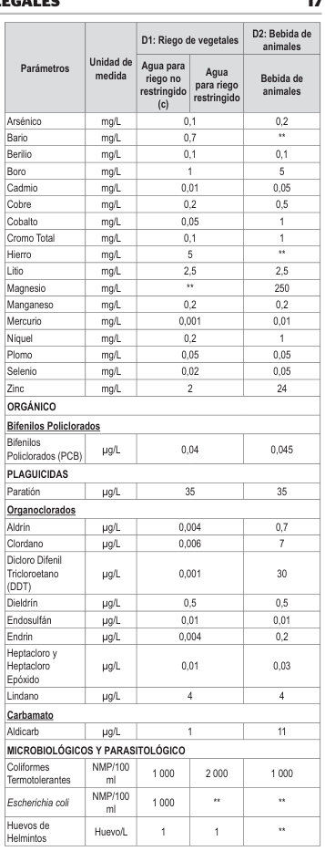

(a): Para aguas claras. Sin cambio anormal (para aguas que presentan coloración natural). (b): Después de filtración simple. (c): Para el riego de parques públicos, campos deportivos, áreas verdes y plantas ornamentales, sólo aplican los parámetros microbiológicos y parasitológicos del tipo de riego no restringido. ∆ 3: significa variación de 3 grados Celsius respecto al promedio mensual multianual del área evaluada.

Nota 4:

- El símbolo ** dentro de la tabla significa que el parámetro no aplica para esta Subcategoría.

- Los valores de los parámetros se encuentran en concentraciones totales, salvo que se indique lo contrario.

---

<!-- Página original del PDF: 9 de 10 -->

Categoría 4: Conservación del ambiente acuático

Unidad de E1: Lagunas y Parámetros medida lagos

## FÍSICOS- QUÍMICOS

E2: Ríos E3: Ecosistemas costeros y marinos

Costa y sierra Selva Estuarios Marinos

| Aceites y Grasas (MEH) | mg/L | 5,0 | 5,0 | 5,0 | 5,0 |
| --- | --- | --- | --- | --- | --- |
| Cianuro Libre | mg/L | 0,0052 | 0,0052 | 0,0052 | 0,001 |
| Color (b) | Color verdadero   Escala Pt/Co | 20 (a) | 20 (a) | 20 (a) | ** |
| Clorofila A | mg/L | 0,008 | ** | ** | ** |
| Conductividad | (µS/cm) | 1 000 | 1 000 | 1 000 | ** |
| Demanda Bioquímica de Oxígeno   (DBO)   5 | mg/L | 5 | 10 | 10 | 15 |
| Fenoles | mg/L | 2,56 | 2,56 | 2,56 | 5,8 |
| Fósforo total | mg/L | 0,035 | 0,05 | 0,05 | 0,124 |
| Nitratos (NO-) (c)   3 | mg/L | 13 | 13 | 13 | 200 |
| Amoniaco Total (NH)   3 | mg/L | (1) | (1) | (1) | (2) |
| Nitrógeno Total | mg/L | 0,315 | ** | ** | ** |
| Oxígeno Disuelto (valor mínimo) | mg/L | ≥ 5 | ≥ 5 | ≥ 5 | ≥ 4 |
| Potencial de Hidrógeno (pH) | Unidad de pH | 6,5 a 9,0 | 6,5 a 9,0 | 6,5 a 9,0 | 6,8 – 8,5 |
| Sólidos Suspendidos Totales | mg/L | ≤ 25 | ≤ 100 | ≤ 400 | ≤ 100 |
| Sulfuros | mg/L | 0,002 | 0,002 | 0,002 | 0,002 |
| Temperatura | °C | Δ 3 | Δ 3 | Δ 3 | Δ 2 |

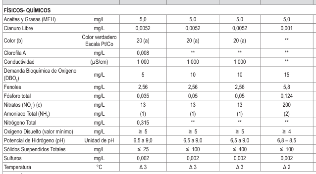

## INORGÁNICOS

| Antimonio | mg/L | 0,64 | 0,64 | 0,64 | ** |
| --- | --- | --- | --- | --- | --- |
| Arsénico | mg/L | 0,15 | 0,15 | 0,15 | 0,036 |
| Bario | mg/L | 0,7 | 0,7 | 1 | 1 |
| Cadmio Disuelto | mg/L | 0,00025 | 0,00025 | 0,00025 | 0,0088 |
| Cobre | mg/L | 0,1 | 0,1 | 0,1 | 0,05 |
| Cromo VI | mg/L | 0,011 | 0,011 | 0,011 | 0,05 |
| Mercurio | mg/L | 0,0001 | 0,0001 | 0,0001 | 0,0001 |
| Níquel | mg/L | 0,052 | 0,052 | 0,052 | 0,0082 |
| Plomo | mg/L | 0,0025 | 0,0025 | 0,0025 | 0,0081 |
| Selenio | mg/L | 0,005 | 0,005 | 0,005 | 0,071 |
| Talio | mg/L | 0,0008 | 0,0008 | 0,0008 | ** |
| Zinc | mg/L | 0,12 | 0,12 | 0,12 | 0,081 |

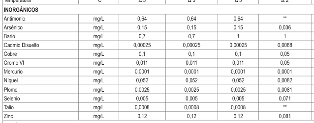

## ORGÁNICOS

Compuestos Orgánicos Volátiles

| Hidrocarburos Totales de   Petróleo | mg/L | 0,5 | 0,5 | 0,5 | 0,5 |
| --- | --- | --- | --- | --- | --- |
| Hexaclorobutadieno | mg/L | 0,0006 | 0,0006 | 0,0006 | 0,0006 |

BTEX Benceno mg/L 0,05

Hidrocarburos Aromáticos

0,05 0,05 0,05 0,05

| Benzo(a)Pireno | mg/L | 0,0001 | 0,0001 | 0,0001 | 0,0001 |
| --- | --- | --- | --- | --- | --- |
| Antraceno | mg/L | 0,0004 | 0,0004 | 0,0004 | 0,0004 |
| Fluoranteno | mg/L | 0,001 | 0,001 | 0,001 | 0,001 |

Bifenilos Policlorados Bifenilos Policlorados (PCB) mg/L 0,000014

## PLAGUICIDAS

Organofosforados Malatión mg/L 0,0001 Paratión mg/L 0,000013

Organoclorados

0,000014 0,000014 0,00003 0,00003

0,0001 0,0001 0,0001 0,0001 0,000013 0,000013 ** **

| Aldrín | mg/L | 0,000004 | 0,000004 | 0,000004 | ** |
| --- | --- | --- | --- | --- | --- |
| Clordano | mg/L | 0,0000043 | 0,0000043 | 0,0000043 | 0,000004 |
| DDT (Suma de 4,4'-DDD y   4,4-DDE) | mg/L | 0,000001 | 0,000001 | 0,000001 | 0,000001 |
| Dieldrín | mg/L | 0,000056 | 0,000056 | 0,000056 | 0,0000019 |
| Endosulfán | mg/L | 0,000056 | 0,000056 | 0,000056 | 0,0000087 |
| Endrin | mg/L | 0,000036 | 0,000036 | 0,000036 | 0,0000023 |
| Heptacloro | mg/L | 0,0000038 | 0,0000038 | 0,0000038 | 0,0000036 |

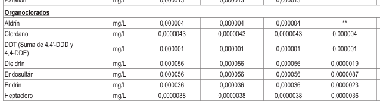

---

<!-- Página original del PDF: 10 de 10 -->

| Parámetros | Unidad de   medida | E1: Lagunas y   lagos | E2: Ríos |  | E3: Ecosistemas costeros y marinos |  |
| --- | --- | --- | --- | --- | --- | --- |
|  |  |  | Costa y sierra | Selva | Estuarios | Marinos |
| Heptacloro Epóxido | mg/L | 0,0000038 | 0,0000038 | 0,0000038 | 0,0000036 | 0,0000036 |
| Lindano | mg/L | 0,00095 | 0,00095 | 0,00095 | ** | ** |
| Pentaclorofenol (PCP) | mg/L | 0,001 | 0,001 | 0,001 | 0,001 | 0,001 |
| Carbamato |  |  |  |  |  |  |
| Aldicarb | mg/L | 0,001 | 0,001 | 0,001 | 0,00015 | 0,00015 |
| MICROBIOLÓGICO |  |  |  |  |  |  |
| Coliformes Termotolerantes | NMP/100 ml | 1 000 | 2 000 | 2 000 | 1 000 | 2 000 |

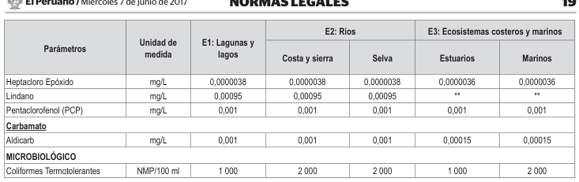

(a) 100 (para aguas claras). Sin cambio anormal (para aguas que presentan coloración natural).

(c) En caso las técnicas analíticas determinen la concentración en unidades de Nitratos-N (NO3

∆ 3: significa variación de 3 grados Celsius respecto al promedio mensual multianual del área evaluada.

Nota 5:

- El símbolo ** dentro de la tabla significa que el parámetro no aplica para esta Subcategoría.

- Los valores de los parámetros se encuentran en concentraciones totales, salvo que se indique lo contrario.

(1) Aplicar la Tabla N° 1 sobre el estándar de calidad de concentración de Amoniaco Total en función del pH y temperatura para la protección de la vida acuática en agua dulce (mg/L de NH3) que se encuentra descrita en la Categoría

(2) Aplicar la Tabla Nº 2 sobre Estándar de calidad de Amoniaco Total en función del pH, la temperatura y la salinidad

Tabla Nº 2: Estándar de calidad de Amoniaco Total en función del pH, la temperatura y la salinidad para la protección de la vida acuática en agua de mar y estuarios (mg/L de NH3)

| pH   0 | Temperatura (°C) |  |  |  |  |  |  |  |
| --- | --- | --- | --- | --- | --- | --- | --- | --- |
|  |  | 5 | 10 | 15 | 20 | 25 | 30 | 35 |
| Salinidad 10 g/kg |  |  |  |  |  |  |  |  |
| 7,0 4 | 1,00 | 29,00 | 20,00 | 14.00 | 9,40 | 6,60 | 4,40 | 3,10 |
| 7,2 2 | 6,00 | 18,00 | 12,00 | 8,70 | 5,90 | 4,10 | 2,80 | 2,00 |
| 7,4 1 | 7,00 | 12,00 | 7,80 | 5,30 | 3,70 | 2,60 | 1,80 | 1,20 |
| 7,6 1 | 0,00 | 7,20 | 5,00 | 3,40 | 2,40 | 1,70 | 1,20 | 0,84 |
| 7,8 6 | ,60 | 4,70 | 3,10 | 2,20 | 1,50 | 1,10 | 0,75 | 0,53 |
| 8,0 4 | ,10 | 2,90 | 2,00 | 1,40 | 0,97 | 0,69 | 0,47 | 0,34 |
| 8,2 2 | ,70 | 1,80 | 1,30 | 0,87 | 0,62 | 0,44 | 0,31 | 0,23 |
| 8,4 1 | ,70 | 1.20 | 0,81 | 0,56 | 0,41 | 0,29 | 0,21 | 0,16 |
| 8,6 1 | ,10 | 0,75 | 0,53 | 0,37 | 0,27 | 0,20 | 0,15 | 0,11 |
| 8,8 0 | ,69 | 0,50 | 0,34 | 0,25 | 0,18 | 0,14 | 0,11 | 0,08 |
| 9,0 0 | ,44 | 0,31 | 0,23 | 0,17 | 0,13 | 0,10 | 0,08 | 0,07 |
| Salinidad 20 g/kg |  |  |  |  |  |  |  |  |
| 7,0 4 | 4,00 | 30,00 | 21,00 | 14,00 | 9,70 | 6,60 | 4,70 | 3,10 |
| 7,2 2 | 7,00 | 19,00 | 13,00 | 9,00 | 6,20 | 4,40 | 3,00 | 2,10 |
| 7,4 1 | 8,00 | 12,00 | 8,10 | 5,60 | 4,10 | 2,70 | 1,90 | 1,30 |
| 7,6 1 | 1,00 | 7,50 | 5,30 | 3,40 | 2,50 | 1,70 | 1,20 | 0,84 |
| 7,8 6 | ,90 | 4,70 | 3,40 | 2,30 | 1,60 | 1,10 | 0,78 | 0,53 |
| 8,0 4 | ,40 | 3,00 | 2,10 | 1,50 | 1,00 | 0,72 | 0,50 | 0,34 |
| 8,2 2 | ,80 | 1,90 | 1,30 | 0,94 | 0,66 | 0,47 | 0,31 | 0,24 |
| 8,4 1 | ,80 | 1,20 | 0,84 | 0,59 | 0,44 | 0,30 | 0,22 | 0,16 |
| 8,6 1 | ,10 | 0,78 | 0,56 | 0, 41 | 0,28 | 0,20 | 0,15 | 0,12 |
| 8,8 0 | ,72 | 0,50 | 0,37 | 0,26 | 0,19 | 0,14 | 0,11 | 0,08 |
| 9,0 0 | ,47 | 0,34 | 0,24 | 0,18 | 0,13 | 0,10 | 0,08 | 0,07 |
| Salinidad 30 g/kg |  |  |  |  |  |  |  |  |
| 7,0 4 | 7,00 | 31,00 | 22,00 | 15,00 | 11,00 | 7,20 | 5,00 | 3,40 |
| 7,2 2 | 9,00 | 20,00 | 14,00 | 9,70 | 6,60 | 4,70 | 3,10 | 2,20 |
| 7,4 1 | 9,00 | 13,00 | 8,70 | 5,90 | 4,10 | 2,90 | 2,00 | 1,40 |
| 7,6 1 | 2,00 | 8,10 | 5,60 | 3,70 | 3,10 | 1,80 | 1,30 | 0,90 |
| 7,8 7 | ,50 | 5,00 | 3,40 | 2,40 | 1,70 | 1,20 | 0,81 | 0,56 |

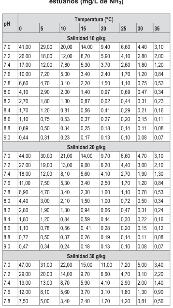

| pH | Temperatura (°C) |  |  |  |  |  |  |  |
| --- | --- | --- | --- | --- | --- | --- | --- | --- |
|  | 0 | 5 | 10 | 15 | 20 | 25 | 30 | 35 |
| 8,0 | 4,70 | 3,10 | 2,20 | 1,60 | 1,10 | 0,75 | 0,53 | 0,37 |
| 8,2 | 3,00 | 2,10 | 1,40 | 1,00 | 0,69 | 0,50 | 0,34 | 0,25 |
| 8,4 | 1,90 | 1,30 | 0,90 | 0,62 | 0,44 | 0,31 | 0,23 | 0,17 |
| 8,6 | 1,20 | 0,84 | 0,59 | 0,41 | 0,30 | 0,22 | 0,16 | 0,12 |
| 8,8 | 0,78 | 0,53 | 0,37 | 0,27 | 0,20 | 0,15 | 0,11 | 0,09 |
| 9,0 | 0,50 | 0,34 | 0,26 | 0,19 | 0,14 | 0,11 | 0,08 | 0,07 |

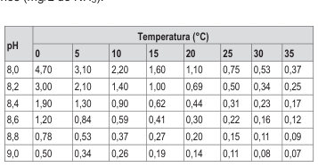

Notas: (*)El estándar de calidad de Amoniaco Total en función del pH, la temperatura y la salinidad para la protección de la vida acuática en agua de mar y estuarios, presentan una tabla de valores para rangos de pH de 7,0 a 9,0, Temperatura de 0 a 35°C, y Salinidades de 10, 20 y 30 g/ kg. Para comparar la Salinidad de las muestras de agua superficial, se deben tomar la salinidad próxima inferior (30, 20 o 10) al valor obtenido en la muestra, ya que la condición más extrema se da a menor salinidad. Asimismo, para comparar la temperatura y pH de las muestras de agua superficial, se deben tomar la temperatura y pH próximo superior al valor obtenido en campo, ya que la condición más extrema se da a mayor temperatura y pH. En tal sentido, no es necesario establecer rangos. (**)En caso las técnicas analíticas determinen la concentración en unidades de Amoniaco-N (NH3-N), multiplicar el resultado por el factor 1.22 para expresarlo en las unidades de Amoniaco (NH3).

## NOTA GENERAL:

- Para el parámetro de Temperatura el símbolo Δ significa variación y se determinará considerando la media histórica de la información disponible en los últimos 05 años como máximo y de 01 año como mínimo, considerando la estacionalidad.

- Los valores de los parámetros están referidos a la concentración máxima, salvo que se precise otra condición.

- Los reportes de laboratorio deberán contemplar como parte de sus informes de Ensayo los Límites de Cuantificación y el Límite de Detección.

1529835-2
