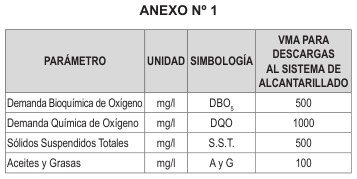
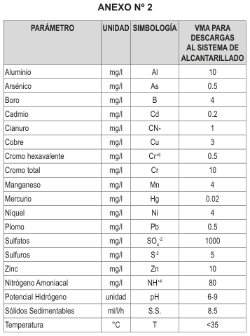
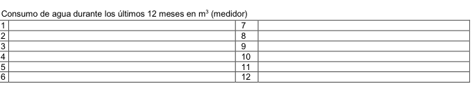
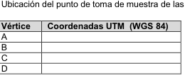
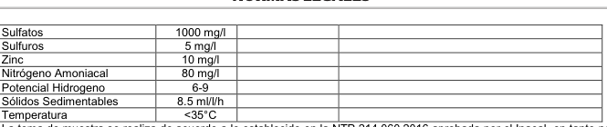
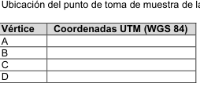

# DS 010-2019-VIVIENDA Reglamento VMA Agua Residual

> **Fuente:** `DS 010-2019-VIVIENDA Reglamento VMA Agua Residual.pdf`. Conversión de PDF a Markdown conservando el texto, la división por páginas y las tablas detectables. Esta transcripción automatizada no verifica vigencia normativa ni reemplaza el documento oficial.

<!-- Página original del PDF: 1 de 15 -->

### Artículo 2.- Incorporación de los artículos 13-A y

14-A al Reglamento de la Ley N° 29973, Ley General de la Persona con Discapacidad, aprobado por Decreto Supremo N° 002-2014-MIMP. Incorpórase los artículos 13-A y 14-A al Reglamento de la Ley N° 29973, Ley General de la Persona con Discapacidad, aprobado por Decreto Supremo N° 002-2014-MIMP, quedando redactado de la siguiente manera:

“Artículo 13-A.- Supervisión de las condiciones de accesibilidad en los espacios públicos y privados de uso público con fines recreacionales y que cuenten con juegos infantiles. El Consejo Nacional para la Integración de la Persona con Discapacidad – CONADIS supervisa el cumplimiento de las condiciones de accesibilidad en los espacios públicos y privados de uso público con fines recreacionales y que cuenten con juegos infantiles. Ante el incumplimiento de las normas de accesibilidad respecto de edificaciones privadas, el CONADIS elabora y remite al Gobierno Local el informe técnico de supervisión, en un plazo de cinco (5) días hábiles, para su evaluación, y si fuera el caso, el inicio del procedimiento administrativo sancionador. Concluido dicho procedimiento, se comunica al CONADIS para que lo incorpore en el informe anual que remite al Congreso de la República.”

### Artículo 14-A.- Cumplimiento de las normas de

accesibilidad (…) Los gobiernos locales, en el marco de sus competencias, emiten las disposiciones necesarias para fiscalizar y sancionar el incumplimiento de las normas de accesibilidad en las edificaciones privadas ubicadas en sus jurisdicciones, considerando como circunstancia agravante cuando los espacios privados de acceso y uso público con fines recreacionales que cuenten con juegos infantiles no sean accesibles para niños, niñas y adolescentes con discapacidad”.

### Artículo 3.- Financiamiento

La implementación de la presente norma se financia con cargo al presupuesto institucional de las entidades involucradas, sin demandar recursos adicionales al Tesoro Público.

### Artículo 4.- Refrendo

El presente Decreto Supremo es refrendado por la Ministra de la Mujer y Poblaciones Vulnerables, el Ministro de la Producción, la Ministra de Salud, el Ministro de Educación y el Ministro de Vivienda, Construcción y Saneamiento.

## DISPOSICIONES COMPLEMENTARIAS

## FINALES

Primera.- DISPOSICIÓN NORMATIVA DE LOS

## GOBIERNOS LOCALES

Los gobiernos locales, en un plazo de noventa (90) días hábiles, establecen las disposiciones normativas necesarias para la fiscalización de las edificaciones privadas y su correspondiente sanción por el incumplimiento de las normas de accesibilidad, adecuación urbanística y arquitectónica para las personas con discapacidad.

Segunda.- CRITERIOS DE ACCESIBILIDAD Y

## DISEÑO UNIVERSAL

El Instituto Nacional de la Calidad – INACAL, en coordinación con el CONADIS, en un plazo de ciento ochenta (180) días hábiles, contados a partir del día siguiente de la publicación del presente Decreto Supremo, emite la Norma Técnica que contiene los requisitos técnicos para los juegos infantiles ubicados en los espacios públicos y privados de uso público con fines recreacionales para los niños, niñas y adolescentes con discapacidad, considerando criterios de accesibilidad y de diseño universal, garantizando especialmente su seguridad.

Tercera.- INFORME ANUAL AL CONGRESO DE LA

## REPÚBLICA

El Presidente del Consejo Nacional para la Integración de la Persona con Discapacidad remite el informe sobre el cumplimiento de la Ley N° 30603, Ley que garantiza el derecho al juego y la accesibilidad urbana para niños, niñas y adolescentes con discapacidad a la Comisión de Inclusión Social y Personas con Discapacidad del Congreso de la República, en el marco del Día Nacional de la Persona con Discapacidad.

Cuarta.- ELABORACIÓN DE LA ESTRATEGIA

## NACIONAL

El Ministerio de Salud, el Ministerio de la Mujer y Poblaciones Vulnerables, a través del CONADIS; y en coordinación con los gobiernos regionales, en un plazo de ciento ochenta (180) días hábiles, elaboran una Estrategia Nacional Multianual para promover el acceso de las personas con discapacidad a las tecnologías de apoyo, dispositivos y ayudas compensatorias.

Dado en la Casa de Gobierno, en Lima, a los nueve días del mes de marzo del año dos mil diecinueve.

## MARTÍN ALBERTO VIZCARRA CORNEJO

Presidente de la República

## DANIEL ALfARO PAREDES

Ministro de Educación

## ANA MARÍA MENDIETA TREfOGLI

Ministra de la Mujer y Poblaciones Vulnerables

## RAÚL PÉREZ-REYES ESPEJO

Ministro de la Producción

ELIZABETh ZuLEMA TOMáS GONZáLES Ministra de Salud

JAVIER PIquÉ DEL POZO Ministro de Vivienda, Construcción y Saneamiento

1748339-2

## VIVIENDA, CONSTRUCCION

## Y SANEAMIENTO

Decreto Supremo que aprueba el Reglamento de Valores Máximos Admisibles (VMA) para las descargas de aguas residuales no domésticas en el sistema de alcantarillado sanitario

## DECRETO SUPREMO

Nº 010-2019-VIVIENDA

## EL PRESIDENTE DE LA REPÚBLICA

## CONSIDERANDO:

que, el artículo 6 de la Ley Nº 30156, Ley de Organización y funciones del Ministerio de Vivienda, Construcción y Saneamiento, en concordancia con el artículo 5 del Decreto Legislativo Nº 1280, Decreto Legislativo que aprueba la Ley Marco de la Gestión y Prestación de los Servicios de Saneamiento, establece que este Ministerio es el Ente rector de las políticas nacionales y sectoriales dentro de su ámbito de competencia, las cuales son de obligatorio cumplimiento por los tres niveles de gobierno en el marco del proceso de descentralización, y en todo el territorio nacional; que, el artículo 25 del citado Decreto Legislativo, establece la prohibición de descargar en las redes de alcantarillado sanitario, sustancias o elementos extraños que contravengan las normas vigentes sobre la calidad de los efluentes; para ello, los usuarios del servicio de

---

<!-- Página original del PDF: 2 de 15 -->

alcantarillado sanitario tienen prohibido descargar al sistema de alcantarillado sanitario, aguas residuales no domésticas que excedan los Valores Máximos Admisibles de los parámetros que establezca el Ente rector, excepto aquellos parámetros en los que el usuario no doméstico efectúe el pago adicional por exceso de concentración, conforme lo determinen las normas sectoriales y las normas de la Superintendencia Nacional de Servicios de Saneamiento. La contravención o incumplimiento de esta disposición ocasiona la suspensión de los servicios de saneamiento; que, mediante Decreto Supremo Nº 021-2009-VIVIENDA se aprobaron los Valores Máximos Admisibles (VMA) de las descargas de aguas residuales no domésticas en el sistema de alcantarillado sanitario, a fin de evitar el deterioro de las instalaciones, infraestructura sanitaria, maquinarias, equipos y asegurar su adecuado funcionamiento; garantizando la sostenibilidad de los sistemas de alcantarillado y tratamiento de las aguas residuales; que, mediante Decreto Supremo Nº

## 003-2011-VIVIENDA,

modificado por los Decretos Supremos Nº 010-2012-VIVIENDA y Nº 001-2015-VIVIENDA, se aprobó el Reglamento del Decreto Supremo Nº 021-2009-VIVIENDA, con el objeto de regular los procedimientos para controlar las descargas de aguas residuales no domésticas en el sistema de alcantarillado sanitario; que, durante el proceso de implementación de los Valores Máximos Admisibles se ha identificado la necesidad de emitir un nuevo Reglamento que establezca el procedimiento para el adecuado cumplimiento de sus disposiciones, con el propósito de adecuarlas al marco normativo sectorial y a la realidad del país, de forma tal que permita a los prestadores de los servicios de saneamiento efectuar una apropiada implementación; De conformidad con lo dispuesto por el numeral 8 del artículo 118 de la Constitución Política del Perú, el Decreto Legislativo Nº 1280, Decreto Legislativo que aprueba la Ley Marco de la Gestión y Prestación de los Servicios de Saneamiento; la Ley Nº 30156, Ley de Organización y funciones del Ministerio de Vivienda, Construcción y Saneamiento; su Reglamento de Organización y funciones, aprobado por Decreto Supremo Nº 010-2014-VIVIENDA, modificado por Decreto Supremo Nº 006-2015-VIVIENDA; y, el Reglamento que establece disposiciones relativas a la Publicidad, Publicación de Proyectos Normativos y Difusión de Normas Legales de Carácter General, aprobado por Decreto Supremo Nº 001-2009-JuS;

## DECRETA:

### Artículo 1.- Aprobación

Apruébese el Reglamento de Valores Máximos Admisibles (VMA) para las descargas de aguas residuales no domésticas en el sistema de alcantarillado sanitario y sus Anexos, los cuales forman parte integrante del presente Decreto Supremo.

### Artículo 2.- Publicación

Dispóngase la publicación del presente Decreto Supremo, del Reglamento y sus anexos, en el diario oficial El Peruano, y la difusión en el Portal Institucional del Ministerio de Vivienda, Construcción y Saneamiento (www.vivienda.gob.pe), el mismo día de su publicación.

### Artículo 3.- Refrendo

El presente Decreto Supremo es refrendado por el Ministro de Vivienda, Construcción y Saneamiento.

## DISPOSICIÓN TRANSITORIA FINAL

Única. - Aplicación de la norma Los actos administrativos que hayan iniciado antes de la entrada en vigencia del presente Decreto Supremo se rigen por lo establecido en el Decreto Supremo Nº 021-2009-VIVIENDA que aprueba los Valores Máximos Admisibles de las descargas de aguas residuales no domésticas en el sistema de alcantarillado sanitario y sus Anexos, el Decreto Supremo Nº 003-2011-VIVIENDA,

Decreto Supremo que aprueba el Reglamento del Decreto Supremo Nº 021-2009-VIVIENDA y su modificatoria, que aprueba los Valores Máximos Admisibles de las descargas de aguas residuales no domésticas en el Sistema de Alcantarillado Sanitario, hasta su conclusión; salvo que las disposiciones del Reglamento aprobado con el presente Decreto Supremo le resulten más favorables al administrado.

## DISPOSICIÓN COMPLEMENTARIA

## DEROGATORIA

Única. - Derogación Derógase los siguientes dispositivos legales:

1. El Decreto Supremo Nº 021-2009-VIVIENDA que aprueba los Valores Máximos Admisibles de las descargas de aguas residuales no domésticas en el sistema de alcantarillado sanitario y sus Anexos; así como, sus disposiciones modificatorias. 2. El Decreto Supremo Nº 003-2011-VIVIENDA, que aprueba el Reglamento del Decreto Supremo Nº 021-2009-VIVIENDA, que aprueba los Valores Máximos Admisibles de las descargas de aguas residuales no domésticas en el Sistema de Alcantarillado Sanitario; así como, sus disposiciones modificatorias.

Dado en la Casa de Gobierno, en Lima, a los nueve días del mes de marzo del año dos mil diecinueve.

## MARTÍN ALBERTO VIZCARRA CORNEJO

Presidente de la República

JAVIER PIquÉ DEL POZO Ministro de Vivienda, Construcción y Saneamiento

## REGLAMENTO DE VALORES MÁXIMOS

## ADMISIBLES (VMA) PARA LAS DESCARGAS DE

## AGUAS RESIDUALES NO DOMÉSTICAS EN EL

## SISTEMA DE ALCANTARILLADO SANITARIO

## TÍTULO I

## DISPOSICIONES GENERALES

### Artículo 1.- Objeto

El presente Reglamento tiene por objeto establecer los parámetros de los Valores Máximos Admisibles (VMA) y regular el procedimiento para controlar las descargas de aguas residuales no domésticas en el sistema de alcantarillado sanitario.

### Artículo 2.- Finalidad

El presente Reglamento tiene por finalidad preservar las instalaciones, la infraestructura sanitaria, maquinarias, equipos de los servicios de alcantarillado sanitario e incentivar el tratamiento de las aguas residuales para disposición o reúso, garantizando la sostenibilidad de los sistemas de alcantarillado y tratamiento de las aguas residuales; así como, la disminución del riesgo sobre el personal del prestador de los servicios de saneamiento que tenga contacto con las descargas de aguas residuales no domésticas.

### Artículo 3.- Ámbito de aplicación

El presente Reglamento es de obligatorio cumplimiento por parte de los usuarios No Domésticos (uND) que efectúan descargas de aguas residuales no domésticas al sistema de alcantarillado sanitario bajo el ámbito de los prestadores de los servicios de saneamiento a nivel nacional. Asimismo, su cumplimiento es exigible por los prestadores de servicios de saneamiento.

### Artículo 4.- Definiciones

Para efectos de la aplicación del presente Reglamento se tiene en cuenta las definiciones siguientes:

1. Agua residual no doméstica: Descarga de líquidos producidos por alguna actividad económica comercial e industrial, distinta a la generada por los usuarios

---

<!-- Página original del PDF: 3 de 15 -->

domésticos, quienes descargan aguas residuales domésticas como producto de la preparación de alimentos, del aseo personal y de desechos fisiológicos. 2. Balance hídrico: Equilibrio del recurso hídrico entre lo que ingresa (afluente) y sale (efluente) en las instalaciones del uND, representado por un esquema general del recurso hídrico empleado en el proceso productivo o actividad económica, en un intervalo de tiempo determinado. 3. Caso fortuito o fuerza mayor: Causa no imputable, consistente en un evento extraordinario, imprevisible e irresistible, que impide la ejecución de la obligación o determina su cumplimiento parcial, tardío o defectuoso. 4. Clasificación Industrial Internacional Uniforme (CIIU): Clasificación internacional de referencia de las actividades económicas productivas, para facilitar un conjunto de categorías de actividad que pueda utilizarse para la elaboración de estadísticas por actividades. 5. Contramuestra: Muestra adicional que se toma en la misma oportunidad y bajo los mismos criterios que la muestra original a ser analizada. 6. Dirimencia: Procedimiento técnico iniciado a pedido de parte, sea por el interesado o su representante, a fin que, un laboratorio acreditado ante el Instituto Nacional de Calidad (Inacal), realice un nuevo análisis de la muestra en custodia, por no estar de acuerdo con los resultados emitidos por el laboratorio acreditado. 7. Laboratorio acreditado: Laboratorio que ha obtenido el Certificado de Acreditación otorgado por el Inacal, para realizar el análisis de aguas residuales en los parámetros establecidos en los Anexos Nº 1 y Nº 2 del presente Reglamento. 8. Muestra de parte: Muestra puntual realizada a través de laboratorio acreditado ante el Inacal, por cuenta y costo del uND, sin previo requerimiento, de forma voluntaria y bajo los procedimientos, criterios y disposiciones establecidos por el organismo competente. 9. Muestra dirimente: Muestra puntual tomada en la misma oportunidad que la muestra original a ser analizada y la contramuestra, bajo los mismos criterios, para analizar y/o compararla en el caso que existan eventuales reclamos sobre la validez de los resultados de la muestra, de acuerdo a lo dispuesto en el procedimiento de resolución de quejas establecido por el Inacal. La muestra dirimente aplica a los parámetros establecidos en los Anexos Nº 1 y Nº 2 del presente Reglamento, a excepción de los siguientes parámetros: Demanda Bioquímica de Oxígeno (DBO5), Sólidos Suspendidos Totales (SST), Sulfuros (S-2), Nitrógeno Amoniacal (Nh+4), Potencial hidrógeno (ph), Sólidos Sedimentables (SS) y Temperatura (T). 10. Muestra inopinada: Muestra puntual tomada por un laboratorio acreditado ante el Inacal, a solicitud y en presencia del representante del prestador de los servicios de saneamiento y sin previo aviso al uND. Para su realización no es necesario contar con la presencia del uND o de su representante. 11. Muestra puntual: Muestra original tomada al azar de la descarga de agua residual no doméstica del uND, que se utiliza para evaluar todos los parámetros contenidos en los Anexos Nº 1 y Nº 2 del presente Reglamento. 12. Pago adicional por exceso de concentración: Pago que debe ser requerido por el prestador de los servicios de saneamiento y que es aplicado a los uND, cuando superen los Valores Máximos Admisibles (VMA) establecidos en el Anexo Nº 1 del presente Reglamento, en base a la metodología elaborada y aprobada por la Superintendencia Nacional de Servicios de Saneamiento (Sunass). 13. Prestador de los servicios de saneamiento: Persona jurídica constituida según las disposiciones establecidas en la Ley Marco de la Gestión y Prestación de los Servicios de Saneamiento, aprobada con el Decreto Legislativo Nº 1280 (Ley Marco) y su Reglamento, aprobado por el Decreto Supremo Nº 019-2017-VIVIENDA, cuyo objeto es prestar los servicios de saneamiento a los usuarios, a cambio de la contraprestación correspondiente, en cuyo ámbito de responsabilidad existan servicios de alcantarillado sanitario y tratamiento de aguas residuales para disposición final y reúso.

14. Punto de toma de muestra: Caja de registro o dispositivo similar de la conexión domiciliaria de alcantarillado sanitario, ubicada fuera del predio, para descargas de aguas residuales no domésticas, en el que se realiza la toma de muestra de los parámetros establecidos en el Anexo Nº 1 y Nº 2 del presente Reglamento y de ser necesario la medición del caudal. 15. Reclamo: Derecho de contradicción del que goza todo uND, cuando surge una controversia entre este y el prestador de los servicios de saneamiento, respecto a la aplicación del presente Reglamento y/o normas conexas. 16. Registro de Usuario No Doméstico: Base de datos implementada por el prestador de los servicios de saneamiento, en la que se identifican, clasifican y registran a los uND del servicio de alcantarillado sanitario, con información sobre la ubicación de punto de toma de muestra, características de las aguas residuales no domésticas, entre otros datos requeridos por el prestador de servicios de saneamiento. 17. Subcontratación: Mecanismo a través del cual aquel laboratorio que encontrándose acreditado ante el Inacal para realizar el análisis de aguas residuales en alguno de los parámetros establecidos en los Anexos Nº 1 y Nº 2 del presente Reglamento y no alcanza la totalidad de estos, subcontrata a otro laboratorio acreditado ante el Inacal para que realice el análisis de aguas residuales respecto de aquellos parámetros en los que el laboratorio subcontratante se encuentra en proceso de acreditación. El muestreo debe ser realizado por el laboratorio acreditado que efectúe el análisis por el cual fue subcontratado. 18. Usuario No Doméstico (UND): Persona natural o jurídica que realiza descargas de aguas residuales no domésticas al sistema de alcantarillado sanitario. 19. Valores Máximos Admisibles (VMA): Es la concentración de los parámetros, establecidos en el Anexos Nº 1 y Nº 2 del presente Reglamento, contenidos en las descargas de las aguas residuales no domésticas a descargar en los sistemas de alcantarillado sanitario y que puede influenciar negativamente en los procesos de tratamiento de las aguas residuales, al exceder dichos valores.

## TÍTULO II

## GESTIÓN DE LAS AGUAS RESIDUALES

## NO DOMÉSTICAS

## CAPÍTULO I

## DERECHOS Y OBLIGACIONES DE LOS

## PRESTADORES DE LOS SERVICIOS DE

## SANEAMIENTO

### Artículo 5.- Derechos de los prestadores de los

servicios de saneamiento Para efectos de la aplicación del presente Reglamento, los prestadores de los servicios de saneamiento tienen derecho a:

1. Efectuar la toma de muestra inopinada y análisis del efluente residual generado por el UND, a través de un laboratorio acreditado por el Instituto Nacional de Calidad (Inacal), considerando la actividad económica que desarrolla, las cuales se encuentran establecidas en el Anexo de la Resolución Ministerial Nº 116-2012-VIVIENDA. En caso la actividad económica del uND no se encuentre comprendida en el Anexo de la Resolución Ministerial antes citada, el prestador de los servicios de saneamiento, previa evaluación técnica y el informe técnico que lo sustente, efectúa la toma de muestra inopinada y análisis de todos los parámetros del Anexo Nº 1, y de algunos o todos los parámetros del Anexo Nº 2 del presente Reglamento. 2. Participar en la toma de muestra de parte, programada por el uND. 3. Proponer al Ministerio de Vivienda, Construcción y Saneamiento (MVCS) la modificación y/o actualización de los parámetros contenidos en los Anexos Nº 1 y Nº 2 del presente Reglamento. Dicha propuesta debe encontrarse sustentada con estudios de caracterización de los

---

<!-- Página original del PDF: 4 de 15 -->

diferentes tipos de descargas no domésticas, además de otros documentos que el MVCS considere necesarios.

### Artículo 6.- Obligaciones de los prestadores de los

servicios de saneamiento Para efectos de la aplicación del presente Reglamento, los prestadores de los servicios de saneamiento están obligados a:

1. Identificar, registrar y asignar un Código al UND. 2. Otorgar la factibilidad de servicios a los uND, siempre que cumpla con las condiciones técnicas necesarias para el cumplimiento de los VMA. 3. Cumplir con realizar el porcentaje de toma de muestra inopinada a los uND, consignado en el Registro de uND, de acuerdo a lo establecido con el artículo 23 del presente Reglamento. 4. Monitorear la concentración de parámetros de descargas de aguas residuales no domésticas en los sistemas de alcantarillado sanitario, a través de laboratorios acreditados ante el Inacal, para realizar los análisis de aguas residuales en los parámetros establecidos en los Anexos Nº 1 y Nº 2 del presente Reglamento. 5. Solicitar la realización de la dirimencia a través de un laboratorio acreditado por el Inacal. 6. Pagar el importe correspondiente a la toma de muestra inopinada, análisis y cualquier otro gasto relacionado a la labor realizada por el laboratorio acreditado por el Inacal, siempre que el valor del(los) parámetro(s) analizado(s) no sobrepase los VMA. En caso de sobrepasar los VMA de uno o más parámetros, el uND asume el importe de la toma de muestra inopinada y del análisis de dichos parámetros, así como el costo proporcional adicional, de los parámetros que sobrepasen, por la labor realizada por el laboratorio acreditado por el Inacal. 7. Realizar el cobro a los uND respecto a: i) el pago adicional por exceso de concentración de los parámetros establecidos en el Anexo Nº 1 del presente Reglamento; ii) el costo de la instalación nueva o la reubicación de la caja de registro o dispositivo similar de la conexión domiciliaria para aguas residuales no domésticas; y, iii) los costos establecidos en el artículo 27 del presente Reglamento, de acuerdo a las disposiciones que para dicho fin apruebe la Sunass. 8. Destinar los recursos recaudados, en el marco del cumplimiento del presente Reglamento, en la implementación de los VMA y en la mejora de la infraestructura de alcantarillado sanitario y tratamiento de aguas residuales para disposición final o reúso. 9. Suspender temporalmente los servicios de agua potable y de alcantarillado sanitario por: i) el incumplimiento del Pago adicional por exceso de concentración de alguno de los parámetros establecidos en el Anexo Nº 1 del presente Reglamento; ii) exceder los VMA de algún parámetro del Anexo Nº 2 del presente Reglamento; y, iii) los demás casos que establezca el presente Reglamento. El prestador de los servicios de saneamiento, comunica a la Autoridad Nacional del Agua (ANA), el incumplimiento del uND al presente Reglamento, para que esta evalúe la cancelación de la licencia de uso. 10. Rehabilitar los servicios de agua potable y de alcantarillado sanitario, previo pago de los importes pendientes por exceso de concentración de alguno de los parámetros establecidos en el Anexo Nº 1 y/o la verificación del cumplimiento de los parámetros establecidos en el Anexo Nº 2 del presente Reglamento; y la verificación de la instalación y operación del sistema de tratamiento de aguas residuales no domésticas, que permitan cumplir con los parámetros de los VMA, y en los casos que establezca el presente Reglamento. La Sunass establece el plazo y el procedimiento para que el prestador de los servicios de saneamiento rehabilite los servicios de agua potable y alcantarillado sanitario. 11. Suspender el cobro del pago adicional por exceso de concentración al UND, previa verificación del cumplimiento de las concentraciones de los parámetros del Anexo Nº 1 del presente Reglamento, mediante los resultados de un laboratorio acreditado por el Inacal, la verificación de la instalación y operación del sistema de

tratamiento de aguas residuales no domésticas y/o la implementación de mejoras en los procesos productivos, que permitan cumplir con los parámetros de los VMA. 12. Comunicar a los UND las modificaciones y actualizaciones realizadas al marco normativo aplicable a los VMA, así como efectuar periódicamente campañas de sensibilización entre sus usuarios. 13. Evaluar si procede exonerar, temporalmente, al uND del pago adicional por exceso de concentración de parámetros o de la suspensión temporal de los servicios de agua potable y de alcantarillado sanitario, cuando las descargas de aguas residuales no domésticas superen los VMA por caso fortuito o fuerza mayor. 14. Presentar anualmente a la Sunass, con copia a la Dirección de Saneamiento de la Dirección General de Políticas y Regulación en Construcción y Saneamiento del MVCS, durante el primer trimestre de cada año, un informe sobre el proceso de implementación del marco normativo aplicable a los VMA y el grado de cumplimiento por parte de los uND. 15. Evaluar si procede el otorgamiento del plazo adicional solicitado por el uND para ejecutar las acciones de mejora para el cumplimiento de los parámetros del Anexo Nº 2 del presente Reglamento. 16. Revisar, verificar y determinar la ubicación, acceso y características técnicas del punto de toma de muestra de las descargas de aguas residuales no domésticas. 17. Instalar, reubicar o reponer, la conexión domiciliaria de alcantarillado sanitario del uND o punto de toma de muestra en la parte exterior del predio, a efectos de realizar las descargas de aguas residuales no domésticas. 18. Presenciar la toma de muestra inopinada y participar en dicha diligencia, de acuerdo a lo señalado en los artículos 23, 24 y 25 del presente Reglamento. 19. Levantar y suscribir, a través de su personal debidamente acreditado, el Acta de inspección y el Acta de toma de muestra inopinada, conforme a los formatos de los Anexos Nº 3 y Nº 4 del presente Reglamento, respectivamente. 20. Cumplir con las disposiciones establecidas en las normas aprobadas por la Sunass. 21. Cumplir con las demás obligaciones establecidas en el presente Reglamento, así como con las disposiciones sectoriales que se emitan para regular el cumplimiento de los VMA.

## CAPÍTULO II

## DERECHOS Y OBLIGACIONES DE

## LOS USUARIOS NO DOMÉSTICOS

### Artículo 7.- Derechos de los UND

Para efectos de la aplicación del presente Reglamento, los uND, tienen derecho a:

1. Recibir información sobre el marco normativo aplicable a los VMA, así como de sus modificaciones y actualizaciones. 2. Solicitar la exoneración del pago adicional por exceso de concentración de los parámetros o la suspensión temporal del servicio de agua potable y de alcantarillado sanitario, cuando por caso fortuito o fuerza mayor la descarga de agua residual no doméstica en el sistema de alcantarillado sanitario exceda los VMA, de acuerdo con el procedimiento establecido en el presente Reglamento. 3. Presenciar la toma de muestra inopinada y participar de dicha diligencia, así como suscribir el Acta de toma de muestra inopinada, según el formato aprobado en el Anexo Nº 4 del presente Reglamento. 4. Solicitar la realización de la dirimencia a través de un laboratorio acreditado por el Inacal. 5. Presentar reclamos, en caso consideren que se ha vulnerado alguno de sus derechos, de acuerdo a los procedimientos que para tal fin apruebe la Sunass. 6. Solicitar por escrito y por única vez al prestador de los servicios de saneamiento, el otorgamiento de un plazo para implementar acciones de mejora destinadas a la adecuación sus descargas no domésticas a los VMA, en los casos establecidos en el inciso 2 del párrafo 27.1 del artículo 27 del presente Reglamento.

---

<!-- Página original del PDF: 5 de 15 -->

### Artículo 8.- Obligaciones de los UND

Para efectos de la aplicación del presente Reglamento, los uND que descargan aguas residuales no domésticas al sistema de alcantarillado sanitario, están obligados a:

1. Implementar un sistema de tratamiento de aguas residuales y/o las modificaciones del proceso productivo, cuando sus descargas excedan los VMA establecidos en los Anexos Nº 1 y Nº 2 del presente Reglamento, para lo cual deben elaborar y presentar al prestador de los servicios de saneamiento, en la oportunidad que establezca el presente Reglamento, un diagrama de flujo de los procesos unitarios que involucra el tratamiento realizado al agua residual no doméstica y/o las modificaciones del proceso productivo. 2. Elaborar y presentar, en la oportunidad que establezca el presente Reglamento, un balance hídrico del proceso productivo o actividad económica que realiza, mediante un esquema general en el que se incluya el sistema de tratamiento de las aguas residuales no domésticas y la ubicación del punto de toma de muestra. 3. Brindar todas las facilidades, accesos e ingresos necesarios para que el personal debidamente acreditado por el prestador de los servicios de saneamiento efectúe la inspección necesaria para verificar el cumplimiento de los VMA establecidos en los Anexos Nº 1 y Nº 2 del presente Reglamento. 4. Pagar el costo de la conexión domiciliaria, instalación nueva, reubicación o reposición, al exterior del predio, a través del recibo de pago emitido por el prestador de los servicios de saneamiento, de acuerdo a las disposiciones que para dicho fin apruebe la Sunass. 5. Informar al prestador de los servicios de saneamiento, cuando la descarga de sus aguas residuales no domésticas presente alguna modificación derivada de la ampliación o variación de las actividades que realiza el uND, dentro de un plazo que no debe exceder los quince (15) días hábiles, contados desde la ampliación o variación de sus actividades. 6. No suspender, diluir y/o regular, de cualquier forma, el flujo de sus descargas de aguas residuales no domésticas antes, durante o después de la toma de muestra inopinada, realizada por el personal del laboratorio acreditado por el Inacal. 7. Pagar el importe correspondiente a la toma de muestra inopinada, análisis y cualquier otro gasto relacionado a la labor realizada por el laboratorio acreditado por el Inacal, siempre que el valor del(os) parámetro(s) analizado(s) sobrepase los VMA. En caso de no sobrepasar los VMA de uno o más parámetros, el prestador de los servicios de saneamiento asume el importe de la toma de muestra y del análisis de dicho(s) parámetro(s), así como el costo proporcional adicional por la labor realizada por el laboratorio acreditado por el Inacal. 8. Efectuar el pago adicional por exceso de concentración de los parámetros establecidos en el Anexo Nº 1 del presente Reglamento, de acuerdo a la metodología elaborada y aprobada por la Sunass y lo previsto en el artículo 26 del presente Reglamento. 9. Cumplir con las normas sectoriales que se emitan para la regulación de la aplicación de los VMA.

## CAPÍTULO III

## SUPERINTENDENCIA NACIONAL DE SERVICIOS

## DE SANEAMIENTO

### Artículo 9.- Del pago adicional por exceso de

concentración en la descarga de aguas residuales no domésticas

9.1. La Sunass, elabora y aprueba la metodología para determinar el pago adicional por exceso de concentración de los parámetros fijados en el Anexo Nº 1 del presente Reglamento. 9.2. Los prestadores de los servicios de saneamiento, en aplicación de la metodología mencionada en el párrafo precedente, cobran a los uND el monto correspondiente al pago adicional por exceso de concentración de los parámetros establecidos en el Anexo Nº 1 del presente Reglamento, cuando verifiquen el exceso de los VMA.

### Artículo 10.- De la implementación, control y

cumplimiento de los VMA

10.1. La Sunass, como parte de su función normativa, supervisora y fiscalizadora, incorpora y supervisa el cumplimiento de los VMA en sus respectivos Reglamentos, aprobados mediante Resolución de Consejo Directivo. 10.2. Adicionalmente, el prestador de los servicios de saneamiento presenta, como mínimo una vez al año y dentro del primer trimestre de cada año, un informe que contenga las actividades de implementación y control de los VMA y debe dar cuenta de las inversiones y costos de operación y mantenimiento de las redes de alcantarillado sanitario y plantas de tratamiento de aguas residuales hasta su disposición final o reúso, efectuadas en aplicación de lo establecido en el inciso 8 del artículo 6 del presente Reglamento. 10.3. Acorde con lo dispuesto en la Ley Nº 27332, Ley Marco de los Organismos Reguladores de la Inversión Privada en los Servicios Públicos y su modificatoria, la Sunass se encuentra facultada para tipificar infracciones y sanciones aplicables a los prestadores de los servicios de saneamiento por el incumplimiento de las obligaciones detalladas en el presente Reglamento y las normas complementarias.

## CAPÍTULO IV

## LABORATORIOS ACREDITADOS

### Artículo 11.- Acreditación del laboratorio para el

alcance de aguas residuales

11.1. Los laboratorios acreditados por el Inacal están facultados a efectuar la toma de muestra y el análisis de las descargas de aguas residuales no domésticas, a fin de verificar el cumplimiento de los VMA establecidos en los Anexos Nº 1 y Nº 2 del presente Reglamento. Para dicho fin, deben obtener el certificado de acreditación emitido por la Dirección de Acreditación del Inacal. 11.2. Excepcionalmente, la subcontratación de laboratorios acreditados es permitida en: i) casos justificados sustentados por el laboratorio acreditado, evaluado y aceptado por el Inacal; y/o, ii) cuando el laboratorio subcontratante se encuentre en proceso de acreditación ante el Inacal respecto del(los) parámetro(s) que pretenda subcontratar, y que este proceso no se encuentre interrumpido por causas imputables al laboratorio. En los casos de subcontratación, el muestreo y análisis son realizados por el laboratorio acreditado subcontratado, sin excepción.

### Artículo 12.- Toma de muestras

12.1. Los laboratorios acreditados por el Inacal son responsables de efectuar la toma de muestra puntual y de efectuar el análisis de los parámetros establecidos en los Anexos Nº 1 y Nº 2 del presente Reglamento, en las descargas de aguas residuales no domésticas, cumpliendo lo dispuesto en la Norma Técnica Peruana NTP 214.060.2016 “AGUAS RESIDUALES. Protocolo de muestreo de aguas residuales no domésticas que se descargan en la red de alcantarillado”, en tanto no se contraponga con el presente Reglamento. 12.2. Los laboratorios acreditados ante el Inacal están obligados a informar al uND y al prestador de los servicios de saneamiento que contraten sus servicios, sobre la facultad de estos a solicitar la dirimencia, sus alcances y costos, así como la obligación de los laboratorios a tomar la muestra dirimente. Esta información es comunicada antes y durante la realización de la toma de muestra de parte o inopinada.

## TÍTULO III

## VALORES MÁXIMOS ADMISIBLES

## CAPÍTULO I

## DE LAS DESCARGAS

### Artículo 13.- Descargas permitidas

13.1. Está permitida la descarga directa de aguas residuales no domésticas realizadas por el uND en el

---

<!-- Página original del PDF: 6 de 15 -->

sistema de alcantarillado sanitario, siempre que estas no excedan los VMA establecidos en los Anexos Nº 1 y Nº 2 del presente Reglamento. Estas descargas no demandan el pago adicional o la suspensión temporal del servicio de agua potable y alcantarillado sanitario. 13.2. Los uND cuyas descargas sobrepasen los VMA contenidos en el Anexo Nº 1 del presente Reglamento, efectúan el pago adicional por exceso de concentración, conforme a las disposiciones establecidas por la Sunass.

### Artículo 14.- Descargas prohibidas

14.1. Los uND están prohibidos de descargar aguas residuales no domésticas al sistema de alcantarillado sanitario que sobrepasen los VMA establecidos en el Anexo Nº 2 del presente Reglamento. 14.2. Está prohibido descargar, verter, arrojar o introducir, directa o indirectamente, al sistema de alcantarillado sanitario:

1. Residuos sólidos, líquidos, gases o vapores, o la mezcla de estos. 2. Sustancias inflamables, radioactivas, explosivas, corrosivas, tóxicas y/o venenosas. 3. Gases procedentes de escapes de motores de cualquier tipo. 4. Disolventes orgánicos y pinturas, cualquiera sea su proporción y cantidad. 5. Carburo cálcico y otras sustancias sólidas potencialmente peligrosas, tales como hidruros, peróxidos, cloratos, percloratos, bromatos y sus derivados. 6. Materias colorantes. 7. Agua salobre. 8. Residuos que generen gases nocivos. 9. Otros que establezca la normativa sectorial.

## CAPÍTULO II

## SUSPENSIÓN DEL SERVICIO

### Artículo 15.- Suspensión temporal del servicio

15.1. Los prestadores de los servicios de saneamiento, suspenden temporalmente el servicio de agua potable y de alcantarillado sanitario ante el incumplimiento, por parte del uND, de las obligaciones contenidas en los incisos 2, 4, 6, 7 y 8 del artículo 8, en el artículo 14, en el párrafo 19.4 del artículo 19, en el párrafo 25.2 del artículo 25, en el artículo 27 y en el artículo 31 del presente Reglamento, de acuerdo al procedimiento de suspensión temporal que apruebe la Sunass. 15.2. En caso el uND cuente con fuente de agua propia, autorizada por la autoridad competente, el prestador de los servicios de saneamiento informa a la ANA y a la Sunass, para que efectúen las acciones y medidas necesarias a fin de suspender dicha autorización.

### Artículo 16.- Suspensión definitiva del servicio

16.1. Los prestadores de los servicios de saneamiento suspenden definitivamente los servicios de agua potable y de alcantarillado sanitario, cuando encontrándose suspendidos temporalmente dichos servicios, el uND, realice alguna de las siguientes acciones:

1. Se conecte clandestinamente a las redes del sistema de agua potable y alcantarillado sanitario. 2. Rehabilite la conexión del sistema de agua potable y/o alcantarillado sanitario suspendido sin autorización del prestador de los servicios de saneamiento.

16.2. La verificación, por parte del prestador de los servicios de saneamiento, de cualquiera de las acciones descritas en el párrafo precedente, genera el levantamiento físico de las conexiones de agua potable y de alcantarillado sanitario y la pérdida de su condición como uND, la cual debe ser efectuada por el prestador

de los servicios de saneamiento, de acuerdo a las disposiciones que para dicho fin apruebe la Sunass.

### Artículo 17.- Del cobro adicional por exceso de

concentración

17.1. Cuando el prestador de los servicios de saneamiento verifique que el UND excede uno o más parámetros establecidos en el Anexo Nº 1 del presente Reglamento, efectúa, en el recibo del servicio de saneamiento, el cobro correspondiente a los siguientes conceptos:

1. Exceso de concentración de los parámetros que superen los VMA, de acuerdo a la metodología elaborada y aprobada por la Sunass. 2. El importe de la toma de muestra inopinada y análisis de dichos parámetros, así como el costo proporcional adicional, respecto a la cantidad de los parámetros que sobrepasan, por la labor realizada por el laboratorio acreditado por el Inacal.

17.2. La Sunass aprueba las normas complementarias correspondientes para tal efecto, precisando, entre otros, las disposiciones referidas a las fechas de pago, conceptos facturables y falta de entrega del recibo.

## CAPÍTULO III

## INSPECCIÓN

### Artículo 18.- Inspección

18.1. La inspección que debe efectuar los prestadores de los servicios de saneamiento, sin ser limitativo, se realiza con la finalidad de:

1. Determinar la ubicación del punto de toma de muestra del uND. 2. Verificar el estado del punto de toma de muestra del uND. 3. Verificar la implementación y operación del sistema de tratamiento de aguas residuales no domésticas y/o las modificaciones al proceso productivo para adecuar las descargas que superan los VMA. 4. Efectuar la toma de muestra de parte y el análisis, a través de un laboratorio acreditado por el Inacal, de los parámetros correspondientes, de acuerdo a la actividad económica establecida en el Anexo de la Resolución Ministerial Nº 116-2012-VIVIENDA, o en su defecto de lo dispuesto en el inciso 1 del artículo 5 del presente Reglamento.

18.2. La inspección, para la ejecución del inciso 3 del párrafo precedente, es de carácter inopinado y reservado, no requiere comunicación previa al uND. 18.3. La inspección, para la ejecución de los incisos 1 y 2 del párrafo precedente, requiere comunicación previa al uND. Dicha comunicación se realiza con cinco

(5) días previos a la inspección a las instalaciones del uND. 18.4. La inspección para la toma de muestra de parte y el análisis establecido en el inciso 4 del párrafo

18.1 del presente artículo, requiere comunicación previa al prestador de los servicios de saneamiento, con al menos cinco (5) días hábiles de anticipación, para que, de considerarlo necesario, participe en ella, conforme lo dispone el artículo 26 del presente Reglamento, en lo que le corresponda. 18.5. La programación y ejecución de la inspección es responsabilidad del prestador de los servicios de saneamiento. 18.6. Los uND están facultados a presenciar y participar en la inspección, directamente o a través de un representante con la obligación de facilitar al personal del prestador de los servicios de saneamiento y al laboratorio acreditado por el Inacal, la realización de dicha diligencia. La ausencia del uND o de su representante, no constituye impedimento para realizar la inspección, tampoco la invalida.

---

<!-- Página original del PDF: 7 de 15 -->

18.7. Realizada la inspección, el personal del prestador de los servicios de saneamiento elabora el Acta de inspección correspondiente. 18.8. El personal del prestador de los servicios de saneamiento está facultado a utilizar cualquier medio fehaciente complementario, que permita corroborar el lugar, fecha, hora y condiciones físicas en que se realiza la inspección.

### Artículo 19.- Acta de inspección

19.1. El Acta de inspección a ser utilizada por el prestador de los servicios de saneamiento es el formato aprobado en el Anexo Nº 3 del presente Reglamento. 19.2. Durante el desarrollo de la inspección, el personal del prestador de los servicios de saneamiento solicita, bajo responsabilidad, al uND, la presentación del diagrama de flujo y balance hídrico a aquellos UND cuyos volúmenes y concentraciones de descarga de aguas residuales no domésticas afecten significativamente el sistema de alcantarillado sanitario y tratamiento de aguas residuales. 19.3. La información detallada en el párrafo precedente se adjunta al Acta de inspección, la misma que puede ser suscrita por el uND o su representante y el personal del prestador de los servicios de saneamiento. En caso el uND o su representante se niegue a suscribir el Acta de inspección, el personal del prestador de los servicios de saneamiento procede a consignar dicho hecho, el cual de ninguna manera invalida el Acta. una copia del acta es entregada al uND o a su representante. 19.4. La falta de presentación del diagrama de flujo y balance hídrico, no invalida el Acta de inspección. Sin perjuicio de ello, los prestadores de los servicios de saneamiento pueden otorgar al uND un plazo máximo de treinta (30) días hábiles, contados a partir del día siguiente de requerido, a efectos que este cumpla con presentarlos. El incumplimiento de este plazo determina la suspensión temporal establecida en el artículo 15 del presente Reglamento. 19.5. Durante el desarrollo de la inspección, el personal del prestador de los servicios de saneamiento puede además, requerir la información que considere necesaria que le permita actualizar los datos de uND.

## CAPÍTULO IV

## DEL REGISTRO Y/O ACTUALIZACIÓN

## DEL USUARIO NO DOMÉSTICO

### Artículo 20.- Registro del UND

20.1. El registro del uND, bajo el ámbito de responsabilidad del prestador de los servicios de saneamiento, se efectúa con la información obtenida en la inspección realizada, de acuerdo a los incisos 1 y 2 del párrafo 18.1 del artículo 18 del presente Reglamento. 20.2. El prestador de los servicios de saneamiento, asigna al uND, un código del registro en la base de datos, en el cual puede incorporar los resultados de la caracterización de las aguas residuales no domésticas. El registro del UND se efectúa con fines informativos. 20.3. El prestador de los servicios de saneamiento está facultado para emplear el catastro comercial de usuarios u otra herramienta que facilite el registro del uND.

### Artículo 21.- Actualización del registro de UND

La inspección realizada por los prestadores de los servicios de saneamiento permite, en caso lo requiera, el recojo de datos del uND para la actualización del registro mediante el Acta de inspección, según lo previsto en el formato aprobado en el Anexo Nº 3 del presente Reglamento.

### Artículo 22.- Conexión domiciliaria

22.1. La instalación de la caja de registro de la conexión domiciliaria de aguas residuales no domésticas o dispositivo similar, ubicada en el exterior del predio

del uND, está a cargo del prestador de los servicios de saneamiento correspondiente. El costo de la caja de registro de la conexión domiciliaria y su instalación es asumido por el uND. 22.2. El Ente Rector está facultado a aprobar la normativa complementaria, la cual comprende entre otros, las características y/o especificaciones técnicas de la caja de registro o dispositivo similar como conexión domiciliaria de aguas residuales no domésticas.

## CAPÍTULO V

## TOMA DE MUESTRA INOPINADA

### Artículo 23.- Toma de muestra inopinada

23.1. El prestador de los servicios de saneamiento, como responsable del control de la concentración de parámetros de descargas de aguas residuales no domésticas en los sistemas de alcantarillado sanitario, realiza la toma de muestra inopinada, de dichas descargas. La toma de muestra inopinada no requiere comunicación previa al uND. La programación y ejecución de la toma de muestra inopinada es responsabilidad del prestador de los servicios de saneamiento. 23.2. El personal del prestador de los servicios de saneamiento conjuntamente con el personal del laboratorio acreditado por el Inacal se apersonan a las instalaciones del UND a fin de realizar la toma de muestra inopinada en el punto de toma de muestra previamente determinado por el prestador de los servicios de saneamiento, de los parámetros de los Anexos Nº 1 y Nº 2 del presente Reglamento, que correspondan, de acuerdo a la actividad económica establecida en el Anexo de la Resolución Ministerial Nº 116-2012-VIVIENDA. Excepcionalmente, en caso que la actividad económica del uND no se encuentre comprendida en el Anexo de la Resolución Ministerial Nº 116-2012-VIVIENDA, el prestador de los servicios de saneamiento está facultado a solicitar la toma de muestra de todos los parámetros del Anexo Nº 1, y de algunos o todos los parámetros del Anexo Nº 2 del presente Reglamento, previa evaluación y el informe técnico que lo sustente. 23.3. De forma anual, el prestador de los servicios de saneamiento está obligado a realizar la toma de muestra inopinada, a través de un laboratorio acreditado por el Inacal, como mínimo del quince por ciento (15%) de los uND consignados en el Registro de uND, los que son seleccionados por el prestador de los servicios de saneamiento, priorizando a aquellos uND cuyos volúmenes y concentraciones de descarga de aguas residuales no domésticas afecten significativamente al sistema de alcantarillado sanitario y tratamiento de aguas residuales. El porcentaje antes mencionado puede ser variado por el Ente Rector mediante Resolución Ministerial.

### Artículo 24.- Acta de toma de muestra inopinada

El Acta de toma de muestra inopinada es un documento emitido por el prestador de servicios en el que constan entre otros, las condiciones físicas en las que se realiza la toma de muestra inopinada, los datos del uND, su(s) actividad(es) económica(s), lugar, fecha y hora en la que se realizó, las personas que participan en ella, así como cualquier otra circunstancia en la que se realiza, conforme al formato aprobado en el Anexo Nº 4 del presente Reglamento.

### Artículo 25.- Realización de la toma de muestra

inopinada

25.1. Para la toma de muestra inopinada, el personal del prestador de los servicios de saneamiento levanta el Acta de toma de muestra inopinada. 25.2. Si el uND impide u obstaculiza de alguna manera la realización de la toma de muestra inopinada, el prestador de los servicios de saneamiento procede a suspender temporalmente los servicios de agua potable y alcantarillado hasta la efectiva realización de la toma de muestra inopinada.

---

<!-- Página original del PDF: 8 de 15 -->

25.3. El uND o su representante está facultado a presenciar la toma de muestra inopinada y suscribir el Acta respectiva. La no suscripción de dicha Acta por parte del uND o su representante, no la invalida. 25.4. El personal del prestador de los servicios de saneamiento está facultado a utilizar cualquier medio fehaciente, distinto al Acta de toma de muestra inopinada, que permita corroborar el lugar, fecha, hora y condiciones físicas en que se realizó la toma de muestra inopinada, la misma que forma parte de los informes y procedimientos de supervisión, monitoreo e implementación de los prestadores de los servicios de saneamiento. 25.5. Luego de realizada la toma de muestra inopinada, y recibidos los resultados por parte del laboratorio acreditado por el Inacal, el prestador de los servicios realiza el procedimiento establecido en los artículos 26 y artículo 27 del presente Reglamento, según corresponda.

## CAPÍTULO VI

## EVALUACIÓN DE LOS VALORES MÁXIMOS

## ADMISIBLES

### Artículo 26.- Evaluación de los resultados de los

parámetros del Anexo Nº 1

26.1. Si los resultados de los análisis de la toma de muestra inopinada, superan los parámetros establecidos en el Anexo Nº 1 del presente Reglamento, el prestador de los servicios de saneamiento efectúa las acciones siguientes:

1. Solicita al uND que ejecute la implementación de las acciones de mejora que permitan adecuar sus descargas de aguas residuales no domésticas a fin de no exceder los VMA; y, 2. Realiza el cobro del pago adicional por exceso de concentración, en tanto el uND implemente las acciones de mejora.

26.2. Si el uND implementa las acciones de mejora mencionadas en el inciso 2 del párrafo precedente, sea a través de la instalación de un sistema de tratamiento de aguas residuales no domésticas y/o la implementación de mejoras en los procesos productivos, este comunica al prestador de los servicios de saneamiento, con al menos cinco (5) días hábiles de anticipación, la fecha de realización de la toma de muestra de parte para que, de considerarlo necesario, participe en ella. Cuando el uND no efectúe la referida comunicación o lo efectúe fuera del plazo, la toma de muestra de parte no tiene validez. De participar el personal del prestador de los servicios de saneamiento en la toma de muestra de parte, el uND debe brindar las facilidades para que este presencie y participe en dicha toma de muestra, la cual debe ser realizada en el punto de toma de muestra determinado previamente por el prestador de los servicios de saneamiento. Para ello, el personal de prestador de los servicios de saneamiento procede a elaborar y suscribir conjuntamente con el uND o su representante el Acta de Inspección correspondiente, según lo previsto en el formato aprobado en el Anexo Nº 3 del presente Reglamento. La suscripción del Acta por parte del uND no es obligatoria, por lo que, si este se niega a suscribirla, no la invalida, sin perjuicio de que se consigne dicha circunstancia en el Acta. una copia del Acta es entregada al uND. 26.3. El uND presenta al prestador de los servicios de saneamiento los resultados de los análisis realizados por el laboratorio acreditado por el Inacal, de la toma de muestra de parte, así como la documentación que contenga las evidencias que demuestren las acciones de mejora implementadas para cumplir con los VMA del Anexo Nº 1 del presente Reglamento, las cuales tienen la condición de declaración jurada. 26.4. El prestador de los servicios de saneamiento procede con revisar y evaluar los resultados de los análisis y los documentos que contengan las evidencias

presentadas por el uND, en un plazo que no debe exceder los diez (10) días hábiles. 26.5. De verificarse que el UND cumple con los VMA establecidos en el Anexo Nº 1 del presente Reglamento y que ha implementado las acciones de mejora señaladas en el párrafo 26.2 del presente artículo, el prestador de los servicios de saneamiento procede a suspender el cobro por exceso de concentración al uND. 26.6. De verificarse que el UND continúa incumpliendo con los VMA del Anexo Nº 1 del presente Reglamento, el prestador de los servicios de saneamiento continúa cobrando por concepto del pago adicional por exceso de concentración correspondiente.

### Artículo 27.- Evaluación de los resultados de los

parámetros del Anexo Nº 2

27.1. En la primera oportunidad que el uND supere alguno(s) o todos los parámetros del Anexo Nº 2 del presente Reglamento, el prestador de los servicios de saneamiento, comunica al uND lo siguiente:

1. que cuenta con un plazo máximo de sesenta (60) días calendario, contados desde el día siguiente de la notificación, para implementar las acciones de mejora necesarias y acreditar cumplir con los VMA del Anexo Nº 2 del presente Reglamento. Vencido dicho plazo máximo indicado, sin que el uND implemente las acciones de mejora necesarias y acredite cumplir con los VMA, el prestador de los servicios de saneamiento procede a suspender temporalmente los servicios de agua potable y alcantarillado sanitario hasta que éste acredite el cumplimiento de los VMA. 2. Excepcionalmente, y dentro del plazo antes indicado, el uND está facultado a solicitar el otorgamiento de un plazo adicional, el cual es evaluado y, de ser el caso, otorgado por el prestador de los servicios de saneamiento. Las opciones para el otorgamiento del plazo adicional son las siguientes:

2.1. hasta sesenta (60) días calendario adicionales, siempre que el uND sustente que la ejecución de las acciones de mejora que viene implementando para acreditar cumplir con los VMA del Anexo Nº 2 del presente Reglamento, requieren de un plazo no mayor de sesenta

(60) días calendario adicionales. La solicitud debe contener el sustento técnico y las evidencias del inicio de ejecución de las acciones de mejora necesarias para acreditar cumplir con los VMA del Anexo Nº 2 del presente Reglamento. 2.2. hasta dieciocho (18) meses adicionales, siempre que el uND sustente que la ejecución de las acciones de mejora que viene implementando para acreditar cumplir con los VMA del Anexo Nº 2 del presente Reglamento, requieren de un plazo superior a sesenta (60) días calendario adicionales. Para dicho fin debe seguir con el procedimiento establecido a continuación:

a) El uND, dentro del plazo establecido en el inciso 1 del presente párrafo, puede solicitar por escrito y por única vez, al prestador de los servicios de saneamiento, un plazo adicional, de hasta dieciocho (18) meses, para implementar acciones de mejora a fin de cumplir con los VMA del Anexo Nº 2 del presente Reglamento, adjuntando para dicho fin la documentación sustentatoria que contenga como mínimo, lo siguiente:

i) Propuesta técnica de las acciones de mejora que efectúa el uND. ii) Propuesta económica del costo total de las acciones de mejora. iii) Cronograma de ejecución de las acciones de mejora propuestas.

b) Presentada la solicitud, el prestador de los servicios de saneamiento procede a efectuar la evaluación de la documentación antes indicada, en un plazo no mayor de diez (10) días hábiles, contados desde el día siguiente de presentada la solicitud, considerando la situación de las descargas de aguas residuales no domésticas de cada uND.

---

<!-- Página original del PDF: 9 de 15 -->

En caso el uND presente información incompleta, se le otorga un plazo de tres (3) días hábiles para subsanarla.

c) Presentada la información faltante dentro del plazo otorgado, el prestador de los servicios de saneamiento evalúa la solicitud y determina su aprobación o desaprobación, dentro de un plazo no mayor de diez (10) días hábiles. Si transcurrido el plazo para presentar la información faltante, el uND incumple con presentar dicha información o la realiza fuera del plazo otorgado, se archiva el trámite y se procede a la suspensión temporal de los servicios de agua potable y alcantarillado sanitario hasta que éste acredite el cumplimiento de los VMA.

d) De ser aprobada la solicitud, el prestador de los servicios de saneamiento comunica al uND dicha decisión, señalando el plazo adicional con el que cuenta para ejecutar las acciones de mejora para cumplir con el Anexo Nº 2 del presente Reglamento. El plazo adicional se contabiliza desde el día siguiente de la fecha de comunicación realizada por el prestador de los servicios de saneamiento. En caso que el prestador de los servicios de saneamiento desapruebe la solicitud presentada por el uND, se archiva el trámite y procede a efectuar la suspensión temporal de los servicios de agua potable y alcantarillado sanitario hasta que éste acredite el cumplimiento de los VMA, de acuerdo al procedimiento de suspensión temporal establecido por el prestador de los servicios de saneamiento.

e) A partir del día siguiente de comunicada la aprobación de la solicitud por el prestador de los servicios de saneamiento, el uND cuenta con un plazo no mayor a quince (15) días hábiles para gestionar y presentar una garantía financiera de una institución financiera supervisada por la Superintendencia de Banca, Seguros y AfP (SBS), que represente el treinta por ciento (30%) del costo total de las acciones de mejora propuestas por el uND.

f) Presentada dicha garantía financiera, el prestador de los servicios de saneamiento procede a suscribir con el uND un Acuerdo en el que se establece el plazo otorgado por única vez, a fin de ejecutar las acciones de mejora propuestas por el uND para cumplir con el Anexo Nº 2 del presente Reglamento. El Acuerdo debe incluir una cláusula penal que contemple que el uND se obliga a pagar mensualmente al prestador de los servicios de saneamiento el cien por ciento (100%) adicional al importe facturado por el servicio de alcantarillado sanitario, durante los seis (6) primeros meses de ejecución de las acciones de mejora aprobadas, y del doscientos por ciento (200%) adicional por el mismo concepto, en caso el plazo del acuerdo suscrito sea superior a seis (6) meses. El prestador de los servicios de saneamiento procede a cobrar el importe correspondiente desde el siguiente mes de facturación, luego de suscrito el Acuerdo, con efecto retroactivo al día siguiente de notificado el UND en la situación descrita en el presente párrafo.

g) Si transcurrido el plazo señalado en el literal e) del presente artículo, el uND no suscribe el Acuerdo, se archiva el trámite y se procede con la suspensión temporal del servicio de agua potable y alcantarillado sanitario, hasta que éste acredite el cumplimiento de los VMA.

h) En caso que el uND incumpla el Acuerdo suscrito, el prestador de los servicios de saneamiento procede con ejecutar la garantía financiera otorgada a su favor, y a suspender temporalmente el servicio de agua potable y alcantarillado sanitario, hasta que adecúe sus descargas no domésticas, de acuerdo al procedimiento de suspensión temporal establecido por el prestador de los servicios de saneamiento. Del mismo modo, el prestador de los servicios de saneamiento suspende el cobro del pago establecido en el literal f) del presente artículo.

i) En caso el uND cumpla con el Acuerdo suscrito y acredite haber ejecutado las acciones de mejora para cumplir con el Anexo Nº 2 del presente Reglamento, debe comunicar al prestador de los servicios de saneamiento, con al menos cinco (5) días hábiles de

anticipación, la fecha de realización de la toma de muestra de parte para que, de considerarlo, participe en ella. Si el uND no efectúa la referida comunicación o lo efectúa fuera del plazo, la toma de muestra de parte no tiene validez. De participar el personal del prestador de los servicios de saneamiento en la toma de muestra de parte, el uND debe brindar las facilidades para que este presencie la toma de la muestra de parte, la cual debe ser realizada en el punto de toma de muestra determinado previamente por el prestador de los servicios de saneamiento. Para ello, el personal de prestador de los servicios de saneamiento procede a elaborar y suscribir conjuntamente con el uND o su representante el Acta de Inspección correspondiente, según el formato aprobado en el Anexo Nº 3 del presente Reglamento. La suscripción del Acta por parte del uND no es obligatoria, por lo que, si este se niega a suscribirla, no la invalida, sin perjuicio de que se consigne dicha circunstancia en el Acta. una copia del Acta es entregada al uND.

j) El uND presenta al prestador de los servicios de saneamiento los resultados de los análisis realizados por el laboratorio acreditado por el Inacal, de la toma de muestra de parte, a fin de que proceda con revisar y evaluar los resultados de los análisis, en un plazo que no debe exceder los diez (10) días hábiles. De verificarse que el UND cumple los parámetros establecidos en el Anexo Nº 2 del presente Reglamento, el prestador de los servicios de saneamiento procede a actualizar el Registro de uND. De verificarse que el UND continúa incumpliendo con los parámetros establecidos en el Anexo Nº 2 del presente Reglamento, el prestador de los servicios de saneamiento procede a suspender temporalmente el servicio de agua potable y alcantarillado sanitario hasta que éste acredite el cumplimiento de los VMA, de acuerdo al procedimiento de suspensión temporal establecido por el prestador de los servicios de saneamiento.

27.2. Si en una nueva oportunidad, producto de los resultados de los análisis de la toma de muestra inopinada, se verifica que el UND supera alguno(s) o todos los parámetros del Anexo Nº 2 del presente Reglamento, el prestador de los servicios de saneamiento efectúa los siguientes pasos:

1. Notifica al UND que incumple con los parámetros del VMA. 2. Solicita al uND, ejecutar la implementación de las acciones de mejora que permitan adecuar sus descargas de aguas residuales no domésticas y no exceder los VMA. 3. Suspende temporalmente los servicios de agua potable y alcantarillado sanitario, hasta que el uND implemente las acciones de mejora y acredite cumplir con los parámetros del VMA.

27.3. Si el uND implementa las acciones de mejora mencionadas en el inciso 2 del párrafo precedente, sea a través de la instalación de un sistema de tratamiento de aguas residuales no domésticas y/o la implementación de mejoras en los procesos productivos; debe comunicar al prestador de los servicios de saneamiento, con al menos cinco (5) días hábiles de anticipación, la fecha de realización de la toma de muestra de parte para que, de considerarlo necesario, participe en ella. En caso que, el personal del prestador de los servicios de saneamiento participe en la toma de muestra de parte, el uND debe brindar las facilidades para que este presencie la realización de dicha diligencia, la cual debe ser efectuada en el punto de toma de muestra determinado previamente por el prestador de los servicios de saneamiento. Para ello, el personal de prestador de los servicios de saneamiento, debidamente acreditado, procede a elaborar y suscribir conjuntamente con el uND o su representante el Acta de inspección correspondiente, según el formato aprobado en el Anexo Nº 3 del presente Reglamento. La suscripción del Acta por parte del uND no es obligatoria, por lo que, si este se niega a suscribirla, no la invalida, sin perjuicio de que se consigne dicha circunstancia en

---

<!-- Página original del PDF: 10 de 15 -->

el Acta. una copia del Acta es entregada al uND o a su representante. 27.4. El uND presenta al prestador de los servicios de saneamiento los resultados de los análisis realizados por el laboratorio acreditado por el Inacal de la toma de muestra de parte, así como la documentación que contenga las evidencias que demuestren las acciones de mejora implementadas para cumplir con el Anexo Nº 2 del presente Reglamento, las cuales tienen la condición de declaración jurada. 27.5. El prestador de los servicios de saneamiento procede con revisar y evaluar los resultados de los análisis y los documentos que contengan las evidencias de mejora implementadas por el uND, en un plazo que no debe exceder los diez (10) días hábiles. 27.6. De verificarse que el UND cumple con los parámetros del Anexo Nº 2 del presente Reglamento, y que ha implementado las acciones de mejora mencionadas en el párrafo 27.3 del presente artículo, el prestador de los servicios de saneamiento procede a efectuar la rehabilitación de los servicios de agua potable y alcantarillado sanitario. 27.7. De verificarse que el UND continúa incumpliendo con los VMA del Anexo Nº 2 del presente Reglamento, el prestador de los servicios de saneamiento mantiene la suspensión temporal de los servicios de agua potable y alcantarillado sanitario hasta que adecúe sus descargas no domésticas, de acuerdo al procedimiento de suspensión temporal establecido por el prestador de los servicios de saneamiento.

## TÍTULO IV

## DENUNCIAS, RECLAMOS Y SITUACIÓN DE

## EMERGENCIA

## CAPÍTULO I

## DENUNCIAS Y RECLAMOS

### Artículo 28.- Participación de otros usuarios

Los usuarios domésticos y los uND están facultados a denunciar, de forma escrita o verbal, ante el prestador de los servicios de saneamiento competente, los hechos, actos u omisiones que dañen el sistema de alcantarillado sanitario, proporcionando, como mínimo, la información siguiente:

1. Identificación completa de la persona que realiza la denuncia. 2. Identificación del UND que efectúa la descarga al sistema de alcantarillado sanitario. 3. Breve descripción del hecho, acto u omisión que se presume cometido.

Sin perjuicio de ello, están facultados a interponer las quejas y/o denuncias ante las instancias que consideren competentes.

### Artículo 29.- Procedimiento de reclamo

29.1. Los uND están facultados a presentar reclamos ante los prestadores de los servicios de saneamiento. 29.2. La Sunass es la encargada de establecer los procedimientos, plazos e instancias correspondientes para la atención de dichos reclamos.

## CAPÍTULO II

## DE LA SITUACIÓN DE EMERGENCIA

### Artículo 30.- Situación de emergencia

30.1. Si bajo una situación de emergencia, por caso fortuito o fuerza mayor, se incumple(n) alguna(s) de las disposiciones contenidas en el presente Reglamento, el uND, a través de cualquier medio, debe comunicar inmediatamente dicha situación al prestador de los servicios de saneamiento competente. 30.2. una vez producida la situación de emergencia, el uND utiliza todos los medios a su alcance para reducir

al máximo los efectos de la descarga por situación de emergencia, en coordinación con el prestador de los servicios de saneamiento competentes.

### Artículo 31.- Procedimiento a seguir en caso de

emergencia

31.1. Sin perjuicio de lo establecido en el párrafo

30.1 del artículo 30 del presente Reglamento, en un plazo máximo de dos (2) días calendario de producido el hecho, el uND debe informar por escrito al prestador de los servicios de saneamiento la situación de emergencia ocurrida, señalando su identificación y los siguientes datos:

1. Causas que originaron la situación de emergencia. 2. hora en que se produjo y duración de la misma. 3. Volumen y características de la descarga. 4. Acciones de mejora adoptadas. 5. hora y forma en que se comunicó el suceso al prestador de los servicios de saneamiento.

31.2. El prestador de los servicios de saneamiento, previa evaluación de la información remitida por el uND, en un plazo no mayor de dos (2) días calendario de recibida, se encuentra facultado para exonerar del cobro por el pago adicional por exceso de concentración o de la suspensión temporal del servicio de agua potable y alcantarillado sanitario por las descargas de aguas residuales no domésticas que superen los VMA detallados en los Anexos Nº 1 y Nº 2 del presente Reglamento, otorgando como máximo el plazo de tres

(3) días calendario, contados desde la comunicación del pronunciamiento efectuado por los prestadores de los servicios de saneamiento, para reponer su sistema de tratamiento de aguas residuales. 31.3. Sin perjuicio de otras responsabilidades en que pudiera haber incurrido el uND, los costos que realice el prestador de los servicios de saneamiento como producto de las acciones de mejora por las descargas accidentales, son asumidas por el uND, de acuerdo al procedimiento que para dicho fin apruebe la Sunass.

## DISPOSICIONES COMPLEMENTARIAS

## FINALES

Primera.- Aprobación de normas Complementarias En un plazo no mayor de noventa (90) días calendario, contados desde el día siguiente de publicado el presente decreto supremo en el Diario Oficial El Peruano, la Sunass aprueba las normas complementarias necesarias, a fin de adecuarlas a lo dispuesto en el presente Reglamento.

Segunda.- Indicador de Gestión En cumplimiento de lo dispuesto en la Decimoséptima Disposición Complementaria final de la Ley Marco, la Sunass en un plazo máximo de ciento veinte (120) días calendario, contados desde el día siguiente de publicado el presente Reglamento en el Diario Oficial El Peruano, aprueba, mediante Resolución de Consejo Directivo, la incorporación del cumplimiento de los VMA como indicador de gestión de las empresas prestadoras de servicios de saneamiento.

Tercera.- Difusión Corresponde a las entidades con competencias reconocidas en materia de saneamiento efectuar la difusión del presente Reglamento, por los medios más adecuados para su conocimiento y aplicación, debiendo, además, disponer su publicación en sus respectivos Portales Institucionales. Los prestadores de los servicios de saneamiento, implementan campañas y programas de difusión, a fin de que los uND, adecúen sus descargas a las disposiciones establecidas en el presente Reglamento.

Cuarta.- Capacitación Los prestadores de los servicios de saneamiento, implementan campañas de capacitación y otras que considere pertinentes, al interior de su organización, para el mejor cumplimiento e implementación de los VMA.

---

<!-- Página original del PDF: 11 de 15 -->

Quinta.- Asistencia Técnica Sin perjuicio de las funciones que realicen las entidades e instituciones con competencias reconocidas en materia de saneamiento, el Organismo Técnico de la Administración de los Servicios de Saneamiento (OTASS), en el marco de sus funciones y competencias, brinda asistencia técnica a los prestadores de servicios de saneamiento del ámbito urbano, para el adecuado cumplimiento del presente Reglamento.

## DISPOSICIONES COMPLEMENTARIAS

## TRANSITORIAS

Primera.- Plazo para el Registro de UND Los prestadores de los servicios de saneamiento tienen un plazo máximo de un (1) año, contados desde el día siguiente de la publicación del presente Reglamento en el Diario Oficial El Peruano, para registrar y/o actualizar a la totalidad de sus uND que se encuentren dentro de su ámbito de responsabilidad.

Segunda.- Implementación del punto de toma de muestra del UND Los prestadores de los servicios de saneamiento, en un plazo no mayor de dos (2) años, contados a partir del día siguiente de publicado el presente Reglamento en el Diario Oficial El Peruano, realizan las acciones necesarias para implementar, bajo responsabilidad, que todos los uND cuenten con una caja de registro o dispositivo similar como conexión domiciliaria en la parte externa de su predio, acorde con las características y especificaciones técnicas establecidas en la normativa sectorial.

Tercera.- Procedimiento para identificar y determinar el punto de toma de muestra temporal del UND En tanto se implemente la instalación del punto de toma de muestra o conexión domiciliaria mencionada en la Segunda Disposición Complementaria Transitoria, a efectos de aplicar lo dispuesto en el presente Reglamento, los prestadores de los servicios de saneamiento, identifican y determinan el punto de toma de muestra temporal del uND, el cual en todos los casos debe estar ubicado antes de la red de alcantarillado sanitario. Para dicho fin, se debe cumplir con el procedimiento siguiente: 1. El prestador de los servicios de saneamiento, notifica al uND, precisando el día y hora en que se lleva a cabo la visita a sus instalaciones, a fin de realizar la verificación y determinación del punto de toma de muestra temporal, el cual puede contar con la presencia del uND o su representante, persona encargada o con la persona que se encuentre en las instalaciones. Dicha notificación se realiza con cinco (5) días previos a la inspección a las instalaciones del uND. 2. El prestador de los servicios de saneamiento se apersona a las instalaciones del uND a efectos de proceder con lo señalado en el numeral precedente, previa verificación de que la notificación realizada al UND, cumple con las disposiciones establecidas en el artículo 21 del Texto Único Ordenado de la Ley Nº 27444, Ley del Procedimiento Administrativo General (TuO de la Ley Nº 27444), aprobado por el Decreto Supremo Nº 006-2017- JuS, para lo cual procede a levantar el Acta de inspección, según el formato aprobado en el Anexo Nº 3 del presente Reglamento. 3. Durante la diligencia, el personal del prestador de los servicios de saneamiento solicita, bajo responsabilidad, al uND o su representante, la presentación del diagrama de flujo y balance hídrico a aquellos UND cuyos volúmenes y concentraciones de descarga de aguas residuales no domésticas afecten significativamente el sistema de alcantarillado sanitario y tratamiento de aguas residuales. La no presentación de la documentación antes mencionada no invalida la diligencia ni el Acta de inspección. Sin perjuicio de ello, el prestador de los servicios de saneamiento, puede otorgar un plazo máximo de treinta (30) días hábiles, a partir del día siguiente de realizada la diligencia, a efectos que el uND cumpla con presentarlos. El incumplimiento de este plazo determina la suspensión temporal establecida en el artículo 15 del presente Reglamento.

4. En el Acta de inspección debe constar la determinación del punto de toma de muestra temporal. La suscripción del Acta por parte del uND o su representante no es obligatoria, por lo que si este se niega a suscribirla, no la invalida, sin perjuicio de que consigne dicha circunstancia en el Acta. una copia del Acta debe ser entregada al uND o su representante. 5. Si el uND o su representante no permite el ingreso a sus instalaciones u obstaculiza las labores del personal del prestador de los servicios de saneamiento debidamente identificado, este procede a consignar dicha circunstancia en el Acta de inspección, y a suspender temporalmente el servicio de agua potable y alcantarillado sanitario, hasta la efectiva realización de la inspección. El Acta de inspección es notificada al UND o su representante en el momento de la diligencia, cumpliendo con las disposiciones establecidas en los párrafos 21.1, 21.3 y 21.4 del artículo 21 del TuO de la Ley Nº 27444. 6. Suspendidos temporalmente los servicios de agua potable y alcantarillado sanitario, el prestador de los servicios de saneamiento reprograma la visita a las instalaciones del uND, a solicitud de este, para lo cual debe restablecer los servicios de agua potable y alcantarillado sanitario, de acuerdo a las disposiciones que para dicho fin apruebe la Sunass.

ANEXO Nº 1

| PARÁMETRO | UNIDAD | SIMBOLOGÍA | VMA PARA   DESCARGAS   AL SISTEMA DE   ALCANTARILLADO |
| --- | --- | --- | --- |
| Demanda Bioquímica de Oxígeno | mg/l | DBO   5 | 500 |
| Demanda Química de Oxígeno | mg/l | DQO | 1000 |
| Sólidos Suspendidos Totales | mg/l | S.S.T. | 500 |
| Aceites y Grasas | mg/l | A y G | 100 |

ANEXO Nº 2

| PARÁMETRO | UNIDAD | SIMBOLOGÍA | VMA PARA   DESCARGAS   AL SISTEMA DE   ALCANTARILLADO |
| --- | --- | --- | --- |
| Aluminio | mg/l | Al | 10 |
| Arsénico | mg/l | As | 0.5 |
| Boro | mg/l | B | 4 |
| Cadmio | mg/l | Cd | 0.2 |
| Cianuro | mg/l | CN- | 1 |
| Cobre | mg/l | Cu | 3 |
| Cromo hexavalente | mg/l | Cr+6 | 0.5 |
| Cromo total | mg/l | Cr | 10 |
| Manganeso | mg/l | Mn | 4 |
| Mercurio | mg/l | Hg | 0.02 |
| Níquel | mg/l | Ni | 4 |
| Plomo | mg/l | Pb | 0.5 |
| Sulfatos | mg/l | SO-2   4 | 1000 |
| Sulfuros | mg/l | S-2 | 5 |
| Zinc | mg/l | Zn | 10 |
| Nitrógeno Amoniacal | mg/l | NH+4 | 80 |
| Potencial Hidrógeno | unidad | pH | 6-9 |
| Sólidos Sedimentables | ml/l/h | S.S. | 8.5 |
| Temperatura | °C | T | <35 |

(1) La aplicación de estos parámetros a cada actividad económica por procesos productivos, es la precisada en el presente Reglamento tomando como referencia el código CIIU. Aquellas actividades que no estén incluidas en este código, deben cumplir con los parámetros indicados en el presente Anexo. Los parámetros establecidos en los Anexos Nº 1 y Nº 2 del presente Reglamento, son determinados a partir del análisis de muestras puntuales.

(2) Las concentraciones de los parámetros establecidos en los Anexos Nº 1 y Nº 2 deben ser determinadas a partir del análisis de muestras puntuales.

---

<!-- Página original del PDF: 12 de 15 -->

## ANEXO N° 3

## “ACTA DE INSPECCIÓN”

1.

## MOTIVO DE LA INSPECCIÓN:

Muestra de parte:

Rutina y/o verificación:

2.

## DATOS GENERALES:

A. Nombre o Razón Social:

B. DNI o RUC:

C. Actividad:

D. Dirección Fiscal:

(Ficha a ser llenada por el Prestador de Servicios)

Código de Usuario No Doméstico:

Determinación de punto de muestreo:

Distrito: _______ ___ ____Provincia: ___ __ _ _ Departamento: ___ __ __

E. Teléfono(s) de contacto:

F. Lugar de Inspección:

Distrito: _______ ___ ____Provincia: ___ __ _ _ Departamento: ___ _

Dirección:

G. Representante:

H. Nombre del Propietario y/o arrendatario del predio:

I. Fecha inicio operación:

J. Número de la CIIU: Descripción:

Descripción:

Descripción:

Descripción:

3.

## ACTIVIDAD QUE REALIZA

A. Indicar los meses de máxima y mínima producción: Meses de Máxima Producción

Meses de Mínima Producción

B. Materia(s) Prima(s) Empleada(s) Principal(es) Materia Prima

4. ABASTECIMIENTO DE AGUA: (Marcar un aspa lo que corresponde)

A. Tipo de fuente:

Conexión domiciliaria Cantidad

Fuente propia Cantidad

Otro (especificar)

Observaciones

Producto

---

<!-- Página original del PDF: 13 de 15 -->

Consumo de agua durante los últimos 12 meses en m3 (medidor) B.

|  | 7 |  |
| --- | --- | --- |
|  | 8 |  |
|  | 9 |  |
|  | 10 |  |
|  | 11 |  |
|  | 12 |  |

5.

## DESCARGA DE LAS AGUAS RESIDUALES NO DOMÉSTICAS (PUNTO DE TOMA DE MUESTRA)

Ubicación del punto de toma de muestra de las aguas residuales no domésticas al sistema de alcantarillado sanitario:

| Vértice | Coordenadas UTM (WGS 84) |  |
| --- | --- | --- |
| A |  |  |
| B |  |  |
| C |  |  |
| D |  |  |

B. Presentar un croquis del punto de toma de muestras con punto referencial fijo. (Anexo)

C.

Descripción del sistema de tratamiento de las aguas residuales no domésticas (indicar capacidad, insumos, tipo de procesos,

eficiencias)

D. Observaciones

6. DOCUMENTOS PRESENTADOS (Marque con un aspa los documentos que adjunta)

A. Ficha del Registro Único de Contribuyente-Acreditación del inicio de actividades.

B. Diagrama de flujo del tipo de tratamiento del agua residual, de ser el caso.

C. Balance hídrico, de ser el caso.

D. Panel fotográfico. (Anexo)

________________________________ _______________________________________

Llenado por:

## DNI: DNI:

__________________________________ Lugar y Fecha:

Firma del UND o representante

---

<!-- Página original del PDF: 14 de 15 -->

1.

## DATOS GENERALES:

A. Nombre o Razón Social:

B. DNI o RUC:

C. Actividad:

D. Dirección Fiscal:

## ANEXO N° 4

## “ACTA DE TOMA DE MUESTRA INOPINADA”

(Ficha a ser llenada por el Prestador de Servicios)

Código de Usuario No Doméstico:

Distrito: _______ ___ ____Provincia: ___ __ _ _ Departamento: ___ __ __

E. Teléfono(s) de contacto:

F. Lugar de Toma de Muestra:

Distrito: _______ ___ ____Provincia: ___ __ _ _ Departamento: ___ _

G. Representante:

H. Fecha inicio operación:

I. Número de la CIIU: Descripción:

Descripción:

Descripción:

Descripción:

2.

## CARACTERISTICAS DE LA TOMA DE MUESTRA

C. Datos de laboratorio acreditado:

| Nombre de laboratorio: |  |
| --- | --- |
| Fecha: |  |
| Hora: |  |
| Responsable de la toma de muestra: |  |

D. Parámetros Anexo N° 1:

Parámetro VMA N° de muestra Demanda Bioquímica de 500 mg/l Oxígeno Demanda Química de 1000 mg/l Oxigeno Sólidos Suspendidos Totales 500 mg/l Aceites y Grasas 100 mg/l

Tipo de muestra

La toma de muestra se realizará de acuerdo a lo establecido en la NTP 214.060.2016 aprobada por el Inacal, en tanto

no se contraponga con el presente Reglamento.

E. Parámetros Anexo N° 2:

Parámetro VMA N° de muestra Aluminio 10 mg/l Arsénico

0.5 mg/l Boro 4 mg/l Cadmio

0.2 mg/l Cianuro 1 mg/l Cobre 3 mg/l Cromo hexavalente

0.5 mg/l Cromo total 10 mg/l Manganeso 4 mg/l Mercurio

0.02 mg/l Níquel 4 mg/l Plomo

0.5 mg/l

Tipo de muestra

---

<!-- Página original del PDF: 15 de 15 -->

| Sulfatos   Sulfuros | 1000 mg/l   5 mg/l |  |  |
| --- | --- | --- | --- |
| inc | 10 mg/l |  |  |
| Nitrógeno Amoniacal | 80 mg/l |  |  |
| Potencial Hidrogeno | 6-9 |  |  |
| Sólidos Sedimentables | 8.5 ml/l/h |  |  |
| emperatura | <35°C |  |  |

La toma de muestra se realiza de acuerdo a lo establecido en la NTP 214.060.2016 aprobada por el Inacal, en tanto no

se contraponga con el presente Reglamento.

Observaciones:

## DESCARGA DE LAS AGUAS RESIDUALES NO DOMÉSTICAS (PUNTO DE TOMA DE MUESTRA)

Ubicación del punto de toma de muestra de las aguas residuales no domésticas al sistema de alcantarillado sanitario:

| Vértice | Coordenadas UTM (WGS 84) |  |
| --- | --- | --- |
| A |  |  |
| B |  |  |
| C |  |  |
| D |  |  |

F. Presentar un croquis del punto de toma de muestras con punto referencial fijo. (Anexo)

G. Observaciones

4.

## DOCUMENTOS QUE ACREDITEN LA TOMA DE MUESTRA

1. 2. 3. 4. 5.

________________________________ _______________________________________

Llenado por:

## DNI: DNI:

__________________________________ Lugar y Fecha:

1748339-3

Firma del UND o del representante
