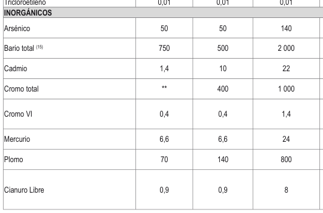

# DS_011-2017-MINAM Estándares de Calidad Ambiental para Suelo

> **Fuente:** `DS_011-2017-MINAM Estándares de Calidad Ambiental para Suelo.pdf`. Conversión de PDF a Markdown conservando el texto, la división por páginas y las tablas detectables. Esta transcripción automatizada no verifica vigencia normativa ni reemplaza el documento oficial.

<!-- Página original del PDF: 1 de 4 -->

Que, de conformidad con lo previsto en el artículo 14 del Reglamento que establece disposiciones relativas a la Publicidad, Publicación de Proyectos Normativos y Difusión de Normas Legales de Carácter General, aprobado por Decreto Supremo N° 001-2009-JUS, y el artículo 39 del Reglamento sobre Transparencia, Acceso a la Información Pública Ambiental y Participación y Consulta Ciudadana en Asuntos Ambientales, aprobado por Decreto Supremo N° 002-2009-MINAM; corresponde disponer la publicación de la propuesta de metodología en el Diario Oficial El Peruano, antes de la fecha prevista para su entrada en vigencia, con la finalidad de permitir a las personas interesadas formular los comentarios y aportes respectivos; Con los vistos de la Secretaría General, la Dirección de Gestión de Calidad de los Recursos Hídricos, la Oficina de Asesoría Jurídica, y en uso de las facultades conferidas en la Ley de Recursos Hídricos, el Reglamento de Organización y Funciones de esta autoridad, aprobado por Decreto Supremo N° 06-2010-AG, y modificado por Decreto Supremo N° 012-2016-MINAGRI;

## SE RESUELVE:

### Artículo 1.- Dispóngase la publicación de la presente

resolución en el Diario Oficial El Peruano y del documento denominado “Metodología para la determinación del índice de calidad de agua para los recursos hídricos superficiales en el Perú ICA-PE”, en el portal web de la Autoridad Nacional del Agua: www.ana.gob.pe, por el plazo de quince (15) días hábiles, a fin que los interesados remitan sus opiniones y sugerencias a la dirección electrónica siguiente: IndiceCalidadAgua@ana.gob.pe.

### Artículo 2.- Encargar a la Dirección de Gestión de

Calidad de los Recursos Hídricos, la recepción y análisis de los aportes y comentarios que se presenten respecto al documento citado en el artículo precedente. Regístrese, comuníquese y publíquese,

## ABELARDO DE LA TORRE VILLANUEVA

Jefe Autoridad Nacional del Agua

1593024-1

## AMBIENTE

Aprueban Estándares de Calidad Ambiental (ECA) para Suelo

Decreto Supremo

## N° 011-2017-MINAM

## EL PRESIDENTE DE LA REPÚBLICA

## REQUISITO PARA PUBLICACIÓN DE

## NORMAS LEGALES Y SENTENCIAS

## CONSIDERANDO:

Que, el numeral 22 del artículo 2 de la Constitución Política del Perú establece que toda persona tiene derecho a gozar de un ambiente equilibrado y adecuado al desarrollo de su vida; Que, de acuerdo con lo establecido en el artículo 3 de la Ley N° 28611, Ley General del Ambiente, en adelante la Ley, el Estado, a través de sus entidades y órganos correspondientes, diseña y aplica, entre otros, las normas que sean necesarias para garantizar el efectivo ejercicio de los derechos y el cumplimiento de las obligaciones y responsabilidades contenidas en la Ley; Que, el numeral 31.1 del artículo 31 de la Ley define al Estándar de Calidad Ambiental (ECA) como la medida que establece el nivel de concentración o del grado de elementos, sustancias o parámetros físicos, químicos y biológicos, presentes en el aire, agua o suelo, en su condición de cuerpo receptor, que no representa riesgo significativo para la salud de las personas ni al ambiente; asimismo, el numeral 31.2 del artículo 31 de la Ley establece que el ECA es obligatorio en el diseño de las normas legales y las políticas públicas, así como un referente obligatorio en el diseño y aplicación de todos los instrumentos de gestión ambiental; Que, según lo dispuesto en el numeral 33.1 del artículo 33 de la Ley, la Autoridad Ambiental Nacional dirige el proceso de elaboración y revisión de ECA y, en coordinación con los sectores correspondientes, elabora o encarga las propuestas de ECA, las que serán remitidas a la Presidencia del Consejo de Ministros para su aprobación mediante decreto supremo; Que, en virtud a lo dispuesto por el numeral 33.4 del artículo 33 de la Ley, en el proceso de revisión de los parámetros de contaminación ambiental, con la finalidad de determinar nuevos niveles de calidad, se aplica el principio de gradualidad, permitiendo ajustes progresivos a dichos niveles para las actividades en curso; Que, de conformidad con el literal d) del artículo 7 del Decreto Legislativo N° 1013, que aprueba la Ley de Creación, Organización y Funciones del Ministerio del Ambiente, esta entidad tiene como función específica elaborar los ECA, los cuales deberán contar con la opinión del sector correspondiente y ser aprobados mediante decreto supremo; Que, mediante Decreto Supremo N° 002-2013-MINAM se aprueban los ECA para Suelo y, a través del Decreto Supremo N° 002-2014-MINAM se aprueban las disposiciones complementarias para su aplicación; Que, asimismo, mediante Decreto Supremo N° 013-2015-MINAM se dictan las reglas para la presentación y evaluación del Informe de Identificación de Sitios Contaminados; Que, mediante Resolución Ministerial Nº 331-2016-MINAM se crea el Grupo de Trabajo encargado

Se comunica a las entidades que conforman el Poder Legislativo, Poder Ejecutivo, Poder Judicial, Organismos constitucionales autónomos, Organismos Públicos, Gobiernos Regionales y Gobiernos Locales, que para efectos de la publicación de sus disposiciones en general (normas legales, reglamentos jurídicos o administrativos, resoluciones administrativas, actos de administración, actos administrativos, etc) con o sin anexos, que contengan más de una página, se adjuntará un CD o USB en formato Word con su contenido o éste podrá ser remitido al correo electrónico normaslegales@editoraperu.com.pe.

## LA DIRECCIÓN

---

<!-- Página original del PDF: 2 de 4 -->

de establecer medidas para optimizar la calidad ambiental, siendo una de sus funciones específicas, analizar y proponer medidas para mejorar la calidad ambiental del país; Que, en mérito a la evaluación técnica realizada por el citado Grupo de Trabajo, se identificó la necesidad de actualizar los ECA para Suelo; Que, mediante Resolución Ministerial Nº 182-2017-MINAM, el Ministerio del Ambiente dispuso la prepublicación del proyecto de Decreto Supremo que aprueba los ECA para Suelo, en cumplimiento del artículo 39 del Reglamento sobre Transparencia, Acceso a la Información Pública Ambiental y Participación y Consulta Ciudadana en Asuntos Ambientales, aprobado por Decreto Supremo Nº 002-2009-MINAM, y el artículo 14 del Reglamento que establece disposiciones relativas a la publicidad, publicación de Proyectos Normativos y difusión de Normas Legales de Carácter General, aprobado por Decreto Supremo Nº 001- 2009-JUS; en virtud de la cual se recibieron aportes y comentarios al mismo; De conformidad con lo dispuesto en el numeral 8 del artículo 118 de la Constitución Política del Perú; la Ley Nº 29158, Ley Orgánica del Poder Ejecutivo; el Decreto Legislativo N° 1013, que aprueba la Ley de Creación, Organización, y Funciones del Ministerio del Ambiente; y la Ley N° 28611, Ley General del Ambiente;

## DECRETA:

### Artículo 1.- Aprobación de los Estándares de

Calidad Ambiental para Suelo Apruébase los Estándares de Calidad Ambiental (ECA) para Suelo, que como Anexo forman parte integrante del presente decreto supremo.

### Artículo 2.- Los Estándares de Calidad Ambiental

para Suelo como referente obligatorio Los ECA para Suelo constituyen un referente obligatorio para el diseño y aplicación de los instrumentos de gestión ambiental, y son aplicables para aquellos parámetros asociados a las actividades productivas, extractivas y de servicios.

### Artículo 3.- De la superación de los ECA para Suelo

De superarse los ECA para Suelo, en aquellos parámetros asociados a las actividades productivas, extractivas y de servicios, las personas naturales y jurídicas a cargo de estas deben realizar acciones de evaluación y, de ser el caso, ejecutar acciones de remediación de sitios contaminados, con la finalidad de proteger la salud de las personas y el ambiente. Lo indicado en el párrafo anterior no aplica cuando la superación de los ECA para Suelo sea inferior a los niveles de fondo, los cuales proporcionan información acerca de las concentraciones de origen natural de las sustancias químicas presentes en el suelo, que pueden incluir el aporte de fuentes antrópicas no relacionadas al sitio en evaluación.

### Artículo 4.- Refrendo

El presente decreto supremo es refrendado por la Ministra del Ambiente, la Ministra de Energía y Minas, el Ministro de Salud, el Ministro de Vivienda, Construcción y Saneamiento, el Ministro de la Producción, el Ministro de Transportes y Comunicaciones, y el Ministro de Agricultura y Riego.

## DISPOSICIONES

## COMPLEMENTARIAS FINALES

Primera.- Criterios para la gestión de sitios contaminados Mediante decreto supremo, a propuesta del Ministerio del Ambiente y en coordinación con los sectores competentes, se aprobarán los criterios para la gestión de sitios contaminados, los mismos que regulan las acciones señaladas en el artículo 3 del presente decreto supremo.

Segunda.- Aplicación del ECA para Suelo en los instrumentos de gestión ambiental aprobados La aplicación de los ECA para Suelo en los instrumentos de gestión ambiental aprobados, que sean de carácter preventivo, se realiza en la actualización o modificación de los mismos, en el marco de la normativa vigente del Sistema Nacional de Evaluación del Impacto Ambiental (SEIA). En el caso de instrumentos correctivos, la aplicación de los ECA para Suelo se realiza conforme a la normativa ambiental sectorial correspondiente.

## DISPOSICIONES COMPLEMENTARIAS

## TRANSITORIAS

Primera.- Instrumento de gestión ambiental en trámite ante la Autoridad Competente Los/as titulares que, antes de la entrada en vigencia de la presente norma, hayan iniciado un procedimiento administrativo para la aprobación del instrumento de gestión ambiental ante la autoridad competente, tomarán en consideración los ECA para Suelo vigentes a la fecha de inicio del procedimiento. Luego de aprobado el instrumento de gestión ambiental por la autoridad competente, los/as titulares deberán considerar lo establecido en la Segunda Disposición Complementaria Final, a efectos de aplicar los ECA para Suelo aprobados mediante el presente decreto supremo.

Segunda.- De los procedimientos en trámite para la adecuación de los instrumentos de gestión ambiental a los ECA Los procedimientos de adecuación de los instrumentos de gestión ambiental a los estándares de calidad ambiental (ECA), iniciados con anterioridad a la vigencia del presente decreto supremo, se resuelven conforme a las disposiciones normativas vigentes al momento de su inicio.

## DISPOSICIÓN

## COMPLEMENTARIA DEROGATORIA

Única.- Derogación Derógase el Decreto Supremo N° 002-2013-MINAM, que aprueba los Estándares de Calidad Ambiental (ECA) para Suelo, y el Decreto Supremo Nº 003-2014-MINAM, que aprueba la Directiva que establece el procedimiento de adecuación de los instrumentos de gestión ambiental a nuevos Estándares de Calidad Ambiental (ECA).

Dado en la Casa de Gobierno, en Lima, al primer día del mes de diciembre del año dos mil diecisiete.

## PEDRO PABLO KUCZYNSKI GODARD

Presidente de la República

José Manuel Hernández Calderón Ministro de Agricultura y Riego

Elsa Galarza Contreras Ministra del Ambiente

Cayetana Aljovín Gazzani Ministra de Energía y Minas PEDRO Olaechea Álvarez Calderón Ministro de la Producción Fernando Antonio D’Alessio Ipinza Ministro de Salud Bruno Giuffra Monteverde Ministro de Transportes y Comunicaciones Carlos Ricardo Bruce Montes de Oca Ministro de Vivienda, Construcción y Saneamiento

---

<!-- Página original del PDF: 3 de 4 -->

## ANEXO

Estándares de Calidad Ambiental (ECA) para Suelo

| Parámetros   en mg/kg PS(2) | Usos del Suelo(1) |  |  |
| --- | --- | --- | --- |
|  | Suelo Agrícola(3) | Suelo   Residencial/   Parques(4) | Suelo   Comercial(5)/   Industrial/   Extractivo(6) |

## ORGÁNICOS

Hidrocarburos aromáticos volátiles

EPA 8260(9)

| Benceno | 0,03 | 0,03 | 0,03 |
| --- | --- | --- | --- |
| Tolueno | 0,37 | 0,37 | 0,37 |
| Etilbenceno | 0,082 | 0,082 | 0,082 |
| Xilenos (10) | 11 | 11 | 11 |

EPA 8260

| Naftaleno | 0,1 | 0,6 | 22 |
| --- | --- | --- | --- |
| Benzo(a) pireno | 0,1 | 0,7 | 0,7 |

EPA 8015

| Fracción de hidrocarburos F1 (11) (C6-C10) | 200 | 200 | 500 |
| --- | --- | --- | --- |
| Fracción de hidrocarburos F2 (12)   (>C10-C28) | 1200 | 1200 | 5000 |
| Fracción de hidrocarburos F3 (13)   (>C28-C40) | 3000 | 3000 | 6000 |

| Bifenilos policlorados - PCB (14) | 0,5 | 1,3 | 33 |
| --- | --- | --- | --- |
| Tetracloroetileno | 0,1 | 0,2 | 0,5 |
| Tricloroetileno | 0,01 | 0,01 | 0,01 |

EPA 3050

| Arsénico | 50 | 50 | 140 |
| --- | --- | --- | --- |
| Bario total (15) | 750 | 500 | 2 000 |
| Cadmio | 1,4 | 10 | 22 |
| Cromo total | ** | 400 | 1 000 |
| Cromo VI | 0,4 | 0,4 | 1,4 |
| Mercurio | 6,6 | 6,6 | 24 |
| Plomo | 70 | 140 | 800 |
| Cianuro Libre | 0,9 | 0,9 | 8 |

Notas:

[**] Este símbolo dentro de la tabla significa que el parámetro no aplica para el uso de suelo agrícola. (1) Suelo: Material no consolidado compuesto por partículas inorgánicas, materia orgánica, agua, aire y organismos, que comprende desde la capa superior de la superficie terrestre hasta diferentes niveles de profundidad. (2) PS: Peso seco. (3) Suelo agrícola: Suelo dedicado a la producción de cultivos, forrajes y pastos cultivados. Es también aquel suelo con aptitud para el crecimiento de cultivos y el desarrollo de la ganadería. Esto incluye tierras clasificadas como agrícolas, que mantienen un hábitat para especies permanentes y transitorias, además de flora y fauna nativa, como es el caso de las áreas naturales protegidas.

(4) Suelo residencial/parques: Suelo ocupado por la población para construir sus viviendas, incluyendo áreas verdes y espacios destinados a actividades de recreación y de esparcimiento. (5) Suelo comercial: Suelo en el cual la actividad principal que se desarrolla está relacionada con operaciones comerciales y de servicios. (6) Suelo industrial/extractivo: Suelo en el cual la actividad principal que se desarrolla abarca la extracción y/o aprovechamiento de recursos naturales (actividades mineras, hidrocarburos, entre otros) y/o, la elaboración, transformación o construcción de bienes. (7) Métodos de ensayo estandarizados vigentes o métodos validados y que cuenten con la acreditación nacional e internacional correspondiente, en el marco del Acuerdo de Reconocimiento Mutuo de la International Laboratory Accreditation Cooperation (ILAC). Los métodos de ensayo deben contar con límites de cuantificación que estén por debajo del ECA

---

<!-- Página original del PDF: 4 de 4 -->

correspondiente al parámetro bajo análisis. (8) Para aquellos parámetros respecto de los cuales no se especifican los métodos de ensayo empleados para la determinación de las muestras, se deben utilizar métodos que cumplan con las condiciones señaladas en la nota (7). (9) EPA: Agencia de Protección Ambiental de los Estados Unidos (Environmental Protection Agency, por sus siglas en inglés). (10) Este parámetro comprende la suma de Xilenos: o-xileno, m-xileno y p-xileno. En el respectivo informe de ensayo se debe reportar la suma de los Xilenos, así como las concentraciones y límites de cuantificación de los tres (3) isómeros de manera individual. (11) Fracción de hidrocarburos F1 o fracción ligera: Mezcla de hidrocarburos cuyas moléculas contienen entre seis y diez átomos de carbono (C6 a C10). Los hidrocarburos de fracción ligera deben analizarse en los siguientes productos: mezcla de productos desconocidos derivados del petróleo, petróleo crudo, solventes, gasolinas, gas nafta, entre otros. (12) Fracción de hidrocarburos F2 o fracción media: Mezcla de hidrocarburos cuyas moléculas contienen mayor a diez y hasta veintiocho átomos de carbono (>C10 a C28). Los hidrocarburos fracción media deben analizarse en los siguientes productos: mezcla de productos desconocidos derivados del petróleo, petróleo crudo, gasóleo, diesel, turbosina, queroseno, mezcla de creosota, gasolvente, gasolinas, gas nafta, entre otros (13) Fracción de hidrocarburos F3 o fracción pesada: Mezcla de hidrocarburos cuyas moléculas contienen mayor a veintiocho y hasta cuarenta átomos de carbono (>C28 a C40). Los hidrocarburos fracción pesada deben analizarse en los siguientes productos: mezcla de productos desconocidos derivados del petróleo, petróleo crudo, parafinas, petrolatos, aceites del petróleo, entre otros. (14) Suma de siete PCB indicadores: PCB 28, PCB 52, PCB 101, PCB 118, PCB 138, PCB 153 y PCB 180. (15) De acuerdo con la metodología de Alberta Environment (2009): Soil remediation guidelines for barite: environmental health and human health. ISBN No. 978-0-7785-7691-4. En el caso de sitios con presencia de baritina se podrán aplicar los valores establecidos para Bario total real en la Tabla 1. Un sitio con presencia de baritina se determina cuando todas las muestras de suelo cumplen con los valores establecidos para Bario extraíble, de acuerdo con lo indicado en la tabla 1.

Tabla 1. Valores para bario en sitios con presencia de baritina(a)

| Parámetros   en mg/kg PS | Uso del suelo   Suelo   Suelo   Suelo Comercial(d)/   Residencial/   Agrícola(b) Industrial/   Parques(c)   Extractivo(e) |  |  |
| --- | --- | --- | --- |
|  |  | Suelo   Residencial/   Parques(c) | Suelo   Comercial(d)/   Industrial/   Extractivo(e) |
| Bario extraíble (f)   (Extractable Barium) | 250 | 250 | 450 |
| Bario total real   en sitios con presencia   baritina (g)   (True total Barium at Ba   Sites) | de   10 000   rite | 10 000 | 15 000 (h)   140 000 (i) |

Notas:

(a) A efectos de aplicar los valores establecidos para el Bario total, Bario extraíble o Bario total real en sitios con presencia de baritina, corresponde utilizar el procedimiento detallado por Alberta Environment (2009). Soil remediation guidelines for barite: environmental health and human health. ISBN Nº 978‑0‑7785-7691-4. Suelo agrícola: Suelo dedicado a la producción de cultivos, (b) forrajes y pastos cultivados. Es también aquel suelo con aptitud para el crecimiento de cultivos y el desarrollo de la ganadería. Esto incluye tierras clasificadas como agrícolas, que mantienen un hábitat para especies permanentes y transitorias, además de flora y fauna nativa, como es el caso de las áreas naturales protegidas Suelo residencial/parques: Suelo ocupado por la población (c) para construir sus viviendas, incluyendo áreas verdes y espacios destinados a actividades de recreación y de esparcimiento. Suelo comercial: Suelo en el cual la actividad principal que (d) se desarrolla está relacionada con operaciones comerciales y de servicios. Suelo industrial/extractivo: Suelo en el cual la actividad (e) principal que se desarrolla abarca la extracción y/o

aprovechamiento de recursos naturales (actividades mineras, hidrocarburos, entre otros) y/o, la elaboración, transformación o construcción de bienes. (f) Se determina mediante la medición en solución extractora 0,1 M CaCl2, de acuerdo con la metodología establecida por Alberta Environment (2009). Soil remediation guidelines for barite: environmental health and human health. ISBN Nº 978‑0‑7785-7691-4. (g) Valores aplicables en sitios que cumplen con las concentraciones de Bario extraíble. La concentración del Bario total real se determina mediante las técnicas de fusión XRF o por fusión ICP, de acuerdo con la metodología establecida por Alberta Environment (2009). Soil remediation guidelines for barite: environmental health and human health. ISBN Nº 978 0 7785-7691-4. (h) Suelo comercial. (i) Suelo industrial/extractivo.

(16) DIN: Instituto Alemán de Normalización (Deutsches Institut für Normung, por sus siglas en alemán).

1593392-5

Aprueban Criterios para la Gestión de Sitios Contaminados

## DECRETO SUPREMO

## N° 012-2017-MINAM

## EL PRESIDENTE DE LA REPÚBLICA

## CONSIDERANDO:

Que, el numeral 22 del artículo 2 de la Constitución Política del Perú, establece que toda persona tiene derecho a gozar de un ambiente equilibrado y adecuado al desarrollo de su vida; Que, el artículo I del Título Preliminar de la Ley N° 28611, Ley General del Ambiente, en adelante la Ley, señala que toda persona tiene el derecho irrenunciable a vivir en un ambiente saludable, equilibrado y adecuado para el pleno desarrollo de la vida, y el deber de contribuir a una efectiva gestión ambiental y de proteger el ambiente, así como sus componentes, asegurando particularmente la salud de las personas en forma individual y colectiva, la conservación de la diversidad biológica, el aprovechamiento sostenible de los recursos naturales y el desarrollo sostenible del país; Que, de acuerdo a lo establecido en el artículo 3 de la Ley, el Estado, a través de sus entidades y órganos correspondientes, diseña y aplica, entre otros, las normas que sean necesarias para garantizar el efectivo ejercicio de los derechos y el cumplimiento de las obligaciones y responsabilidades contenidas en la citada Ley; Que, en virtud del numeral 16.2 del artículo 16 de la Ley, los instrumentos de gestión ambiental constituyen medios operativos que son diseñados, normados y aplicados con carácter funcional o complementario para efectivizar el cumplimiento de la Política Nacional Ambiental y las normas ambientales que rigen en el país; Que, asimismo, según lo dispuesto por el numeral

17.2 del artículo 17 de la Ley, los planes de remediación constituyen un tipo de instrumento de gestión ambiental; Que, el numeral 30.1 del artículo 30 de la Ley, referido a los planes de descontaminación y el tratamiento de pasivos ambientales, señala que estos están dirigidos a remediar impactos ambientales originados por uno o varios proyectos de inversión o actividades, pasados o presentes; asimismo, precisa que los citados planes deben considerar el financiamiento y las responsabilidades que correspondan a los titulares de las actividades contaminantes, incluyendo la compensación por los daños generados, bajo el principio de responsabilidad ambiental; Que, de conformidad con el numeral 30.2 del artículo 30 de la Ley, las entidades con competencias ambientales promueven y establecen planes de descontaminación y recuperación de ambientes degradados, y la Autoridad Ambiental Nacional establece los criterios para su elaboración;
