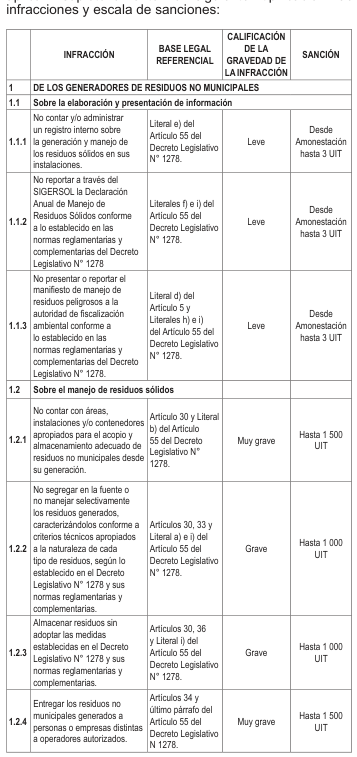
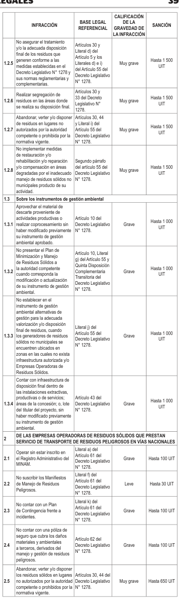
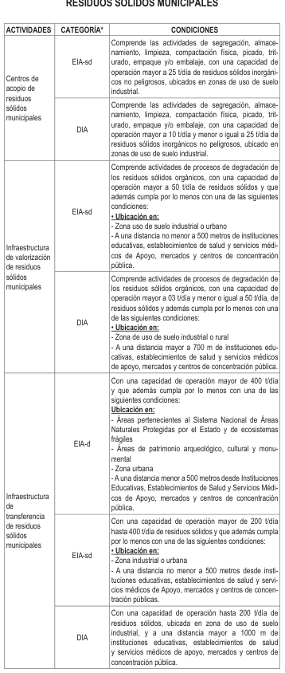
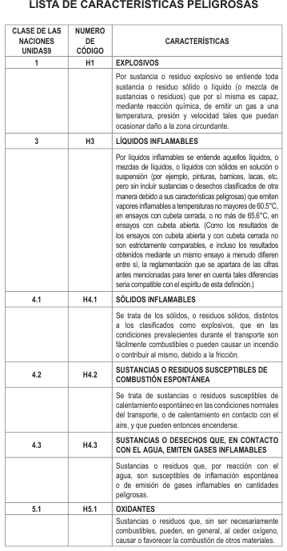
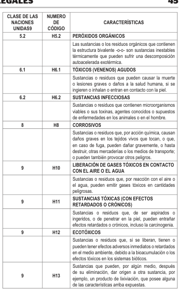

# DS 014-2017-MINAM Reglamento de la Ley de Gestión Integral de Residuos Sólidos

> **Fuente:** `DS 014-2017-MINAM Reglamento de la Ley de Gestión Integral de Residuos Sólidos.pdf`. Conversión de PDF a Markdown conservando el texto, la división por páginas y las tablas detectables. Esta transcripción automatizada no verifica vigencia normativa ni reemplaza el documento oficial.

<!-- Página original del PDF: 1 de 32 -->

de gestión correspondientes y las disposiciones complementarias necesarias, para la adecuada implementación de la presente norma.

Segunda.- Efectos presupuestales La aplicación del Reglamento de Organización y Funciones del Organismo de Evaluación y Fiscalización Ambiental (OEFA) se sujeta a su presupuesto institucional, sin demandar recursos adicionales al Tesoro Público.

Tercera.- Denominación Toda referencia en normas anteriores a las Oficinas y Direcciones que no formen parte del presente Reglamento de Organización y Funciones, deben identificarse con las nuevas Oficinas, Direcciones, Subdirecciones y Unidades de acuerdo a sus funciones.

## DISPOSICIÓN COMPLEMENTARIA DEROGATORIA

Única.- Derogación Deróguese el Decreto Supremo N° 022-2009-MINAM, que aprueba el Reglamento de Organización y Funciones del Organismo de Evaluación y Fiscalización Ambiental - OEFA.

Dado en la Casa de Gobierno, en Lima, a los veinte días del mes de diciembre del año dos mil diecisiete.

## PEDRO PABLO KUCZYNSKI GODARD

Presidente de la República

## ELSA GALARZA CONTRERAS

Ministra del Ambiente

1599656-6

Aprueban Reglamento del Decreto Legislativo N° 1278, Decreto Legislativo que aprueba la Ley de Gestión Integral de Residuos Sólidos

## DECRETO SUPREMO

## N° 014-2017-MINAM

## EL PRESIDENTE DE LA REPÚBLICA

## CONSIDERANDO:

Que, el numeral 22 del artículo 2 de la Constitución Política del Perú establece que toda persona tiene derecho a gozar de un ambiente equilibrado y adecuado al desarrollo de su vida; Que, conforme a lo dispuesto por el artículo I del Título Preliminar de la Ley Nº 28611, Ley General del Ambiente, toda persona tiene el derecho irrenunciable a vivir en un ambiente saludable, equilibrado y adecuado para el pleno desarrollo de la vida, y el deber de contribuir a una efectiva gestión ambiental y de proteger el ambiente, así como sus componentes, asegurando particularmente la salud de las personas en forma individual y colectiva, la conservación de la diversidad biológica, el aprovechamiento sostenible de los recursos naturales y el desarrollo sostenible del país; Que, el artículo 3 de la citada Ley señala que el Estado, a través de sus entidades y órganos correspondientes, diseña y aplica, las políticas, normas, instrumentos, incentivos y sanciones que sean necesarios para garantizar el efectivo ejercicio de los derechos y el cumplimiento de las obligaciones y responsabilidades contenidos en la referida Ley; Que, de acuerdo al literal k) del artículo 7 del Decreto Legislativo Nº 1013, Ley de Creación, Organización y Funciones del Ministerio del Ambiente, esta entidad tiene como función específica promover y coordinar la adecuada gestión de residuos sólidos; Que, a través del Decreto Legislativo N° 1278, se aprueba la Ley de Gestión Integral de Residuos Sólidos, la cual tiene como objeto establecer derechos, obligaciones, atribuciones y responsabilidades de la sociedad en su conjunto, con la finalidad de propender

hacia la maximización constante de la eficiencia en el uso de los materiales y asegurar una gestión y manejo de los residuos sólidos económica, sanitaria y ambientalmente adecuada, con sujeción a las obligaciones, principios y lineamientos señalado en ella; Que, de acuerdo a lo dispuesto por la Novena Disposición Complementaria Final del referido Decreto Legislativo, mediante decreto supremo, en coordinación con los sectores competentes, se aprobará el Reglamento del mismo en un plazo no mayor de ciento ochenta (180) días calendario, contados desde del día siguiente de la fecha de su publicación; Que, mediante Resolución Ministerial N° 174-2017-MINAM, el Ministerio del Ambiente dispuso la prepublicación del Proyecto de Decreto Supremo que aprueba el Reglamento de la Ley de Gestión Integral de Residuos Sólidos, en el Portal Institucional del Ministerio del Ambiente, en virtud de la cual se recibieron aportes y comentarios al mismo; De conformidad con lo dispuesto en el numeral 8 del artículo 118 de la Constitución Política del Perú; el numeral 3 del artículo 11 de la Ley Nº 29158, Ley Orgánica del Poder Ejecutivo; la Ley N° 28611, Ley General del Ambiente; y, el Decreto Legislativo N° 1278, Ley de Gestión Integral de Residuos Sólidos;

## DECRETA:

### Artículo 1.- Aprobación del Reglamento del

Decreto Legislativo N° 1278 que aprueba la Ley de Gestión Integral de Residuos Sólidos Apruébese el Reglamento del Decreto Legislativo N° 1278, que aprueba la Ley de Gestión Integral de Residuos Sólidos, cuyo texto está compuesto de trece

(13) Títulos, ciento treinta y seis (136) Artículos, catorce

(14) Disposiciones Complementarias Finales, seis (06) Disposiciones Complementarias Transitorias, una (01) Disposición Complementaria Derogatoria y cinco (05) Anexos, los cuales forman parte integrante del presente Decreto Supremo.

### Artículo 2.- Publicación

Disponer la publicación del presente Decreto Supremo, el Reglamento aprobado por el artículo precedente y sus Anexos en el Portal del Estado Peruano (www.peru.gob.pe) y en el Portal Institucional del Ministerio del Ambiente (www.minam.gob.pe), el mismo día de la publicación de la presente norma en el Diario Oficial “El Peruano”.

### Artículo 3.- Financiamiento

El financiamiento de la presente norma se realiza con cargo al presupuesto institucional de los pliegos involucrados, sin demandar recursos adicionales del Tesoro Público.

### Artículo 4.- Refrendo

El presente Decreto Supremo es refrendado por la Ministra del Ambiente, la Ministra de Energía y Minas, la Ministra de Economía y Finanzas, el Ministro de la Producción, el Ministro de Transportes y Comunicaciones, el Ministro de Vivienda, Construcción y Saneamiento, el Ministro de Salud y el Ministro de Agricultura y Riego.

Dado en la Casa de Gobierno, en Lima, a los veinte días del mes de diciembre del año dos mil diecisiete.

## PEDRO PABLO KUCZYNSKI GODARD

Presidente de la República

## ELSA GALARZA CONTRERAS

Ministra del Ambiente

## CAYETANA ALJOVÍN GAZZANI

Ministra de Energía y Minas

## CLAUDIA MARÍA COOPER FORT

Ministra de Economía y Finanzas

## PEDRO OLAECHEA ÁLVAREZ CALDERÓN

Ministro de la Producción

---

<!-- Página original del PDF: 2 de 32 -->

## BRUNO GIUFFRA MONTEVERDE

Ministro de Transportes y Comunicaciones

## CARLOS RICARDO BRUCE MONTES DE OCA

Ministro de Vivienda, Construcción y Saneamiento

## FERNANDO ANTONIO D’ALESSIO IPINZA

Ministro de Salud

## JOSÉ MANUEL HERNÁNDEZ CALDERÓN

Ministro de Agricultura y Riego

## REGLAMENTO DEL DECRETO LEGISLATIVO

## N° 1278, LEY DE GESTIÓN INTEGRAL

## DE RESIDUOS SÓLIDOS

## TÍTULO I

## DISPOSICIONES GENERALES

### Artículo 1.- Objeto

El presente dispositivo normativo tiene como objeto reglamentar el Decreto Legislativo N° 1278, Ley de Gestión Integral de Residuos Sólidos, a fin de asegurar la maximización constante de la eficiencia en el uso de materiales, y regular la gestión y manejo de residuos sólidos, que comprende la minimización de la generación de residuos sólidos en la fuente, la valorización material y energética de los residuos sólidos, la adecuada disposición final de los mismos y la sostenibilidad de los servicios de limpieza pública.

### Artículo 2.- Definiciones

Para la aplicación de lo dispuesto en el presente Reglamento deben considerarse las definiciones establecidas en el Anexo del Decreto Legislativo N° 1278 y las contenidas en el Anexo I del presente dispositivo normativo.

## TÍTULO II

## EFICIENCIA DE MATERIALES, MATERIAL DE

## DESCARTE Y MINIMIZACIÓN EN LA FUENTE

### Artículo 3.- Promoción de la eficiencia en el uso

de materiales Los sectores que en el marco del Sistema Nacional de Evaluación de Impacto Ambiental – SEIA tienen bajo su ámbito de competencia el desarrollo y promoción de actividades extractivas, productivas o de servicios, establecerán disposiciones orientadas a alcanzar el uso eficiente de las materias primas e insumos en dichas actividades, en coordinación con el MINAM, con la finalidad de reducir los impactos ambientales negativos durante el ciclo de vida del producto.

### Artículo 4.- Material de descarte proveniente de

actividades productivas Se considera material de descarte a todo material resultante de los procesos de las actividades productivas de bienes y servicios, siempre que constituya un insumo directamente aprovechable en la misma actividad, otras actividades productivas, la investigación y el desarrollo de nuevas tecnologías y materiales a nivel nacional.

### Artículo 5.- Regla para el aprovechamiento del

material de descarte Los titulares de actividades productivas que posean material de descarte y aquellos que lo utilicen deben, previamente a su aprovechamiento, incluir los cambios que este implique en el Instrumento de Gestión Ambiental (IGA) aprobado ante su autoridad competente, de conformidad con las normas del SEIA y sus normas complementarias. En caso los titulares de las actividades productivas, a que se refiere el párrafo precedente, requieran realizar procesos complementarios para aprovechar el material de descarte, estos deben ser realizados dentro de sus instalaciones industriales o productivas, áreas de la concesión o lote del titular.

### Artículo 6.- Transporte del material de descarte

El material de descarte se transporta bajo cualquier modalidad, desde el lugar de su generación hacia las instalaciones de la actividad productiva donde se aprovechará, sin que le sea aplicable la normativa sobre residuos sólidos. El transporte de material de descarte debe regirse según la normativa que regula el transporte de mercancías o materiales, establecida por el Ministerio de Transportes y Comunicaciones (MTC) y otras entidades competentes, según corresponda.

### Artículo 7.- Minimización en la fuente

Los generadores de residuos sólidos orientan el desarrollo de sus actividades a reducir al mínimo posible la generación de residuos sólidos. Los generadores de residuos no municipales deben incluir en su Plan de Minimización y Manejo de Residuos Sólidos, estrategias preventivas orientadas a alcanzar la minimización en la fuente. Dicho Plan forma parte del IGA.

## TÍTULO III

## INSTRUMENTOS DE GESTIÓN EN MATERIA

## DE RESIDUOS SÓLIDOS

## CAPITULO I

## INSTRUMENTOS PARA EL USO EFICIENTE

## DE MATERIALES Y LA GESTIÓN DE

## RESIDUOS SÓLIDOS

### Artículo 8.- Instrumentos

Los instrumentos para el uso eficiente de materiales y la gestión de residuos sólidos son aquellos detallados en el artículo 7 del Decreto Legislativo N° 1278.

### Artículo 9.- Plan Nacional de Gestión Integral de

Residuos Sólidos (PLANRES) El PLANRES es un instrumento nacional para la Gestión Integral de Residuos Sólidos basados en el cumplimiento de metas establecidas en el Plan Nacional de Acción Ambiental (PLANAA) y los compromisos internacionales relacionados a la materia. Los objetivos del PLANRES se encuentran dirigidos a contribuir con la protección de la salud de las personas y mejorar la calidad ambiental a nivel nacional. Dicho Plan se aprueba por Decreto Supremo, a propuesta del MINAM, con el refrendo de los sectores involucrados. El PLANRES se actualiza cada cinco (05) años, en base al análisis del cumplimiento de sus objetivos específicos y metas.

### Artículo 10.- Planes de Gestión de Residuos

Sólidos Municipales El Plan Provincial de Gestión de Residuos Sólidos Municipales y el Plan Distrital de Manejo de Residuos Sólidos Municipales son instrumentos de planificación en materia de residuos sólidos de gestión municipal. Estos instrumentos tienen por objetivo generar las condiciones necesarias para una adecuada, eficaz y eficiente gestión y manejo de los residuos sólidos, desde la generación hasta la disposición final. Los Planes a que se refiere el párrafo anterior deben estar alineados al PLANRES. Dichos planes se actualizan cada cinco (05) años y deben contener como mínimo lo siguiente:

a) Diagnóstico de la situación del manejo de los residuos sólidos de gestión municipal, que identifique los aspectos críticos y potencialidades del sistema de la gestión y manejo de residuos sólidos municipales. En el caso del Plan Provincial debe de incluirse el diagnóstico de todos los distritos que integran la misma, incluyendo información sobre la presencia de pueblos indígenas u originarios, de corresponder; y, el ámbito sobre el cual la Municipalidad Provincial tiene competencia para proveer el servicio de limpieza pública. Asimismo, el Plan Provincial debe incluir la identificación de infraestructuras de residuos sólidos de gestión municipal que se requieren a nivel Provincial.

b) Objetivos estratégicos, metas y un plan de acción, donde se precisen las actividades, responsables,

---

<!-- Página original del PDF: 3 de 32 -->

indicadores, cronograma de implementación para mejorar la gestión y manejo de residuos sólidos en toda la jurisdicción. En el caso de la provincia, el plan de acción debe incluir a todos sus distritos. Asimismo, el Plan Provincial debe incluir la propuesta de infraestructuras de residuos sólidos municipales que se requieren a nivel Provincial y su potencial ubicación.

c) Mecanismos y actividades de seguimiento y evaluación de avances y resultados.

Las municipalidades provinciales y distritales, en el último día hábil del mes de marzo de cada año, presentan ante el MINAM y al Organismo de Evaluación y Fiscalización Ambiental (OEFA) el reporte de las actividades ejecutadas el año anterior en el marco de los Planes de Gestión de Residuos Sólidos Municipales, conforme al formato que establezca el MINAM a través de la Dirección General de Gestión de Residuos Sólidos en la guía técnica de formulación de los planes de gestión de residuos sólidos municipales. Los planes de gestión de residuos sólidos municipales deben formularse conforme a las guías técnicas que emita el MINAM.

### Artículo 11.- Programa de Segregación en la

Fuente y Recolección Selectiva de Residuos Sólidos El Programa de Segregación en la Fuente y Recolección Selectiva de Residuos Sólidos es un instrumento técnico elaborado por las municipalidades, a través del cual se formulan estrategias para la segregación en fuente y el diseño de la recolección selectiva de los residuos sólidos generados en su jurisdicción, teniendo en consideración un enfoque que incluya la participación de las organizaciones de recicladores formalizados.

### Artículo 12.- Acuerdo de Producción Limpia

Los Acuerdos de Producción Limpia son instrumentos de promoción que tienen como objetivo introducir en las actividades productivas un conjunto de acciones que trasciendan el cumplimiento de la legislación vigente, de modo que se mejore las condiciones en las cuales el titular realiza sus actividades, a fin de lograr la prevención o minimización de la generación de los residuos sólidos. Los titulares de las actividades productivas, extractivas y de servicios pueden suscribir voluntariamente Acuerdos de Producción Limpia en materia de residuos sólidos con el MINAM y/o la autoridad competente, de corresponder. Dicho acuerdo no sustituye las obligaciones que establece la normatividad ambiental. Las autoridades sectoriales promueven el otorgamiento de incentivos para los titulares de actividades productivas, extractivas y de servicios que suscriban estos acuerdos; sin perjuicio de las competencias de las entidades de fiscalización ambiental en la materia. El OEFA, en el marco de la normativa vigente y conforme a sus competencias, puede otorgar incentivos por el cumplimiento de los Acuerdos de Producción Limpia.

### Artículo 13.- Registro de Información en el Sistema

de Información para la Gestión de Residuos sólidos

## (SIGERSOL)

El MINAM administra el SIGERSOL con el propósito de facilitar el registro, procesamiento y difusión de la información sobre el manejo y gestión de los residuos sólidos, en el marco del Sistema Nacional de Información Ambiental (SINIA). Las autoridades competentes tienen libre acceso a la información que se registra en el SIGERSOL a efectos de realizar acciones de gestión y ejercer sus funciones de fiscalización en materia de residuos sólidos. Las municipalidades, Empresas Operadoras de Residuos Sólidos (EO-RS) y generadores del ámbito no municipal están obligados a registrar información en materia de residuos sólidos en el SIGERSOL, conforme a lo siguiente:

a) Las municipalidades provinciales y distritales reportan información correspondiente al año anterior sobre la gestión y manejo de los residuos sólidos del ámbito municipal, hasta el último día hábil del mes de febrero de cada año;

b) Las EO-RS deben presentar el Informe de Operador sobre el manejo de residuos sólidos trimestralmente, con datos mensualizados;

c) El generador de residuos sólidos no municipales debe reportar la Declaración Anual sobre Minimización y Gestión de Residuos Sólidos No Municipales sobre el manejo de residuos sólidos correspondiente al año anterior, durante los quince (15) primeros días hábiles del mes de abril de cada año; y el Manifiesto de Residuos Sólidos Peligrosos durante los quince (15) primeros días hábiles de cada trimestre, en cumplimiento a las obligaciones establecidas en los literales g) y h) del

### artículo 48.1 del presente Reglamento.

El MINAM consolida la información recabada y presenta sus resultados a través del Informe Nacional sobre el Estado del Ambiente en el Perú, el mismo que es puesto a disposición de la ciudadanía a través de su portal institucional. Sobre la base de la información reportada por las municipalidades y las EO-RS con relación a la generación, composición y disposición final de residuos sólidos municipales, el SIGERSOL emite un reporte de las emisiones y reducciones de gases efecto invernadero del sector residuos sólidos, el cual constituye un insumo para la elaboración de Inventario Nacional de Gases Efecto Invernadero, a través del INFOCARBONO. Toda iniciativa vinculada a los residuos sólidos que sea parte de la Contribución Nacionalmente Determinada (NDC) y que genere una reducción de emisiones de Gases de Efecto Invernadero, debe reportase al MINAM en el marco del monitoreo, reporte y verificación de la NDC.

### Artículo 14.- Inventario Nacional de Áreas Degradadas por Residuos Sólidos El OEFA elabora y administra el Inventario Nacional de Áreas Degradadas por Residuos Sólidos Municipales. Para tal efecto categoriza las áreas degradadas para su reconversión o recuperación a través de las siguientes acciones:

a) Sistematiza la información obtenida en el ejercicio de sus funciones;

b) Sistematiza la información remitida por los gobiernos regionales y las municipalidades sobre áreas degradadas por residuos sólidos;

c) Identifica y categoriza las áreas degradadas de acuerdo a lo establecido por el MINAM.

Las áreas degradadas por residuos sólidos municipales son aquellos lugares donde se realiza o se ha realizado la acumulación permanente de residuos sólidos municipales sin las consideraciones técnicas establecidas en el Capítulo V del Título IX del presente Reglamento y/o sin contar con autorización.

## CAPITULO II

## INSTRUMENTOS DE GESTIÓN AMBIENTAL DE

## INFRAESTRUCTURAS DE RESIDUOS SÓLIDOS

### Artículo 15.- Requisitos para la presentación de

los instrumentos de gestión ambiental de proyectos de inversión de infraestructura de residuos sólidos Todo proyecto de inversión de infraestructura de residuos sólidos debe contar con un instrumento de gestión ambiental (IGA) aprobado por el SENACE, el Gobierno Regional o la Municipalidad Provincial, según corresponda, en el marco de las normas del SEIA. Los titulares de dichos proyectos, en concordancia con lo establecido en las normas del SEIA, deben presentar el IGA para evaluación, adjuntando los siguientes requisitos de admisibilidad:

a) Formulario o solicitud dirigida a la autoridad competente que contenga la siguiente información:

- Datos del titular del proyecto referidos a razón social de la empresa o nombre de la entidad.

- Número del RUC de la empresa, o de la entidad.

---

<!-- Página original del PDF: 4 de 32 -->

- Nombre del Titular o Representante Legal de la empresa o entidad.

- Número del Documento Nacional de Identidad (DNI) del Titular o Representante Legal

- Número de la partida registral y asiento de inscripción en la Superintendencia Nacional de Registros Públicos – SUNARP de la empresa o de la entidad, según corresponda.

- Declaración jurada indicando la autenticidad de los documentos presentados en copia simple, de conformidad con lo establecido en el artículo 47 del Texto Único Ordenado de la Ley N° 27444, Ley del Procedimiento Administrativo General.

b) Pago por derecho de tramitación;

c) Un (01) ejemplar impreso del IGA o un (01) ejemplar en formato electrónico, suscrito por las/os profesionales responsables cuyo contenido debe ser desarrollado conforme a lo establecido en los Términos de Referencia aprobados, según corresponda;

d) Copia simple del certificado de compatibilidad de uso del terreno, otorgado por la Municipalidad Provincial correspondiente, de conformidad con lo establecido en el literal b) del artículo 23 del Decreto Legislativo N° 1278, que considere la ubicación y coordenadas del área del polígono del proyecto; solo en los casos en los que el SENACE o el Gobierno Regional sean la autoridad competente para la aprobación de los IGA. Cuando el IGA sea presentado a la Municipalidad Provincial, el titular del proyecto debe indicar en la solicitud el número del documento que otorga el certificado de compatibilidad de uso del terreno;

e) Copia simple del Certificado de Inexistencia de Restos Arqueológicos (CIRA), otorgado por la autoridad competente; según corresponda, de acuerdo a las normas sobre la materia, que considere la ubicación y coordenadas del área del polígono del proyecto;

Adicionalmente, en el caso de infraestructuras de disposición final, son requisitos de admisibilidad para la evaluación del IGA la presentación de los siguientes documentos:

f) Informe de Evaluación de Riesgos de desastres (derrumbes, inundaciones, deslizamientos, etc.), respecto a la ubicación del proyecto, elaborado por un/a profesional inscrito/a en el Registro Nacional de Evaluadores de Riesgo administrado por el Centro Nacional de Estimación, Prevención y Reducción del Riesgo de Desastres (CENEPRED).

g) Estudios topográficos, geológicos, geotécnicos, hidrológicos e hidrogeológicos del área de influencia del proyecto, suscritos por las/os profesionales responsables en dichas materias.

En el caso de proyectos nuevos de instalaciones industriales o productivas, que contemplen dentro de sus instalaciones, áreas de concesión o lote del titular, la implementación de infraestructuras para el manejo de residuos sólidos provenientes de sus actividades, dichas infraestructuras son evaluadas como parte de su IGA por las autoridades competentes.

### Artículo 16.- Clasificación de acuerdo al riesgo

ambiental Los titulares de proyectos de inversión de infraestructura de residuos sólidos que se encuentren sujetos al SEIA bajo la competencia de los Gobiernos Regionales o Municipalidades Provinciales deben presentar los IGA de acuerdo a la categoría señalada en la clasificación anticipada establecida en el Anexo II del presente Reglamento y los respectivos términos de referencia para los proyectos con características comunes y similares. Los titulares de proyectos de inversión de infraestructura de residuos sólidos que no se encuentren considerados dentro de la clasificación anticipada señalada en el párrafo anterior, deben solicitar la clasificación de su proyecto a través de la presentación de una Evaluación Ambiental Preliminar ante la autoridad competente. Para tal efecto, se tendrá en cuenta lo establecido en el Anexo

VI del Reglamento de la Ley del Sistema Nacional de Evaluación de Impacto Ambiental, aprobado mediante Decreto Supremo N° 019-2009-MINAM.

### Artículo 17.- Modificación de Instrumento de

Gestión Ambiental Los titulares de las actividades productivas, extractivas y de servicios que decidan implementar infraestructuras para el manejo de residuos sólidos provenientes de sus actividades dentro de sus instalaciones, áreas de concesión o lote del titular, deben modificar previamente su IGA aprobado ante la autoridad competente, de conformidad con las normas del SEIA y sus normas complementarias. En caso la modificación del IGA proponga la valorización de residuos que incluya operaciones de coprocesamiento, se debe incluir como parte del capítulo de descripción del proyecto los resultados del Monitoreo de Pruebas (Trial Burn) que certifican el cumplimiento de los parámetros de emisión establecidos para el coprocesamiento a nivel internacional, en tanto no se cuente con normativa nacional que los regule.

### Artículo 18.- Proyectos de inversión no comprendidos en el SEIA Los titulares de los proyectos de inversión de infraestructura de residuos sólidos no comprendidos en el marco del SEIA, deben cumplir con las normas generales emitidas para la gestión integral de residuos sólidos, recursos hídricos, efluentes, emisiones, ruidos, suelos, conservación del patrimonio natural y cultural, zonificación, construcción y otras normas ambientales que pudieran corresponder; y están obligados a presentar la información que establezca el MINAM en los plazos y condiciones que éste determine mediante Resolución Ministerial, para su presentación a la autoridad competente para la fiscalización correspondiente.

## TÍTULO IV

## GESTIÓN INTEGRAL DE RESIDUOS SÓLIDOS

## MUNICIPALES

## CAPÍTULO I

## SEGREGACIÓN Y ALMACENAMIENTO EN LA

## FUENTE DE RESIDUOS SÓLIDOS MUNICIPALES

### Artículo 19.- Segregación en la fuente

El generador de residuos municipales debe realizar la segregación de sus residuos sólidos de acuerdo a sus características físicas, químicas y biológicas, con el objeto de facilitar su valorización y/o disposición final. Dicha actividad solo está permitida en la fuente de generación, centros de acopio de residuos sólidos municipales y plantas de valorización de residuos sólidos municipales y no municipales, debidamente autorizados y que cuenten con certificación ambiental, según corresponda. Las municipalidades deben regular el proceso de segregación de residuos sólidos municipales en la fuente en su jurisdicción, en el marco del Programa de Segregación en la Fuente y Recolección Selectiva de Residuos Sólidos.

### Artículo 20.- Almacenamiento en la fuente

El almacenamiento debe ser efectuado por el generador de residuos sólidos municipales, de acuerdo a las características particulares de los residuos sólidos y diferenciando los peligrosos, con la finalidad de evitar daños a los operarios del servicio de limpieza pública durante las operaciones de recolección y transporte de residuos sólidos. Las municipalidades deben regular en su jurisdicción el almacenamiento de residuos sólidos municipales, teniendo en consideración, como mínimo, los siguientes aspectos:

a) Los recipientes de almacenamiento deben ser de material impermeable, liviano y resistente, de fácil manipulación, de modo que facilite su traslado hasta el vehículo recolector.

---

<!-- Página original del PDF: 5 de 32 -->

b) Los recipientes de preferencia deben ser retornables y de fácil limpieza, a fin de reducir su impacto negativo sobre el ambiente y la salud humana.

## CAPÍTULO II

## PRESTACIÓN DEL SERVICIO DE LIMPIEZA PÚBLICA

## A CARGO DE LAS MUNICIPALIDADES

## SUB CAPÍTULO 1

## ASPECTOS GENERALES

### Artículo 21.- Aspectos generales

Las municipalidades son responsables de brindar el servicio de limpieza pública, el cual comprende el barrido, limpieza y almacenamiento en espacios públicos, la recolección, el transporte, la transferencia, valorización y disposición final de los residuos sólidos, en el ámbito de su jurisdicción. El MINAM aprueba las normas complementarias que regulan los aspectos técnicos del referido servicio, las mismas que serán de cumplimiento obligatorio.

### Artículo 22.- Servicio de limpieza pública

El servicio de limpieza pública puede realizarse directamente por la municipalidad o a través de una EO-RS. En este último caso, podrá desarrollarse bajo las modalidades previstas en el Decreto Legislativo N° 1224, Decreto Legislativo que aprueba la Ley Marco de la Promoción de la Inversión Privada mediante Asociaciones Públicos Privadas y Proyectos en Activos y su Reglamento. En cualquiera de los casos, la municipalidad debe garantizar que la prestación del servicio de limpieza pública se realice de manera continua, regular, permanente y obligatoria, asegurando su calidad y cobertura en toda la jurisdicción; asimismo, que el personal operativo cuente con herramientas, equipos, insumos, implementos de seguridad y de protección personal; así como el cumplimiento de las disposiciones sobre seguridad y salud en el trabajo.

### Artículo 23.- Contratos para la prestación del

servicio de limpieza pública Los contratos de concesión o prestación del servicio de limpieza pública, que suscriban las municipalidades con las EO-RS deben contemplar, como mínimo, los siguientes aspectos:

a) Ámbito de la prestación del servicio;

b) Plazo de vigencia del contrato que asegure la sostenibilidad y continuidad del servicio;

c) Mecanismos de retribución;

d) Parámetros de calidad técnica, sanitaria y ambiental del servicio objeto del contrato;

e) Medidas para la atención de contingencias que pongan en riesgo la continuidad y calidad del servicio;

f) Penalidades por incumplimiento del contrato;

g) Garantías que ofrecen las partes para el cumplimiento de sus obligaciones;

h) Causales de resolución del contrato.

Los contratos que las municipalidades suscriban con las EO-RS constituyen información pública y deben ser difundidos a través del portal de transparencia de la entidad.

### Artículo 24.- Seguridad y salud en el trabajo del

personal que realiza operaciones para el manejo de residuos sólidos municipales Los aspectos relacionados con la seguridad y salud en el trabajo de las/os obreras/os municipales comprendidas/ os en el segundo párrafo del artículo 37 de la Ley N° 27792, Ley Orgánica de Municipalidades, del personal de las empresas contratistas de las Municipalidades y de las/os trabajadores que estas destaquen, que realizan operaciones para el manejo de residuos sólidos, se rigen por lo dispuesto en el Decreto Supremo N° 017-2017-TR, Reglamento de Seguridad y Salud en el Trabajo de los Obreros Municipales o norma que lo sustituya.

## SUB CAPÍTULO 2

## BARRIDO, LIMPIEZA Y ALMACENAMIENTO

## EN ESPACIOS PÚBLICOS

### Artículo 25.- Barrido y limpieza de espacios

públicos La operación de barrido y limpieza tiene por finalidad que los espacios públicos que incluyen vías, plazas y demás áreas públicas, tanto en el ámbito urbano como rural, queden libres de residuos sólidos. En caso de que dichos espacios no se encuentren pavimentados o asfaltados o en áreas donde por sus características físicas no sea posible realizar el barrido, la municipalidad debe desarrollar labores de limpieza que permitan cumplir con la finalidad de la referida operación. Corresponde a la sociedad civil coadyuvar en el mantenimiento del ornato de la ciudad.

### Artículo 26.- Almacenamiento de residuos sólidos

en espacios de uso público El almacenamiento de los residuos sólidos municipales en espacios públicos, centros comerciales e instituciones públicas, debe realizarse conforme a lo establecido en el último párrafo del artículo 36 del Decreto Legislativo N° 1278. La capacidad de carga de los dispositivos de almacenamiento debe determinarse en función de la generación y la frecuencia de recolección, de tal manera que esta nunca sea rebasada, a fin de evitar la dispersión de los residuos sólidos. Dicho almacenamiento debe facilitar las operaciones de carga, descarga y transporte de los residuos sólidos.

### Articulo 27.- Condiciones para el almacenamiento

de residuos sólidos en unidades inmobiliarias en las que coexisten bienes de propiedad exclusiva y propiedad común Las unidades inmobiliarias en las que coexisten bienes de propiedad exclusiva y propiedad común, a que se refiere la Ley N° 27157, “Ley de regularización de edificaciones, del procedimiento para la declaratoria de fábrica y del Régimen de unidades inmobiliarias de propiedad exclusiva y propiedad común”, deben implementar áreas internas destinadas al almacenamiento de residuos sólidos previo a su entrega al servicio municipal correspondiente, conforme a los criterios establecidos en las normas sobre la materia.

## SUB CAPÍTULO 3

## RECOLECCIÓN Y TRANSPORTE DE

## RESIDUOS SÓLIDOS MUNICIPALES

### Artículo 28.- Aspectos Generales

La recolección consiste en la acción de recoger los residuos sólidos para transportarlos y continuar con su posterior manejo. Las municipalidades, de acuerdo a sus competencias, deben establecer progresivamente Programas de Segregación en la Fuente y Recolección Selectiva de los residuos sólidos, los cuales deberán contemplar expresamente las rutas de las unidades vehiculares, los horarios y frecuencias en la prestación del servicio. Estos programas deben ser establecidos de acuerdo a las necesidades de su jurisdicción y cumpliendo con la normativa vigente. La recolección selectiva de residuos sólidos municipales podrá ser realizada por las municipalidades, EO-RS que integran el sistema del servicio de limpieza pública de la jurisdicción y organizaciones de recicladores formalizados, en el marco de la Ley N° 29419, Ley que regula las actividades de los recicladores y su Reglamento, y el Programa de Segregación en la Fuente y Recolección Selectiva de los residuos sólidos.

### Artículo 29.- Tipos de vehículos para la recolección

Los tipos de vehículos para la recolección de residuos sólidos de acuerdo a su capacidad se clasifican en vehículos convencionales y no convencionales, según se indica: a) Vehículos convencionales: Camiones compactadores, camiones barandas, camiones para

---

<!-- Página original del PDF: 6 de 32 -->

contenedores de gran capacidad y camiones similares.

b) Vehículos no convencionales: Triciclos (a pedal y motorizado), motofurgón, carretas jaladas por acémilas y botes.

Las condiciones para la circulación y uso de los vehículos se rigen por lo dispuesto en las normas en materia de transportes.

### Artículo 30.- Establecimiento de rutas

Para el diseño de las rutas de recolección y transporte de los residuos sólidos, las municipalidades deben tener en cuenta lo siguiente:

a) Tipo de vías existentes, criterios de tráfico vehicular y peatonal;

b) Uso del suelo (residencial, comercial, industrial, etc.);

c) Ubicación de fuentes de residuos sólidos municipales especiales;

d) Zonas de difícil acceso y/o presencia de barreras geográficas naturales o artificiales;

e) Densidad poblacional de la zona atendida;

f) Especificaciones técnicas del equipamiento;

g) Tipo, número y capacidad de unidades vehiculares existentes;

h) Programa de Segregación en la Fuente y Recolección Selectiva de residuos sólidos;

i) Otras condiciones que permitan establecer un adecuado diseño de rutas.

### Artículo 31.- Horarios de recolección

Para determinar los horarios de recolección de residuos sólidos, las municipalidades deben tener en cuenta lo siguiente:

a) La cantidad de residuos sólidos generados;

b) Las características de cada zona;

c) La jornada de trabajo;

d) Las condiciones meteorológicas;

e) La capacidad de los equipos;

f) El tráfico vehicular o peatonal;

g) Los hábitos y costumbres de los generadores; y,

h) Cualquier otro elemento que pueda incidir en la prestación del servicio.

Cuando la recolección se efectúe en horario nocturno, se debe adoptar las medidas necesarias para mitigar el ruido durante la prestación del servicio, sin perjuicio del cumplimiento de la normativa vigente.

### Artículo 32.- Frecuencia de recolección

La frecuencia de recolección depende principalmente de la naturaleza y la cantidad de residuos sólidos generados, la segregación en fuente y recolección selectiva, condiciones meteorológicas. La frecuencia mínima de recolección y transporte de residuos sólidos no aprovechables es de tres (03) veces por semana.

### Artículo 33.- Difusión de frecuencias, rutas y

horarios La recolección se efectúa en el horario y frecuencia establecidos por la municipalidad correspondiente, los cuales deben darse a conocer a los generadores, utilizando medios masivos de difusión.

### Artículo 34.- Cobros diferenciados por prestaciones municipales Las municipalidades deben garantizar la prestación de los servicios de recolección, transporte y disposición final de residuos sólidos municipales hasta los 150 litros diarios por fuente generadora. En caso el generador tuviese regularmente un volumen diario de residuos sólidos mayor a 150 y hasta los 500 litros diarios, la municipalidad podrá cobrar derechos adicionales, el mismo que reflejará el costo efectivo del servicio. De superarse los 500 litros diarios, el generador de residuos sólidos debe contratar a una EO-RS para que se encargue de realizar la recolección, transporte y disposición final de los residuos sólidos.

## SUB CAPÍTULO 4

## MANEJO DE RESIDUOS SÓLIDOS MUNICIPALES

## EN CENTROS DE ACOPIO

### Artículo 35.- Manejo de residuos sólidos municipales en centros de acopio Los centros de acopio de residuos sólidos municipales son infraestructuras destinadas al acondicionamiento de residuos sólidos inorgánicos no peligrosos recuperados en el marco de los Programas de Segregación en la Fuente y Recolección Selectiva de los Residuos Sólidos. El funcionamiento de dichos centros es autorizado por la municipalidad de la jurisdicción. Las actividades que se realizan en los centros de acopio de rigen por lo establecido en el artículo 101 del presente Reglamento. Los residuos sólidos acondicionados en los centros de acopio pueden transportarse a través de EO-RS, organizaciones de recicladores formalizados o titulares de actividades productivas.

## SUB CAPÍTULO 5

## VALORIZACIÓN DE RESIDUOS SÓLIDOS

## MUNICIPALES

### Artículo 36.- Aspectos generales

La valorización de residuos sólidos municipales debe priorizarse frente a la disposición final de los mismos. Las municipalidades pueden realizar las operaciones de valorización de residuos sólidos municipales descritas en el artículo 48 del Decreto Legislativo, directamente o a través de las organizaciones de recicladores debidamente formalizados o las EO-RS. La implementación de otras operaciones de valorización de residuos sólidos municipales distintas a las descritas en el artículo 48 del Decreto Legislativo, debe contar con opinión previa favorable del MINAM.

### Artículo 37.- Plantas de valorización

Las municipalidades pueden implementar plantas de valorización material o energética de residuos sólidos municipales, en infraestructuras que cumplan con las características establecidas en el artículo 105 del presente Reglamento.

### Artículo 38.- Verificación de las metas nacionales

de valorización de residuos sólidos municipales Las metas nacionales de valorización de residuos sólidos municipales son establecidas por el MINAM, en el PLANAA y PLANRES. El cumplimiento de las metas nacionales de valorización se sustente en la información histórica relativa a los residuos sólidos municipales sometidos a valorización reportada por las municipales en el SIGERSOL.

## SUB CAPÍTULO 6

## TRANSFERENCIA DE RESIDUOS SÓLIDOS

## MUNICIPALES

### Artículo 39.- Aspectos generales

La transferencia de residuos sólidos municipales es el proceso mediante el cual se descargan los residuos sólidos de un vehículo de capacidad menor a otro de mayor capacidad, para continuar con el proceso de transporte hacia la disposición final. Bajo ninguna circunstancia se permitirá el almacenamiento temporal de residuos sólidos en el vehículo de mayor capacidad por más de doce (12) horas desde que fueron recibidos dichos residuos, de conformidad con lo establecido en el artículo 39 del Decreto Legislativo N° 1278. La transferencia de residuos sólidos municipales debe ser desarrollada por las municipalidades o por las EO-RS, en infraestructuras que cumplan con las condiciones establecidas en el artículo 107 del presente Reglamento. Está prohibido el trasbordo de residuos sólidos en sitios diferentes a las plantas de transferencia.

---

<!-- Página original del PDF: 7 de 32 -->

### Artículo 40.- Implementación de las plantas de

transferencia de residuos sólidos Las municipalidades podrán determinar la necesidad de implementar plantas de transferencia de residuos sólidos, en función de la racionalización de recursos económicos, energéticos, la disminución de los impactos ambientales y el logro de una mayor productividad de la mano de obra y de los equipos utilizados.

## SUB CAPÍTULO 7

## DISPOSICIÓN FINAL DE RESIDUOS SÓLIDOS

## MUNICIPALES

### Artículo 41.- Aspectos generales

La disposición final de residuos sólidos municipales se realiza en rellenos sanitarios, los mismos que son implementados por las municipalidades o EO-RS.

### Artículo 42.- Disposición final de residuos sólidos

municipales La disposición final de los residuos sólidos peligrosos, no peligrosos y residuos provenientes de actividades de la construcción y demolición de gestión municipal deben realizarse en celdas diferenciadas. La disposición final de residuos sólidos en las celdas diferenciadas, referidas en el párrafo anterior, se encuentra sujeta al tipo de residuos que las municipalidades manejen, conforme a la implementación del Programa de Segregación en Fuente y Recolección Selectiva de residuos sólidos. En aquellos lugares donde no existan EO-RS que realicen la disposición final de los residuos sólidos provenientes de establecimientos de salud y servicios médicos de apoyo, los residuos sólidos que provengan de establecimientos de salud categorizados en primer nivel de atención, correspondientes a las categorías I-1 y I-2, de acuerdo con la normativa vigente, podrán ser dispuestos en los rellenos sanitarios administrados por las municipalidades. Los residuos biocontaminados provenientes de las categorías antes señaladas, previamente a su disposición final, deben ser tratados según sus características y volumen. El Ministerio de Salud (MINSA) establece el tratamiento que se aplica a dichos residuos.

## CAPÍTULO III

## MANEJO DE RESIDUOS SÓLIDOS MUNICIPALES

## ESPECIALES

### Artículo 43.- Manejo de residuos sólidos municipales especiales Los generadores de residuos sólidos municipales especiales son responsables del adecuado manejo de los mismos, debiendo optar por los servicios que brinden una EO-RS o la municipalidad correspondiente. En caso opten por el servicio de limpieza pública municipal deberán pagar la tasa a la que se refiere el segundo párrafo del artículo 28 del Decreto Legislativo N° 1278. Los generadores de residuos sólidos provenientes de laboratorios de ensayos ambientales, lubricentros y los centros veterinarios, deben segregar sus residuos sólidos diferenciándolos en residuos sólidos peligrosos y no peligrosos. El manejo de los residuos sólidos peligrosos se realiza a través de una EO-RS o la municipalidad correspondiente y, en ambos casos, se deberá garantizar la adecuada gestión y manejo de los mismos. Los residuos sólidos no peligrosos serán manejados a través del servicio de limpieza pública municipal. Los organizadores de eventos masivos como conciertos, ferias, concentraciones y movilizaciones temporales humanas; así como los centros comerciales, son responsables de la gestión y manejo de los residuos sólidos generados como resultado de sus actividades. En los eventos masivos y en los centros comerciales se debe promover la segregación de los residuos generados. Los residuos sólidos no peligrosos aprovechables podrán destinarse preferentemente a los Programas de Segregación en la Fuente y Recolección Selectiva de los Residuos Sólidos de la jurisdicción o a las EO-RS.

Los generadores de residuos sólidos provenientes de las actividades de construcción y demolición no comprendidas dentro de las competencias del Sector Vivienda, Construcción y Saneamiento, deben manejar los residuos sólidos a través de la EO-RS o de un servicio especial brindado por la municipalidad, de acuerdo a las condiciones establecidas por esta última. Las municipalidades son responsables, en el ámbito de su jurisdicción, de garantizar el cumplimiento de la presente disposición, en el marco de lo dispuesto en el artículo 22 del Decreto Legislativo N° 1278.

## CAPÍTULO IV

## PROMOCIÓN DE LA INVERSIÓN PÚBLICA Y

## PRIVADA PARA LA GESTIÓN INTEGRAL DE

## RESIDUOS SÓLIDOS

### Artículo 44.- Promoción de la inversión pública y

privada El Estado promueve la inversión pública y la participación del sector privado en la investigación, desarrollo tecnológico, y en la construcción y operación de infraestructuras para la gestión integral de residuos sólidos. El desarrollo de proyectos de inversión en materia de residuos sólidos se rige por las normas del Sistema Nacional de Programación Multianual y Gestión de Inversiones, regulado por el Decreto Legislativo N° 1252. Las entidades competentes en la gestión y manejo de residuos sólidos pueden suscribir convenios con el sector privado, a efectos de ejecutar proyectos de inversión, en el marco de lo dispuesto por la Ley N° 29230, Ley que impulsa la inversión pública regional y local con participación del sector privado, modificada por los Decretos Legislativos N° 1238 y 1250. Asimismo, pueden ejecutar proyectos de inversión a través de Asociaciones Público Privadas en el marco del Decreto Legislativo N° 1224, Ley Marco de Promoción de la Inversión Privada mediante Asociaciones Público Privadas y proyectos en activos.

## CAPÍTULO V

## EXCEPCIÓN PARA CENTROS POBLADOS Y

## CONGLOMERADOS

### Artículo 45.- Criterios y mecanismos para la

excepción aplicable a centros poblados La excepción establecida en el artículo 25 del Decreto Legislativo N° 1278 es aplicable a centros poblados o conglomerados con menos de 10,000 habitantes que cuenten con un municipio propio creado por ordenanza municipal. Las entidades señaladas en el párrafo precedente que requieran exceptuarse podrán remitir al MINAM una solicitud del titular de la entidad, adjuntando lo siguiente:

a) Acuerdo de Concejo Municipal que aprueba la solicitud de excepción.

b) Memoria Descriptiva que contenga: b.1 Descripción del estado actual de las operaciones y procesos del manejo de los residuos sólidos municipales que realiza. b.2 Operaciones o procesos del manejo de residuos sólidos regulados en el Decreto Legislativo N° 1278 y su Reglamento, que requieran ser exceptuados, sustentando la incompatibilidad con sus condiciones económicas e infraestructura o equipamiento urbano o señalando su condición socioeconómica rural.

c) Propuesta sobre el manejo alternativo de las operaciones o procesos cuya excepción se solicita.

El MINAM en un plazo no mayor de treinta (30) días hábiles contados a partir de la recepción de la solicitud, emitirá el pronunciamiento respectivo indicando las excepciones que correspondan, así como las medidas supletorias a ser implementadas que garanticen la protección del ambiente y la salud pública.

---

<!-- Página original del PDF: 8 de 32 -->

Dentro de las medidas supletorias señaladas en el párrafo anterior se podrá considerar la elaboración de la Ficha Técnica Ambiental para proyectos de inversión de infraestructuras de residuos sólidos en el caso de centros poblados o conglomerados con menos de 5,000 habitantes.

## TÍTULO V

## GESTIÓN INTEGRAL DE RESIDUOS SÓLIDOS

## NO MUNICIPALES

## CAPITULO I

## ASPECTOS GENERALES Y OBLIGACIONES

## DEL GENERADOR NO MUNICIPAL

### Artículo 46.- Aspectos Generales

Los generadores de residuos sólidos no municipales deben contemplar en el Plan de Minimización y Manejo de Residuos Sólidos No Municipales, la descripción de las operaciones de minimización, segregación, almacenamiento, recolección, transporte, valorización y disposición final de los residuos sólidos generados como resultado del desarrollo de sus actividades productivas, extractivas o de servicios. El manejo de los residuos sólidos no municipales se realiza a través de las EO-RS, con excepción de los residuos sólidos similares a los municipales.

### Artículo 47.- Residuos no municipales similares a

los municipales Los generadores de residuos sólidos no municipales podrán entregar los residuos sólidos similares a los municipales, en un volumen de hasta 150 litros diarios al servicio municipal de su jurisdicción. En caso de que el volumen supere esta cantidad, se procederá de acuerdo a lo establecido en el artículo 34 del presente Reglamento. Se encuentra prohibida la mezcla con residuos peligrosos. La recolección de residuos sólidos no municipales similares a los municipales se rige por lo dispuesto en el artículo 28 del presente Reglamento. Los residuos sólidos no municipales similares a los municipales, de acuerdo a lo señalado en el artículo 19 del Decreto Supremo N° 005-2010-MINAM, que aprueba el Reglamento de la Ley N° 29419, Ley que regula la actividad de los recicladores, pueden ser entregados a las organizaciones de recicladores formalizados, en el marco del Programa de Segregación en la Fuente y Recolección Selectiva de los residuos sólidos.

### Artículo 48.- Obligaciones del generador no

municipal

48.1 Son obligaciones del generador de residuos sólidos no municipales: Los generadores de residuos sólidos no municipales que no cuenten con IGA son responsables de:

a) Manejar los residuos sólidos que generen, teniendo en cuenta lo establecido en el literal a) del artículo 55 del Decreto Legislativo N° 1278;

b) Conducir el registro interno sobre la generación y manejo de los residuos sólidos en sus instalaciones, con la finalidad de disponer de la información necesaria sobre la generación, minimización y manejo de los residuos sólidos;

c) Contratar a una EO-RS para el manejo los residuos sólidos fuera de las instalaciones industriales o productivas, áreas de la concesión o lote del titular del proyecto;

d) Brindar las facilidades necesarias a las autoridades competentes para el adecuado cumplimiento de sus funciones;

e) Adoptar medidas para la restauración y/o rehabilitación y/o reparación y/o compensación ambiental por el inadecuado manejo de residuos sólidos no municipales de su actividad;

f) Establecer e implementar las estrategias y acciones conducentes a la valorización de los residuos como primera opción de gestión.

Adicionalmente a las obligaciones antes señaladas, los generadores de residuos sólidos no municipales que cuenten con IGA son responsables de:

g) Presentar la Declaración Anual sobre Minimización y Gestión de Residuos Sólidos No Municipales -también denominada Declaración Anual de Manejo de Residuos Sólidos-a través del SIGERSOL;

h) Presentar el Manifiesto de Manejo de Residuos Peligrosos a través del SIGERSOL;

i) Asegurar el tratamiento y/o disposición final de los residuos sólidos mediante el seguimiento de las obligaciones y compromisos asumidos en el Plan de Minimización y Manejo de Residuos Sólidos;

j) Incluir el Plan de Minimización y Manejo de Residuos Sólidos dentro del IGA, el cual debe considerar estrategias y acciones orientadas a la prevención y/o minimización y/o valorización de residuos sólidos;

k) Considerar previamente en el IGA los cambios que impliquen el aprovechamiento del material de descarte proveniente de actividades productivas o realizar coprocesamiento, conforme a lo establecido en el Decreto Legislativo N° 1278 y el presente Reglamento;

l) En caso de que los generadores de residuos sólidos no municipales se encuentren ubicados en zonas en las cuales no exista infraestructura de residuos sólidos autorizada y/o EO-RS, deben establecer e implementar alternativas de gestión que garanticen la adecuada valorización y/o disposición final de los residuos sólidos, las cuales deben ser considerados en el IGA;

m) Cumplir con las disposiciones establecidas en la normatividad vigente.

48.2 Los sectores competentes, en coordinación con el MINAM, definen el alcance, condiciones y lineamientos para la presentación de la Declaración Anual sobre Minimización y Gestión de Residuos Sólidos No Municipales, también denominada Declaración Anual de Manejo de Residuos Sólidos, y Manifiesto de Manejo de Residuos Peligrosos, a través del SIGERSOL, por parte de los generadores no municipales que no cuentan con IGA.

### Artículo 49.- Plan de Minimización y Manejo de

Residuos Sólidos No Municipales El Plan de Minimización y Manejo de Residuos Sólidos No Municipales, también denominado Plan de Manejo de Residuos Sólidos, de los proyectos de inversión sujetos al SEIA, forma parte del IGA. Los cambios a las medidas contenidas en el citado Plan se rigen por lo establecido en las normas del SEIA.

### Artículo 50.- Reporte en caso de evento asociado

a residuos sólidos Todo generador de residuos sólidos no municipales y las EO-RS deben desarrollar medidas de contingencias para la atención de emergencias durante el manejo de los residuos sólidos, las cuales deben incluirse en el IGA. En caso de suscitarse una emergencia en las instalaciones del generador, este debe remitir a su autoridad competente y de fiscalización, dentro de las veinte cuatro (24) horas siguientes de ocurrido el hecho, la siguiente información:

a) Datos generales para la identificación del generador, incluyendo el número de documento que aprobó el IGA, según corresponda;

b) Descripción del origen, cantidad, características físico-químicas y toxicológicas de los residuos sólidos involucrados en la emergencia;

c) Localización y características del área donde ocurrió el hecho de emergencia, acompañado de un registro fotográfico o archivo de video;

d) Situaciones o hechos que ocasionaron la emergencia;

e) Estimación de posibles daños causados a la salud de las personas y al ambiente, en caso corresponda;

f) Acciones realizadas para la atención de la emergencia y pasos a seguir para su remediación, según corresponda.

---

<!-- Página original del PDF: 9 de 32 -->

Adicionalmente a lo señalado en el párrafo anterior, el generador de residuos sólidos no municipales remite la información antes indicada a otras autoridades que resulten competentes.

## CAPÍTULO II

## OPERACIONES Y PROCESOS DEL MANEJO DE

## RESIDUOS NO MUNICIPALES

## SUB CAPÍTULO 1

## SEGREGACIÓN Y ALMACENAMIENTO DE

## RESIDUOS SÓLIDOS NO MUNICIPALES

### Artículo 51.- Segregación en la fuente

Los generadores de residuos sólidos no municipales están obligados a segregar los residuos sólidos en la fuente.

### Artículo 52.- Almacenamiento de residuos sólidos

segregados El almacenamiento de residuos sólidos debe realizarse conforme a lo establecido en el último párrafo del artículo 36 del Decreto Legislativo N° 1278. Los residuos sólidos deben ser almacenados, considerando su peso, volumen y características físicas, químicas o biológicas, de tal manera que garanticen la seguridad, higiene y orden, evitando fugas, derrames o dispersión de los residuos sólidos. Dicho almacenamiento debe facilitar las operaciones de carga, descarga y transporte de los residuos sólidos, debiendo considerar la prevención de la afectación de la salud de los operadores. Las condiciones de almacenamiento de los residuos sólidos no municipales deben estar detalladas en el IGA,

### Artículo 53.- Tipos de almacenamiento de residuos

sólidos no municipales Los tipos de almacenamiento de residuos sólidos no municipales son:

a) Almacenamiento inicial o primario: Es el almacenamiento temporal de residuos sólidos realizado en forma inmediata en el ambiente de trabajo, para su posterior traslado al almacenamiento intermedio o central.

intermedio: Es el b) Almacenamiento almacenamiento temporal de los residuos sólidos provenientes del almacenamiento inicial, realizado en espacios distribuidos estratégicamente dentro de las unidades, áreas o servicios de las instalaciones del generador. Este almacenamiento es opcional y se realiza en función del volumen generado, frecuencia de traslado de residuos y las áreas disponibles para su implementación.

c) Almacenamiento central: Es el almacenamiento de los residuos sólidos provenientes del almacenamiento primario y/o intermedio, según corresponda, dentro de las unidades, áreas o servicios de las instalaciones del generador, previo a su traslado hacia infraestructuras de residuos sólidos o instalaciones establecidas para tal fin.

### Artículo 54.- Almacenamiento central de residuos

sólidos peligrosos El almacenamiento central de residuos sólidos peligrosos debe realizarse en un ambiente cercado, en el cual se almacenan los residuos sólidos compatibles entre sí. Cuando el almacenamiento de los residuos sólidos peligrosos se encuentre dentro y/o colindante a las tierras de pueblos indígenas u originarios; se deberá tomar en cuenta lo señalado en la Sétima Disposición Complementaria, Transitoria y Final del Decreto Supremo N° 001-2012-MC, Reglamento de la Ley del Derecho a la consulta previa a los pueblos indígenas u originarios. En el diseño del almacén central se debe considerar los siguientes aspectos:

a) Disponer de un área acondicionada y techada ubicada a una distancia determinada teniendo en cuenta

el nivel de peligrosidad del residuo, su cercanía a áreas de producción, servicios, oficinas, almacenamiento de insumos, materias primas o de productos terminados, así como el tamaño del proyecto de inversión, además de otras condiciones que se estimen necesarias en el marco de los lineamientos que establezca el sector competente;

b) Distribuir los residuos sólidos peligrosos de acuerdo a su compatibilidad física, química y biológica, con la finalidad de controlar y reducir riesgos;

c) Contar con sistemas de impermeabilización, contención y drenaje acondicionados y apropiados, según corresponda;

d) Contar con pasillos o áreas de tránsito que permitan el paso de maquinarias y equipos, según corresponda; así como el desplazamiento del personal de seguridad o emergencia. Los pisos deben ser de material impermeable y resistente;

e) En caso se almacenen residuos que generen gases volátiles, se tendrá en cuenta las características del almacén establecidas en el IGA, según esto se deberá contar con detectores de gases o vapores peligrosos con alarma audible;

f) Contar con señalización en lugares visibles que indique la peligrosidad de los residuos sólidos;

g) Contar con sistemas de alerta contra incendios, dispositivos de seguridad operativos y equipos, de acuerdo con la naturaleza y peligrosidad del residuo;

h) Contar con sistemas de higienización operativos, y;

i) Otras condiciones establecidas en las normas complementarias.

### Artículo 55.- Plazos para almacenamiento de

residuos sólidos peligrosos Los residuos sólidos peligrosos no podrán permanecer almacenados en instalaciones del generador de residuos sólidos no municipales por más de doce (12) meses, con excepción de aquellos regulados por normas especiales o aquellos que cuenten con plazos distintos establecidos en los IGA.

## SUB CAPÍTULO 2

## RECOLECCIÓN Y TRANSPORTE DE

## RESIDUOS SÓLIDOS NO MUNICIPALES

### Artículo 56.- Manifiesto de Residuos Sólidos

Peligrosos Los generadores de residuos sólidos no municipales y las Empresas Operadoras de Residuos Sólidos (EO- RS), según corresponda, que han intervenido en las operaciones de recolección, transporte, tratamiento, valorización o disposición final de residuos sólidos peligrosos; suscriben, informan y conservan el Manifiesto de Residuos Sólidos Peligrosos (MRSP), teniendo en cuenta lo siguiente:

a) Durante los quince (15) primeros días de cada inicio de trimestre, el generador registra en el SIGERSOL, la información de los MRSP acumulados en los meses anteriores. En caso que la valorización o disposición final se realice fuera del territorio nacional, el generador registra la información sobre la Notificación del país importador o exportador, según corresponda.

b) El generador y las EO-RS conservan durante cinco

(05) años los MRSP, para las acciones de supervisión y fiscalización que correspondan. En caso de que el MRSP presente información falsa o inexacta, la EO–RS de disposición final comunicará este hecho a la entidad de fiscalización competente, sin perjuicio de las acciones legales correspondientes.

### Artículo 57.- Características del Manifiesto de

Residuos Sólidos Peligrosos El MRSP consta de un (01) original de color verde para el generador, una (01) copia de color blanco para la EO- RS de transporte y una (01) copia de color amarillo para las infraestructuras de residuos sólidos o de exportación.

### Artículo 58.- Devolución del Manifiesto de Residuos Sólidos Peligrosos al generador

---

<!-- Página original del PDF: 10 de 32 -->

Dentro de los quince (15) días calendario siguientes a la recepción de los residuos, las EO-RS deben devolver el MRSP, debidamente firmado, al generador. De no cumplir con dicha obligación, el generador informará a su entidad de fiscalización ambiental, para que adopte las acciones que correspondan en el marco de su competencia.

### Artículo 59.- Transporte de residuos sólidos

peligrosos no municipales El servicio de transporte de residuos sólidos peligrosos no municipales debe realizarse a través de una EO-RS, de acuerdo con la normativa del Ministerio de Transportes y Comunicaciones (MTC) y la normativa municipal provincial, cuando corresponda.

### Artículo 60.- Acciones en caso de accidente

durante el transporte de residuos En caso suceda un accidente durante el transporte que involucre el derrame de residuos sólidos no peligrosos, el generador debe informar al respecto a la autoridad de fiscalización dentro de las cuarenta y ocho (48) horas siguientes de ocurrido el hecho, indicando las acciones que se realizaron para evitar contaminación en el lugar o riesgo a la salud o el ambiente. En caso suceda un accidente durante el transporte que involucre el derrame de residuos sólidos peligrosos, que provoque contaminación en el lugar o ponga en riesgo la salud o el ambiente, la Dirección General de Asuntos Socio Ambientales del MTC informará al respecto al MINAM, al MINSA, al OEFA y otras entidades pertinentes, según corresponda, en un plazo no mayor a veinticuatro (24) horas de haber tomado conocimiento de la ocurrencia, a fin de que se adopten las acciones necesarias, de acuerdo a sus respectivas competencias; sin perjuicio de la aplicación inmediata del Plan de Contingencias por parte de la EO-RS.

## SUB CAPÍTULO 3

## TRATAMIENTO DE RESIDUOS SÓLIDOS

## NO MUNICIPALES

### Artículo 61.- Aspectos generales

Los residuos sólidos no municipales podrán recibir tratamiento previo al proceso de valorización o disposición final, según corresponda. El tratamiento de residuos sólidos será realizado mediante los procesos establecidos en el artículo 62 del presente Reglamento y las normas específicas que aprueben las autoridades competentes. Queda prohibida la quema de residuos sólidos en general.

### Artículo 62.- Procesos, métodos o técnicas de

tratamiento de residuos sólidos Los procesos, métodos o técnicas de tratamiento de residuos sólidos a cargo de las EO-RS se realizan fuera de las instalaciones del generador, en infraestructuras de valorización, disposición final u otras infraestructuras de residuos sólidos debidamente autorizados para cada fin. Asimismo, dichos procesos, métodos o técnicas pueden ser realizados por el generador dentro de sus instalaciones, siempre que previamente estén contemplados dentro de su IGA. En este supuesto, los generadores no requieren contar con Registro de EO-RS. El tratamiento de residuos sólidos debe regirse por las normas emitidas por la autoridad competente, de acuerdo a las características de los residuos sólidos. Los procesos, métodos o técnicas de tratamiento de residuos sólidos son:

a) Solidificación, es el proceso que permite la integración de residuos peligrosos para generar un material sólido de alta capacidad estructural;

b) Neutralización, es el proceso que permite ajustar el pH de una sustancia química corrosiva a niveles de neutralidad;

c) Estabilización, es el proceso que neutraliza la peligrosidad del residuos mediante procesos bioquímicos;

d) Incineración, es el proceso para anular las características de peligrosidad del residuo original y reducir su volumen; para lo cual se debe contar como mínimo con una cámara primaria (entre 650° - 850°C

), una cámara secundaria (no menor a 1200°C); y un sistema de lavado y filtrado de gases;

e) Pirólisis, proceso térmico que con déficit de oxígeno transforma los materiales orgánicos peligrosos en componentes gaseosos, que se condensan formando un compuesto de alquitrán y aceite, además de generar un residuo sólido de carbón fijo y ceniza;

f) Esterilización por autoclave; es el proceso que utiliza vapor saturado en una cámara dentro de la cual se someten a los residuos sólidos a altas temperaturas con la finalidad de destruir los agentes patógenos;

g) Pretratamiento, consistente en trituración, mezcla y dosificación para producción de combustible derivado de residuos (CDR), para posterior valorización energética (por coprocesamiento, coincineración, etc.);

h) Otras operaciones establecidas por las autoridades competentes.

### Artículo 63.- Uso de residuos en la alimentación

de animales Queda prohibido alimentar a los animales con residuos de alimentación humana provenientes de establecimientos de atención de salud, puertos y aeropuertos, así como con la mortalidad de las explotaciones avícolas y otras especies. La alimentación de animales con residuos orgánicos se rige por las normas sobre la materia.

### Artículo 64.- Productos adulterados o vencidos

Los productos adulterados son considerados residuos sólidos y deben recibir el tratamiento y/o disposición final que establezca la normatividad vigente, de acuerdo a sus características de peligrosidad. Los productos que no se hubiesen utilizado, pasada la fecha de caducidad señalada en sus respectivos envases, son considerados residuos sólidos, debiendo regirse por las disposiciones del Decreto Legislativo N° 1278 y el presente Reglamento. Los fabricantes y distribuidores de dichos residuos implementan mecanismos para su manejo, involucrando al generador.

## SUBCAPITULO 4

## VALORIZACIÓN DE RESIDUOS SÓLIDOS

## NO MUNICIPALES

### Artículo 65.- Disposiciones generales

La valorización constituye la alternativa de gestión y manejo que debe priorizarse frente a la disposición final de los residuos sólidos. Son consideradas operaciones de valorización: reciclaje, compostaje, reutilización, recuperación de aceites, bio-conversión, coprocesamiento, coincineración, generación de energía en base a procesos de biodegradación, biochar, entre otras alternativas posibles y de acuerdo a la disponibilidad tecnológica del país. Los generadores del ámbito de la gestión no municipal pueden ejecutar operaciones de valorización respecto de sus residuos sólidos.

### Artículo 66.- Actividades de acondicionamiento de

residuos sólidos no municipales Las actividades de acondicionamiento de residuos sólidos no municipales se pueden realizar en plantas de valorización o en las instalaciones del generador no municipal, pudiendo comprender los siguientes:

a) Segregación;

b) Almacenamiento;

c) Limpieza;

d) Trituración o molido;

e) Compactación física;

f) Empaque o embalaje;

g) Procesos, métodos o técnicas de tratamiento, de corresponder y;

h) Otras que establezca el MINAM en coordinación con las autoridades competentes.

### Artículo 67.- Operaciones de valorización energética Constituyen operaciones de valorización energética, aquellas destinadas a emplear residuos con la finalidad

---

<!-- Página original del PDF: 11 de 32 -->

de aprovechar su potencial energético, tales como: coprocesamiento, coincineración, generación de energía en base a procesos de biodegradación, biochar, entre otros. Mediante Decreto Supremo refrendado por el MINAM y los sectores competentes se regula el manejo y las condiciones para la valorización energética en las diversas actividades económicas productivas, extractivas y de servicios. El MINAM y los sectores competentes promueven las tecnologías disponibles para dichas operaciones, con la finalidad de garantizar la eficiencia del proceso y la protección ambiental.

### Artículo 68.- Regla para el coprocesamiento en

hornos de cemento No constituyen residuos coprocesables en hornos de cemento, de acuerdo al Convenio de Basilea, los siguientes:

a) Desechos radiactivos o nucleares;

b) Desechos eléctricos y electrónicos;

c) Baterías enteras;

d) Desechos corrosivos, incluidos los ácidos minerales;

e) Explosivos;

f) Desechos que contengan cianuro;

g) Desechos que contengan amianto;

h) Desechos médicos infecciosos;

i) Armas químicas o biológicas destinadas a su destrucción;

j) Desechos que contengan mercurio o estén contaminados con él; k) Desechos de composición desconocida o impredecible, incluyendo los desechos municipales sin clasificar. El MINAM, con opinión favorable de los sectores vinculados, puede incluir otros tipos de residuos sólidos, sobre la base de sus características y los impactos ambientales, económicos y sociales que ocasione su manejo inadecuado, así como formular las normas técnicas respectivas para estipular los procedimientos aplicables al coprocesamiento.

## SUBCAPITULO 5

## DISPOSICIÓN FINAL DE RESIDUOS SÓLIDOS

## NO MUNICIPALES

### Artículo 69.- Aspectos generales

La disposición final de residuos sólidos peligrosos y no peligrosos de gestión no municipal debe realizarse en celdas diferenciadas implementadas en infraestructuras de disposición final. Los residuos sólidos no municipales similares a los municipales pueden ser dispuestos en rellenos sanitarios de gestión municipal, de conformidad con el artículo 47 del presente Reglamento. Los residuos sólidos no peligrosos provenientes de las actividades de la construcción y demolición deben disponerse en escombreras o rellenos sanitarios que cuenten con celdas habilitadas para tal fin. El Ministerio de Vivienda, Construcción y Saneamiento regula las condiciones y características de las escombreras.

### Artículo 70.- Imposibilidad de acceso a infraestructuras de valorización y/o disposición final autorizadas Cuando no exista infraestructuras de valorización y disposición final de residuos sólidos autorizadas o cuando condiciones geográficas no hagan viable el transporte de los residuos sólidos hacia infraestructuras de valorización y/o disposición final de residuos sólidos autorizadas, los generadores de residuos sólidos no municipales deberán contemplar en el Plan de Minimización y Manejo de Residuos Sólidos No Municipales, las estrategias y el manejo que garanticen la adecuada gestión de los residuos sólidos generados, de conformidad con lo señalado en el literal j) del artículo 55 del Decreto Legislativo N° 1278. Corresponde al generador no municipal acreditar el cumplimiento de la condición establecida en el presente Reglamento.

## CAPÍTULO III

## CLASIFICACIÓN Y OPINIÓN TÉCNICA DEFINITORIA

## DE RESIDUOS PELIGROSOS

### Artículo 71.- Establecimiento de residuos sólidos

peligrosos Los residuos sólidos peligrosos se encuentran contemplados en el Anexo III del presente Reglamento, en concordancia con lo establecido en el Convenio de Basilea sobre el Control de los movimientos transfronterizos de los desechos peligrosos y su eliminación, aprobado por la Resolución Legislativa Nº 26234. Asimismo, los residuos sólidos no peligrosos se encuentran contemplados en el Anexo V del presente Reglamento. El MINAM, en coordinación con el sector competente y mediante Resolución Ministerial, puede declarar como peligrosos a otros residuos sólidos que no se encuentren contemplados en el Anexo III del presente Reglamento, cuando presenten alguna de las características establecidas en el artículo 30 del Decreto Legislativo N° 1278. En caso se mezcle un residuo sólido peligroso con uno que no lo es, se le asigna a este último la característica de peligrosidad y debe ser manejado como tal. El MINAM, en coordinación con los sectores competentes, establece las normas complementarias que resulten pertinentes.

### Artículo 72.- Envases de sustancias o productos

peligrosos Los envases que han sido utilizados para el almacenamiento o comercialización de sustancias o productos peligrosos y los productos usados o vencidos que puedan causar daños a la salud o al ambiente, son considerados residuos peligrosos. Estos residuos peligrosos deben ser manejados como tales, salvo que sean sometidos a un tratamiento que elimine sus características de peligrosidad. Los generadores son responsables de su recuperación cuando sea técnica y económicamente viable, y de su manejo directo o indirecto, de acuerdo con la normativa vigente.

### Artículo 73.- Opinión técnica definitoria de

peligrosidad En caso de incertidumbre respecto de las características de peligrosidad de un residuo sólido, el generador debe solicitar la opinión técnica definitoria del MINAM, a efectos de determinar si el residuo sólido es peligroso o no peligroso, con la finalidad de garantizar su adecuado manejo por parte del generador, conforme a la normativa vigente. Para tal efecto, el generador que requiera de la opinión técnica definitoria debe presentar los siguientes documentos:

a) Memoria descriptiva de los procesos o servicios que generan el residuo sólido;

b) Copia simple de las hojas de seguridad de los insumos que intervinieron en los procesos que generaron el residuo;

c) Informe de ensayo que contenga los resultados de análisis físico-químico, microbiológico, radiológicos, toxicológico u otro, de la composición del residuo sólido, según sus características emitido por un laboratorio acreditado;

Sin perjuicio de lo indicado, el generador podrá presentar información complementaria que permita identificar las características de peligrosidad o no del residuo sólido.

### Artículo 74.- De la solicitud para la opinión técnica

definitoria de peligrosidad El Minam evalúa la solicitud de la opinión técnica definitoria de peligrosidad, pudiendo solicitar una contramuestra del residuo sólido, a fin de corroborar la información presentada por el solicitante; dicha contramuestra debe ser sometida al análisis señalado en el inciso c) del artículo precedente.

---

<!-- Página original del PDF: 12 de 32 -->

## TÍTULO VI

## COMERCIALIZACIÓN, IMPORTACIÓN, TRÁNSITO Y

## EXPORTACIÓN DE RESIDUOS

## CAPÍTULO I

## COMERCIALIZACIÓN DE RESIDUOS SÓLIDOS

### Artículo 75.- Comercialización de residuos sólidos

La comercialización de residuos sólidos aprovechables es efectuada por el generador de residuos sólidos, las organizaciones de recicladores formalizados y las EO- RS. Los generadores de residuos sólidos municipales que formen parte del Programa de Segregación en la Fuente y la Recolección Selectiva de los Residuos Sólidos Municipales, implementado por la municipalidad de su jurisdicción, no podrán realizar la comercialización de los mismos.

### Artículo 76.- Control de riesgos en la comercialización La comercialización de residuos sólidos sólo puede realizarse adoptando medidas de seguridad en toda la ruta de comercialización, a fin de controlar los riesgos sanitarios y ambientales, aplicables a la naturaleza de los residuos sólidos.

## CAPÍTULO II

## IMPORTACIÓN, TRÁNSITO Y EXPORTACIÓN

## DE RESIDUOS SÓLIDOS

### Artículo 77.- Sujeción a la legislación

El ingreso, tránsito y salida de residuos sólidos del territorio nacional se rige por lo dispuesto en la legislación vigente sobre la materia. Para efectos del presente Reglamento, se entiende por importación a todo ingreso de residuo sólidos del exterior en el territorio nacional y por exportación a toda salida de residuos sólidos del territorio nacional. Para efectos del presente capítulo, se considera como residuos sólidos, además de los comprendidos en la definición establecida en el Decreto Legislativo N° 1278, a aquellos generados dentro del territorio nacional como producto del desguace y desmantelamiento de los buques y demás embarcaciones de banderas extranjeras y nacionalizadas. Solo está permitida la importación de residuos sólidos destinados exclusivamente para su valorización.

### Artículo 78.- Sujeción al Convenio de Basilea

La importación, la exportación y el tránsito de residuos sólidos peligrosos se regulan internacionalmente por el Convenio de Basilea sobre el Control de los Movimientos Transfronterizos de los Desechos Peligrosos y otros Desechos y su Eliminación, aprobado mediante Resolución Legislativa Nº 26234.

### Artículo 79.- Autorización de importación, tránsito

y exportación de residuos sólidos La importación, tránsito y exportación de residuos sólidos es realizada por los generadores no municipales y las EO-RS registradas y autorizadas por el MINAM. El MINAM, a través de la Dirección General de Gestión de Residuos Sólidos, emite la autorización para la importación, tránsito y exportación de residuos sólidos por cada embarque. En el caso de importación o exportación de múltiples embarques de residuos sólidos, con el mismo lugar de origen, fuente generadora, características físicas y químicas, procesos y destino, se emite una sola autorización de importación y exportación, la cual será válida para múltiples operaciones y tendrá una vigencia máxima de doce (12) meses.

### Artículo 80.- Requisitos para la autorización de

importación, tránsito y exportación de residuos sólidos

80.1 Para la autorización de importación de residuos sólidos, las EO-RS o los generadores no municipales, deben presentar un formulario o solicitud ante la Dirección General de Gestión de Residuos Sólidos, adjuntando el

pago por derecho de tramitación, así como los siguientes documentos:

80.1.1 Para los residuos no peligrosos: a) Memoria descriptiva, indicando el tipo y característica, volumen, fuente generadora del residuo sólido, proceso al cual será sometido y el período en el que se realizará el embarque, el cual no debe superar el período de doce (12) meses;

b) Copia simple del certificado de análisis de composición de residuos.

80.1.2 Para los residuos peligrosos:

a) Memoria descriptiva, indicando el tipo, característica, volumen, fuente generadora del residuo sólido, y proceso al cual será sometido;

b) Copia simple del certificado de análisis físicoquímico, microbiológico, radiológico o toxicológico, sobre la composición de los residuos, según corresponda;

c) Copia simple de la Póliza de seguro, según lo establecido en el artículo 82 del presente Reglamento;

d) Copia simple de la notificación del país exportador emitida por la autoridad competente de dicho país, en donde se establezca que los residuos no causarán daños al ambiente ni a la salud. Para los países que no formen parte del convenio Basilea se presentará un documento equivalente emitido por la autoridad competente.

Todos los ingresos de residuos que se internen en el territorio nacional, contarán con su respectivo certificado de análisis de la característica del residuo, emitido por un organismo de certificación del país de origen o empresa internacional de certificación.

80.2 Para la autorización de exportación de residuos sólidos, las EO-RS o los generadores no municipales deben presentar un formulario o solicitud ante la Dirección General de Gestión de Residuos Sólidos, adjuntando el pago por derecho de tramitación, así como los siguientes documentos: a) Memoria descriptiva, indicando el tipo y característica, volumen, fuente generadora del residuo sólido, proceso al cual será sometido y el lugar de eliminación y el período en el que se realizará el embarque, el cual no debe superar el período de doce (12) meses;

b) Certificado de análisis físico-químico, microbiológico, radiológico o toxicológico, sobre la composición de los residuos, según corresponda, emitidos por un laboratorio acreditado;

c) Copia simple de la notificación al país importador para los residuos comprendidos en el Anexo III del presente Reglamento. Para los residuos sólidos comprendidos en el Anexo V del presente Reglamento, sólo si contienen materiales o sustancias del Anexo I del Convenio de Basilea en una cantidad tal que les confiera una de las características señaladas en el Anexo IV del presente Reglamento.

80.3 Para la autorización de tránsito de residuos sólidos, el solicitante debe presentar un formulario o solicitud ante la Dirección General de Gestión de Residuos Sólidos, adjuntando el pago por derecho de tramitación, así como los siguientes documentos:

a) Memoria descriptiva, indicando las rutas del movimiento transfronterizo, tipo de residuo, volumen y proceso al cual será sometido;

b) Copia simple de la notificación del país de origen emitido por la autoridad competente, en donde se establezca que los residuos no causarán daños al ambiente ni a la salud;

c) Copia simple de la notificación del país de destino emitido por la autoridad competente, en donde se establezca que los residuos no causarán daños al ambiente ni a la salud;

d) Copia simple de la póliza de seguro, según lo establecido en el artículo 82 del presente Reglamento.

En el caso de copias simples, se debe indicar en el formulario o solicitud la autenticidad de dichos

---

<!-- Página original del PDF: 13 de 32 -->

documentos, lo cual tendrá carácter de declaración jurada, de conformidad con lo establecido en el artículo 47 del Texto Único Ordenado de la Ley N° 27444, Ley del Procedimiento Administrativo General. En caso el/la administrado/a solicite autorización de exportación de residuos sólidos comprendidos en el Anexo V del presente Reglamento, con el mismo lugar de origen, fuente generadora, características físicas y químicas, procesos y distintos destinos, el MINAM puede emitir una sola autorización de exportación. Este supuesto es aplicable también para la importación de residuos sólidos. El MINAM remitirá copia de la autorización de tránsito de residuos sólidos a la Dirección General de Asuntos Socio Ambientales del MTC en el caso de transporte de residuos peligrosos. El MINAM procede a emitir la autorización de importación, tránsito y exportación de residuos sólidos, en un plazo no mayor a veinte (20) días hábiles. Toda importación, tránsito y exportación de residuos debe ser informada al MINAM dentro de los quince (15) días calendario siguientes a la fecha en la que se realice, adjuntando el respectivo documento emitido por la oficina de aduanas respectiva, certificando dicha operación.

### Artículo 81- Transporte de residuos sólidos

importados Una vez ingresado el residuo sólido en el territorio nacional, este podrá ser transportado por el titular de la importación de residuos sólidos o las EO-RS autorizadas por el MINAM. No podrá emplearse el sistema postal o el equipaje de carga para el movimiento interno del residuo sólido en el país.

### Artículo 82.- Póliza de seguro para la importación

y tránsito de residuos peligrosos comprendidos en el Convenio de Basilea El responsable de la importación o tránsito de residuos sólidos peligrosos comprendidos en el Convenio de Basilea deberá contar con una póliza de seguro que cubra los eventuales daños propios y contra terceros, el cual debe cubrir daños a la salud y al ambiente, que puedan originarse por accidentes o incidentes que resulten durante el desembarque, desaduanaje y en el transporte hasta su destino final.

### Artículo 83.- Revocación de la autorización de

importación, exportación y tránsito El MINAM podrá revocar la autorización de importación, exportación o tránsito de residuos de conformidad con lo señalado en el numeral 212.1.2 del artículo 212 del Texto Único Ordenado de la Ley N° 27444, Ley del Procedimiento Administrativo General.

## TÍTULO VII

## RÉGIMEN ESPECIAL DE GESTIÓN DE

## RESIDUOS SÓLIDOS DE BIENES PRIORIZADOS

### Artículo 84.- Régimen especial de gestión de

residuos sólidos de bienes priorizados El régimen especial de gestión de los residuos sólidos está dirigido a bienes de consumo masivo que, por su volumen, inciden significativamente en la generación de residuos sólidos o que por sus características requieren un manejo especial. En dicho caso, los productores, de manera individual o colectiva, deben implementar sistemas específicos de manejo, asumiendo la responsabilidad por los residuos generados a partir de dichos bienes en la fase de post consumo. Mediante Decreto Supremo, a propuesta del MINAM y con el refrendo de los sectores competentes, se regula el citado régimen especial, estableciéndose los bienes priorizados, los objetivos, las metas y los plazos para la implementación de los sistemas de manejo de los residuos sólidos generados a partir de dichos bienes.

### Artículo 85.- Sistema de manejo de residuos

sólidos de bienes priorizados El sistema de manejo de los residuos sólidos generados a partir de cada bien priorizado comprende las obligaciones y responsabilidades de los partícipes en

las etapas de fabricación, distribución, comercialización, consumo y post consumo; así como los mecanismos de retorno de los residuos que permitan la valorización y/o disposición final adecuada. Este sistema puede ser aplicado en forma individual o colectiva por los productores, con la finalidad de que cumplan con las obligaciones y responsabilidades establecidas en el marco de la responsabilidad extendida del productor y el principio de responsabilidad compartida. En caso se seleccione la implementación de un sistema colectivo, se debe constituir o incorporar a una persona jurídica que organice, financie y garantice el funcionamiento de este sistema.

### Artículo 86.- Criterios para la identificación de un

bien priorizado Para la identificación de un bien priorizado se podrá tener en cuenta, los siguientes criterios:

a) Identificación del origen y cadena de valor del residuo sólido del bien.

b) Volumen de generación de residuos sólidos asociado al bien.

c) Peligrosidad de los residuos sólidos del bien.

d) Posibilidad de valorización de los residuos sólidos del bien.

e) Alternativas de tecnologías disponibles para su valorización material o energética.

## TÍTULO VIII

## EMPRESAS OPERADORAS

## DE RESIDUOS SÓLIDOS

## CAPITULO I

## REGISTRO AUTORITATIVO DE EMPRESAS

## OPERADORAS DE RESIDUOS SÓLIDOS

### Artículo 87.- Registro Autoritativo de Empresas

Operadoras de residuos sólidos Las empresas que se constituyen para el desarrollo de las operaciones vinculadas al manejo de residuos sólidos, deben inscribirse previamente en el Registro Autoritativo de Empresas Operadoras de Residuos Sólidos administrado por el MINAM. Las municipalidades que realicen directamente operaciones de residuos sólidos municipales, de acuerdo con lo establecido en la Ley N° 27972, Ley Orgánica de municipalidades no requieren inscribirse en el Registro Autoritativo de EO-RS. La inscripción en el mencionado registro tendrá una vigencia indeterminada, en concordancia con lo establecido en el artículo 41 del Texto Único Ordenado de la Ley N° 27444, Ley de Procedimiento Administrativo General.

### Artículo 88.- Operaciones consideradas en el

Registro Autoritativo A través de la inscripción en el Registro Autoritativo de EO-RS, se autoriza el inicio de las operaciones que se detallan a continuación:

a) Barrido y limpieza de espacios públicos;

b) Recolección y transporte;

c) Transferencia;

d) Tratamiento;

e) Valorización; y,

f) Disposición final.

### Artículo 89. - Inscripción en el Registro Autoritativo

89.1 Para la inscripción en el Registro Autoritativo, el solicitante debe presentar al MINAM el formulario o solicitud de Inscripción para EO-RS, el cual tiene carácter de declaración jurada; estando el procedimiento administrativo sujeto a fiscalización posterior. Dicho Formato debe estar suscrito por el/la representante legal y el/la responsable técnico.

89.2 El formulario o solicitud de Inscripción para EO- RS deberá contener la siguiente información:

---

<!-- Página original del PDF: 14 de 32 -->

a) Datos generales de la empresa, consignando el número de Registro Único de Contribuyente (RUC), el número de partida electrónica y asiento de inscripción en la Superintendencia Nacional de Registros Públicos – SUNARP, donde conste que el objeto social de la empresa se encuentra vinculado al manejo de residuos sólidos;

b) Datos del domicilio legal y/o de la ubicación de la planta de operaciones y/o de la infraestructura de residuos sólidos, de corresponder;

c) Datos de la Resolución o documento que aprueba el IGA, en el caso de que la EO-RS pretenda manejar infraestructuras de residuos sólidos;

d) Datos del responsable de la dirección técnica de la empresa; de conformidad con lo dispuesto en el artículo 60 del Decreto Legislativo N° 1278;

e) Datos de las licencias de funcionamiento vigente del domicilio legal, de la planta de operaciones y de la infraestructura de residuos sólidos, según corresponda, expedida por la Autoridad Municipalidad respectiva, consignando un giro de negocio acorde a las operaciones a realizar;

f) Descripción de las operaciones que se pretende desarrollar;

g) Descripción de equipos e infraestructuras para las operaciones que pretendan realizar;

h) Clasificación y ámbito de la gestión de los residuos sólidos que se pretende manejar;

i) En el caso de vehículos propios, consignar los siguientes datos: número de la tarjeta de propiedad y número de la partida registral y asiento de inscripción en la SUNARP en donde se encuentra inscrito el vehículo;

j) En el caso de vehículos alquilados, adjuntar copia simple de los contratos de alquiler o leasing vigentes, que deberá contener los siguientes datos del vehículo: número de la tarjeta de propiedad, número de partida registral y asiento de inscripción en la SUNARP en donde se encuentra inscrito el vehículo.

k) Declaración jurada indicando la autenticidad de los documentos presentados en copia simple, de conformidad con lo establecido en el artículo 47 del Texto Único Ordenado de la Ley N° 27444, Ley del Procedimiento Administrativo General.

l) Declaración jurada de no ser micro o pequeña empresa, en caso se pretenda manejar residuos peligrosos;

89.3 Además del pago por derecho de tramitación, los documentos que deben acompañar la solicitud de inscripción son los siguientes:

a) Plan de contingencia en el cual se detallen las medidas de atención de emergencia frente a incidentes (incendios, derrames, colisión, volcadura, desastres naturales y otros que aplique el manejo de residuos) para las operaciones que realicen;

b) Copia simple del permiso de operación especial para el servicio de transporte terrestre de materiales y/o residuos peligrosos por carretera emitido por el MTC, para el caso de residuos peligrosos; y copia simple del permiso de operación para transporte de mercancías en general, para los residuos no peligrosos;

c) Copia simple de los documentos que acrediten la especialización y la experiencia en la gestión y manejo de residuos sólidos del/la profesional responsable de la dirección técnica de las operaciones de la empresa, en caso corresponda. La especialización deberá acreditarse con cualquiera de los estudios de post grado señalados en el artículo 43 de la Ley N° 30220, Ley Universitaria; debiendo presentar, para el caso de grado académico, solo los datos del mismo. Asimismo, la experiencia deberá acreditarse con el currículum vitae correspondiente;

d) Copia simple de la póliza de seguro que cubren los riesgos por daños al ambiente y contra terceros, en el caso de manejo de residuos peligrosos;

La inscripción de la EO-RS en el Registro Autoritativo de Empresas Operadoras de Residuos Sólidos se formaliza mediante constancia de registro que el MINAM otorga. En caso de ampliación de actividades para el manejo de residuos peligrosos, se deberá cumplir con lo señalado en el literal d) del presente artículo.

### Artículo 90.- Modificación de la información en el

Registro Autoritativo La modificación de la información consignada en el Registro Autoritativo relacionada con el cambio del representante legal, del domicilio legal, de la razón social de la empresa y/o del responsable técnico, debe ser comunicada al MINAM a través de un documento suscrito por el/la representante legal de la empresa en funciones, indicando la información a modificar y realizar el pago por derecho de tramitación, en caso corresponda. Para el caso de la modificación de información relacionada con el/la representante legal y/o razón social de la empresa se debe indicar el número de la partida registral en la SUNARP en donde conste dicha información. Para el caso de cambio de responsable técnico se debe adjuntar a la solicitud, el pago por derecho de tramitación, una carta de compromiso debidamente firmada por el/la profesional que se hará cargo de la dirección técnica de la EO-RS; adjuntando para ello, en caso corresponda, copia de los documentos establecidos en el literal c) del inciso 89.3 del artículo 89 del presente Reglamento. Asimismo, se debe indicar la autenticidad de los documentos presentados en copia simple, lo cual tendrá carácter de declaración jurada, de conformidad con lo establecido en el artículo 47 del Texto Único Ordenado de la Ley N° 27444, Ley del Procedimiento Administrativo General. Previa verificación de la información, el MINAM procede a la modificación de los datos en el Registro Autoritativo, en un plazo no mayor a siete (07) días hábiles. Los cambios de ubicación de la planta de operaciones o de la infraestructura de residuos sólidos de la EO-RS se tramita como una nueva inscripción en el Registro Autoritativo, considerando para ello lo establecido en el artículo 89 del presente Reglamento.

### Artículo 91.- Ampliación de operaciones de las EO-

RS en el Registro Autoritativo La EO-RS que requiera ampliar las operaciones consignadas en el Registro Autoritativo, debe presentar al MINAM, además del pago por derecho de tramitación, los siguientes requisitos, los mismos que deben estar relacionados únicamente a las nuevas operaciones:

91.1 Formulario o solicitud para Ampliación de Operaciones, el cual debe contener la siguiente información:

a) Descripción de las operaciones que se requiere ampliar;

b) Clasificación y ámbito de la gestión de los residuos sólidos que se pretende manejar con la ampliación de las operaciones;

c) En el caso de vehículos propios, consignar los siguientes datos: número de la tarjeta de propiedad, número de la partida registral y asiento de inscripción en la SUNARP en donde se encuentra inscrito el vehículo;

d) En el caso de vehículos alquilados, adjuntar copia simple de los contratos de alquiler o leasing vigentes, que deberá contener los siguientes datos del vehículo: número de la tarjeta de propiedad, número de partida registral y asiento de inscripción en la SUNARP en donde se encuentra inscrito el vehículo.

e) Declaración jurada de no ser micro o pequeña empresa, en caso requiera manejar residuos sólidos peligrosos;

f) Declaración jurada indicando la autenticidad, de los documentos presentados en copia simple, de conformidad con lo establecido en el artículo 47 del Texto Único Ordenado de la Ley N° 27444, Ley del Procedimiento Administrativo General.

91.2 Los documentos que deben acompañar el Formulario o solicitud para la ampliación son los siguientes:

a) Copia simple de la Resolución o documento que aprueba el IGA, en caso pretenda manejar infraestructuras de residuos sólidos;

---

<!-- Página original del PDF: 15 de 32 -->

b) Plan de contingencia en el cual se detallen las medidas de atención de emergencia frente a incidentes (incendios, derrames, colisión, volcadura, desastres naturales y otros que aplique el manejo de residuos) para las operaciones que se requieran ampliar;

91.3 En caso de que se requiera manejar residuos sólidos peligrosos, adicionalmente debe adjuntar:

a) Copia simple del permiso de operación especial para el servicio de transporte terrestre de materiales y/o residuos peligrosos por carretera emitido por el MTC, para el caso de residuos peligroso.

El MINAM procede a la ampliación de las operaciones en el Registro Autoritativo, en un plazo no mayor a treinta

(30) días hábiles.

### Artículo 92.- Cese de actividades de la EO-RS

El cese de las actividades económicas de las EO- RS debe ser comunicada formalmente al MINAM por el representante legal de la EO-RS. Ante dicha comunicación, el MINAM deja sin efecto la inscripción en el Registro Autoritativo. La comunicación de cese de actividades puede ser realizada también por las entidades a cargo de la supervisión y fiscalización de las actividades que realizan las EO-RS.

## CAPITULO II

## OBLIGACIONES DE LAS EMPRESAS OPERADORAS

## DE RESIDUOS SÓLIDOS

### Artículo 93.- Obligaciones de las EO-RS en materia

de recolección y transporte de residuos sólidos Para realizar las operaciones de recolección y transporte las EO-RS deben tener en cuenta lo siguiente:

a) Asegurar un adecuado control de los riesgos sanitarios y ambientales;

b) Transportar los residuos sólidos de acuerdo a su naturaleza física, química y biológica, características de peligrosidad, e incompatibilidad con otros residuos;

c) Garantizar el mantenimiento preventivo de los equipos y vehículos que empleen para el transporte de residuos; los que, a su vez, deben contar con señalética visible del tipo de residuo que transportan;

d) El personal a cargo de la recolección y transporte de residuos sólidos debe contar con equipo de protección personal y haber recibido capacitación sobre los tipos y riesgos de los residuos que manejan y los procedimientos frente a incidentes (incendios, derrames, entre otros);

e) Utilizar las rutas de tránsito de vehículos de transporte de residuos sólidos peligrosos autorizadas por la municipalidad provincial correspondiente;

f) Emplear vehículos para el transporte de residuos peligrosos con las siguientes características: 1. De color blanco; 2. Identificación visible en color rojo del tipo de residuo que transporta en ambos lados del compartimiento de carga del vehículo; 3. Nombre y teléfono de la EO-RS en ambas puertas de la cabina de conducción; 4. Número de registro emitido por la MINAM, en ambos lados de la parte de carga del vehículo, en un tamaño de 40 por 15 centímetros;

g) Los vehículos para el manejo de residuos sólidos biocontaminados deben ser utilizados exclusivamente para tal fin.

### Artículo 94.- Imposibilidad de entrega de residuos

sólidos peligrosos Las EO-RS de transporte que por alguna causa excepcional no puedan entregar los residuos sólidos peligrosos a las EO-RS de valorización o disposición final, deben devolverlos al generador en un plazo máximo de veinte cuatro (24) horas de ocurrido el hecho que generó la imposibilidad. Las EO-RS de transporte deben dejar

expresa constancia del evento y de los motivos que les impidieron cumplir con el servicio en el manifiesto respectivo. El generador comunica inmediatamente a su autoridad competente.

### Artículo 95.- Autorización para el transporte de

residuos sólidos peligrosos Las EO-RS debidamente inscritas en el Registro Autoritativo deben contar con la autorización para el transporte de residuos peligrosos emitido por la municipalidad provincial correspondiente, de conformidad con lo establecido el literal h) del artículo 23 del Decreto Legislativo N° 1278. Las municipalidades provinciales regulan el transporte de residuos sólidos peligrosos, debiendo requerir, para la emisión de la autorización correspondiente en su respectiva jurisdicción, el permiso de operación especial para el servicio de transporte terrestre de materiales y/o residuos peligrosos por carretera de las unidades vehiculares, así como el plan de contingencia para el transporte terrestre de materiales y/o residuos peligrosos, expedidos por el MTC.

### Artículo 96.- Cumplimiento de obligaciones

Las municipalidades provinciales realizan las labores de fiscalización de las operaciones o procesos a cargo de las EO-RS inscritas en el Registro Autoritativo, verificando el cumplimiento de las obligaciones a cargo de los titulares del Registro Autoritativo; pudiendo imponer las sanciones a que hubiere lugar en el caso de incumplimiento, de conformidad con lo establecido en el artículo 46 de la Ley 27972, Ley Orgánica de Municipalidades y el artículo 23 del Decreto Legislativo N° 1278. Este supuesto no aplica para el caso de infraestructuras de residuos sólidos que son supervisados y fiscalizados por el OEFA en el marco de sus competencias.

### Artículo 97.- Revocación de la inscripción en el

Registro Autoritativo El MINAM puede revocar la inscripción en el Registro Autoritativo de Empresas Operadoras de Residuos Sólidos, de conformidad con lo señalado en el numeral

212.1.2 del artículo 212 del Texto Único Ordenado de la Ley N° 27444, Ley del Procedimiento Administrativo General. La revocación trae como consecuencia la exclusión de la EO-RS del citado Registro Autoritativo. Realizada la revocación de la inscripción en el Registro Autoritativo, el Minan informa a la autoridad de supervisión y fiscalización competente para que realice las acciones que correspondan.

## TÍTULO IX

## INFRAESTRUCTURAS PARA LA GESTIÓN Y

## MANEJO DE RESIDUOS SÓLIDOS

## CAPÍTULO I

## CONDICIONES GENERALES PARA LA

## IMPLEMENTACIÓN DE INFRAESTRUCTURAS

## DE RESIDUOS SÓLIDOS

### Artículo 98.- Condiciones generales

98.1 Toda infraestructura de residuos sólidos, en forma previa a la construcción e inicio de sus operaciones, debe contar con el IGA y el proyecto debidamente aprobados por la autoridad competente, según corresponda; así como con la respectiva Licencia de Funcionamiento, de acuerdo con la normativa vigente.

98.2 El MINAM aprobará normas complementarias para el diseño, operación y mantenimiento de las infraestructuras de residuos sólidos, las mismas que serán de cumplimiento obligatorio.

98.3 Toda infraestructura de residuos sólidos debe cumplir como mínimo con lo siguiente:

a) Garantizar la accesibilidad a la infraestructura de residuos sólidos;

b) Sistema de seguridad contra incendios, dispositivos de seguridad operativos y equipos e indumentaria de

---

<!-- Página original del PDF: 16 de 32 -->

protección para el personal de acuerdo con la naturaleza y características de los residuos;

c) Exclusividad para la realización de las actividades operativas de la infraestructura, quedando excluido para fines de vivienda, crianza de animales y la quema de residuos sólidos;

d) Instalaciones sanitarias y vestuarios;

e) Señalización en las zonas de tránsito y áreas de seguridad, según corresponda;

f) Barrera sanitaria natural y/o artificial en todo el perímetro de la infraestructura de disposición final. Para las otras infraestructuras deben contar con cerco perimétrico de material noble;

g) Suministro de agua para realizar actividades de lavado e higienización, alcantarillado y suministro de energía eléctrica;

h) Registro de la cantidad de residuos sólidos manejados; y,

El MINAM establece otros tipos de infraestructura de residuos sólidos, las condiciones para su implementación y funcionamiento, siempre que sustente su utilidad dentro del ciclo de gestión de residuos sólidos. El otorgamiento de la Licencia de Funcionamiento para la infraestructura de residuos sólidos se rige por lo dispuesto en la normativa vigente. Cuando la disposición final de los residuos sólidos peligrosos se encuentre dentro y/o colindante a las tierras de pueblos indígenas u originarios; se deberá tomar en cuenta lo señalado en la Sétima Disposición Complementaria, Transitoria y Final del Decreto Supremo N° 001-2012-MC, Reglamento de la Ley del Derecho a la consulta previa a los pueblos indígenas u originarios.

### Artículo 99.- Aprobación de expediente técnico

de obra de las infraestructuras de residuos sólidos municipales El expediente técnico de obra de las infraestructuras de residuos sólidos municipales, previamente a su construcción, debe ser aprobado por las autoridades competentes, para ello se debe considerar los siguientes requisitos:

a) Formulario o solicitud dirigida a la autoridad competente que contenga la siguiente información:

- Número de la Resolución o documento que aprueba el IGA.

- Número de la partida registral y asiento de inscripción en la Superintendencia Nacional de Registros Públicos – SUNARP de la empresa o de la entidad, según corresponda.

- Datos del titular del proyecto referidos a razón social de la empresa o nombre de la entidad.

- Número del RUC de la empresa, o de la entidad.

- Nombre del Titular o Representante Legal de la empresa o entidad.

- Número del Documento Nacional de Identidad (DNI) del Titular o Representante Legal

- Declaración jurada indicando la autenticidad de los documentos presentados en copia simple, de conformidad con lo establecido en el artículo 47 del Texto Único Ordenado de la Ley N° 27444, Ley del Procedimiento Administrativo General;

b) En caso el terreno en donde se desarrollará el proyecto de inversión de infraestructura de residuos sólidos municipales no sea de propiedad del titular del proyecto, copia simple del documento que autorice el uso del terreno para tales fines;

c) Pago por derecho de tramitación;

d) Expediente técnico del proyecto de inversión de infraestructura de acuerdo al Reglamento Nacional de Edificaciones, Norma Técnica G.040. Definiciones, aprobado por Decreto Supremo N° 011-2006-VIVIENDA o sus modificatorias;

e) Manual de operaciones de la infraestructura de residuos sólidos.

Para el caso de las infraestructuras de disposición final debe presentarse, adicionalmente, la memoria de

cálculo de vida útil del proyecto. La vida útil no será menor de diez (10) años. El expediente técnico de obra y el manual de operaciones deben estar firmados por un/a profesional de ingeniería civil, sanitario o ambiental. Asimismo, los estudios específicos que forman parte del expediente técnico deben estar suscritos por las/os respectivos profesionales. En caso de suscitarse cambios en el expediente técnico de obra vinculados al diseño, características y/o del período de vida útil de la infraestructura de residuos sólidos contenidas en el proyecto aprobado, deben presentar el expediente técnico reformulado a la autoridad competente para su respectiva evaluación y aprobación. El proyecto a que se refiere los literal b) y f) de los artículos 21 y 23 del Decreto Legislativo Nº 1278 es equivalente al expediente técnico de obra, conforme a lo señalado en el presente artículo.

### Artículo 100.- Póliza de seguro para infraestructura

de residuos sólidos Las EO-RS que administren infraestructuras de residuos sólidos deben contar con una póliza de seguro que cubra todos los riesgos por daños al ambiente y contra terceros que sean consecuencia de los actos u omisiones del titular de la infraestructura.

## CAPÍTULO II

## CENTROS DE ACOPIO DE RESIDUOS

## MUNICIPALES

### Artículo 101.- Actividades en los centros de acopio

de residuos municipales En los centros de acopio de residuos municipales se pueden realizar actividades de acondicionamiento tales como: segregación, almacenamiento, limpieza, compactación física, picado, triturado, empaque y/o embalaje de residuos sólidos inorgánicos no peligrosos. En los centros de acopio de residuos municipales no se debe superar la capacidad operativa debiendo garantizar el flujo permanente de los residuos sólidos para su valorización.

### Artículo 102.- Condiciones mínimas de los centros

de acopio Las condiciones mínimas para implementar los centros de acopio de residuos municipales son las siguientes:

a) No deben ubicarse en áreas de zonificación residencial;

b) No estar ubicado a menos de 100 metros de centros de establecimientos de atención de salud, instituciones educativas;

c) No estar ubicado a menos de 300 metros de almacenes de insumos o materias primas o de productos inflamables;

d) Contar con un cerco perimétrico de material noble;

e) Contar con piso de cemento u otro material impermeable, liso y resistente en almacenes y zonas de segregación;

f) Contar con canales para la evacuación de aguas de lluvia, según corresponda.

## CAPÍTULO III

## PLANTAS DE VALORIZACIÓN DE

## RESIDUOS SÓLIDOS

### Artículo 103.- Plantas de valorización de residuos

sólidos Las plantas de valorización son infraestructuras donde se realizan las siguientes operaciones:

a) Actividades de acondicionamiento señaladas en el artículo 66 del presente Reglamento;

b) Biodegradación de la fracción orgánica de los residuos con fines de producción de energía o mejorador de suelo;

c) Uso de residuos orgánicos para el desarrollo de compostaje;

---

<!-- Página original del PDF: 17 de 32 -->

d) Recuperación de aceites usados;

e) Desmantelamiento/desensamblaje de residuos de aparatos eléctricos y electrónicos;

f) Otras alternativas de valorización.

### Artículo 104.- Condiciones mínimas de las plantas

de valorización Las plantas de valorización de residuos sólidos deben cumplir como mínimo, con las siguientes condiciones:

a) No deben ubicarse en áreas de zonificación residencial, comercial o recreacional;

b) No obstaculizar el tránsito vehicular o peatonal;

c) Disponer de un sistema de lavado, limpieza y fumigación;

d) Contar con canales para la evacuación de aguas de lluvia, según corresponda.

### Artículo 105.- Características de las plantas de

valorización Para el diseño de las plantas de valorización se debe considerar, como mínimo, los siguientes aspectos:

a) Contar con áreas para la maniobra y operación de vehículos y equipos sin perturbar las actividades operativas;

b) Independización del área de manejo de residuos del área administrativa y de los laboratorios;

c) Contar con sistemas de iluminación y ventilación;

d) Contar con paredes y pisos impermeables y lavables;

e) Contar con sistemas contra incendio.

## CAPÍTULO IV

## PLANTAS DE TRANSFERENCIA DE

## RESIDUOS SÓLIDOS

### Artículo 106.- Actividades de las plantas de

transferencia En las plantas de transferencia se realiza la descarga de los residuos sólidos de los vehículos de menor capacidad y la carga de los mismos en los vehículos de mayor capacidad. Dichas plantas se implementan con el propósito de reducir los costos de transporte y alcanzar una mayor productividad de la mano de obra y del equipo utilizado. En las instalaciones de las plantas de transferencia no se puede almacenar residuos sólidos por más de doce

(12) horas.

### Artículo 107.- Condiciones mínimas de las plantas

de transferencia Las plantas de transferencia de residuos sólidos deben cumplir como mínimo, con las siguientes condiciones:

a) No deben ubicarse en áreas de zonificación residencial, comercial o recreacional;

b) Disponer de vías de fácil acceso para vehículos recolectores;

c) No obstaculizar el tránsito vehicular o peatonal;

d) Contar con un sistema de carga y descarga de residuos sólidos;

e) Tener un sistema de pesaje de los residuos sólidos acorde a las necesidades de la planta de transferencia;

f) Disponer de un sistema alterno para operación en caso de fallas o emergencias;

g) Contar con paredes y pisos impermeables en zonas de carga y descarga de residuos sólidos;

h) Disponer de un sistema de lavado, limpieza y fumigación;

i) Contar con canales para la evacuación de aguas de lluvia, según corresponda.

## CAPÍTULO V

## INFRAESTRUCTURAS DE DISPOSICIÓN FINAL

### Artículo 108.- Infraestructuras de disposición final

108.1 Son consideradas infraestructuras de

disposición final de residuos sólidos los rellenos sanitarios, los rellenos de seguridad y las escombreras.

108.2 Los rellenos sanitarios se clasifican en:

i. Relleno sanitario manual, cuya capacidad de operación diaria no excede a seis (06) toneladas métricas (TM);

ii. Relleno sanitario semi-mecanizado, cuya capacidad de operación diaria es más de seis (06) hasta cincuenta

(50) TM; y

iii. Relleno sanitario mecanizado, cuya capacidad de operación diaria es mayor a cincuenta (50) TM.

108.3 En los rellenos de seguridad se realiza la disposición final de residuos sólidos no municipales peligrosos.

108.4 Para el caso de los residuos sólidos no peligrosos provenientes de las actividades de la construcción y demolición, la infraestructura de disposición final se denomina escombrera.

### Artículo 109.- Selección de áreas para las

infraestructuras de disposición final La municipalidad provincial, en coordinación con la distrital, identifica los espacios geográficos en su jurisdicción para implementar infraestructuras de disposición final de residuos sólidos teniendo en cuenta lo siguiente:

a) La compatibilidad con el uso del suelo y los planes de expansión urbana;

b) La minimización y prevención de los impactos sociales, sanitarios y ambientales negativos, que se puedan originar por la construcción, operación y cierre de las infraestructuras;

c) Los factores climáticos, topográficos, geológicos, geomorfológicos, hidrogeológicos, entre otros;

d) Disponibilidad de material de cobertura;

e) La preservación del patrimonio cultural;

f) La preservación de áreas naturales protegidas por el Estado;

g) La vulnerabilidad del área ante desastres naturales;

h) El patrimonio nacional forestal y de fauna silvestre, según las normativa de la materia;

i) Otros que establezca la normatividad sobre la materia.

En caso de discrepancia entre dos o más Municipalidades Provinciales, el Gobierno Regional define la ubicación y selección de áreas para la implementación de infraestructuras de residuos sólidos, en concordancia con el literal g) del artículo 21 del Decreto Legislativo N° 1278.

### Artículo 110.- Condiciones para la ubicación de

infraestructuras de disposición final de residuos sólidos Las infraestructuras de disposición final de residuos sólidos deben seguir las siguientes condiciones:

a) Ubicarse a una distancia no menor a 500 metros de poblaciones, así como de granjas porcinas, avícolas, entre otras. Por excepción, y de acuerdo a lo que se establezca en el IGA, la autoridad ambiental podrá permitir su ubicación a distancias menores sobre la base de los potenciales riesgos para la salud o la seguridad de la población;

b) No estar ubicadas a distancias menores de 500 metros de fuentes de aguas superficiales. Por excepción y de acuerdo a lo que establezca en el IGA, la autoridad ambiental podrá permitir su ubicación a distancias menores, considerando la delimitación de la faja marginal conforme a la normativa vigente de la materia;

c) No estar ubicada en zonas de pantanos, humedales o recarga de acuíferos en la zona de emplazamiento del proyecto;

d) No estar ubicada en zonas con presencia de fallas geológicas;

e) No estar ubicada en zonas donde se puedan generar asentamientos o deslizamientos que desestabilicen la integridad de la infraestructura de residuos sólidos;

---

<!-- Página original del PDF: 18 de 32 -->

f) Otros que establezca la normatividad sobre la materia.

### Artículo 111.- Implementación de infraestructura

de disposición final de residuos sólidos cercana a aeródromos Para la implementación de infraestructuras de disposición final de residuos sólidos a ser ubicadas dentro de las Áreas de Seguridad del Aeródromo, previstas en la normativa aeronáutica y establecidas por la Dirección General de Aeronáutica Civil (DGAC) del MTC, que se ubiquen dentro de los 13.0 km de radio con centro en el Punto de Referencia del Aeródromo; se requiere la opinión favorable de la DGAC. Para tal efecto, el titular del proyecto debe presentar un Estudio de Riesgo de la Seguridad Operacional para ser evaluado por la DGAC, conforme a los criterios y los requisitos establecidos en la normativa vigente de la materia.

### Artículo 112.- Plan de cierre de infraestructura de

disposición final de residuos sólidos El plan de cierre de la infraestructura de disposición final de residuos sólidos que forma parte del IGA debe contar, como mínimo, con los siguientes aspectos:

a) Diseño de cobertura final;

b) Control de gases;

c) Control, manejo y/o tratamiento de lixiviados;

d) Programa de monitoreo ambiental;

e) Medidas de contingencia posterior al cierre;

f) Proyecto de uso del área después de su cierre, en caso corresponda.

El plan de cierre debe contener actividades y acciones dirigidas a mitigar los posibles impactos ambientales de la infraestructura hasta por un periodo de diez (10) años después de su cierre definitivo, el mismo que debe ser establecido en el IGA y ser de cumplimiento obligatorio.

### Artículo 113.- Prohibición del uso del área de

disposición final Queda prohibida la habilitación urbana y la construcción de edificaciones de cualquier naturaleza en lugares que fueron utilizados como infraestructuras de residuos sólidos o áreas degradadas por los mismos.

## SUB CAPITULO 1

## RELLENOS SANITARIOS

### Artículo 114.- Instalaciones del relleno sanitario

Las instalaciones del relleno sanitario deben cumplir como mínimo con lo siguiente:

a) Impermeabilización de la base y los taludes del relleno para evitar la contaminación ambiental por lixiviados (k<=1x10-6 cm/s y en un espesor mínimo de

0.40 m); salvo que se cuente con una barrera geológica natural para dichos fines, lo cual estará sustentado técnicamente. De no cumplir con las condiciones antes descritas, la impermeabilización de la base y los taludes del relleno deben considerar el uso de geomembrana con un espesor mínimo de 1.2. mm y el uso de geotextil entre la geomembrana;

b) Drenes de lixiviados con planta de tratamiento o sistema de recirculación interna de los mismos;

c) Drenes y chimeneas de evacuación y control de gases;

d) Canales perimétricos de intersección y evacuación de aguas de escorrentía superficial;

e) Barreras sanitarias, que pueden ser barreras naturales o artificiales que contribuyan a reducir los impactos negativos y proteger a la población de posibles riesgos sanitarios y ambientales.

f) Pozos para el monitoreo de agua subterránea, en caso corresponda;

g) Sistemas de monitoreo y control de gases y lixiviados;

h) Señalización y letreros de información conforme a la normativa sobre seguridad y salud en el trabajo;

i) Sistema de pesaje y registro;

j) Control de vectores y roedores;

k) Instalaciones complementarias, tales como caseta de control, oficinas administrativas, almacén, servicios higiénicos y vestuario.

Para el caso de rellenos sanitarios que manejen más de 200 toneladas de residuos sólidos diarios, se debe implementar progresivamente la captura y quema centralizada de gases, a efectos de reducir las emisiones de gases de efecto invernadero. En caso de que sean menores a las 200 toneladas diarias, deben implementarse captura y quema convencional de gases u otra medida orientada a la mitigación de gases de efecto invernadero. Del mismo modo, podrán incluir actividades de valorización energética a través del uso de la biomasa para la generación de energía.

### Artículo 115.- Operaciones mínimas en rellenos

sanitarios Las operaciones mínimas que deben realizarse en un relleno sanitario son:

a) Recepción, pesaje y registro del tipo y volumen de los residuos sólidos; b) Nivelación y compactación diaria para la conformación de las celdas de residuos sólidos;

c) Cobertura diaria de los residuos con capas de material que permita el correcto confinamiento de los mismos;

d) Compactación diaria de la celda en capas de un espesor no menor de 0.20 m.

e) Cobertura final con material de un espesor no menor de 0.50 m;

f) Monitoreo de los parámetros establecidos en la línea base para la calidad del aire, suelo, ruido y agua superficial o subterránea, en caso corresponda;

g) Mantenimiento de pozos de monitoreo, drenes de lixiviados, chimeneas para evacuación y control de gases, canaletas superficiales.

## SUB CAPITULO 2

## RELLENOS SEGURIDAD

### Artículo 116.- Instalaciones del relleno de seguridad Las instalaciones del relleno de seguridad deben cumplir como mínimo con lo siguiente, según corresponda:

a) Impermeabilización de la base y los taludes del relleno para evitar la contaminación ambiental por lixiviados (k<=1x10-9 cm/s para residuos peligrosos y con un espesor mínimo de 0.50 m), salvo que se cuente con una barrera geológica natural para dichos fines;

b) Geomembrana de un espesor no inferior a 2 mm;

c) Geotextil de protección y filtración;

d) Capa de drenaje de lixiviados;

e) Drenes de lixiviados con planta de tratamiento o sistema de recirculación interna de los mismos;

f) Drenes y chimeneas de evacuación y control de gases;

g) Canales perimétricos de intersección y evacuación de aguas de escorrentía superficial;

h) Barrera sanitaria;

i) Pozos de monitoreo de agua subterránea, en caso corresponda;

j) Sistemas de monitoreo y control de gases y lixiviados;

k) Señalización y letreros de información;

l) Sistema de pesaje y registro;

m) Control de vectores y roedores;

n) Instalaciones complementarias, tales como caseta de control, oficinas administrativas, almacén, servicios higiénicos y vestuario;

o) Contar con un laboratorio en sus instalaciones para la operación del mismo.

La celda de seguridad es aquella donde se disponen los residuos peligrosos. Para aquellas celdas que se implementen dentro de las instalaciones industriales o

---

<!-- Página original del PDF: 19 de 32 -->

productivas, áreas de concesión o lote del titular deben contemplar como mínimo los aspectos relacionados a la impermeabilización de base y taludes, manejo de lixiviados y chimeneas.

### Artículo 117.- Operaciones en rellenos seguridad

Las operaciones mínimas que deben realizarse en un relleno de seguridad son:

a) Control y registro sistemático del origen, tipo, características, volumen, ubicación exacta en las celdas o lugares de confinamiento de residuos;

b) Recepción y pesaje de los residuos sólidos;

c) Tratamiento de los residuos sólidos, previo a su confinamiento según su naturaleza, con la finalidad de minimizar riesgos sanitarios y ambientales;

d) Confinamiento de los residuos en un plazo no mayor de cinco (5) días, contados a partir de su recepción en el relleno de seguridad, según corresponda;

e) Mantenimiento de pozos de monitoreo, drenes de lixiviados, chimeneas para la evacuación y control de gases, canaletas superficiales.

## TÍTULO X

## AREAS DEGRADADAS POR RESIDUOS SÓLIDOS

## MUNICIPALES

### Artículo 118.- Responsables de la recuperación

y reconversión de áreas degradadas por residuos sólidos municipales Las áreas degradadas por residuos sólidos municipales son aquellos lugares donde se realiza o se ha realizado la acumulación permanente de residuos sólidos municipales sin las consideraciones técnicas establecidas en el Capítulo V del Título IX del presente Reglamento y/o sin autorización. La municipalidad de la jurisdicción correspondiente es responsable de la recuperación o reconversión de aquellas áreas degradadas que hayan generado en su jurisdicción; por lo que se encuentran obligadas a ejecutar proyectos de recuperación o reconversión, sin perjuicio de las responsabilidades civiles o penales a que hubiere lugar. Los lugares de acumulación temporal de residuos sólidos municipales generados en vías, espacios y áreas públicas son considerados puntos críticos. La municipalidad de la jurisdicción correspondiente es responsable de la limpieza, remoción y erradicación de dichos puntos.

### Artículo 119.- Instrumentos de Gestión Ambiental

complementarios al SEIA El Programa de Reconversión y Manejo de Áreas Degradadas por Residuos Sólidos y el Plan de Recuperación de Áreas Degradadas por Residuos Sólidos, constituyen Instrumentos de Gestión Ambiental complementarios al SEIA.

### Artículo 120.- Recuperación de áreas degradadas

por residuos sólidos Para la recuperación de áreas degradadas por residuos sólidos las municipalidades deben contar con un Plan de Recuperación de Áreas Degradadas por Residuos Sólidos aprobado por la autoridad competente. El Plan de recuperación debe incluir actividades como: la delimitación del área a recuperar incluye cerco perimétrico, diseño de estabilización del suelo, cobertura y confinamiento final de residuos, manejo de gases, manejo de lixiviados y de aguas pluviales, integración paisajística con el entorno natural. Dependiendo de las características del área degradada, se podrá remover parcialmente o agrupar los residuos dispersos con la finalidad de facilitar el confinamiento final de los residuos, siempre que el movimiento de la masa de residuos no genere impactos significativos al ambiente. Asimismo, se podrán incluir actividades de valorización energética a través del uso de la biomasa para la generación de energía, o recuperación de metano mediante la captura y quema centralizada o convencional de gases del área degradada. Como parte de las actividades del Plan antes mencionado, se pueden implementar celdas transitorias

para la disposición final de los residuos sólidos con una capacidad para la disposición final de estos hasta por un plazo máximo de tres (03) años, en el que paralelamente deberá garantizarse la puesta en operación de la infraestructura de residuos sólidos a través de un proyecto de inversión pública, a fin de garantizar la adecuada prestación del servicio de limpieza pública. Para la implementación de las celdas transitorias se debe cumplir con lo establecido en el artículo 123 del presente Reglamento.

### Artículo 121.- Reconversión y manejo de áreas

degradadas por residuos sólidos Para la reconversión y manejo de áreas degradadas por residuos sólidos las municipalidades deben contar un Programa de Reconversión y Manejo de Áreas Degradadas por Residuos Sólidos aprobado por la autoridad competente. Corresponde la reconversión de áreas degradadas por residuos sólidos cuando se cuente con disponibilidad de área y su construcción se haya realizado sobre la base de un expediente técnico cumpliendo con los criterios técnicos para el diseño y construcción relacionados al manejo, control y/o tratamiento de los lixiviados, implementación de drenes y chimeneas de evacuación y control de gases e impermeabilización de base y taludes de la infraestructura de disposición final de residuos sólidos, pero sin contar con un IGA aprobado. El supuesto antes señalado aplica a áreas degradadas que se encuentran en operación hasta la entrada en vigencia del presente Reglamento.

### Artículo 122.- Requisitos para la aprobación

del Plan de Recuperación de Áreas Degradadas por Residuos Sólidos Municipales y Programa de Reconversión y Manejo de Áreas Degradadas por Residuos Sólidos Son requisitos para la presentación de solicitudes de aprobación del Plan de Recuperación de Áreas Degradadas por Residuos Sólidos Municipales y Programa de Reconversión y Manejo de Áreas Degradadas por Residuos Sólidos, además del pago por derecho de tramitación, los siguientes:

122.1 Para el Plan de Recuperación de Áreas Degradadas por Residuos Sólidos se debe considerar lo siguiente: 1. Informe con la descripción de las características del área degradada que incluya la ubicación, extensión y la evaluación de la calidad ambiental de los componentes suelo, agua y aire. 2. Memoria descriptiva detallando:

2.1 Las actividades de recuperación del área degradada; considerando las establecidas en el segundo párrafo del artículo 120 del presente Reglamento.

2.2 Las medidas para la gestión de riesgos y respuesta a los eventuales accidentes que afecten a la salud o al ambiente durante la implementación de las actividades de recuperación del área degradada;

2.3 Las acciones para el cierre definitivo de la celda transitoria tomando en consideración los literales a), b), c) y e) del artículo 112 del presente Reglamento. En el caso que como parte del Plan de Recuperación se consideren actividades de valorización energética a través del uso de la biomasa para la generación de energía, o recuperación de metano mediante la captura y quema centralizada o convencional de gases del área degradada, se debe incluir en la memoria descriptiva la identificación y caracterización de todas las medidas que se realizaran para prevenir, mitigar y/o corregir los impactos ambientales.

3. Documento que contenga las acciones de monitoreo y vigilancia de las actividades de recuperación; y, de ser el caso, las medidas para prevenir, mitigar y/o corregir los impactos ambientales.

122.2 Para el Programa de Reconversión y Manejo de Áreas Degradadas por Residuos Sólidos Municipales, se debe considerar lo siguiente:

---

<!-- Página original del PDF: 20 de 32 -->

1. Copia simple del expediente técnico del proyecto con el cual se construyó el área de disposición final de residuos sólidos que debe incluir los criterios técnicos relacionados al manejo, control y/o tratamiento de los lixiviados, implementación de drenes y chimeneas de evacuación y control de gases e impermeabilización de base y taludes; 2. Informe con la descripción de las características del área degradada que incluya la ubicación, extensión y la evaluación de la calidad ambiental de los componentes suelo, agua y aire. 3. Plan de manejo ambiental, que identifique y caracterice todas las medidas que se realizará para prevenir, mitigar y/o corregir los impactos ambientales identificados. 4. Plan de vigilancia ambiental, que incluya los mecanismos de implementación del sistema de vigilancia ambiental y la asignación de responsabilidades específicas para asegurar el cumplimiento de las medidas contenidas en el Plan de Manejo Ambiental, considerando la evaluación de su eficiencia y eficacia mediante indicadores de desempeño. Asimismo este plan, incluirá el Programa de Monitoreo Ambiental, el cual señalará las acciones de monitoreo de la calidad ambiental de los componentes suelo, agua y aire, estableciendo su frecuencia, puntos de monitoreo y parámetros; 5. Plan de contingencias, que considere las medidas para la gestión de riesgos y respuesta a los eventuales accidentes que afecten a la salud o al ambiente durante la implementación de las actividades de reconversión del área degradada; 6. Plan de cierre, conteniendo las acciones a realizar considerando lo establecido en el artículo 112 del presente Reglamento.

El responsable de la implementación del Programa de Reconversión y Manejo de Áreas Degradadas por Residuos Sólidos Municipales o Plan de Recuperación de Áreas Degradadas por Residuos Sólidos debe presentar ante la autoridad competente, de acuerdo a lo señalado en los artículos 17, 21 y 23 del Decreto Legislativo N° 1278, la solicitud para la aprobación de dichos documentos, previamente a su ejecución.

### Artículo 123.- Características para la habilitación

de las celdas transitorias Las celdas transitorias que se implementen tienen capacidad máxima de tres (03) años para la disposición final de residuos sólidos, para lo cual deben cumplir con las siguientes características:

a) Construcción de terrazas o trincheras, de acuerdo con las condiciones topográficas;

b) Barrera de protección o de impermeabilización de las celdas, con geomembrana y geotextil o capa de arcilla, según disponibilidad en la zona;

c) Canales perimetrales para retención de aguas de escorrentía;

d) Sistema de drenaje, recolección y recirculación de lixiviados;

e) Sistema de manejo de gases;

f) Compactación y cobertura diaria de los residuos sólidos;

g) Acciones para el cierre definitivo de la celda transitoria tomando en consideración los literales a), b), c) y e) del artículo 112 del presente Reglamento

Las celdas transitorias a ser implementadas como parte de una Declaratoria de Emergencia deben contar con la opinión favorable del MINAM para lo cual las municipalidades provinciales o distritales presentará ante la DGRS un informe conteniendo la información con las características de la celda transitoria.

## TÍTULO XI

## DECLARACIÓN DE EMERGENCIA EN LA GESTIÓN Y

## MANEJO DE RESIDUOS SÓLIDOS MUNICIPALES

### Artículo 124.- Alcance

El MINAM puede declarar en emergencia la gestión y manejo inadecuado de los residuos sólidos en una

determinada jurisdicción y/o en infraestructuras de residuos sólidos, cuando se cumpla alguno de las causales establecidas en el artículo 125 del presente Reglamento. El MINAM coordina con las entidades involucradas, las acciones necesarias para garantizar el cumplimiento de las disposiciones establecidas en la declaratoria. En caso de que sea declarado en emergencia el manejo de los residuos sólidos en la etapa de disposición final, la Municipalidad Provincial, en coordinación con la Municipalidad Distrital, según corresponda, autoriza la implementación de celdas transitorias. Para la implementación de las celdas transitoria será aplicable todo lo relacionado con la materia.

### Artículo 125.- Causales para la declaratoria de

emergencia La declaratoria de emergencia procede cuando como resultado de la inadecuada gestión y manejo de los residuos sólidos se verifique el cumplimiento de al menos uno de las siguientes causales:

a) Potencial riesgo para la salud de las personas;

b) Afectación directa de cuerpos naturales de agua y sus bienes asociados, que pone en riesgo la calidad de los mismos;

c) Afectación directa de Áreas Naturales Protegidas y Zonas de Amortiguamiento; áreas de patrimonio arqueológico, cultural, monumental; y, Reservas Indígenas y Reservas Territoriales, áreas donde habitan pueblos indígenas;

d) Ocurrencia de desastres naturales que afecten o impidan el adecuado manejo de residuos sólidos, si no existe, una declaratoria previa de estado de emergencia por desastre o peligro inminente;

e) Cese total o parcial de las operaciones o procesos de gestión y manejo de residuos sólidos;

f) Otras que el MINAM establezca.

### Artículo 126.- Procedimiento para la declaratoria

de emergencia El MINAM, de oficio o a pedido de parte, evalúa la procedencia de la Declaratoria de Emergencia en un plazo no mayor de cinco (05) días calendario posterior de la toma de conocimiento de la posible emergencia. Al día siguiente de tomado conocimiento del hecho, el MINAM puede requerir información a las entidades involucradas. Estas entidades se encuentran obligadas a remitir la información requerida en un plazo no mayor de tres (03) días calendario de formulada la solicitud. En caso resulte procedente la declaratoria de emergencia, el MINAM emite la resolución respectiva, en la cual se establece el ámbito territorial, el tiempo de duración, el mismo que no deberá exceder de sesenta

(60) días, prorrogables por cuarenta y cinco (45) días; y, las medidas inmediatas a ser implementadas por las entidades correspondientes, dentro de las cuales dispondrán la elaboración de un Plan de Acción para la atención de la emergencia. El MINAM remite la resolución indicada en el párrafo precedente a las autoridades regionales y locales, así como a las autoridades sectoriales involucradas para su implementación, según corresponda. En caso resulte improcedente la declaratoria de emergencia, el MINAM emite recomendaciones destinadas a revertir la situación objeto de evaluación.

### Artículo 127.- Acciones complementarias

Las municipalidades y otras entidades públicas involucradas, según corresponda, adoptan acciones complementarias para garantizar la continuidad en el manejo de los residuos sólidos. El MINAM realiza el seguimiento del cumplimiento de las referidas acciones complementarias.

### Artículo 128.- Acciones de las municipalidades

provinciales y gobiernos regionales La Municipalidad Provincial puede asumir total o parcialmente, la prestación de aquellos servicios en materia de residuos sólidos que las municipalidades distritales no puedan brindar. Los Gobiernos Regionales, en el marco de sus

---

<!-- Página original del PDF: 21 de 32 -->

competencias, coadyuvan a las Municipalidades Provinciales en la realización de las acciones que resulten necesarias para dar continuidad al manejo de los residuos sólidos declarados en emergencia.

## TÍTULO XII

## EDUCACIÓN AMBIENTAL

### Artículo 129.- Consideraciones para el desarrollo

de estrategias y actividades de educación ambiental Con el fin de contribuir a la educación ambiental, los planes, las estrategias y actividades que realicen los sectores, los gobiernos regionales y las municipalidades, en materia de residuos sólidos, deben realizar actividades dirigidas a promover:

a) El fortalecimiento de capacidades de todos/as los/ as actores involucrados/as en la gestión y manejo de residuos sólidos;

b) El fomento de la participación ciudadana, a través de la formación de promotores y promotoras ambientales escolares, comunitarios y empresariales;

c) El desarrollo de campañas de comunicación e información ambiental en materia de residuos sólidos; y,

d) El acceso a información en materia de residuos sólidos, entre otras.

## TÍTULO XIII

## RÉGIMEN DE SUPERVISIÓN, FISCALIZACIÓN Y

## SANCIÓN

### Artículo 130.- Autoridades competentes para la

supervisión, fiscalización y sanción en materia de residuos sólidos

130.1 Las funciones de supervisión, fiscalización y sanción en materia de residuos sólidos se ejercen en el marco de la fiscalización ambiental a cargo del OEFA y de las entidades de fiscalización ambiental (EFA) de ámbito nacional, regional y local.

130.2 Adicionalmente, las autoridades competentes para la supervisión, fiscalización y sanción en materia de residuos sólidos ejercen sus funciones en los siguientes supuestos:

a) El OEFA ejerce las funciones de supervisión, fiscalización y sanción e imposición de medidas administrativas sobre los responsables de la recuperación y reconversión de áreas degradadas por residuos sólidos que hayan generado, cuenten o no con los instrumentos de gestión ambiental complementarios al SEIA; inclusive respecto a lo establecido en el artículo 133 del presente Reglamento.

b) Las Autoridades Sectoriales y los Gobiernos Regionales, en su calidad de EFA nacional y regional, respectivamente, ejercen las funciones de supervisión, fiscalización y sanción sobre las personas naturales o jurídicas que realicen actividades, bajo el ámbito de su competencia, que generen residuos no municipales, cuenten o no con el IGA o los permisos o autorizaciones correspondientes.

c) Las Municipalidades Provinciales, en su calidad de EFA locales, ejercen las funciones de supervisión, fiscalización y sanción sobre la prestación de servicios de barrido y limpieza de espacios públicos, segregación, almacenamiento, comercialización, recolección y transporte dentro de su jurisdicción, sean realizados por EO-RS o municipalidades distritales.

d) Las Municipalidades Distritales, en su calidad de EFA locales, ejercen las funciones de supervisión, fiscalización y sanción en el manejo de residuos sólidos en su jurisdicción, en el marco de sus competencias.

130.3 El OEFA supervisa el cumplimiento de los compromisos asumidos en los Planes Provinciales de Gestión de Residuos Sólidos Municipales y en los Planes Distritales de Manejo de Residuos Sólidos Municipales. El incumplimiento de lo previsto en los respectivos Planes acarrea responsabilidad funcional, por lo que deberá ser

informado al órgano competente del Sistema Nacional de Control, sin perjuicio de hacer de conocimiento lo ocurrido al Ministerio Público, cuando corresponda.

### Artículo 131.- Medidas administrativas en el

ejercicio de la función de supervisión

131.1 En el ejercicio de la función de supervisión en materia de residuos sólidos, el OEFA y las EFA aplican las siguientes medidas administrativas:

a) Mandatos de carácter particular.- De conformidad con lo establecido en el artículo 16-A de la Ley N° 29325, Ley del Sistema Nacional de Evaluación y Fiscalización Ambiental, el OEFA y las EFA son competentes para dictar disposiciones exigibles a sus administrados/as, a fin de garantizar la eficacia de la fiscalización ambiental.

b) Requerimientos dictados en el marco del Sistema Nacional de Evaluación de Impacto Ambiental.- De conformidad con lo establecido en el Reglamento de la Ley del SEIA y sus normas complementarias, el OEFA y las EFA podrán formular requerimientos, cuando, en el desarrollo de la fiscalización ambiental, verifiquen los supuestos previstos en dicho marco legal.

131.2 Adicionalmente, en el ejercicio de la función de supervisión en materia de residuos sólidos, el OEFA aplica las siguientes medidas administrativas:

a) Medidas preventivas, cuando se evidencie en el manejo de residuos sólidos un inminente peligro o alto riesgo de producirse un daño grave al ambiente, los recursos naturales o derivados de ellos; y/o a la salud de las personas; así como para mitigar las causas que generan la degradación o el daño ambiental, de conformidad con lo establecido en el artículo 22-A de la Ley N° 29325, Ley del Sistema Nacional de Fiscalización Ambiental.

b) Otros mandatos dictados de conformidad con la Ley N° 29325, Ley del Sistema Nacional de Fiscalización Ambiental.

### Artículo 132.- Medidas administrativas en el

ejercicio de la función de fiscalización y sanción

132.1 En el ejercicio de las funciones de fiscalización y sanción en materia de residuos sólidos, las autoridades con dichas funciones aplican las siguientes medidas administrativas:

a) Medidas cautelares.- Disposiciones a través de las cuales se impone al administrado/a una orden para prevenir un daño irreparable al ambiente, los recursos naturales o la salud de las personas, ante la detección de la comisión de una presunta infracción. Estas medidas se dictan iniciado el procedimiento administrativo sancionador, de conformidad con lo previsto en el artículo 137 de la Ley N° 28611, Ley General del Ambiente.

b) Medidas correctivas.- Disposiciones a través de las cuales se impone al/la administrado/a la orden de realizar acciones necesarias para revertir o disminuir, en lo posible, el efecto nocivo que la conducta infractora hubiera podido producir en el ambiente, los recursos naturales y la salud de las personas, de conformidad con lo previsto en el numeral 136.4 del artículo 136 de la Ley N° 28611, Ley General del Ambiente.

132.2 El OEFA puede dictar medidas cautelares antes del inicio del procedimiento administrativo sancionador en el marco de sus competencias.

### Artículo 133.- Fiscalización de la implementación

de las celdas transitorias. El OEFA ejerce sus funciones de fiscalización en el proceso de implementación de las celdas transitorias, a cargo de los responsables de la recuperación y/o reconversión, en el marco de lo previsto en el Título X del presente Reglamento. Para tal efecto, dichos

---

<!-- Página original del PDF: 22 de 32 -->

responsables formulan un cronograma de actividades en coordinación con el OEFA.

### Artículo 134.- Multas coercitivas en el ejercicio de

la función de supervisión, fiscalización y sanción a cargo del OEFA Ante el incumplimiento de las medidas administrativas dictadas en el ejercicio de las funciones de supervisión, fiscalización y sanción, corresponde aplicar una multa coercitiva automática, proporcional a la impuesta en cada caso, no menor a una (01) UIT ni mayor a cien (100) UIT, la cual debe ser pagada en un plazo de cinco (05) días. En caso de persistir el incumplimiento se impondrá una nueva multa coercitiva, duplicando sucesiva e ilimitadamente el monto de la última multa coercitiva impuesta, hasta que se cumpla con la medida ordenada, conforme a lo establecido en la Ley N° 29325, Ley del Sistema Nacional de Evaluación y Fiscalización Ambiental; y, Ley N° 28611, Ley General del Ambiente.

### Artículo 135.- Infracciones

Sin perjuicio de la respectiva tipificación de infracciones por el incumplimiento de las normas sobre la gestión y manejo de los residuos sólidos de origen minero, energético, agropecuario, agroindustrial, de actividades de la construcción, de los establecimiento de salud, servicios médicos de apoyo y otros de competencia sectorial, el OEFA y las EFA de ámbito nacional y regional aplican supletoriamente la siguiente tipificación de infracciones y escala de sanciones:

|  | INFRACCIÓN | BASE LEGAL   REFERENCIAL | CALIFICACIÓN   DE LA   GRAVEDAD DE   LA INFRACCIÓN | SANCIÓN |
| --- | --- | --- | --- | --- |
| 1 | DE LOS GENERADORES DE RESIDUOS NO MUNICIPALES |  |  |  |
| 1.1 | Sobre la elaboración y presentación de información |  |  |  |
| 1.1.1 | No contar y/o administrar   un registro interno sobre   la generación y manejo de   los residuos sólidos en sus   instalaciones. | Literal e) del   Artículo 55 del   Decreto Legislativo   N° 1278. | Leve | Desde   Amonestación   hasta 3 UIT |
| 1.1.2 | No reportar a través del   SIGERSOL la Declaración   Anual de Manejo de   Residuos Sólidos conforme   a lo establecido en las   normas reglamentarias y   complementarias del Decreto   Legislativo N° 1278 | Literales f) e i) del   Artículo 55 del   Decreto Legislativo   N° 1278. | Leve | Desde   Amonestación   hasta 3 UIT |
| 1.1.3 | No presentar o reportar el   manifiesto de manejo de   residuos peligrosos a la   autoridad de fiscalización   ambiental conforme a   lo establecido en las   normas reglamentarias y   complementarias del Decreto   Legislativo N° 1278. | Literal d) del   Artículo 5 y   Literales h) e i)   del Artículo 55 del   Decreto Legislativo   N° 1278. | Leve | Desde   Amonestación   hasta 3 UIT |
| 1.2 | Sobre el manejo de residuos sólidos |  |  |  |
| 1.2.1 | No contar con áreas,   instalaciones y/o contenedores   apropiados para el acopio y   almacenamiento adecuado de   residuos no municipales desde   su generación. | Artículo 30 y Literal   b) del Artículo   55 del Decreto   Legislativo N°   1278. | Muy grave | Hasta 1 500   UIT |
| 1.2.2 | No segregar en la fuente o   no manejar selectivamente   los residuos generados,   caracterizándolos conforme a   criterios técnicos apropiados   a la naturaleza de cada   tipo de residuos, según lo   establecido en el Decreto   Legislativo N° 1278 y sus   normas reglamentarias y   complementarias. | Artículos 30, 33 y   Literal a) e i) del   Artículo 55 del   Decreto Legislativo   N° 1278. | Grave | Hasta 1 000   UIT |
| 1.2.3 | Almacenar residuos sin   adoptar las medidas   establecidas en el Decreto   Legislativo N° 1278 y sus   normas reglamentarias y   complementarias. | Artículos 30, 36   y Literal i) del   Artículo 55 del   Decreto Legislativo   N° 1278. | Grave | Hasta 1 000   UIT |
| 1.2.4 | Entregar los residuos no   municipales generados a   personas o empresas distintas   a operadores autorizados. | Artículos 34 y   último párrafo del   Artículo 55 del   Decreto Legislativo   N 1278. | Muy grave | Hasta 1 500   UIT |

|  | INFRACCIÓN | BASE LEGAL   REFERENCIAL | CALIFICACIÓN   DE LA   GRAVEDAD DE   LA INFRACCIÓN | SANCIÓN |
| --- | --- | --- | --- | --- |
| 1.2.5 | No asegurar el tratamiento   y/o la adecuada disposición   final de los residuos que   generen conforme a las   medidas establecidas en el   Decreto Legislativo N° 1278 y   sus normas reglamentarias y   complementarias. | Artículos 30 y   Literal d) del   Artículo 5 y los   Literales d) e i)   del Artículo 55 del   Decreto Legislativo   N° 1278. | Muy grave | Hasta 1 500   UIT |
| 1.2.6 | Realizar segregación de   residuos en las áreas donde   se realiza su disposición final. | Artículos 30 y   33 del Decreto   Legislativo N°   1278. | Muy grave | Hasta 1 500   UIT |
| 1.2.7 | Abandonar, verter y/o disponer   de residuos en lugares no   autorizados por la autoridad   competente o prohibida por la   normativa vigente. | Artículos 30, 44   y Literal i) del   Artículo 55 del   Decreto Legislativo   N° 1278. | Muy grave | Hasta 1 500   UIT |
| 1.2.8 | No implementar medidas   de restauración y/o   rehabilitación y/o reparación   y/o compensación en áreas   degradadas por el inadecuado   manejo de residuos sólidos no   municipales producto de su   actividad. | Segundo párrafo   del artículo 55 del   Decreto Legislativo   N° 1278. | Muy grave | Hasta 1 500   UIT |
| 1.3 | Sobre los instrumentos de gestión ambiental |  |  |  |
| 1.3.1 | Aprovechar el material de   descarte proveniente de   actividades productivas o   realizar coprocesamiento sin   haber modificado previamente   su instrumento de gestión   ambiental aprobado. | Artículo 10 del   Decreto Legislativo   N° 1278. | Grave | Hasta 1 000   UIT |
| 1.3.2 | No presentar el Plan de   Minimización y Manejo   de Residuos Sólidos a   la autoridad competente   cuando corresponda la   modificación o actualización   de su instrumento de gestión   ambiental. | Artículo 10, Literal   g) del Artículo 55 y   Quinta Disposición   Complementaria   Transitoria del   Decreto Legislativo   N° 1278. | Grave | Hasta 1 000   UIT |
| 1.3.3 | No establecer en el   instrumento de gestión   ambiental alternativas de   gestión para la adecuada   valorización y/o disposición   final de residuos, cuando   los generadores de residuos   sólidos no municipales se   encuentren ubicados en   zonas en las cuales no exista   infraestructura autorizada y/o   Empresas Operadoras de   Residuos Sólidos. | Literal j) del   Artículo 55 del   Decreto Legislativo   N° 1278. | Grave | Hasta 1 000   UIT |
| 1.3.4 | Contar con infraestructura de   disposición final dentro de   las instalaciones extractivas,   productivas o de servicios;   áreas de la concesión; o, lote   del titular del proyecto, sin   haber modificado previamente   su instrumento de gestión   ambiental. | Artículo 43 del   Decreto Legislativo   N° 1278. | Grave | Hasta 1 000   UIT |
| 2 | DE LAS EMPRESAS OPERADORAS DE RESIDUOS SÓLIDOS QUE PRESTAN   SERVICIO DE TRANSPORTE DE RESIDUOS PELIGROSOS EN VÍAS NACIONALES |  |  |  |
| 2.1 | Operar sin estar inscrito en   el Registro Administrativo del   MINAM. | Literal a) del   Artículo 61 del   Decreto Legislativo   N° 1278. | Grave | Hasta 100 UIT |
| 2.2 | No suscribir los Manifiestos   de Manejo de Residuos   Peligrosos. | Literal f) del   Artículo 61 del   Decreto Legislativo   N° 1278. | Leve | Hasta 30 UIT |
| 2.3 | No contar con un Plan   de Contingencia frente a   incidentes. | Literal k) del   Artículo 61 del   Decreto Legislativo   N° 1278. | Grave | Hasta 100 UIT |
| 2.4 | No contar con una póliza de   seguro que cubra los daños   materiales y ambientales   a terceros, derivados del   manejo y gestión de residuos   peligrosos. | Artículo 62 del   Decreto Legislativo   N° 1278. | Grave | Hasta 100 UIT |
| 2.5 | Abandonar, verter y/o disponer   los residuos sólidos en lugares   no autorizados por la autoridad   competente o prohibidos por la   normativa vigente. | Artículos 30, 44 del   Decreto Legislativo   N° 1278. | Muy grave | Hasta 650 UIT |

---

<!-- Página original del PDF: 23 de 32 -->

### Artículo 136.- Graduación de las multas

Para la graduación de las multas, las autoridades sectoriales aplican los criterios de graduación establecidos en el numeral 3 del artículo 246 del Texto Único Ordenado de la Ley N° 27444, Ley del Procedimiento Administrativo General, aprobado por Decreto Supremo N° 006-2017- JUS. Las multas a ser impuestas no deben superar el diez por ciento (10%) del ingreso bruto anual percibido por el infractor el año anterior a la fecha en que cometió la infracción; para lo cual, el infractor debe acreditar sus ingresos brutos, o la estimación de los ingresos que proyecta percibir. Esta regla no aplica cuando el infractor es reincidente o ha desarrollado actividades en zonas o áreas prohibidas.

## DISPOSICIONES COMPLEMENTARIAS FINALES

PRIMERA.- Elaboración de guías técnicas El MINAM, en un plazo de ciento ochenta (180) días calendarios, contados a partir de la vigencia del presente Reglamento, elabora las siguientes guías:

a) Formulación de los planes de gestión de residuos sólidos municipales;

b) Caracterización de residuos sólidos municipales;

c) Formulación y evaluación de Instrumentos de Gestión Ambiental para infraestructuras de residuos sólidos;

d) Gestión operativa del servicio de limpieza pública;

e) Criterios y contenido para los proyectos de inversión de recuperación de áreas degradadas por residuos sólidos;

f) Estructuras de costos asociados a la operación y mantenimiento del servicio de limpieza pública;

g) Diseño y construcción de infraestructuras de disposición final de residuos sólidos municipales.

Asimismo, elabora hojas técnicas para las operaciones y procesos del manejo de los residuos sólidos.

SEGUNDA.- Aprobación de Términos de Referencia Comunes para los IGA de proyectos de inversión de infraestructura de residuos sólidos El MINAM, en un plazo máximo de sesenta (60) días hábiles, contados desde la entrada en vigencia del presente Reglamento, aprobará mediante Resolución Ministerial, los Términos de Referencia de los proyectos de inversión de infraestructura de residuos sólidos con características comunes o similares en el marco de la clasificación anticipada. En tanto no se aprueben dichos Términos de Referencia, los titulares de proyectos de inversión de comprendidos en la clasificación anticipada presentarán, antes de la elaboración del estudio ambiental, su propuesta de términos de referencia sobre la base de lo establecido en los anexos III, IV y VI del Reglamento del SEIA según corresponda a la Categoría de su proyecto, los cuales serán evaluados por la autoridad competente.

TERCERA.- Transferencia de acervo documentario En un plazo no mayor de noventa (90) días hábiles, contados desde la entrada en vigencia del presente Reglamento, el Ministerio de Salud transfiere al MINAM el acervo documentario referido al Registro de Empresas Prestadoras de Residuos Sólidos y Empresas Comercializadoras de Residuos Sólidos; así como a la autorización de importación, exportación y tránsito de residuos sólidos.

CUARTA.- Plan de Manejo de Residuos Sólidos Para el caso de los Planes de Manejo de Residuos Sólidos que, a la entrada en vigencia del presente Reglamento, no formen parte del IGA, la autoridad competente considerará el último Plan de Manejo de Residuos Sólidos presentado por el generador no municipal, no siendo necesaria la presentación anual de los mismos. El Plan de Minimización y Manejo de Residuos Sólidos No Municipales podrá ser incorporado al IGA cuando se modifique o actualice dicho instrumento ambiental

QUINTA.- Normas sectoriales que regulan la gestión de residuos sólidos Las autoridades competentes aplican el presente Reglamento como norma general, el mismo que puede ser desarrollado de acuerdo a la naturaleza de las actividades bajo su competencia. Las autoridades sectoriales que hayan aprobado normas sobre la materia deben adecuarlas a lo dispuesto en el presente Reglamento en un plazo máximo de ciento ochenta

(180) días calendario contados a partir de la vigencia del presente Decreto Supremo. Las normas que se emitan en el marco de la presente disposición deben contar, previamente, con la opinión favorable del MINAM, de conformidad con la Octava Disposición Complementaria Final. En un plazo no mayor de noventa (90) días hábiles contados desde la publicación del presente Reglamento, los sectores competentes, en coordinación con el MINAM, emiten las disposiciones a que se refiere el numeral 48.2 del presente Reglamento.

SEXTA.- Aprobación de Formatos El MINAM, a través de la Dirección General de Gestión de Residuos Sólidos, previa coordinación con los sectores competentes, en caso corresponda, en un plazo no mayor de sesenta (60) días hábiles, contados desde la entrada en vigencia del presente Reglamento, aprueba los formatos para:

a) La Declaración Anual sobre Minimización y Gestión de Residuos Sólidos No Municipales;

b) Manifiesto de Residuos Peligrosos;

c) Informe de Operador de Residuos Sólidos;

d) Registro Autoritativo.

Asimismo, en el plazo señalado en el primer párrafo de la presente disposición, el MINAM aprueba el contenido mínimo del Plan de Minimización y Manejo de Residuos Sólidos.

SÉPTIMA.- Procesos de tratamiento de residuos sólidos en establecimientos de atención salud y servicios médicos de apoyo Para aquellos centros de establecimientos de atención salud y servicios médicos de apoyo que realicen procesos de tratamiento de sus residuos sólidos previo a su disposición final, se rigen bajo las normas del sector salud.

## OCTAVA.-

Autoridad competente para los proyectos de inversión de valorización de residuos sólidos Los proyectos de inversión o actividades que tengan como objetivo que el residuo, uno o varios de los materiales que lo componen, sea aprovechado y sirva a una finalidad útil al sustituir a otros materiales o recursos en los procesos productivos, y se desarrollen fuera de instalaciones industriales o productivas, áreas de concesión o lote del titular del proyecto de inversión que generó el residuo o sean de titularidad de EO-RS, se constituyen en proyectos de inversión de infraestructuras para la valorización de residuos sólidos. La autoridad competente para conducir el proceso de evaluación del impacto ambiental de los proyectos de inversión de infraestructura referidos en el párrafo anterior es el SENACE, el Gobierno Regional o la Municipalidad Provincial, según corresponda de acuerdo a lo establecido en el Decreto Legislativo N° 1278 y en el Capítulo II del Título III del presente Reglamento. Lo mismo aplica para la modificación o actualización de IGA de dichos proyectos o actividades y otros procedimientos relacionados, aun cuando hubieran sido aprobados por una autoridad distinta, con anterioridad a la entrada en vigencia del Decreto Legislativo Nº 1278.

NOVENA.- Normas aplicables a la elaboración y evaluación de los IGA Las disposiciones establecidas en el Capítulo I del Título III del Reglamento del Título II de la Ley N° 30327, aprobado mediante Decreto Supremo N° 005-2016-MINAM, son de aplicación para la elaboración de los IGA de los proyectos de inversión de infraestructura

---

<!-- Página original del PDF: 24 de 32 -->

de residuos sólidos bajo la competencia del SENACE, en lo que resulte aplicable. Los plazos y el procedimiento de evaluación de los IGA de los proyectos de inversión de infraestructura de residuos sólidos, así como el proceso de participación ciudadana correspondiente, se rige por lo dispuesto en el Reglamento de la Ley N° 27446, aprobado mediante Decreto Supremo N° 019-2009-MINAM y sus normas complementarias.

## DÉCIMA.-

Aprovechamiento de material de descarte Los titulares de actividades productivas que vienen aprovechando las mermas, sub productos, materiales u otros de similar naturaleza que constituyan material de descarte no se encuentran obligados a modificar sus IGA si estas actividades han sido consideradas en dichos instrumentos.

UNDÉCIMA.- Instrumentos de gestión ambiental correctivos La presentación y aprobación de un instrumento de gestión ambiental correctivo tiene por objeto que, a través de la ejecución de actividades previamente planificadas, los titulares de infraestructura de residuos sólidos que no cuentan con un IGA aprobado, implementen medidas para corregir los impactos ambientales generados y sus eventuales consecuencias, así como medidas preventivas y/o permanentes para contribuir a la sostenibilidad de la actividad durante todo su ciclo de vida, evaluando el riesgo que éstas representan para el ambiente. Mediante Decreto Supremo refrendado por el MINAM, se establecerán las disposiciones para la presentación del instrumento de gestión ambiental correctivo. En ese sentido, los titulares de las infraestructuras de residuos sólidos que iniciaron operaciones antes de la entrada en vigencia del presente Reglamento, sin contar con un IGA aprobado, deben presentar para su aprobación el instrumento de gestión ambiental correctivo, en el plazo máximo de dos (02) años, contados a partir de la entrada en vigencia del citado Decreto Supremo. En el caso de las infraestructuras de disposición final, solo les corresponde la recuperación o reconversión de áreas degradadas, de conformidad con lo dispuesto en el Título X del presente Reglamento. Los compromisos que adquiera el titular de la actividad con la aprobación de un instrumento de gestión ambiental correctivo, deberán ser ejecutados en un plazo máximo de tres (03) años contados desde la aprobación del citado instrumento de gestión ambiental. Asimismo, el instrumento de gestión ambiental correctivo debe contemplar las medidas permanentes de manejo ambiental durante todo la vida útil de la infraestructura. La aprobación del instrumento de gestión ambiental correctivo se realiza sin perjuicio de la responsabilidad civil, penal o administrativa a que hubiere lugar. Sin perjuicio de la elaboración del instrumento de gestión ambiental correctivo, el titular deberá desarrollar sus actividades de conformidad con el marco legal vigente, debiendo cumplir todas las normas generales emitidas para el manejo de residuos sólidos, agua, efluentes, emisiones, ruidos, suelos, conservación del patrimonio natural y cultural, zonificación, construcción y otras que pudieran corresponder.

DÉCIMA SEGUNDA.- Normas complementarias El MINAM emitirá las normas complementarias para la aplicación del Decreto Legislativo N° 1278 y del presente Reglamento.

DÉCIMA TERCERA.- Normas complementarias en relación a los Programas de Reconversión o Plan de Recuperación de Áreas Degradadas por Residuos Sólidos Municipales El MINAM aprueba las normas complementarias que desarrollen otros aspectos que deben contener el Programa de Reconversión y Manejo de Áreas Degradadas por Residuos Sólidos Municipales o Plan de Recuperación de Áreas Degradadas por Residuos Sólidos, incluyendo los criterios para la evaluación de la calidad ambiental de los mismos.

DÉCIMA CUARTA.- De los Planes de Cierre de las infraestructuras de disposición final de residuos sólidos Para aquellos titulares de infraestructuras de disposición final de residuos sólidos que a la entrada en vigencia del presente Reglamento se encuentren en operación, deben actualizar ante su autoridad competente, en el marco del Decreto Legislativo N° 1278, las actividades propuestas en su IGA para el cierre de la infraestructura cuatro años (04) antes del término de su vida útil.

## DISPOSICIONES COMPLEMENTARIAS

## TRANSITORIAS

PRIMERA.- Criterios de segregación En tanto las municipalidades no definan los criterios de segregación en el plazo señalado en el literal a) artículo 34 del Decreto Legislativo N° 1278, los generadores deben cumplir con lo dispuesto en el artículo 19 del presente reglamento.

## SEGUNDA.- SIGERSOL

En tanto se implemente el SIGERSOL para la información no municipal, el generador de residuos no municipales debe presentar a la autoridad competente, preferentemente en formato digital, con copia a su entidad de fiscalización ambiental correspondiente, de ser el caso, los Manifiestos de Residuos Sólidos Peligrosos y la Declaración Anual sobre Minimización y Gestión de Residuos No Municipales. Las EO-RS deben presentar al MINAM el Informe de Operador, de acuerdo al formulario que este apruebe, en versión impresa y digitalizada, el mismo que, de corresponder, será remitido a la entidad de fiscalización correspondiente. Las autoridades competentes están obligadas a consolidar y remitir la información sistematizada de las Declaraciones Anuales de Minimización y Gestión de Residuos Sólidos no Municipales al MINAM, el último día hábil del mes de junio de cada año. Para tal efecto las autoridades comunicaran al MINAM el órgano responsable de cumplir dicha obligación, en un plazo de diez (10) días hábiles, contados desde la entrada en vigencia del presente Reglamento.

TERCERA.- De las empresas prestadoras de servicios de residuos sólidos (EPS-RS) y empresas comercializadoras de residuos sólidos (EC-RS) Las empresas prestadoras de servicios de residuos sólidos (EPS-RS) y empresas comercializadoras de residuos sólidos (EC-RS) que se encuentran registradas ante la DIGESA a la entrada en vigencia del presente Reglamento, mantendrán su inscripción en las mismas condiciones en las que les fue otorgada. Una vez culminada la vigencia del referido Registro, deberán iniciar el trámite de inscripción en el Registro Autoritativo de Empresas Operadoras de Residuos Sólidos ante el MINAM. En caso requieran realizar algún cambio en su registro o requieran ampliación de servicios o actividades, deberán solicitar su inscripción ante el MINAM.

CUARTA.- Reglamento Nacional para la Gestión y Manejo de Residuos de Aparatos Eléctricos Electrónicos En tanto se apruebe el Decreto Supremo al que se hace referencia el Título VII del presente Reglamento, la gestión y manejo de los residuos de aparatos eléctricos y electrónicos serán regulados mediante el Decreto Supremo N° 001-2012-MINAM que aprueba el Reglamento Nacional para la Gestión y Manejo de Residuos de Aparatos Eléctricos Electrónicos – RAEE y sus normas complementarias.

QUINTA.- Plazo para adecuación de uso de material de descarte en actividades en curso Los titulares de las actividades en curso que a la fecha de entrada en vigencia del presente Reglamento no hayan considerado dentro de su IGA las operaciones de gestión y manejo del material de descarte, deberán modificar el

---

<!-- Página original del PDF: 25 de 32 -->

IGA en un plazo de ciento ochenta (180) días. Durante dicho plazo y hasta que la autoridad ambiental resuelva el trámite, seguirán aprovechando el material de descarte. La autoridad ambiental establecerá un cronograma para la atención de los trámites a fin de evitar carga procesal.

SEXTA.- Vigencia del PLANRES En tanto no se apruebe el Decreto Supremo al que hace referencia el artículo 9 del presente Reglamento, el Plan Nacional de Residuos Sólidos - PLANRES aprobado mediante Resolución Ministerial N° 191-2016-MINAM mantiene su vigencia.

## DISPOSICIÓN COMPLEMENTARIA

## DEROGATORIA

ÚNICA.- Derogación y vigencia de normas Deróguese el Decreto Supremo N° 057-2004-PCM, Reglamento de la Ley General de Residuos Sólidos.

## ANEXO I

## DEFINICIONES

1. Almacenamiento: Operación de acumulación temporal de residuos en condiciones técnicas como parte del sistema de manejo hasta su valorización o disposición final. 2. Aprovechamiento de residuos sólidos: Volver a obtener un beneficio del bien, artículo, elemento o parte del mismo que constituye residuo sólido. Se reconoce como técnica de aprovechamiento el reciclaje, recuperación o reutilización. 3. Bienes priorizados: Son aquellos bienes que requieren un manejo especial al momento de convertirse en residuo, ya que estos pueden ser valorizados o requieren manejo diferenciado para su disposición final. A estos bienes se le aplica el Principio de Responsabilidad Extendida del Productor, haciendo responsable al productor de los bienes en todo del Ciclo de Vida del Producto. 4. Celda transitoria: Es aquella en donde se dispone los residuos sólidos municipales de manera temporal. 5. Ciclo de Vida del Producto: Son las etapas consecutivas e interrelacionadas de un sistema de producto, desde la adquisición de materia prima o su generación a partir de recursos naturales hasta la disposición final. Las etapas del ciclo de vida incluyen la adquisición de materias primas, el diseño, la producción, el transporte/entrega, el uso, el tratamiento al finalizar la vida y la disposición final. 6. Estudio de Caracterización de Residuos Sólidos Municipales: Es una herramienta que permite obtener información primaria relacionada a las características de los residuos sólidos municipales, constituidos por residuos domiciliarios y no domiciliarios, como son: la cantidad de residuos, densidad, composición y humedad, en un determinado ámbito geográfico. Esta información permite la planificación técnica y operativa del manejo de los residuos sólidos y también la planificación administrativa y financiera, ya que sabiendo cuánto de residuos sólidos se genera en cada una de las actividades que se producen en el distrito, se puede calcular la tasa de cobros de arbitrios. 7. Operadores de residuos sólidos: Son las personas jurídicas que realizan operaciones y procesos con residuos sólidos. Son considerados operadores las municipalidades y las empresas autorizadas para tal fin. 8. Procesos de degradación de residuos sólidos orgánicos.- Es el proceso de digestión, asimilación y metabolización de un compuesto orgánico llevado a cabo por bacterias, hongos y otros organismos. Dichos procesos pueden ser aeróbicos o anaeróbicos. 9. Protocolo de Pruebas (TRIAL BURN): Son los criterios específicos para el desarrollo de pruebas pre operativas de un sistema de tratamiento térmico de residuos que demuestre el cumplimiento de la eficacia de la destrucción y eliminación (EDE), la eficiencia de destrucción (DE), así como las normas de funcionamiento de los límites reglamentarios de emisión. Estas pruebas se utilizan como base para establecer los límites máximos permisibles para el funcionamiento.

10. Quema de residuos sólidos: Proceso de combustión incompleta de los residuos ya sea al aire libre o empleando equipos inapropiados, que causa impactos negativos a la salud y el ambiente. 11. Residuos inorgánicos: Son aquellos residuos que no pueden ser degradados o desdoblados naturalmente, o bien si esto es posible sufren una descomposición demasiado lenta. Estos residuos provienen de minerales y productos sintéticos. 12. Residuos orgánicos: Se refiere a los residuos biodegradables o sujetos a descomposición. Pueden generarse tanto en el ámbito de gestión municipal como en el ámbito de gestión no municipal. 13. Sistema de manejo de residuos sólidos: Conjunto de operaciones y procesos para el manejo de los residuos a fin de asegurar su control y manejo ambientalmente adecuado.

## ANEXO II

## CLASIFICACIÓN ANTICIPADA PARA

## PROYECTOS DE INFRAESTRUCTURA DE

## RESIDUOS SÓLIDOS MUNICIPALES

| ACTIVIDADES | CATEGORÍA* | CONDICIONES |
| --- | --- | --- |
| Centros de   acopio de   residuos   sólidos   municipales | EIA-sd | Comprende las actividades de segregación, almace-   namiento, limpieza, compactación física, picado, trit-   urado, empaque y/o embalaje, con una capacidad de   operación mayor a 25 t/día de residuos sólidos inorgáni-   cos no peligrosos, ubicados en zonas de uso de suelo   industrial. |
|  | DIA | Comprende las actividades de segregación, almace-   namiento, limpieza, compactación física, picado, trit-   urado, empaque y/o embalaje, con una capacidad de   operación mayor a 10 t/día y menor o igual a 25 t/día de   residuos sólidos inorgánicos no peligrosos, ubicado en   zonas de uso de suelo industrial. |
| Infraestructura   de valorización   de residuos   sólidos   municipales | EIA-sd | Comprende actividades de procesos de degradación de   los residuos sólidos orgánicos, con una capacidad de   operación mayor a 50 t/día de residuos sólidos y que   además cumpla por lo menos con una de las siguientes   condiciones:   • Ubicación en:   - Zona uso de suelo industrial o urbano   - A una distancia no menor a 500 metros de instituciones   educativas, establecimientos de salud y servicios médi-   cos de Apoyo, mercados y centros de concentración   pública. |
|  | DIA | Comprende actividades de procesos de degradación de   los residuos sólidos orgánicos, con una capacidad de   operación mayor a 03 t/día y menor o igual a 50 t/día. de   residuos sólidos y además cumpla por lo menos con una   de las siguientes condiciones:   • Ubicación en:   - Zona de uso de suelo industrial o rural   - A una distancia mayor a 700 m de instituciones edu-   cativas, establecimientos de salud y servicios médicos   de apoyo, mercados y centros de concentración pública. |
| Infraestructura   de   transferencia   de residuos   sólidos   municipales | EIA-d | Con una capacidad de operación mayor de 400 t/día   y que además cumpla por lo menos con una de las   siguientes condiciones:   Ubicación en:   - Áreas pertenecientes al Sistema Nacional de Áreas   Naturales Protegidas por el Estado y de ecosistemas   frágiles   - Áreas de patrimonio arqueológico, cultural y monu-   mental   - Zona urbana   - A una distancia menor a 500 metros desde Instituciones   Educativas, Establecimientos de Salud y Servicios Médi-   cos de Apoyo, mercados y centros de concentración   pública. |
|  | EIA-sd | Con una capacidad de operación mayor de 200 t/día   hasta 400 t/día de residuos sólidos y que además cumpla   por lo menos con una de las siguientes condiciones:   • Ubicación en:   - Zona industrial o urbana   - A una distancia no menor a 500 metros desde insti-   tuciones educativas, establecimientos de salud y servi-   cios médicos de Apoyo, mercados y centros de concen-   tración públicas. |
|  | DIA | Con una capacidad de operación hasta 200 t/día de   residuos sólidos, ubicada en zona de uso de suelo   industrial, y a una distancia mayor a 1000 m de   instituciones educativas, establecimientos de salud   y servicios médicos de apoyo, mercados y centros de   concentración pública. |

---

<!-- Página original del PDF: 26 de 32 -->

## ACTIVIDADES

| S CATEGORÍ   EIA-d   EIA-sd   DIA | A* CONDICIONES   Con una capacidad de operación mayor a 400 t/   día, ubicada a una distancia no menor de 1 km de la   población y áreas donde se desarrollan actividades   económicas, y que además cuente con por lo menos con   una de las siguientes condiciones:   Ubicación en:   - Distancia de aeropuertos: Entre 4 y 13 km   - Fuente superficial: a distancia mayor a 500 metros y   menor a 800 metros, ubicado en la faja marginal de una   fuente de agua.   - Áreas con fallas geológicas: A una distancia mayor   a 60 y menor o igual a cien (100) m de zonas de falla   geológica. |
| --- | --- |
|  | Con una capacidad de operación mayor de 20 t/día   hasta 400 t/día de residuos sólidos, ubicada a una   distancia no menor de 1 km de la población y áreas   donde se desarrollan actividades económicas, y que   además cuente con por lo menos una de las siguientes   condiciones:   Ubicación en:   - Distancia de aeropuertos: Entre 4 y 13 Km   - Fuente superficial: a distancia mayor a 800 metros y   menor a 1000 metros.   - Áreas con fallas geológicas: A una distancia mayor a   cien (100) metros de zonas de falla geológica. |
|  | Con una capacidad de operación de 2 t/día hasta 20 t/día   de residuos sólidos, ubicada a una distancia no menor   de 1 km de la población y áreas donde se desarrollan   actividades económicas, y que además cuente con por   lo menos una de las siguientes condiciones:   Ubicación en:   - Distancia de aeropuertos: Mayor a 13 Km   - Fuente superficial: a distancia mayor de 1000 metros.   - Áreas con fallas geológicas: A una distancia mayor   a quinientos (500) metros de zonas de falla geológica. |

Infraestructura de disposición de residuos sólidos municipales

## ANEXO III

## LISTA A: RESIDUOS PELIGROSOS

Los residuos enumerados en este Anexo están definidos como peligrosos de conformidad con la Resolución Legislativa Nº 26234, Convenio de Basilea, y su inclusión en este Anexo no obsta para que se use el Anexo IV para demostrar que un residuo no es peligroso.

## A 1 RESIDUOS METÁLICOS O QUE CONTENGAN

## METALES

A 1010 Residuos metálicos y residuos que contengan aleaciones de cualquiera de las sustancias siguientes:

i. Antimonio

ii. Arsénico

iii. Berilio

iv. Cadmio

v. Plomo

vi. Mercurio

vii. Selenio

viii. Telurio

ix. Talio.

Son excluidos los residuos que figuran específicamente en el Anexo v del Reglamento.

A 1020 Residuos que tengan como constituyentes o contaminantes, excluidos los residuos de metal en forma masiva, cualquiera de las sustancias siguientes:

i. Antimonio; compuestos de antimonio

ii. Berilio; compuestos de berilio

iii. Cadmio; compuestos de cadmio

iv. Plomo; compuestos de plomo

v. Selenio; compuestos de selenio

vi. Telurio; compuestos de telurio

A1030 Residuos que tengan como constituyentes o contaminantes cualquiera de las sustancias siguientes:

i. Arsénico; compuestos de arsénico

ii. Mercurio; compuestos de mercurio

iii. Talio; compuestos de talio

A 1040 Residuos que tengan como constituyentes:

i. Carbonilos de metal

ii. Compuestos de cromo hexavalente

A1050 Lodos galvánicos. A1060 Líquidos de desecho del decapaje de metales. A1070 Residuos de lixiviación del tratamiento del zinc, polvos y lodos como jarosita, hematites, etc.

A1080 Residuos de desechos de zinc no incluidos en el Anexo V, que contengan plomo y cadmio en concentraciones tales que presenten características del Anexo IV lista de características peligrosas. A1090 Cenizas de la incineración de cables de cobre recubiertos.

A1100 Polvos y residuos de los sistemas de depuración de gases de las fundiciones de cobre.

A1110 Soluciones electrolíticas usadas en las operaciones de refinación y extracción electrolítica del cobre.

A1120 Lodos residuales, excluidos los fangos anódicos, de los sistemas de depuración electrolítica de las operaciones de refinación y extracción electrolítica del cobre.

A1130 Soluciones de ácidos para grabar usadas que contengan cobre disuelto.

A1140 Residuos de catalizadores de cloruro cúprico y cianuro de cobre.

A1150 Cenizas de metales preciosos procedentes de la incineración de circuitos impresos no incluidos en el Anexo V1. A1160 Acumuladores de plomo de desecho, enteros o triturados.

A1170 Acumuladores de residuos sin seleccionar excluidas mezclas de acumuladores solo de la lista B del Anexo V. Los acumuladores de residuos no incluidos en la lista B que contengan constituyentes del Anexo I del Convenio de Basilea, en tal grado que los conviertan en peligrosos

A1180 Residuos de Montajes eléctricos y electrónicos o restos de éstos2 que contengan componentes como acumuladores y otras baterías incluidas en la lista A, interruptores de mercurio, vidrios de tubos de rayos catódicos y otros vidrios activados y capacitadores de PCB, o contaminados con constituyentes del Anexo I (por ejemplo, Cadmio, Mercurio, Plomo, Bifenilo Policlorado) en tal grado que posean alguna de las características del Anexo IV Lista de Características Peligrosas (véase la entrada correspondiente en la lista B B1110)3 A1190 Residuos de cables de metal recubiertos o aislados con plástico que contienen alquitrán de carbón, PBC4 (presentes a una concentración igual o superior a 50 mg/kg)

A2

## RESIDUOS

QUE

## CONTENGAN

## PRINCIPALMENTE

## CONSTITUYENTES

## INORGÁNICOS, QUE PUEDAN CONTENER METALES

O MATERIA ORGÁNICA.

A2010 Residuos de vidrio de tubos de rayos catódicos y otros vidrios activados.

A2020 Residuos de compuestos inorgánicos de flúor en forma de líquidos o Iodos, pero excluidos los residuos de ese tipo especificados en el Anexo V.

A2030 Residuos de catalizadores, pero excluidos los residuos de este tipo especificados en el Anexo V.

---

<!-- Página original del PDF: 27 de 32 -->

A2040 Residuos de yeso procedente de procesos de la industria química, si contiene constituyentes del Anexo I del Convenio de Basilea en tal grado que presenten una característica peligrosa del Anexo IV lista de características peligrosas (véase la entrada correspondiente en la lista B B2050) A2050 Residuos de amianto (polvo y fibras) A2060 Cenizas volantes de centrales eléctricas de carbón que contengan sustancias del Anexo I del Convenio de Basilea en concentraciones tales que presenten características del Anexo IV lista de características peligrosas (véase la entrada correspondiente en la lista B B2050)

A3

## RESIDUOS

QUE

## CONTENGAN

## PRINCIPALMENTE CONSTITUYENTES ORGÁNICOS,

## QUE PUEDAN CONTENER METALES Y MATERIA

INORGÁNICA.

A3010 Residuos resultantes de la producción o el tratamiento de coque de petróleo y asfalto.

A3020 Residuos de aceites minerales no aptos para el uso al que estaban destinados.

A3030 Residuos que contengan, estén integrados o estén contaminados por Iodos de compuestos antidetonantes con plomo.

A3040 Residuos de líquidos térmicos (transferencia de calor).

A3050 Residuos resultantes de la producción, preparación y utilización de resinas, látex, plastificantes o colas/adhesivos excepto los residuos especificados en la lista B del Anexo V (véase el apartado correspondiente en la lista B B4020) A3060 Residuos de nitrocelulosa. A3070 Residuo de fenoles, compuestos fenólicos, incluido el clorofenol en forma de líquido o de lodo.

A3080 Residuos de éteres excepto los especificados en el Anexo V del reglamento. A3090 Residuos de cuero en forma de polvo, cenizas, Iodos y harinas que contengan compuestos de cromo hexavalente o biocidas (véase el apartado correspondiente en la lista B B3100) A3100 Raeduras y otros residuos del cuero o de cuero regenerado que no sirvan para la fabricación de artículos de cuero, que contengan compuestos de cromo hexavalente o biocidas (véase el apartado correspondiente en la lista B B3090) A3110 Residuos del curtido de pieles que contengan compuestos de cromo hexavalente o biocidas o sustancias infecciosas. (véase el apartado correspondiente en la lista B B3110) A3120 Pelusas - fragmentos ligeros resultantes del desmenuzamiento.

A3130 Residuos de compuestos de fósforo orgánicos. A3140 Residuos de disolventes orgánicos no halogenados pero con exclusión de los residuos especificados en el Anexo V del Reglamento.

A3150 Residuos de disolventes orgánicos halogenados

A3160 Residuos resultantes de desechos no acuosos de destilación halogenados o no halogenados derivados de operaciones de recuperación de disolventes orgánicos.

A3170 Residuos resultantes de la producción de hidrocarburos halogenados alifáticos (tales como el clorometano, dicloroetano, cloruro de vinilo, cloruro de alilo, epicloridrina)

A3180 Residuos, sustancias y artículos que contienen, consisten o están contaminados con bifenilo policlorado (PCB), terfenilo policlorado (PCT), naftaleno policlorado (PCN) o bifenilo polibromado (PBB), o cualquier otro compuesto polibromado análogo, con una concentración de igual o superior a 50 mg/kg5. A3190 Residuos de desechos alquitranados (con exclusión de los cementos asfálticos) resultantes de la refinación, destilación o cualquier otro tratamiento pirolítico de materiales orgánicos.

A3200 Material bituminoso (residuos de asfalto) con contenido de alquitrán resultantes de la construcción y el mantenimiento de carreteras (obsérvese el articulo correspondiente B2130 de la lista B Anexo V)

A4

## RESIDUOS

## QUE PUEDEN

## CONTENER

## CONSTITUYENTES INORGÁNICOS U ORGÁNICOS

A4010 Residuos resultantes de la producción, preparación y utilización de productos farmacéuticos, pero con exclusión de los residuos especificados en el Anexo V del Reglamento. A4020 Residuos clínicos y afines; es decir residuos resultantes de prácticas médicas, de enfermería, dentales, veterinaria o actividades similares, y residuos generados en hospitales u otras instalaciones durante actividades de investigación o el tratamiento de pacientes, o de proyecto de investigación.

A4030 Residuos resultantes de la producción, la preparación y la utilización de biocidas y productos fitofarmacéuticos, con inclusión de residuos de plaguicidas y herbicidas que no respondan a las especificaciones, caducados6, o no aptos para el uso previsto originalmente. A4040 Residuos resultantes de la fabricación, preparación y utilización de productos químicos para la preservación de la madera7.

A4050 Residuos que contienen, consisten o están contaminados con algunos de los productos siguientes:

i. Cianuros inorgánicos, con excepción de los residuos que contienen metales preciosos, en forma sólida, con trazas de cianuros inorgánicos

ii. Cianuros orgánicos.

A4060 Residuos de mezclas y emulsiones de aceite y agua o de hidrocarburos y agua.

A4070 Residuos resultantes de la producción, preparación y utilización de tintas, colorantes, pigmentos, pinturas, lacas o barnices, con exclusión de los residuos especificados en el Anexo V del Reglamento (véase el apartado correspondiente de la lista B B4010) A4080 Residuos de carácter explosivo (pero con exclusión de los residuos especificados en el Anexo V del Reglamento)

A4090 Residuos de soluciones ácidas o básicas, distintas de las especificadas en el apartado correspondiente del Anexo V del Reglamento (véase el apartado correspondiente de la lista B B2120) A4100 Residuos resultantes de la utilización de dispositivos de control de la contaminación industrial para la depuración de los gases industriales, pero con exclusión de los residuos especificados en el Anexo V del Reglamento. A4110 Residuos que contienen, consisten o están contaminados con algunos de los productos siguientes:

---

<!-- Página original del PDF: 28 de 32 -->

i. Cualquier sustancia del grupo de los dibenzofuranos policlorados

ii. Cualquier sustancia del grupo de las dibenzodioxinas policloradas

A4120 Residuos que contienen, consisten o están contaminados con peróxidos.

A4130 Envases y contenedores de residuos que contienen sustancias incluidas en el Anexo I del Convenio de Basilea, en concentraciones suficientes como para mostrar las características peligrosas del Anexo IV lista de características peligrosas.

A4140 Residuos consistentes o que contienen productos químicos que no responden a las especificaciones o caducados8, según a las categorías del Anexo I del Convenio de Basilea, y a las características de peligrosidad señalada en el Anexo IV lista de características peligrosas.

A4150 Residuos contaminados con sustancias químicas nuevas o no identificadas, resultantes de investigación o de actividades de enseñanza, cuyos efectos en el ser humano o el medio ambiente no se conozcan.

A4160 Carbón activado consumido no incluido en el Anexo V del Reglamento (Véase el correspondiente apartado de la lista B B2060).

## ANEXO IV

## LISTA DE CARACTERÍSTICAS PELIGROSAS

| CLASE DE LAS   NACIONES   UNIDAS9 | NUMERO   DE   CÓDIGO | CARACTERÍSTICAS |
| --- | --- | --- |
| 1 | H1 | EXPLOSIVOS |
|  |  | Por sustancia o residuo explosivo se entiende toda   sustancia o residuo sólido o líquido (o mezcla de   sustancias o residuos) que por sí misma es capaz,   mediante reacción química, de emitir un gas a una   temperatura, presión y velocidad tales que puedan   ocasionar daño a la zona circundante. |
| 3 | H3 | LÍQUIDOS INFLAMABLES |
|  |  | Por líquidos inflamables se entiende aquellos líquidos, o   mezclas de líquidos, o líquidos con sólidos en solución o   suspensión (por ejemplo, pinturas, barnices, lacas, etc.   pero sin incluir sustancias o desechos clasificados de otra   manera debido a sus características peligrosas) que emiten   vapores inflamables a temperaturas no mayores de 60.5°C,   en ensayos con cubeta cerrada, o no más de 65.6°C, en   ensayos con cubeta abierta. (Como los resultados de   los ensayos con cubeta abierta y con cubeta cerrada no   son estrictamente comparables, e incluso los resultados   obtenidos mediante un mismo ensayo a menudo difieren   entre sí, la reglamentación que se apartara de las cifras   antes mencionadas para tener en cuenta tales diferencias   sería compatible con el espíritu de esta definición.) |
| 4.1 | H4.1 | SÓLIDOS INFLAMABLES |
|  |  | Se trata de los sólidos, o residuos sólidos, distintos   a los clasificados como explosivos, que en las   condiciones prevalecientes durante el transporte son   fácilmente combustibles o pueden causar un incendio   o contribuir al mismo, debido a la fricción. |
| 4.2 | H4.2 | SUSTANCIAS O RESIDUOS SUSCEPTIBLES DE   COMBUSTIÓN ESPONTÁNEA |
|  |  | Se trata de sustancias o residuos susceptibles de   calentamiento espontáneo en las condiciones normales   del transporte, o de calentamiento en contacto con el   aire, y que pueden entonces encenderse. |
| 4.3 | H4.3 | SUSTANCIAS O DESECHOS QUE, EN CONTACTO   CON EL AGUA, EMITEN GASES INFLAMABLES |
|  |  | Sustancias o residuos que, por reacción con el   agua, son susceptibles de inflamación espontánea   o de emisión de gases inflamables en cantidades   peligrosas. |
| 5.1 | H5.1 | OXIDANTES |
|  |  | Sustancias o residuos que, sin ser necesariamente   combustibles, pueden, en general, al ceder oxígeno,   causar o favorecer la combustión de otros materiales. |

| CLASE DE LAS   NACIONES   UNIDAS9 | NUMERO   DE   CÓDIGO | CARACTERÍSTICAS |
| --- | --- | --- |
| 5.2 | H5.2 | PERÓXIDOS ORGÁNICOS |
|  |  | Las sustancias o los residuos orgánicos que contienen   la estructura bivalente -o-o- son sustancias inestables   térmicamente que pueden sufrir una descomposición   autoacelerada exotérmica. |
| 6.1 | H6.1 | TÓXICOS (VENENOS) AGUDOS |
|  |  | Sustancias o residuos que pueden causar la muerte   o lesiones graves o daños a la salud humana, si se   ingieren o inhalan o entran en contacto con la piel. |
| 6.2 | H6.2 | SUSTANCIAS INFECCIOSAS |
|  |  | Sustancias o residuos que contienen microorganismos   viables o sus toxinas, agentes conocidos o supuestos   de enfermedades en los animales o en el hombre. |
| 8 | H8 | CORROSIVOS |
|  |  | Sustancias o residuos que, por acción química, causan   daños graves en los tejidos vivos que tocan, o que,   en caso de fuga, pueden dañar gravemente, o hasta   destruir, otras mercaderías o los medios de transporte;   o pueden también provocar otros peligros. |
| 9 | H10 | LIBERACIÓN DE GASES TÓXICOS EN CONTACTO   CON EL AIRE O EL AGUA |
|  |  | Sustancias o residuos que, por reacción con el aire o   el agua, pueden emitir gases tóxicos en cantidades   peligrosas. |
| 9 | H11 | SUSTANCIAS TÓXICAS (CON EFECTOS   RETARDADOS O CRÓNICOS) |
|  |  | Sustancias o residuos que, de ser aspirados o   ingeridos, o de penetrar en la piel, pueden entrañar   efectos retardados o crónicos, incluso la carcinogenia. |
| 9 | H12 | ECOTÓXICOS |
|  |  | Sustancias o residuos que, si se liberan, tienen o   pueden tener efectos adversos inmediatos o retardados   en el medio ambiente, debido a la bioacumulación o los   efectos tóxicos en los sistemas bióticos. |
| 9 | H13 | Sustancias que pueden, por algún medio, después   de su eliminación, dar origen a otra sustancia, por   ejemplo, un producto de lixiviación, que posee alguna   de las características arriba expuestas. |

## ANEXO V

## LISTA B: RESIDUOS NO PELIGROSOS

Residuos que no están definidos como peligrosos de acuerdo a la Resolución Legislativa Nº 26234, Convenio de Basilea, a menos que contengan materiales o sustancias, que son establecidos en el Anexo I del Convenio de Basilea, en una cantidad tal que les confiera una de las características del Anexo IV lista de características peligrosas.

## B1 RESIDUOS DE METALES Y RESIDUOS QUE

## CONTENGAN METALES

B1010. Residuos de metales y de aleaciones de metales, en forma metálica y no dispersable:

i. Metales preciosos (oro, plata, el grupo del platino, pero no el mercurio)

ii. Chatarra de hierro y acero

iii. Chatarra de cobre

iv. Chatarra de níquel

v. Chatarra de aluminio

vi. Chatarra de zinc

vii. Chatarra de estaño

viii. Chatarra de tungsteno

ix. Chatarra de molibdeno

x. Chatarra de tántalo

xi. Chatarra de magnesio

xii. Chatarra de cromo

xiii. Residuos de cobalto

xiv. Residuos de bismuto

xv. Residuos de titanio

xvi. Residuos de zirconio

xvii. Residuos de manganeso

xviii. Residuos de germanio

xix. Residuos de vanadio

xx. Residuos de hafnio, indio, niobio, renio y galio

xxi. Residuos de torio

xxii. Residuos de tierras raras.

---

<!-- Página original del PDF: 29 de 32 -->

B1020 Chatarra de metal limpia, no contaminada, incluidas las aleaciones, en forma acabada en bruto (láminas, chapas, vigas, barras, etc.)

i. Residuos de antimonio

ii. Residuos de berilio

iii. Residuos de cadmio

iv. Residuos de plomo (pero con exclusión de los acumuladores de plomo)

v. Residuos de selenio

vi. Residuos de telurio

B1030 Metales refractarios que contengan residuos B1031 Desechos metálicos y de aleaciones metálicas de molibdeno, tungsteno, titanio, tántalo, niobio y renio en forma metálica dispersable (polvo metálico), con exclusión de los desechos especificados en A1050 – lodos galvánicos, de la lista A del Anexo III del presente reglamento.

B1040 Chatarra resultante de la generación de energía eléctrica no contaminada con aceite de lubricante, PBC o PCT en una cantidad que la haga peligrosa.

B1050 Fracción pesada de la chatarra de mezcla de metales no ferrosos que no contenga materiales del Anexo I del Convenio de Basilea, en una concentración suficiente como para mostrar las características del Anexo IV lista de características peligrosas10. B1060 Residuos de selenio y telurio en forma metálica elemental, incluido el polvo de estos elementos.

B1070 Residuos de cobre y de aleaciones de cobre en forma dispersable, a menos que contengan constituyentes del Anexo I del Convenio de Basilea, en una cantidad tal que les confiera alguna de las características del Anexo IV lista de características peligrosas.

B1080 Ceniza y residuos de zinc, incluidos los residuos de aleaciones de zinc en forma dispersable, que contengan constituyentes del Anexo I del Convenio de Basilea, en una concentración tal que les confiera alguna de las características peligrosas de la clase H4.311. B1090 Baterías de desecho que se ajusten a una especificación, con exclusión de los fabricados con plomo, cadmio o mercurio.

B1100 Residuos que contienen metales resultantes de la fusión, refundición y refinación de metales:

i. Peltre de zinc duro

ii. Escorias que contengan zinc

iii. Escorias de la superficie de planchas de zinc para galvanización, mayor a 90% Zn

iv. Escorias del fondo de planchas de zinc para galvanización, mayor a 92% Zn

v. Escorias del zinc de la fundición en coquiIla, mayor a 85% Zn

vi. Escorias de planchas de zinc de galvanización por inmersión en caliente (carga), mayor a 92% Zn

vii. Espumados de zinc

viii. Espumados de aluminio (o espumas) con exclusión de la escoria de sal

ix. Escorias de la elaboración del cobre destinado a una elaboración o refinación posteriores, que no contengan arsénico, plomo o cadmio en cantidad tal que les confiera las características peligrosas como se señala en el Anexo IV.

x. Residuos de revestimientos refractarios, con inclusión de crisoles, derivados de la fundición del cobre

xi. Escorias de la elaboración de metales preciosos destinados a una refinación posterior

xii. Escorias de estaño que contengan tántalo, con menos del 0,5% de estaño. B1110 Montajes eléctricos y electrónicos:

i. Montajes electrónicos que consistan sólo en metales o aleaciones

ii. Residuos o chatarra de montajes electrónicos12 (incluidos los circuitos impresos) que no contengan componentes tales como acumuladores y otras baterías incluidas en el Anexo III, interruptores de mercurio, vidrio procedente de tubos de rayos catódicos u otros vidrios activados ni condensadores de PCB, o no estén contaminados con elementos indicados en el Anexo I del Convenio de Basilea (por ejemplo cadmio, mercurio, plomo, bifenilo policlorado), o de los que esos componentes se hayan extraído hasta el punto de que no muestren ninguna de las características enumeradas en el Anexo IV (véase el apartado correspondiente de la lista A A1180)

iii. Montajes eléctricos o electrónicos (incluidos los circuitos impresos, componentes electrónicos y cables) destinados a una reutilización directa13, y no al reciclado o a la eliminación final.14 B1115 Cables de metal de desecho recubiertos o aislados con plástico, no incluidos en la lista A A1190 del Anexo III, excluidos los destinados a las operaciones especificadas en la sección A del Anexo IV del Convenio de Basilea o cualquier otra operación de eliminación que incluya, en cualesquiera de sus etapas, procesos térmicos no controlados, tales como la quema a cielo abierto.

B1120 Catalizadores agotados, con exclusión de líquidos utilizados como catalizadores, que contengan alguno de los siguientes elementos: Metales de transición, con exclusión de catalizadores de desecho (catalizadores agotados, catalizadores líquidos usados u otros catalizadores) de la lista A:

i. Escandio

ii. Vanadio

iii. Manganeso

iv. Cobalto

v. Cobre

vi. Itrio

vii. Niobio

viii. Hafnio

ix. Tungsteno

x. Titanio

xi. Cromo

xii. Hierro

xiii. Niquel

xiv. Zinc

xv. Circonio

xvi. Molibdeno

xvii. Tentalo

xviii. Renio

Lantánidos (metales del grupo de las tierras raras):

i. Lantanio

ii. Praseodimio

iii. Samario

iv. Gadolinio

v. Disprosio

vi. Terbio

vii. Iterbio

viii. Cerio

ix. Neodimio

x. Europio

xi. Terbio

xii. Holmio

xiii. Tulio

xiv. Lutecio

B1130 Catalizadores agotados limpios que contengan metales preciosos. B1140 Residuos que contengan metales preciosos en forma sólida, con trazas de cianuros inorgánicos.

B1150 Residuos de metales preciosos y sus aleaciones (oro, plata, el grupo de platino, pero no el mercurio) en forma dispersable, no líquida, con un embalaje y etiquetado adecuados.

B1160 Cenizas de metales preciosos resultantes de la incineración de circuitos impresos (véase el

---

<!-- Página original del PDF: 30 de 32 -->

correspondiente apartado de la lista A A1150 del Anexo III) B1170 Cenizas de metales preciosos resultantes de la incineración de películas fotográficas. B1180 Residuos de películas fotográficas que contengan haluros de plata y plata metálica.

B1190 Residuos de papel para fotografía que contengan haluros de plata y plata metálica.

B1200 Escoria granulada resultante de la fabricación de hierro y acero.

B1210 Escoria resultante de la fabricación de hierro y acero, con inclusión de escorias que sean una fuente del TiO2 y vanadio. B1220 Escoria de la producción de zinc, químicamente estabilizada, con un elevado contenido de hierro (más de 20%) y elaborado de conformidad con las especificaciones industriales (por ejemplo, DIN 4301), sobre todo con fines de construcción.

B1230 Escamas de laminado resultante de la fabricación de hierro y acero.

B1240 Escamas de laminado del óxido de cobre. B1250 Vehículos automotores al final de su vida útil, para desecho, que no contengan líquidos ni otros componentes peligrosos.

B2

## RESIDUOS

QUE

## CONTENGAN

## PRINCIPALMENTE

## CONSTITUYENTES

## INORGÁNICOS, QUE A SU VEZ PUEDAN CONTENER

## METALES Y MATERIALES ORGÁNICOS

B2010 Residuos resultantes de actividades mineras, en forma no dispersable:

i. Residuos de grafito natural

ii. Residuos de pizarra, estén o no recortados en forma basta o simplemente cortados, mediante aserrado o de otra manera

iii. Residuos de mica

iv. Residuos de leucita, nefelina y sienita nefelínica

v. Residuos de feldespato

vi. Desecho de espato flúor

vii. Residuos de sílice en forma sólida, con exclusión de los utilizados en operaciones de fundición.

B2020 Residuos de vidrios en forma no dispersable: Desperdicios de vidrios rotos y otros residuos y escorias de vidrios, con excepción del vidrio de los tubos rayos catódicos y otros vidrios activados.

B2030 Residuos de cerámica en forma no dispersable:

i. Residuos y escorias de cerametal (compuestos metalocerámicos)

ii. Fibras de base cerámica no especificadas o incluidas en otro lugar

B2040 Otros desperdicios que contengan principalmente constituyentes inorgánicos:

i. Sulfato de calcio parcialmente refinado resultante de la desulfurización del gas de combustión

ii. Residuos de tablas o planchas de yeso resultantes de la demolición de edificios

iii. Escorias de la producción de cobre, químicamente estabilizadas, con un elevado contenido de hierro (más de 20%) y elaboradas de conformidad con las especificaciones industriales (por ejemplo DIN 4301 y DIN 8201) principalmente con fines de construcción y de abrasión

iv. Azufre en forma sólida

v. Piedra caliza resultante de la producción de cianamida de calcio, con un Ph inferior a 9

vi. Cloruros de sodio, potasio, calcio

vii. Carborundo (carburo de silicio)

viii. Hormigón en cascotes

ix. Escorias de vidrio que contengan litio-tántalo y litioniobio.

B2050 Cenizas volantes de centrales eléctricas a carbón, no incluidas en la lista A del Anexo III del presente reglamento (véase el apartado correspondiente de la lista A A2060) B2060 Carbón activado consumido que no contenga ninguno de los constituyentes del Anexo I del Convenio de Basilea, por ejemplo, carbono resultante del tratamiento de agua potable y de los procesos de la industria alimenticia y la producción de vitaminas.(obsérvese el articulo correspondiente A A4160 del anexo III) B2070 Fango de fluoruro de calcio. B2080 Residuos de yeso resultante de procesos de la industria química no incluidos en el Anexo III (véase el apartado correspondiente A2040 del anexo III). B2090 Residuos de ánodos resultantes de la producción de acero o aluminio, hechos de coque o alquitrán de petróleo y limpiados con arreglo a las especificaciones normales de la industria (con exclusión de los residuos de ánodos resultantes de la electrólisis de álcalis de cloro y de la industria metalúrgica)

B2100 Residuos de hidratos de aluminio y residuos de alúmina, y residuos de la producción de alúmina, con exclusión de los materiales utilizados para la depuración de gases, o para los procesos de floculación o filtrado. B2110 Residuos de bauxita “barro rojo”, con Ph moderado a menos de 11,5. B2120 Residuos de soluciones ácidas o básicas con un Ph superior a 2 o inferior a 11,5, que no muestren otras características corrosivas o peligrosas (véase el apartado correspondiente de la lista A A4090) B2130 Material bituminoso (residuos de asfalto) sin contenido de alquitrán15 de la construcción y el mantenimiento de carreteras (obsérvese el articulo correspondiente A3200 de la lista A del Anexo III)

B3

## RESIDUOS

QUE

## CONTENGAN

## PRINCIPALMENTE CONSTITUYENTES ORGÁNICOS,

## QUE PUEDEN CONTENER METALES Y MATERIALES

## INORGÁNICOS

B3010 Residuos sólidos de material plástico:

Los siguientes materiales plásticos o sus mezclas, siempre que no estén mezclados con otros residuos y estén preparados con arreglo a una especificación: B3010.1 Residuos de material plástico de polímeros y copolímeros no halogenados, con inclusión de los siguientes, pero sin limitarse a ellos16:

i. Etileno

ii. Estireno

iii. Polipropileno

iv. Tereftalato de polietileno

v. Acrilonitrilo

vi. Butadieno

vii. Poliacetálicos

viii. Poliamidas

ix. Tereftalato de polibuteleno

x. Policarbonatos

xi. Poliéteres

xii. Sulfuros de polifenilenos

xiii. Polímeros acrílicos

xiv. Alcanos C10-C13 (plastificantes)

xv. Poliuretano (que no contenga CFC)

xvi. Polisiloxanos

xvii. Metacrilato de polimetilo

---

<!-- Página original del PDF: 31 de 32 -->

xviii. Alcohol polivinílico

xix. Butiral de polivinilo

xx. Acetato de polivinilo.

B3010.2 Residuos de resinas curadas o productos de condensación, con inclusión de los siguientes:

i. Resinas de formaldehídos de urea

ii. Resinas de formaldehídos de fenol

iii. Resinas de formaldehído de melamina

iv. Resinas expoxy

v. Resinas alquílicas

vi. Poliamidas.

B3010.3 Los siguientes residuos de polímeros fluorados17:

i. Perfluoroetileno/propileno (FEP)

ii. Alkano perfluoroalcohoxilo

iii. Éter tetrafluoroetileno / perfluorovinilo (PFA)

iv. Éter tetrafluoroetileno / perfluorometilvinilo (MFA)

v. Fluoruro de polivinilo (PVF)

vi. Fluoruro de polivinilideno (PVDF) B3020 Residuos de papel, cartón y productos del papel

Los materiales siguientes siempre que no estén mezclados con residuos peligrosos: Residuos y desperdicios de papel o cartón de:

i. Papel o cartón no blanqueado o papel o cartón ondulado

ii. Otros papeles o cartones, hechos principalmente de pasta química blanqueada, no coloreada en la masa

iii. Papel o cartón hecho principalmente de pasta mecánica (por ejemplo, periódicos, revistas y materiales impresos similares)

iv. Otros, con inclusión, pero sin limitarse a: 1) cartón laminado, 2) desperdicios sin triar. B3026 Los siguientes residuos del tratamiento previo de embalajes compuestos para líquidos que no contengan materiales incluidos en el Anexo I del Convenio de Basilea en concentraciones tales que presenten características del Anexo IV del presente reglamento.

- Fracciones plásticas no separables

- Fracciones de plástico y aluminio no separables B3027 residuos laminados de etiquetas autoadhesivas que contengan materias primas utilizadas en la producción de materiales para etiquetas.

B3030 Residuos de textiles

Los siguientes materiales, siempre que no estén mezclados con otros residuos y estén preparados con arreglo a una especificación: B3030.1 Residuos de seda (con inclusión de cocuyos inadecuados para el devanado, residuos de hilados y de materiales en hilachas);

i. Que no estén cardados ni peinados

ii. Otros.

B3030.2 Residuos de lana o de pelo animal, fino o basto, con inclusión de residuos de hilados pero con exclusión del material en hilachas)

i. Borras de lana o de pelo animal fino

ii. Otros residuos de lana o de pelo animal fino

iii. Residuos de pelo animal.

B3030.3 Residuos de algodón, (con inclusión de los residuos de hilados y material en hilachas)

i. Residuos de hilados (con inclusión de residuos de hilos)

ii. Material deshilachado

iii. Otros.

B3030.4 Estopa y residuos de lino. B3030.5 Estopa y residuos (con inclusión de residuos de hilados y de material deshilachado) de cáñamo verdadero (Cannabis sativa L.)

B3030.6 Estopa y residuos (con inclusión de residuos de hilados y de material deshilachado) de yute y otras fibras textiles bastas (con exclusión del lino, el cáñamo verdadero y el ramio)

B3030.7 Estopa y residuos (con inclusión de residuos de hilados y de material deshilachado) de sisal y de otras fibras textiles del género Agave. B3030.8 Estopa, borras y residuos (con inclusión de residuos de hilados y de material deshilachado) de coco.

B3030.9 Estopa, borras y residuos (con inclusión de residuos de hilados y de material deshilachado) de abaca (cáñamo de Manila o Musa textilis Nee). B3030.10 Estopa, borras y residuos (con inclusión de residuos de hilados y material deshilachado) de ramio y otras fibras textiles vegetales, no especificadas o incluidas en otra parte

B3030.11 Residuos (con inclusión de borras, residuos de hilados y de material deshilachado) de fibras no naturales

i. De fibras sintéticas; y

ii. De fibras artificiales. B3030.12 Ropa usada y otros artículos textiles usados B3030.13 Trapos usados, bramantes, cordelería y cables de desecho y artículos usados de bramante, cordelería o cables de materiales textiles

i. Triados; y

ii. Otros.

B3035 Revestimiento de suelos textiles y alfombras para desecho

B3040 Residuos de caucho, siempre que no estén mezclados con otros residuos:

i. Residuos y desechos de caucho duro (por ejemplo, ebonita)

ii. Otros residuos de caucho (con exclusión de los residuos especificados en otro lugar) B3050 Residuos de corcho y de madera no elaborados:

i. Residuos y desechos de madera, estén o no aglomerados en troncos, briquetas, bolas o formas similares

ii. Residuos de corcho: corcho triturado, granulado o molido.

B3060 Residuos resultantes de las industrias agroalimentarias siempre que no sean infecciosos:

i. Borra de vino

ii. Residuos, desechos y subproductos vegetales secos y esterilizados, utilizados como piensos, no especificados o incluidos en otro lugar

iii. Productos desgrasados: residuos resultantes del tratamiento de sustancias grasas o de ceras animales o vegetales

iv. Residuos de huesos y de médula de cuernos, no elaborados, desgrasados, o simplemente preparados (pero sin que se les haya dado forma), tratados con ácido o desgelatinizados

v. Residuos de pescado

vi. Cáscaras, cortezas, pieles y otros residuos del cacao

---

<!-- Página original del PDF: 32 de 32 -->

vii. Otros residuos de la industria agroalimentaria, con exclusión de subproductos que satisfagan los requisitos y normas nacionales e internacionales para el consumo humano o animal.

B3065 Grasas y aceites comestibles de origen animal o vegetal para desecho (por. ej: aceite de freír), siempre que no exhiban las características del Anexo IV lista de características peligrosas.

B3070 Los siguientes residuos:

i. Residuos de pelo humano; y,

ii. Paja de desecho.

iii. Micelios de hongos desactivados resultantes de la producción de penicilina para su utilización como piensos

B3080 Residuos y recortes de caucho. B3090 Recortes y otros residuos de cuero o de cuero aglomerado, no aptos para la fabricación de artículos de cuero, con exclusión de los fangos de cuero que no contengan biocidas o compuestos de cromo hexavalente (véase el apartado correspondiente en la lista A A3100 del Anexo III del reglamento) B3100 Polvo, cenizas, Iodos o harinas de cueros que no contengan compuestos de cromo hexavalente ni biocidas (véase el apartado correspondiente de la lista A A3090 del Anexo III del reglamento) B3110 Residuos de curtido de pieles que no contengan compuestos de cromo hexavalente ni biocidas ni sustancias infecciosas (véase el apartado correspondiente de la lista A A3110 del Anexo III del reglamento) B3120 Residuos consistentes en colorantes alimentarios.

B3130 Éteres polímeros de desecho y éteres monómeros inocuos de desecho que no puedan formar peróxidos.

B3140 Cubiertas neumáticas de desecho, excluidas las destinadas a las operaciones del Anexo IV.A del Convenio de Basilea.

B4.

## RESIDUOS

## QUE PUEDAN

## CONTENER

## COMPONENTES INORGÁNICOS U ORGÁNICOS

B4010 Residuos integrados principalmente por pinturas de látex y/o con base de agua, tintas y barnices endurecidos que no contengan disolventes orgánicos, metales pesados ni biocidas en tal grado que los convierta en peligroso (véase el apartado correspondiente de la lista A A4070 del Anexo III del reglamento) B4020 Residuos procedentes de la producción, formulación y uso de resinas, látex, plastificantes, colas/ adhesivos, que no figuren en el Anexo III del Reglamento, sin disolventes ni otros contaminantes en tal grado que no presenten características del Anexo IV lista de características peligrosas, por ejemplo, con base de agua, o colas con base de almidón de caseína, dextrina, éteres de celulosa, alcoholes de polivinilo (véase el apartado correspondiente de la lista A A3050 del Anexo III del reglamento)

B4030 Cámaras de un solo uso usadas, con baterías no incluidas en el Anexo III del Reglamento.

1 Obsérvese que en el apartado correspondiente de la lista B (B1160) no se especifican excepciones. 2 En esta entrada no se incluyen restos de montajes de generación de energía eléctrica. 3 El nivel de concentración de los Bifenilos Policrorados de 50 mg/kg o más. 4 PCB presentes a una concentración igual o superior a 50 mg/kg. 5 Se considera que el nivel de 50 mg/kg es un nivel práctico internacional

para todos los residuos. Sin embargo, muchos países han establecido en sus normas niveles más bajos (por ejemplo, 20 mg/kg) para determinados residuos. 6 “Caducados” significa no utilizados durante el periodo recomendado por el fabricante. 7 Este apartado no incluye la madera tratada con preservadores químicos. 8 “Caducados” significa no utilizados durante el periodo recomendado por el fabricante. 9 Corresponde al sistema de numeración de clases de peligrosos de las recomendaciones de las Naciones Unidas sobre el transporte de mercaderías peligrosas (ST/SG/AC.10/1/ Rev.5, Naciones Unidas, Nueva York, 1988). 10 Obsérvese que aun cuando inicialmente exista una contaminación de bajo nivel con materiales del Anexo I del Convenio de Basilea, los procesos subsiguientes, incluidos los de reciclado, pueden dar como resultado fracciones separadas que contengan una concentración considerablemente mayor de esos materiales del Anexo I del Convenio de Basilea. 11 La situación de la ceniza de zinc está siendo objeto de examen y hay una recomendación de la Conferencia de las Naciones Unidas sobre Comercio y Desarrollo (UNCTAD) en el sentido de que las cenizas de zinc no deberían considerarse mercancías peligrosas. 12 Este apartado no incluye la chatarra resultante de la generación de energía eléctrica. 13 Pueden considerarse como reutilización la reparación, la reconstrucción o el perfeccionamiento, pero no un nuevo montaje importante. 14 En algunos países estos materiales destinados a la reutilización directa no se consideran desechos. 15 la concentración de Benzo[a]pireno deberá ser inferior a 50 mg/kg. 16 se entiende que estos desechos están completamente polimerizados. 17 Los desechos posteriores al consumo están excluidos de este apartado

- Los residuos no deberán estar mezclados

- Deben tenerse en cuenta los problemas planteados por la práctica de la quema al aire libre

1599663-10

## DESARROLLO E

## INCLUSION SOCIAL

Designan Fedatarios del Programa Nacional Plataformas de Acción para la Inclusión Social - PAIS

## RESOLUCIÓN DIRECTORAL

## N° 018-2017-MIDIS/PNPAIS

Lima, 18 de octubre de 2017

VISTO: El Memorándum N° 079-2017-MIDIS/PAIS-UA emitido por la Unidad de Administración del Programa Nacional Plataformas de Acción para la Inclusión Social - PAIS; y, el Informe N° 29-2017-MIDIS/PNPAIS-UAJ, emitido por la Unidad de Asesoría Jurídica del Programa Nacional Plataformas de Acción para la Inclusión Social; y,

## CONSIDERANDO:

Que, el numeral 1 del artículo 136° del Texto Único Ordenado de la Ley Nº 27444, Ley del Procedimiento Administrativo General, aprobado por Decreto Supremo N° 006-2017-JUS regula el régimen de fedatarios, estableciendo que cada entidad designa fedatarios institucionales adscritos a sus unidades de recepción documental, en número proporcional a las necesidades de atención, quienes sin exclusión de sus labores ordinarias, brindan gratuitamente sus servicios a los administrados; Que, el numeral 2 del artículo 136° antes citado, señala que el fedatario tiene como labor personalísima, comprobar y autenticar, previo cotejo entre el original que exhibe el administrado y la copia presentada, la fidelidad del contenido de esta última para su empleo en los procedimientos de la entidad; cuando en la actuación administrativa sea exigida la agregación de los documentos o el administrado desee agregarlos como prueba. También pueden, a pedido de los administrados,
