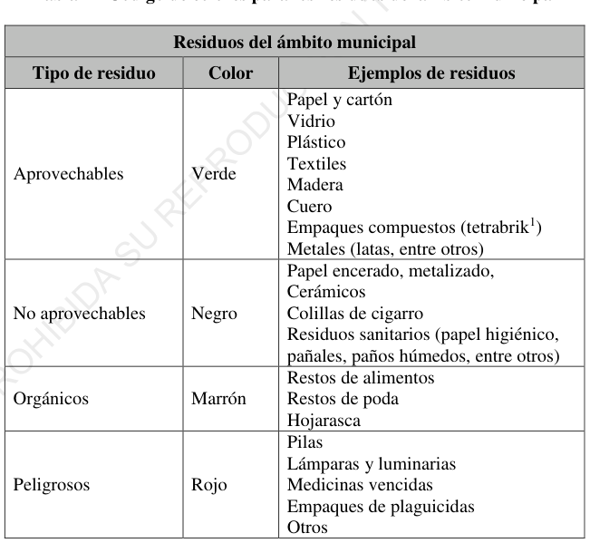
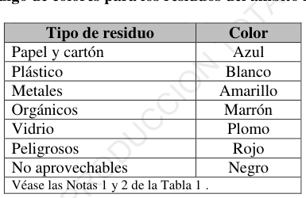

# NTP-900.058-2019 Código colores almacenamiento de residuos

> **Fuente:** `NTP-900.058-2019 Código colores almacenamiento de residuos.pdf`. Conversión de PDF a Markdown conservando el texto, la división por páginas y las tablas detectables. Esta transcripción automatizada no verifica vigencia normativa ni reemplaza el documento oficial.

<!-- Página original del PDF: 1 de 14 -->

## NORMA TÉCNICA

NTP 900.058

## PERUANA

2019

Dirección de Normalización - INACAL Lima, Perú Calle Las Camelias 817, San Isidro (Lima 27)

GESTIÓN DE RESIDUOS. Código de colores para el almacenamiento de residuos sólidos

WASTE MANAGEMENT. Color code for the storage of solid waste

2019-03-18 2ª Edición

R.D. N° 003-2019-INACAL/DN. Publicada el 2019-03-28 Precio basado en 07 páginas I.C.S.: 13.030; 13.030.10

## ESTA NORMA ES RECOMENDABLE

Descriptores: Gestión de residuo, código de color, residuo sólido, residuo, sólido, código, color, almacenamiento

---

<!-- Página original del PDF: 2 de 14 -->

Todos los derechos son reservados. A menos que se especifique lo contrario, ninguna parte de esta publicación podrá ser reproducida o utilizada por cualquier medio, electrónico o mecánico, incluyendo fotocopia o publicándolo en el internet o intranet, sin permiso por escrito del INACAL.

INACAL

Calle Las Camelias 817, San Isidro Lima - Perú Tel.: +51 1 640-8820 publicaciones@inacal.gob.pe www.inacal.gob.pe

i

---

<!-- Página original del PDF: 3 de 14 -->

## ÍNDICE

página

## ÍNDICE

ii

## PROLOGO

iii

1 Objeto y campo de aplicación 1

2 Referencias normativas 1

3 Términos y definiciones 2

4 Condiciones generales 4

5 Aplicación del código de colores 5

## BIBLIOGRAFÍA

7

ii

---

<!-- Página original del PDF: 4 de 14 -->

## PROLOGO

A.

## RESEÑA HISTÓRICA

A.1 El Instituto Nacional de Calidad - INACAL, a través de la Dirección de Normalización es la autoridad competente que aprueba las Normas Técnicas Peruanas a nivel nacional. Es miembro de la Organización Internacional de Normalización (ISO) y la Comisión Electrotécnica Internacional (IEC), en representación del país.

A.2 La presente Norma Técnica Peruana ha sido elaborada por el Comité Técnico de Normalización de Gestión ambiental - Subcomité Técnico de Normalización de Gestión de residuos, mediante el Sistema 2 u ordinario, durante los meses de junio a septiembre de 2018, utilizando como antecedente a los documentos que se mencionan en la Bibliografía.

A.3 El Comité Técnico de Normalización de Gestión ambiental - Subcomité Técnico de Normalización de Gestión de residuos presento a la Dirección de Normalización -DN-, con fecha 2018-10-03, el PNTP 900.058:2018, para su revisión y aprobación, siendo sometido a la etapa de discusión pública el 2019-02-11. Habiéndose recibido observaciones, fue oficializada como Norma Técnica Peruana NTP 900.058:2019 GESTIÓN DE RESIDUOS. Código de colores para el almacenamiento de residuos sólidos, 2ª Edición, el 28 de marzo de 2019.

A.4 La presente Norma Técnica Peruana ha sido estructurada de acuerdo a las Guías Peruanas GP 001:2016 y GP 002:2016.

B.

## INSTITUCIONES QUE PARTICIPARON EN LA ELABORACIÓN

## DE LA NORMA TÉCNICA PERUANA

Secretaría Ministerio del Ambiente

Presidente Gladys Monge Talavera

Secretario Dulia Aráoz Garcia

Coordinadora de Grupo Marlene Quiche Ruiz

iii

---

<!-- Página original del PDF: 5 de 14 -->

## ENTIDAD

## REPRESENTANTE

A NOVO PERÚ S. A. C. Félix Tafur Izaguirre Ricardo Luis Carlos Baldeón

ALMI INTERNATIONAL S. A. C. Edwin Dyer Aguirre

Asociación Peruana de Actores para la Cecilia Adriana B. Rosell Grijalba Gestión de Residuos – ASPAGER Andrea Johanna Tang Valdez

## CERTIFICACIONES DEL PERÚ S. A. -

Marisol Saico Ccamaqque CERPER

CM AMPCO PERÚ S. A. C. Carmen del R. Marcos Salvatierra

COMIMTEL S. A. C. Roxana Llerena Ruíz Miguel Angel Labrin Encalada

## COMPAÑÍA INDUSTRIAL LIMA S. A. -

Javier Ríos Ríos CILSA

## DIRECCIÓN GENERAL DE ASUNTOS

Miguel Alfonso Sánchez Sivori

## AMBIENTALES DE INDUSTRIA –

Victoria Yolanda Rivera Chale

## MINISTERIO DE LA PRODUCCIÓN

## DIRECCIÓN GENERAL DE ASUNTOS

Maritza León Iriarte

## AMBIENTALES MINEROS –

## MINISTERIO DE ENERGÍA Y MINAS

## DIRECCIÓN GENERAL DE ASUNTOS

Manuel L. Paredes Barrantes

## SOCIO AMBIENTALES – MINISTERIO

## DE TRANSPORTES Y COMUNICACIONES

## DIRECCIÓN GENERAL DE EFICIENCIA

Félix Bernabel Badillo

## ENERGÉTICA - VICEMINISTERIO DE

## ENERGÍA - MINISTERIO DE ENERGÍA

## Y MINAS

ECOTEC CONSULTORES S. A. C. Wendy Lyly Guerra Espíritu José Raúl Consilla Monroy

ESMERALDA CORP S. A. C. María Luisa Flores Chimbipuma Antonio Valer Cerna

iv

---

<!-- Página original del PDF: 6 de 14 -->

## FÁBRICA NACIONAL DE

Alfredo Llanos calderón ACUMULADORES ETNA S. A.

GRUPO LIMA VERDE S. A. C. Raúl Valenzuela

GRUPO REPSOL DEL PERÚ S. A. C. Pedro Ramos Mendoza Marcos Morriberon Rosas

## INSTITUTO ANDINO Y AMAZÓNICO

Valentín Antonio Bartra Abensur

## DE DERECHO AMBIENTAL

Josefina Dulia Aráoz García

## IPES PROMOCIÓN DEL DESARROLLO

Luis Briceño Bustillos

## SOSTENIBLE

## LOMBRICULTURA 1° DE MAYO

Maria Genera Nieto Jáuregui María Trinidad Sánchez Barriente

## MAC JOHNSON CONTROLS

Diego Torrejón Anticona COLOMBIA S. A. S.

METALEXACTO S. R. L. Adrian Stern Uralde

## MINISTERIO DEL AMBIENTE /

Ericson Benigno Huamán Cruz

## ORGANISMO DE EVALUACIÓN

Ruth Genoveva Chevarría Hospina

## Y FISCALIZACIÓN AMBIENTAL –

## OEFA / SECRETARIA GENERAL

## MINISTERIO DEL AMBIENTE MINAM –

Alicia Marlene Quiche Ruiz

## DIRECCIÓN GENERAL DE GESTIÓN

Yuliana Dalmira Vidal Villaorduña

## DE RESIDUOS SÓLIDOS

## MARTE SOLUCIONES AMBIENTALES

Angela Serna

## MUNICIPALIDAD METROPOLITANA

Camilo Ernesto Joan De la Cruz Lavan

## DE LIMA - GERENCIA DE SERVICIOS

## A LA CIUDAD Y GESTIÓN AMBIENTAL

SAN ANTONIO RECYCLING S. A. Oscar Espinoza Loayza

## SERVICIO NACIONAL DE SANIDAD

Wilfredo Alcántara Arenas

## AGRARIA - DIRECCIÓN DE INSUMOS

Ursula Sonia Ingar Elliott

## AGROPECUARIOS E INOCUIDAD

## AGROALIMENTARIA

## TECNOLOGÍAS Y CONSULTORÍAS

Juan Carlos Rivera Reushe

## ECOLÓGICAS S. A. C. - TECONEC

Luis Oliva Castillo

v

---

<!-- Página original del PDF: 7 de 14 -->

TOWER & TOWER S. A. Bernardette Mariella Sencebe Bastante

## UNIVERSIDAD NACIONAL MAYOR

Raymundo Erazo Erazo

## DE SAN MARCOS - FACULTAD DE

## QUÍMICA E INGENIERÍA QUÍMICA

ZINC INDUSTRIAS NACIONALES S. A. Frank Carlo Pantoja Castillo

WR Ingenieros Williams Loth Reynoso Brandan

## CONSULTORA

Aracelis del Carmen Amadori Oliva

## CONSULTORA

Florencia Cancho Vivanco

## CONSULTORA

Regina Cáterin Ortega Gordillo

## CONSULTORA

Gladys Elena Monge Talavera

---oooOooo---

vi

---

<!-- Página original del PDF: 8 de 14 -->

## NORMA TÉCNICA

NTP 900.058

## PERUANA

1 de 7

GESTIÓN DE RESIDUOS. Código de colores para el almacenamiento de residuos sólidos

1 Objeto y campo de aplicación

Esta Norma Técnica Peruana establece los colores a ser utilizados para el almacenamiento adecuado de los residuos sólidos de los ámbitos de gestión municipal y no municipal.

Esta Norma Técnica Peruana es aplicable a todos los residuos sólidos generados en los ámbitos de gestión municipal y no municipal, a excepción de los siguientes:

a) residuos radiactivos, cuya gestión es competencia del Instituto Peruano de Energía Nuclear;

b) residuos propios de actividades militares para la seguridad y defensa de la nación, cuya gestión es competencia del Ministerio de Defensa;

c) las aguas residuales y los residuos líquidos que se incorporen al manejo de las mismas de acuerdo a la legislación de la materia, cuya regulación es competencia de la Autoridad Nacional del Agua y del Ministerio de Vivienda, Construcción y Saneamiento, en el ámbito de sus respectivas funciones y atribuciones; y

d) las emisiones de gases y material particulado descargadas al ambiente.

Esta Norma Técnica Peruana no establece las características del recipiente de almacenamiento a utilizar, ya que esto dependerá del peso, volumen y otras características físicas, químicas o biológicas de los residuos, de tal manera que se garantice la seguridad, higiene y orden, evitando fugas, derrames o dispersión de los mismos.

2 Referencias normativas

No hay normas específicas, ni disposiciones, que sean citadas como referencia en el presente texto que constituyan requisitos de esta Norma Técnica Peruana.

---

<!-- Página original del PDF: 9 de 14 -->

## NORMA TÉCNICA

NTP 900.058

## PERUANA

2 de 7

3 Términos y definiciones

Para los propósitos de esta Norma Técnica Peruana se aplican las siguientes definiciones:

3.1 almacenamiento operación de acumulación temporal de residuos en condiciones técnicas y sanitarias, como parte del sistema de manejo hasta su valorización o disposición final

3.2 aprovechamiento volver a obtener un beneficio del bien, artículo, elemento o parte del mismo que constituye residuo sólido. Se reconoce como técnica de aprovechamiento el reciclaje, la recuperación o la reutilización

3.3 generador persona natural o jurídica que en razón de sus actividades genera residuos, sea como fabricante, importador, distribuidor, comerciante o usuario. También se considera generador al poseedor de residuos peligrosos, cuando no se pueda identificar al generador real y a los gobiernos municipales a partir de las actividades de recolección

3.4 reciclaje toda actividad que permite aprovechar un residuo mediante un proceso de transformación material, para cumplir su fin inicial u otros fines

3.5 residuos municipales los residuos del ámbito de la gestión municipal o residuos municipales, están conformados por los residuos domiciliarios y los provenientes del barrido y limpieza de espacios públicos, incluyendo las playas, actividades comerciales y otras actividades urbanas no domiciliarias cuyos residuos se pueden asimilar a los servicios de limpieza pública, en todo el ámbito de su jurisdicción

---

<!-- Página original del PDF: 10 de 14 -->

## NORMA TÉCNICA

NTP 900.058

## PERUANA

3 de 7

3.6 residuo sólido no aprovechable es todo material o sustancia sólida o semisólida de origen orgánico e inorgánico, putrescible o no, proveniente de actividades domésticas, industriales, comerciales, institucionales, de servicios, que no ofrece ninguna posibilidad de aprovechamiento, reutilización o reincorporación en un proceso productivo. Son residuos sólidos que no tienen ningún valor comercial, requieren tratamiento y disposición final y por lo tanto generan costos de disposición

3.7 residuos no municipales los residuos del ámbito de gestión no municipal o residuos no municipales, son aquellos de carácter peligroso y no peligroso que se generan en el desarrollo de actividades extractivas, productivas y de servicios. Comprenden los generados en las instalaciones principales y auxiliares de la operación

3.8 residuos sólidos residuo sólido es cualquier objeto, material, sustancia o elemento resultante del consumo o uso de un bien o servicio, del cual su poseedor se desprenda o tenga la intención u obligación de desprenderse, para ser manejados priorizando la valorización de los residuos y en último caso, su disposición final

Los residuos sólidos incluyen todo residuo o desecho en fase sólida o semisólida. También se considera residuos aquellos que siendo líquido o gas se encuentran contenidos en recipientes o depósitos que van a ser desechados, así como los líquidos o gases, que por sus características fisicoquímicas no puedan ser ingresados en los sistemas de tratamiento de emisiones y efluentes y por ello no pueden ser vertidos al ambiente. En estos casos los gases o líquidos deben ser acondicionados de forma segura para su adecuada disposición final

3.9 residuos peligrosos son residuos sólidos peligrosos aquéllos que, por sus características o el manejo al que son o van a ser sometidos, representan un riesgo significativo para la salud o el ambiente

---

<!-- Página original del PDF: 11 de 14 -->

## NORMA TÉCNICA

NTP 900.058

## PERUANA

4 de 7

3.10 segregación acción de separar y agrupar determinados componentes o elementos físicos de los residuos sólidos para ser manejados en forma especial

3.11 transporte es el proceso de manejo de los residuos sólidos ejecutada por las municipalidades u Empresas Operadoras de Residuos Sólidos autorizadas, consistente en el traslado apropiado de los residuos recolectados hasta las infraestructuras de valorización o disposición final, según corresponda, empleando los vehículos apropiados cuyas características se especificarán en el instrumento de normalización que corresponda, y las vías autorizadas para tal fin

En el caso de los residuos peligrosos, el transporte se realiza de acuerdo a la normativa para el transporte de los materiales y residuos peligrosos, así como de acuerdo con lo establecido en la versión vigente del Libro Naranja de las Naciones Unidas y/o del Sistema Globalmente Armonizado de Clasificación y Etiquetado de productos químicos

3.12 valorización cualquier operación cuyo objetivo sea que el residuo, uno o varios de los materiales que lo componen, sea reaprovechado y sirva a una finalidad útil al sustituir a otros materiales o recursos en los procesos productivos. La valorización puede ser material o energética

4 Condiciones generales

4.1 Los residuos deben ser segregados en la fuente de generación de acuerdo a sus características físicas, químicas o biológicas, para facilitar su almacenamiento, valorización, recolección, transporte o disposición final.

4.2 La presente Norma Técnica Peruana establece el código de colores para el almacenamiento de residuos sólidos.

---

<!-- Página original del PDF: 12 de 14 -->

## NORMA TÉCNICA

NTP 900.058

## PERUANA

5 de 7

5 Aplicación del código de colores

Esta Noma Técnica Peruana se aplica a los residuos del ámbito de gestión municipal y no municipal.

El código de colores deberá ser utilizado en los recipientes para el almacenamiento de residuos sólidos, o en las etiquetas que identifiquen el residuo sólido a almacenar.

5.1 Residuos sólidos del ámbito gestión municipal

Tabla 1 - Código de colores para los residuos del ámbito municipal

| N   O   Residuos del ámbito municipal |  |  |
| --- | --- | --- |
| Tipo de residuo | Color | I   C   Ejemplos de residuos |
| Aprovechables   R   U   S | U   D   O   R   P   Verde   E | C   Papel y cartón   Vidrio   Plástico   Textiles   Madera   Cuero   Empaques compuestos (tetrabrik1)   Metales (latas, entre otros) |
| A   D   I   B   No aprovechables   I   H   O | Negro | Papel encerado, metalizado,   Cerámicos   Colillas de cigarro   Residuos sanitarios (papel higiénico,   pañales, paños húmedos, entre otros) |
| Orgánicos | Marrón | Restos de alimentos   Restos de poda   Hojarasca |
| Peligrosos | Rojo | Pilas   Lámparas y luminarias   Medicinas vencidas   Empaques de plaguicidas   Otros |

1 Envase de cartón impermeabilizado, cerrado herméticamente, y generalmente de forma rectangular, para bebidas y alimentos líquidos.

---

<!-- Página original del PDF: 13 de 14 -->

## NORMA TÉCNICA

NTP 900.058

## PERUANA

6 de 7

NOTA 1: Los residuos peligrosos deberían ser almacenados de manera diferenciada y manejados de acuerdo a la normativa vigente.

NOTA 2: Se recomienda enjuagar los envases de residuos aprovechables para garantizar su aprovechamiento.

NOTA 3: Los residuos del ámbito municipal podrán también ser almacenados utilizando los colores descritos en el Tabla 2 .

5.2 Residuos sólidos del ámbito de gestión no municipal

Tabla 2 - Código de colores para los residuos del ámbito no municipal

|  | Tipo de residuo |  |  | O   Color |  |
| --- | --- | --- | --- | --- | --- |
| Papel y cartón |  |  | T   Azul |  |  |
| Plástico |  |  | N   Blanco |  |  |
| O   Metales I |  |  | Amarillo |  |  |
| C   Orgánicos |  |  | Marrón |  |  |
| C   Vidrio U |  |  | Plomo |  |  |
| D   Peligrosos |  |  | Rojo |  |  |
| O   No aprovechables |  |  | Negro |  |  |
| R   Véase las Notas 1 y 2 de la Tabla 1 . |  |  |  |  |  |

Los generadores definirán los tipos de residuos sólidos a almacenar de manera diferenciada, en función a su generación.

---

<!-- Página original del PDF: 14 de 14 -->

## NORMA TÉCNICA

NTP 900.058

## PERUANA

7 de 7

## BIBLIOGRAFÍA

[1] Decreto Legislativo N° 1278. Ley de Gestión Integral de Residuos Sólidos

[2] Decreto Supremo N° 014-2017-MINAM. Reglamento de la Ley de Gestión Integral de Residuos Sólidos

[3] Guía Técnica Colombiana GTC 24 (Segunda actualización) Gestión ambiental. Residuos sólidos, guía para la separación en la fuente y la recolección

[4] NTP 900.058:2005 GESTION AMBIENTAL. Gestión de residuos. Código de colores para los dispositivos de almacenamiento de residuos
