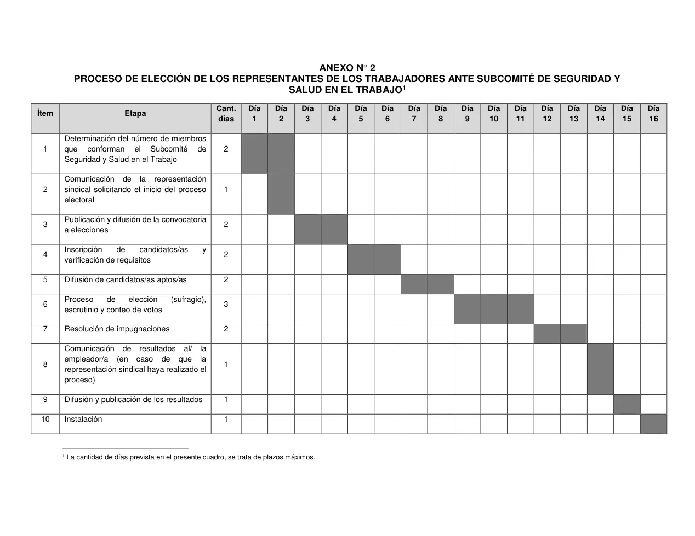
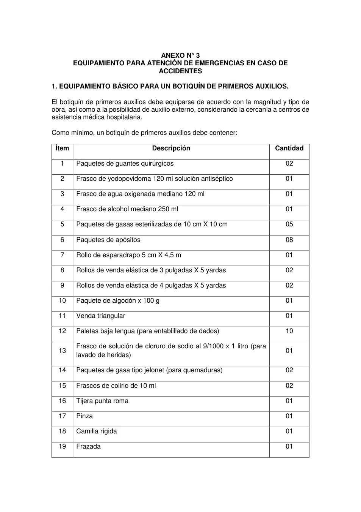
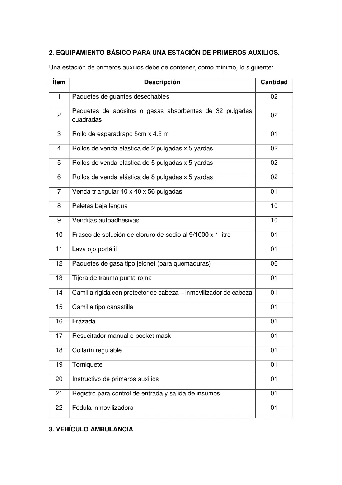
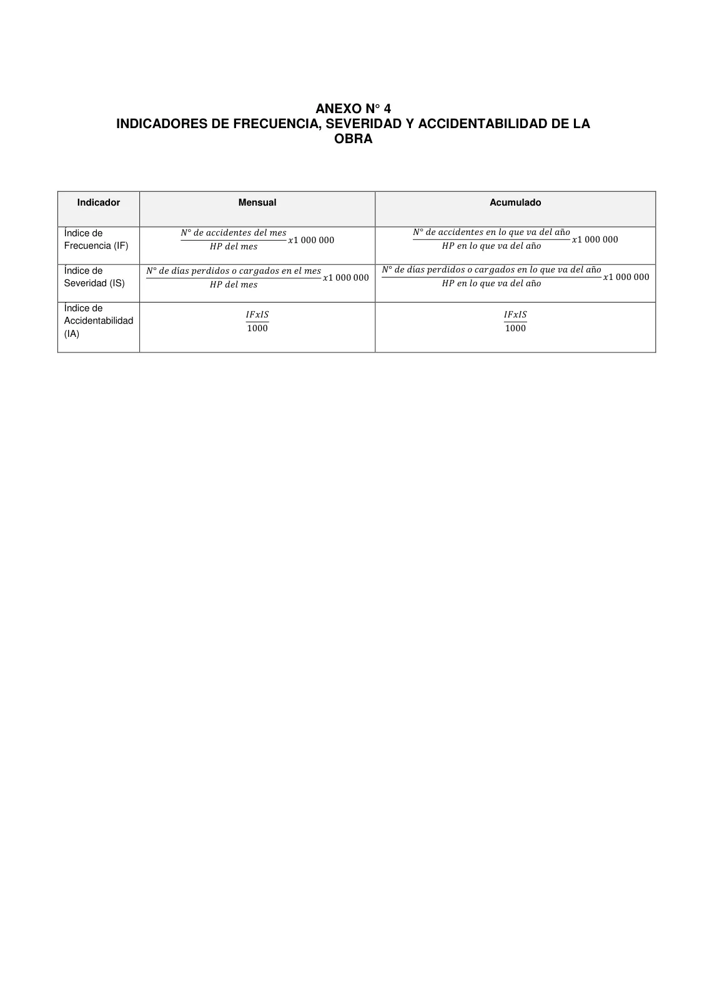

# Anexos del Reglamento de SST para Construcción

**Archivo fuente:** `ANEXOS_REGLAMENTO_SST_CONSTRUCCION.pdf`
**Páginas del PDF:** 9

> Conversión a Markdown página por página. Cuando la página contiene formularios escaneados, se adjunta su imagen original. El OCR de tablas y textos escaneados puede contener errores; contrastar con el documento original. No se ha verificado la vigencia normativa ni consolidado modificaciones posteriores.

## Índice de páginas

- [Página 1](#pagina-1)
- [Página 2](#pagina-2)
- [Página 3](#pagina-3)
- [Página 4](#pagina-4)
- [Página 5](#pagina-5)
- [Página 6](#pagina-6)
- [Página 7](#pagina-7)
- [Página 8](#pagina-8)
- [Página 9](#pagina-9)

---

## Página 1

### ANEXO N° 1

### PAUTAS GENERALES PARA LA INVESTIGACIÓN DE ACCIDENTES DE

### TRABAJO

La investigación de accidentes de trabajo debe contestar seis (6) preguntas básicas:

- ¿Quién resultó afectado? - ¿Dónde ocurrió el accidente? - ¿Cuándo ocurrió el accidente? - ¿Qué sucedió en el momento del accidente? - ¿Cómo ocurrió el accidente? - ¿Por qué ocurrió el accidente? Para ello, independientemente de la metodología establecida por el/la empleador/a, se recomienda tomar en consideración las siguientes pautas generales: a. Realizar la investigación con la mayor inmediatez posible al acontecimiento. Ello garantiza que los datos recabados se ajusten con más fidelidad a la situación existente en el momento del accidente. b. Revisar la identificación de peligros, la evaluación de riesgos, la determinación de controles (IPERC) y el análisis de trabajo seguro (ATS), a fin de determinar si el factor de riesgo que ocasionó directamente el accidente fue identificado. c. Evitar la búsqueda de responsabilidades. Una investigación técnica del accidente persigue identificar "causas", nunca responsables. d. Recoger únicamente información de hechos probados. Se deben recoger hechos concretos y objetivos, nunca suposiciones ni interpretaciones. e. Evitar hacer juicios de valor durante la "toma de datos". Tener en consideración que los juicios de valor serían prematuros y podrían condicionar desfavorablemente el desarrollo de la investigación. f. Entrevistar a las personas que puedan aportar datos del accidente, como testigos, jefes, y siempre que sea posible, a la persona accidentada, ya que esta puede facilitar la información más fiel y real sobre el accidente. g. Realizar las entrevistas individualmente. Se debe evitar influencias entre los distintos entrevistados/as. En una fase avanzada de la investigación puede ser útil reunir a estas personas, en caso que se precise clarificar versiones no coincidentes. h. Realizar la investigación del accidente en el lugar de los hechos. Para un perfecto conocimiento de lo ocurrido es importante y, en muchas ocasiones imprescindible, conocer la disposición de los lugares, la organización del espacio de trabajo y el estado del entorno físico y medioambiental. i. Preocuparse de todos los aspectos que hayan podido intervenir. Analizar cuestiones relativas tanto a las condiciones materiales de trabajo (instalaciones, equipos, medios de trabajo, etc.), como organizativas (métodos y procedimientos de trabajo, etc.), del comportamiento humano (calificación profesional, actitud, etc.) y del entorno físico y medioambiental (limpieza, iluminación, etc.).

---

## Página 2

### ANEXO N° 2 PROCESO DE ELECCIÓN DE LOS REPRESENTANTES DE LOS TRABAJADORES ANTE SUBCOMITÉ DE SEGURIDAD Y

### SALUD EN EL TRABAJO1

**Cuadro del documento (filas: 12; columnas: 53):**

| Ítem | Etapa | Columna 3 | Cant. | Día | Día | Día | Día | Día | Día | Día | Día | Día | Día | Día | Día | Día | Día | Día | Día |
| --- | --- | --- | --- | --- | --- | --- | --- | --- | --- | --- | --- | --- | --- | --- | --- | --- | --- | --- | --- |
|  |  |  | días | 1 | 2 | 3 | 4 | 5 | 6 | 7 | 8 | 9 | 10 | 11 | 12 | 13 | 14 | 15 | 16 |
| 1 | Determinación del número de miembros / que conforman el Subcomité de / Seguridad y Salud en el Trabajo | 2 |  |  |  |  |  |  |  |  |  |  |  |  |  |  |  |  |  |
| 2 | Comunicación de la representación / sindical solicitando el inicio del proceso / electoral | 1 |  |  |  |  |  |  |  |  |  |  |  |  |  |  |  |  |  |
| 3 | Publicación y difusión de la convocatoria / a elecciones | 2 |  |  |  |  |  |  |  |  |  |  |  |  |  |  |  |  |  |
| 4 | Inscripción de candidatos/as y / verificación de requisitos | 2 |  |  |  |  |  |  |  |  |  |  |  |  |  |  |  |  |  |
| 5 | Difusión de candidatos/as aptos/as | 2 |  |  |  |  |  |  |  |  |  |  |  |  |  |  |  |  |  |
| 6 | Proceso de elección (sufragio), / escrutinio y conteo de votos | 3 |  |  |  |  |  |  |  |  |  |  |  |  |  |  |  |  |  |
| 7 | Resolución de impugnaciones | 2 |  |  |  |  |  |  |  |  |  |  |  |  |  |  |  |  |  |
| 8 | Comunicación de resultados al/ la / empleador/a (en caso de que la / representación sindical haya realizado el / proceso) | 1 |  |  |  |  |  |  |  |  |  |  |  |  |  |  |  |  |  |
| 9 | Difusión y publicación de los resultados | 1 |  |  |  |  |  |  |  |  |  |  |  |  |  |  |  |  |  |
| 10 | Instalación | 1 |  |  |  |  |  |  |  |  |  |  |  |  |  |  |  |  |  |

1 La cantidad de días prevista en el presente cuadro, se trata de plazos máximos.

**Gráfico o cuadro original:**

---

## Página 3

**Página escaneada: imagen de referencia para comprobar tablas, formularios y sus casillas.**

[No se recuperó texto legible. Consultar imagen original.]

---

## Página 4

### ANEXO N° 3 EQUIPAMIENTO PARA ATENCIÓN DE EMERGENCIAS EN CASO DE

ACCIDENTES

1. EQUIPAMIENTO BÁSICO PARA UN BOTIQUÍN DE PRIMEROS AUXILIOS. El botiquín de primeros auxilios debe equiparse de acuerdo con la magnitud y tipo de obra, así como a la posibilidad de auxilio externo, considerando la cercanía a centros de asistencia médica hospitalaria. Como mínimo, un botiquín de primeros auxilios debe contener:

**Cuadro del documento (filas: 20; columnas: 3):**

| Ítem | Descripción | Cantidad |
| --- | --- | --- |
| 1 | Paquetes de guantes quirúrgicos | 02 |
| 2 | Frasco de yodopovidoma 120 ml solución antiséptico | 01 |
| 3 | Frasco de agua oxigenada mediano 120 ml | 01 |
| 4 | Frasco de alcohol mediano 250 ml | 01 |
| 5 | Paquetes de gasas esterilizadas de 10 cm X 10 cm | 05 |
| 6 | Paquetes de apósitos | 08 |
| 7 | Rollo de esparadrapo 5 cm X 4,5 m | 01 |
| 8 | Rollos de venda elástica de 3 pulgadas X 5 yardas | 02 |
| 9 | Rollos de venda elástica de 4 pulgadas X 5 yardas | 02 |
| 10 | Paquete de algodón x 100 g | 01 |
| 11 | Venda triangular | 01 |
| 12 | Paletas baja lengua (para entablillado de dedos) | 10 |
| 13 | Frasco de solución de cloruro de sodio al 9/1000 x 1 litro (para / lavado de heridas) | 01 |
| 14 | Paquetes de gasa tipo jelonet (para quemaduras) | 02 |
| 15 | Frascos de colirio de 10 ml | 02 |
| 16 | Tijera punta roma | 01 |
| 17 | Pinza | 01 |
| 18 | Camilla rígida | 01 |
| 19 | Frazada | 01 |

**Gráfico o cuadro original:**

---

## Página 5

2. EQUIPAMIENTO BÁSICO PARA UNA ESTACIÓN DE PRIMEROS AUXILIOS. Una estación de primeros auxilios debe de contener, como mínimo, lo siguiente:

**Cuadro del documento (filas: 23; columnas: 3):**

| Ítem | Descripción | Cantidad |
| --- | --- | --- |
| 1 | Paquetes de guantes desechables | 02 |
| 2 | Paquetes de apósitos o gasas absorbentes de 32 pulgadas / cuadradas | 02 |
| 3 | Rollo de esparadrapo 5cm x 4.5 m | 01 |
| 4 | Rollos de venda elástica de 2 pulgadas x 5 yardas | 02 |
| 5 | Rollos de venda elástica de 5 pulgadas x 5 yardas | 02 |
| 6 | Rollos de venda elástica de 8 pulgadas x 5 yardas | 02 |
| 7 | Venda triangular 40 x 40 x 56 pulgadas | 01 |
| 8 | Paletas baja lengua | 10 |
| 9 | Venditas autoadhesivas | 10 |
| 10 | Frasco de solución de cloruro de sodio al 9/1000 x 1 litro | 01 |
| 11 | Lava ojo portátil | 01 |
| 12 | Paquetes de gasa tipo jelonet (para quemaduras) | 06 |
| 13 | Tijera de trauma punta roma | 01 |
| 14 | Camilla rígida con protector de cabeza – inmovilizador de cabeza | 01 |
| 15 | Camilla tipo canastilla | 01 |
| 16 | Frazada | 01 |
| 17 | Resucitador manual o pocket mask | 01 |
| 18 | Collarín regulable | 01 |
| 19 | Torniquete | 01 |
| 20 | Instructivo de primeros auxilios | 01 |
| 21 | Registro para control de entrada y salida de insumos | 01 |
| 22 | Fédula inmovilizadora | 01 |

### 3. VEHÍCULO AMBULANCIA

**Gráfico o cuadro original:**

---

## Página 6

Es un vehículo diseñado especialmente para el transporte rápido de persona cuyo estado de salud requiera atención médica inmediata. Los recursos humanos necesarios para la ambulancia son:

1. Chofer profesional.

2. Enfermero capacitado en medicina de emergencia.

---

## Página 7

**Vista original del cuadro o formulario (para comprobar campos, filas, valores y diseño):**

### ANEXO N° 4 INDICADORES DE FRECUENCIA, SEVERIDAD Y ACCIDENTABILIDAD DE LA

OBRA

**Cuadro del documento (filas: 4; columnas: 3):**

| Indicador | Mensual | Acumulado |
| --- | --- | --- |
| Índice de / Frecuencia (IF) | 𝑁° 𝑑𝑒 𝑎𝑐𝑐𝑖𝑑𝑒𝑛𝑡𝑒𝑠 𝑑𝑒𝑙 𝑚𝑒𝑠 / 𝑥1 000 000 / 𝐻𝑃 𝑑𝑒𝑙 𝑚𝑒𝑠 | 𝑁° 𝑑𝑒 𝑎𝑐𝑐𝑖𝑑𝑒𝑛𝑡𝑒𝑠 𝑒𝑛 𝑙𝑜 𝑞𝑢𝑒 𝑣𝑎 𝑑𝑒𝑙 𝑎ñ𝑜 / 𝑥1 000 000 / 𝐻𝑃 𝑒𝑛 𝑙𝑜 𝑞𝑢𝑒 𝑣𝑎 𝑑𝑒𝑙 𝑎ñ𝑜 |
| Índice de / Severidad (IS) | 𝑁° 𝑑𝑒 𝑑í𝑎𝑠 𝑝𝑒𝑟𝑑𝑖𝑑𝑜𝑠 𝑜 𝑐𝑎𝑟𝑔𝑎𝑑𝑜𝑠 𝑒𝑛 𝑒𝑙 𝑚𝑒𝑠 / 𝑥1 000 000 / 𝐻𝑃 𝑑𝑒𝑙 𝑚𝑒𝑠 | 𝑁° 𝑑𝑒 𝑑í𝑎𝑠 𝑝𝑒𝑟𝑑𝑖𝑑𝑜𝑠 𝑜 𝑐𝑎𝑟𝑔𝑎𝑑𝑜𝑠 𝑒𝑛 𝑙𝑜 𝑞𝑢𝑒 𝑣𝑎 𝑑𝑒𝑙 𝑎ñ𝑜 / 𝑥1 000 000 / 𝐻𝑃 𝑒𝑛 𝑙𝑜 𝑞𝑢𝑒 𝑣𝑎 𝑑𝑒𝑙 𝑎ñ𝑜 |
| Índice de / Accidentabilidad / (IA) | 𝐼𝐹𝑥𝐼𝑆 / 1000 | 𝐼𝐹𝑥𝐼𝑆 / 1000 |

---

## Página 8

ANEXO N° 5 TABLA DE DÍAS CARGO CLASIFICACIÓN DE LESIONES DEL TRABAJO DÍAS A CARGARSE

1.- Muerte. 6,000

2.- Incapacidad total permanente: A) Lesiones que incapaciten total o permanentemente al/a la trabajador/a para efectuar cualquier clase de trabajo remunerado 6,000 B) Lesiones que resulten en la pérdida anatómica o la pérdida funcional total de:

a) Ambos ojos 6,000

b) Ambos brazos 6,000

c) Ambas piernas 6,000

d) Ambas manos 6,000

e) Ambos pies 6,000

f) Un ojo y un brazo 6,000

g) Un ojo y una mano 6,000

h) Un ojo y una pierna 6,000

i) Un ojo y un pie 6,000

j) Una mano y una pierna 6,000

k) Una mano y un pie 6,000

l) Un brazo y una mano, siempre que no sea de la misma extremidad 6,000

m) Una pierna y un pie, siempre que no sea de la misma extremidad 6,000

3.- Incapacidad parcial permanente: A.- Lesiones que resulten en la pérdida anatómica o la pérdida total de la función de:

a) Un brazo:

1.- Cualquier punto arriba del codo, incluyendo la coyuntura del hombro            4,500

2.- Cualquier punto arriba de la muñeca hasta el nivel del codo                              3,600

b) Una pierna:

1.- Cualquier punto arriba de la rodilla (muslo) 4,500

2.- Cualquier punto arriba del tobillo hasta la rodilla 3,000

c) Mano, dedo pulgar y otros dedos de la mano: Amputación de todo o Pulgar Índice Medio Anular Meñique parte del hueso

1.- Tercera falange (uña) 300 100 75 60 50

2.- Segunda falange (medio) 200 150 120 100

3.- Primera falange (próxima)                           600 400 300 240 200

4.- Metacarpo 900 600 500 450 400

5.- Mano hasta la muñeca 3,000

d) Pie, dedo grande y otros dedos del pie: Amputación de todo o                                                           Dedo grande      c/u de los dedos parte del hueso

1.- Tercera falange (uña) 150 35

2.- Segunda falange (medio) 75

3.- Primera falange (próximo) 300 150

4.- Metatarso 600 350

5.- Pie hasta el tobillo 2400

---

## Página 9

B.- Lesiones que resulten en la pérdida de las funciones fisiológicas:

a) Un ojo (pérdida de la visión), esté o no afectada la visión del otro ojo              1,800

b)    Un oído (pérdida total de la audición), esté o no afectada la

audición del otro oído 60

c) Ambos oídos (pérdida total de la audición) en un accidente 3,000

d) Hernia no operada 50

---
