# NTP 350.043-1:2011 — Extintores portátiles

**Archivo fuente:** `NTP 350 43 Extintores portátiles 2.pdf`
**Páginas del PDF:** 147

> Conversión a Markdown página por página. Cuando la página contiene formularios escaneados, se adjunta su imagen original. El OCR de tablas y textos escaneados puede contener errores; contrastar con el documento original. No se ha verificado la vigencia normativa ni consolidado modificaciones posteriores.

## Índice de páginas

- [Página 1](#pagina-1)
- [Página 2](#pagina-2)
- [Página 3](#pagina-3)
- [Página 4](#pagina-4)
- [Página 5](#pagina-5)
- [Página 6](#pagina-6)
- [Página 7](#pagina-7)
- [Página 8](#pagina-8)
- [Página 9](#pagina-9)
- [Página 10](#pagina-10)
- [Página 11](#pagina-11)
- [Página 12](#pagina-12)
- [Página 13](#pagina-13)
- [Página 14](#pagina-14)
- [Página 15](#pagina-15)
- [Página 16](#pagina-16)
- [Página 17](#pagina-17)
- [Página 18](#pagina-18)
- [Página 19](#pagina-19)
- [Página 20](#pagina-20)
- [Página 21](#pagina-21)
- [Página 22](#pagina-22)
- [Página 23](#pagina-23)
- [Página 24](#pagina-24)
- [Página 25](#pagina-25)
- [Página 26](#pagina-26)
- [Página 27](#pagina-27)
- [Página 28](#pagina-28)
- [Página 29](#pagina-29)
- [Página 30](#pagina-30)
- [Página 31](#pagina-31)
- [Página 32](#pagina-32)
- [Página 33](#pagina-33)
- [Página 34](#pagina-34)
- [Página 35](#pagina-35)
- [Página 36](#pagina-36)
- [Página 37](#pagina-37)
- [Página 38](#pagina-38)
- [Página 39](#pagina-39)
- [Página 40](#pagina-40)
- [Página 41](#pagina-41)
- [Página 42](#pagina-42)
- [Página 43](#pagina-43)
- [Página 44](#pagina-44)
- [Página 45](#pagina-45)
- [Página 46](#pagina-46)
- [Página 47](#pagina-47)
- [Página 48](#pagina-48)
- [Página 49](#pagina-49)
- [Página 50](#pagina-50)
- [Página 51](#pagina-51)
- [Página 52](#pagina-52)
- [Página 53](#pagina-53)
- [Página 54](#pagina-54)
- [Página 55](#pagina-55)
- [Página 56](#pagina-56)
- [Página 57](#pagina-57)
- [Página 58](#pagina-58)
- [Página 59](#pagina-59)
- [Página 60](#pagina-60)
- [Página 61](#pagina-61)
- [Página 62](#pagina-62)
- [Página 63](#pagina-63)
- [Página 64](#pagina-64)
- [Página 65](#pagina-65)
- [Página 66](#pagina-66)
- [Página 67](#pagina-67)
- [Página 68](#pagina-68)
- [Página 69](#pagina-69)
- [Página 70](#pagina-70)
- [Página 71](#pagina-71)
- [Página 72](#pagina-72)
- [Página 73](#pagina-73)
- [Página 74](#pagina-74)
- [Página 75](#pagina-75)
- [Página 76](#pagina-76)
- [Página 77](#pagina-77)
- [Página 78](#pagina-78)
- [Página 79](#pagina-79)
- [Página 80](#pagina-80)
- [Página 81](#pagina-81)
- [Página 82](#pagina-82)
- [Página 83](#pagina-83)
- [Página 84](#pagina-84)
- [Página 85](#pagina-85)
- [Página 86](#pagina-86)
- [Página 87](#pagina-87)
- [Página 88](#pagina-88)
- [Página 89](#pagina-89)
- [Página 90](#pagina-90)
- [Página 91](#pagina-91)
- [Página 92](#pagina-92)
- [Página 93](#pagina-93)
- [Página 94](#pagina-94)
- [Página 95](#pagina-95)
- [Página 96](#pagina-96)
- [Página 97](#pagina-97)
- [Página 98](#pagina-98)
- [Página 99](#pagina-99)
- [Página 100](#pagina-100)
- [Página 101](#pagina-101)
- [Página 102](#pagina-102)
- [Página 103](#pagina-103)
- [Página 104](#pagina-104)
- [Página 105](#pagina-105)
- [Página 106](#pagina-106)
- [Página 107](#pagina-107)
- [Página 108](#pagina-108)
- [Página 109](#pagina-109)
- [Página 110](#pagina-110)
- [Página 111](#pagina-111)
- [Página 112](#pagina-112)
- [Página 113](#pagina-113)
- [Página 114](#pagina-114)
- [Página 115](#pagina-115)
- [Página 116](#pagina-116)
- [Página 117](#pagina-117)
- [Página 118](#pagina-118)
- [Página 119](#pagina-119)
- [Página 120](#pagina-120)
- [Página 121](#pagina-121)
- [Página 122](#pagina-122)
- [Página 123](#pagina-123)
- [Página 124](#pagina-124)
- [Página 125](#pagina-125)
- [Página 126](#pagina-126)
- [Página 127](#pagina-127)
- [Página 128](#pagina-128)
- [Página 129](#pagina-129)
- [Página 130](#pagina-130)
- [Página 131](#pagina-131)
- [Página 132](#pagina-132)
- [Página 133](#pagina-133)
- [Página 134](#pagina-134)
- [Página 135](#pagina-135)
- [Página 136](#pagina-136)
- [Página 137](#pagina-137)
- [Página 138](#pagina-138)
- [Página 139](#pagina-139)
- [Página 140](#pagina-140)
- [Página 141](#pagina-141)
- [Página 142](#pagina-142)
- [Página 143](#pagina-143)
- [Página 144](#pagina-144)
- [Página 145](#pagina-145)
- [Página 146](#pagina-146)
- [Página 147](#pagina-147)

---

## Página 1

NORMA TÉCNICA NTP 350.043-1 PERUANA 2011 Comisión de Normalización y de Fiscalización de Barreras Comerciales no Arancelarias - INDECOPI Calle de La Prosa 138, San Borja (Lima 41) Apartado 145 Lima-Perú EXTINTORES PORTÁTILES. Selección, distribución, inspección, mantenimiento, recarga y prueba hidrostática Portable fire extinguishers. Selection, distribution, inspection, maintenance, recharging and hydrostatic testing 2011-12-07 3a Edición R.0055-2011/CNB-INDECOPI. Publicada el 2011-12-31 Precio basado en 140 páginas I.C.S: 13.220.10 ESTA NORMA ES RECOMENDABLE Descriptores: Extintor portátil, selección, distribución, señalización, mantenimiento, recarga, prueba hidrostática, seguridad contra incendios.

### PROHIBIDA LA REPRODUCCIÓN TOTAL O PARCIAL

**Gráfico o cuadro original:**

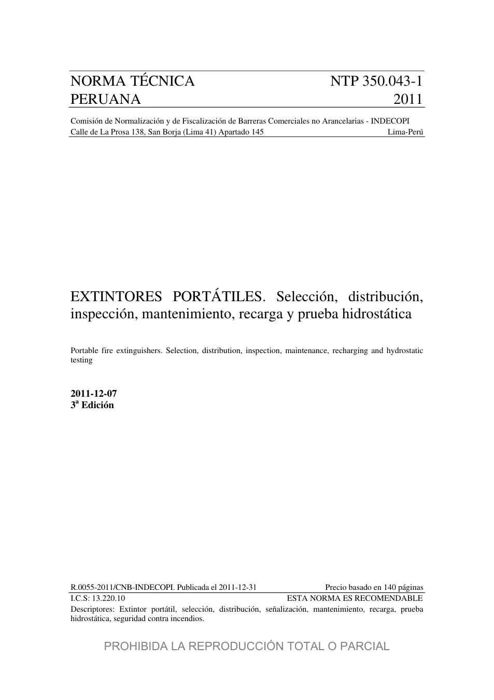

---

## Página 2

ÍNDICE Página INDICE i PREFACIO iii INTRODUCCIÓN v

1. OBJETO 1

2. REFERENCIAS NORMATIVAS 1

3. CAMPO DE APLICACIÓN 8

4. DEFINICIONES Y UNIDADES 8

5. CLASIFICACIÓN DE LAS CLASES DE FUEGO Y DE RIESGOS 14

6. REQUISITOS GENERALES 17

7. SELECCIÓN DE EXTINTORES 21

8. DISTRIBUCIÓN E INSTALACIÓN DE EXTINTORES 31

9. INSPECCIÓN, MANTENIMIENTO Y RECARGA 51

9.1 REQUISITOS GENERALES 51

9.2 INSPECCIÓN DE EXTINTORES 53

9.3 MANTENIMIENTO DE EXTINTORES 58

9.4 RECARGA DE EXTINTORES 62

### PROHIBIDA LA REPRODUCCIÓN TOTAL O PARCIAL

---

## Página 3

10. PRUEBA HIDROSTÁTICA 69

11. ANTECEDENTES 79 ANEXO A (normativo) 80 PERSONAS COMPETENTES ANEXO B (normativo) 82 EXTINTORES NO PERMITIDOS ANEXO C (normativo) 84 GUIA DE MANTENIMIENTO ANEXO D (normativo) 95 PROCEDIMIENTO DE PRUEBA HIDROSTATICA PARA CILINDROS DE BAJA PRESION ANEXO E (normativo) 98 PROCEDIMIENTO DE PRUEBA HIDROSTATICA PARA CONJUNTOS DE MANGUERA ANEXO F (informativo) 100 OPERACIÓN, USO Y DIAGRAMA DE EXTINTORES ANEXO G (Informativo) 118 DISTRIBUCIÓN DE EXTINTORES ANEXO H (informativo) 130 SELECCIÓN DE EXTINTORES CONDICIONES DE SELECCIÓN ANEXO J (Informativo) 138 TÍTULOS DE LAS NORMAS DE REFERENCIA EN CASTELLANO

### PROHIBIDA LA REPRODUCCIÓN TOTAL O PARCIAL

---

## Página 4

PREFACIO A.1 La presente de Norma Técnica Peruana ha sido elaborada por el Comité de Técnico de Normalización de Seguridad contra incendios, mediante el Sistema 2 u Ordinario durante los meses de julio 2008 a marzo del 2009, utilizando como antecedentes a las normas citadas en el capítulo correspondiente. A.2 El Comité de Técnico de Normalización de Seguridad contra incendios presentó a la Comisión de Normalización y de Fiscalización de Barreras Comerciales No Arancelarias –CNB-, con fecha 2009-10-22, el PNTP 350.043-1:2009, para su revisión y aprobación, siendo sometido a la etapa de Discusión Pública el 2010-11-28. Habiéndose presentado observaciones durante este periodo y luego de la evaluación de las mismas fue oficializado como Norma Técnica Peruana NTP 350.043-1:2011 EXTINTORES PORTATILES. Selección, distribución, inspección, mantenimiento, recarga y prueba hidrostática, 3ª Edición, el 31 de diciembre de 2011. A.3 Esta Norma Técnica Peruana reemplaza a la NTP 350.043-1:1998. La presente Norma Técnica Peruana presenta cambios editoriales referidos principalmente a terminología empleada propia del idioma español y ha sido estructurada de acuerdo a las Guías Peruanas GP 001:1995 y GP 002:1995. B. ENTIDADES QUE PARTICIPARON EN LA ELABORACIÓN DE LA PRESENTE NORMA TÉCNICA PERUANA Secretaría Instituto Nacional de Defensa Civil – INDECI Presidente Jorge Herbozo Valverde Secretario Víctor Ernesto Ulloa Montoya ENTIDAD REPRESENTANTES ALPE CORPORACION S.A. Pedro A. Díaz Correa DE RIVERO INDUSTRIAL SAC Felipe De Rivero Rodriguez EXANCO S.A. Jorge Herbozo Valverde

### PROHIBIDA LA REPRODUCCIÓN TOTAL O PARCIAL

---

## Página 5

FÁBRICA DE EXTINTORES S.A Arturo Nolte Maldonado FIREMAN´S Saúl Montenegro Tello MANTHER SRL Jhonatan Castro MENDUSAC José Ignacio Mendivil TOMASGENSA Teobaldo Aleman Aleman MINISTERIO DE LA PRODUCCIÓN Raül Flores Martinez Dirección General de Industrias MINISTERIO DE DEFENSA Comandancia General del Ejército Apolinario Huaman Marallano ETALON S.A. Jacobo Gutarra Álvarez CONSULTOR José Luis Gamarra Supo

### PROHIBIDA LA REPRODUCCIÓN TOTAL O PARCIAL

---

## Página 6

INTRODUCCIÓN En la organización de un plan de prevención y protección contra incendios en una edificación (industria, comercio, centro de trabajo, almacén, etc) merece especial importancia la selección de los elementos materiales más adecuados y eficaces. Si se tiene en cuenta que el extintor es el primer elemento que se usa en los primeros minutos de iniciado un fuego, se puede afirmar que de él depende que la propagación del fuego se suprima o no. Elegir un buen extintor significa conocer qué agente extintor es el más adecuado y que tipo y eficacia de extintor conviene. Además la efectividad de su uso depende de la ubicación o distribución, cuando existe más de un extintor, en la instalación o área que se quiere proteger, así mismo depende de cómo se efectúe el uso y operación, aplicando lo indicado en las instrucciones de operación, el entrenamiento recibido y lo recomendado por los fabricantes de los equipos así como de las empresas de mantenimiento y recarga de equipos de lucha contra incendios. También que la inspección, mantenimiento y ensayos de pruebas hidrostáticas de los equipos, sean llevadas a cabo según lo establecido en las normas técnicas o normativa correspondiente. Debe tenerse en cuenta, que tan importante es la selección de los equipos de protección más adecuados, como un buen programa de mantenimiento con las inspecciones o revisiones necesarias, además obviamente, de la adecuada formación teórico - práctica del personal. Las instalaciones y los elementos de lucha contra incendios están ideados para actuar cuando ocurra la emergencia, siendo lo más probable es que estén largos periodos sin que tengan que intervenir, por lo cual es importante asegurar estén en condiciones de operar al ser requeridos. Todo esto conduce a la necesidad de tener un buen programa de mantenimiento de dichas instalaciones y elementos de lucha contra incendios, que incluya la descripción de las pruebas a realizar y la frecuencia correspondiente. En la fase de la ingeniería básica de las mencionadas instalaciones y para la buena selección de los medios contra incendios se deberán seguir criterios prácticos basados en las reglamentaciones existentes y en las experiencias de los profesionales de la lucha contra incendios. La presente Norma Técnica Peruana establece las disposiciones para la protección contra incendios considerando la selección, distribución, instalación, señalización, inspección, mantenimiento, recarga y pruebas hidrostáticas de los extintores contra incendios.

### PROHIBIDA LA REPRODUCCIÓN TOTAL O PARCIAL

---

## Página 7

Se incluye además en anexos, información técnica complementaria relacionada a la capacitación para lograr personal competente para los servicios, se establece una guía de mantenimiento, los procedimientos de pruebas hidrostáticas para los cilindros y conjuntos de mangueras, condiciones para la selección de extintores, ejemplos para la distribución de extintores, así como lo referente a la operación, uso y diagramas de los extintores citados en esta  NTP

### PROHIBIDA LA REPRODUCCIÓN TOTAL O PARCIAL

---

## Página 8

NORMA TÉCNICA NTP 350.043-1 PERUANA 1 de 140

EXTINTORES PORTÁTILES. Selección, distribución, inspección, mantenimiento, recarga y prueba hidrostática

1. OBJETO

1.1 Esta parte de la NTP 350.043 establece los requisitos y procedimientos para la selección, distribución, instalación, señalización, inspección, mantenimiento, recarga y prueba hidrostática de los extintores portátiles, excepto los de agentes de extinción halogenados.

1.2 Los requisitos son mínimos. Los extintores portátiles son una línea primaria de defensa con capacidad para controlar y extinguir incendios de tamaño limitado. Son necesarios aún cuando la propiedad esté equipada con sistemas o instalaciones fijas de extinción de incendios, tales como rociadores automáticos, sistemas de agua y/o espuma contra incendio, mangueras u otros equipos fijos de protección. Los extintores no reemplazan a sistemas e instalaciones fijas.

1.3 La presente Norma Técnica Peruana no elimina o anula cualquier requisito establecido en otra Norma Técnica Peruana referida a lugares específicos.

2. REFERENCIAS NORMATIVAS Las siguientes normas contienen disposiciones que al ser citadas en este texto, constituyen requisitos de esta Norma Técnica Peruana. Las ediciones indicadas estaban en vigencia en el momento de esta publicación. Como toda norma está sujeta a revisión, se recomienda a aquellos que realicen acuerdos en base a ellas, que analicen la conveniencia de usar las ediciones recientes de las normas citadas seguidamente.  El Organismo Peruano de Normalización posee la información de las Normas Técnicas Peruanas en vigencia en todo momento.

### PROHIBIDA LA REPRODUCCIÓN TOTAL O PARCIAL

---

## Página 9

NORMA TÉCNICA NTP 350.043-1 PERUANA 2 de 140

2.1 Normas Técnicas Peruanas

2.1.1 NTP 311.120:1984 Productos químicos industriales. Anhídrido carbónico licuado

2.1.2 NTP 321.123:2009 INSTALACIONES DE GLP PARA CONSUMIDORES DIRECTOS Y REDES DE DISTRIBUCIÓN.

2.1.3 PNTP 350.021:2011 Clasificación de los fuegos y su representación gráfica.

2.1.4 NTP 350.025-1:2007 EXTINTORES PORTÁTILES MANUALES CON AGUA. Parte  1: Agua presurizada. Requisitos

2.1.5 NTP 350.026:2007 Extintores portátiles manuales de polvo químico seco. Requisitos

2.1.6 NTP 350.027:2007 Extintores portátiles manuales y sobre ruedas de dióxido de carbono (CO2). Requisitos

2.1.7 NTP 350.034:2003 AGENTES EXTINTORES. Cargas. Polvos químicos secos

2.1.8 NTP 350.037:2007 Extintores portátiles sobre ruedas de polvo químico seco. Requisitos

2.1.9 NTP 350.043-2:1998 EXTINTORES PORTÁTILES. Selección, distribución, inspección, mantenimiento, recarga y prueba hidrostática. Extintores de agentes halogenados.

### PROHIBIDA LA REPRODUCCIÓN TOTAL O PARCIAL

---

## Página 10

NORMA TÉCNICA NTP 350.043-1 PERUANA 3 de 140

2.1.10 PNTP 350.062-1:2011 EXTINTORES PORTÁTILES. Métodos de ensayo para calificar la capacidad o potencial de extinción. Parte 1: Fuegos Clase A

2.1.11 PNTP 350.062-2:2011 EXTINTORES PORTÁTILES. Métodos de ensayo para calificar la capacidad o potencial de extinción. Parte 2: Fuegos Clase B

2.1.12 PNTP 350.062-3:2011 EXTINTORES PORTÁTILES. Métodos de ensayo de conductividad eléctrica. Parte 3: Fuego Clase C

2.1.13 PNTP 350.062-4:2011 EXTINTORES PORTÁTILES. Métodos de ensayo de capacidad o potencial de extinción. Parte 4: Fuegos Clase D

2.1.14 PNTP 350.062-5:2011 EXTINTORES PORTÁTILES. Métodos de ensayo para calificar la capacidad o potencial de extinción. Parte 5: Fuego Clase K

2.1.15 NTP 399.010-1:2004 SEÑALES DE SEGURIDAD. Colores, símbolos, formas, dimensiones de señales de seguridad. Parte 1. Reglas para el diseño de las señales de seguridad

2.1.16 PNTP 833.026-1:2011 EXTINTORES PORTÁTILES. Servicio de mantenimiento y recarga. Parte 1: Requisitos de equipamiento

2.1.17 PNTP 833.030:2011 EXTINTORES PORTÁTILES. Servicio de Inspección Mantenimiento, Recarga y Prueba Hidrostática. Rotulado

### PROHIBIDA LA REPRODUCCIÓN TOTAL O PARCIAL

---

## Página 11

NORMA TÉCNICA NTP 350.043-1 PERUANA 4 de 140

2.1.18 NTP 833.032:2006 EXTINTORES PORTÁTILES PARA VEHÍCULOS AUTOMOTORES

2.1.19 NTP 399.704: 2003 CILINDRO PARA GASES. Ensayos e Inspecciones de cilindros para gas fabricados con aleaciones de aluminio sin costura.

2.1.20 NTP 399.705: 2003 CILINDRO PARA GASES. Ensayos e inspecciones periódicas de cilindros para gas fabricados con acero sin costura.

2.2 Normas Técnicas de Asociación (Véase en Anexo J, los títulos en castellano)

2.1.1 ANSI/ASME B1 20.1:1983 Pipe Threads, General Purpose (Inch)

2.2.2 ANSI/UL 8:2005 Standard for foam fire extinguishers

2.2.3 ASTM D 5391:2005 Standard test for electrical conductivity and resistivity of a flowing high Purity Water sample

2.2.4 CGA C-1:2004 Methods of Hydrostatic Testing of Compressed Gas  Cylinders.

2.2.5 NFPA 13:2007 Norma para la instalación de sistemas de rociadores

2.2.6 NFPA 14:2007 Norma para la instalación del sistemas de tubería vertical y mangueras

### PROHIBIDA LA REPRODUCCIÓN TOTAL O PARCIAL

---

## Página 12

NORMA TÉCNICA NTP 350.043-1 PERUANA 5 de 140

2.2.7 NFPA 30A:2008 Code for Motor Fuel Dispensing Facilities and Repair Garages.

2.2.8 NFPA 32:2007 Standard for Drycleaning Plants.

2.2.9 NFPA 72:2007 Código Nacional de Alarmas de Incendio

2.2.10 NFPA 86:2007 Standard for Ovens and Furnaces.

2.2.11 NFPA 96:2008 Standard for Ventilation Control and Fire Protection of Commercial Cooking Operations

2.2.12 NFPA 120:2004 Standard for Fire Prevention and Control Coal Mines.

2.2.13 NFPA 122:2004 Standard for Fire Prevention and Control in Metal/Nonmetal Mining and Metal Mineral Processing Facilities.

2.2.14 NFPA 241:2009 Standard for Safeguarding Construction, Alteration, and Demolition Operations.

2.2.15 NFPA 302:2004 Fire Protection Standard for Pleasure and Commercial Motor Craft

2.2.16 NFPA 303:2006 Fire Protection Standard for Marinas and Boatyards

2.2.17 NFPA 385:2007 Standard for Tank Vehicles for Flammable and Combustible Liquids.

### PROHIBIDA LA REPRODUCCIÓN TOTAL O PARCIAL

---

## Página 13

NORMA TÉCNICA NTP 350.043-1 PERUANA 6 de 140

2.2.18 NFPA 400:2010 Hazardous Materials Code

2.2.19 NFPA 407:2007 Standard for Aircraft Fuel Servicing.

2.2.20 NFPA 408:2004 Standard for Aircraft Hand Portable Fire Extinguishers.

2.2.21 NFPA 410:2004 Standard on Aircarft Maintenance.

2.2.22 NFPA 418:2006 Standard for Heliport.

2.2.23 NFPA 430:2004 Code for the Storage of Liquid and Solid Oxidizers

2.2.24 NFPA 498:2006 Standard for Safe Havens and Interchange Lots for Vehicles Transporting Explosives.

2.2.25 NFPA 1192:2008 Standard on Recreational Vehicles

2.2.26 NFPA 1194:2008 Standard for Recreational Vehicle Parks and Campgrounds

2.2.27 UL 300:2010 Fire Testing of Fire Extinguishing Systems for Protection of Commercial Cooking Equipment

### PROHIBIDA LA REPRODUCCIÓN TOTAL O PARCIAL

---

## Página 14

NORMA TÉCNICA NTP 350.043-1 PERUANA 7 de 140

3. CAMPO DE APLICACIÓN

3.1 Esta parte de NTP 350.043 se aplica para equipos de extinción portátiles excepto los que usan agentes de extinción halogenados. No se aplica a extintores acarreados por vehículos, ni a los sistemas de instalaciones fijas (permanentes) de extinción de incendios, aunque parte de estos sistemas sean portátiles, tales como las mangueras y pitones conectados a un abastecimiento fijo de agente de extinción.

3.2 Esta NTP está preparada para el uso y guía de personas encargadas de la selección, compra, instalación, aprovisionamiento, diseño y mantenimiento de extintores portátiles, así como para los asesores, inspectores y entidades competentes.

3.3 Lo establecido en esta NTP no debe ser interpretado como una restricción a las nuevas tecnologías o disposiciones alternas, con tal de que el nivel de protección como el aquí descrito no sea disminuido y sea aceptado por la entidad competente.

4. DEFINICIONES Y UNIDADES Para propósitos de esta Norma Técnica Peruana se aplican las definiciones siguientes:

4.1 agente de extinción: Son los compuestos químicos ignífugos que forman la carga del extintor y cuya acción permite la extinción del fuego.

4.2 agente humectante: Un producto concentrado que añadido al agua reduce su tensión superficial e incrementa sus características de penetración y de dispersión.

4.3 agente impulsor o gas expelente: Es el elemento que permite propulsar y descargar el agente de extinción.

### PROHIBIDA LA REPRODUCCIÓN TOTAL O PARCIAL

---

## Página 15

NORMA TÉCNICA NTP 350.043-1 PERUANA 8 de 140

4.4 agente limpio: Agente de extinción gaseoso y volátil, no conductor de electricidad que no deja residuos al evaporarse

4.5 aprobación: Conformidad que reúne un producto, proceso o servicio para ser comercializado o usado, para un propósito establecido o de acuerdo con condiciones específicas NOTA: La aprobación puede basarse en el cumplimiento de requisitos especificados que pueden establecerse en documentos normativos, tales como la reglamentación, las normas y las especificaciones técnicas o de procedimientos especificados, es decir en la forma establecida para llevar a cabo una actividad o un proceso.

4.6 capacidad de carga: Es la cantidad del contenido neto del agente de extinción, con la que se prueba y consigue la capacidad o potencial de extinción (rating).

4.7 capacidad nominal: Es la cantidad expresada en litros de agua que es contenida en el cilindro del extintor. Es indicada por el fabricante.

4.8 capacidad o potencial de extinción (rating): Es la calificación de la capacidad o potencial del extintor para sofocar satisfactoriamente modelos de incendio preparados y producidos  bajo condiciones controladas y reproducibles. Se identifica con un código formado por un número que precede a las letras correspondientes a las clases de fuego, de acuerdo con las NTP 350.021 y NTP 350.062

4.9 carga: Es la cantidad de agente de extinción en kilogramos o litros que contiene un extintor.

4.10 cilindro: Recipiente metálico que contiene el agente de extinción y/o agente impulsor o gas expelente a altas o bajas presiones.

4.11 cilindro de alta presión (incluidos cartuchos y cilindros que contienen el agente impulsor o gas expelente): Son aquellos que contienen nitrógeno, aire comprimido, dióxido de carbono u otros gases expelentes que están comprimidos a una presión mayor de 3450 kPa a 21 ºC (500 psi a 70 ºF).

### PROHIBIDA LA REPRODUCCIÓN TOTAL O PARCIAL

---

## Página 16

NORMA TÉCNICA NTP 350.043-1 PERUANA 9 de 140

4.12 cilindro de baja presión. Son aquellos que contienen tanto los agentes de extinción, nitrógeno, aire comprimido u otros gases comprimidos a una presión de trabajo hasta 3 450 kPa a 21 ºC (500 psi a 70 ºF).

4.13 conformidad: Cumplimiento de los requisitos especificados

4.14 dióxido de carbono: Gas inerte incoloro, inodoro, no conductor de electricidad, que es medio apropiado para extinguir fuegos Clase B y Clase C

4.15 empresa asesora. Es aquella cuya actividad es brindar asesoría profesional especializada en protección contra incendios acorde a las Normas Técnicas Peruanas y a normas técnicas reconocidas internacionalmente.

4.16 empresa de mantenimiento y recarga. Es la que cumple con los requisitos de la NTP 833.026-1, y es competente para desarrollar dicho servicio (véase

4.35)  acorde a la presente NTP. En adelante se denominará Empresa Competente

4.17 entidad competente: Organismo que tiene poderes y derechos. Responsable de verificar la correcta aplicación de cualquier parte de esta NTP NOTA: La entidad puede ser nacional, regional, o local.

4.18 extintor: Es todo aparato destinado a apagar incendios de tamaño limitado,  por medio de un agente de extinción contenido en el mismo.

4.19 extintor portátil: Es un extintor que puede ser transportable a mano o sobre ruedas por una sola persona.

4.20 extintor portátil residencial: Extintor apropiado para uso dentro y alrededor del hogar (viviendas de una y/o dos familias y en edificios multifamiliares), con objeto de suprimir o extinguir un inicio o conato de incendio. Este será establecido en la Parte 3 de la presente NTP.

### PROHIBIDA LA REPRODUCCIÓN TOTAL O PARCIAL

---

## Página 17

NORMA TÉCNICA NTP 350.043-1 PERUANA 10 de 140

4.21 extintor portátil sobre ruedas: Es un extintor con mayor capacidad de carga que el extintor portátil manual,  montado sobre ruedas para facilitar su traslado.

4.22 extintor de niebla de agua: Extintor que contiene agua destilada o desionizada y emplea una boquilla que descarga el agente en una aspersión fina

4.23 extintor tipo de agua. Extintor que contiene agentes a base de agua, como agua, AFFF, FFFP, anticongelante y chorro cargado

4.24 incendios de líquidos inflamables a presión. Los incendios que provienen de líquidos inflamables que están siendo forzados, bombeados o pulverizados.

4.25 inspección: Es la verificación externa del extintor con la finalidad de dar una seguridad relativa sobre la operatividad del mismo.

4.26 mantenimiento: Es el examen completo del extintor de acuerdo a la presente NTP y al manual del fabricante realizado en el taller de una empresa de mantenimiento y recarga competente, con el fin de dar seguridad de que un extintor operará eficientemente. Incluye un examen y evaluación de cualquier daño físico ó condición que evite su operación. Además, cualquier necesaria reparación ó reemplazo.

4.27 memoria de extintores. Documento del análisis y estudio de riesgo de una instalación que fundamenta la cantidad de extintores necesarios, tipo de extintor, agentes de extinción, capacidad de extinción, distribución de los extintores según el riesgo, área a proteger y distancias a recorrer, suscrito por el propietario y/o el proveedor. (Véase 8.1.1 y 8.1.2)

4.28 monitoreo electrónico: Un método de comunicación electrónica, transmisión de datos, desde el lugar del extintor a un sistema o dispositivo electrónico de monitoreo.

4.29 persona competente: Persona con la experiencia y entrenamiento necesario y con acceso a las herramientas requeridas, equipamiento, partes e

### PROHIBIDA LA REPRODUCCIÓN TOTAL O PARCIAL

---

## Página 18

NORMA TÉCNICA NTP 350.043-1 PERUANA 11 de 140

información, incluyendo los manuales de servicio de los fabricantes para ser capaz de llevar a cabo los procedimientos para la inspección, mantenimiento y recarga de extintores según lo establecido en esta parte de la NTP 350.043. Nota. Véase Anexo A

4.30 presión de prueba de fábrica. Presión a la cual es sometido el cilindro al termino de su fabricación. Esta presión está grabada en el cuerpo del extintor.

4.31 prevención. Acciones destinadas a eliminar, reducir y controlar riesgos.

4.32 químico

4.32.1 químico seco: Polvo compuesto de partículas muy pequeñas, generalmente bicarbonato de sodio, o bicarbonato de potasio, o a base de fosfato de amonio con adición de material especial y complementado con un tratamiento apropiado para proporcionar resistencia a la compactación, resistencia a la absorción de la humedad (grumos o trozos) y las características de adecuada fluidez

4.32.2 químico húmedo: Normalmente una solución acuosa de sales orgánicas e inorgánicas o una combinación de éstas que forma un agente de extinción

4.33 recarga. Es el reemplazo de la carga del extintor por otra de características acordes con la capacidad de carga, capacidad de extinción y el rotulado del extintor, según los requisitos establecidos en las Normas Técnicas Peruanas.

4.34 riesgo. Condición o situación evidente o potencial que puede causar daño o pérdida a personas, bienes y/o valores.

4.35 servicio: Se encuentran comprendidos uno o más de los siguientes servicios: Inspección, Mantenimiento, Recarga y Prueba hidrostática.

### PROHIBIDA LA REPRODUCCIÓN TOTAL O PARCIAL

---

## Página 19

NORMA TÉCNICA NTP 350.043-1 PERUANA 12 de 140

4.36 servicio irregular. Es el servicio prestado por una Empresa de mantenimiento y Recarga o no, a un intermediario, o tramitador o sub contratista. En el servicio irregular se encuentran comprendidos uno o más de los siguientes servicios: presurización de extintores, carga de cartuchos o botellas con agente impulsor o gas expelente, reparaciones, colocación de repuestos, cargas, etc.

4.37 sistema cerrado de recuperación de químicos secos. Sistema construido de manera que no introduce materias extrañas en el agente que se recupera y tiene un medio de inspección visual del agente recuperado para detectar contaminantes como partículas extrañas, compactación, colores diferentes del agente.

4.38 unidades: Las unidades del SI utilizadas en esta NTP se listan a continuación con factores de conversión de otras unidades que aún figuran en rótulos de equipos, medios de medición y componentes de extintores. Unidad

**Cuadro del documento (filas: 7; columnas: 3):**

| Unidad | Símbolo | Factor de conversión |
| --- | --- | --- |
| Litro | l ó L | 3,785 L = 1 galón |
| Milímetro | Mm | 25,4 mm = 1 pulgada |
| Metro | M | 0,305 m = 1 pie |
| Kilogramo | Kg | 0,454 kg = 1 libra masa |
| grado Celsius | º C | º C = 5/9 (ºF – 32) |
| Bar | Bar | 0,0689 bar = 1 psi |

Litro l ó L 3,785 L  =  1 galón Milímetro Mm 25,4 mm  =  1 pulgada Metro M 0,305 m  =  1 pie Kilogramo Kg 0,454 kg  =  1 libra masa grado Celsius º C º C  =  5/9 (ºF – 32) Bar Bar 0,0689 bar  =  1 psi Sí un valor de medida dado en el presente Esquema de NTP es seguido por un valor equivalente en otras unidades, el primero establecido es considerado como el requisito El valor entre paréntesis puede ser considerado aproximado

### PROHIBIDA LA REPRODUCCIÓN TOTAL O PARCIAL

---

## Página 20

NORMA TÉCNICA NTP 350.043-1 PERUANA 13 de 140

5. CLASIFICACION DE LAS CLASES DE FUEGO Y DE RIESGOS Para la selección y distribución de los extintores se considera las Clases de Fuego que puedan ocurrir y la severidad del riesgo de incendio de los lugares o áreas ocupadas, las que están clasificadas como se indica en 5.1 y 5.2.

5.1 Clasificación de fuegos Los fuegos están clasificados de conformidad con la NTP 350.021 y son los siguientes:

5.1.1 Fuegos de Clase A. Son fuegos en materiales combustibles comunes sólidos tales como maderas, telas, papeles, cauchos y  plásticos.

5.1.2 Fuegos de Clase B. Son fuegos en líquidos inflamables, combustibles líquidos, grasa de petróleo, breas, aceites, pinturas a base de aceites, solventes, alcoholes, lacas, y gases inflamables

5.1.3 Fuegos de Clase C. Son fuegos que involucran equipos eléctricos energizados

5.1.4 Fuegos de Clase D. Son fuegos en metales combustibles tales como magnesio, titanio, circonio, sodio, litio y potasio

5.1.5 Fuegos de Clase K  Son los fuegos que se producen en instalaciones de cocina y que involucran medios combustibles de cocina (grasas y aceites de origen animal o vegetal)

### PROHIBIDA LA REPRODUCCIÓN TOTAL O PARCIAL

---

## Página 21

NORMA TÉCNICA NTP 350.043-1 PERUANA 14 de 140

5.2 Clasificación de riesgos Los riesgos de incendio de los lugares o áreas ocupadas, se han clasificados de modo general en las tres clases siguientes: - Riesgo bajo (véase el apartado 5.2.1); - Riesgo moderado (véase el apartado 5.2.2); y - Riesgo alto (véase el apartado 5.2.3)

5.2.1 Riesgo bajo: Lugares o áreas de riesgo bajo, son aquellos donde la cantidad total de material combustible de Clase A y de material inflamable de Clase B, están presentes en pequeña cantidad y los rangos esperados de calor disipados por el fuego son relativamente bajos. Estos lugares o áreas tienen cantidades de mobiliario que son combustible de Clase A y/o pequeñas cantidades de líquidos inflamables de Clase B, menor a 4 litros, están incluidos en esta clasificación siempre que se pruebe que están guardados en envases cerrados y seguros. Lugares o áreas de riesgo bajo, pueden incluir algunos edificios o cuartos ocupados como oficinas, salones de clase, iglesias, salas de reunión, salas de espera en hoteles, hostales, etc. Esta clasificación prevé que la mayoría de los artículos contenidos son no combustibles o están ordenado de tal manera que el incendio no se propague rápidamente.

5.2.2 Riesgo moderado: Lugares o áreas de riesgo moderado son aquellos donde la cantidad total de combustibles de Clase A y de líquidos inflamables de Clase B, están presentes en mayores cantidades que las previstas en lugares de riesgo bajo y los rangos esperados de calor disipados por el fuego son moderados. Estos lugares o áreas tienen ocasionalmente materiales combustibles de Clase A más allá del mobiliario previsto  y/o una cantidad total de líquidos inflamables de Clase B de 4 litros a 19 litros en cualquier área o recinto

### PROHIBIDA LA REPRODUCCIÓN TOTAL O PARCIAL

---

## Página 22

NORMA TÉCNICA NTP 350.043-1 PERUANA 15 de 140

Estos lugares o áreas de riesgo moderado podrían consistir en comedores, tiendas y almacenes anexos, fábricas pequeñas, lugares de exposición de autos, garajes, talleres, depósitos que contienes mercaderías de clase I y II según como lo define la norma NFPA 13, mientras no exista NTP u otras disposiciones aplicables. Los artículos de Clase I y Clase II como sigue: Un artículo de Clase I es un producto incombustible que satisface uno de los siguientes criterios - Colocado directamente sobre parihuelas de madera - Colocado en un solo tendido de cartones corrugados con o sin divisiones de cartón sencillas con o sin parihuelas - Envuelto en plástico o en papel como unidad de carga, con o sin parihuelas Un artículo de Clase II es un producto incombustible que está embalado en cajones de tablillas de madera, cajas de madera sólida, cartones corrugados de capa múltiple o material de empaque combustible equivalente, con o sin parihuelas.

5.2.3 Riesgo alto: Lugares o áreas de riesgo alto son aquellos donde la cantidad total de materiales combustible de Clase A es alta y/o donde cantidades altas de líquidos inflamables de Clase B están presentes por encima de aquellas consideradas para riesgos moderados, además donde es posible que pueda rápidamente desarrollarse fuegos con  altos rangos de calor originados por el fuego. Estos lugares o áreas comprenden el almacenaje, embalaje, el proceso de producción y productos terminados de material combustible de Clase A y/o cuando están presentes mayor cantidad de 19 litros de inflamables de Clase B en cualquier área o recinto Estos lugares o áreas de riesgo alto consisten en carpinterías, talleres de reparación de vehículos, instalaciones de servicios de aviones y buques, áreas de cocina, depósitos y proceso de producción tales como: pinturas, recubrimientos, incluyendo manipuleo y refinación de líquidos inflamables.

### PROHIBIDA LA REPRODUCCIÓN TOTAL O PARCIAL

---

## Página 23

NORMA TÉCNICA NTP 350.043-1 PERUANA 16 de 140

También se incluyen almacenes y procesos de envasado de mercadería de diferente clasificación a I y II de la norma NFPA 13 mientras no exista NTP u otras disposiciones aplicables.

6. REQUISITOS GENERALES

6.1 Responsabilidad

6.1.1 El propietario u ocupante de una instalación donde están situados los extintores tendrá a su cargo el cuidado y uso de éstos en todo momento para lo cual contratará el servicio de mantenimiento y/o recarga y/o prueba hidrostática y que este sea realizado por empresas de mantenimiento y recarga competentes de acuerdo a lo indicado en 4.16

6.1.2 Las empresas de mantenimiento y recarga competentes deberán cumplir la presente NTP. Además en los servicios realizados a los extintores, colocarán su etiqueta de mantenimiento, recarga y/o prueba hidrostática en cada equipo y de otros dispositivos de acuerdo a la NTP 833.030

6.1.3 El servicio irregular (véase 4.36) no está permitido

6.1.4 El propietario u ocupante de una instalación fija o móvil debe reconocer los riesgos de incendio de la instalación que ocupa y anticiparse en contar con los medios y equipos necesarios para combatirlo por lo que es recomendable por intermedio de una empresa asesora o profesional especializado o empresa de mantenimiento y recarga competente determinar el nivel del riesgo (véase capítulo 7) y contar con los extintores adecuados recomendados, de acuerdo a lo establecido en la presente NTP. NOTA: Puede ser específico el estudio y análisis para determinar los riesgos de fuego y recomendar los extintores necesarios, o dicho estudio puede estar comprendido en un estudio general relacionado con la seguridad que además incluya otros extintores y/o sistemas de protección de la instalación.

### PROHIBIDA LA REPRODUCCIÓN TOTAL O PARCIAL

---

## Página 24

NORMA TÉCNICA NTP 350.043-1 PERUANA 17 de 140

Cuando el propietario u ocupante decide por su propia cuenta la selección y/o ubicación y/o tamaño y/o clase de fuego y tipo de extintores para proteger la instalación, éste deberá cumplir lo establecido en la presente NTP y asumirá los riesgos correspondientes

6.1.5 El propietario u ocupante de una instalación fija o móvil tendrá a su cargo brindar entrenamiento según la NTP 833.026-1 en el correcto uso de los extintores existentes a todo su personal, por lo menos una vez al año; y cuando el estudio y análisis de riesgo lo amerite la frecuencia de los entrenamientos podrá ser mayor. NOTA: En el caso de extintores de agentes halogenados véase NTP 350.043-2.

6.1.6 Las empresas de mantenimiento y recarga al suministrar el servicio, de mantenimiento, recarga y prueba hidrostática, tendrán a su cargo, verificar el contenido del extintor al que se efectúa el servicio, del buen funcionamiento del mismo; siempre y cuando estos hayan sido operados correctamente y sometidos a un control e inspección de acuerdo a 9.2 de esta NTP, por parte del propietario u ocupante.

6.1.7 El propietario u ocupante de una instalación fija o móvil velará por la buena conservación, operatividad y correcto uso de los extintores; preocupándose por que las instrucciones en las etiquetas y manuales sean suficientes, veraces, legibles y fáciles de entender.

6.1.8 El propietario u ocupante de una instalación fija o móvil velará que se cumpla con la inspección, mantenimiento y recarga de los extintores acorde a los plazos previstos en la presente norma.

6.1.9 El propietario u ocupante de una instalación fija o móvil debe asegurarse de instruir al personal, la forma de comunicar y alertar al Cuerpo General de Bomberos Voluntarios del Perú y  enfatizar el realizarlo aún cuando el incendio sea pequeño, así como dar aviso a los servicios de emergencia NOTA: Los extintores portátiles son aparatos a ser utilizados en riesgos de incendio. Son de gran valor para la primera respuesta en incendios incipientes. Tienen una cantidad limitada de agente extintor y por lo tanto deben ser usados apropiadamente para su mejor desempeño y eficiencia.

6.1.10 En instalaciones que de acuerdo al estudio y análisis de riesgo sean clasificadas de riesgo moderado o alto, el propietario u ocupante deberá organizar, establecer y entrenar una brigada contra incendios; así como también designará al

### PROHIBIDA LA REPRODUCCIÓN TOTAL O PARCIAL

---

## Página 25

NORMA TÉCNICA NTP 350.043-1 PERUANA 18 de 140

personal capacitado para realizar el control y la inspección de los extintores acorde a la presente norma y se llevará el registro e inventario indicado en 9.2.6.7. El servicio de los extintores (véase 4.35) se realizará por empresas de mantenimiento y recarga NOTA: Los extintores portátiles son cilindros sometidos a presión,  por lo que deben ser tratados y  manipulados adecuadamente, según las recomendaciones del fabricante.

6.1.11 Las empresas asesoras son responsables que sus estudios y análisis de riesgo, y recomendaciones en materia de extinción de incendios con extintores portátiles se basen necesariamente en la presente NTP, teniendo en cuenta los siguientes factores:

a) Análisis y clasificación del riesgo

b) Condiciones del agente y del extintor para fuegos específicos.

c) Capacidad o potencial de extinción (rating) En ningún caso sus recomendaciones representarán menor protección que la exigida en la presente NTP.

6.2 Requisitos de los extintores

6.2.1 Los requisitos dados en esta NTP son mínimos. Los extintores portátiles están diseñados para combatir fuegos de tamaño limitados a su capacidad o potencial de extinción. Los extintores portátiles considerados a seleccionarse y para ser usados en conformidad a esta NTP, deben ser aquellos que tienen aprobación de haber cumplido las pruebas correspondientes establecidas en la NTP 350.062 y además aprobación que reúnen los requerimientos aplicables a la fabricación indicados, en cualquiera de las Normas Técnicas Peruanas siguientes: NTP 350.025-1, NTP 350.026, NTP 350.027 y NTP

350.037. La aprobación del cumplimiento de las citadas NTP será a través de un organismo de evaluación de la conformidad. Para los otros tipos de extintores diferentes a los que se refieren las NTP arriba indicadas, se recomienda que cumplan con las correspondientes normas del país de origen. Nota: La referencia a “otros tipos de extintores” son: tipo halón, tipo formadora de película de espuma,  tipo halocarbonado.

6.2.2 Todos los extintores deberán tener indicado en el rotulado, su capacidad o potencial de extinción (rating), que han aprobado conforme a lo establecido en la NTP

### PROHIBIDA LA REPRODUCCIÓN TOTAL O PARCIAL

---

## Página 26

NORMA TÉCNICA NTP 350.043-1 PERUANA 19 de 140

350.062, así como indicación de la norma técnica de fabricación que cumplen. Además deben tener indicado las instrucciones de operación.

6.2.3 Las Instrucciones de Operación de los extintores deben estar claramente indicadas en idioma castellano en la etiqueta o rotulado de cada extintor.

6.2.4 Para identificación de los contenidos, el extintor debe tener adherida una etiqueta, marbete, o indicador similar que proporcione la información siguiente:

a) aEl nombre del producto contenido como aparece en la Hoja de Datos de Seguridad del Material del Fabricante (MSDS)

b) La relación de identificación de materiales peligrosos de conformidad con el Sistema de Identificación de Materiales Peligrosos (HMIS) Manual de Implementación desarrollado por la National Paint & Coating Association.

c) Relación de los materiales peligrosos que están por encima del 1,0 por ciento del contenido

d) Relación de cada producto químico que están por encima de 5,0 por ciento de los contenidos

e) Información respecto de lo que es peligroso en el agente de acuerdo con la hoja MSDS

f) Nombre del fabricante o agente de servicio, dirección de correo y número telefónico.

6.2.5 Los extintores deben estar listos y operativos en su sistema de actuación, con su capacidad de carga que le corresponde, así como estar ubicados en los lugares designados para actuar eficientemente ante una emergencia.

6.2.6 Extintores que no reúnen las mínimas condiciones de seguridad, están obsoletos y no aptos para su uso en conformidad con la presente NTP, se detallan en el anexo B con el título de “Extintores No Permitidos”

6.2.7 El distribuidor o proveedor de los extintores debe suministrar al usuario, un manual del fabricante con instrucciones generales y las precauciones necesarias para la instalación, operación, inspección y mantenimiento. El manual puede ser específico al

### PROHIBIDA LA REPRODUCCIÓN TOTAL O PARCIAL

---

## Página 27

NORMA TÉCNICA NTP 350.043-1 PERUANA 20 de 140

extintor implicado o puede cubrir varios tipos. Asimismo contendrá los alcances de la garantía de funcionamiento.

6.2.8 Los extintores aplicables para fuegos Clase C no deben contener agentes que sean conductores de electricidad. Los extintores además de cumplir con los requisitos de la NTP 350.062 -3, los agentes a base de agua deben probarse de acuerdo con la Norma ASTM D 5391, mientras no exista NTP. Los extintores que contienen agentes a base de agua con una conductividad mayor de 1,00 microsiemens/cm a 25 ºC se deben considerar conductores de electricidad y por lo tanto no se deben utilizar ni designar para Fuego Clase C

7. SELECCIÓN DE EXTINTORES

7.1 Requisitos generales

7.1.1 Para la selección de los extintores en una instalación dada, se deberá considerar la severidad del riesgo de incendio de los lugares o áreas ocupados y determinarse considerando y aplicando los requerimientos siguientes: - La clasificación de los fuegos (véase el apartado 5.1) - La clasificación de los riesgos (véase el apartado 5.2) - Selección de acuerdo a la Clase de Fuego (véase el apartado 7.2) - Selección para riesgos específicos (véase el apartado 7.3) - Selección para lugares específicos (véase el apartado 7.4)

7.1.2 En la selección de los extintores, además de lo indicado en 7.1.1, se deberá tener en cuenta los siguientes factores:

### PROHIBIDA LA REPRODUCCIÓN TOTAL O PARCIAL

---

## Página 28

NORMA TÉCNICA NTP 350.043-1 PERUANA 21 de 140

- Clase de fuego más probable que pueda ocurrir (véase el apartado 5.1) - Magnitud del fuego que pueda presentarse - Riesgos en el área donde el fuego es más probable que se pueda originar - Equipos eléctricos energizados existentes en la cercanía de fuego probable - Condiciones de temperatura ambiental - La construcción y contenido del bien (mueble o inmueble) a ser protegido - Otros factores (véase Anexo H) El número, capacidad o potencial de extinción, ubicación y limitaciones de uso de los extintores requeridos cumplirán los requisitos del capítulo 8. NOTA 1. Para la selección de extintores de agente halogenado se procederá de acuerdo a la NTP

350.043-2

7.1.3 Extintores portátiles sobre ruedas. Serán considerados para protección de los riesgos donde es necesario cumplir una mayor capacidad de extinción (rating) con  los siguientes requerimientos:

a) Mayor flujo de descarga.

b) Mayor alcance de chorro

c) Mayor capacidad de agente de extinción (carga)

d) Lugares o áreas de riesgo alto

e) Limitada disponibilidad de personal entrenado

7.2 Selección de los extintores de acuerdo a la Clase de Fuego Los extintores deben ser seleccionados para la(s) clase(s) de fuego (s) más probable que puedan ocurrir y riesgo(s) a ser protegidos, de conformidad con lo siguiente:

### PROHIBIDA LA REPRODUCCIÓN TOTAL O PARCIAL

---

## Página 29

NORMA TÉCNICA NTP 350.043-1 PERUANA 22 de 140

7.2.1 En el rotulado del extintor está indicada la letra que identifica la Clase de Fuego para el cual el extintor es efectivo (véase 5.1 Clasificación de Clases de Fuego)

7.2.1.1 Los extintores clasificados para uso en riesgos de Fuego de Clase A o Clase B, según 6.2.1 y 6.2.2 deben tener en el rotulado su capacidad o potencial de extinción relativa (rating) en conformidad a lo establecido en la NTP 350.062, el cual está indicado por un número que precede la letra de la clasificación.

7.2.1.2 Los extintores clasificados para uso en riesgos de Fuego de Clase C, Clase D, no  requieren que tengan un número precediendo la letra de clasificación.

7.2.1.3 Los extintores clasificados para uso en riesgos de Fuego de Clase K, pueden tener un número precediendo la letra de clasificación de acuerdo a lo declarado por el fabricante que cumpla con el apartado 6.2.2

7.2.2 Los extintores para la protección de riesgos de Fuego de Clase A deben ser seleccionados de los tipos específicamente rotulados para uso en fuegos de Clase A. Como ejemplo informativo para la protección contra fuegos Clase A, los extintores que se usen deberán contener agentes de extinción tales como: agua, químico húmedo, espuma formadora de película acuosa (AFFF), espuma formadora de película fluoroproteínica (FFFP) u otras con aprobación y de polvo químico seco ABC.

7.2.3 Los extintores para la protección de riesgos de Fuegos de Clase B deben ser seleccionados de los tipos específicamente rotulados para uso en fuegos de Clase B Como ejemplo informativo los extintores para protección contra fuegos Clase B, serán seleccionados con los siguientes agentes de extinción: espuma formadora de película acuosa (AFFF), espuma formadora de película fluoroproteínica (AFFF-AR o AFFF-P), dióxido de carbono y polvos químicos secos

7.2.4 Los extintores para la protección de riesgos de Fuegos de Clase C deben ser seleccionados de los tipos específicamente rotulados para uso en fuegos de Clase C

### PROHIBIDA LA REPRODUCCIÓN TOTAL O PARCIAL

---

## Página 30

NORMA TÉCNICA NTP 350.043-1 PERUANA 23 de 140

Como ejemplo informativo los extintores para protección contra fuegos Clase C, serán seleccionados con los siguientes agentes de extinción: dióxido de carbono, polvo químico seco, agentes a base de agua específicamente con aprobación para este fin (véase 6.2.7), agentes limpios rotulados para uso en Fuego Clase C.

7.2.5 Los extintores y agentes de extinción para protección contra fuegos Clase D, serán de los tipos específicamente rotulados para uso en fuegos Clase D y que tienen su aprobación conforme a la NTP 350.062-4 para empleo en peligros de fuegos de metales combustibles.

7.2.6 Los Extintores portátiles para extinguir fuegos de Clase K deben seleccionarse de de los tipos específicamente rotulados para uso en fuegos de Clase K. y que tienen aprobación conforme a la NTP 350.062-5 Además para cocinas en usos comerciales o industriales (restaurantes) deberá instalarse sistemas fijos, manuales y/o automático de acuerdo a normas internacionalmente aceptadas a falta de NTP, como la UL 300.

7.2.7 En el Anexo F se presenta con carácter informativo la operación, uso y diagramas con detalles de los extintores que son citados en esta NTP

7.3 Selección de acuerdo a la edificación y a su contenido en ella Los extintores deben ser seleccionados para permitir proteger tanto la estructura del edificio, si éste es combustible así como los riesgos contenidos en las áreas dentro del mismo, así se encuentre equipado con cualquier sistema fijo de supresión de incendios.

7.3.1 La protección requerida para el edificio deberá proporcionarse por extintores para fuegos Clase A

7.3.2 En el caso de los riesgos contenidos dentro del edificio, deberá proporcionarse extintores para fuegos potenciales de Clase A, B, C, D, ó K, que puedan presentarse.

### PROHIBIDA LA REPRODUCCIÓN TOTAL O PARCIAL

---

## Página 31

NORMA TÉCNICA NTP 350.043-1 PERUANA 24 de 140

7.3.3 Los extintores proveídos para la protección del edificio, pueden también considerarse para la protección de los riesgos de las áreas dentro del edificio que tengan el potencial de fuego de Clase A

7.3.4 Los edificios que tengan un riesgo de ocupación sujetos a fuegos de Clase B o Clase C, o ambos, deberán tener un complemento normal de extintores para fuegos de Clase A para la protección de la edificación, más el adicional de extintores para fuegos de Clase B o fuegos Clase C, o ambos.

7.3.5 Donde los extintores tienen en la indicación de la capacidad o potencial de extinción, más de una letra de clasificación, (como 2-A:20-B:C); se deberá considerar que satisfacen los requerimientos de las Clases de Fuego que representa cada letra

7.4 Selección para riesgos específicos

7.4.1 Fuegos Clase B. Extintores para fuegos de gases presurizados y líquidos inflamables a presión:

7.4.1.1 Fuegos de esta naturaleza son considerados de riesgo especial o específico. La selección del extintor para este tipo de riesgo se hará en base a la determinación del análisis de nivel de riesgo realizado, que indicará el tipo del extintor, así como que sean equipos especiales recomendados por su diseño por el fabricante para estos riesgos específicos, y establecerá la capacidad de extinción necesaria del extintor

7.4.1.2 Debe seleccionarse extintores de polvo químico seco. Para proteger estos riesgos deben ser usados extintores desde 4 kg o mayores y que tengan un flujo mínimo de descarga de 0,45 kg/s (1 libra /segundo) o más.

7.4.1.3 Para vencer este tipo de riesgo, los extintores requerirán boquillas de diseños especiales que provean flujo (velocidades) de descarga adecuadas del agente de extinción.

### PROHIBIDA LA REPRODUCCIÓN TOTAL O PARCIAL

---

## Página 32

NORMA TÉCNICA NTP 350.043-1 PERUANA 25 de 140

Los extintores Clase B que contienen agentes de extinción diferentes a polvo químico seco son ineficaces en este tipo de riesgo debido a las características del agente y flujo. En caso de usar agentes diferentes al polvo químico seco deberá comprobarse su eficacia para éste tipo de riesgo NOTA: En caso de gases a presión, tanques, líneas de conducción, conexiones, no es conveniente apagar este tipo de fuego a menos que se tenga la seguridad de que la fuente de combustible pueda ser positivamente cerrada.

7.4.2 Extintores para Fuegos Clase B: Fuegos tridimensionales. Debe recomendarse extintores de polvo químico seco. Para proteger estos riesgos específicos deben ser usados extintores desde 4 kg o mayores y que tengan un flujo de descarga de 0,45 kg/s (1 libra /segundo) o más. El estudio y análisis de riesgo determinará el tipo del extintor, indicará la capacidad o potencial de extinción necesaria del extintor y que el extintor sea especial por su diseño de tener o superar las características anteriormente mencionadas (flujo de descarga y capacidad de carga). Los fuegos tridimensionales son aquellos producidos en combustibles Clase B que están en movimiento tales como vaciado, chorreo, goteo de líquidos inflamables y generalmente incluye superficies verticales así como una o más superficies horizontales. Los fuegos de esta naturaleza son considerados de riesgo especial. La selección de extintores para esta forma de fuego se hará en base a equipos recomendados por los fabricantes para estos riesgos. El sistema empleado para determinar la capacidad de extinción relativa de los extintores de fuegos clase B (Líquidos inflamables con profundidad) no es directamente aplicable en este tipo de riesgo. NOTA: La instalación de sistemas fijos deberá ser considerado donde sea aplicable.

7.4.3 Fuegos en líquidos inflamables solubles en agua. Para la protección de fuegos de líquidos inflamables solubles en agua (solventes polares), tales como: alcoholes, acetonas, esteres, cetonas, otros solventes, etc., no deben usarse extintores con agentes de extinción de los tipos de espuma formadora de película acuosa (AFFF)

### PROHIBIDA LA REPRODUCCIÓN TOTAL O PARCIAL

---

## Página 33

NORMA TÉCNICA NTP 350.043-1 PERUANA 26 de 140

o espuma formadora de película fluoro proteínica (FFFP) a menos que el agente de extinción haya sido específicamente ensayado y encontrado que es apropiado para tales aplicaciones y esté mencionado en el rotulado del extintor

7.4.4 Caso de obstáculos presentes, en Incendios de Clase B, difíciles de apagar Cuando se seleccione un extintor para éste tipo de riesgo, debe estar basado en el uso de uno de los siguientes equipos: - Extintor conteniendo agente de espuma supresor de vapor - Varios extintores conteniendo agentes Clase B no supresoras de vapor destinados para aplicarse simultáneamente - Extintores de apropiada capacidad desde 4 kg o mayores y un flujo de descarga mínimo de 0,45 kg/s (1 libra /segundo).

7.4.5 Fuegos en cocinas, Clase K: En la protección de las instalaciones de cocinas, donde se usan medios para cocinar que son combustibles como grasas y/o aceites de origen vegetal o animal; los extintores a usarse deben ser seleccionados con rotulados para fuegos de Clase K. Nota. Los extintores que fueron usados en la protección de las instalaciones de cocina, donde se usan medios para cocinar que son combustibles como grasas y/o aceites de origen vegetal o animal, tradicionalmente se tomo para riesgo alto como lo indica la tabla 3 . La evolución de utensilios de cocina de alta eficiencia y el cambio a acortar la cocción rápida con medios combustibles vegetales que son más calientes  ha creado riesgos de fuego más severos. Ensayos han demostrado que extintores con agente químico húmedo tienen varias veces mejorada la capacidad de extinción en fuegos de cocina, comparada con los extintores de químico seco de bicarbonato de potasio o de bicarbonato de sodio con capacidad de extinción 40:B; lo cual ha impulsado la creación de una nueva clasificación y un nuevo procedimiento de ensayo.  El nuevo ensayo está considerado en la norma NTP 350.062-5

7.4.5.1 Cuando la campana extractora cuente con un sistema automático y/o manual, de extinción de incendios, deberá tener un letrero visiblemente ubicado cerca del extintor para fuego de Clase K, que establezca que el sistema de protección de incendios debe ser activado previamente para usar el extintor (Véase Figura 1)

### PROHIBIDA LA REPRODUCCIÓN TOTAL O PARCIAL

---

## Página 34

NORMA TÉCNICA NTP 350.043-1 PERUANA 27 de 140

Nota: Existen extintores para fuegos de Clase K, que fueron equipados con un dispositivo de descarga que por su forma se puede denominar “tipo vara de extensión”, en la actualidad ya no se fabrican, sin embargo debe tenerse el cuidado que al usarse el extintor,  la descarga alejada con la vara de extensión  no resulte en producir una inyección del agente químico húmedo debajo de la superficie o sub superficial o dentro del medio caliente de cocina. La inyección o introducción debajo de la superficie o dentro del medio caliente de cocina causa una reacción termodinámica comparable a una explosión.

FIGURA 1- Letrero para fuegos en cocina Clase K

7.4.5.2 Como condición esencial para la seguridad del personal que labora en áreas de cocina se debe llevar a cabo el entrenamiento específico en el uso de estos extintores. NOTA: Véase norma NFPA 96 Control de ventilación y protección contra incendio en operaciones de cocinas comerciales.

7.4.5.3 Los extintores instalados específicamente para la protección de aparatos de cocción que utilizan medios combustibles para cocinar (como grasas y/o aceites de origen vegetal o animal) sin clasificación Clase K deben ser retirados del servicio.

### PROHIBIDA LA REPRODUCCIÓN TOTAL O PARCIAL

**Gráfico o cuadro original:**

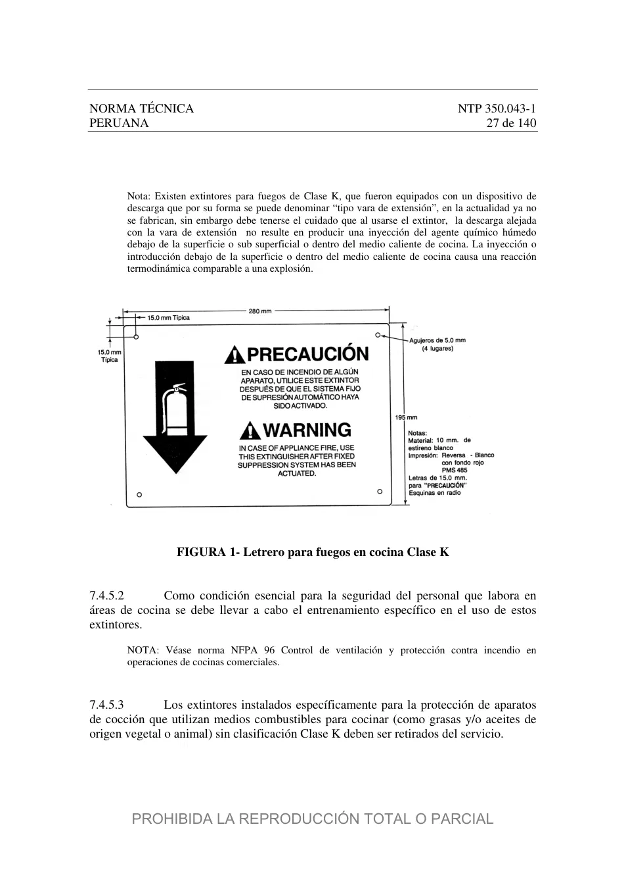

---

## Página 35

NORMA TÉCNICA NTP 350.043-1 PERUANA 28 de 140

7.4.5.4 Extintores de polvo químico seco, sin estar clasificados ni rotulados para Clase K, que fueron instalados para la protección de riesgos Clase K, serán reemplazados con extintores rotulados para dicha Clase cuando llegue la fecha que los extintores de polvo químico seco sean sometidos a mantenimiento o a la prueba hidrostática.

7.4.6 Fuegos en equipos electrónicos: Los extintores para la protección de equipos electrónicos deben ser seleccionados de los tipos rotulados para riesgos Clase C (véase 7.2.4).

7.4.6.1 No se deben instalar extintores de polvo químico seco para la protección de equipos electrónicos delicados

7.4.7 Áreas conteniendo productos oxidantes

7.4.7.1 Sólo los extintores de agua y/o espuma serán instalados en áreas conteniendo materiales oxidantes, tales como el caso de químicos para piscinas

7.4.7.2 No serán instalados extintores de polvo químico seco para fuegos clase ABC en áreas conteniendo materiales oxidantes, tales como el caso de químicos para piscinas

7.5 Selección para aplicación en lugares específicos.

7.5.1 Para el caso de instalaciones y áreas definidas, se recomienda consultar y aplicar, lo considerado en  los  campos de aplicación de las siguientes Normas Técnicas Peruanas, así como a las normas NFPA que a continuación se detallan mientras no existan Normas Técnicas Peruanas equivalentes. Con carácter informativo, los títulos en inglés de estas normas se indican en castellano en el Anexo J - NTP 321.123 Norma para el almacenamiento y manipulación de gases licuado de petróleo.

### PROHIBIDA LA REPRODUCCIÓN TOTAL O PARCIAL

---

## Página 36

NORMA TÉCNICA NTP 350.043-1 PERUANA 29 de 140

- NTP 833.032 EXTINTORES PORTÁTILES PARA VEHÍCULOS AUTOMOTORES - NFPA 30A Code for Motor Fuel Dispensing Facilities and Repair Garages. - NFPA Standard for Drycleaning Plants. - NFPA 86 Standard for Ovens and Furnaces. - NFPA 96 Standard for Ventilation Control and Fire Protection of Commercial Cooking Operations - NFPA 120 Standard for Coal Preparation Plants. - NFPA 122 Standard for Fire Prevention and Control in Metal/Nonmetal Mining and Metal Mineral Processing Facilities. - NFPA 241 Standard for Safeguarding Construction, Alteration, and Demolition Operations  . - NFPA 302 Fire Protection Standard for Pleasure and Comercial Motor Craft - NFPA 303 Fire Protection Standard for Marinas and Boatyards - NFPA 385 Standard for Tank Vehicles for Flammable and Combustible Liquids. - NFPA 400 Hazardous Materials Code - NFPA 407 Standard for Aircraft Fuel Servicing. - NFPA 408 Standard for Aircraft Hand Portable Fire Extinguishers. - NFPA 410 Standard on Aircarft Maintenance. - NFPA 418 Standard for Heliport.

### PROHIBIDA LA REPRODUCCIÓN TOTAL O PARCIAL

---

## Página 37

NORMA TÉCNICA NTP 350.043-1 PERUANA 30 de 140

- NFPA 430 Code for the Storage of Liquid and Solid Oxidizers - NFPA 498 Standard for Safe Havens and Interchange Lots for Vehicles Transporting Explosives. - NFPA 1192 Standard on Recreational Vehicles - NFPA 1194 Standard for Recreational Vehicle Parks and Campgrounds

7.5.2 En ningún caso los requerimientos de las normas indicadas en 7.5.1 serán menores en la protección que las especificadas en esta norma

8. DISTRIBUCIÓN E INSTALACIÓN DE EXTINTORES

8.1 Generales

8.1.1 Cantidad de extintores: La cantidad mínima de extintores necesarios para proteger los diversos ambientes de una propiedad será determinado de acuerdo a este capítulo,

8.1.1.1 Está permitida la instalación de extintores adicionales para proporcionar mayor protección como sea necesario

8.1.1.2 Está permitida la distribución de extintores que tengan una capacidad o potencial de extinción menor que las especificadas en las Tablas 1 y 2; no siendo considerados su utilización para cumplir con los requerimientos mínimos de protección que describe este capítulo; a no ser que cumpla  las pautas  establecidas en 8.2.1.3.1,

8.2.1.4 y 8.3.1.5

### PROHIBIDA LA REPRODUCCIÓN TOTAL O PARCIAL

---

## Página 38

NORMA TÉCNICA NTP 350.043-1 PERUANA 31 de 140

8.1.2 Cálculo de extintores. Es el cálculo de la cantidad necesaria de extintores de acuerdo al riesgo de la ocupación el cual se realizará  aplicando el análisis de protección contra incendios de las áreas específicas de la edificación cuya guía para determinar el número mínimo de extintores es haciendo uso de las tablas 1 y 2, por áreas a proteger, distancias a recorrer así como la correspondiente capacidad o potencial de extinción de los equipos, descrito en una memoria u hoja de cálculo de extintores con el correspondiente plano de distribución que muestra el área máxima que cada extintor puede proteger, suscrita por la persona que ejecutó el cálculo (véase el Anexo G).

8.1.3 Operatividad de los extintores: Los extintores portátiles deben mantenerse correctamente cargados, en condiciones operativas, y estar colocados en sus lugares designados durante todo el tiempo mientras no están siendo usados

8.1.4 Ubicación e instalación

8.1.4.1 Los extintores deben estar ubicados de manera que estén visibles en todo momento, e instalados en lugares estratégicos que permitan estar fácilmente accesibles y de disponibilidad inmediata en caso de un inicio de incendio. En la parte superior donde se ubica el extintor se debe proveer la señal indicada en la Figura 2, pudiendo ser también un cartel como se indica en la Figura 3 y Figura 4.

8.1.4.2 Los extintores deben ser ubicados a lo largo de los pasadizos, incluyendo la salida de las áreas.

8.1.4.3 Obstrucciones visuales.

8.1.4.3.1 Los extintores no deben estar obstaculizados o instalados en zonas obscurecidas que lo hagan poco visibles.

8.1.4.3.2 En recintos amplios o en ciertos lugares donde existan obstáculos físicos que no puedan ser completamente evitados, donde los extintores no fueran totalmente visibles desde todos los puntos del recinto, habitación o local, se debe proveer señales o medios para indicar la ubicación exacta del extintor, como se indica en la Figura 3 ó Figura 4; o también mediante carteles o señales combinadas (véase Figuras 5 y 6)

### PROHIBIDA LA REPRODUCCIÓN TOTAL O PARCIAL

---

## Página 39

NORMA TÉCNICA NTP 350.043-1 PERUANA 32 de 140

ubicadas en las partes altas de las columnas o paredes sobre las cuales está instalado el extintor. En la Figura 7 se detallan las dimensiones recomendables de la señalización del lugar donde se instala el extintor que se muestra en la Figura 4. Nota. Es permitida la utilización de otras señales y carteles  en los pasadizos y pisos que faciliten la ubicación de los extintores, con los colores rojo y blanco (Véase NTP 399.010-1)

### PROHIBIDA LA REPRODUCCIÓN TOTAL O PARCIAL

---

## Página 40

NORMA TÉCNICA NTP 350.043-1 PERUANA 33 de 140

LA SEÑALIZACIÓN SE UBICARÁ A UNA ALTURA MÍNIMA RECOMENDADA DE 1,80 m PARA QUE SEA VISIBLE

FIGURA 2 – Señal para Extintores NOTA : Fondo : Rojo Símbolo :  Blanco Referencias :  NTP 399.010-1 Dimensiones : a = u . x b = u . y donde : módulo  u = 20 cm. x , y = valores a seleccionar según lo requerido

### PROHIBIDA LA REPRODUCCIÓN TOTAL O PARCIAL

**Gráfico o cuadro original:**

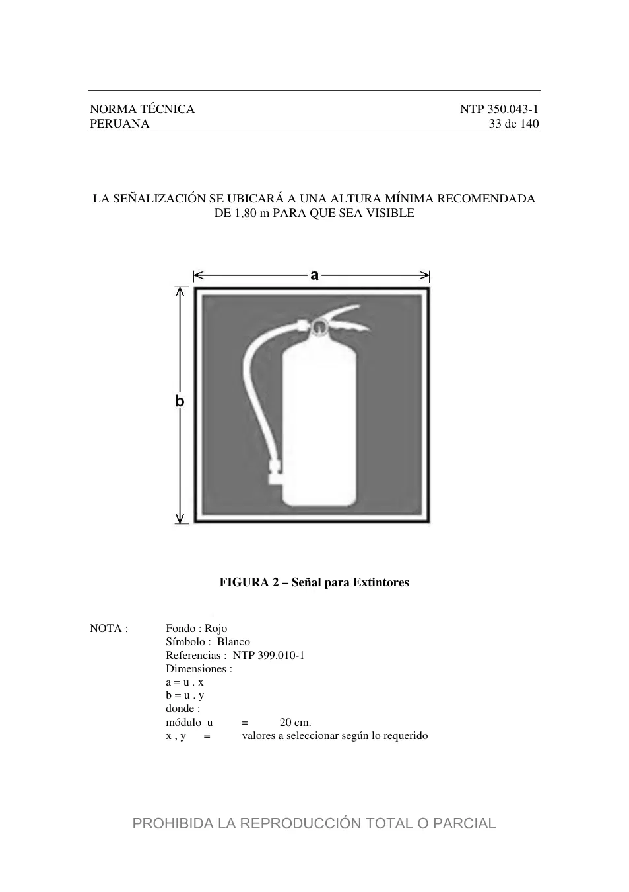

---

## Página 41

NORMA TÉCNICA NTP 350.043-1 PERUANA 34 de 140

FIGURA 3 – Señalización del extintor

### PROHIBIDA LA REPRODUCCIÓN TOTAL O PARCIAL

**Gráfico o cuadro original:**

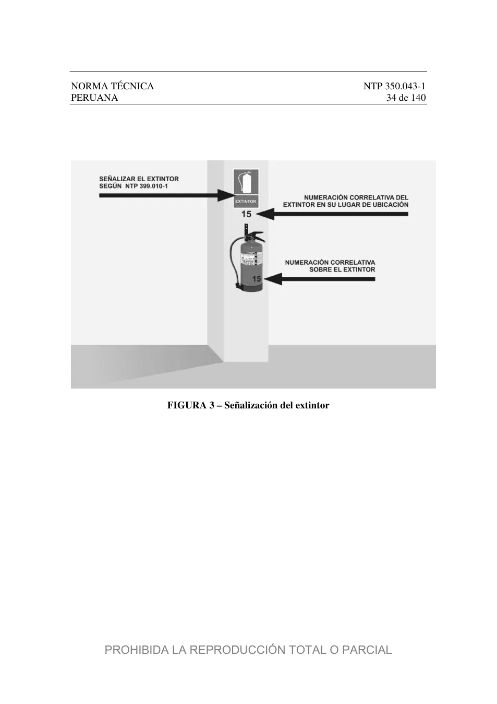

---

## Página 42

NORMA TÉCNICA NTP 350.043-1 PERUANA 35 de 140

FIGURA 4 – Señalización para extintores en almacenes o locales industriales

FIGURA 5 – Carteles varios con las señales para indicar la ubicación del extintor

### PROHIBIDA LA REPRODUCCIÓN TOTAL O PARCIAL

**Gráfico o cuadro original:**

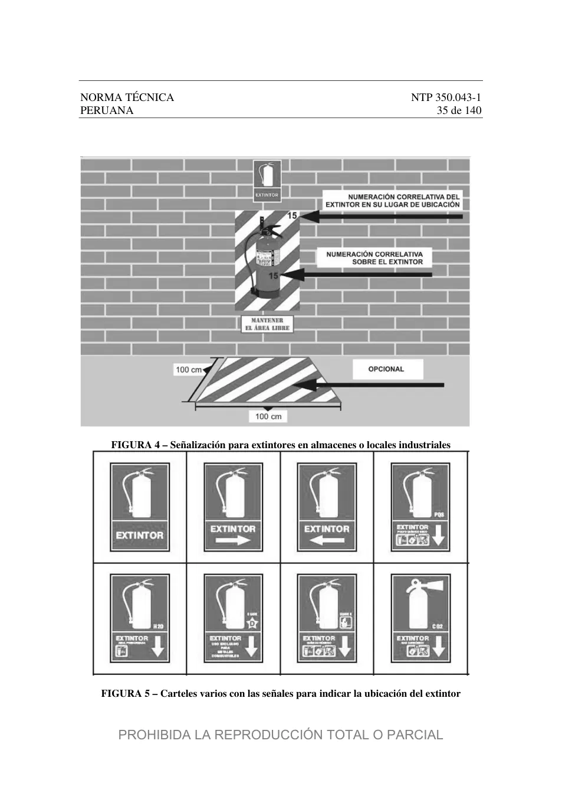

---

## Página 43

NORMA TÉCNICA NTP 350.043-1 PERUANA 36 de 140

FIGURA 6 – Carteles combinados con las señales para indicar la ubicación del extintor, el de la derecha es fotoluminiscente

### PROHIBIDA LA REPRODUCCIÓN TOTAL O PARCIAL

**Gráfico o cuadro original:**

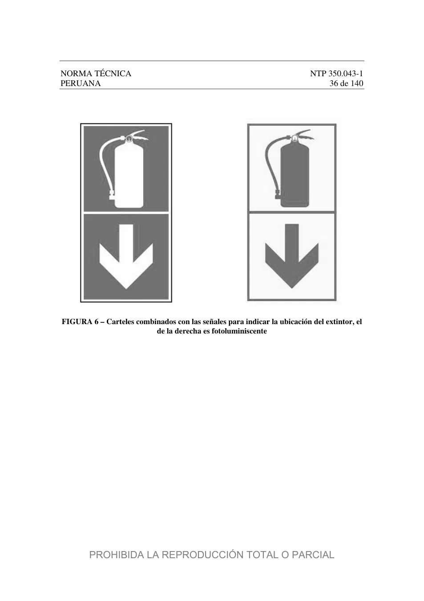

---

## Página 44

NORMA TÉCNICA NTP 350.043-1 PERUANA 37 de 140

H   =   Hasta 1,50 m Para extintores iguales o menores a los 18 kg de peso total H   =   Hasta 1,00 m Para extintores mayores a 18 kg de peso total Y   =   Diámetro del extintor No es recomendable su uso en oficinas Figura 7 - Dimensiones recomendables de la señalización para extintores en almacenes o locales industriales

### PROHIBIDA LA REPRODUCCIÓN TOTAL O PARCIAL

**Gráfico o cuadro original:**

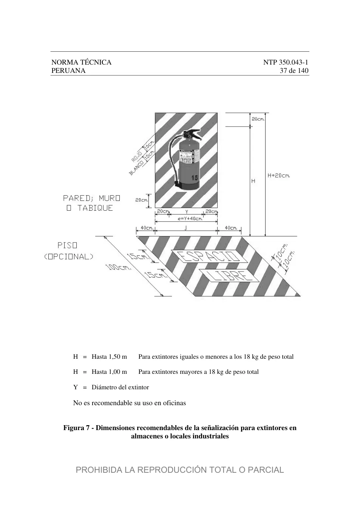

---

## Página 45

NORMA TÉCNICA NTP 350.043-1 PERUANA 38 de 140

8.1.4.4 Los extintores portátiles manuales que no sean los extintores sobre ruedas; deben de ser instalados usando cualquiera de los siguientes medios: 1) Asegurado en su apropiado colgador - soporte mural, para el extintor 2) En la abrazadera que provee el fabricante del extintor. 3) En una abrazadera aprobada para tales propósitos 4) En gabinete o cavidad en la pared

8.1.4.5 Los extintores sobre ruedas deben estar ubicados en un lugar previamente determinado

8.1.4.6 Los extintores instalados, bajo condiciones de estar sujetos a ser desplazados o movidos de su ubicación, deben ser instalados con los soportes específicamente diseñadas por los fabricantes, para estos problemas.

8.1.4.7 Los extintores instalados en condiciones donde estén sujetos a daños físicos (por ejemplo: impactos, vibración, medio ambiente) deben ser adecuadamente protegidos.

8.1.4.8 Altura de instalación

8.1.4.8.1 Los extintores que tengan un peso bruto que no excedan los 18 kg deben ser instalados de manera que la parte superior del extintor, no esté a más de 1,5 m del piso. (Véase Figura 8)

8.1.4.8.2 Los extintores que tengan un peso bruto mayor a 18 kg (excepto tipo sobre ruedas) deben de ser instalados de manera que la parte superior del extintor, no esté a más de 1,10 m por encima del piso. (Véase Figura 9)

8.1.4.8.3 En ningún caso el espacio entre la parte más baja del extintor y el piso no debe ser menos de 0,2 m (200 mm) (Véase Figura 10 y 11)

### PROHIBIDA LA REPRODUCCIÓN TOTAL O PARCIAL

---

## Página 46

NORMA TÉCNICA NTP 350.043-1 PERUANA 39 de 140

8.1.4.8.4 En el caso de paredes o tabiquería que no resisten o no permiten instalar el extintor con su soporte de pared o mural, se podrán instalar en un pedestal que tenga un diseño con una apropiada base que permita una instalación estable y segura de dicho extintor, así como facilitar su inmediato uso en caso de una emergencia (véase Figura 11).

Figura 8 – Altura de la instalación de extintor igual o menor a 18 kg.

### PROHIBIDA LA REPRODUCCIÓN TOTAL O PARCIAL

**Gráfico o cuadro original:**

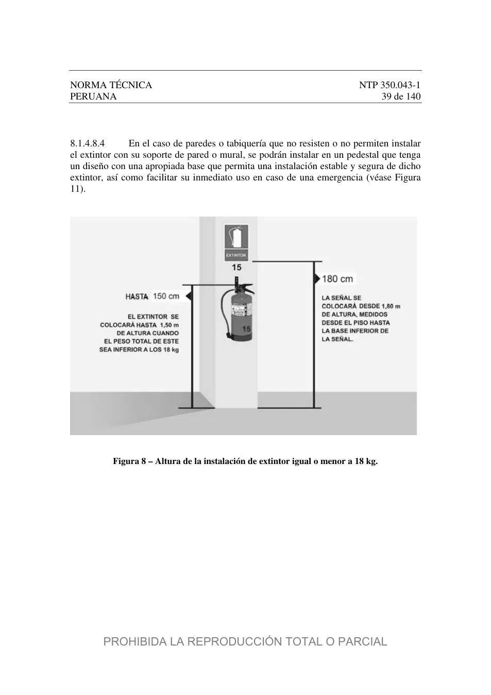

---

## Página 47

NORMA TÉCNICA NTP 350.043-1 PERUANA 40 de 140

Figura 9 – Altura de la instalación de extintor mayor a 18 kg

Figura 10 – Espacio entre la parte más baja del extintor y el piso

### PROHIBIDA LA REPRODUCCIÓN TOTAL O PARCIAL

**Gráfico o cuadro original:**

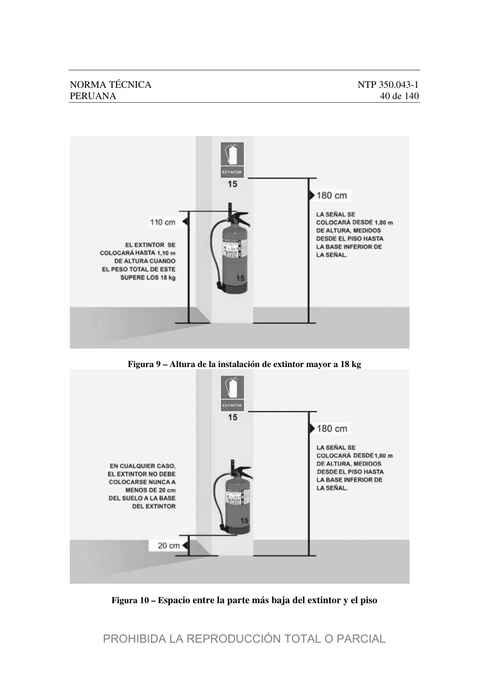

---

## Página 48

NORMA TÉCNICA NTP 350.043-1 PERUANA 41 de 140

Figura 11 – Pedestal (El modelo es sólo referencial)

8.1.4.9 Visibilidad del rotulado

8.1.4.9.1 Una vez instalado, las instrucciones de operación del extintor deben estar ubicadas en la parte frontal del extintor y debe ser claramente visible.

8.1.4.9.2 Etiquetas del Sistema de Identificación de Materiales Peligrosos (véase

6.2.4), etiquetas de mantenimiento y recarga, etiquetas de prueba hidrostática, u otras etiquetas no deben ser ubicadas o colocadas en la parte frontal del extintor.

8.1.4.9.3 Las restricciones indicadas en 8.1.3.9.2 no deben aplicarse al rotulado original del fabricante, rotulado que específicamente detalla la operación del extintor o la clasificación de fuegos, o a la tarjeta de inspección o de control de inventario específica para el extintor.

### PROHIBIDA LA REPRODUCCIÓN TOTAL O PARCIAL

**Gráfico o cuadro original:**

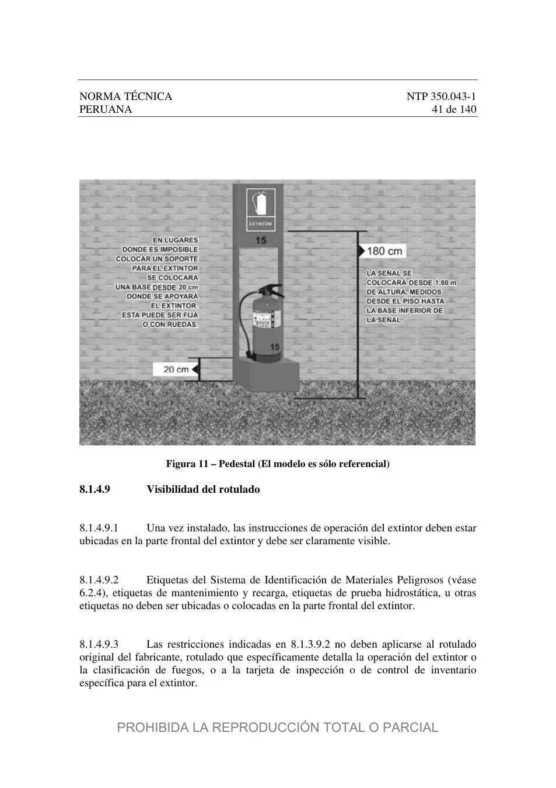

---

## Página 49

NORMA TÉCNICA NTP 350.043-1 PERUANA 42 de 140

8.1.4.10 Gabinete

8.1.4.10.1 Los gabinetes, que alojan a un extintor, no deben mantenerse cerrados con llave. En el caso que pueda estar sujeto a sustracción o pérdida, los gabinetes deben ser acondicionados con un medio de acceso de emergencia para su apertura o por medio de un sistema de apertura rápida por presión o magnética. En el caso extremo que tenga que ser cerrado con llave, se debe construir de manera que este claramente establecido el procedimiento, demuestre ser infalible y permita que el extintor pueda retirarse del gabinete apropiadamente.

8.1.4.10.2 Los extintores instalados en los gabinetes o cavidades o espacios empotrados en la pared, deben ser ubicados de tal manera que las instrucciones de operación del extintor estén a la vista

8.1.4.10.3 Cuando los extintores son instalados en gabinetes cerrados que están expuestos a temperaturas elevadas, los gabinetes deben estar provistos con aperturas de ventilación así como de drenajes

8.1.4.10.4 Los extintores que por motivos justificados deban instalarse a la intemperie o bajo condiciones físicas severas: de vibración, temperatura, humedad, corrosión, radiación solar, etc, deberán instalarse en gabinetes adecuados al medio donde se van utilizar. Para el caso de extintores sobre ruedas se puede recomendar la utilización de cobertores que lo protejan del medio ambiente, apropiadamente

8.1.4.11 Los extintores no deben estar expuestos a temperaturas fuera del rango de temperaturas indicadas en la placa de rotulado del extintor

8.1.5 Anticongelante

8.1.5.1 Los extintores que contienen como agente de extinción agua sólo pueden ser protegidos para temperaturas tan bajas como – 40 ºC (-40 ºF) por la adición de un

### PROHIBIDA LA REPRODUCCIÓN TOTAL O PARCIAL

---

## Página 50

NORMA TÉCNICA NTP 350.043-1 PERUANA 43 de 140

anticongelante que está indicado en la placa de rotulado del extintor, recomendado por el fabricante.

8.1.5.2 Los anticongelantes que contienen soluciones de cloruro de calcio no deben ser usados en extintores de acero inoxidable

8.2 Instalación para riesgos de fuegos Clase A

8.2.1 Capacidad o potencial de extinción y ubicación de extintores para riesgos de fuego Clase A

8.2.1.1 La capacidad o potencial mínima de extinción de los extintores para la severidad de los riesgos clasificados (bajo, moderado, alto) serán proporcionados en base a la Tabla 1, excepto según lo establecido en 8.2.1.3.1  y 8.2.1.4

8.2.1.2 Los extintores deben estar ubicados de tal manera que las máximas distancias a recorrer no excedan a la especificada en la Tabla 1 excepto según lo establecido en 8.2.1.4 (véase anexo G)

8.2.1.3 Algunos extintores pequeños que están cargados con polvo químico seco multipropósito o agente halogenado incluso clasificados para fuegos Clase B y Clase C, pero que no tienen la capacidad o potencial de extinción suficiente para obtener la mínima capacidad de extinción 1-A, aun cuando tienen valor en la extinción de fuegos más pequeños de Clase A no deben ser considerados para satisfacer el requerimiento de

8.2.1

### PROHIBIDA LA REPRODUCCIÓN TOTAL O PARCIAL

---

## Página 51

NORMA TÉCNICA NTP 350.043-1 PERUANA 44 de 140

Tabla 1 – Capacidad o potencial de extinción para riesgos de fuego Clase A, por áreas a proteger* y distancias a recorrer Criterio Ocupación de riesgo Bajo

**Cuadro del documento (filas: 2; columnas: 4):**

| Criterio | Ocupación de / riesgo / Bajo | Ocupación de / riesgo moderado | Ocupación de / riesgo / alto |
| --- | --- | --- | --- |
| Capacidad o potencial de / extinción mínima (extintor / individual) / Área máxima de piso por / unidad de A / Área máxima de piso cubierta / por extintor / Distancia máxima a recorrer / hasta el extintor | 2–A / 280 m2 / 1 045 m2 / 23 m | 2–A / 140 m2 / 1 045 m2 / 23 m | 4–A / 93 m2 / 1 045 m2 / 23 m |

Para el  Sistema Internacional de Unidades:  0,305 m = 1 pie   ;     0,0929 m2  =  1 pie2 Explicaciones para área máxima de piso, véase anexo G 3.3 * En este cuadro no se está considerando volumen

8.2.1.3.1 Los extintores de capacidad de extinción menores se deben permitir instalar pero no deben ser considerados como que cumplen alguna parte de los requerimientos de la Tabla 1 excepto como está permitido en 8.2.1.3.1.1 y 8.2.1.3.1.2

8.2.1.3.1.1 Hasta dos extintores tipo agua cada uno con capacidad de extinción 1-A serán permitidos a ser usados para cumplir el requerimiento de un extintor de capacidad de extinción 2-A

8.2.1.3.1.2 Dos extintores tipo agua de 10 L (2 ½ galones) serán permitidos a ser usados para cumplir el requerimiento de un extintor de capacidad de extinción 4-A

8.2.1.4 Hasta la mitad de la dotación de los extintores como los especificados en la Tabla 1 (fuegos de Clase A) pueden ser reemplazados por instalaciones usando manguera de 1 ½ de pulgada de diámetro, espaciadas uniformemente para ser utilizados por los ocupantes de las edificaciones.

### PROHIBIDA LA REPRODUCCIÓN TOTAL O PARCIAL

---

## Página 52

NORMA TÉCNICA NTP 350.043-1 PERUANA 45 de 140

La dotación de extintores no elimina a las instalaciones de manguera. Dichas instalaciones deberán cumplir con la Norma NFPA 14, mientras no exista la NTP correspondiente. La ubicación de las instalaciones con manguera y la de los extintores deben estar intercaladas de manera que cada instalación con manguera no reemplace más de un extintor.

8.2.1.5 Donde el área de un establecimiento es menor que el especificado en la Tabla 1, por lo menos debe ser instalado un extintor de la capacidad de extinción mínima recomendada.

8.2.2 Es permitido cumplir los requisitos de protección con extintores de una capacidad o potencial de extinción mayor, teniendo en cuenta que la distancia de recorrido a los extintores, así sean de mayor capacidad de extinción, no exceda los 23 m. (véase Tabla 1) Es necesario que al seleccionar los extintores se cumpla con la distribución y distancia del recorrido.

8.3 Instalación para riesgos de fuegos Clase B

8.3.1 Capacidad o potencial de extinción y ubicación de los extintores para riesgos de fuego Clase B, distintos a aquellos para fuegos en líquidos inflamables de apreciable profundidad. NOTA. Líquidos inflamables de apreciable profundidad son aquellos que tienen una profundidad mayor a 0,64 cm (1/4 de pulgada)

8.2.1.1 La capacidad o potencial de extinción mínima de los extintores para los riesgos clasificados Clase B, debe ser suministrada en base a la tabla 2, excepto según lo establecido en 8.3.1.3.

8.2.1.2 Los extintores deben ser ubicados de tal forma que la distancia de recorrido máxima no exceda aquellas especificadas en la tabla 2. Esta permitido instalar extintores de menor capacidad o potencial relativa de extinción deseables para riesgos específicos menores dentro del área general de riesgo, pero no

### PROHIBIDA LA REPRODUCCIÓN TOTAL O PARCIAL

---

## Página 53

NORMA TÉCNICA NTP 350.043-1 PERUANA 46 de 140

deben considerarse que cumplen con alguna parte de los requisitos de la tabla 2, excepto según lo establecido en  8.3.1.3

8.3.1.3 No deben ser utilizados, dos o más extintores de menor capacidad o potencial de extinción para llenar los requisitos de protección de la tabla 2, excepto lo permitido en 8.3.1.4 y 8.3.1.5. Las capacidades o potencial de extinción (rating) de los extintores para fuegos Clase B no se suman. Tabla 2 – Capacidad o potencial de extinción de extintores por riesgos de fuego Clase B y distancia máxima a recorrer

**Cuadro del documento (filas: 4; columnas: 3):**

| Tipo de riesgo | Capacidad o potencial de / extinción Básica Mínima | Distancia máxima a recorrer / hasta el extintor / (m) |
| --- | --- | --- |
| Bajo | 5B / 10B | 9 / 15 |
| Moderado | 10B / 20B | 9 / 15 |
| Alto | 40B / 80B | 9 / 15 |

NOTA 1. Para fuegos que involucren líquidos inflamables solubles en agua, véase 7.4.3 NOTA 2.Para aplicación a riesgos específicos, véase 7.4 NOTA 3. Las capacidades de extinción especificadas no implican que ocurrirán fuegos de las magnitudes indicadas por estas clasificaciones, sino que se establecen para dar a los operadores de los extintores más tiempo y agente de extinción para manejar derrames difíciles que pudieran ocurrir.

8.3.1.4 Se permitirá hasta tres extintores de espuma formadora de película acuosa (AFFF) o espuma fluoro-proteínica formadora de película (FFFP) de por lo menos 9,46 L de capacidad de carga para que pueden ser utilizados para cumplir con los requisitos de riesgo alto.

### PROHIBIDA LA REPRODUCCIÓN TOTAL O PARCIAL

---

## Página 54

NORMA TÉCNICA NTP 350.043-1 PERUANA 47 de 140

8.3.1.5 Se permitirá usar dos extintores de espuma formadora de película acuosa (AFFF) o espuma fluoro-proteínica formadora de película (FFFP) de por lo menos 6L de capacidad de carga, para que pueden ser utilizados para cumplir con los requisitos de riesgo moderado.

8.3.1.6 Los requisitos de protección pueden ser llevados a cabo con extintores con capacidades o potencial de extinción mayores pero teniendo en cuenta que la distancia de recorrido a los extintores no exceda los 15 m. (véase Tabla 2)

8.3.2 Capacidad o potencial de extinción y ubicación de extintores para riesgos de Clase B en líquidos inflamables de apreciable profundidad.

8.3.2.1 Los extintores portátiles no deben ser instalados como única protección de riesgos con líquidos inflamables de apreciable profundidad [mayores de 0,64 cm (1/4 de pulgada)] donde la superficie exceda de 0,93 m2 (10pies2). Se debe recomendar la instalación de sistemas automáticos

8.3.2.2 En los lugares donde exista personal entrenado en extinción de incendios, será permitido que la máxima superficie para ser cubierta por extintores como única protección sea extendida a 1,86 m2 (20 pies2) de área de mayor riesgo.

8.3.2.3 Para riesgos de líquidos inflamables de apreciable profundidad, se debe disponer de un extintor de Clase B, considerando por lo menos dos unidades numéricas de capacidad o potencial de extinción (2-B) por cada 0,0929  m2 (1 pie2) de superficie del líquido inflamable del riesgo de mayor área.

8.3.2.4 Los extintores de tipo de espuma formadora de película acuosa (AFFF) y espuma fluoro-proteínica formadora de película (FFFP), pueden ser empleados en base a la protección de 1-B por cada 0,0929 m2 (1pie2) de riesgo. Para fuegos que involucran líquidos inflamables solubles en agua véase 7.4.3

### PROHIBIDA LA REPRODUCCIÓN TOTAL O PARCIAL

---

## Página 55

NORMA TÉCNICA NTP 350.043-1 PERUANA 48 de 140

8.3.2.5 No se deben usar dos o más extintores de menor capacidad de extinción en lugar de los extintores requeridos para el riesgo de mayor área, con excepción de los extintores tipo AFFF o FFFP.

8.3.2.6 Se permitirá usar hasta tres extintores de tipo AFFF y FFFP para cumplir los requerimientos, siempre que la suma de las denominaciones Clase B cumpla o sobrepase el valor requerido para el área mayor de riesgo.

8.3.2.7 Las distancias de recorrido para los extintores portátiles no excederán los 15 m.

8.3.2.8 Lugares de riesgo dispersos o ampliamente separados deben ser protegidos individualmente. Un extintor en la proximidad de un riesgo debe ser instalado apropiadamente para que sea accesible en el momento del incendio y sin poner en riesgo al operador.

8.4 Instalación de extintores para riesgos de Clase C.

8.4.1 Los extintores para fuegos de Clase C deben ser instalados en lugares donde se encuentre equipo eléctrico energizado.

8.4.2 El requisito 8.4.1 incluye las situaciones donde el fuego comprometa directamente o rodee el equipo eléctrico.

8.4.3 Dado que el fuego en equipos eléctricos energizados, en sí es por materiales combustibles de un riesgo de Clase A o Clase B, los extintores se deben seleccionar e instalar, además del riesgo de clase C, en base al riesgo previsto sea de Clase A o Clase B, que pueda esperarse. Nota 1: El equipo eléctrico debe ser desenergizado lo más pronto posible para evitar la reignición.

### PROHIBIDA LA REPRODUCCIÓN TOTAL O PARCIAL

---

## Página 56

NORMA TÉCNICA NTP 350.043-1 PERUANA 49 de 140

8.5 Instalación de extintores para riesgos de Clase D. Por tratarse de casos excepcionales de fuegos de Clase D se deberá tomar en cuenta los estudios y recomendaciones de especialistas para la selección, distribución e instalación de este tipo de extintores.

8.5.1 Los extintores o agentes de extinción con capacidad o potencial de extinción para Clase D, deben ser suministrados para fuegos que involucren metales combustibles.

8.5.2 Los equipos de extinción o agentes de extinción deben estar ubicados a no más de 23 m (75 pies) de distancia de recorrido al riesgo de Clase D. (Véase Anexo G, apartado G.6.1)

8.5.3 Los extintores portátiles o agentes de extinción para riesgos Clase D deben ser suministrados en las áreas de trabajo donde se generen polvos metálicos combustibles, escamas, virutas, astillas, o productos de tamaño similar.

8.5.4 La determinación de la capacidad y el tipo de agente debe realizarse específicamente en base al metal combustible, al tamaño físico de partícula, área a ser cubierta y recomendaciones del fabricante del extintor obtenidas de ensayos realizados.

8.6 Instalación de extintores para riesgos de Clase K

8.6.1 Los extintores para fuegos Clase K, deben ser suministrados para aquellos riesgos donde exista un potencial de fuegos que involucre medios para cocinar que son combustibles como grasas y/o aceites de origen vegetal o animal.

8.6.2 La distancia máxima de recorrido desde el riesgo hasta el extintor no debe exceder de 9,00 m.

### PROHIBIDA LA REPRODUCCIÓN TOTAL O PARCIAL

---

## Página 57

NORMA TÉCNICA NTP 350.043-1 PERUANA 50 de 140

8.6.3 Todas las cocinas que usan combustibles sólidos (carbón, leña, aserrín, etc) (con o sin campana),  con caja para fuego de un volumen de 0,14 m3 ó menos, deben tener por lo menos un extintor tipo agua con capacidad o potencial de extinción 2-A o un extintor de químico húmedo de 6 L,  indicado para fuegos Clase K.

9. INSPECCION, MANTENIMIENTO Y RECARGA

9.1 Requisitos Generales

9.1.1 Responsabilidad. El propietario, o el administrador de la propiedad u ocupante de una propiedad serán responsables de la inspección, mantenimiento y recarga de los extintores que están instalados

9.1.2 La inspección debe ser realizada por personal calificado de acuerdo al apartado 9.2.2, por ejemplo:

a) El propietario o el administrador de la propiedad u ocupante del bien mueble o inmueble, o;

b) Empresa de mantenimiento y recarga, o;

c) Empresas Asesoras, o;

d) Oficina, o departamento, o área, de la organización que ocupa la propiedad, con encargo o función relacionada a este tema

9.1.3 El mantenimiento y recarga de extintores portátiles se debe realizar a través de empresas de mantenimiento y recarga competentes para realizar dichos servicios, que tengan los equipos de acuerdo a la NTP 833.026-1

9.1.4 En caso de verificarse deficiencias en cualquier de los puntos establecidos en 9.2.2, las acciones correctivas se tienen que efectuar contratando el servicio de empresas de mantenimiento y recarga.

9.1.5 Se recomienda que en el servicio (véase 4.35) no se permita la división de responsabilidades ni intermediación de sub-contratistas.

### PROHIBIDA LA REPRODUCCIÓN TOTAL O PARCIAL

---

## Página 58

NORMA TÉCNICA NTP 350.043-1 PERUANA 51 de 140

9.1.6 Para los servicios de inspección, mantenimiento y recarga, el propietario o el administrador de la propiedad u ocupante de la instalación fija o móvil, la empresa de mantenimiento y recarga y la empresa asesora deben cumplir los requisitos de responsabilidad indicados en 6.1.1 a 6.1.11 de esta parte de la NTP 350.043

9.1.7 Personal competente.

9.1.7.1 Personal entrenado y capacitado (véase definición 4.29 y el Anexo A) que han aprobado los procedimientos y métodos necesarios para desempeñar un mantenimiento confiable y además dispongan del manual de mantenimiento del fabricante deben dar el servicio a los extintores a intervalos no mayores de un año como se describe en el apartado 9.3

9.1.7.2 Los servicios de mantenimiento y recarga deben ser realizados por personas entrenadas y capacitadas que tienen disponible los manuales de servicio apropiados, los tipos apropiados de herramientas, materiales de recarga, lubricantes y partes de reemplazo recomendadas por los fabricantes o partes específicamente fabricadas para uso en los extintores

9.1.7.3 El personal para estos servicios debe acreditar su entrenamiento y capacitación obtenida. Las empresas de mantenimiento y recarga son responsables de contar con éste personal.

9.1.8 Reemplazo durante el servicio.  Los extintores retirados para el servicio de mantenimiento o recarga deben ser reemplazados por extintores apropiados para el tipo de riesgo que están protegiendo y debe ser por lo menos de igual capacidad de extinción.

9.1.9 Tarjetas, rótulos o etiquetas

9.1.9.1 Los rótulos o etiquetas destinadas para registrar el mantenimiento y/o recarga no deben ser colocados en la parte frontal del extintor.

### PROHIBIDA LA REPRODUCCIÓN TOTAL O PARCIAL

---

## Página 59

NORMA TÉCNICA NTP 350.043-1 PERUANA 52 de 140

9.1.9.2 Es permitido colocar en la parte frontal del extintor la tarjeta de inspección así como los rótulos o etiquetas que indican las instrucciones de uso o la capacidad de extinción o ambos.

9.1.10 Sistemas de monitoreo electrónico

9.1.10.1 Los dispositivos electrónicos de monitoreo de extintores cuando se usa en unión con sistemas de alarma de fuego deben ser inspeccionados y mantenidos de conformidad con la norma NFPA 72 y con el apartado 9.3.2.6

9.1.10.2 Los dispositivos electrónicos de monitoreo de extintores cuando  no  se usa en unión con sistemas de alarma de fuego deben ser inspeccionados y mantenidos como es requerido en 9.1.10.2.1 a 9.1.10.2.3 y el manual de instalación y mantenimiento del fabricante

9.1.10.2.1 La conexión al dispositivo electrónico de monitoreo debe ser continuamente supervisado para que garantice su permanente funcionamiento

9.1.10.2.2 La fuente de energía para el dispositivo electrónico de monitoreo  debe ser supervisado para que no se produzca la interrupción de la energía

9.1.10.2.3 El dispositivo de monitoreo debe ser ensayado y mantenido anualmente en conformidad con el apartado 9.3.2.6

9.2 INSPECCIÓN DE LOS EXTINTORES Es la verificación externa del extintor con la finalidad de dar una seguridad relativa sobre la operatividad del mismo.

### PROHIBIDA LA REPRODUCCIÓN TOTAL O PARCIAL

---

## Página 60

NORMA TÉCNICA NTP 350.043-1 PERUANA 53 de 140

9.2.1 Frecuencia Los extintores deben ser inspeccionados desde que comienzan a prestar servicio, cuando recién son instalados, siendo la primera una inspección física con un registro emitido por escrito; las siguientes inspecciones como se indica en 9.2.1.2

9.2.1.1 Todos los extintores deben ser inspeccionados cada 30 días en cualquiera de las siguientes dos formas: - Física con registros por escrito, o; - Por medio de un sistema o dispositivo electrónico de monitoreo.

9.2.1.1.1 La frecuencia de las inspecciones podrá ser menor según la necesidad del área, en la cual el extintor está instalado.

9.2.1.1.2 Cuando se usa monitoreo electrónico y un extintor específico no puede ser verificado electrónicamente entonces deberá ser continuamente monitoreado en su ubicación

9.2.1.2 La inspección de extintores se realizará a intervalos más frecuentes que los mensuales si existiera cualquiera de las circunstancias siguientes:

a) Clasificación del riesgo como riesgo alto,

b) Frecuentes conatos de incendio,

c) Repetidas obstrucciones físicas o visuales,

d) Ubicación que posibilita la ocurrencia de daños mecánicos ,

e) Posibilidad de manipuleo malicioso o irresponsable.

f) Exposición a temperaturas anormales o atmosferas corrosivas

g) Extintores instalados en vehículos automotores

9.2.1.3 Es recomendable que en los lugares donde existan las condiciones de

9.2.1.2, las empresas autorizadas de mantenimiento y recarga verifiquen que las inspecciones se realicen de acuerdo a esta parte de la NTP 350.043.

### PROHIBIDA LA REPRODUCCIÓN TOTAL O PARCIAL

---

## Página 61

NORMA TÉCNICA NTP 350.043-1 PERUANA 54 de 140

9.2.2 La inspección periódica de los extintores sea física o por monitoreo electrónico debe incluir la verificación de por lo menos los siguientes puntos:

a) El extintor este ubicado en su lugar designado.

b) El acceso y la visibilidad al extintor, no deben tener ninguna obstrucción.

c) Las instrucciones de operación deben estar visibles y legibles, redactada en castellano y estar a la vista

d) Que los sellos, precintos y pasadores de seguridad, indicadores de operación no hayan sido removidos de su lugar, falten ni estén rotos.

e) Verificar el peso bruto del extintor de acuerdo a instrucciones del fabricante.

f) Examinar cualquier evidencia de daño físico, corrosión, fugas u obstrucción de manguera.

g) En los extintores presurizados, observar que el manómetro o el indicador muestre la presión de operación de trabajo.

h) Para extintores sobre ruedas verificar la condición de las ruedas, llantas, bastidor, mangueras, conexiones y boquillas

i) Que las etiquetas de mantenimiento, recarga y pruebas hidrostáticas se encuentren en su lugar con fecha actualizada acorde a la presente NTP.

j) La Tarjeta de Inspección sea la establecida en la NTP 833.030 y los registros sean acorde a la presente NTP

9.2.3 Acción Correctiva. Cuando la inspección de cualquier extintor revele una deficiencia en cualquier de los puntos indicados en a), b), c), i), j) de 9.2.2 se debe tomar la acción correctiva inmediata.

9.2.4 Derivación a mantenimiento. Cuando la inspección revele una deficiencia en cualquiera de los puntos indicados de d) hasta  h) de 9.2.2 el extintor debe ser sometido al método de control total de mantenimiento preventivo en el taller de una empresa de mantenimiento y recarga.

9.2.5 El personal encargado de las inspecciones deberá inspeccionar que los extintores estén siempre ubicados en los lugares designados, el número de cada uno deberá ser graficado o marcado, tanto en el cuerpo del extintor como en la ubicación física donde se instala (gabinete, colgador, alojamiento, etc). (Véase Figuras 3, 4, 7, 8 a 10)

### PROHIBIDA LA REPRODUCCIÓN TOTAL O PARCIAL

---

## Página 62

NORMA TÉCNICA NTP 350.043-1 PERUANA 55 de 140

9.2.6 Conservación de registros de inspección e inventario

9.2.6.1 El Personal encargado de las inspecciones físicas debe conservar los registros de todos los extintores inspeccionados, inclusive de aquellos encontrados que requieren acciones correctivas.

9.2.6.2 Donde sistemas electrónicos de monitoreo son empleados para inspecciones, deben ser conservados los registros de los extintores encontrados que requieren acciones correctivas

9.2.6.3 Donde inspecciones físicas son realizadas, al menos mensualmente debe estar registradas, la fecha en que fue realizada la inspección física y las iniciales de la persona que la llevó a cabo.

9.2.6.4 Cuando inspecciones físicas son realizadas, se deben registrar las verificaciones efectuadas en una Tarjeta de Inspección, que irá puesta al extintor. Los registros de cada inspección, serán transcritos y conservados en un archivo físico, en caso el método fuera electrónico se dispondrá en un archivo electrónico. La Tarjeta de Inspección a colocar en el extintor se establece en la NTP 833.030.

9.2.6.5 Los registros se deben conservar para demostrar al menos que las inspecciones de los últimos 12 meses han sido realizados.

9.2.6.6 Extintores inspeccionados vía monitoreo electrónico, donde el extintor causa una señal a la unidad de control cuando una deficiencia en cualquiera de las condiciones listadas en 9.2.2 ocurre, deberá proveer la conservación del registro en la forma de un evento electrónico indicado en el panel de control.

### PROHIBIDA LA REPRODUCCIÓN TOTAL O PARCIAL

---

## Página 63

NORMA TÉCNICA NTP 350.043-1 PERUANA 56 de 140

9.2.6.7 Inventario y registros Acorde con lo indicado en el apartado 6.1.10 el propietario u ocupante debe llevar un registro foliado o archivo por el método electrónico, donde se consignará:  Inventario técnico  Registro de Inspecciones y mantenimiento  Historia de descargas  Observaciones

a) Los inventarios técnicos deberán indicar por lo menos:  Numero del extintor designado por el usuario (véase 8.2.5.3)  Ubicación  Agente extintor.  Nomenclatura de fabricante (tipo, modelo, Nº de serie, código, etc)  Capacidad de extinción  Capacidad de Carga  Presión de la prueba hidrostática de origen.  Fecha de fabricación

b) Los registros de inspecciones, deberán indicar las observaciones que se encuentren, la fecha, el nombre y la firma del responsable de efectuarlas.

c) En el registro de mantenimiento se indicarán las fechas de ejecución, la empresa que las efectúa, tipo de servicio y/o mantenimiento recibido, partes sustituidas, así como la fecha y la presión de las pruebas hidrostáticas que se efectúan.

d) En cada registro individual se anotará las fechas de descarga y causales que la originaron.

### PROHIBIDA LA REPRODUCCIÓN TOTAL O PARCIAL

---

## Página 64

NORMA TÉCNICA NTP 350.043-1 PERUANA 57 de 140

9.3 MANTENIMIENTO DE LOS EXTINTORES

9.3.1 Frecuencia

9.3.1.1 Todos los extintores a intervalos regulares, no mayores de un año o cuando le corresponda la prueba hidrostática o cuando sea específicamente determinado por la inspección realizada o la notificación electrónica, deben ser rigurosamente examinados y mantenidos, para asegurar su operación eficaz y segura.

9.3.1.2 Cada cinco años, cuando se requiere una prueba hidrostática, todos los extintores deberán ser completamente descargados y sometidos a procedimientos de mantenimiento establecidos en la presente norma. Nota. Para el caso de extintores que contienen agentes halogenados, véase NTP 350.043-2

9.3.1.3 Mangueras de extintores de dióxido de carbono: Debe efectuarse anualmente una prueba de conductividad entre los conectores de las mangueras de extintores de dióxido de carbono.

9.3.1.3.1 Las mangueras de extintores de dióxido de carbono que no pasen la prueba de conductividad, deben ser reemplazadas

9.3.1.3.2 Las mangueras que pasen la prueba de conductividad deben tener un rótulo metálico para registro del resultado de la prueba o en un material durable de tamaño mínimo de 13 mm x 75 mm

9.3.1.3.3 El rótulo debe estar fijado a la manguera.

9.3.1.3.4 El rótulo debe incluir la información siguiente: - Mes y año de la prueba realizada, indicada por perforación - Nombre o iniciales de la persona que realizó la prueba y el nombre de la empresa de mantenimiento y recarga responsable de la prueba

### PROHIBIDA LA REPRODUCCIÓN TOTAL O PARCIAL

---

## Página 65

NORMA TÉCNICA NTP 350.043-1 PERUANA 58 de 140

9.3.1.4 Reguladores de presión. Los reguladores de presión de los extintores sobre ruedas serán sometidos anualmente a una calibración y verificación de presión estática y de tasa de flujo, de acuerdo a las instrucciones del fabricante.

9.3.1.5 Los extintores que se retiren para el servicio de mantenimiento o recarga deben ser reemplazados por otros extintores, debiendo ser estos de igual o mayor capacidad de extinción (rating), de manera que las instalaciones no queden desprotegidas.

9.3.2 Procedimiento de Mantenimiento

9.3.2.1 Los procedimientos deben incluir exámenes minuciosos de los elementos básicos de un extintor:  Las partes mecánicas  Agente de extinción  Mecanismo de impulsión  Apariencia física y rotulado  Mangueras en especial de extintores sobre ruedas examinadas por daños Se seguirán los procedimientos detallados en el manual de servicio del fabricante. Se usarán instrumentos y equipos apropiados indicados en la NTP 833.026, personal competente (véase 9.1.7) y siguiendo los procedimientos establecidos en el Anexo C Igualmente en el caso que involucre un sistema o dispositivo de monitoreo electrónico se debe examinar además los componentes del mismo

9.3.2.2 Este examen determinará la necesidad de una prueba hidrostática, recarga o rechazo del extintor. Este examen debe realizarse de acuerdo a lo indicado en el Anexo B.

9.3.2.3 Precinto de inviolabilidad y pasador de seguridad

### PROHIBIDA LA REPRODUCCIÓN TOTAL O PARCIAL

---

## Página 66

NORMA TÉCNICA NTP 350.043-1 PERUANA 59 de 140

9.3.2.3.1 En el momento cuando se hace el mantenimiento deben retirarse el precinto de inviolabilidad así como el pasador de seguridad.

9.3.2.3.2 Después de completar los procedimientos de mantenimiento se debe colocar un nuevo pasador y su respectivo precinto de inviolabilidad.

9.3.2.4 Protector de base, abrazaderas y accesorios. Todas las abrazaderas, accesorios, así como los que tienen el protector adicional (plástico) de base del extintor serán retirados para permitir la completa inspección anual del cilindro.

9.3.2.5 Apariencia física. Un examen visual del extintor debe ser efectuado para examinar posibles daños físicos, corrosión, obstrucciones de boquilla y para verificar que las instrucciones de operación están presentes o actualizadas y legibles en la parte frontal e Información del Sistema de Identificación de Materiales Peligrosos (HMIS) (véase 6.2.4)  debe estar presente y legible.

9.3.2.6 Monitoreo electrónico. Los componentes del sistema o dispositivo de monitoreo deberán ser probados y mantenidos anualmente de conformidad con el manual de mantenimiento del fabricante, incluyendo como mínimo los siguientes elementos: - Inspección del suministro de energía/ carga de baterías - Inspección de obstrucción del sensor - Inspección de ubicación del sensor - Inspección del indicador de presión - Inspección de continuidad de conexión (véase 9.3.2.6.1 y 9.3.2.6.2)

9.3.2.6.1 El cien por ciento de los extintores a ser controlados por el sistema de monitoreo electrónico serán probados en la instalación inicial o hacer reconocimiento de verificar la recepción de la señal en el panel de control o por una alarma local

9.3.2.6.2 El veinte por ciento de las unidades debe ser ensayada anualmente sobre una base de rotación de manera que todas las unidades sean probadas dentro del período de cinco años

### PROHIBIDA LA REPRODUCCIÓN TOTAL O PARCIAL

---

## Página 67

NORMA TÉCNICA NTP 350.043-1 PERUANA 60 de 140

9.3.3 Conservación de registros

9.3.3.1 Cada extintor debe tener una etiqueta adherida con seguridad que indica el mes y año que fue realizado el mantenimiento, e identificando la empresa de mantenimiento y recarga.

9.3.3.2 Etiquetas del servicio. La información del mantenimiento será registrada en etiquetas que están detalladas en la NTP 833.030. Además tener en cuenta lo siguiente: La nueva etiqueta debe ser fijada al cilindro por un proceso autoadhesivo, sin calor y cualquier etiqueta anterior de mantenimiento debe ser retirada

9.3.3.3 Collar de verificación del servicio. Para el uso del collar de verificación véase la NTP 833.030. Los extintores nuevos fabricados en el año, no requerirán instalación del collar de verificación del servicio

9.3.4 Reparación, repuestos y retiro del servicio

9.3.4.1 Reparación. Se realizará sobre las partes y piezas que en el mantenimiento se hayan encontrado defectuosas de acuerdo con los procedimientos establecidos por el fabricante o en esta parte de esta NTP.

9.3.4.2 Repuestos. Las partes y piezas a reponerse deben ser originales, en el caso de no existir en el mercado serán reemplazados por otras de iguales características y/o especificaciones equivalentes de manera que no disminuya la confiabilidad ni la capacidad de extinción del extintor.

9.3.4.3 Los cilindros de alta presión que no tengan estampada o tengan adulteradas las especificaciones técnicas de fábrica tales como: identificación del fabricante, fecha de fabricación, número de serie o presión de prueba, no serán sometidos a prueba hidrostática y serán inutilizados procediéndose de acuerdo a 9.3.4.5.

### PROHIBIDA LA REPRODUCCIÓN TOTAL O PARCIAL

---

## Página 68

NORMA TÉCNICA NTP 350.043-1 PERUANA 61 de 140

9.3.4.4 Si en cualquier circunstancia, un extintor mostrara huellas evidentes de corrosión debe ser sometido a una prueba hidrostática de acuerdo a la Normas Técnicas Peruanas correspondientes o en su defecto ser inutilizado y reemplazado por otro del mismo tipo, igual clasificación y capacidad de extinción.

9.3.4.5 Los extintores que de acuerdo a Norma Técnica Peruana se determinen que sean desechados, deben ser devueltos a los propietarios o usuarios, inutilizados por medio de cortes y perforaciones de tal forma que no puedan ser empleados como extintores. Cumpliendo en remitir una comunicación escrita con el informe técnico sobre la inutilización de los extintores

9.3.4.6 Los cilindros de los extintores no podrán soldarse ni parcharse, ni se permitirá el uso de adaptadores de roscas entre el cuello y la válvula.

9.4 RECARGA DE EXTINTORES

9.4.1 Requisitos generales

9.4.1.1 Todos los extintores deben ser recargados después de cualquier uso o cuando es indicado por una inspección, o al realizarles el mantenimiento.

9.4.1.2 Cuando se realiza la recarga de extintores, se debe seguir las recomendaciones del fabricante y efectuarla según  los procedimientos descritos en

9.4.2

9.4.1.3 Los extintores cargados con agentes premezclados u otros tipos especiales, deberán ser recargados de acuerdo a instrucciones especificas del fabricante.

### PROHIBIDA LA REPRODUCCIÓN TOTAL O PARCIAL

---

## Página 69

NORMA TÉCNICA NTP 350.043-1 PERUANA 62 de 140

9.4.1.4 La cantidad del agente de extinción de recarga debe verificarse por peso. La cantidad del agente de extinción utilizado en la recarga debe ser igual a la capacidad de carga indicada en el rotulado del extintor de acuerdo a esta parte de la Norma Técnica Peruana; o el peso bruto del extintor recargado debe ser el mismo que el peso bruto marcado en el rotulado de identificación

9.4.1.5 Conversión de extintores. Ningún extintor será convertido de un tipo a otro ni deberá ser usado con un diferente agente de extinción. Los extintores deberán ser usados para el fin que fueron fabricados.

9.4.1.6 Prueba de estanqueidad. Luego de toda recarga, se debe realizar una prueba de estanqueidad para verificar fugas en los extintores de tipo presurizado y autoexpelentes.

9.4.2 Frecuencia

9.4.2.1 Agente humectante. El agente de un extintor de agente humectante con presión incorporada debe remplazarse anualmente

9.4.2.1.1 Se debe utilizar para recarga solamente el agente especificado en la placa de identificación.

9.4.2.1.2 Está prohibido el uso de agua sin agente humectante

9.4.2.2 Agentes de Espuma Formadora de Película Acuosa (AFFF) y Espuma Fluoro-proteínica formadora de Película (FFFP)

9.4.2.2.1 El agente premezclado en extintores AFFF y FFFP de carga líquida se debe cambiar por lo menos una vez cada tres años, previo mantenimiento anual

### PROHIBIDA LA REPRODUCCIÓN TOTAL O PARCIAL

---

## Página 70

NORMA TÉCNICA NTP 350.043-1 PERUANA 63 de 140

9.4.2.2.2 Se debe utilizar para recarga solamente el agente de espuma especificado en la placa de identificación.

9.4.2.2.3 El agente en extintores de incendios AFFF y FFFP no presurizados que se sometan a análisis del agente de acuerdo con las instrucciones del fabricante no requieren cumplir con 9.4.2.3.1, pero sí el mantenimiento anual

9.4.3 Procedimientos

9.4.3.1 Agentes de recarga. Deben ser usados solamente aquellos agentes de extinción indicados en el manual del fabricante o en el rotulado, o  aquellos agentes que han demostrado tener similar composición básica química, características físicas y capacidad o potencial de extinción equivalente según certificación del fabricante del agente.

9.4.3.2 Polvo químicos secos

a) Los agentes utilizados en la recarga de extintores para fuegos de la clase ABC y BC deberán cumplir con el apartado 9.4.3.1 y que cumplan con lo establecido en la Norma Técnica Peruana 350.034.

b) No es permitido la recarga de extintores con polvos químicos secos que tengan una concentración menor a la establecida en la NTP 350.034.

c) Mezcla de polvo químico seco. Los polvos químicos secos no deben ser mezclados. NOTA. Los polvos químicos secos a base de fosfato monoamónico no deben mezclarse con polvos químicos secos a base de bicarbonatos, ni los bicarbonatos de sodio con los de potasio

9.4.3.3 Sistema cerrado de recarga de químico seco. Se usará maquinaría o equipo con un sistema cerrado al vacío de recarga  de polvo químico seco.

### PROHIBIDA LA REPRODUCCIÓN TOTAL O PARCIAL

---

## Página 71

NORMA TÉCNICA NTP 350.043-1 PERUANA 64 de 140

9.4.3.3.1 Debe estar fabricada de manera que no permita la contaminación de los agentes químicos secos.

9.4.3.3.2 De acuerdo a 9.4.3.3.1 se evitará la contaminación usándose tolvas y mecanismos independientes para cada tipo de polvo químico seco. Nota: Se recomienda que una humedad relativa máxima de 65 % en el ambiente donde se realiza la recarga

9.4.3.4 Polvo Seco para Clase de Fuego D

9.4.3.4.1 Los extintores de polvos secos para fuegos Clase D se deben recargar y presurizar de acuerdo a las recomendaciones del fabricante.

9.4.3.4.2 El agente, polvo seco, usado para fuegos Clase D, será aplicado específicamente para cada tipo de fuego del metal a extinguir.

9.4.3.5 Remoción de la humedad. En todos los cilindros de los extintores que no sean de agua, la humedad debe ser eliminada con procedimientos y métodos de la NTP correspondiente, antes de recargar.

9.4.3.6 Dióxido de Carbono: Se debe usar con las características establecidas en la NTP 311.120

9.4.3.6.1 La fase de vapor del dióxido de carbono no debe ser menor de 99,5 % de dióxido de carbono

9.4.3.6.2 El contenido de agua no debe ser mayor de 60 partes por millón (ppm) por peso a – 47 ºC ( -52 ºF) punto de condensación (rocío)

9.4.3.6.3 El contenido de aceite no debe exceder 10 ppm por peso

### PROHIBIDA LA REPRODUCCIÓN TOTAL O PARCIAL

---

## Página 72

NORMA TÉCNICA NTP 350.043-1 PERUANA 65 de 140

Para la recarga de los extintores de gas carbónico se debe utilizar una máquina o equipo trasegador de CO eléctrico o neumático que permita cumplir los requisitos de la NTP

111.120.

9.4.3.7 Extintores de agua. La cantidad apropiada del agente líquido debe ser determinada usando uno de los criterios siguientes:

a) Medida exacta del peso

b) Medida exacta del volumen

c) Uso de un tubo que evite el sobrellenado si se dispone, o

d) Uso de una marca en el cilindro del extintor, que indique el nivel de llenado.

9.4.3.7.1 Se debe utilizar solamente el agente especificado en la placa de identificación del extintor para recarga.

9.4.3.8 Recarga del agente químico húmedo

9.4.3.8.1 Los agentes químicos húmedos no se deben reusar

9.4.3.8.2 Si se descarga parcialmente un extintor de químico húmedo, se debe desechar el resto del químico húmedo

9.4.3.8.3 Cuando le corresponda la prueba hidrostática al extintor, el agente químico húmedo se debe desechar

9.4.3.8.4 Para la recarga se debe usar solamente el agente especificado en la placa de identificación o la recomendación del fabricante

9.4.3.9 Sobrellenado. Ningún extintor debe ser sobrellenado.

### PROHIBIDA LA REPRODUCCIÓN TOTAL O PARCIAL

---

## Página 73

NORMA TÉCNICA NTP 350.043-1 PERUANA 66 de 140

9.4.4 Medidas preventivas en la presurización

9.4.4.1 Medidas preventivas para uso de manómetros e indicadores de presión de repuesto. Los manómetros o indicadores de presión de repuesto deben tener adecuadamente marcada la presión de carga (servicio) así como del agente de extinción a utilizar y ser de un material compatible con el del cuerpo de la válvula del extintor. El manómetro usado para el control de los reguladores de presión y manómetro del extintor debe ser calibrado por lo menos una vez al año con un manómetro patrón. NOTA. La línea de carga de presurización debe incluir un manómetro calibrado el cual debe ser revisado según programa de control del taller utilizando un manómetro patrón con una exactitud de 0,25% a 1%

9.4.4.2 Medidas preventivas en extintores presurizados

9.4.4.2.1 Estos se deben presurizar solamente a la presión de carga especificada por el fabricante en la placa de identificación o en el manual de instrucciones.

9.4.4.2.1.1 Antes de presurizar el extintor, el adaptador de presurización del fabricante se debe conectar al conjunto de válvula.

9.4.4.2.1.2 Se debe usar una fuente de presión regulada, ajustada a no más de 172 kPa (25 psi) por encima de la presión de operación (servicio), para presurizar los extintores.

9.4.4.2.1.3 El manómetro usado para ajustar la fuente de presión regulada se debe calibrar por lo menos anualmente.

9.4.4.2.2 Nunca debe usarse una fuente de presión no regulada, como un cilindro de nitrógeno sin regulador de presión, porque el extintor de incendios podría sobre presurizarse y posiblemente una ruptura se produciría

### PROHIBIDA LA REPRODUCCIÓN TOTAL O PARCIAL

---

## Página 74

NORMA TÉCNICA NTP 350.043-1 PERUANA 67 de 140

9.4.4.2.3 Nunca se debe dejar un extintor conectado al regulador de una fuente de alta presión por un tiempo prolongado

9.4.4.3 Gases impulsores o de presurización

9.4.4.3.1 Se debe usar solamente nitrógeno de grado industrial estándar con punto de rocío de -51 ºC (–60 ºF) o menor (especificación CGA G-10.1, grados D hasta P de nitrógeno, para presurizar extintores de incendio de tipos de químico seco presurizado y halogenados Nota. Especificación CGA G-10.1 titulada Commodity Specification for Nitrogen.

9.4.4.3.2 Los extintores presurizados de polvo químico seco, utilizarán como agente impulsor nitrógeno seco de acuerdo a las recomendaciones del fabricante

9.4.4.3.3 Los extintores de polvo químico seco con cartucho exterior o interior, utilizarán CO2 ó N2  de acuerdo a lo recomendado por el fabricante. NOTA: Los extintores con cartucho o botella con gas impulsor a utilizarse sobre los 2000 m sobre el nivel del mar utilizarán gas nitrógeno y cumplir con las recomendaciones indicadas en los manuales del fabricante.

9.4.4.3.4 Los extintores de clase D requieren ser presurizados con argón. Ellos deben ser presurizados solo con el tipo de gas impulsor indicado por el fabricante en el rotulado del extintor.

9.4.4.3.5 La presurización de los extintores de agentes halogenados, así como el retiro de dichos agentes véase en la NTP 350.043-2.

9.4.5 Registro de recargas

9.4.5.1 Cada extintor de incendios, al que se le ha realizado la recarga, debe tener aplicada una etiqueta de mantenimiento y recarga, como lo establece la NTP

833.030.

### PROHIBIDA LA REPRODUCCIÓN TOTAL O PARCIAL

---

## Página 75

NORMA TÉCNICA NTP 350.043-1 PERUANA 68 de 140

9.4.5.2 Se debe colocar también al extintor un collar de verificación de servicio (mantenimiento y recarga) como lo establece la NTP 833.030 y de acuerdo con 9.3.3.2

9.4.5.2.1 Los extintores de gas licuado, agente halogenado y dióxido de carbono que han sido recargados sin remoción de la válvula no requerirán la instalación de collar de verificación de servicio  después de la recarga

9.4.5.2.2 Los extintores de operación de cartucho y cilindro no requerirán la instalación de collar de verificación de servicio

10. PRUEBA HIDROSTATICA

10.1 Condiciones generales.

10.1.1 Este capítulo establece las pruebas hidrostáticas para los cilindros de los extintores así como a sus partes.

10.1.2 Los cartuchos y cilindros de los agentes de impulsión o gases expelentes, se deben volver a probar de acuerdo a lo establecido en este capítulo.

10.1.3 Las pruebas hidrostáticas deben ser llevadas a cabo por Empresas competentes en de Mantenimiento y Recarga de extintores.

10.1.4 Las empresas que realicen pruebas hidrostáticas deben tener personal capacitado en los procedimientos de pruebas de presión, contar con los dispositivos de seguridad o de protección; disponer del equipo de prueba adecuado que cumplan con la presente norma y la NTP 833.026-1, así como contar con  instalaciones y manuales de servicio apropiados.

10.1.5 Las pruebas hidrostáticas deben incluir examen visual externo e interno del cilindro.

### PROHIBIDA LA REPRODUCCIÓN TOTAL O PARCIAL

---

## Página 76

NORMA TÉCNICA NTP 350.043-1 PERUANA 69 de 140

10.1.6 Las pruebas hidrostáticas se deben realizar usando como medio de prueba, agua u otro fluido compatible no comprimible. No se debe usar aire u otros gases como medio único de prueba de presión. Antes de la prueba hidrostática y para evitar fallas violentas así como peligrosas del cilindro, todo el aire contenido en éste debe purgarse.

10.1.7 Cilindros o cartuchos de aluminio. Los extintores que tengan cilindros o cartuchos de aluminio que han estado expuestos a temperaturas superiores de 177 ºC deben pasar la prueba hidrostática.

10.2 Equipo de prueba.

10.2.1 Indicadores de presión

10.2.1.1 Los indicadores de presión para pruebas deben tener certificación de exactitud de ± 0,5 por ciento o mejor, del rango total del indicador

10.2.1.2 Los indicadores de presión de pruebas deben permitir la lectura hasta dentro de uno por ciento de la presión de prueba. Se permitirá la interpolación de entre las graduaciones más pequeñas

10.2.1.3 Los indicadores de presión para pruebas deben tener una graduación que permita indicar del 90 por ciento al 110 por ciento de la presión de prueba

10.2.1.4 Los indicadores de presión usados en equipos de prueba deben calibrarse por lo menos cada 6 meses.

### PROHIBIDA LA REPRODUCCIÓN TOTAL O PARCIAL

---

## Página 77

NORMA TÉCNICA NTP 350.043-1 PERUANA 70 de 140

10.2.1.5 Los indicadores maestros o probadores de peso muerto se deben calibrar por lo menos anualmente.

10.2.2 Equipo de secado

10.2.2.1 Todos los cilindros y aparatos que se prueban hidrostáticamente, excepto los extintores tipo de agua, se deben secar totalmente después de la prueba.

10.2.2.2 La temperatura usada para el secado no debe exceder 65 ºC dentro del cilindro.

10.2.3 Equipo de prueba para tipos de cilindros de alta presión.

10.2.3.1 El equipo para la prueba hidrostática a alta presión de los cilindros y cartuchos deben ser del tipo de camisa de agua (método recomendable) que cumpla con las especificaciones de la NTP 399.704 ó NTP 399.705 ó Norma CGA C-1.

10.2.3.2 Los conjuntos de manguera de los extintores de dióxido de carbono que requieran una prueba hidrostática deben ser probados dentro de una jaula protectora.

10.2.4 Equipos de prueba para tipos de cilindros de baja presión. El equipo para la prueba hidrostática a baja presión de cilindros y conjunto de manguera consiste de lo siguiente:

a) Una bomba de prueba hidrostática, operado manualmente o con fuerza motriz, capaz de producir no menos de 150% de la presión de prueba. Esta incluye válvulas de retención y conexiones apropiadas, así como una columna calibrada para determinar la expansión volumétrica, según lo indicado en el Anexo F, apartado F 2 b) de la NTP 399.074

### PROHIBIDA LA REPRODUCCIÓN TOTAL O PARCIAL

---

## Página 78

NORMA TÉCNICA NTP 350.043-1 PERUANA 71 de 140

b) Una conexión flexible para unir la bomba de prueba y el cilindro a probar, la cual debe estar provista con las conexiones necesarias para probar completamente a través de la abertura del cilindro, o tapones para la prueba:  la boquilla del extintor o la descarga de la manguera, según como sea aplicable.

c) Una jaula o escudo guarda protectora para la protección del personal durante la prueba que permita la observación del extintor y manguera ensamblada, mientras están bajo presión, para detectar fugas, abombamientos u otros defectos dañinos.

10.3 Frecuencia.

10.3.1 Los cilindros de los extintores deben ser probados hidrostáticamente  a intervalos que no excedan los cinco años.

10.3.2 Los cilindros y botellas que contienen agentes de impulsión o gases expelentes usados como impulsores para los extintores sobre ruedas serán probados hidrostáticamente cada cinco años.

10.3.3 Los cartuchos de nitrógeno o gas carbónico y botellas de gas carbónico, usados como impulsores de extintores portátiles manuales serán probados hidrostáticamente cada cinco años.

10.3.4 Los cartuchos que no sobrepasen los 51 mm de diámetro exterior y una longitud menor de 61 cm, están exentos de reexamen hidrostático periódico

10.3.5 La prueba hidrostática se debe realizar dentro del año calendario del intervalo de prueba especificado

10.3.6 En ningún caso se debe recargar un extintor si ya se ha pasado la fecha de la prueba hidrostática de reexamen especificado

### PROHIBIDA LA REPRODUCCIÓN TOTAL O PARCIAL

---

## Página 79

NORMA TÉCNICA NTP 350.043-1 PERUANA 72 de 140

10.3.7 Los cartuchos con sello DOT 3E o cartuchos TC 3EM deben estar exentos de reexamen hidrostático periódico.

10.3.7 Conjunto de manguera.

10.3.7.1 Se deben realizar pruebas hidrostáticas en conjuntos de mangueras que estén equipadas con una boquilla de control al final de la manguera.

10.3.7.2 Otras mangueras de alta y baja presión, que no sean mangueras de descarga del agente extintor, usadas en extintores sobre ruedas también deben probarse hidrostáticamente

10.3.7.3 El intervalo de prueba debe ser el mismo especificado para el cilindro del extintor en el cual está instalada la manguera.

10.4 Inspección de extintores

10.4.1 Si en cualquier momento, el cilindro del extintor muestra abolladuras, o daño mecánico, o evidencia de corrosión, debe ser separado, examinarse según lo indicado en 10.4.2 y de acuerdo al resultado,  realizar la prueba hidrostática y aplicar lo estipulado en 10.8 Excepción Nº1.  Tanques de Bombeo Excepción Nº2.  Extintores no recargables que no sean del tipo de agentes halogenados deben ser descargados e inutilizados. Excepción Nº3. Para equipos halogenados véase NTP 350.043-2

10.4.2 Examen de las condiciones del cilindro Cuando el cilindro del extintor presenta una o más de las condiciones listadas a continuación, no debe ser probado hidrostáticamente, sino que se debe retirar del servicio y ser inutilizado de acuerdo a 9.3.4.5

### PROHIBIDA LA REPRODUCCIÓN TOTAL O PARCIAL

---

## Página 80

NORMA TÉCNICA NTP 350.043-1 PERUANA 73 de 140

a) Cuando existan reparaciones por soldaduras o parches

b) Cuando se han dañado las roscas de los cilindros, botellas o cartuchos impulsores (desgastadas, corroídas, rotas, agrietadas o melladas) o que no reúnan las tolerancias.

c) Cuando exista corrosión o deformación que haya causado daño mecánico severo.

d) Cuando el extintor haya sufrido acción del fuego.

e) Cuando se haya usado cloruro de calcio en un extintor de acero inoxidable.

f) Cuando el cilindro es de cobre o bronce unido por soldadura blanda o por ribetes o remaches.

g) Todos los extintores convertidos en un tipo a otro

h) Cuando haya sido usado para cualquier propósito distinto al de un extintor

i) Todos los extintores de reacción química.

j) Cuando la profundidad de la abolladura es más de 1/10 de la dimensión mayor de la abolladura si no está en una soldadura o es más de 6 mm (¼ de pulgada) si la abolladura incluye una soldadura.

k) Cuando cualquier corrosión local o general, corte, estría o ranura ha removido más de 10 por ciento del espesor mínimo de la pared del cilindro

10.4.3 Cuando los recipientes, cilindros, cartuchos o botellas de extintores de encendió fallen durante las pruebas hidrostáticas, deben ser inutilizados de acuerdo a

9.3.4.5.

10.5 Procedimientos de prueba

10.5.1 Condiciones generales

10.5.1.1 La presión de la prueba hidrostática de un cilindro se debe alcanzar en un mínimo de 30 segundos, y mantener dicha presión durante 30 s adicionales, de manera que permita terminar el examen visual del cilindro del extintor. Se leerá la expansión volumétrica.

### PROHIBIDA LA REPRODUCCIÓN TOTAL O PARCIAL

---

## Página 81

NORMA TÉCNICA NTP 350.043-1 PERUANA 74 de 140

10.5.1.2 Todas las válvulas, partes internas y ensambles de manguera se deben retirar y el extintor será descargado completamente, antes de la prueba.

10.5.1.3 Se debe eliminar todos los restos del agente de extinción del interior del cilindro del extintor antes de llenarlo con agua.

10.5.1.4 Se debe hacer un examen visual interno y externo completo antes de la prueba hidrostática. El examen visual debe ser de acuerdo a 10.4.2

10.5.1.5 En algunos extintores de polvo químico seco y de polvo seco (operados por cartucho), ciertas partes internas no se deben retirar cuando el fabricante así lo recomienda.

10.5.2 Cilindros de baja presión. El procedimiento de prueba para cilindros de baja presión, cartuchos y botellas, se detallan en el Anexo D (normativo). Dicho procedimiento es aplicable a conjuntos de manguera que operan a baja presión.

10.5.3 Cilindros de alta presión

10.5.3.1 Además del examen visual requerido antes de la prueba como se señaló en 10.4.2 se debe realizar un examen interno antes de hacer la prueba hidrostática. Los procedimientos para este examen interno deben de estar de acuerdo con los requerimientos de la NTP 399.704 o NTP 399.705 o norma CGA C-6.

10.5.3.2 La prueba hidrostática en los cilindros, cartuchos y botellas de alta presión, deben estar de acuerdo con los procedimientos especificados en la norma NTP

399.704, ó NTP 399.705, ó NTP CGA-C1.

10.5.3.3 Los cilindros, cartuchos o botellas que aprueban el ensayo hidrostático se deben secar por completo internamente antes de colocarse de nuevo en servicio.

### PROHIBIDA LA REPRODUCCIÓN TOTAL O PARCIAL

---

## Página 82

NORMA TÉCNICA NTP 350.043-1 PERUANA 75 de 140

10.5.3.4 Si se usa aire caliente para secar los cilindros, cartuchos o botellas, la temperatura no debe exceder dentro del cilindro 65 ºC.

10.5.4 Conjuntos de manguera. El procedimiento de prueba para conjuntos de manguera que requieren una prueba hidrostática se detalla en el Anexo E (normativo).

10.6 Presiones de prueba

10.6.1 Cilindros de baja presión

10.6.1.1 Extintores presurizados. Todos los cilindros de los extintores presurizados deberán ser probados hidrostáticamente a la presión especificada en la placa de rotulado del extintor. Cuando la presión no está especificada en el rotulado, se debe probar a la presión de prueba de fábrica o tres veces la presión de trabajo, la que sea más alta.

10.6.1.2 Extintores operados por cartucho. Los extintores de polvo químico seco y polvo seco operados con cilindros, cartuchos o botellas impulsoras deben ser probados hidrostáticamente a 41,4 bar (600psi).

10.6.2 Cilindros de alta presión

10.6.2.1 Los cilindros de los extintores de gas carbónico serán probados a 5/3 de la presión de servicio acorde a lo estampado en el cilindro.

10.6.2.2 Los cilindros de nitrógeno y de dióxido de carbono usados en los extintores sobre ruedas deben ser probados a 5/3 de la presión de servicio que aparece estampado en el cilindro.

10.6.3 Conjunto de manguera.

### PROHIBIDA LA REPRODUCCIÓN TOTAL O PARCIAL

---

## Página 83

NORMA TÉCNICA NTP 350.043-1 PERUANA 76 de 140

10.6.3.1 Los conjuntos de mangueras de extintores de dióxido de carbono que requieran prueba hidrostática deben ser realizados a 8 619 kPa (1250 psi)

10.6.3.2 Los conjuntos de mangueras para descarga de polvo químico seco, polvo seco, agua y espuma que requieran prueba hidrostática deben ser probados a 2,068 MPa (300 psi) o a la presión de servicio, cualquiera que sea la más alta.

10.6.3.3 Las mangueras auxiliares de baja presión que se usan con extintores sobre ruedas se deben probar a 2,068 MPa (300 psi).

10.6.3.4 Las mangueras auxiliares de alta presión que se usan con extintores sobre ruedas se deben probar a 20,68 MPa (3000 psi).

10.7 Registro de pruebas

10.7.1 La empresa de mantenimiento y recarga que realiza o es la responsable de la prueba hidrostática debe conservar el registro de la prueba realizada hasta la expiración del período de la prueba o hasta que el cilindro se pruebe de nuevo, lo que ocurra primero.

10.7.2 Cilindros de baja presión. Los cilindros de los extintores de baja presión que pasan por una prueba hidrostática deben tener el registro de información de la prueba en una etiqueta metálica adecuada o de un material durable. La etiqueta debe ser fijada al cilindro por medio de un proceso que no sea el calor. Estas etiquetas deben ser autodestructivas cuando se intentan retirarla del cilindro del extintor. La etiqueta debe incluir la siguiente información:

a) Mes y año en que se llevó a cabo la prueba, indicado por una perforación.

b) La presión de prueba utilizada

c) El nombre de la empresa autorizada que realiza la prueba hidrostática

### PROHIBIDA LA REPRODUCCIÓN TOTAL O PARCIAL

---

## Página 84

NORMA TÉCNICA NTP 350.043-1 PERUANA 77 de 140

10.7.3 Cilindros y cartuchos de Alta Presión. En los cilindros de alta presión y cartuchos que pasan una prueba hidrostática, debe estamparse el mes, año, la presión de prueba y la identificación de la empresa que realizo la prueba. Cada prueba hidrostática será refrendada por un Informe de Ensayo que señale: marca, número de serie, la presión de prueba, fecha y resultado de la prueba. NOTA: Es importante que el estampado debe ser colocado solamente en el hombro del cilindro, casquete superior, cuello o anillo de base (cuando lo hay).

10.7.4 Los conjuntos de la manguera que pasan una prueba hidrostática no requieren registros, etiquetas o marcas.

10.8 Reprobación de extintores

10.8.1 Falla en la prueba  o Inspección. Cuando el cilindro, o cartucho impulsor de un extintor falla en la prueba de presión hidrostática o no pasa el examen visual como se especifica en 8.4.2, el propietario o la empresa de mantenimiento y recarga debe prohibir su uso, disponer darle de baja y destruirlo.

10.8.1.1 Cuando se requiere prohibir su uso o darle de baja, la empresa que realiza la prueba debe notificar al propietario por escrito que el cilindro está prohibido de ser usado y que no puede ser usado de nuevo.

10.8.1.2 No se deben reparar los cilindros prohibidos de ser usados o dados de baja.

10.8.2 Marcado de los extintores prohibidos de ser usado o dados de baja

10.8.2.1 Los cilindros prohibidos de ser usados o  dados de baja se deben estampar “NO USAR”, en el casquete superior, hombro o reborde o cuello con un marcador de acero

### PROHIBIDA LA REPRODUCCIÓN TOTAL O PARCIAL

---

## Página 85

NORMA TÉCNICA NTP 350.043-1 PERUANA 78 de 140

10.8.2.2 Nadie debe retirar o dañar la marca “NO USAR”

10.8.2.3 La altura mínima de las letras debe ser 3 mm

11. ANTECEDENTES La siguiente es la  lista de Normas Técnicas, que sirvieron de base para el estudio de la presente Norma Técnica Peruana.

11.1 NTP 350.043-1:1998 SELECCIÓN, DISTRIBUCIÓN, INSPECCIÓN, MANTENIMIENTO, RECARGA Y PRUEBA HIDROSTÁTICA.

11.2 NFPA 10:2010 Norma para Extintores Portátiles Contra Incendios

11.3 ISO 11602-1:2000 Fire Protection – Portable and wheeled extinguishers – Part 1: Selection and installation

11.4 ISO 11602-2:2000 Fire Protection – Portable and wheeled extinguishers – Part 2: Inspection and maintenance

11.5 IRAM 3 517-1:1985 MATAFUEGOS MANUALES Y SOBRE RUEDAS. Parte I: Elección, instalación y uso

11.6 IRAM 3 517-2:2005 MATAFUEGOS MANUALES Y SOBRE RUEDAS. Parte 2: Dotación, control, mantenimiento y recarga

### PROHIBIDA LA REPRODUCCIÓN TOTAL O PARCIAL

---

## Página 86

NORMA TÉCNICA NTP 350.043-1 PERUANA 79 de 140

ANEXO A (NORMATIVO) PERSONAS COMPETENTES A.1 General Este Anexo establece las exigencias y disposiciones necesarias para determinar y aprobar la competencia de personas encargadas de realizar los servicios de los extintores. Otros métodos alternativos pueden ser considerados para mejorar el nivel de preparación de dichas personas A.2 Entrenamiento y experiencia de persona competente A.2.1 La persona competente deberá demostrar su capacidad técnica. Debe tener conocimientos de mecánica de preferencia brindados por una escuela técnica, haber sido entrenado por lo menos tres meses “en el trabajo” o experiencia práctica en un taller de mantenimiento y recarga y con participación en un curso de entrenamiento, el cual necesariamente comprenderá lo establecido en las Normas Técnicas Peruanas de Seguridad Contra Incendios (NTP 350.043, NTP 350.021, NTP 833.026-1, NTP

833.030). Se recomienda que la evaluación de la competencia deba ser supervisada por un organismo independiente reconocido en la capacitación técnica en el país El tiempo recomendado del curso debe ser por lo menos 32 horas. La persona para ser declarada competente debe aprobar satisfactoriamente un examen al final del curso de entrenamiento. A.2.2 El curso de entrenamiento deberá ser dirigido por:  un fabricante, o;  entidad o asociación educativa reconocida en la especialidad, o;

### PROHIBIDA LA REPRODUCCIÓN TOTAL O PARCIAL

---

## Página 87

NORMA TÉCNICA NTP 350.043-1 PERUANA 80 de 140

 una empresa de mantenimiento y recarga, autorizada por el fabricante Además deberán contar con las herramientas equipos y ambientes apropiados para cumplir con el entrenamiento teórico práctico A.2.3 La persona competente deberá asistir a un curso de actualización por lo menos cada cinco años

### PROHIBIDA LA REPRODUCCIÓN TOTAL O PARCIAL

---

## Página 88

NORMA TÉCNICA NTP 350.043-1 PERUANA 81 de 140

ANEXO B (NORMATIVO) EXTINTORES NO PERMITIDOS B.1 Los siguientes extintores portátiles no reúnen las mínimas condiciones de seguridad, están obsoletos y no aptos para su uso, por lo que no deben ser sometidos al servicio de mantenimiento y recarga y por lo tanto retirados e inutilizados de acuerdo al apartado 9.3.4.5 de esta norma:

a) Soda-Ácido

b) Espuma química (excluyendo los extintores que usan concentrados de espuma formadores de películas)

c) Tetracloruro de carbono (líquido vaporizante)

d) De agua operados por cartucho

e) De agua operados por cartucho de descarga continua

f) De cilindros de cobre o latón (excepto el tanque de la bomba) unidos por soldadura blanda, remachados o con rivetes

g) Descartables

h) Extintores de dióxido de carbono con tobera metálica

i) Extintores con carga sólida de concentrado de espuma AFFF (cartucho de papel)

j) Extintores de agua a presión manufacturados antes del año 1971

k) Cualquier extintor que necesite ser invertido para operar

l) Cualquier extintor presurizado manufacturado antes de 1955

m) Extintores de agua presurizados que tengan cilindros de fibra de vidrio.

n) Extintores infladores (véase B.2)

o) Cualquier extintor con capacidad de extinción 4B, 6B, 8B, 12B  y  16B

p) Extintores portátiles que no cumplan con la NTP de requisitos de fabricación correspondiente. (sin identificación del fabricante, sin número de serie, sin año de fabricación, sin prueba hidrostática, etc)

q) Extintores con más de 20 años de fabricación B.2 Extintores infladores. Los llamados extintores infladores no son considerados por la presente Norma Técnica Peruana como extintores dado que son incapaces de alcanzar la capacidad de extinción mínima requerida en 8.2.1, 8.3.1 y citadas en la tablas 1 y 2 de esta Norma, no pudiendo ser seleccionados para la protección de los mínimos riesgos de incendio clasificados como riesgos bajos en 5.2.1 .

### PROHIBIDA LA REPRODUCCIÓN TOTAL O PARCIAL

---

## Página 89

NORMA TÉCNICA NTP 350.043-1 PERUANA 82 de 140

Por la anterior razón y acorde a 8.4, tampoco cumplen con los requisitos para ser clasificados y ubicados para la protección de riesgos en las instalaciones eléctricas donde se producen fuegos de Clase C. Los llamados extintores infladores no serán aceptados como extintores portátiles por las Empresas de Mantenimiento y Recarga, Empresas Asesoras, ni por los propietarios, ocupantes o usuarios, por lo que no podrán ser objetos de inspecciones, mantenimiento, recarga, ni prueba hidrostática acorde a la presente Norma Técnica Peruana. Los recipientes a presión conteniendo dióxido de carbono, utilizados comercialmente como infladores, no constituyen protección contra incendio alguno y en consecuencia no pueden ser marcados por los fabricantes como extintor o extintor inflador o cualquier otra denominación como equipo extintor de incendios.

### PROHIBIDA LA REPRODUCCIÓN TOTAL O PARCIAL

---

## Página 90

NORMA TÉCNICA NTP 350.043-1 PERUANA 83 de 140

### ANEXO C (NORMATIVO) GUIA DE MANTENIMIENTO TABLA 3 – PARTES MECÁNICAS

**Cuadro del documento (filas: 7; columnas: 2):**

| PARTE DEL EXTINTOR | Columna 2 |
| --- | --- |
| Revisión (punto de control) | Acción correctiva |
| CILINDRO |  |
| a) Prueba hidrostática con fecha vencida / b) Corrosión / c) Daño mecánico (abrasión o abolladura / o desgaste) / d) Pintura dañada / e) Presencia de reparaciones: soldadura y / otros / f) Hilos de roscas dañadas (corroídas, / entrecruzadas o gastadas) / g) Rotura del soporte de colgador o / soporte de manija / h) No tiene especificaciones técnicas / i) Daños en la superficie de sellado o / cierre / j) Espesor de la pared o profundidad de / los hilos fuera de norma | a) Realizar prueba hidrostática / b) Realizar prueba hidrostática y / limpieza o inutilizar* / c) Realizar prueba hidrostática o / inutilizar* / d) Remover pintura y pintar / e) Inutilizar* / f) Inutilizar* / g) Adaptar sin soldadura o inutilizar* / h) Inutilizar* / i) Limpiar, reparar, hacer prueba de / estanqueidad o inutilizar*. / j) Inutilizar* |
| PLACA Y/O ROTULADO |  |
| a) Información ilegible, incompleta y/o / equivocada / b) Placa corroída o floja | a) Limpiar o reemplazar el rotulado, en / idioma castellano. / b) Examinar bajo la placa y proceder a lo / estipulado para cilindros según / b),c),d) o e) y reajustar placa |
| * De acuerdo a 9.3.4.5 |  |

### PROHIBIDA LA REPRODUCCIÓN TOTAL O PARCIAL

---

## Página 91

NORMA TÉCNICA NTP 350.043-1 PERUANA 84 de 140

**Cuadro del documento (filas: 8; columnas: 2):**

| PITON O TOBERA | Columna 2 |
| --- | --- |
| a) Deformado, dañada, rajada o reseca o / quebradizas / b) Salida obstruida / c) Hilos de uniones roscadas en mal estado / d) Cristalizada (quebradiza) | a) Reemplazar / b) Limpiar / c) Reemplazar / d) Reemplazar |
| MECANISMO DE SEGURO (DE VALVULA) |  |
| a) Dañado (doblado, corroído, trabado o / roto) / b) Faltante / c) Seguro que no cumple su función | a) Reemplazar y lubricar; o reponer de acuerdo / a NTP / b) Reemplazar / c) Reemplazar |
| MANGUERA Y CONEXIONES |  |
| a) Dañada( cortada, quebrada, desgastada) / b) Conexiones o uniones giratorias / deterioradas (quebradas o corroídas) / c) Roscas dañadas (corroídas, / entrecruzadas o gastadas) / d) Tubo interno o cámara cortada en las / uniones. / e) Con continuidad eléctrica entre las / conexiones(sólo manguera de CO ) / 2 / f) Obstrucción de la manguera | a) Reemplazar / b) Reemplazar / c) Reemplazar / d) Reparar o reemplazar / e) Reemplazar / f) Quitar la obstrucción o reemplazar |
| MANOMETROS Y/O DISPOSITIVOS INDICADORES DE PRESION |  |
| a) Indicador inamovible, atascado o / faltante. (En prueba de presión) / b) Cubierta transparente faltante, roto o / deformado / c) Dial o carátula ilegible / d) Corrosión / e) Marco de cubierta con abolladuras / f) Vástago del indicador de presión / inamovible o corroído | a) Despresurizar y cambiar el dispositivo / b) Despresurizar y cambiar el dispositivo / c) Despresurizar y cambiar el dispositivo. / d) Despresurizar y revisar la calibración, / limpiar y pulir o reemplazar el manómetro / e) Despresurizar, revisar la calibración ; o / reemplazar el manómetro / f) Despresurizar, reemplazar el ensamble de la / parte superior y reemplace cilindro o / extintor |

### PROHIBIDA LA REPRODUCCIÓN TOTAL O PARCIAL

---

## Página 92

NORMA TÉCNICA NTP 350.043-1 PERUANA 85 de 140

**Cuadro del documento (filas: 9; columnas: 2):**

| VÁLVULA DEL CILINDRO | Columna 2 |
| --- | --- |
| a) Palanca, manija, resorte, vástago o / enganche del seguro, dañados, trabados, / corroídos / b) Rosca o hilos dañados corroídos, / falseadas o gastados | a) Despresurizar, revisar la libertad de / movimiento y reparar o reemplazar / b) Despresurizar y reemplazar |
| PISTOLA O VÁLVULA DE SALIDA CONTROLADA |  |
| a) Palanca, resorte, enganche del seguro o / vástago, corroídos, dañados, trabados / b) Boquilla de pistola o pasaje de descarga, / obstruido, deformado o corroído / c) Rosca o hilos dañados | a) Reparar y lubricar o reemplazar / b) Limpiar o reemplazar / c) Descartar y reemplazar |
| MECANISMO DE PERFORACIÓN |  |
| a) Palanca o dispositivo de perforación / vástago, enganche del seguro, dañados o / atascados / b) Perforador sin punta o dañado. / c) Rosca dañadas (corroídas, entrecruzadas o / gastadas) | a) reemplazar / b) Reemplazar / c) Reemplazar |
| CARTUCHO CON GAS IMPULSOR (CON SELLO DE CORTE) |  |
| a) Especificación técnica inexistente o / ilegible / b) Corrosión / c) Sello*) roscado usado o reusado o dañado / d) Hilos de rosca dañados (corroídas, / entrecruzadas o modificadas o gastadas) / e) Asiento del sello de cartucho dañado / f) Protector de cartucho externo faltante | a) Inutilizar y reemplazar el cartucho / b) Inutilizar y reemplazar el cartucho / c) Reemplazar el sello del cartucho / d) Inutilizar y reemplazar el cartucho / e) Inutilizar y reemplazar el cartucho / f) Reponerlo |
| (*) Está prohibido el uso de un sello de corte que no sea original del fabricante ya que esto ocasiona el mal / funcionamiento del extintor creando una situación de inseguridad al usuario / CILINDRO CON GAS IMPULSOR CON VALVULA DE CONTROL |  |

### PROHIBIDA LA REPRODUCCIÓN TOTAL O PARCIAL

---

## Página 93

NORMA TÉCNICA NTP 350.043-1 PERUANA 86 de 140

a) Inutilizar y reemplazar cilindro.

b) Efectuar prueba hidrostática

c) Efectuar prueba hidrostática y pulir

d) Pintar

e) Inutilizar y reemplazar cilindro

f) Reemplazar cilindro o válvula

g) Colocar sujetador(sin soldar en el cilindro)

h) Reparar o reemplazar la válvula

i) Reparar válvula de seguridad o reemplazarla

j) Retirar adaptador y colocar válvula correcta.

k) Comprobar carga y reemplazar precinto y/o pasador

l) Reemplazar cilindro

a) Especificaciones Técnicas inexistentes o ilegibles.

b) Fecha de prueba hidrostática vencida.

c) Cilindro Corroído.

d) Pintura el mal estado.

e) Presencia de Reparaciones con soldaduras

f) Hilos de Roscas del cilindro o válvulas, dañadas (corroídas, entrecruzadas, fuera de tolerancias, gastadas)

g) Ausencia del sujetador – protector (inmovilizador) de cilindro.

h) Válvula con fugas

i) Válvula de seguridad malograda o ausente.

j) Presencia de adaptadores entre la válvula y el cilindro

k) Precinto y/o pasador deteriorado o faltante.

l) Cilindro incorrecto en diseño y compatibilidad de fecha de fabricación como componente del extintor acorde con NTP

CAPSULA IMPULSORA DESCARTABLE (DESECHABLE)

a) Datos técnicos inexistentes o ilegibles

b) Corrosión

a) Descargar, inutilizar y reemplazar el cilindro

b) Descargar, inutilizar y reemplazar el cilindro

c) Descargar, inutilizar y reemplazar el cilindro

c) Roscas dañadas (corroídas, entrecruzadas o modificadas o gastadas)

### PROHIBIDA LA REPRODUCCIÓN TOTAL O PARCIAL

---

## Página 94

NORMA TÉCNICA NTP 350.043-1 PERUANA 87 de 140

**Cuadro del documento (filas: 11; columnas: 2):**

| TAPA DE LLENADO | Columna 2 |
| --- | --- |
| a) Corroída, quebrada o rota / b) Roscas dañadas (corroídas, / entrecruzadas o gastadas) / c) Daño en la superficie de sellamiento / (mellada, deformada o corroída). / c) Orificio o ranura de escape obstruido | a) Reemplazar / b) Reemplazar / c) Limpiar, reparar y aplicar prueba de fugas; / o reemplazar / d) Limpiar |
| MANIJA DE ACARREO |  |
| a) Soporte de manija roto / b) Manija rota / c) Pasador o remache corroído, trabado o / gastado | a) Descartar cilindro o la válvula / b) Reemplazar / c) Reemplazar |
| CARRETILLA Y RUEDAS |  |
| a) Estructura de acarreo corroída, doblada / o rota / b) Rueda dañada (rayos rotos o doblados, / aro o eje arqueado, neumático flojo o / con baja presión, rodamiento trabado | a) Reparar o reponer / b) Limpiar, reparar y lubricar o reemplazar |
| PRECINTOS |  |
| a) Roto o faltante | a) Revisar carga del agente extintor e |
|  | impulsor tomando las acciones especificas de / acuerdo a la tabla 5 del Anexo B |
| BOMBA MANUAL |  |
| a) Bomba: corroída, trabada o dañada. / b) Tuerca de ensamble mal ajustada | a) Reparar y lubricar; o reemplazar. / b) Ajustar correctamente |

### PROHIBIDA LA REPRODUCCIÓN TOTAL O PARCIAL

**Gráfico o cuadro original:**

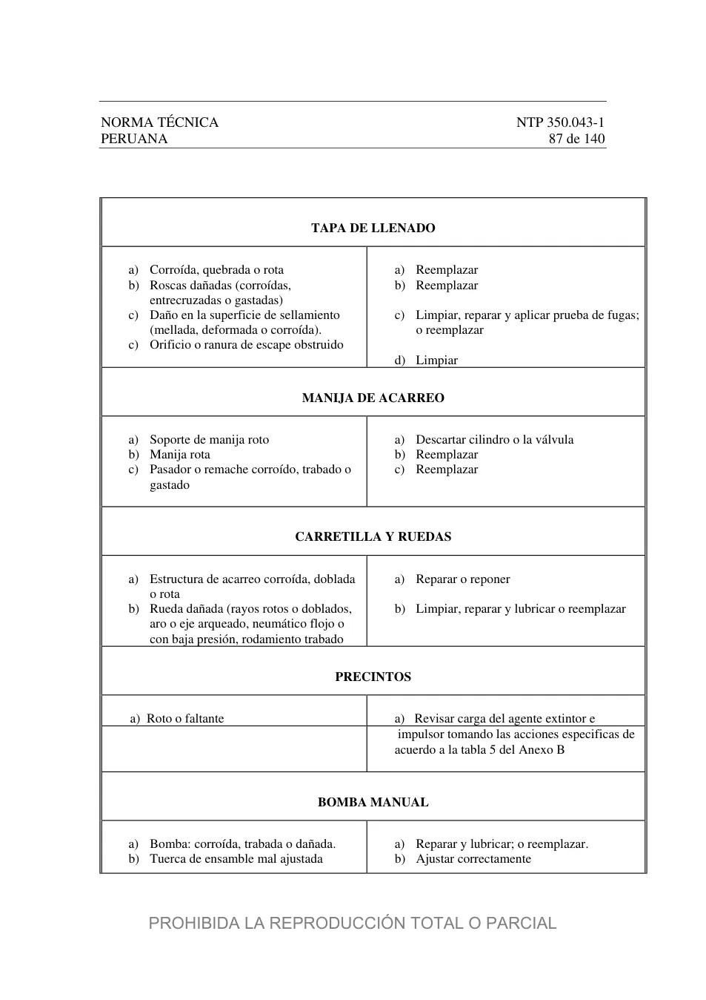

---

## Página 95

NORMA TÉCNICA NTP 350.043-1 PERUANA 88 de 140

**Cuadro del documento (filas: 10; columnas: 3):**

| DISPOSITIVO DE PRESURIZACION | Columna 2 | Columna 3 |
| --- | --- | --- |
| d) Dispositivo con fuga |  | g) Despresurizar y reparar o reemplazar el / dispositivo |
| EMPAQUES |  |  |
| a) Dañados( cortados, agrietados o / gastados) / b) Faltantes / c) Envejecidos o expuestos a la / intemperie |  | a) Reemplazar y lubricar / b) Reemplazar y lubricar / c) Reemplazar y lubricar |
| SOPORTES |  |  |
| a) Corroídas, gastadas o dobladas / b) Abrazadera floja o doblada. / c) Tornillos o tuercas: corroídas, flojas, / gastadas o faltantes / d) Topes, correas u ojalillos gastados |  | a) Reparar o reemplazar. / b) Ajustar abrazadera, reparar o reemplazar / c) Ajustar o reemplazar / d) Reponer |
| TUBO DE SIFON O DE GAS |  |  |
| a) Corroído, abollado, fisurado o roto. / b) Tubo obstruido / c) Retención de válvula de jebe para / proveer la fluidización del agente / químico seco, faltante o malogrado |  | a) Reponer de acuerdo a NTP / b) Limpiar o reponer / c) Reemplazar o descartar |
| DISPOSITIVO DE ALIVIO DE PRESION |  |  |
| a) Corroído o dañado | a) Despresurizar y reemplazar |  |

### PROHIBIDA LA REPRODUCCIÓN TOTAL O PARCIAL

**Gráfico o cuadro original:**

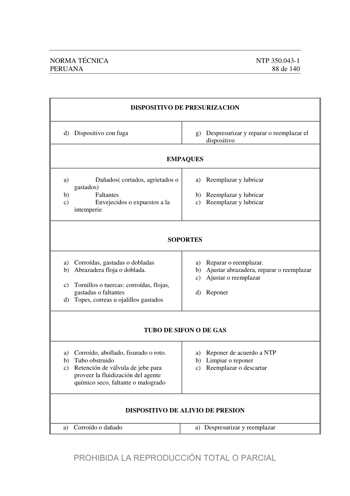

---

## Página 96

NORMA TÉCNICA NTP 350.043-1 PERUANA 89 de 140

**Cuadro del documento (filas: 3; columnas: 2):**

| b) Roto, accionado o atascado | b) Despresurizar y reemplazar o reparar |
| --- | --- |
| REGULADORES DE PRESION |  |
| a) Condición Externa: / 1) Daño / 2) Corrosión / b) Dispositivo de alivio de presión: / corroído, tapado, con abolladuras, con / escape roto o faltante / c) Cubierta protectora del orificio de / alivio: tapa faltante, sello o precinto / roto o faltante / d) Dispositivo de ajuste –pasador de / fijación, faltante. / e) Manómetros / 1) Indicador: inamovible, trabado / o perdido / 2) Cubierta o cristal: roto o / perdido / 3) Dial: ilegible o descolorido / 4) Corrosión / 5) Marco o retenedor del cristal / abollado / f) Manguera o tubo del regulador. / 1) Exterior cortado, agrietado, / desgastado o deformado / 2) Conexiones corroídas o rajadas / 3) Roscas de conexión, corroídas, / entrecruzadas o gastadas | a) Regulador: / 1) Reemplazarlo / 2) Limpiarlo o reemplazarlo / b) Desconectar el regulador de la fuente de / presión; reemplazarlo / c) Comprobar el regulador de acuerdo con los / procedimientos de prueba del fabricante. / d) Revisar el regulador de acuerdo con los / procedimientos de prueba del fabricante. / e) Véase 9.4.4.1 Medidas preventivas de uso / de manómetros y/o indicadores de presión / (Pág.55) / 1) Desconectar regulador de la fuente / de presión, reemplazar manómetro / 2) Reemplazar cubierta o cristal / 3) Reemplazar manómetro / 4) Calibrar, limpiar y pulir o / reemplazar manómetro / 5) Calibrar o reemplazar manómetro / f) / 1) Prueba Hidrostática o reemplazar / 2) Reemplazar manguera o tubo / 3) Reemplazar manguera o tubo |

### PROHIBIDA LA REPRODUCCIÓN TOTAL O PARCIAL

---

## Página 97

NORMA TÉCNICA NTP 350.043-1 PERUANA 90 de 140

**Cuadro del documento (filas: 13; columnas: 2):**

| MODO DE OPERACIÓN DEL EXTINTOR | Columna 2 |
| --- | --- |
| Agente extintor |  |
| Revisión (punto de control) | Acción correctiva |
| Espuma |  |
| a) Fecha de la recarga vencida / b) Niveles impropios de llenado en el / envase y cilindro / c) Condición del agente (para revisar el / sedimento) | a) Vaciar, limpiar y recargar / b) Vaciar, limpiar y recargar / c) Vaciar, limpiar y recargar |
| AUTO EXPELENTE |  |
| Dióxido de Carbono |  |
| a) Peso incorrecto / d) Pasador o precinto roto o faltante | a) Recargar con el peso correcto / b) Prueba de fuga y comprobación del peso, / recargar y reemplazar precinto o pasador |
| BOMBA MECÁNICA |  |
| Agua y anticongelante |  |
| a) Nivel impropio de llenado / b) Bomba defectuosa / Gastadas / c) Mal estado de la carga | a) Recargar / b) Limpiar, reparar y lubricar o sustituir. / c) Recargar |
| Polvo seco |  |
| a) Nivel impropio de llenado / b) Condición del agente (contaminación o / aglutinación) | a) Recargar / b) Desechar y sustituir |

### PROHIBIDA LA REPRODUCCIÓN TOTAL O PARCIAL

**Gráfico o cuadro original:**

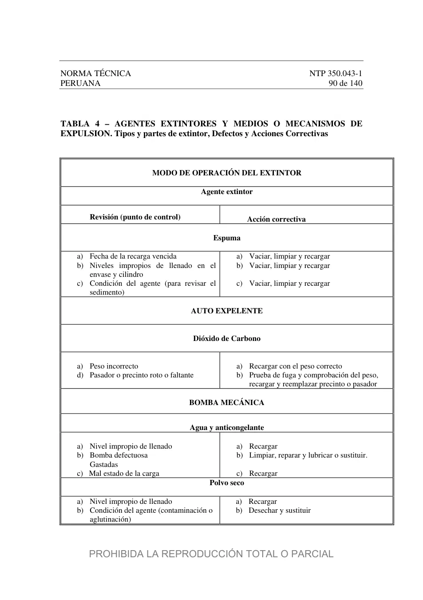

---

## Página 98

NORMA TÉCNICA NTP 350.043-1 PERUANA 91 de 140

c) Falta cucharón

c) Sustituir

**Cuadro del documento (filas: 6; columnas: 3):**

| CILINDRO O CARTUCHO DE GAS | Columna 2 | Columna 3 |
| --- | --- | --- |
| Polvo químico seco y polvo seco |  |  |
| 1. Peso o nivel de carga impropio. / 2. Condición del agente / (contaminado, aglutinado o / incorrecto y no apropiado) / 3. a) para el cartucho / a.1) disco de sello perforado / a.2) peso incorrecto. / a.3) indicador de estanquidad, anillo – / pasador faltante o roto / b) para cilindro de nitrógeno con / manómetro / b.1) presión baja / b.2) anillo- pasador faltante o roto / c) para cilindro de nitrógeno sin / manómetro / c.1) presión baja / c.2)anillo-pasador faltante o roto | 1. Recargar al peso de carga apropiado. / 2. Vaciar y recargar con el agente / apropiado indicado en el rotulado / 3. a) para el cartucho / a.1) cambiar sello. / a.2) recargar apropiadamente / a.3) examinar el disco del sello y / reemplazar el anillo pasador / b) para cilindro de nitrógeno con / manómetro / b.1) recargar el cilindro / b.2) prueba de fuga y sustituir el anillo / pasador / c) para cilindro de nitrógeno sin / manómetro / c.1) prueba de fuga, de comprobarse, / reparar o cambiar el cabezal y / recargar / c.2) medir la presión, prueba de fuga, / reemplazar el anillo – pasador y / colocar precinto |  |
| PRESURIZADOS |  |  |
| Polvo Químico Seco y de polvo seco |  |  |
| a) Peso de carga inexacto / b) Condición del agente (contaminado, |  | a) Recargar al peso de carga exacto / b) Recargar correctamente |

### PROHIBIDA LA REPRODUCCIÓN TOTAL O PARCIAL

---

## Página 99

NORMA TÉCNICA NTP 350.043-1 PERUANA 92 de 140

**Cuadro del documento (filas: 10; columnas: 3):**

| aglutinado o incorrecto y no apropiado) / c) Presión en el manómetro incorrecta / d) Precinto o pasador dañado o faltante | Columna 2 | c) Presurizar y hacer prueba de fuga. / d) Prueba de fuga y reponer pasador y / precinto |
| --- | --- | --- |
| Agua o Agua con Anticongelante |  |  |
| a) Nivel o peso incorrecto de carga / b) Condición incorrecta del agente / c) Presión en el manómetro incorrecta / d) Precinto o pasador dañado o faltante | a) Recargar al nivel y peso correcto. / b) Vaciar y recargar correctamente / c) Presurizar correctamente y realizar prueba de / fuga. / d) Prueba de fuga y reponer pasador y precinto |  |
| Agua destilada |  |  |
| Igual que el anterior, teniendo en cuenta que la recarga debe cumplir con lo establecido / en 6.2.7 |  |  |
| AFFF – FFFP, Carga Líquida |  |  |
| a) Nivel o peso incorrecto de carga. / b) Condición incorrecta del agente / c) Presión en el manómetro incorrecta. / d) Precinto o pasador dañado o faltante | a) Recargar al nivel y peso de carga correcto / b) Vaciar y recargar con solución nueva . / c) Presurizar correctamente y realizar prueba de / fuga / d) Prueba de fuga y reponer pasador y precinto |  |
| AFFF – FFFP, Carga Sólida |  |  |
| a) Nivel o peso incorrecto del contenido / de agua. / b) Condición incorrecta del agente / c) Presión en el manómetro incorrecta. / d) Precinto o pasador dañado o faltante | a) Recargar al nivel correcto / b) Cambiar el agente. / c) Presurizar correctamente y realizar prueba de / fuga / d) Prueba de fuga y reponer pasador y precinto |  |
| Químico Húmedo |  |  |

### PROHIBIDA LA REPRODUCCIÓN TOTAL O PARCIAL

---

## Página 100

NORMA TÉCNICA NTP 350.043-1 PERUANA 93 de 140

a) Desocupar y recargar con soluciones nuevas para corregir peso a la línea de nivel

b) Presurizar y verificar estanquidad

c) Probar estanquidad y reemplazar indicador

a) Nivel inadecuado de llenado (por peso u observación)

b) Presión no adecuada

c) Indicador de verificación de servicio roto o faltante

### PROHIBIDA LA REPRODUCCIÓN TOTAL O PARCIAL

---

## Página 101

NORMA TÉCNICA NTP 350.043-1 PERUANA 94 de 140

ANEXO D (NORMATIVO) PROCEDIMIENTO DE PRUEBA HIDROSTATICA PARA CILINDROS DE BAJA PRESION D.1 Todas las válvulas, partes internas y ensambles de manguera deben ser retirados y el extintor vaciado. Excepción: En algunos extintores de polvo químico seco y polvo seco (operados con cartucho) el fabricante recomienda que no sean retiradas ciertas partes internas. D.2 Se deben eliminar todos los restos de agentes de extinción del interior del recipiente antes de llenarlo con agua, en todos los tipos de extintores de polvo químico seco D.3 En todos los extintores de polvo químico seco y de polvo seco que tienen cartuchos o botellas de gas instalados para crear presión de descarga, éstos así como sus protectores deberán ser retirados y un tapón adecuado insertado en la abertura del recipiente. D.4 Las mangueras de los extintores sobre ruedas o rodantes equipados con un pitón de cierre en el extremo de salida de la manguera, deben ser separadas del extintor para ser probadas (con los acoples pero sin el pitón de descarga) NOTA: Para realizar el mantenimiento o una prueba hidrostática en los extintores rodantes equipados con un regulador, desconectar el regulador o la manguera de baja presión del cilindro. Verifique el regulador de acuerdo con los procedimientos establecidos en tabla 3 o tabla 4 (véase Anexo C de esta parte de la NTP 350.043). D.5 En todos los extintores de polvo químico seco presurizado, el ensamble del cabezal o válvula del cilindro debe ser retirado y reemplazado con un acople o adaptador de prueba adecuado.

### PROHIBIDA LA REPRODUCCIÓN TOTAL O PARCIAL

---

## Página 102

NORMA TÉCNICA NTP 350.043-1 PERUANA 95 de 140

D.6 La manguera de la bomba de prueba hidrostática es fijada luego por la conexión flexible al pitón de descarga, al ensamble de manguera, al acople de prueba, o llenado de prueba, según sea aplicable. En el caso de extintores rodantes de polvo químico seco y de polvo seco, los procedimientos y conexiones de ajuste deberán ser los recomendados por el fabricante. D.7 El extintor es luego colocado en una jaula protectora o guarda, antes de aplicar la presión de prueba. Similarmente para el caso de unidades sobre ruedas o rodantes. D.8 El suministro de agua tiene que ser conectado a la bomba de prueba y luego el extintor llenado hasta el borde del cuello. D.9 Para los extintores probados con la válvula en su lugar, la válvula debe ser ajustada lentamente mientras el suministro de agua permanece abierto. Después de que todo el aire dentro del recipiente haya salido y el agua emerja, la tapa debe ser ajustada completamente. D.10 Para los extintores probados con el acople de prueba o conexiones de ajuste, el acople o conexión de ajuste debe estar ajustado totalmente mientras el suministro de agua permanece abierto.  Después que todo el aire dentro del recipiente haya salido y el agua emerja, la válvula de purga debe ser cerrada herméticamente. D.11 La presión debe ser elevada paulatinamente de manera que se alcance la presión de prueba en no menos de 30 s. Esta presión de prueba se mantiene por lo menos 30 s pero no por tiempo menor que el requerido para completar la expansión del cilindro. Se debe hacer observaciones en ese momento para advertir cualquier deformación o fuga del cilindro del extintor. D.12 Si no se observa ninguna deformación o fuga y la presión de prueba indicada en el manómetro no ha bajado, la presión en el cilindro del extintor puede ser liberada. Entonces se considera que el extintor ha pasado  la prueba hidrostática.

### PROHIBIDA LA REPRODUCCIÓN TOTAL O PARCIAL

---

## Página 103

NORMA TÉCNICA NTP 350.043-1 PERUANA 96 de 140

D.13 Todo indicio de humedad y agua deben ser eliminados de todos los cilindros de los extintores que usan polvo químico seco utilizando un secador de cilindro. Si se emplea una corriente de aire caliente, la temperatura dentro del cilindro no debe exceder 66 ºC D.14 Cualquier cilindro de extintor que no pase la prueba hidrostática debe ser inutilizado según 9.3.4.5

### PROHIBIDA LA REPRODUCCIÓN TOTAL O PARCIAL

---

## Página 104

NORMA TÉCNICA NTP 350.043-1 PERUANA 97 de 140

ANEXO E (NORMATIVO) PROCEDIMIENTO DE PRUEBA HIDROSTATICA PARA CONJUNTOS DE MANGUERA E.1 La válvula o el pitón de descarga debe ser retirado del conjunto de manguera sin sacar ningún acople de manguera. Antes de la prueba se debe marcar la ubicación de los acoples con relación a la manguera. E.2 Para los tipos de polvo químico seco y polvo seco, se debe eliminar todos los residuos del agente de extinción antes de la prueba. E.3 El ensamble de manguera es luego colocado dentro de una jaula protectora o en un dispositivo protector, cuyo diseño permitirá la observación visual de la prueba. El personal encargado de esta prueba deberá estar premunido de equipo de protección personal y permanecer a una distancia segura de la manguera que está siendo probada. E.4 La manguera debe ser completamente llenada con agua antes de la prueba. E.5 La presión se aplica a una velocidad de aumento, de manera tal, que se alcance la presión de prueba dentro de 1 min. La presión de prueba tiene que mantenerse durante 1 min. Luego se observará si hay deformación o fuga. E.6 Si no se observa deformación o fuga o la presión de prueba no ha descendido, o los acoples no se han movido, la presión luego es liberada. El ensamble de manguera es entonces considerado que ha pasado la prueba hidrostática. E.7 Los ensambles de manguera que pasan la prueba deben ser luego completamente secados internamente. Si se emplea calor para secar, la temperatura no debe exceder 65ºC (150ºF).

### PROHIBIDA LA REPRODUCCIÓN TOTAL O PARCIAL

---

## Página 105

NORMA TÉCNICA NTP 350.043-1 PERUANA 98 de 140

E.8 Los ensambles de manguera que fallan una prueba hidrostática debe ser destruidos.

### PROHIBIDA LA REPRODUCCIÓN TOTAL O PARCIAL

---

## Página 106

NORMA TÉCNICA NTP 350.043-1 PERUANA 99 de 140

### ANEXO F (INFORMATIVO) OPERACIÓN, USO Y DIAGRAMA DE EXTINTORES

**Cuadro del documento (filas: 20; columnas: 2):**

| F.l General | Columna 2 |
| --- | --- |
| F.l.l Las personas que se espera usen un extintor de incendios deberían |  |
| familiarizarse con toda la información contenida en la placa de identificación del |  |
| fabricante y el manual de instrucción. La operación adecuada del extintor requiere que |  |
| el operador realice varios pasos básicos en determinada secuencia. El diseño del |  |
| extintor, las entidades que aprueban, el instalador y el planificador de la protección |  |
| pueden influir sobre la facilidad y probabilidad de que estos pasos se realicen |  |
| correctamente. En este Anexo además de la operación y uso, se presentan diagramas en |  |
| detalle de los extintores citados en esta NTP |  |
| F.l.1.1 Los extintores son usados por uno o más de los siguientes grupos de |  |
| personas, relacionados en orden descendente según su pericia: |  |
|  | (1) Cuerpo de bomberos entrenados |
|  | (2) Empleados entrenados o sin entrenar (Locales comerciales o |
|  | industriales). |

(1) Cuerpo de bomberos entrenados (2) Empleados entrenados o sin entrenar (Locales comerciales o industriales). (3) Propietarios privados sin entrenar (casa, automóvil, bote, etc.). (4) Público en general sin entrenar.

F.l.1.2 Cuando no se ha entrenado a los empleados, la operación de los extintores podría sufrir serias demoras, se podría desperdiciar el material de extinción debido a malas técnicas de aplicación y tendría que usarse más extintores, o posible- mente no se podría extinguir el incendio. F.l.1.3 No es suficiente que la persona que proyecta la protección determine el riesgo de un lugar o área dentro de un edificio y después seleccione el tipo y tamaño

### PROHIBIDA LA REPRODUCCIÓN TOTAL O PARCIAL

---

## Página 107

NORMA TÉCNICA NTP 350.043-1 PERUANA 100 de 140

adecuados de extintor de acuerdo con el resigo. También necesita tener en cuenta cualquier problema relacionado con el accionamiento del extintor, y la dificultad de aplicación correcta del agente extintor. El jefe de planeación debería considerar también quien será el usuario del extintor más probable y debería calcular el grado de experticia o entrenamiento que esa persona debería tener.

F.l.2 Operación de los extintores F.1.2.1 La operación de los extintores se puede organizar convenientemente agrupándolos de acuerdo a sus medios de impulsión o expulsión. Los cinco métodos de uso común son:

1. Auto-expulsión, cuando los agentes tienen suficiente presión de vapor a

temperaturas normales de operación para auto-expeler.

2. Cartucho o cilindro de gas, cuando el gas expelente está contenido en

un recipiente a presión aparte hasta que un operador lo libere para presurizar el cilindro del extintor.

3. Presurizado, cuando el agente extintor y el gas expelente se guardan en un

solo recipiente.

4. De bombeo mecánico, cuando el operador provee energía expelente por

medio de una bomba, y el recipiente que contiene el agente no está presurizado.

5. De propulsión manual cuando el material se aplica con una pala de

mano, cubo o balde. F.l.2.2 Varios agentes extintores se manejan por cada tipo de estos medios de expulsión. La Tabla 5 relaciona las combinaciones de agente y medio expelente que están en uso o se han usado.

### PROHIBIDA LA REPRODUCCIÓN TOTAL O PARCIAL

---

## Página 108

NORMA TÉCNICA NTP 350.043-1 PERUANA 101 de 140

**Cuadro del documento (filas: 6; columnas: 8):**

| Columna 1 | Tabla 5 – Combinaciones de agente extintor y agente expelente | Columna 3 | Columna 4 | Columna 5 | Columna 6 | Columna 7 |
| --- | --- | --- | --- | --- | --- | --- |
| Material de extinción |  | Métodos de expulsión |  |  |  |  |
|  |  | Auto / expelente | Cartucho / o cilindro / de gas | Presurizado | Bombeo / mecánico | Manual |
| Agua y anticongelante / Agente húmedo / AFFF y FFFP / Chorro cargado / Químico seco ABC / Dióxido de carbono / Químico seco / Polvo seco (Fuegos de metal) / Químico húmedo |  | X | X / X / X / X / X | X / X / X / X / X / X / X / X | X | X / X |

F.2 Pasos Básicos para Operación de Extintores. F.2.1 Los pasos básicos necesarios para poner un extintor en funcionamiento son:

**Cuadro del documento (filas: 17; columnas: 2):**

| Columna 1 | 1. Reconocer el extintor. |
| --- | --- |
|  | 2. Seleccionar el extintor adecuado. |
|  | 3. Transportar el extintor hasta el fuego |
|  | 4. Operación del extintor |
|  | 5. Aplicación del agente extintor al fuego |
| F.2.2 Reconocer el extintor |  |
| F.2.2.1 Las entidades de inspección requieren el rotulado permanente en el frente del |  |
| extintor indicando su propósito, contenido y uso. |  |
| F.2.2.2 Se podrían necesitar señales adicionales que no son parte del aparato para |  |
| indicar la ubicación del extintor. Estas señales están normadas en todas las instalaciones de |  |
| manera que se puedan ubicar fácilmente los extintores. Estas señales, además podrían ser |  |

### PROHIBIDA LA REPRODUCCIÓN TOTAL O PARCIAL

---

## Página 109

NORMA TÉCNICA NTP 350.043-1 PERUANA 102 de 140

**Cuadro del documento (filas: 19; columnas: 2):**

| en forma de luces eléctricas, placas, placa-soporte, avisos en lo alto, paneles o cintas de | Columna 2 |
| --- | --- |
| color o gabinetes. Estos podrían colorearse distintivamente con pintura o cintas reflexivas. |  |
| F.2.2.3 Si los extintores están situados a lo largo de las vías de salida normales De |  |
| un área, el personal estará más inclinado a tomarlos y regresar al lugar del fuego. |  |
| F.2.3 Transporte del extintor hasta el fuego. |  |
| F.2.3.1 El extintor debería estar montado y situado de manera que se pueda quitar |  |
| fácilmente en una emergencia de incendio y llevarse al lugar del fuego lo más rápidamente |  |
| posible. Debería estar accesible fácilmente sin necesidad de moverse o subirse sobre |  |
| mercancías, materiales o equipos. |  |
| F.2.3.2 Portar el extintor se ve afectado por los siguientes factores: |  |
|  | 6. Peso del extintor. |

6. Peso del extintor.

7. Distancia de recorrido hasta el posible incendio

8. Necesidad de llevar el aparato por escaleras o escaleras de mano.

9. Necesidad de usar guantes.

10. Congestión general del local.

11. Capacidad física de los operadores. F.2.3.3 En el caso de extintores sobre ruedas, se debería tener en cuenta el ancho de los pasillos y puertas y la naturaleza de los pisos y suelos sobre los cuales se necesita mover el extintor. F.2.4 Operación del extintor F.2.4.1 Una vez que el extintor se ha transportado hasta el lugar del fuego, se debe poner en operación sin demora. Los empleados deben estar familiarizados con todos los pasos necesarios para operar cualquier extintor de incendios. Aquí es donde el entrenamiento previo es más valioso, ya que hay poco tiempo para detenerse a leer las instrucciones de operación del rotulado.

### PROHIBIDA LA REPRODUCCIÓN TOTAL O PARCIAL

---

## Página 110

NORMA TÉCNICA NTP 350.043-1 PERUANA 103 de 140

**Cuadro del documento (filas: 18; columnas: 2):**

| F.2.4.2 Para operar un extintor se requieren uno o más de los siguientes pasos: | Columna 2 |
| --- | --- |
|  | Posición para Operación. La posición proyectada de operación generalmente |
|  | está marcada sobre el extintor. Cuando la posición de operación es obvia (como |
|  | cuando una mano sostiene el extintor y la otra mano sostiene la boquilla), esta |
|  | información puede no estar marcada. |
|  | 2. Remoción de Dispositivos de seguridad o bloqueo. Muchos extintores tienen un |
|  | seguro de operación o dispositivo de bloqueo que evita la operación accidental. El |
|  | dispositivo más común es un pasador de seguridad o pasador de anillo que debe |
|  | retirarse antes de la operación. Otras formas de dispositivos son grapas, levas, |
|  | palancas o bloqueadores de mangueras o boquillas. La mayoría de indicadores de |
|  | manipulación (como sellos de alambre o plomo) se rompen con la remoción del |
|  | dispositivo de bloqueo. En algunos extintores, el dispositivo de bloqueo está dis- |
|  | puesto para destrabarse cuando el aparato se manipula normalmente. No se requiere |
|  | ningún movimiento separado. Este tipo de dispositivo de bloqueo es especialmente |
|  | adecuado para uso por propietarios privados y el público general ya que rara vez es |
|  | posible la instrucción previa. |

**Cuadro del documento (filas: 12; columnas: 2):**

- F.2.5 Presión del gas expelente
- F.2.5.1 Muchos de los extintores descritos en este anexo son de tipo presurizado o
- de cartucho. Como las características de operación de estos dos tipos son similares, sin
- importar el agente usado, se describen generalmente en los párrafos siguientes.
- F.2.5.2 En los modelos presurizados, el gas expelente y el agente extintor se
- almacenan en una sola cámara y la descarga se controla con una válvula o boquilla de
- cierre.

### PROHIBIDA LA REPRODUCCIÓN TOTAL O PARCIAL

---

## Página 111

NORMA TÉCNICA NTP 350.043-1 PERUANA 104 de 140

**Cuadro del documento (filas: 41; columnas: 2):**

- F.2.5.3 En los modelos operados por cartucho, el gas expelente se almacena en un
- cartucho separado o podría almacenarse en un cilindro para gas expelente (en los modelos
- sobre ruedas), localizado dentro o junto al cilindro que contiene el agente extintor. Estos
- extintores se operan liberando el gas expelente que expele el agente. En la mayoría de
- modelos la descarga se podría controlar subsecuentemente con una válvula o boquilla de
- cierre.
- F.3 Técnicas de Aplicación.
- F.3.1 General
- F.3.1.1 Muchos extintores descargan su cantidad total de material extintor en 8 a
- 10 segundos (aunque algunos se toman 30 segundos o más para descargar). El agente
- necesita aplicarse correctamente desde el comienzo ya que rara vez hay tiempo para
- experimentar. En muchos extintores, la descarga se puede iniciar o parar con una válvula.
- Cuando se usan algunos extintores en incendios de líquidos inflamables, el fuego podría
- excitarse momentáneamente al comienzo de la aplicación del agente.
- F.3. 1.2 La mejor técnica para aplicar la descarga del extintor sobre un fuego varía
- con el tipo de material extintor.
- F.4 Características de los extintores
- F.4.1 De agua: Estos incluyen extintores de agua, anticongelante, agente húmedo
- y de chorro cargado. Estos extintores están propuestos principalmente para usar en
- incendios Clase A. El chorro debería dirigirse inicialmente a la base de las llamas. Después
- de la extinción de las llamas, debería dirigirse generalmente a las superficies ardientes o
- incandescentes. Las aplicaciones deberán empezar lo más cerca posible al incendio. Los
- fuegos profundos deberían mojarse completamente y podrían necesitar disgregarse para
- efectuar la extinción total.
- F.4.1.1 De agua a presión: Los extintores manuales de este tipo generalmente están
- disponibles con una capacidad de 10 L ó 9,46 L (2 1/2 galones) con capacidad de extinción de
- 2-A. Como el agente usado es agua dulce, este extintor no puede instalarse en áreas someti-

### PROHIBIDA LA REPRODUCCIÓN TOTAL O PARCIAL

---

## Página 112

NORMA TÉCNICA NTP 350.043-1 PERUANA 105 de 140

das a temperaturas menores de 4°C. Este mismo tipo de extintor también se fabrica en un modelo anticongelante, cargado con una solución aprobada que permite la protección a temperaturas tan bajas como -40°C. (Véase Figura 12) F.4.1.2 De agente humectante: Los extintores de este tipo generalmente vienen en modelos portátiles manuales y en modelos sobre ruedas. El agente extintor que se usa es un material tensoactivo que agregado al agua en cantidades adecuadas reduce materialmente la tensión superficial del agua y aumenta así las características de penetración y propagación. Estos extintores necesitan protegerse de la exposición a temperaturas menores de 4 °C.

F.4.1.3 Otros tipos de agua. También son de uso según los requerimientos otros tipos de extintores de tipo de agua como los siguientes:

- Chorro Cargado. - Tanque y Bomba. - De Tanque de Espalda. - Cubetas, Tambores, Cubos y Baldes para fuegos.

Figura 12 – Extintor de agua a presión

### PROHIBIDA LA REPRODUCCIÓN TOTAL O PARCIAL

**Gráfico o cuadro original:**

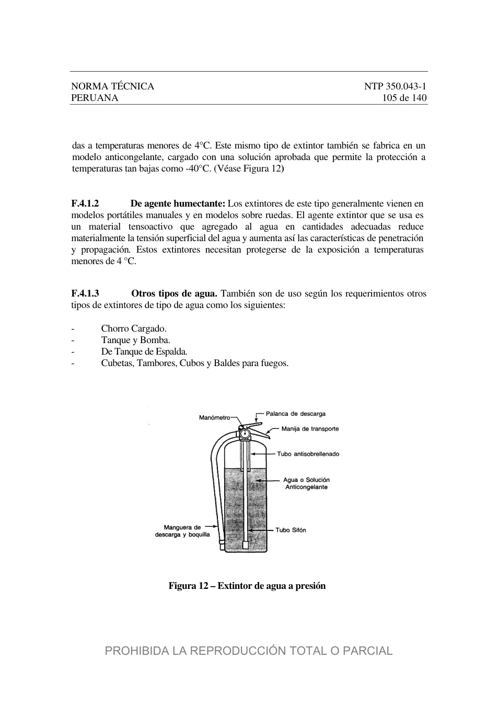

---

## Página 113

NORMA TÉCNICA NTP 350.043-1 PERUANA 106 de 140

**Cuadro del documento (filas: 33; columnas: 2):**

- F.4.2 Agentes de Espuma Formadores de Película. Estos extintores con agentes
- de extinción AFFF y FFFP, son para uso en fuegos Clase A y Clase B. Para incendios de
- líquidos inflamables de profundidad considerable, se obtienen mejores resultados cuando la
- descarga del extintor se hace contra el interior de la pared posterior de la tina o tanque justo
- arriba de la superficie incendiada para permitir la propagación natural del agente sobre el
- líquido incendiado. Si no se puede hacer esto, el operador debería situarse suficientemente
- lejos del incendio para permitir que el agente caiga suavemente sobre la superficie
- incendiada (el chorro no debe dirigirse al líquido incendiado). En lo posible, el operador
- debe caminar alrededor del fuego mientras dirige el chorro para obtener cobertura máxima
- durante el período de descarga. Para incendios de materiales combustibles ordinarios, se
- puede usar el agente para recubrir directamente la superficie incendiada. Para incendios de
- derrames de líquidos inflamables, el agente se podría hacer correr sobre la superficie
- incendiada haciéndolo rebotar sobre el piso frente al área incendiada. Los agentes de
- espuma formadores de película no son efectivos en líquidos inflamables y gases que
- escapan bajo presión o en incendios de grasas de cocina.
- F.4.2.1 AFFF y FFFP. Los extintores de estos tipos generalmente están
- disponibles en modelos portátiles manuales y en modelos sobre ruedas. El agente de
- extinción es una solución de surfactante formador de película en agua que forma
- espuma mecánicamente al descargarse a través de una boquilla aspirante. Para
- incendios Clase A, el agente actúa como refrigerante y como penetrante para reducir las
- temperaturas hasta por debajo del grado de ignición. Para incendios Clase B, el agente
- actúa como barrera para excluir el aire u oxígeno de la superficie del combustible.
- Algunos grados de estos agentes también son adecuados para la protección de líquidos
- inflamables solubles en agua (solventes polares) como los alcoholes, acetona, esteres,
- cetonas y otros. La aptitud de estos extintores para incendios de solventes polares debe
- estar mencionada específicamente en el rotulado por el fabricante. Estos agentes no son
- adecuados para uso en incendios de combustibles presurizados o de grasas de cocina.

### PROHIBIDA LA REPRODUCCIÓN TOTAL O PARCIAL

---

## Página 114

NORMA TÉCNICA NTP 350.043-1 PERUANA 107 de 140

**Cuadro del documento (filas: 47; columnas: 2):**

- Figura 13 - Los modelos manuales portátiles se parecen mucho a los extintores de
- agua a presión a excepción de los tipos especiales de boquillas.
- F.4.3 De dióxido de carbono. Este tipo de extintor es principalmente para uso en
- Fuegos de Clase B y Clase C. Los extintores de dióxido de carbono tienen un alcance
- limitado y se afectan por el viento y corrientes de aire; por lo tanto, es necesario empezar la
- aplicación inicial suficientemente cerca de fuego. En todos los incendios, la descarga se
- debe dirigir a la base de las llamas. La descarga debe aplicarse a la superficie incendiada
- aún después de que se han extinguido las llamas para permitir tiempo adicional de
- enfriamiento y evitar la posible reignición. El método más comúnmente usado de aplicación
- de agente sobre incendios de líquidos inflamables almacenados es empezar por la orilla más
- cercana y dirigir la descarga en un movimiento de barrido lento de lado a lado, avanzando
- gradualmente hacia la parte posterior del fuego. El otro método se conoce como aplicación
- aérea (en lo alto). La tobera o corneta de descarga se dirige en posición de daga o
- descendente (a un ángulo aproximado de 45 grados) hacia el centro del área incendiada.
- Generalmente, la tobera o corneta no se mueve como en el otro método, porque el chorro de
- descarga se introduce al incendio desde arriba y se propaga a todas direcciones sobre la
- superficie incendiada. Para incendios de derrames, el movimiento de barrido de lado a lado
- podría dar mejores resultados.
- En incendios que involucran equipos eléctricos, la descarga debería dirigirse al origen de
- las llamas. Es importante desenergizar el equipo lo más pronto posible por la posibilidad
- de reignición. Estos agentes no son adecuados para uso en incendios de combustibles
- presurizados o de grasas de cocina.

### PROHIBIDA LA REPRODUCCIÓN TOTAL O PARCIAL

**Gráfico o cuadro original:**

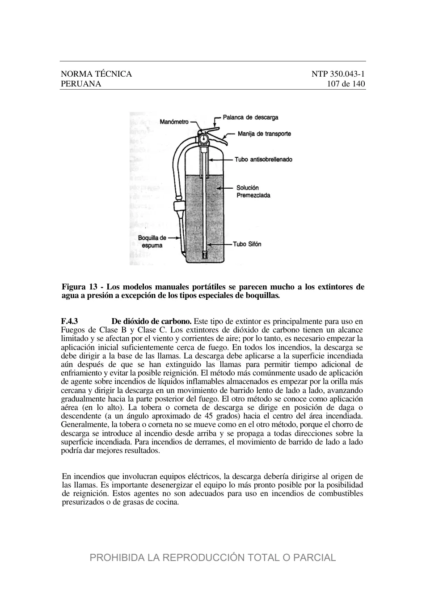

---

## Página 115

NORMA TÉCNICA NTP 350.043-1 PERUANA 108 de 140

El agente de dióxido de carbono extingue al diluir la atmósfera circundante con un gas inerte de manera que los niveles de oxígeno se mantienen por debajo del porcentaje requerido para la combustión. Cuando este tipo de extintores se usa en un espacio sin ventilación, como un cuarto pequeño, closet u otra área encerrada, la ocupación prolongada de ese espacio puede producir la pérdida del sentido por deficiencia de oxígeno. [Véase Figura 14 y 15]

Figura 14 – Extintor de dióxido de carbono El dióxido de carbono se retiene bajo su propia presión en una condición fluida a temperatura ambiente. El agente es auto-expelente y se descarga operando una válvula que hace que el dióxido de carbono se expulse a través de una tobera o corneta en su fase de vapor y sólida. Los modelos más pequeños están diseñados para operarse con una mano. Para los otros portátiles más grandes, la corneta de descarga está conectada a manguera flexible de varios pies de longitud. Estos extintores requieres operación «a dos manos». El alcance máximo del chorro de descarga es de l m a 2,4m (3pies a 8 pies).

### PROHIBIDA LA REPRODUCCIÓN TOTAL O PARCIAL

**Gráfico o cuadro original:**

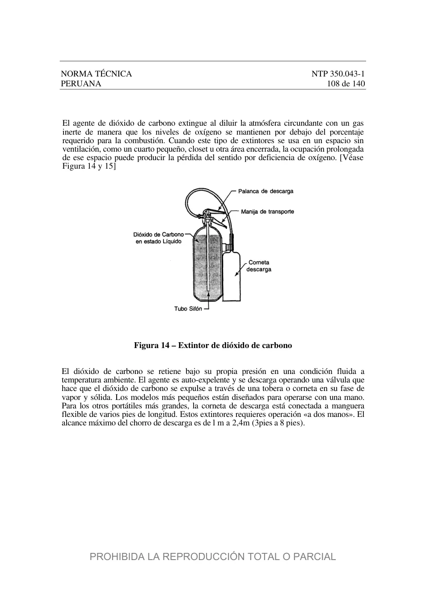

---

## Página 116

NORMA TÉCNICA NTP 350.043-1 PERUANA 109 de 140

**Cuadro del documento (filas: 48; columnas: 2):**

- Figura 15 – Extintor de dióxido de carbono
- F.4.4 De polvo químico seco. Los extintores de químico seco (base de fosfato de
- amonio, multiuso) son para uso en fuegos Clase A, Clase B y Clase C. Los extintores de
- químico seco (bicarbonato de sodio, bicarbonato de potasio, bicarbonato de potasio de base
- urea, base bicarbonato de base urea o de base de cloruro) son principalmente para uso en
- incendios Clase B y Clase C. Hay dos métodos para descargar el agente químico seco del
- cilindro del extintor, dependiendo del diseño básico de extintor. Estos son el método de
- operación de cartucho o por el método presurizado. Sin importar el diseño del extintor, el mé-
- todo de aplicación del agente es básicamente el mismo.
- Cuando se usan en incendios exteriores, se puede lograr la eficiencia máxima cuando la
- dirección del viento está sobre la espalda del operador. [Véase Figura 16 y 17]
- Existen boquillas especiales de largo alcance cuando las condiciones potenciales del
- combate de incendios puedan requerir distancias mayores. Estas boquillas también son úti-
- les en incendios de gases o líquidos presurizados, o cuando prevalecen los vientos fuertes.
- Todos los agentes químicos secos se pueden usar simultáneamente con la aplicación de
- agua (chorro directo o niebla). El uso de extintores de químico seco en equipos eléctricos
- energizados (como postes de energía mojados por la lluvia, interruptores de alto voltaje y
- transformadores) puede empeorar los problemas de escapes eléctricos. El químico seco, en
- combinación con la humedad, crea un camino eléctrico que puede reducir la efectividad de la
- protección por aislamiento. Se recomienda la remoción completa de rastros de químico
- seco de estos equipos después de la extinción. [Véase Figura 18]

### PROHIBIDA LA REPRODUCCIÓN TOTAL O PARCIAL

**Gráfico o cuadro original:**

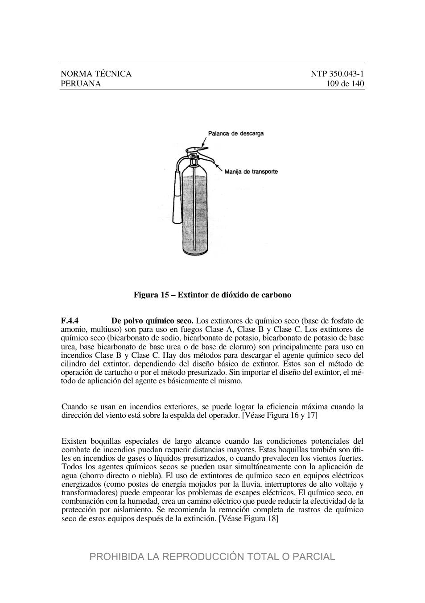

---

## Página 117

NORMA TÉCNICA NTP 350.043-1 PERUANA 110 de 140

**Cuadro del documento (filas: 14; columnas: 2):**

- Los extintores de químico seco para fuegos ABC y para fuegos BC, como tienen la
- denominación de Clase B pueden extinguir incendios de medios de cocina combustibles
- (aceites y grasas vegetales o animales), pero en esos casos se recomienda usar solamente
- extintores Clase K para fuegos de grasas de cocina.
- Figura 16 – Extintor presurizado de polvo químico seco

Figura 17 – Extintor de polvo químico seco con cartucho

### PROHIBIDA LA REPRODUCCIÓN TOTAL O PARCIAL

**Gráfico o cuadro original:**

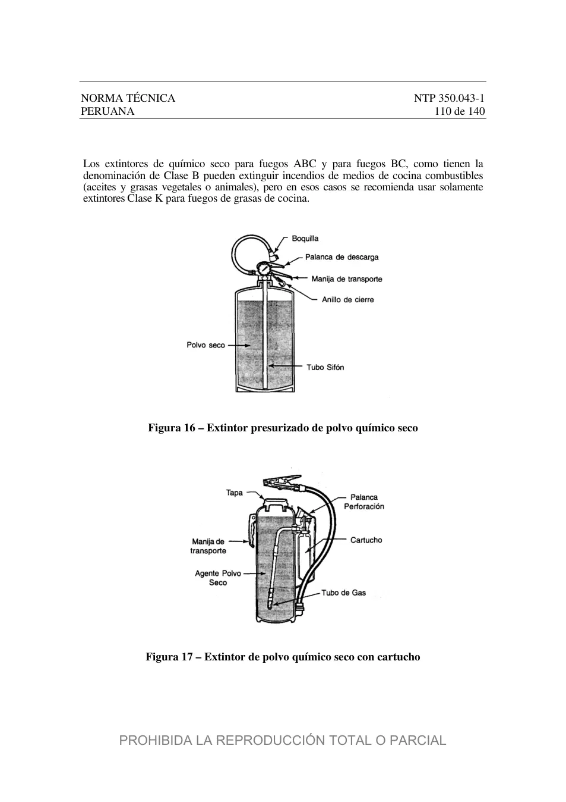

---

## Página 118

NORMA TÉCNICA NTP 350.043-1 PERUANA 111 de 140

F.4.4.1 Extintores de Polvo Químico Seco para fuegos Clase A, Clase B y Clase C. Los extintores de este tipo contienen un agente a base de fosfato de amonio. Los agentes para fuegos ABC se usan exactamente de la misma manera que los agentes de químico seco corrientes en fuegos Clase B. Para el uso en incendios Clase A, el agente de uso ABC tiene la característica adicional de ablandarse y adherirse al contacto con superficies calientes. Por lo tanto, se puede adherir a materiales incendiados y formar una capa o revestimiento que sofoca y aísla el combustible del aire. Al aplicar el agente, es importante tratar de recubrir todas las áreas incendiadas para eliminar o reducir al mínimo el número de rescoldos o residuos incandescentes que pudieran ser fuente potencial de reignición. El agente mismo tiene poco efecto refrigerante y, debido a sus características de revestimiento de superficies, no puede penetrar por debajo de la superficie incendiada. Por esto, no puede lograrse la extinción de incendios profundos a menos que el agente se descargue por debajo de la superficie o el material se separe o disperse.

Figura 18 – Extintor de polvo químico seco con boquilla fija F.4.4.2 Extintores de Polvo Químico Seco Comunes para fuegos Clase B y Clase C. El agente extintor usado es un material micropulverizado tratado especialmente. Los tipos de agentes disponibles incluyen base de bicarbonato de sodio, base de bicarbonato de potasio, base de cloruro de potasio, o base de urea de bicarbonato de potasio. Algunas fórmulas de estos agentes son tratadas especialmente para ser relativamente compatibles para uso con espuma de aire (espuma mecánica). Para usar en incendios de líquidos inflamables, el chorro debe dirigirse a la base de las llamas. Los mejores resultados se obtienen generalmente atacando la orilla más cercana del incendio y avanzando progresivamente hacia la parte posterior del incendio moviendo la boquilla rápidamente de lado a lado con movimiento de barrido. También se debe tener cuidado de no dirigir la descarga inicial directamente hacia la superficie incendiada muy cerca, menos de 1,5 m porque la alta velocidad del chorro puede producir salpicadura o dispersión del material incendiado, o ambos. Aunque no están listados para uso en fuegos Clase A, el químico seco común se puede usar para extinguir rápidamente las llamas. Una vez extinguidas las llamas,

### PROHIBIDA LA REPRODUCCIÓN TOTAL O PARCIAL

**Gráfico o cuadro original:**

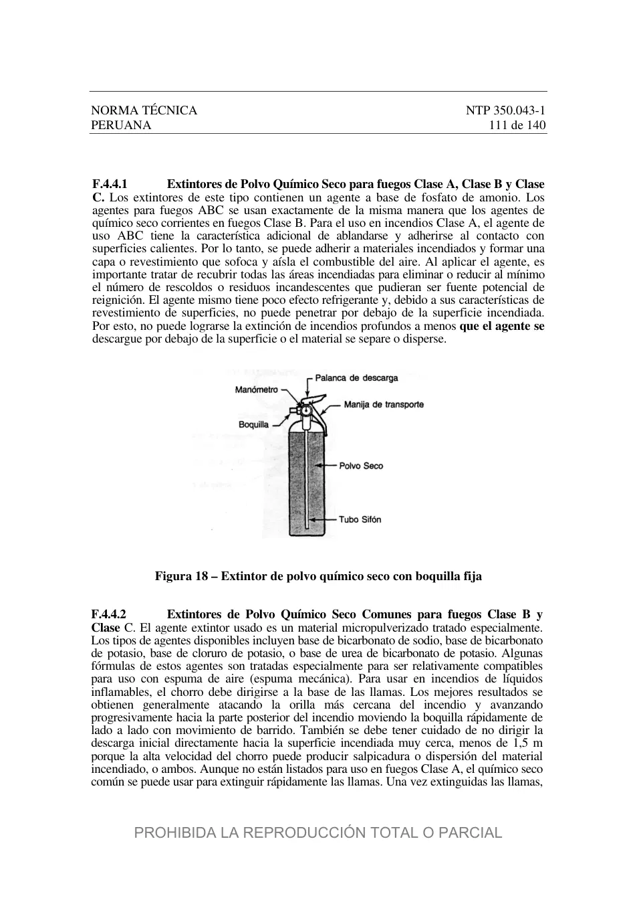

---

## Página 119

NORMA TÉCNICA NTP 350.043-1 PERUANA 112 de 140

el operador puede dispersar los escombros del incendio. Esto ayudará a acelerar el enfriamiento natural de los rescoldos o residuos incandescentes. Los puntos calientes o pequeñas áreas que pueden volver a incendiarse se pueden controlar con chorros cortos intermitentes del agente. Entonces se debería aplicar agua para extinguir los rescoldos o puntos calientes profundos. Se recomienda que este método de extinción se intente solamente si el operador ha recibido entrenamiento y tiene experiencia previa en esta técnica.

F.4.5 De polvo seco. Estos extintores y agentes son para uso en incendios Clase D y de metales específicos, siguiendo técnicas especiales y las recomendaciones de uso de fabricante. El agente extintor se puede aplicar con el extintor o con pala o cuchara. La técnica para aplicar el agente al incendio podría variar con el tipo y forma del agente, y del metal combustible. La aplicación del agente debe ser de profundidad suficiente para cubrir el área del incendio adecuadamente y proporcionar una capa de sofocación. Se pueden necesitar aplicaciones adicionales para cubrir cualquier punto caliente que se forme. El material no debería tocarse hasta que la masa se haya enfriado antes de intentar disponer de él. Debe tenerse cuidado de no dispersar el metal incendiado. Los fuegos de metales combustibles finamente divididos o retales o pedazos de aleaciones de metales combustibles húmedos, mojados con agua o lubricantes de máquinas solubles en agua, o sobre superficies mojadas con agua, tienden a quemarse rápida y violentamente. Pueden inclusive ser explosivos. Pueden producir tanto calor que no se pueda aproximar lo suficientemente para permitir la aplicación adecuada del agente extintor. Cuando el metal incendiado está sobre una superficie combustible, el fuego debe cubrirse con polvo seco, entonces se debe extender una capa de 25 mm ó 50 mm de polvo cerca de éste y traspalar el metal incendiado a esta capa, añadiendo el polvo seco necesario.

F.4.5.1 Extintor de polvo seco. Los extintores de polvo seco se consiguen en un modelo portátil manual de cartucho y modelos de cilindro sobre ruedas. Hay modelo de extintor de polvo seco presurizado con aplicador de vara de extensión. El agente extintor está compuesto de cloruro de sodio, con aditivos para hacerlo de flujo libre para que forme una costra sobre el incendio. Se agrega un material termoplástico para unir las partículas de cloruro de sodio y formar una masa sólida cuando se aplican a metales incendiados. Existen otros agentes especializados de polvo seco para el combate de tipos específicos de incendios de metales. El método de aplicación del agente depende del tipo de metal, la cantidad incendiada y su configuración. En caso de un incendio muy caliente, la descarga inicial debe empezarse al alcance máximo con la boquilla totalmente abierta. Una vez controlado, la válvula de la boquilla se debe cerrar parcialmente para producir un flujo suave y grueso y poder lograr cobertura completa y segura desde cerca. La boquilla está diseñada para que el operador pueda obturar o reducir la tasa y fuerza de descarga de agente. Como los incendios de metales combustibles pueden producir condiciones complejas y difíciles de combate de incendios, es aconsejable obtener detalles específicos del fabricante sobre el uso de los equipos. [Véase Figura 19 y Figura 20 ]

### PROHIBIDA LA REPRODUCCIÓN TOTAL O PARCIAL

---

## Página 120

NORMA TÉCNICA NTP 350.043-1 PERUANA 113 de 140

Figura 19 – Extintor de polvo  seco operado por cartucho F.4.5.2 Agente de Polvo Seco a Granel. Los agentes de extinción de polvo seco a granel, se consiguen en cubos y tambores. Además de agente de base de cloruro de sodio, también hay un material de polvo seco llamado G-l. Este material consiste en grafito granular graduado al cual se ha agregado compuesto con fósforo, aumentando su efectividad de extinción. Mientras que el cloruro de sodio se puede usar en un extintor de polvo seco o aplicar con pala o cuchara a mano, el agente G-l se debe aplicar al incendio a mano. Cuando se aplica G-l a un incendio de metal, el calor del fuego hace que los compuestos de fósforo generen vapores que envuelven el fuego e impiden que el aire llegue al metal incendiado. El grafito, que es un buen conductor de calor, enfría el metal hasta por debajo del punto de ignición. Cada agente extintor está listado para uso en un incendio de metal combustible específico para el que ha sido encontrado aceptable, según lo hayan determinado las investigaciones correspondientes. Esta información, junto con las limitaciones del método de aplicación recomendado, se muestra sobre el recipiente del agente. Es importante anotar que no se deben confundir los agentes extintores de polvo seco con los agentes extintores de polvo químico seco. (Véase F.4.4)

### PROHIBIDA LA REPRODUCCIÓN TOTAL O PARCIAL

**Gráfico o cuadro original:**

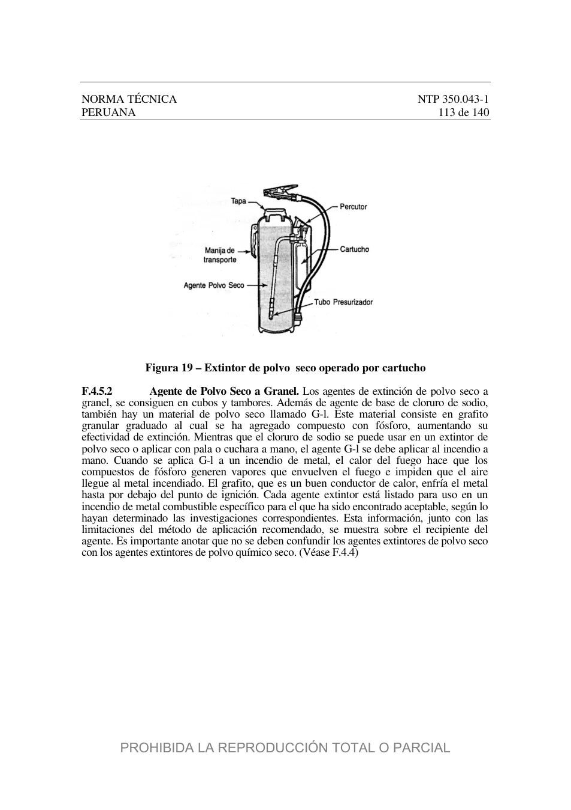

---

## Página 121

NORMA TÉCNICA NTP 350.043-1 PERUANA 114 de 140

**Cuadro del documento (filas: 37; columnas: 2):**

- Figura 20 – Extintor de polvo seco con boquilla especial
- F.4.6 Extintor de Químico Húmedo. Los extintores de este tipo se consiguen en
- modelos portátiles manuales. El agente extintor está compuesto pero no limitado a soluciones
- de agua y acetato de potasio, carbonato de potasio, citrato de potasio o una combinación de
- los químicos arriba mencionados (que son conductores de electricidad). El agente líquido
- típicamente tiene un pH de 9,0 o menos. En incendios Clase A, el agente funciona como
- refrigerante. En incendios Clase K (incendios de aceites de cocina), el agente forma una
- capa de espuma que impide la reignición. El contenido de agua del agente ayuda a enfriar y
- reducir la temperatura de las grasas y aceites calientes por debajo de sus puntos de
- autoignición. El agente al descargarse en forma de rocío fino directamente sobre los
- artefactos de cocina, reduce la posibilidad de salpicar la grasa caliente y no ofrece riesgo de
- choque eléctrico para el operador.
- En años recientes, el desarrollo de equipos de cocina de alta eficiencia con tasas altas de
- entrada de energía y el uso generalizado de aceites vegetales con altas temperaturas e
- autoignición han acentuado la necesidad de un nuevo extintor de Clase K. El extintor de
- químico húmedo fue el primer extintor en calificar para los nuevos requisitos de la Clase
- K.
- Además de ofrecer una rápida extinción del fuego, se forma una gruesa capa de espuma
- para evitar la reignición mientras enfría los equipos y el aceite de cocina calientes. Los
- extintores de químico húmedo también ofrecen mejor visibilidad durante el combate del
- incendio además de reducir el trabajo de limpieza posterior. [Véase Figura 21].

### PROHIBIDA LA REPRODUCCIÓN TOTAL O PARCIAL

**Gráfico o cuadro original:**

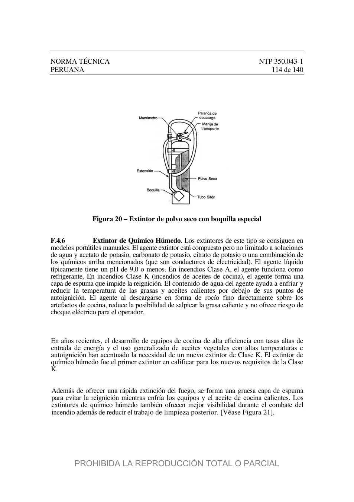

---

## Página 122

NORMA TÉCNICA NTP 350.043-1 PERUANA 115 de 140

Figura 21 – Extintor de químico húmedo

4.7 Extintor de niebla de agua. Los extintores de este tipo son portátiles manuales. Tienen denominaciones de 2-A:C. El agente es solo agua destilada, que se descarga como una niebla fina Además de usarse como un extintor común de agua, los extintores de niebla de agua se usan donde los contaminantes en fuentes de agua no reguladas pueden causar daños excesivos al personal o equipos. Las aplicaciones típicas incluyen salas de cirugía, museos y colecciones de libros. (Véase Figura 22)

### PROHIBIDA LA REPRODUCCIÓN TOTAL O PARCIAL

**Gráfico o cuadro original:**

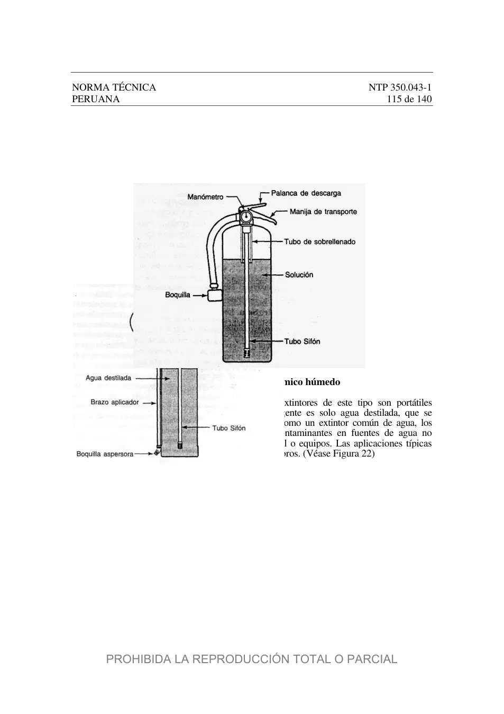

---

## Página 123

NORMA TÉCNICA NTP 350.043-1 PERUANA 116 de 140

Figura 22 – Extintor de niebla de agua

### PROHIBIDA LA REPRODUCCIÓN TOTAL O PARCIAL

**Gráfico o cuadro original:**

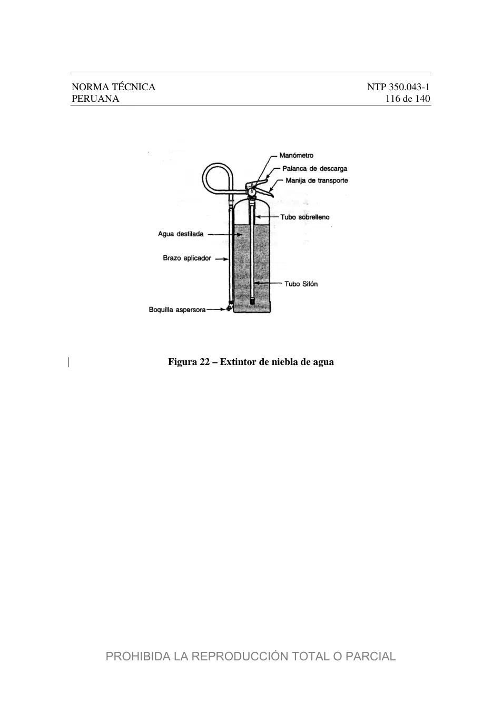

---

## Página 124

NORMA TÉCNICA NTP 350.043-1 PERUANA 117 de 140

ANEXO G (INFORMATIVO) DISTRIBUCION DE EXTINTORES G.1 Distribución de Extintores G.1.1 Los extintores portátiles tienen un uso más eficaz cuando están fácilmente disponibles en número y con adecuada capacidad o potencial  de extinción para ser operados por personas familiarizadas con su manejo G.1.2 En emergencia de incendio donde se disponen de extintores, alguien tiene que desplazarse para traer el equipo antes de iniciar la extinción. Esto significa “tiempo” valioso utilizado en recorrer  “la distancia de transporte” para conseguir el extintor y ponerlo en operación. G.1.3 A veces los extintores son a propósito mantenidos cerca (como por ejemplo en las operaciones de soldadura), sin embargo, sabiendo que los lugares de incendio no pueden anticiparse, los extintores se ubican en lugares estratégicos en las áreas de riesgo potencial G.1.4 La distancia de transporte no es solo un simple radio de un círculo, si no una distancia real que es necesario caminar hasta el extintor. Por tanto, la distancia es afectada por divisiones, la ubicación de las puertas, pasadizos, apilamiento de materiales almacenados, maquinaria, etc. G.2 Distribución en edificaciones. La ubicación debidamente señalizada de los extintores puede ser mejorada si se realiza una inspección del área a ser protegida. En general, se recomienda que las ubicaciones sean seleccionadas según:

a) Proporcione una distribución uniforme.

b) Proporcione un fácil acceso.

c) Estén relativamente libre de bloqueos por almacenaje y equipo, o ambos.

### PROHIBIDA LA REPRODUCCIÓN TOTAL O PARCIAL

---

## Página 125

NORMA TÉCNICA NTP 350.043-1 PERUANA 118 de 140

d) Estén cerca a los recorridos frecuentes.

e) Estén cerca de las puertas de entrada y salida

f) Estén libre de potenciales daños físicos

g) Estén fácilmente visible, y

h) Estén instalados en cada piso. G.3 Distribución de Extintores de Clase A G.3.1 La Tabla 1 (Pág. 38) es una guía para determinar el número mínimo y capacidad relativa de extinción de extintores para protección de incendios de Clase A, necesarios de acuerdo con el riesgo. En ciertas instancias, a través de los análisis de protección de ciertas áreas, riesgos de procesos, o configuraciones de edificios, pueden requerirse extintores de mayor capacidad relativa de extinción. Esto no significa, sin embargo, que las distancias máximas de transporte recomendadas  sean excedidas. G.3.2 Donde el área del piso de un edificio sea menor de 279 m2 (3000 pie2), se debe proveer al menos un extintor con la capacidad de extinción (rating) mínima recomendado. El primer paso para calcular la necesidad de un extintor de Clase A es determinar la clase de riesgo del establecimiento (bajo, moderado o alto). Dependiendo de la capacidad de extinción del extintor (1-A a 40 – A) se puede determinar el área máxima a ser protegida. Por ejemplo cada 10 L ó 9,46 L (2,5 gal) de extintor con agua presurizada (capacidad de extinción  2-A) protegerá un área de 279 m2 (3000 pie2) en un riesgo moderado. Los requerimientos de la Tabla 1 (véase Pág. 38), también especifican que la distancia de transporte (distancia a caminar), desde cualquier punto al extintor más cercano no excederá de 23 m. Es necesario seleccionar extintores que satisfagan tanto la distancia de transporte como la distribución para una clasificación o riesgo especifico. G.3.3 Si un área del piso de un edificio no estuviera obstruida en un radio de 23 m, sería posible colocar un extintor en el centro sin exceder la distancia de transporte de 23 m. En este caso un área de 1644 m2 (17700 pie 2) podrían ser asignados a un extintor de adecuada efectividad relativa de extinción A, ejem. Riesgo bajo 6A, Riesgo moderado 20-A (no existe capacidad de extinción de 12A). Riesgo Alto 20-A (no existe capacidad de extinción de 18A). Sin embargo, como los edificios son generalmente

### PROHIBIDA LA REPRODUCCIÓN TOTAL O PARCIAL

---

## Página 126

NORMA TÉCNICA NTP 350.043-1 PERUANA 119 de 140

rectangulares, el área cuadrada más grande que puede formarse con un punto de no más de 23 m desde el centro es de 1045 m2  (11250 pie2), el cual es el área de un cuadrado de 32 m x 32 m (106 pies x 106 pies) inscrito dentro de un circulo de radio de 23 m (Véase Figura 23). G.3.4 Los siguientes ejemplos de distribución ilustran el número y ubicación de los extintores de acuerdo a tipo de riesgo y capacidad de extinción. El edificio del ejemplo es de 46 m x 137 m (aproximadamente) (150 pies x 450 pies), dando un área de 6271 m2 (67500 pies2). Aunque se dan varias formas de ubicar los extintores, existen otras ubicaciones diferentes que podrían ser dados con resultados parecidos. (Véase Figura 24) El área que puede ser protegido por un extintor con una capacidad de extinción A se muestra en la Tabla 6. La tabla 6 es una guía para determinar el número mínimo y la Capacidad relativa de extinción de extintores para riesgos de fuego Clase A, a distribuir por áreas a proteger. Tabla 6 – Capacidad de extinción de extintores por riesgos de fuego Clase A y por áreas a proteger Máximo de área (m2 ) a proteger por extintor

**Cuadro del documento (filas: 3; columnas: 4):**

| Capacidad de / Extinción / (rating) | Máximo de área (m2 ) a proteger por extintor | Columna 3 | Columna 4 |
| --- | --- | --- | --- |
|  | Riesgo bajo | Riesgo Moderado | Riesgo alto |
| 1A / 2A / 3A / 4A / 6A / 10A / 20A / 30A / 40A | - / 560 / 840 / 1045 / 1045 / 1045 / 1045 / 1045 / 1045 | - / 280 / 420 / 560 / 840 / 1045 / 1045 / 1045 / 1045 | - / - / - / 370 / 560 / 930 / 1045 / 1045 / 1045 |

Nota. El área 1045 m2 es considerado un límite práctico.

### PROHIBIDA LA REPRODUCCIÓN TOTAL O PARCIAL

---

## Página 127

NORMA TÉCNICA NTP 350.043-1 PERUANA 120 de 140

Estos valores son determinados multiplicando el área máxima del piso por unidad de A mostrado en la tabla 1, por las varias capacidades de extinción A hasta que el valor de 11250 pie 2 sea excedida. G.3.5 El primer ejemplo demuestra la colocación en los límites del área de protección máxima, 1045 m2 (11250 pie2) permitidos en la tabla 1 para cada clase de riesgo. La instalación de extintores de mayor capacidad relativa de extinción no afectara la distribución o colocación. Ejemplo 1. 6  Extintores 4 - A para riesgo bajo 6271 (67 500) =  6                  6  Extintores 10-A para riesgo Moderado 1045 (11 250)                         6  Extintores 20-A para riesgo alto Nota. Unidades, metro2  (pie 2)

FIGURA 23 – Área cuadrada que representa el área máxima (1045 m2) que el extintor puede proteger dentro de los limites de un radio de 23 m

### PROHIBIDA LA REPRODUCCIÓN TOTAL O PARCIAL

**Gráfico o cuadro original:**

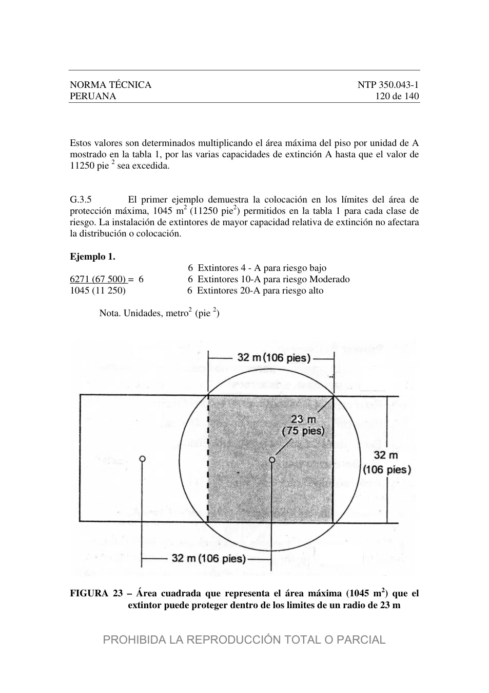

---

## Página 128

NORMA TÉCNICA NTP 350.043-1 PERUANA 121 de 140

FIGURA 24 – Representación diagramática de extintores ubicados a lo largo de las paredes perimetrales de un edificio de 137 m x 46 m NOTA: Los extintores representan los puntos centrales de los semicírculos. El área  sombreada indica zonas que están más alejadas de 23 m del extintor más cerca. G.3.6 La colocación, a lo largo de las paredes del contorno, no sería aceptable porque la regla de la distancia de transporte es claramente violado (véase Figura 24).Se necesita una reubicación y/o extintores adicionales. G.3.7 El ejemplo 2 es para extintores que tienen una capacidad relativa de extinción que corresponden a áreas de protección de 557 m2 (6000 pie 2). El ejemplo 3 es para extintores que tienen  la mínima capacidad relativa de extinción permitida por la tabla 1 con la correspondiente área mínima de protección. A medida que el numero de extintores de baja capacidad de extinción se incrementa cumple la distancia de transporte requerido ya no es una problema. Ejemplo 2 6271 (67 500) =  12           12   Extintores 2-A de riesgo bajo 557 ( 6 250)                      12  Extintores 4-A para riesgo moderado 12  Extintores 6-A para riesgo alto

### PROHIBIDA LA REPRODUCCIÓN TOTAL O PARCIAL

**Gráfico o cuadro original:**

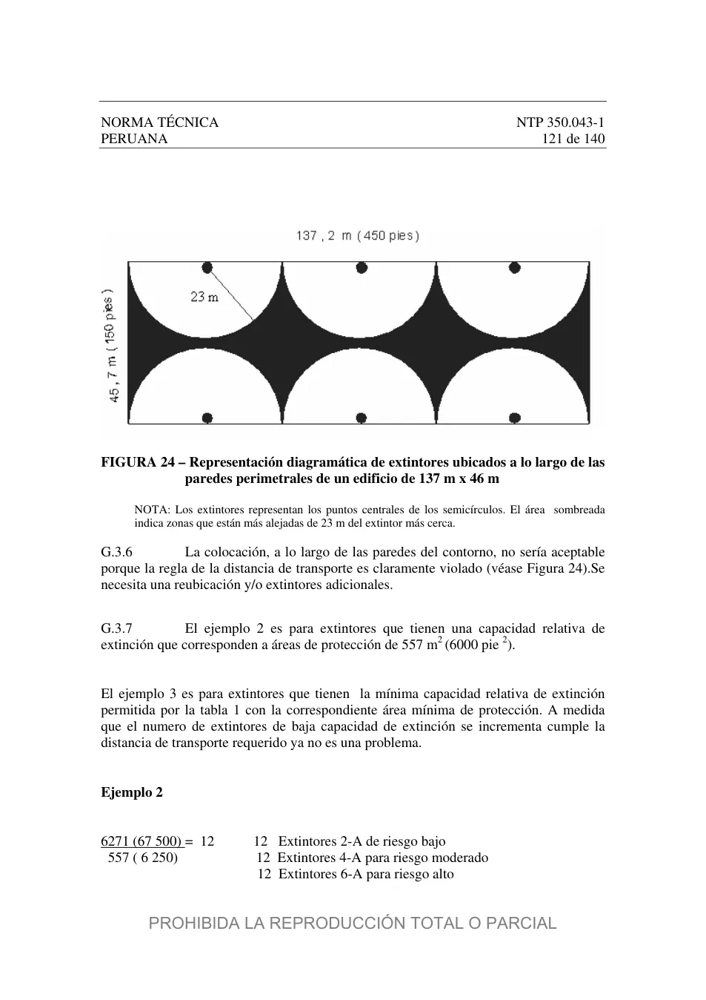

---

## Página 129

NORMA TÉCNICA NTP 350.043-1 PERUANA 122 de 140

F.3.8 Los extintores podrían ser montados en las paredes exteriores o como se muestra en la figura 25, en las columnas del edificio o en las paredes internas y satisface a las reglas tanto de la distribución como de las distancias de transporte.

Ejemplo 3 6271 (67 500) =   12            12  Extintores 2-A para riesgo moderado 557 (  6 000 ) 6271 (67 500) =   23            23  Extintores 2-A para riesgo moderado 278,5(  3 000 ) 6271 (67 500) =  17              17  Extintores 14-A para riesgo alto 370 ( 4  000) G.3.9 Este arreglo, ilustrado en la figura 26, muestra a los extintores agrupados juntos en las columnas del edificio o las paredes internas de una manera que aun satisface tanto la distribución como las distancias de transporte.

FIGURA 25 – Requerimiento de distancia de recorrido y distribución de extintores instalados en columnas del edificio o paredes interiores

### PROHIBIDA LA REPRODUCCIÓN TOTAL O PARCIAL

**Gráfico o cuadro original:**

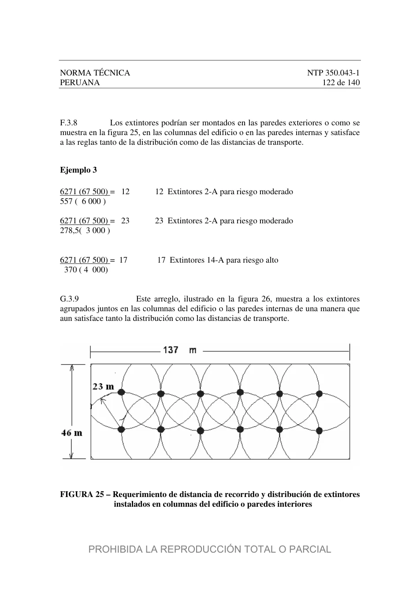

---

## Página 130

NORMA TÉCNICA NTP 350.043-1 PERUANA 123 de 140

FIGURA 26 – Extintores agrupados G.4 Distribución de Extintores de Clase B. G.4.1 Los riesgos de incendio comunes de clase B se dividen en dos categorías diferentes de acuerdo a sus requerimientos para extintores. Una condición es que los incendios no involucren líquidos inflamables de apreciable profundidad, tal como: Combustible derramado en una superficie libre, un incendio que involucre la emisión de vapores de un recipiente o tubería, o un incendio que se propague de un recipiente roto. G.4.2 La otra condición es cuando el incendio involucra líquidos inflamable en profundidad apreciable (definido como una profundidad de líquido mayor a 0.63 cm. (1/4 de pulgada), tal como los incendios de líquidos inflamables de tanques abiertos comúnmente encontrado en las plantas industriales, (tanques de inmersión para recubrimientos, pulido, tratamiento, o procesos similares.) G.4.3 En situaciones donde los líquidos inflamables no están en profundidad apreciable, los extintores deben proporcionarse de acuerdo a la tabla 2. Una vez que el tipo de riesgo se ha determinado, el extintor de clase B seleccionado debe tener una

### PROHIBIDA LA REPRODUCCIÓN TOTAL O PARCIAL

**Gráfico o cuadro original:**

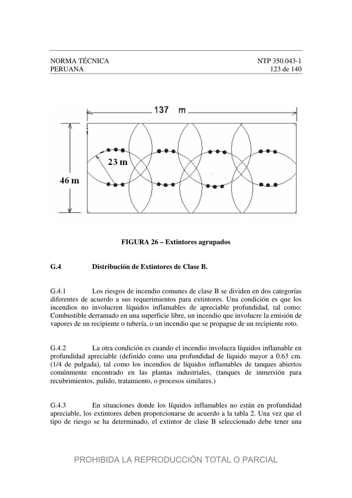

---

## Página 131

NORMA TÉCNICA NTP 350.043-1 PERUANA 124 de 140

capacidad de extinción igual o mayor de lo especificado, y ubicado a una distancia no mayor de la máxima distancia calculada. G.4.4 La razón para que la distancia máxima de transporte para un extintor de clase B sea de 15 m (50 pies) opuesto a la distancia de 23 m (75 pies) para la clase A, es de que el incendio del liquido inflamable alcanza rápidamente su intensidad máxima, casi inmediatamente. Es imperativo que el extintor de clase B sea inmediatamente transportado hacia el lugar del incendio en un tiempo más corto que el extintor de clase A. G.4.5 Aún cuando la Tabla 2 especifica la máxima distancia de transporte para la ubicación de los extintores de Clase B, se debe acudir al buen criterio para ubicar las distancias. El extintor puede ser ubicado más cerca al riesgo siempre y cuando no sea fácilmente alcanzado por el incendio y tenga fácil acceso evitando el calor, humo o el propio incendio. G.4.6 Cuando el área o ambiente es considerado un riesgo de clase B (como un garaje de reparación de autos), los extintores deberían ser ubicados a intervalos regulares tal que la máxima distancia de recorrido desde cualquier punto al extintor más cercano no exceda la máxima distancia de recorrido especificado en la Tabla 2. Para incendios con líquidos inflamables de apreciable profundidad, se provee un extintor de Clase B en base a dos unidades numéricas de potencial de extinción de Clase B(2B) por 0.0929 m2(pies 2) de la superficie del liquido inflamable del tanque más grande dentro del área. Los requerimientos de las distancias de recorrido de la Tabla 2 deberían ser usados en las ubicaciones de los extintores para la protección de riesgos puntuales, sin embargo deberían ser evaluados cuidadosamente el tipo de riesgo y la disponibilidad del extintor. G.4.7 Un extintor puede ser instalado para proporcionar protección contra diversos riesgos, sin exceder las distancias máximas de recorrido. Donde el riesgo es disperso o ampliamente separado y las distancias de recorrido son excedidas, la protección individual se debe instalar de acuerdo a la regla del área [0.0929 m2 (1 pie2)].

### PROHIBIDA LA REPRODUCCIÓN TOTAL O PARCIAL

---

## Página 132

NORMA TÉCNICA NTP 350.043-1 PERUANA 125 de 140

G.4.8 Cuando se ha instalado sistemas fijos de extintores de Clase B, el abastecimiento de extintores portátiles puede ser postergado para ese tipo de riesgo, pero no para la estructura, para otros peligros especiales o para el resto del contenido. A veces un tanque incendiado puede esparcir líquidos fuera del alcance del equipo fijo, o el incendio puede originarse a lado adyacente del tanque en lugar de ser en el propio líquido del tanque. Por tanto, es deseable disponer de extintores portátiles aun cuando estos peligros están protegidos con sistemas fijos. G.4.9 La selección del tipo adecuado y tamaño de extintores de clase B para incendios de combustibles a presión se hace en base a las recomendaciones del fabricante de este tipo de equipo especializado (disponible para ese tipo de riesgo). Son necesarios diseños de pitones, descargas y aplicaciones especiales para cubrir los peligros específicos de este riesgo. No es recomendable intentar apagar un incendio de combustible bajo presión si no se tiene razonable seguridad de que la fuente de suministro puede ser cerrada rápidamente para evitar una posible explosión. La distancia de transporte de los extintores portátiles no debe exceder de aquellos especificados en la Tabla 2. G.4.10 Son recomendados para fuegos de grasas de cocina extintores con agente de clase K.  La distancia máxima de recorrido es de 9 metros G.5 Distribución de Extintores de Clase C G.5.1 Para proteger a los operadores de extintores en circunstancias en que se encuentra equipos eléctricos en funcionamiento se requieren extintores de Clase C. Estos extintores utilizan un agente extintor no conductor. Los extintores clasificados en Clase C emplean dióxido de carbono, polvo químico seco u otros aprobados. NOTA. Agentes halogenados ver NTP 350.043-2 G.5.2 Cuando se corta la fuente de energía eléctrica del equipo, el incendio cambia de carácter de aquel al de Clase A, Clase B, o combinaciones de Clase Ay B dependiendo de la naturaleza de los componentes eléctricos y cualquier material incendiado en las cercanías.

### PROHIBIDA LA REPRODUCCIÓN TOTAL O PARCIAL

---

## Página 133

NORMA TÉCNICA NTP 350.043-1 PERUANA 126 de 140

G.5.3 El corte de la energía eléctrica a los equipos elimina la posibilidad de corto circuito que pueda afectar al operador cuando entre en contacto físico con el equipo, o cuando lleve cualquier parte conductora del extintor dentro de la distancia que forme arco. El corte de energía elimina la propagación de incendio o la fuente de reignición. El uso de interruptores o controles eléctricos en equipos específicos comprometidos en un incendio puede prevenir los efectos laterales del peligro (ejemplo. Llevar a un edificio multifamiliar a la oscuridad o cortar la fuente principal de energía de los equipos de apoyo, etc.). G.5.4 La capacidad de extinción del extintor para cada situación de riesgo de Clase C debe ser individualmente seleccionado de acuerdo a :

a) El tamaño del equipo eléctrico.

b) La configuración del equipo eléctrico (particularmente el contenido de la unidad) que influye la distribución del agente.

c) El alcance efectivo del chorro del extintor.

d) La cantidad de material de Clase A y Clase B involucrado. Cada uno de estos factores influye en la cantidad y tipo de agente necesario, el flujo deseado descarga, la duración de la aplicación y los potenciales desperdicios del agente. G.5.5 Para instalaciones eléctricas de gran envergadura donde la continuidad de la energía es crítica, se requiere la protección contra incendios mediante sistemas fijos. En tales lugares donde se instalan sistemas fijos, es también practico proveer de extintores portátiles para maniobrar rápidamente cuando se descubra incendios localizados; obviamente, el numero y tamaño de estas unidades debe ser reducida en tales condiciones. G.6 Distribución de Extintores de Clase D G.6.1 Para incendio de Clase D, es importante disponer de extintores portátiles especiales (o equipo equivalente para contener o extinguir cualquier incendio en un metal combustible). Los equipos extintores en tales casos deben estar ubicados a no más de 23m (75 pies) del riesgo.

### PROHIBIDA LA REPRODUCCIÓN TOTAL O PARCIAL

---

## Página 134

NORMA TÉCNICA NTP 350.043-1 PERUANA 127 de 140

G.6.2 El uso de un extintor inadecuado puede incrementar o expandir inmediatamente el incendio. Cuantitativamente la cantidad de agente necesario es normalmente medido por el área superficial de los metales combustibles que podrían estar involucrados en el riesgo, más la severidad potencial del incendio influenciado por la forma de metal. Debido a que los incendios en polvos de magnesio son mayores. Los extinguidores señalados para incendios de Clase D no tienen la misma efectividad en todos los metales. Generalmente, los extintores así marcados podrían ser peligrosos cuando se usan en incendios de otro metales. Hasta que el efecto del agente de extinción no sea conocido  se deben realizar pruebas con el material representativo. G.7 Problemas Ejemplo. Se necesita proteger una oficina de riesgo bajo ubicado, mediante extintores portátiles. El área del piso es de 1030 m2  (11100 pies2) que tiene un diseño no común (véase figura 27) El más común de los extintores podría ser de 10 L ó 9,46 L (2,5 gal) de agua a presión en modelos clasificados de 2-A. Según las tablas 1 y 6 se necesitan dos extintores (11100 dividido entre 6000 = 2). La distancia de recorrido como máximo es de 23 m . Las unidades son colocadas en los puntos 1 y 2, se hace una revisión de las distancias de recorrido requeridas. Porque el área es una forma poco común, se observa que las áreas sombreadas exceden los 23 m de distancia. Se necesitan dos extintores adicionales (en los puntos 3 y 4) Los extintores adicionales dan mayor flexibilidad para su ubicación, y alternativas de localización son dadas como se indica. Es importante considerar cualquier división, paredes, u otras obstrucciones para determinar la distancia de recorrido. Como algo adicional, considerar que el área  A tiene una pequeña área de impresión y fotocopiado que utiliza líquidos inflamables, esta área se califica como de riesgo moderado de clase B. Se podrían especificar los extintores 10-B:C o 20-B:C para proteger esta área. Existen dos alternativas a considerar, primero, un quinto extintor sea de dióxido de carbono o de polvo químico seco, con una capacidad de extinción de 10B:C o 20B:C.

### PROHIBIDA LA REPRODUCCIÓN TOTAL O PARCIAL

---

## Página 135

NORMA TÉCNICA NTP 350.043-1 PERUANA 128 de 140

Segundo, el extintor de agua del punto 2 podría ser reemplazado con un extintor de polvo químico seco que tenga una capacidad de extinción de al menos 2 A :10B:C. Este sería localizado cerca  del punto B, tomando en cuenta los 23 m de distancia de recorrido para la protección de 2-A y de 9 m a 15 m (30 a 50 pies) de distancia requerida para la protección de clase B que el extintor provee.

51,8 m ( 170  pies )

9,1  m ( 30  pies )

1

3

9,1  m ( 30  pies )

A 2 4

B

9,1  m ( 30  pies )

FIGURA 27  –  Área de Piso

### PROHIBIDA LA REPRODUCCIÓN TOTAL O PARCIAL

**Gráfico o cuadro original:**

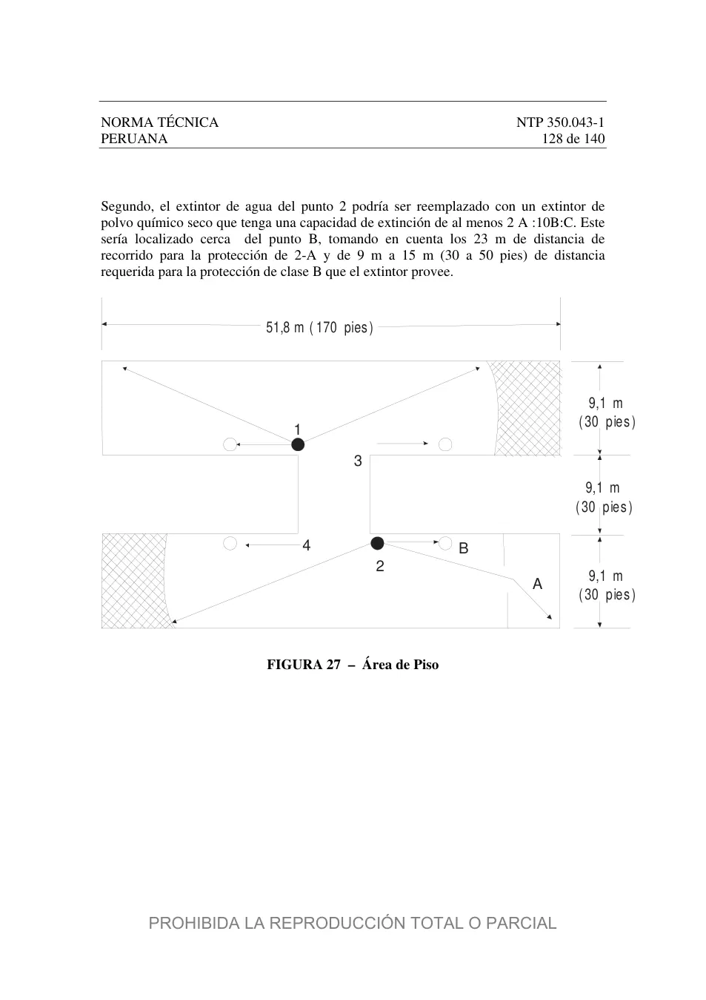

---

## Página 136

NORMA TÉCNICA NTP 350.043-1 PERUANA 129 de 140

ANEXO H (INFORMATIVO) SELECCIÓN DE EXTINTORES H.1 CONDICIONES DE SELECCIÓN H.1.1 Condiciones físicas que influyen en la selección H.1.1.1 Peso Bruto. En la selección de un extintor, es recomendable considerar la capacidad física del usuario. Cuando el riesgo sobrepasa la capacidad de extinción (rating) de un extintor portátil manual, es conveniente considerar extintores portátiles sobre ruedas o de sistemas fijos. H.1.1.2 Corrosión. En la selección e instalación de algunos extintores, existe la posibilidad de exponer al extintor a atmósferas corrosivas. Cuando sea este el caso, es recomendable dar una protección adecuada al extintor en su selección, teniendo en cuenta las recomendaciones del fabricante. H.1.1.3 Reacción del agente extintor. Se recomienda tener en cuenta para la selección de un extintor; la posibilidad de reacciones adversas durante su aplicación, contaminación, u otros efectos del agente extintor en los procesos de fabricación en sí, o en los equipos utilizados en el proceso o ambos, teniendo en cuenta las recomendaciones del fabricante del extintor. H.1.1.4 Extintores portátiles sobre ruedas. Cuando son usados este tipo de extintores, es conveniente tener en cuenta la movilidad de estos dentro del área que van a proteger. Para ubicaciones en exteriores se recomienda considerar el uso de diseños con ruedas apropiadas al terreno. Para ubicaciones en interiores, el tamaño y ancho de las puertas y los pasadizos debe ser lo suficientemente grande para permitir la fácil movilización del extintor portátil sobre ruedas

### PROHIBIDA LA REPRODUCCIÓN TOTAL O PARCIAL

---

## Página 137

NORMA TÉCNICA NTP 350.043-1 PERUANA 130 de 140

H.1.1.5 Viento o corrientes de aire. Si el riesgo a proteger está sujeto a estas condiciones de vientos o corrientes de aire, para superarlas se debe considerar el uso de extintores y agentes extintores que tengan suficiente capacidad de extinción y alcance para vencer dichas condiciones. H.1.1.6 Disponibilidad del personal. Se debe tener en cuenta el número de personas disponibles para operar los extintores, su grado de entrenamiento y la capacidad física para operar los extintores. H.1.2 Condiciones de salud y seguridad que influyen en la selección Cuando se selecciona un extintor se recomienda dar importancia a los riegos a la salud y seguridad involucradas en el uso y mantenimiento de los mismos, como se describe en los siguientes numerales: H.1.2.1 Entre las medidas que es conveniente considerar para espacios confinados están las siguientes: colocar etiquetas de advertencia destacados en el extintor, señales de advertencia en las entradas a recintos confinados, proveer dispositivos de aplicación de control a distancia, pitones o toberas de extintor para un mayor alcance, ventilación especial, provisión de aparatos de respiración autocontenido y otros equipos de protección personal y un adecuado entrenamiento del personal. H.1.2.2 Los extintores de dióxido de carbono contienen un agente extintor que puede hacer peligrar la vida cuando se le usa con bastante concentración en la extinción de un fuego. El uso de este tipo de extintor en espacios no ventilados puede disminuir la provisión de oxígeno. La permanencia prolongada en dichos espacios puede provocar la pérdida de conocimiento debido a la deficiencia de oxígeno. H.1.2.3 La utilización del contenido de los extintores de dióxido de carbono para otros fines (soplar, inflar, congelar, etc) que no sean los de combatir incendios de clase B o C según su capacidad de extinción, no está permitida en razón de su alta presión contenida, la misma que puede ser de alto riesgo y causa de graves accidentes al usuario y/o daño físico a las instalaciones o equipo donde se utiliza o aplique.

### PROHIBIDA LA REPRODUCCIÓN TOTAL O PARCIAL

---

## Página 138

NORMA TÉCNICA NTP 350.043-1 PERUANA 131 de 140

H.1.2.4 Los extintores que no están aprobados para uso de extinción de fuegos de la clase C como: agua, agua con anticongelante, agua penetrante, chorro cargado, espumas; presentan peligro de choque eléctrico cuando se aplican en equipos eléctricos energizados. NOTA. Los extintores de gas carbónico con tobera o corneta metálica están prohibidos para riesgos de incendios de clase C. H.1.2.5 Cuando se descarga extintores de polvo químico seco en un área no ventilada pueden reducir la visibilidad por un periodo de varios minutos y causar dificultad en ese momento a la respiración. El polvo descargado en esa zona puede además obstruir los filtros de los sistemas de purificación (“limpieza”) de aire H.1.2.6 La mayor parte de los incendios producen descomposición tóxica de los productos que combustionan. Algunos materiales en combustión al gasificarse se transforman en altamente tóxicos. Los incendios también pueden consumir el oxígeno disponible o producir exposición altamente peligrosa por convección y radiación de calor. Todo esto puede afectar el grado de aproximación del operador al fuego  para poder atacarlo en forma segura con el extintor. H.1.3 Polvo químico seco en equipos energizados. El uso de extintores de polvo químico seco en equipos energizados húmedos tales como postes, transformadores y conmutadores de alta tensión puede agravar el riesgo con descargas eléctricas. El Polvo químico seco en combinación con la humedad permite el paso de la electricidad reduciendo la efectividad del aislante de protección. Es recomendable el retiro de todos los restos de polvo químico seco de tales equipos después de la extinción. Un extintor de químico seco conteniendo componentes de amonio no debe ser usado sobre oxidantes que contengan cloruros. La reacción entre el oxidante y las sales de amonio pueden producir un componente explosivo (NCl3 )

### PROHIBIDA LA REPRODUCCIÓN TOTAL O PARCIAL

---

## Página 139

NORMA TÉCNICA NTP 350.043-1 PERUANA 132 de 140

H.1.4 Extintores y agentes extintores para riesgos de clase D H.1.4.1 La reacción química entre metales incendiados y muchos de los agentes químicos de extinción incluido el agua, puede causar riesgos de amplio rango desde reacciones sin consecuencias hasta explosiones dependiendo del tipo, forma y cantidad de metal involucrado. En general los riesgos de un metal incendiado son significativamente incrementados cuando tales agentes de extinción se utilizan. H.1.4.2 Los agentes extintores y extintores recomendados en fuegos Clase D son de tipos especializados y su uso generalmente involucra técnicas peculiares para cada metal combustible en particular. Un agente de extinción dado no controlara necesariamente o extinguirá todos los incendios en metales. Algunos agentes son eficaces para combatir fuegos en varios metales, otros solamente en un tipo de incendio de metal. La autoridad o entidad competente debería ser consultada considerando cada caso en particular. H.1.4.3 Ciertos metales combustibles y productos químicos reactivos requieren agentes extintores y técnicas especiales de extinción. Si hay dudas deberán ser consultadas normas aplicables (ISO, NFPA). H.1.4.4 Se deberá tener en cuenta las recomendaciones del fabricante del agente para su uso de extinción y técnica de aplicación en extinciones de fuegos en distintos metales combustibles H.1.4.5 Fuegos de alta intensidad pueden ocurrir en algunos metales; la ignición es generalmente el resultado del recalentamiento por fricción, exposición a la humedad o a un fuego proveniente de otros materiales combustibles. El mayor riesgo existe cuando estos metales estén en estado líquido, en polvo o en viruta. H.1.5 Agentes extintores en equipos eléctricos. La aplicación de agentes extintores en determinados equipos electrónicos puede traer como consecuencias efectos secundarios tanto en los equipos comprometidos como en los periféricos. H.1.6 Extintores portátiles sobre ruedas. Estos extintores están disponibles en capacidades variables, son capaces de descargar flujos mayores de agente, siendo

### PROHIBIDA LA REPRODUCCIÓN TOTAL O PARCIAL

---

## Página 140

NORMA TÉCNICA NTP 350.043-1 PERUANA 133 de 140

capaces de proporcionar mayor capacidad de extinción para áreas de mayor riesgo y tienen una importancia adicional cuando el número de operarios es limitado. H.1.7 Características de los extintores. En la siguiente Tabla se resume las características de los extintores y se puede usar como ayuda para seleccionar extintores de acuerdo con el capítulo 7. Tabla 7 – Características de extintores Agente de extinción

**Cuadro del documento (filas: 2; columnas: 7):**

| Agente / de / extinción | Método de / Operación | Capacidad | Alcance / horizontal / del chorro | Tiempo / aproximado / de descargue | Protección / requerida / debajo de / 4 ºC | Capacidad / o potencial / de / a) / extinción |
| --- | --- | --- | --- | --- | --- | --- |
| Agua | Presurizado / Presurizado / o bomba / Bomba / Bomba | 6 L / 2 ½ gal. / 4 gal / 5 gal | 9 m a 12 m / 9 m a 12 m / 9 m a 12 m / 9 m a 12 m | 40 s / 1 min / 2 min / 2 a 3 min | Si / Si / Si / Si | 1-A / 2-A / 3-A / 4-A |

1-A 2-A 3-A 4-A

a) Capacidad de extinción sólo como referencia Tabla 7 (continuación) – Características de extintores Agente de extinción

**Cuadro del documento (filas: 3; columnas: 7):**

| Agente / de / extinción | Método de / Operación | Capacidad | Alcance / horizontal / del chorro | Tiempo / aproximado / de descargue | Protección / requerida / debajo de / 4 ºC | Capacidad / o potencial / de / a) / extinción |
| --- | --- | --- | --- | --- | --- | --- |
| Agua / (agente / humectan / te) | Presurizado / Presurizado / Presurizado / Presurizado | 1 ½ gal. / 25 gal. / sobre / ruedas / 45 gal. / sobre / ruedas / 60 gal / sobre / ruedas | 6 m / 10,5 m / 10,5 m / 10,5 m | 30 s / 90 s / 2 min / 2,5 min | Si / Si / Si / Si | 2-A / 10-A / 30-A / 40-A |
| Chorro / cargado | Presurizado / Presurizado | 2 ½ gal. / 33 gal. / Sobre / ruedas | 9 m a 12 m / 15 m | 1 min / 3 min | No / No | 2-A / 20-A |

### PROHIBIDA LA REPRODUCCIÓN TOTAL O PARCIAL

---

## Página 141

NORMA TÉCNICA NTP 350.043-1 PERUANA 134 de 140

**Cuadro del documento (filas: 4; columnas: 7):**

| AFFF, / FFFP | Presurizado / Presurizado / Cilindro de / nitrógeno | 2 ½ gal / 6 L. / 33 gal | 6 m, 7,5 m / 6 m, 7,5 m / 9 m | 50 s / 50 s / 60 s | Si / Si / Si | 3-A:20 a / 40B / 2-A:10-B / 20-A:160- / B |
| --- | --- | --- | --- | --- | --- | --- |
| Dióxido / de / carbono / b) | Gas / expelente / Gas / expelente / Gas / expelente / Gas / expelente | 2 ½ lb a 5 / lb / 10 lb a 15 / lb / 20 lb / 50 lb a 100 / lb / Sobre / ruedas | 0,9 m a 2,4 m / 0,9 m a 2,4 m / 0,9 m a 2,4 m / 0,9 m a 3,0 m | 8 s a 30 s / 8 s a 30 s / 10 s a 30 s / 10 s a 30 s | No / No / No / No | 1-B a 5- / B:C / 2-B a 10- / B:C / 10-B: C / 10-B a 20- / B:C |
| Polvo / químico / seco / (bicarbon / ato de / sodio) | Presurizado / Cartucho o / Presurizado / Cartucho o / Presurizado / Presurizado / Cilindro de / nitrógeno o / Presurizado | 1 lb a 2 ½ / lb / 2 ¾ lb a 5 / lb / 6 lb a 30 lb / 50 lb / Sobre / ruedas / 75 lb a 350 / lb / Sobre / ruedas | 1,5 m a 2,4 m / 1,5 m a 6,0 m / 1,5 m a 6,0 m / 6 m / 4,5 m a 13,5 m | 8 s a 12 s / 8 s a 25 s / 10 s a 25 s / 35 s / 20 s a 105 s | No / No / No / No / No | 2-B a 10- / B:C / 5-B a 20- / B:C / 10-B a 160- / B:C / 160-B:C / 2-B a 10- / B:C |
| Polvo / químico / seco / (bicarbon / ato de / potasio) | Cartucho o / Presurizado / Cartucho o / Presurizado / Cartucho o / Presurizado / Cartucho o / Presurizad / Cilindro de / nitrógeno o / Presurizado | 2 lb a 5 lb / 5 ½ lb a 10 / lb / 16 lb a 30 / lb / 48 lb a 50 / lb / 125 lb a 350 / lb / Sobre / ruedas | 1,5 m a 3,5 m / 1,5 m a 6,0 m / 3,0 m a 6,0 m / 6 m / 4,5 m a 13,5 m | 8 s a 10 s / 8 s a 20 s / 8 s a 25 s / 30 s a 35 s / 30 s a 80 s | No / No / No / No / No | 5-B a 30- / B:C / 10-B a 80- / B:C / 40-B a 120- / B:C / 120-B a / 160-B:C / 80-B a 640- / B:C |

a) Capacidad de extinción sólo como referencia

b) Los extintores de dióxido de carbono con toberas metálicas no tienen clasificación C

### PROHIBIDA LA REPRODUCCIÓN TOTAL O PARCIAL

---

## Página 142

NORMA TÉCNICA NTP 350.043-1 PERUANA 135 de 140

**Cuadro del documento (filas: 4; columnas: 7):**

| Agente de / extinción | Método de / Operación | Capacidad | Alcance / horizontal del / chorro | Tiempo / aproximado de / descargue | Protección / requerida / debajo de 4 / ºC | Capacidad / o potencial / de extinción / a) |
| --- | --- | --- | --- | --- | --- | --- |
| Polvo / químico / seco / (cloruro / de / potasio) | Cartucho o / Presurizado / Cartucho o / Presurizado / Cartucho o / Presurizado / Cartucho o / Presurizado / Cartucho o / Presurizado | 2 lb a 5 lb / 5 lb a 9 lb / 9 ½ lb a 20 / lb / 19 ½ lb a 30 / lb / 125 lb a 200 / lb / Sobre ruedas | 1,5 m a 2,4 m / 2,4 m a 3,5 m / 3,0 m a 4,5 m / 1,5 m a 6,0 m / 4,5 m a 13,5 m | 8 s a 10 s / 10 s a 15 s / 15 s a 20 s / 10 s a 25 s / 30 s a 40 s | No / No / No / No / No | 5-B a 10- / B:C / 20-B a 40- / B:C / 40-B a 60- / B:C / 60-B a 80- / B:C / 160-B:C |
| Polvo / químico / seco / multi- / propósito/ / ABC / (fosfato de / amonio) | Presurizado / Presurizado / o Cartucho / Presurizado / o Cartucho / Presurizado / o Cartucho / Presurizado / o Cartucho / Cilindro de / nitrógeno o / Presurizado | 1 lb a 5 lb / 2 ½ lb a 9 lb / 9 lb a 17 lb / 17 lb a 30 lb / 45 lb a 50 lb / Sobre ruedas / 110 lb a 315 / lb / Sobre ruedas | 1,5 m a 3,5 m / 1,5 m a 3,5 m / 1,5 m a 6,0 m / 1,5 m a 6,0 m / 6 m / 4,5 m a 13,5 m | 8 s a 10 s / 8 s a 15 s / 10 s a 25 s / 10 s a 25 s / 25 s a 35 s / 30 s a 60 s | No / No / No / No / No / No | 1-A a 3-A y / 2-B a 10- / B:C / 1-A a 4-A y / 10-B a 40- / B:C / 2-A a 20-A / y / 10-B a 80- / B:C / 3-A a 20-A / y / 30-B a 120- / B:C / 20-A a 30-A / y 80-B a / 160-B:C / 20-A a 40-A / y / 60-B a 320- / B:C |
| Polvo / químico / seco / (compatib / le con / espuma) | Cartucho o / Presurizado / Cartucho o / Presurizado / Cartucho o / Presurizado / Cilindro de / nitrógeno o / Presurizado | 4 ¾ lb a 9 lb / 9 lb a 27 lb / 18 lb a 30 lb / 150 lb a 350 / lb / Sobre ruedas | 1,5 m a 6,0 m / 1,5 m a 6,0 m / 1,5 m a 6,0 m / 4,5 m a 13,5 m | 8 s a 10 s / 10 s a 25 s / 10 s a 25 s / 20 s a 150 s | No / No / No / No | 10-B a 20- / B:C / 20-B a 30- / B:C / 40-B a 60- / B:C |

### PROHIBIDA LA REPRODUCCIÓN TOTAL O PARCIAL

---

## Página 143

NORMA TÉCNICA NTP 350.043-1 PERUANA 136 de 140

**Cuadro del documento (filas: 3; columnas: 7):**

| Columna 1 | Columna 2 | Columna 3 | Columna 4 | Columna 5 | Columna 6 | 80-B a 240- / B:C |
| --- | --- | --- | --- | --- | --- | --- |
| Polvo / químico / seco / (bicarbona / to de / potasio a / base de / urea) | Presurizado / Presurizado | 5 lb a 11 lb / 9 lb a 23 lb / 175 lb / Sobre ruedas | 3,4 m a 6,5 m / 4,5 m a 9,0 m / 21,0 m | 18 s / 17 s a 33 s / 62 s | No / No / No | 40-B a 80- / B:C / 60-B a 160- / B:C / 480-B:C |
| Químico / húmedo | Presurizado / Presurizado / Presurizado | 3 L / 6 L / 2 ½ gal. | 2,4 m a 3,5 m / 2,4 m a 3,5 m / 2,4 m a 3,5 m | 30 s / 35 s a 45 s / 75 s a 85 s | No / No / No | K / K / K |

### PROHIBIDA LA REPRODUCCIÓN TOTAL O PARCIAL

---

## Página 144

NORMA TÉCNICA NTP 350.043-1 PERUANA 137 de 140

ANEXO J (INFORMATIVO) TÍTULOS DE LAS NORMAS DE REFERENCIA EN CASTELLANO J.1 Normas Técnicas de Referencia Las Normas Técnica que a continuación se indican están listadas en 2.2 de esta NTP, siendo sus títulos y su contenido en idioma inglés; en este anexo los títulos son presentados traducidos en castellano sólo con carácter informativo, en caso de algún conflicto por la traducción, el título de idioma inglés prevalecerá J.1.1 ANSI/ASME B1.20.1:1983  Roscas de tubos en pulgadas para propósitos generales [Pipe Threads, General Purpose (Inch)] J.1.2 ANSI/UL 8:2005 Norma para extintores de espuma (Standard for foam fire extinguishers) J.1.3 ASTM D 5391:2005 Norma para la prueba de resistividad y conductividad eléctrica de una muestra de agua de alta pureza fluyendo (Standard test for electrical conductivity and resistivity of a flowing high Purity Water sample) J.1.4 CGA C-1:2004 Método de prueba hidrostática para cilindros de gas comprimido (Methods of Hydrostatic Testing of Compressed Gas Cylinders) J.1.5 NFPA 13:2007 Norma para la instalación de sistemas de rociadores (Standard for the Installation of Sprinkler Systems)

### PROHIBIDA LA REPRODUCCIÓN TOTAL O PARCIAL

---

## Página 145

NORMA TÉCNICA NTP 350.043-1 PERUANA 138 de 140

J.1.6 NFPA 14:2007 Norma para la instalación del sistemas de tubería vertical y mangueras (Standard for the Installation of Standpipes and Hose Systems) J.1.7 NFPA 30A:2008 Código para instalaciones de despacho de combustibles para motor y talleres de reparación de vehículos (Code for Motor Fuel Dispensing Facilities and Repair Garages) J.1.8 NFPA 32:2007 Norma para plantas de limpieza en seco (Standard for Drycleaning Plants) J.1.9 NFPA 72:2007 Código Nacional de alarmas de incendios (National Fire Alarm Code) J.1.10 NFPA 86:2007 Norma para estufas y hornos (Standard for Ovens and Furnace). J.1.11 NFPA 96:2008 Norma para el control de ventilación y protección contra incendio de operaciones en cocinas comerciales (Standard for Ventilation Control and Fire Protection of Commercial Cooking Operations) J.1.12 NFPA 120:2004 Norma para control y prevención de incendios en minas de carbón (Standard for Fire Prevention and Control Coal Mines) J.1.13 NFPA 122:2004 Norma para control y prevención de incendios en minas de metales y/o metaloides e instalaciones de procesamiento de minerales metálicos

### PROHIBIDA LA REPRODUCCIÓN TOTAL O PARCIAL

---

## Página 146

NORMA TÉCNICA NTP 350.043-1 PERUANA 139 de 140

(Standard for Fire Prevention and Control in Metal/Nonmetal Mining and Metal Mineral Processing Facilities) J.1.14 NFPA 241:2004 Norma para protección en las operaciones de construcción, modificaciones y demoliciones (Standard for Safeguarding Construction, Alteration, and Demolition Operations) J.1.15 NFPA 302:2004 Norma para protección contra incendios de embarcaciones a motor comerciales y de recreo (Fire Protection Standard for Pleasure and Comercial Motor Craft) J.1.16 NFPA 303:2006 Norma de protección contra incendios para astilleros y puertos de embarcaciones menores (Fire Protection Standard for Marinas and Boatyards) J.1.17 NFPA 385:2007 Norma de vehículos cisternas para líquidos combustibles e inflamables (Standard for Tank Vehicles for Flammable and Combustible Liquids) J.1.18 NFPA 400:2010 Código de materiales peligrosos (Hazardous Materials Code) J.1.19 NFPA 407:2007 Norma para servicio de combustibles de aeronaves (Standard for Aircraft Fuel Servicing) J.1.20 NFPA 408:2004 Norma para extintores portátiles manuales para aereonaves (Standard for Aircraft Hand Portable Fire Extinguishers) J.1.21 NFPA 410:2004 Norma en el mantenimiento de aeronaves

### PROHIBIDA LA REPRODUCCIÓN TOTAL O PARCIAL

---

## Página 147

NORMA TÉCNICA NTP 350.043-1 PERUANA 140 de 140

(Standard on Aircarft Maintenance) J.1.22 NFPA 418:2006 Norma para helipuertos (Standard for Heliport) J.1.23 NFPA 430:2004 Código para el almacenaje de oxidantes sólidos y líquidos (Code for the Storage of Liquid and Solid Oxidizers) J.1.24 NFPA 498:2006 Norma para refugios seguros e intercambio de lotes para vehículos que transportan explosivos (Standard for Safe Havens and Interchange Lots for Vehicles Transporting Explosives) J.1.25 NFPA 1192:2008 Norma para vehículos recreativos (Standard on Recreational Vehicles) J.1.26 NFPA 1194:2008 Norma para estacionamientos y campamentos de vehículos recreativos (Standard for Recreational Vehicle Parks and Campgrounds) J.1.27 UL 300:2010 Ensayo de fuego de sistemas de extinción de fuegos para protección de instalaciones de cocina comercial (Fire Testing of Fire Extinguishing Systems for Protection of Commercial Cooking Equipment)

### PROHIBIDA LA REPRODUCCIÓN TOTAL O PARCIAL

---
