# R. M. N.° 245-2021-TR — Elecciones de representantes de SST

**Archivo fuente:** `RM 245-2021-TR.pdf`
**Páginas del PDF:** 28

> Conversión a Markdown página por página. Cuando la página contiene formularios escaneados, se adjunta su imagen original. El OCR de tablas y textos escaneados puede contener errores; contrastar con el documento original. No se ha verificado la vigencia normativa ni consolidado modificaciones posteriores.

## Índice de páginas

- [Página 1](#pagina-1)
- [Página 2](#pagina-2)
- [Página 3](#pagina-3)
- [Página 4](#pagina-4)
- [Página 5](#pagina-5)
- [Página 6](#pagina-6)
- [Página 7](#pagina-7)
- [Página 8](#pagina-8)
- [Página 9](#pagina-9)
- [Página 10](#pagina-10)
- [Página 11](#pagina-11)
- [Página 12](#pagina-12)
- [Página 13](#pagina-13)
- [Página 14](#pagina-14)
- [Página 15](#pagina-15)
- [Página 16](#pagina-16)
- [Página 17](#pagina-17)
- [Página 18](#pagina-18)
- [Página 19](#pagina-19)
- [Página 20](#pagina-20)
- [Página 21](#pagina-21)
- [Página 22](#pagina-22)
- [Página 23](#pagina-23)
- [Página 24](#pagina-24)
- [Página 25](#pagina-25)
- [Página 26](#pagina-26)
- [Página 27](#pagina-27)
- [Página 28](#pagina-28)

---

## Página 1

**Página escaneada: imagen de referencia para comprobar tablas, formularios y sus casillas.**

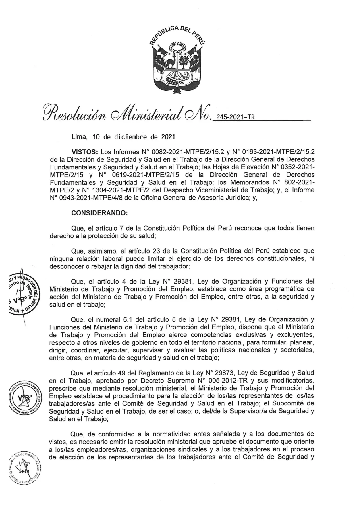

**Transcripción por reconocimiento de imagen:**

Resolución Mimistenial ON. 245-2021-TR

Lima, 10 de diciembre de 2021

VISTOS: Los Informes N” 0082-2021-MTPE/2/15.2 y N* 0163-2021-MTPE/2/15.2
de la Dirección de Seguridad y Salud en el Trabajo de la Dirección General de Derechos
Fundamentales y Seguridad y Salud en el Trabajo; las Hojas de Elevación N* 0352-2021-
MTPE/2/15 y N* 0619-2021-MTPE/2/15 de la Dirección General de Derechos
Fundamentales y Seguridad y Salud en el Trabajo; los Memorandos N* 802-2021-
MTPE/2 y N* 1304-2021-MTPE/2 del Despacho Viceministerial de Trabajo; y, el Informe
N?* 0943-2021-MTPE/4/8 de la Oficina General de Asesoría Jurídica; y,

CONSIDERANDO:

Que, el artículo 7 de la Constitución Política del Perú reconoce que todos tienen
derecho a la protección de su salud;

Que, asimismo, el artículo 23 de la Constitución Política del Perú establece que
ninguna relación laboral puede limitar el ejercicio de los derechos constitucionales, ni
desconocer o rebajar la dignidad del trabajador;

Que, el artículo 4 de la Ley N” 29381, Ley de Organización y Funciones del
Ministerio de Trabajo y Promoción del Empleo, establece como área programática de
acción del Ministerio de Trabajo y Promoción del Empleo, entre otras, a la seguridad y
salud en el trabajo;

Que, el numeral 5.1 del artículo 5 de la Ley N* 29381, Ley de Organización y
Funciones del Ministerio de Trabajo y Promoción del Empleo, dispone que el Ministerio
de Trabajo y Promoción del Empleo ejerce competencias exclusivas y excluyentes,
respecto a otros niveles de gobierno en todo el territorio nacional, para formular, planear,
dirigir, coordinar, ejecutar, supervisar y evaluar las políticas nacionales y sectoriales,
entre otras, en materia de seguridad y salud en el trabajo;

Que, el artículo 49 del Reglamento de la Ley N” 29873, Ley de Seguridad y Salud
en el Trabajo, aprobado por Decreto Supremo N” 005-2012-TR y sus modificatorias,
prescribe que mediante resolución ministerial, el Ministerio de Trabajo y Promoción del
Empleo establece el procedimiento para la elección de los/las representantes de los/las
trabajadores/as ante el Comité de Seguridad y Salud en el Trabajo; el Subcomité de
Seguridad y Salud en el Trabajo, de ser el caso; o, del/de la Supervisor/a de Seguridad y
Salud en el Trabajo;

Que, de conformidad a la normatividad antes señalada y a los documentos de
vistos, es necesario emitir la resolución ministerial que apruebe el documento que oriente
a los/las empleadores/ras, organizaciones sindicales y a los trabajadores en el proceso
de elección de los representantes de los trabajadores ante el Comité de Seguridad y

---

## Página 2

**Página escaneada: imagen de referencia para comprobar tablas, formularios y sus casillas.**

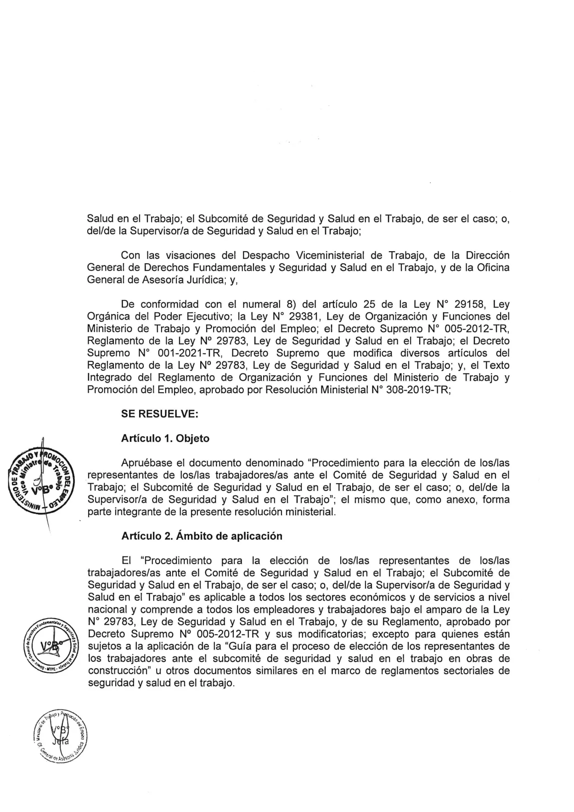

**Transcripción por reconocimiento de imagen:**

Salud en el Trabajo; el Subcomité de Seguridad y Salud en el Trabajo, de ser el caso; o,
del/de la Supervisor/a de Seguridad y Salud en el Trabajo;

Con las visaciones del Despacho Viceministerial de Trabajo, de la Dirección
General de Derechos Fundamentales y Seguridad y Salud en el Trabajo, y de la Oficina
General de Asesoría Jurídica; y,

De conformidad con el numeral 8) del artículo 25 de la Ley N” 29158, Ley
Orgánica del Poder Ejecutivo; la Ley N” 29381, Ley de Organización y Funciones del
Ministerio de Trabajo y Promoción del Empleo; el Decreto Supremo N” 005-2012-TR,
Reglamento de la Ley N” 29783, Ley de Seguridad y Salud en el Trabajo; el Decreto
Supremo N* 001-2021-TR, Decreto Supremo que modifica diversos artículos del
Reglamento de la Ley N* 29783, Ley de Seguridad y Salud en el Trabajo; y, el Texto
Integrado del Reglamento de Organización y Funciones del Ministerio de Trabajo y
Promoción del Empleo, aprobado por Resolución Ministerial N” 308-2019-TR;

SE RESUELVE:
Artículo 1. Objeto

Apruébase el documento denominado “Procedimiento para la elección de los/las
representantes de los/las trabajadores/as ante el Comité de Seguridad y Salud en el
Trabajo; el Subcomité de Seguridad y Salud en el Trabajo, de ser el caso; o, del/de la
Supervisor/a de Seguridad y Salud en el Trabajo”; el mismo que, como anexo, forma
parte integrante de la presente resolución ministerial.

Artículo 2. Ámbito de aplicación

El “Procedimiento para la elección de los/las representantes de los/las
trabajadores/as ante el Comité de Seguridad y Salud en el Trabajo; el Subcomité de
Seguridad y Salud en el Trabajo, de ser el caso; o, del/de la Supervisor/a de Seguridad y
Salud en el Trabajo” es aplicable a todos los sectores económicos y de servicios a nivel
nacional y comprende a todos los empleadores y trabajadores bajo el amparo de la Ley
N* 29783, Ley de Seguridad y Salud en el Trabajo, y de su Reglamento, aprobado por
Decreto Supremo N* 005-2012-TR y sus modificatorias; excepto para quienes están
sujetos a la aplicación de la “Guía para el proceso de elección de los representantes de
los trabajadores ante el subcomité de seguridad y salud en el trabajo en obras de
construcción” u otros documentos similares en el marco de reglamentos sectoriales de
seguridad y salud en el trabajo.

---

## Página 3

**Página escaneada: imagen de referencia para comprobar tablas, formularios y sus casillas.**

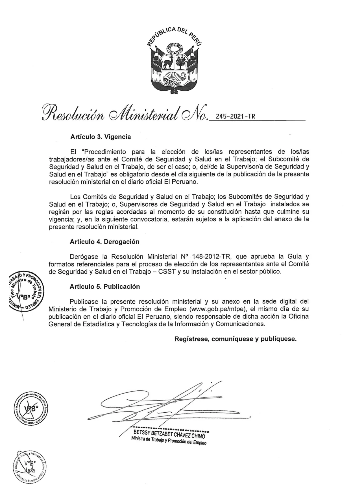

**Transcripción por reconocimiento de imagen:**

Resolución Menistonial Ne. 245-2021-TR

Artículo 3. Vigencia

El “Procedimiento para la elección de los/las representantes de los/las
trabajadores/as ante el Comité de Seguridad y Salud en el Trabajo; el Subcomité de
Seguridad y Salud en el Trabajo, de ser el caso; o, del/de la Supervisor/a de Seguridad y
Salud en el Trabajo” es obligatorio desde el día siguiente de la publicación de la presente
resolución ministerial en el diario oficial El Peruano.

Los Comités de Seguridad y Salud en el Trabajo; los Subcomités de Seguridad y
Salud en el Trabajo; o, Supervisores de Seguridad y Salud en el Trabajo instalados se
regirán por las reglas acordadas al momento de su constitución hasta que culmine su
vigencia; y, en la siguiente convocatoria, estarán sujetos a la aplicación del anexo de la
presente resolución ministerial.

Artículo 4. Derogación

Derógase la Resolución Ministerial N* 148-2012-TR, que aprueba la Guía y
formatos referenciales para el proceso de elección de los representantes ante el Comité
de Seguridad y Salud en el Trabajo - CSST y su instalación en el sector público.

Artículo 5. Publicación

Publicase la presente resolución ministerial y su anexo en la sede digital del
Ministerio de Trabajo y Promoción de Empleo (www.gob.pe/mtpe), el mismo día de su
publicación en el diario oficial El Peruano, siendo responsable de dicha acción la Oficina
General de Estadística y Tecnologías de la Información y Comunicaciones.

Regístrese, comuníquese y publíquese.

dns,

TZABET CHAVEZ. CHINO «|
bajo y Promoción del Empleo

Ministra de Tra

---

## Página 4

**Página escaneada: imagen de referencia para comprobar tablas, formularios y sus casillas.**

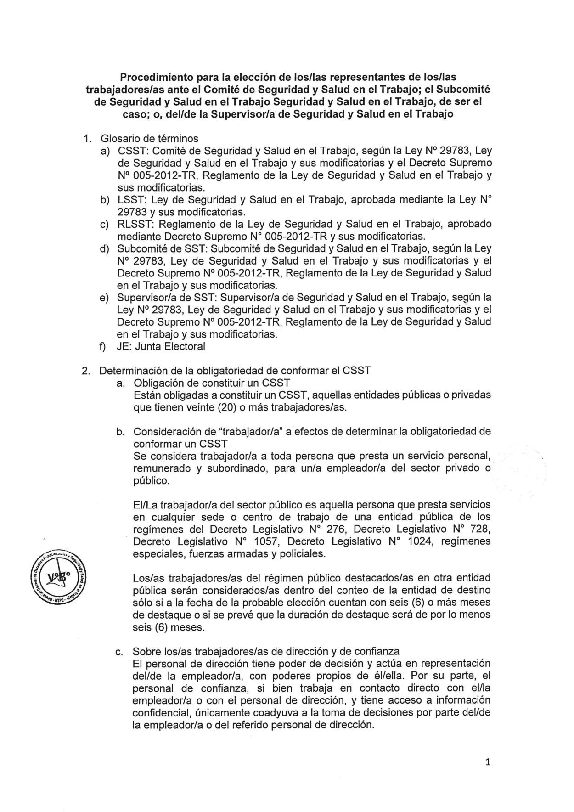

**Transcripción por reconocimiento de imagen:**

Procedimiento para la elección de los/las representantes de los/las
trabajadores/as ante el Comité de Seguridad y Salud en el Trabajo; el Subcomité
de Seguridad y Salud en el Trabajo Seguridad y Salud en el Trabajo, de ser el
caso; o, del/de la Supervisor/a de Seguridad y Salud en el Trabajo

1. Glosario de términos

a) CSST: Comité de Seguridad y Salud en el Trabajo, según la Ley N* 29783, Ley
de Seguridad y Salud en el Trabajo y sus modificatorias y el Decreto Supremo
N* 005-2012-TR, Reglamento de la Ley de Seguridad y Salud en el Trabajo y
sus modificatorias.

b) LSST: Ley de Seguridad y Salud en el Trabajo, aprobada mediante la Ley N*
29783 y sus modificatorias.

c) RLSST: Reglamento de la Ley de Seguridad y Salud en el Trabajo, aprobado
mediante Decreto Supremo N? 005-2012-TR y sus modificatorias.

d) Subcomité de SST: Subcomité de Seguridad y Salud en el Trabajo, según la Ley
N* 29783, Ley de Seguridad y Salud en el Trabajo y sus modificatorias y el
Decreto Supremo N* 005-2012-TR, Reglamento de la Ley de Seguridad y Salud
en el Trabajo y sus modificatorias.

e) Supervisor/a de SST: Supervisor/a de Seguridad y Salud en el Trabajo, según la
Ley N* 29783, Ley de Seguridad y Salud en el Trabajo y sus modificatorias y el
Decreto Supremo N* 005-2012-TR, Reglamento de la Ley de Seguridad y Salud
en el Trabajo y sus modificatorias.

f) JE: Junta Electoral

2. Determinación de la obligatoriedad de conformar el CSST
a. Obligación de constituir un CSST
Están obligadas a constituir un CSST, aquellas entidades públicas o privadas
que tienen veinte (20) o más trabajadores/as.

b. Consideración de “trabajador/a” a efectos de determinar la obligatoriedad de
conformar un CSST
Se considera trabajador/a a toda persona que presta un servicio personal,
remunerado y subordinado, para un/a empleador/a del sector privado o
público.

El/La trabajador/a del sector público es aquella persona que presta servicios
en cualquier sede o centro de trabajo de una entidad pública de los
regímenes del Decreto Legislativo N” 276, Decreto Legislativo N” 728,
Decreto Legislativo N” 1057, Decreto Legislativo N* 1024, regímenes
especiales, fuerzas armadas y policiales.

Los/as trabajadores/as del régimen público destacados/as en otra entidad
pública serán considerados/as dentro del conteo de la entidad de destino
sólo si a la fecha de la probable elección cuentan con seis (6) o más meses
de destaque o si se prevé que la duración de destaque será de por lo menos
seis (6) meses.

c. Sobre los/as trabajadores/as de dirección y de confianza
El personal de dirección tiene poder de decisión y actúa en representación
del/de la empleador/a, con poderes propios de él/ella. Por su parte, el
personal de confianza, si bien trabaja en contacto directo con el/la
empleador/a o con el personal de dirección, y tiene acceso a información
confidencial, únicamente coadyuva a la toma de decisiones por parte del/de
la empleador/a o del referido personal de dirección.

---

## Página 5

**Página escaneada: imagen de referencia para comprobar tablas, formularios y sus casillas.**

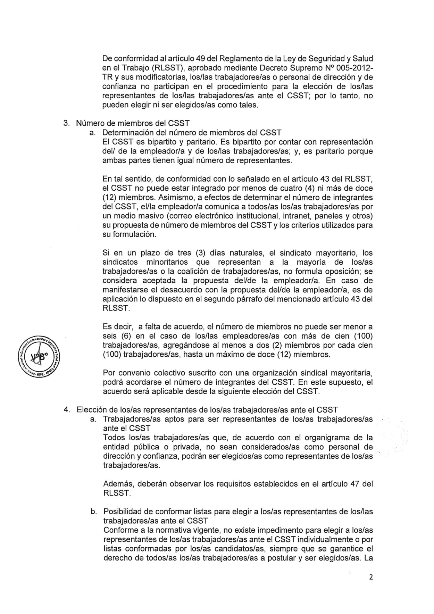

**Transcripción por reconocimiento de imagen:**

De conformidad al artículo 49 del Reglamento de la Ley de Seguridad y Salud
en el Trabajo (RLSST), aprobado mediante Decreto Supremo N* 005-2012-
TR y sus modificatorias, los/las trabajadores/as o personal de dirección y de
confianza no participan en el procedimiento para la elección de los/las
representantes de los/las trabajadores/as ante el CSST; por lo tanto, no
pueden elegir ni ser elegidos/as como tales.

3. Número de miembros del CSST
a. Determinación del número de miembros del CSST
El CSST es bipartito y paritario. Es bipartito por contar con representación
del/ de la empleador/a y de los/las trabajadores/as; y, es paritario porque
ambas partes tienen igual número de representantes.

En tal sentido, de conformidad con lo señalado en el artículo 43 del RLSST,
el CSST no puede estar integrado por menos de cuatro (4) ni más de doce
(12) miembros. Asimismo, a efectos de determinar el número de integrantes
del CSST, el/la empleador/a comunica a todos/as los/as trabajadores/as por
un medio masivo (correo electrónico institucional, intranet, paneles y otros)
su propuesta de número de miembros del CSST y los criterios utilizados para
su formulación.

Si en un plazo de tres (3) días naturales, el sindicato mayoritario, los
sindicatos minoritarios que representan a la mayoría de los/as
trabajadores/as o la coalición de trabajadores/as, no formula oposición; se
considera aceptada la propuesta del/de la empleador/a. En caso de
manifestarse el desacuerdo con la propuesta del/de la empleador/a, es de
aplicación lo dispuesto en el segundo párrafo del mencionado artículo 43 del
RLSST.

Es decir, a falta de acuerdo, el número de miembros no puede ser menor a
seis (6) en el caso de los/las empleadores/as con más de cien (100)
trabajadores/as, agregándose al menos a dos (2) miembros por cada cien
(100) trabajadores/as, hasta un máximo de doce (12) miembros.

Por convenio colectivo suscrito con una organización sindical mayoritaria,
podrá acordarse el número de integrantes del CSST. En este supuesto, el
acuerdo será aplicable desde la siguiente elección del CSST.

4. Elección de los/as representantes de los/as trabajadores/as ante el CSST
a. Trabajadores/as aptos para ser representantes de los/as trabajadores/as
ante el CSST
Todos los/as trabajadores/as que, de acuerdo con el organigrama de la
entidad pública o privada, no sean considerados/as como personal de
dirección y confianza, podrán ser elegidos/as como representantes de los/as
trabajadores/as.

Además, deberán observar los requisitos establecidos en el artículo 47 del
RLSST.

b. Posibilidad de conformar listas para elegir a los/as representantes de los/las
trabajadores/as ante el CSST
Conforme a la normativa vigente, no existe impedimento para elegir a los/as
representantes de los/as trabajadores/as ante el CSST individualmente o por
listas conformadas por los/as candidatos/as, siempre que se garantice el
derecho de todos/as los/as trabajadores/as a postular y ser elegidos/as. La

2

---

## Página 6

**Página escaneada: imagen de referencia para comprobar tablas, formularios y sus casillas.**

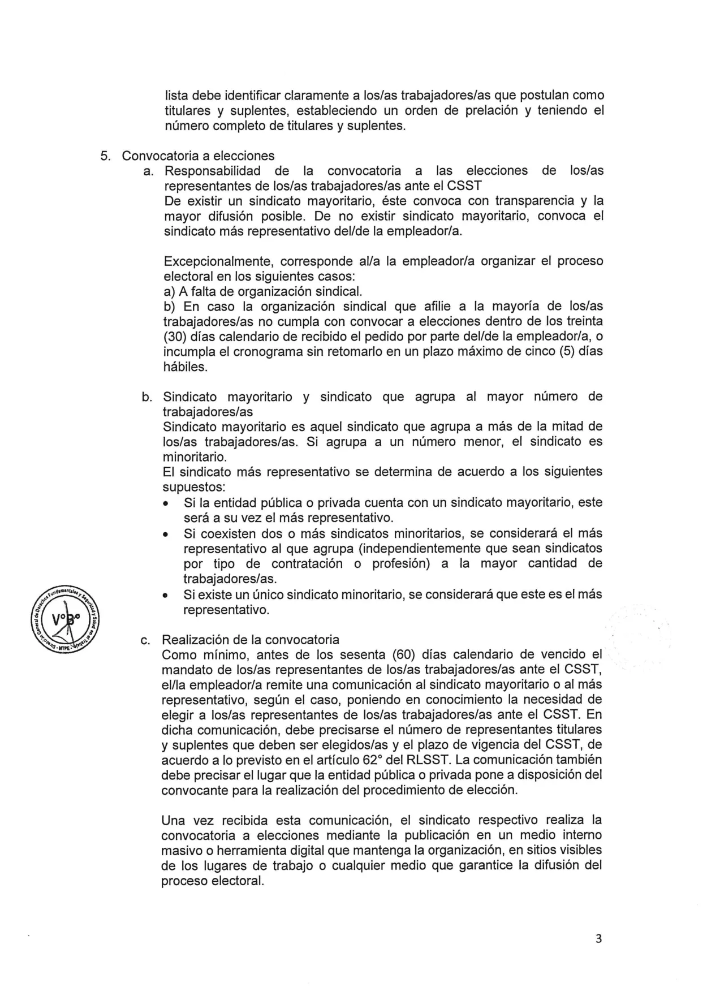

**Transcripción por reconocimiento de imagen:**

lista debe identificar claramente a los/as trabajadores/as que postulan como
titulares y suplentes, estableciendo un orden de prelación y teniendo el
número completo de titulares y suplentes.

5. Convocatoria a elecciones
a. Responsabilidad de la convocatoria a las elecciones de los/as
representantes de los/as trabajadores/as ante el CSST
De existir un sindicato mayoritario, éste convoca con transparencia y la
mayor difusión posible. De no existir sindicato mayoritario, convoca el
sindicato más representativo del/de la empleador/a.

Excepcionalmente, corresponde al/a la empleador/a organizar el proceso
electoral en los siguientes casos:

a) A falta de organización sindical.

b) En caso la organización sindical que afilie a la mayoría de los/as
trabajadores/as no cumpla con convocar a elecciones dentro de los treinta
(30) días calendario de recibido el pedido por parte del/de la empleador/a, o
incumpla el cronograma sin retomarlo en un plazo máximo de cinco (5) días
hábiles.

b. Sindicato mayoritario y sindicato que agrupa al mayor número de
trabajadores/as

Sindicato mayoritario es aquel sindicato que agrupa a más de la mitad de

los/as trabajadores/as. Si agrupa a un número menor, el sindicato es

minoritario.

El sindicato más representativo se determina de acuerdo a los siguientes

supuestos:

e Sila entidad pública o privada cuenta con un sindicato mayoritario, este
será a su vez el más representativo.

+ Si coexisten dos o más sindicatos minoritarios, se considerará el más
representativo al que agrupa (independientemente que sean sindicatos
por tipo de contratación o profesión) a la mayor cantidad de
trabajadores/as.

+  Siexiste un único sindicato minoritario, se considerará que este es el más
representativo.

Cc. Realización de la convocatoria

Como mínimo, antes de los sesenta (60) días calendario de vencido el
mandato de los/as representantes de los/as trabajadores/as ante el CSST,
el/la empleador/a remite una comunicación al sindicato mayoritario o al más
representativo, según el caso, poniendo en conocimiento la necesidad de
elegir a los/as representantes de los/as trabajadores/as ante el CSST. En
dicha comunicación, debe precisarse el número de representantes titulares
y suplentes que deben ser elegidos/as y el plazo de vigencia del CSST, de
acuerdo a lo previsto en el artículo 62” del RLSST. La comunicación también
debe precisar el lugar que la entidad pública o privada pone a disposición del
convocante para la realización del procedimiento de elección.

Una vez recibida esta comunicación, el sindicato respectivo realiza la
convocatoria a elecciones mediante la publicación en un medio interno
masivo o herramienta digital que mantenga la organización, en sitios visibles
de los lugares de trabajo o cualquier medio que garantice la difusión del
proceso electoral.

---

## Página 7

**Página escaneada: imagen de referencia para comprobar tablas, formularios y sus casillas.**

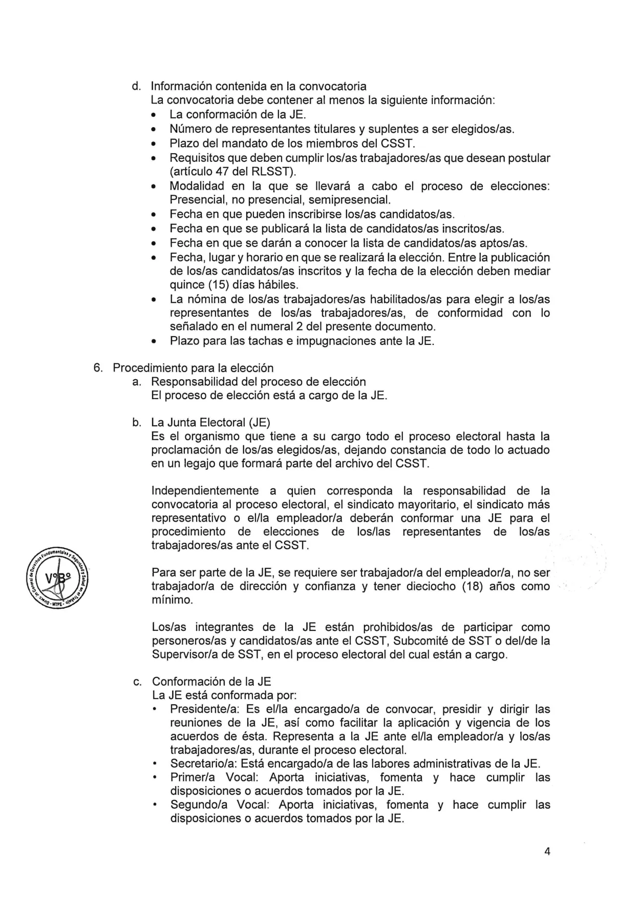

**Transcripción por reconocimiento de imagen:**

d. Información contenida en la convocatoria

La convocatoria debe contener al menos la siguiente información:

+ La conformación de la JE.

+ Número de representantes titulares y suplentes a ser elegidos/as.

+ Plazo del mandato de los miembros del CSST.

+ Requisitos que deben cumplir los/as trabajadores/as que desean postular

(artículo 47 del RLSST).

Modalidad en la que se llevará a cabo el proceso de elecciones:

Presencial, no presencial, semipresencial.

Fecha en que pueden inscribirse los/as candidatos/as.

Fecha en que se publicará la lista de candidatos/as inscritos/as.

Fecha en que se darán a conocer la lista de candidatos/as aptos/as.

Fecha, lugar y horario en que se realizará la elección. Entre la publicación

de los/as candidatos/as inscritos y la fecha de la elección deben mediar

quince (15) días hábiles.

+ La nómina de los/as trabajadores/as habilitados/as para elegir a los/as
representantes de los/as trabajadores/as, de conformidad con lo
señalado en el numeral 2 del presente documento.

+ Plazo para las tachas e impugnaciones ante la JE.

6. Procedimiento para la elección
a. Responsabilidad del proceso de elección
El proceso de elección está a cargo de la JE.

b. La Junta Electoral (JE)
Es el organismo que tiene a su cargo todo el proceso electoral hasta la
proclamación de los/as elegidos/as, dejando constancia de todo lo actuado
en un legajo que formará parte del archivo del CSST.

Independientemente a quien corresponda la responsabilidad de la
convocatoria al proceso electoral, el sindicato mayoritario, el sindicato más
representativo o el/la empleador/a deberán conformar una JE para el
procedimiento de elecciones de los/las representantes de los/as
trabajadores/as ante el CSST.

Para ser parte de la JE, se requiere ser trabajador/a del empleador/a, no ser
trabajador/a de dirección y confianza y tener dieciocho (18) años como
mínimo.

Los/as integrantes de la JE están prohibidos/as de participar como
personeros/as y candidatos/as ante el CSST, Subcomité de SST o del/de la
Supervisor/a de SST, en el proceso electoral del cual están a cargo.

c. Conformación de la JE

La JE está conformada por:

+ Presidente/a: Es el/la encargado/a de convocar, presidir y dirigir las
reuniones de la JE, así como facilitar la aplicación y vigencia de los
acuerdos de ésta. Representa a la JE ante el/la empleador/a y los/as
trabajadores/as, durante el proceso electoral.

+ Secretario/a: Está encargado/a de las labores administrativas de la JE.

+ Primer/a Vocal: Aporta iniciativas, fomenta y hace cumplir las
disposiciones o acuerdos tomados por la JE.

+ Segundo/a Vocal: Aporta iniciativas, fomenta y hace cumplir las
disposiciones o acuerdos tomados por la JE.

---

## Página 8

**Página escaneada: imagen de referencia para comprobar tablas, formularios y sus casillas.**

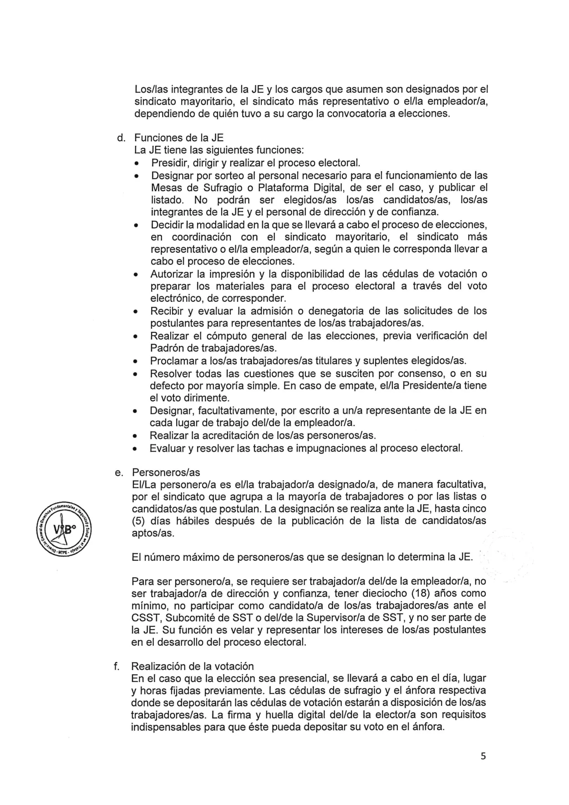

**Transcripción por reconocimiento de imagen:**

Los/las integrantes de la JE y los cargos que asumen son designados por el
sindicato mayoritario, el sindicato más representativo o el/la empleador/a,
dependiendo de quién tuvo a su cargo la convocatoria a elecciones.

Funciones de la JE

La JE tiene las siguientes funciones:

e Presidir, dirigir y realizar el proceso electoral.

+ Designar por sorteo al personal necesario para el funcionamiento de las
Mesas de Sufragio o Plataforma Digital, de ser el caso, y publicar el
listado. No podrán ser elegidos/as los/as candidatos/as, los/as
integrantes de la JE y el personal de dirección y de confianza.

e Decidir la modalidad en la que se llevará a cabo el proceso de elecciones,
en coordinación con el sindicato mayoritario, el sindicato más
representativo o el/la empleador/a, según a quien le corresponda llevar a
cabo el proceso de elecciones.

+ Autorizar la impresión y la disponibilidad de las cédulas de votación o
preparar los materiales para el proceso electoral a través del voto
electrónico, de corresponder.

e Recibir y evaluar la admisión o denegatoria de las solicitudes de los
postulantes para representantes de los/as trabajadores/as.

+ Realizar el cómputo general de las elecciones, previa verificación del
Padrón de trabajadores/as.

+  Proclamar a los/as trabajadores/as titulares y suplentes elegidos/as.

+ Resolver todas las cuestiones que se susciten por consenso, o en su
defecto por mayoría simple. En caso de empate, el/la Presidente/a tiene
el voto dirimente.

+ Designar, facultativamente, por escrito a un/a representante de la JE en
cada lugar de trabajo del/de la empleador/a.

+ Realizar la acreditación de los/as personeros/as.

+ Evaluar y resolver las tachas e impugnaciones al proceso electoral.

Personeros/as

El/La personero/a es el/la trabajador/a designado/a, de manera facultativa,
por el sindicato que agrupa a la mayoría de trabajadores o por las listas o
candidatos/as que postulan. La designación se realiza ante la JE, hasta cinco
(5) días hábiles después de la publicación de la lista de candidatos/as
aptos/as.

El número máximo de personeros/as que se designan lo determina la JE.

Para ser personero/a, se requiere ser trabajador/a del/de la empleador/a, no
ser trabajador/a de dirección y confianza, tener dieciocho (18) años como
mínimo, no participar como candidato/a de los/as trabajadores/as ante el
CSST, Subcomité de SST o del/de la Supervisor/a de SST, y no ser parte de
la JE. Su función es velar y representar los intereses de los/as postulantes
en el desarrollo del proceso electoral.

Realización de la votación

En el caso que la elección sea presencial, se llevará a cabo en el día, lugar
y horas fijadas previamente. Las cédulas de sufragio y el ánfora respectiva
donde se depositarán las cédulas de votación estarán a disposición de los/as
trabajadores/as. La firma y huella digital del/de la elector/a son requisitos
indispensables para que éste pueda depositar su voto en el ánfora.

---

## Página 9

**Página escaneada: imagen de referencia para comprobar tablas, formularios y sus casillas.**

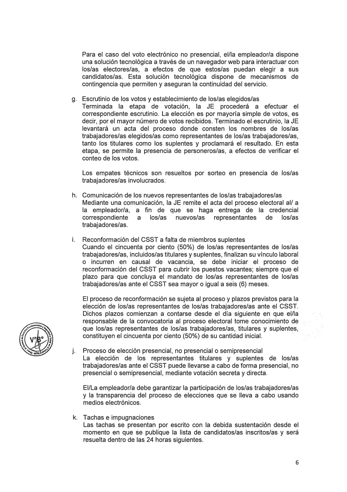

**Transcripción por reconocimiento de imagen:**

Para el caso del voto electrónico no presencial, el/la empleador/a dispone
una solución tecnológica a través de un navegador web para interactuar con
los/as electores/as, a efectos de que estos/as puedan elegir a sus
candidatos/as. Esta solución tecnológica dispone de mecanismos de
contingencia que permiten y aseguran la continuidad del servicio.

Escrutinio de los votos y establecimiento de los/as elegidos/as
Terminada la etapa de votación, la JE procederá a efectuar el
correspondiente escrutinio. La elección es por mayoría simple de votos, es
decir, por el mayor número de votos recibidos. Terminado el escrutinio, la JE
levantará un acta del proceso donde consten los nombres de los/as
trabajadores/as elegidos/as como representantes de los/as trabajadores/as,
tanto los titulares como los suplentes y proclamará el resultado. En esta
etapa, se permite la presencia de personeros/as, a efectos de verificar el
conteo de los votos.

Los empates técnicos son resueltos por sorteo en presencia de los/as
trabajadores/as involucrados.

Comunicación de los nuevos representantes de los/as trabajadores/as
Mediante una comunicación, la JE remite el acta del proceso electoral al/ a
la empleador/a, a fin de que se haga entrega de la credencial
correspondiente a los/as nuevos/as representantes de los/as
trabajadores/as.

Reconformación del CSST a falta de miembros suplentes
Cuando el cincuenta por ciento (50%) de los/as representantes de los/as
trabajadores/as, incluidos/as titulares y suplentes, finalizan su vínculo laboral
o incurren en causal de vacancia, se debe iniciar el proceso de
reconformación del CSST para cubrir los puestos vacantes; siempre que el
plazo para que concluya el mandato de los/as representantes de los/as
trabajadores/as ante el CSST sea mayor o igual a seis (6) meses.

El proceso de reconformación se sujeta al proceso y plazos previstos para la
elección de los/as representantes de los/as trabajadores/as ante el CSST.
Dichos plazos comienzan a contarse desde el día siguiente en que el/la
responsable de la convocatoria al proceso electoral tome conocimiento de
que los/as representantes de los/as trabajadores/as, titulares y suplentes,
constituyen el cincuenta por ciento (50%) de su cantidad inicial.

Proceso de elección presencial, no presencial o semipresencial

La elección de los representantes titulares y suplentes de los/as
trabajadores/as ante el CSST puede llevarse a cabo de forma presencial, no
presencial o semipresencial, mediante votación secreta y directa.

El/La empleador/a debe garantizar la participación de los/as trabajadores/as
y la transparencia del proceso de elecciones que se lleva a cabo usando
medios electrónicos.

Tachas e impugnaciones

Las tachas se presentan por escrito con la debida sustentación desde el
momento en que se publique la lista de candidatos/as inscritos/as y será
resuelta dentro de las 24 horas siguientes.

---

## Página 10

**Página escaneada: imagen de referencia para comprobar tablas, formularios y sus casillas.**

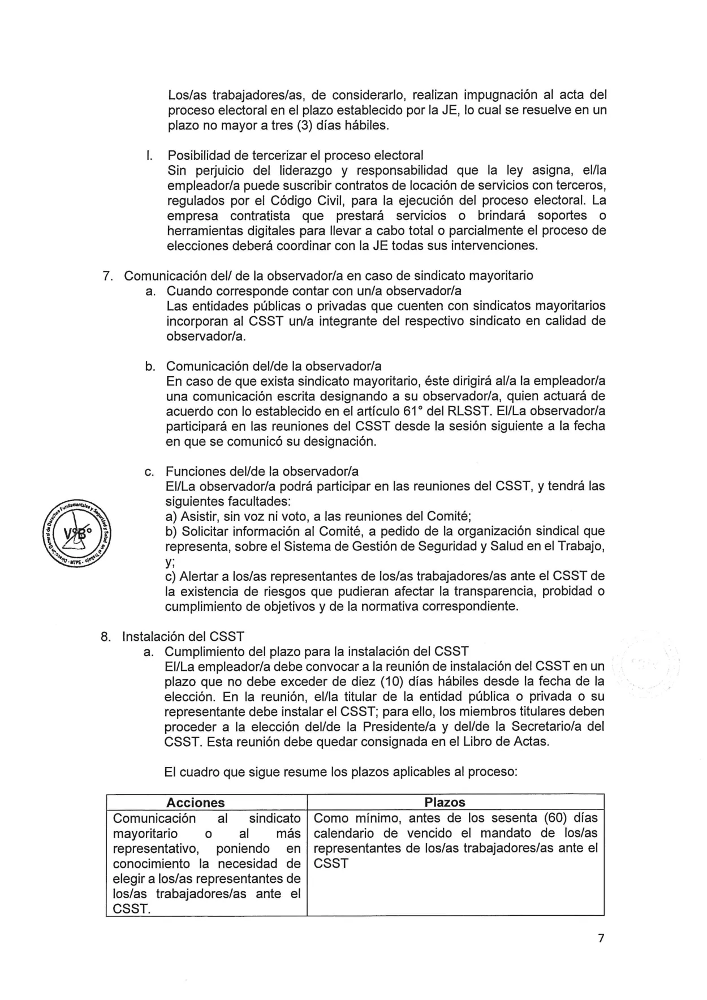

**Transcripción por reconocimiento de imagen:**

Los/as trabajadores/as, de considerarlo, realizan impugnación al acta del
proceso electoral en el plazo establecido por la JE, lo cual se resuelve en un
plazo no mayor a tres (3) días hábiles.

Il. Posibilidad de tercerizar el proceso electoral
Sin perjuicio del liderazgo y responsabilidad que la ley asigna, el/la
empleador/a puede suscribir contratos de locación de servicios con terceros,
regulados por el Código Civil, para la ejecución del proceso electoral. La
empresa contratista que prestará servicios o brindará soportes o
herramientas digitales para llevar a cabo total o parcialmente el proceso de
elecciones deberá coordinar con la JE todas sus intervenciones.

7. Comunicación del/ de la observador/a en caso de sindicato mayoritario
a. Cuando corresponde contar con un/a observador/a
Las entidades públicas o privadas que cuenten con sindicatos mayoritarios
incorporan al CSST un/a integrante del respectivo sindicato en calidad de
observador/a.

b. Comunicación del/de la observador/a
En caso de que exista sindicato mayoritario, éste dirigirá al/a la empleador/a
una comunicación escrita designando a su observador/a, quien actuará de
acuerdo con lo establecido en el artículo 61? del RLSST. El/La observador/a
participará en las reuniones del CSST desde la sesión siguiente a la fecha
en que se comunicó su designación.

c. Funciones del/de la observador/a
El/La observador/a podrá participar en las reuniones del CSST, y tendrá las
siguientes facultades:
a) Asistir, sin voz ni voto, a las reuniones del Comité;
b) Solicitar información al Comité, a pedido de la organización sindical que
representa, sobre el Sistema de Gestión de Seguridad y Salud en el Trabajo,
y;
c) Alertar a los/as representantes de los/as trabajadores/as ante el CSST de
la existencia de riesgos que pudieran afectar la transparencia, probidad o
cumplimiento de objetivos y de la normativa correspondiente.

8. Instalación del CSST

a. Cumplimiento del plazo para la instalación del CSST
El/La empleador/a debe convocar a la reunión de instalación del CSST en un
plazo que no debe exceder de diez (10) días hábiles desde la fecha de la
elección. En la reunión, el/la titular de la entidad pública o privada o su
representante debe instalar el CSST; para ello, los miembros titulares deben
proceder a la elección del/de la Presidente/a y del/de la Secretario/a de
CSST. Esta reunión debe quedar consignada en el Libro de Actas.

El cuadro que sigue resume los plazos aplicables al proceso:

Acciones Plazos

Comunicación al sindicato | Como mínimo, antes de los sesenta (60) días
mayoritario o al más | calendario de vencido el mandato de los/as
representativo, poniendo en | representantes de los/as trabajadores/as ante el
conocimiento la necesidad de | CSST

elegir a los/as representantes de
los/as trabajadores/as ante el
CSST.

---

## Página 11

**Página escaneada: imagen de referencia para comprobar tablas, formularios y sus casillas.**

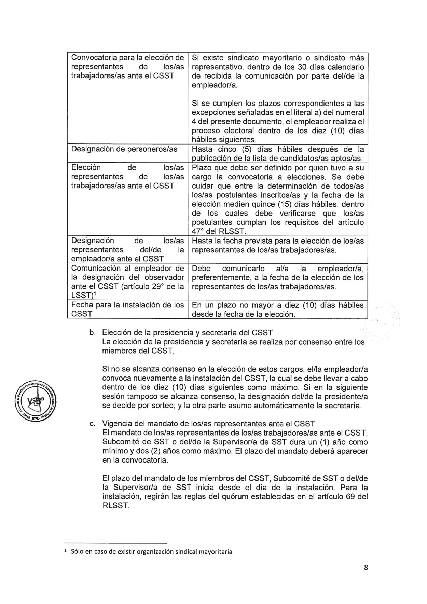

**Transcripción por reconocimiento de imagen:**

Convocatoria para la elección de
representantes de los/as
trabajadores/as ante el CSST

Si existe sindicato mayoritario o sindicato más
representativo, dentro de los 30 días calendario
de recibida la comunicación por parte del/de la
empleador/a.

Si se cumplen los plazos correspondientes a las
excepciones señaladas en el literal a) del numeral
4 del presente documento, el empleador realiza el
proceso electoral dentro de los diez (10) días
hábiles siguientes.

Designación de personeros/as

Hasta cinco (5) días hábiles después de la
publicación de la lista de candidatos/as aptos/as.

Elección de los/as
representantes de los/as
trabajadores/as ante el CSST

Plazo que debe ser definido por quien tuvo a su
cargo la convocatoria a elecciones. Se debe
cuidar que entre la determinación de todos/as
los/as postulantes inscritos/as y la fecha de la
elección medien quince (15) días hábiles, dentro
de los cuales debe verificarse que los/as
postulantes cumplan los requisitos del artículo
47” del RLSST.

Designación de los/as
representantes del/de la
empleador/a ante el CSST

Hasta la fecha prevista para la elección de los/as
representantes de los/as trabajadores/as.

Comunicación al empleador de
la designación del observador
ante el CSST (artículo 29” de la
LSST)'

Debe comunicarlo alía la  empleador/a,
preferentemente, a la fecha de la elección de los
representantes de los/as trabajadores/as.

Fecha para la instalación de los

En un plazo no mayor a diez (10) días hábiles

CSST desde la fecha de la elección.

b. Elección de la presidencia y secretaría del CSST
La elección de la presidencia y secretaría se realiza por consenso entre los
miembros del CSST.

Si no se alcanza consenso en la elección de estos cargos, el/la empleador/a
convoca nuevamente a la instalación del CSST, la cual se debe llevar a cabo
dentro de los diez (10) días siguientes como máximo. Si en la siguiente
sesión tampoco se alcanza consenso, la designación del/de la presidente/a
se decide por sorteo; y la otra parte asume automáticamente la secretaría.

c. Vigencia del mandato de los/as representantes ante el CSST
El mandato de los/as representantes de los/as trabajadores/as ante el CSST,
Subcomité de SST o del/de la Supervisora de SST dura un (1) año como
mínimo y dos (2) años como máximo. El plazo del mandato deberá aparecer
en la convocatoria.

El plazo del mandato de los miembros del CSST, Subcomité de SST o del/de
la Supervisora de SST inicia desde el día de la instalación. Para la
instalación, regirán las reglas del quórum establecidas en el artículo 69 del
RLSST.

1 Sólo en caso de existir organización sindical mayoritaria

---

## Página 12

**Página escaneada: imagen de referencia para comprobar tablas, formularios y sus casillas.**

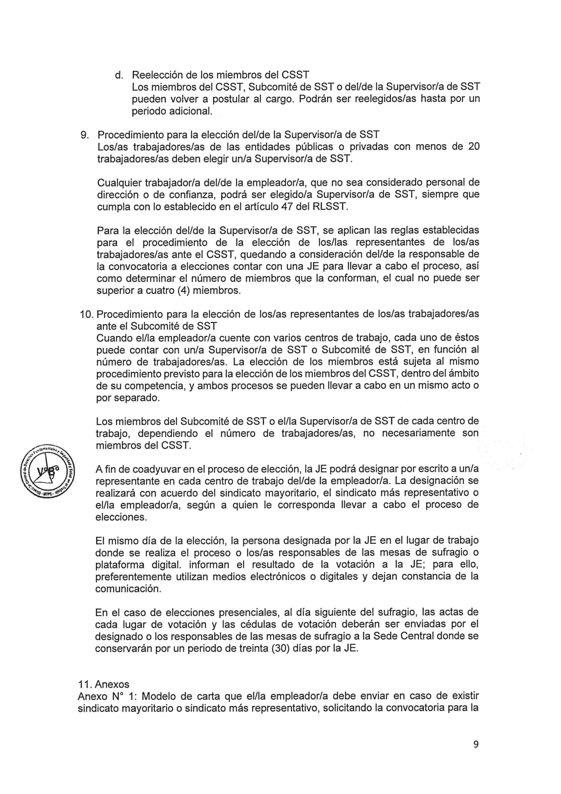

**Transcripción por reconocimiento de imagen:**

9.

10.

11.

d. Reelección de los miembros del CSST
Los miembros del CSST, Subcomité de SST o del/de la Supervisor/a de SST
pueden volver a postular al cargo. Podrán ser reelegidos/as hasta por un
periodo adicional.

Procedimiento para la elección del/de la Supervisor/a de SST
Los/as trabajadores/as de las entidades públicas o privadas con menos de 20
trabajadores/as deben elegir un/a Supervisor/a de SST.

Cualquier trabajador/a del/de la empleador/a, que no sea considerado personal de
dirección o de confianza, podrá ser elegido/a Supervisor/a de SST, siempre que
cumpla con lo establecido en el artículo 47 del RLSST.

Para la elección del/de la Supervisor/a de SST, se aplican las reglas establecidas
para el procedimiento de la elección de los/las representantes de los/as
trabajadores/as ante el CSST, quedando a consideración del/de la responsable de
la convocatoria a elecciones contar con una JE para llevar a cabo el proceso, así
como determinar el número de miembros que la conforman, el cual no puede ser
superior a cuatro (4) miembros.

Procedimiento para la elección de los/as representantes de los/as trabajadores/as
ante el Subcomité de SST

Cuando el/la empleador/a cuente con varios centros de trabajo, cada uno de éstos
puede contar con un/a Supervisor/a de SST o Subcomité de SST, en función al
número de trabajadores/as. La elección de los miembros está sujeta al mismo
procedimiento previsto para la elección de los miembros del CSST, dentro del ámbito
de su competencia, y ambos procesos se pueden llevar a cabo en un mismo acto o
por separado.

Los miembros del Subcomité de SST o el/la Supervisor/a de SST de cada centro de
trabajo, dependiendo el número de trabajadores/as, no necesariamente son
miembros del CSST.

A fin de coadyuvar en el proceso de elección, la JE podrá designar por escrito a un/a
representante en cada centro de trabajo del/de la empleador/a. La designación se
realizará con acuerdo del sindicato mayoritario, el sindicato más representativo o
el/la empleador/a, según a quien le corresponda llevar a cabo el proceso de
elecciones.

El mismo día de la elección, la persona designada por la JE en el lugar de trabajo
donde se realiza el proceso o los/as responsables de las mesas de sufragio o
plataforma digital. informan el resultado de la votación a la JE; para ello,
preferentemente utilizan medios electrónicos o digitales y dejan constancia de la
comunicación.

En el caso de elecciones presenciales, al día siguiente del sufragio, las actas de
cada lugar de votación y las cédulas de votación deberán ser enviadas por el
designado o los responsables de las mesas de sufragio a la Sede Central donde se
conservarán por un periodo de treinta (30) días por la JE.

Anexos

Anexo N” 1: Modelo de carta que el/la empleador/a debe enviar en caso de existir
sindicato mayoritario o sindicato más representativo, solicitando la convocatoria para la

---

## Página 13

**Página escaneada: imagen de referencia para comprobar tablas, formularios y sus casillas.**

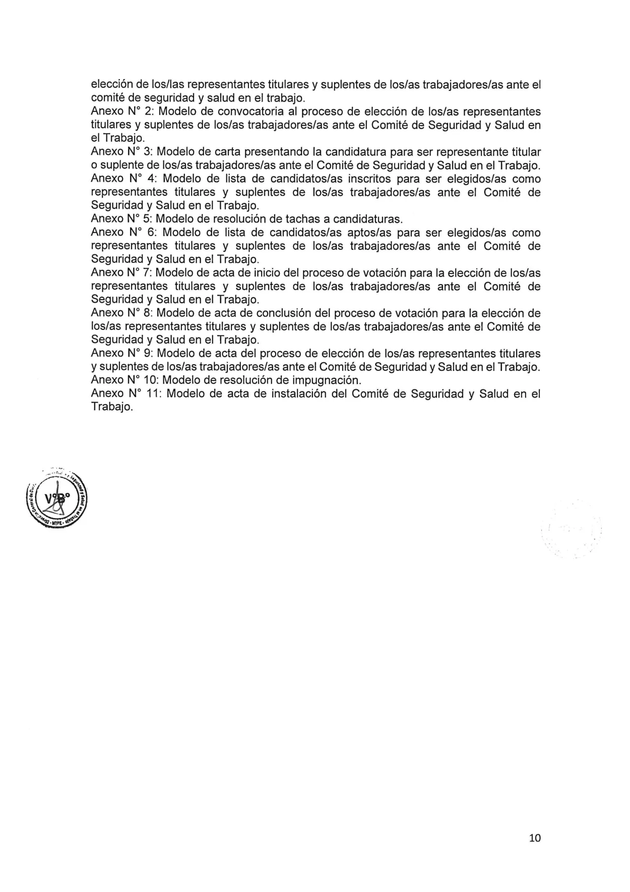

**Transcripción por reconocimiento de imagen:**

elección de los/las representantes titulares y suplentes de los/as trabajadores/as ante el
comité de seguridad y salud en el trabajo.

Anexo N* 2: Modelo de convocatoria al proceso de elección de los/as representantes
titulares y suplentes de los/as trabajadores/as ante el Comité de Seguridad y Salud en
el Trabajo.

Anexo N” 3: Modelo de carta presentando la candidatura para ser representante titular
o suplente de los/as trabajadores/as ante el Comité de Seguridad y Salud en el Trabajo.
Anexo N* 4: Modelo de lista de candidatos/as inscritos para ser elegidos/as como
representantes titulares y suplentes de los/as trabajadores/as ante el Comité de
Seguridad y Salud en el Trabajo.

Anexo N? 5: Modelo de resolución de tachas a candidaturas.

Anexo N* 6: Modelo de lista de candidatos/as aptos/as para ser elegidos/as como
representantes titulares y suplentes de los/as trabajadores/as ante el Comité de
Seguridad y Salud en el Trabajo.

Anexo N? 7: Modelo de acta de inicio del proceso de votación para la elección de los/as
representantes titulares y suplentes de los/as trabajadores/as ante el Comité de
Seguridad y Salud en el Trabajo.

Anexo N” 8: Modelo de acta de conclusión del proceso de votación para la elección de
los/as representantes titulares y suplentes de los/as trabajadores/as ante el Comité de
Seguridad y Salud en el Trabajo.

Anexo N” 9: Modelo de acta del proceso de elección de los/as representantes titulares
y suplentes de los/as trabajadores/as ante el Comité de Seguridad y Salud en el Trabajo.
Anexo N* 10: Modelo de resolución de impugnación.

Anexo N* 11: Modelo de acta de instalación del Comité de Seguridad y Salud en el
Trabajo.

10

---

## Página 14

**Página escaneada: imagen de referencia para comprobar tablas, formularios y sus casillas.**

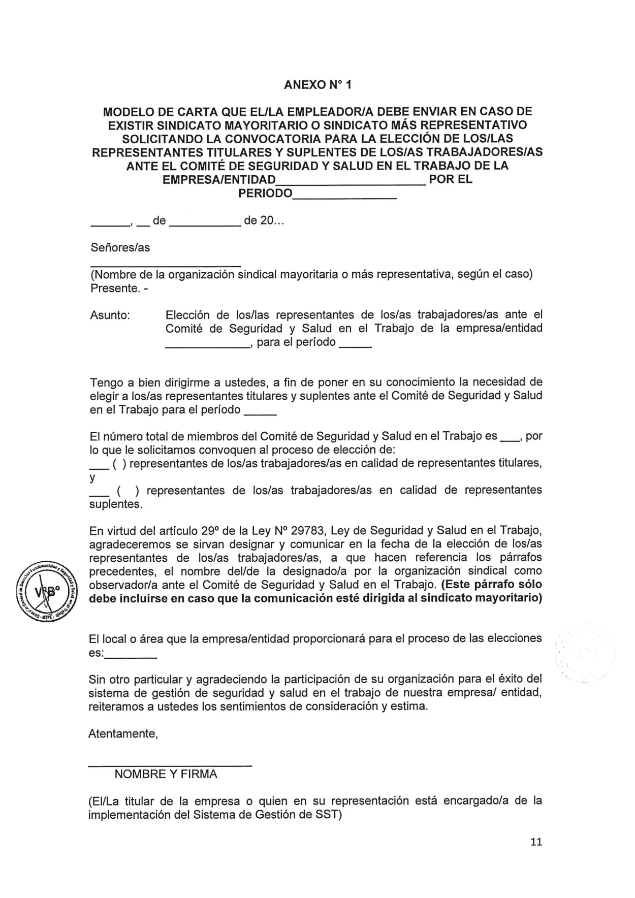

**Transcripción por reconocimiento de imagen:**

ANEXO N? 1

MODELO DE CARTA QUE EL/LA EMPLEADOR/A DEBE ENVIAR EN CASO DE
EXISTIR SINDICATO MAYORITARIO O SINDICATO MÁS REPRESENTATIVO
SOLICITANDO LA CONVOCATORIA PARA LA ELECCIÓN DE LOS/LAS
REPRESENTANTES TITULARES Y SUPLENTES DE LOS/AS TRABAJADORES/AS
ANTE EL COMITÉ DE SEGURIDAD Y SALUD EN EL TRABAJO DE LA

EMPRESA/ENTIDAD. POR EL
PERIODO
, de de 20...

Señores/as

(Nombre de la organización sindical mayoritaria o más representativa, según el caso)
Presente. -

Asunto: Elección de los/las representantes de los/as trabajadores/as ante el
Comité de Seguridad y Salud en el Trabajo de la empresa/entidad
, para el período

Tengo a bien dirigirme a ustedes, a fin de poner en su conocimiento la necesidad de
elegir a los/as representantes titulares y suplentes ante el Comité de Seguridad y Salud
en el Trabajo para el período

El número total de miembros del Comité de Seguridad y Salud en el Trabajo es ___, por
lo que le solicitamos convoquen al proceso de elección de:
___ ( ) representantes de los/as trabajadores/as en calidad de representantes titulares,

___( ) representantes de los/as trabajadores/as en calidad de representantes
suplentes.

En virtud del artículo 29? de la Ley N* 29783, Ley de Seguridad y Salud en el Trabajo,
agradeceremos se sirvan designar y comunicar en la fecha de la elección de los/as
representantes de los/as trabajadores/as, a que hacen referencia los párrafos
precedentes, el nombre del/de la designado/a por la organización sindical como
observador/a ante el Comité de Seguridad y Salud en el Trabajo. (Este párrafo sólo
debe incluirse en caso que la comunicación esté dirigida al sindicato mayoritario)

El local o área que la empresa/entidad proporcionará para el proceso de las elecciones
es:

Sin otro particular y agradeciendo la participación de su organización para el éxito del
sistema de gestión de seguridad y salud en el trabajo de nuestra empresa/ entidad,

reiteramos a ustedes los sentimientos de consideración y estima.

Atentamente,

NOMBRE Y FIRMA

(El/La titular de la empresa o quien en su representación está encargado/a de la
implementación del Sistema de Gestión de SST)

11

---

## Página 15

**Página escaneada: imagen de referencia para comprobar tablas, formularios y sus casillas.**

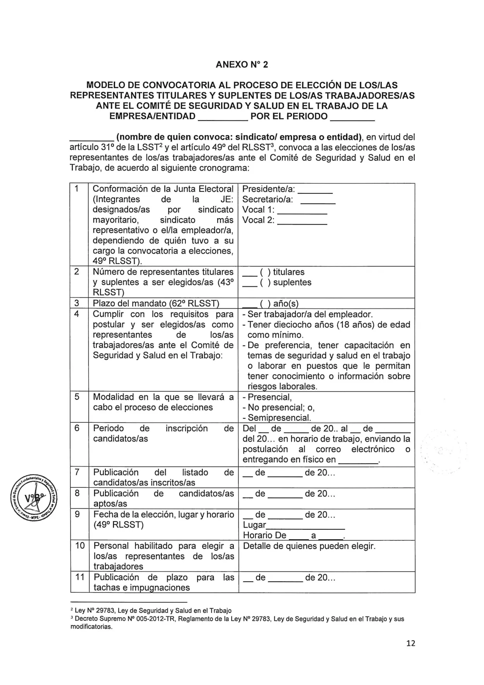

**Transcripción por reconocimiento de imagen:**

ANEXO N* 2

MODELO DE CONVOCATORIA AL PROCESO DE ELECCIÓN DE LOS/LAS

REPRESENTANTES TITULARES Y SUPLENTES DE LOS/AS TRABAJADORES/AS
ANTE EL COMITE DE SEGURIDAD Y SALUD EN EL TRABAJO DE LA

representantes de los/as trabajadores/as ante el Comité de Seguridad y Salud en el
Trabajo, de acuerdo al siguiente cronograma:

EMPRESA/ENTIDAD

POR EL PERIODO

(nombre de quien convoca: sindicato/ empresa o entidad), en virtud del
artículo 31? de la LSST? y el artículo 49? del RLSST?, convoca a las elecciones de los/as

1 | Conformación de la Junta Electoral | Presidente/a:
(Integrantes de la JE: | Secretario/a:
designados/as por sindicato | Vocal 1:
mayoritario, sindicato más | Vocal 2:
representativo o el/la empleador/a,
dependiendo de quién tuvo a su
cargo la convocatoria a elecciones,
49% RLSST).
2 | Número de representantes titulares | ___ ( ) titulares
y suplentes a ser elegidos/as (43% | ___ ( ) suplentes
RLSST)
3_ | Plazo del mandato (62% RLSST) (_) año(s)
4 | Cumplir con los requisitos para | - Ser trabajador/a del empleador.
postular y ser elegidos/as como | - Tener dieciocho años (18 años) de edad
representantes de los/as | como mínimo.
trabajadores/as ante el Comité de | - De preferencia, tener capacitación en
Seguridad y Salud en el Trabajo: temas de seguridad y salud en el trabajo
o laborar en puestos que le permitan
tener conocimiento o información sobre
riesgos laborales.
5 | Modalidad en la que se llevará a | - Presencial,
cabo el proceso de elecciones - No presencial; o,
- Semipresencial.
6 |Periodo de inscripción de | Del __de de 20.. al__ de
candidatos/as del 20... en horario de trabajo, enviando la
postulación al correo electrónico o
entregando en físico en
7 | Publicación del listado  de|__de de 20...
candidatos/as inscritos/as
8 |Publicación de  candidatos/as |__ de de 20...
aptos/as
9 | Fecha de la elección, lugar y horario | __ de de 20...
(49 RLSST) Lugar.
Horario De a A
10 | Personal habilitado para elegir a | Detalle de quienes pueden elegir.
los/as representantes de los/as
trabajadores
11 | Publicación de plazo para las de de 20...

tachas e impugnaciones

2 Ley N* 29783, Ley de Seguridad y Salud en el Trabajo
? Decreto Supremo N* 005-2012-TR, Reglamento de la Ley N* 29783, Ley de Seguridad y Salud en el Trabajo y sus
modificatorias.

12

---

## Página 16

**Página escaneada: imagen de referencia para comprobar tablas, formularios y sus casillas.**

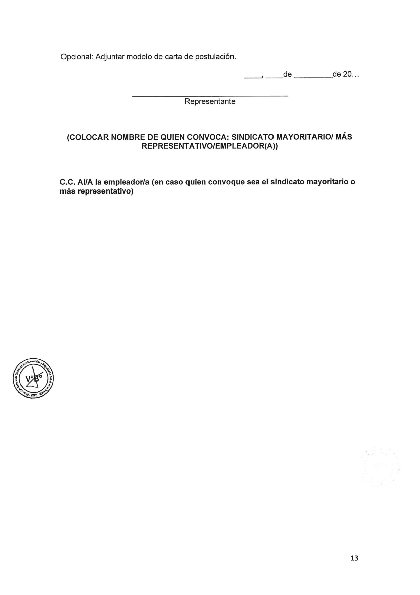

**Transcripción por reconocimiento de imagen:**

Opcional: Adjuntar modelo de carta de postulación.

de de 20...

Representante

(COLOCAR NOMBRE DE QUIEN CONVOCA: SINDICATO MAYORITARIO/ MÁS
REPRESENTATIVO/EMPLEADOR(A))

C.C. A/A la empleador/a (en caso quien convoque sea el sindicato mayoritario o
más representativo)

13

---

## Página 17

**Página escaneada: imagen de referencia para comprobar tablas, formularios y sus casillas.**

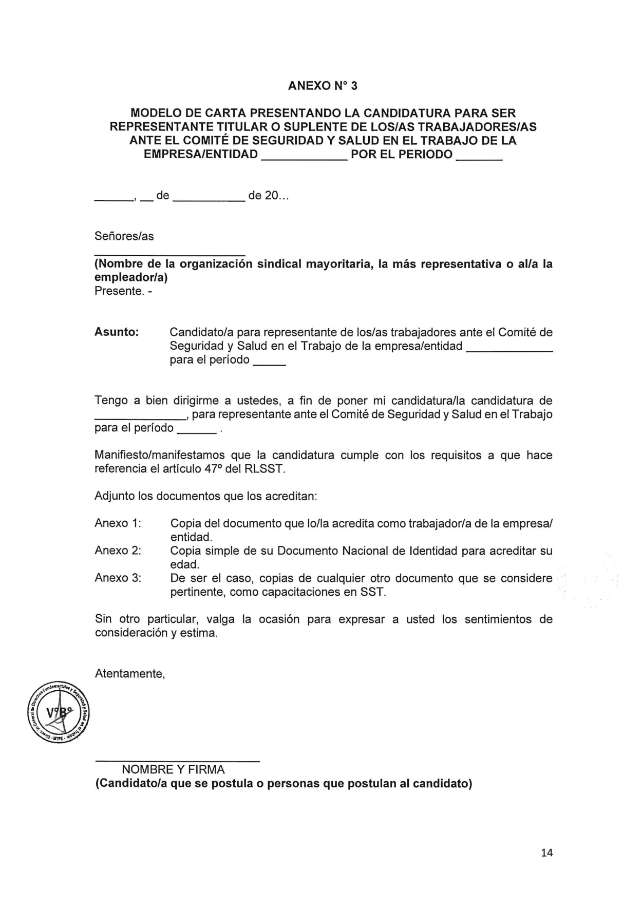

**Transcripción por reconocimiento de imagen:**

ANEXO N* 3

MODELO DE CARTA PRESENTANDO LA CANDIDATURA PARA SER
REPRESENTANTE TITULAR O SUPLENTE DE LOS/AS TRABAJADORES/AS
ANTE EL COMITÉ DE SEGURIDAD Y SALUD EN EL TRABAJO DE LA

EMPRESA/ENTIDAD POR EL PERIODO

de de 20...

Señores/as

(Nombre de la organización sindical mayoritaria, la más representativa o al/a la
empleador/a)
Presente. -

Asunto: Candidato/a para representante de los/as trabajadores ante el Comité de
Seguridad y Salud en el Trabajo de la empresa/entidad
para el período

Tengo a bien dirigirme a ustedes, a fin de poner mi candidatura/la candidatura de
, para representante ante el Comité de Seguridad y Salud en el Trabajo
para el período

Manifiesto/manifestamos que la candidatura cumple con los requisitos a que hace
referencia el artículo 47% del RLSST.

Adjunto los documentos que los acreditan:

Anexo 1: Copia del documento que lo/la acredita como trabajador/a de la empresa/
entidad.

Anexo 2: Copia simple de su Documento Nacional de Identidad para acreditar su
edad.

Anexo 3: De ser el caso, copias de cualquier otro documento que se considere

pertinente, como capacitaciones en SST.

Sin otro particular, valga la ocasión para expresar a usted los sentimientos de
consideración y estima.

Atentamente,

NOMBRE Y FIRMA
(Candidato/a que se postula o personas que postulan al candidato)

14

---

## Página 18

**Página escaneada: imagen de referencia para comprobar tablas, formularios y sus casillas.**

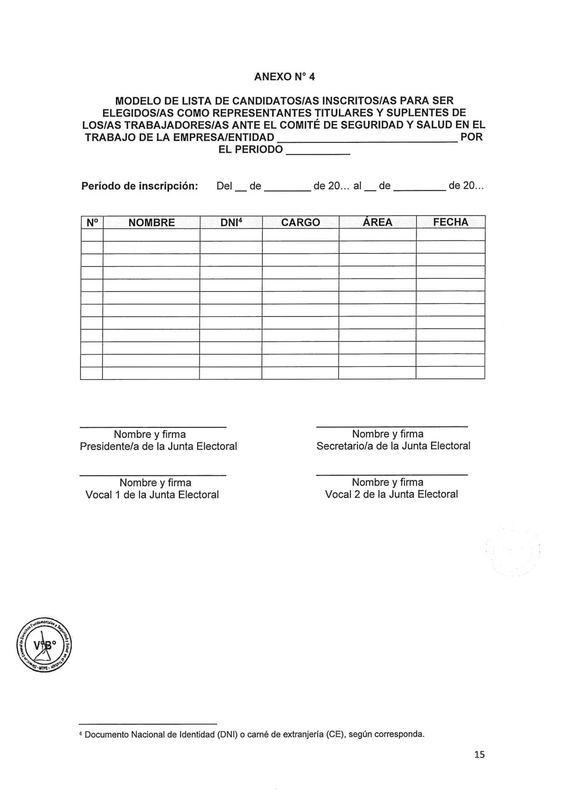

**Transcripción por reconocimiento de imagen:**

ANEXO N* 4

MODELO DE LISTA DE CANDIDATOS/AS INSCRITOS/AS PARA SER
ELEGIDOS/AS COMO REPRESENTANTES TITULARES Y SUPLENTES DE
LOS/AS TRABAJADORES/AS ANTE EL COMITE DE SEGURIDAD Y SALUD EN EL

TRABAJO DE LA EMPRESA/ENTIDAD POR
EL PERIODO
Período de inscripción: Del __de de 20... al__ de de 20...
N2 NOMBRE DNI* CARGO AREA FECHA
Nombre y firma Nombre y firma
Presidente/a de la Junta Electoral Secretario/a de la Junta Electoral
Nombre y firma Nombre y firma
Vocal 1 de la Junta Electoral Vocal 2 de la Junta Electoral

4 Documento Nacional de Identidad (DNI) o carné de extranjería (CE), según corresponda.

15

---

## Página 19

**Página escaneada: imagen de referencia para comprobar tablas, formularios y sus casillas.**

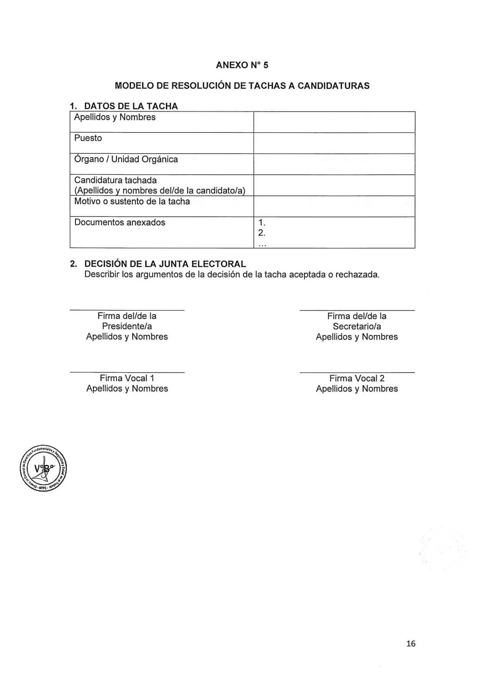

**Transcripción por reconocimiento de imagen:**

ANEXO N* 5

MODELO DE RESOLUCIÓN DE TACHAS A CANDIDATURAS

1. DATOS DE LA TACHA

Apellidos y Nombres

Puesto

Organo / Unidad Orgánica

Candidatura tachada
(Apellidos y nombres del/de la candidato/a)

Motivo o sustento de la tacha

Documentos anexados

pS

2. DECISIÓN DE LA JUNTA ELECTORAL

Describir los argumentos de la decisión de la tacha aceptada o rechazada.

Firma del/de la
Presidente/a
Apellidos y Nombres

Firma Vocal 1
Apellidos y Nombres

Firma del/de la
Secretario/a
Apellidos y Nombres

Firma Vocal 2
Apellidos y Nombres

16

---

## Página 20

**Página escaneada: imagen de referencia para comprobar tablas, formularios y sus casillas.**

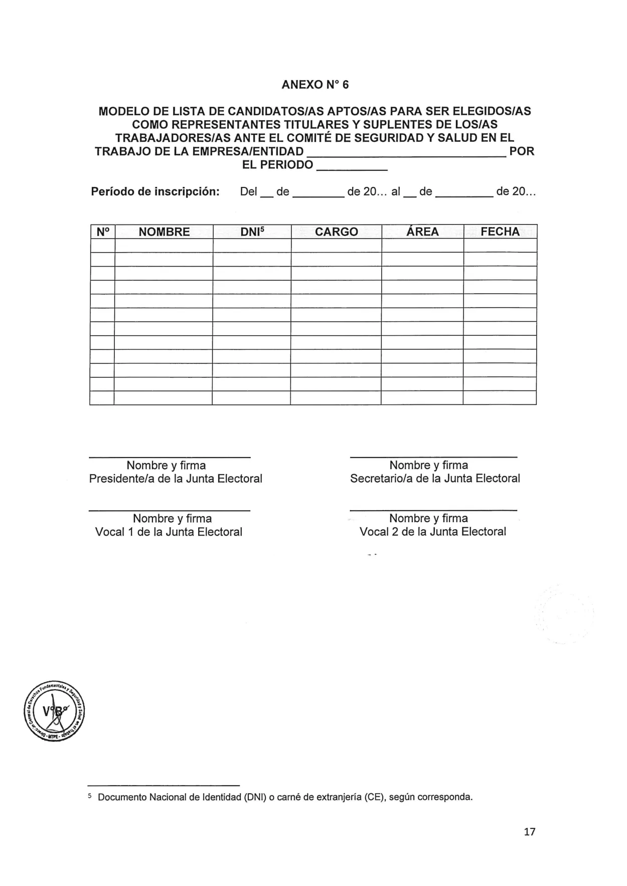

**Transcripción por reconocimiento de imagen:**

ANEXO N? 6

MODELO DE LISTA DE CANDIDATOS/AS APTOS/AS PARA SER ELEGIDOS/AS
COMO REPRESENTANTES TITULARES Y SUPLENTES DE LOS/AS
TRABAJADORES/AS ANTE EL COMITE DE SEGURIDAD Y SALUD EN EL

TRABAJO DE LA EMPRESA/ENTIDAD POR
EL PERIODO
Período de inscripción: Del__de de 20... al__ de de 20...
N2 NOMBRE DNIS CARGO AREA FECHA
Nombre y firma Nombre y firma
Presidente/a de la Junta Electoral Secretario/a de la Junta Electoral
Nombre y firma Nombre y firma
Vocal 1 de la Junta Electoral Vocal 2 de la Junta Electoral

5 Documento Nacional de Identidad (DNI) o carné de extranjería (CE), según corresponda.

17

---

## Página 21

**Página escaneada: imagen de referencia para comprobar tablas, formularios y sus casillas.**

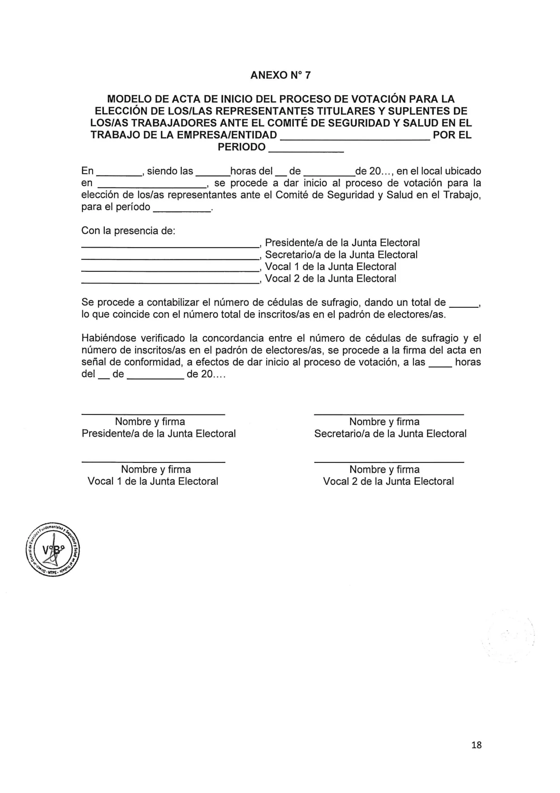

**Transcripción por reconocimiento de imagen:**

ANEXO N* 7

MODELO DE ACTA DE INICIO DEL PROCESO DE VOTACIÓN PARA LA
ELECCIÓN DE LOS/LAS REPRESENTANTES TITULARES Y SUPLENTES DE
LOS/AS TRABAJADORES ANTE EL COMITE DE SEGURIDAD Y SALUD EN EL

TRABAJO DE LA EMPRESA/ENTIDAD POR EL
PERIODO
En , Siendo las horas del __ de de 20..., en el local ubicado
en , Se procede a dar inicio al proceso de votación para la

elección de los/as representantes ante el Comité de Seguridad y Salud en el Trabajo,
para el período .

Con la presencia de:

, Presidente/a de la Junta Electoral
, Secretario/a de la Junta Electoral
, Vocal 1 de la Junta Electoral

, Vocal 2 de la Junta Electoral

Se procede a contabilizar el número de cédulas de sufragio, dando un total de ,
lo que coincide con el número total de inscritos/as en el padrón de electores/as.

Habiéndose verificado la concordancia entre el número de cédulas de sufragio y el
número de inscritos/as en el padrón de electores/as, se procede a la firma del acta en

señal de conformidad, a efectos de dar inicio al proceso de votación, a las horas
del __de de 20....
Nombre y firma Nombre y firma
Presidente/a de la Junta Electoral Secretario/a de la Junta Electoral
Nombre y firma Nombre y firma
Vocal 1 de la Junta Electoral Vocal 2 de la Junta Electoral

18

---

## Página 22

**Página escaneada: imagen de referencia para comprobar tablas, formularios y sus casillas.**

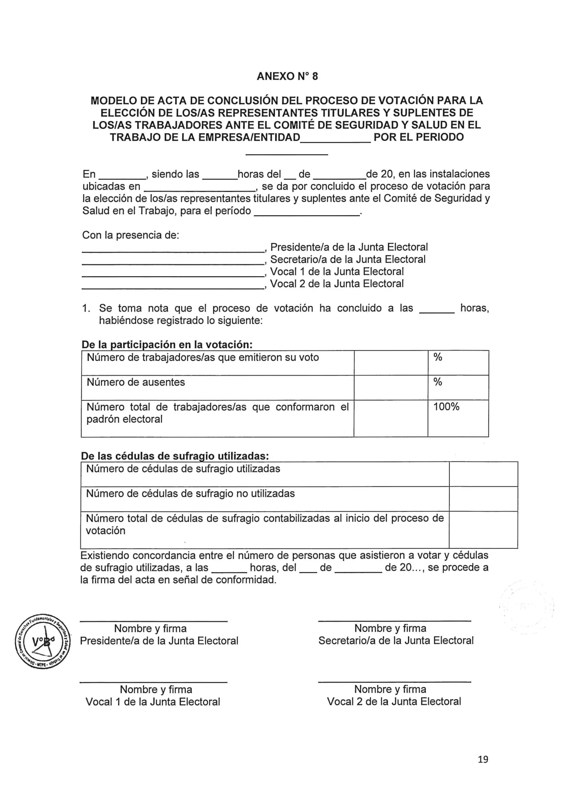

**Transcripción por reconocimiento de imagen:**

ANEXO N* 8

MODELO DE ACTA DE CONCLUSIÓN DEL PROCESO DE VOTACIÓN PARA LA
ELECCIÓN DE LOS/AS REPRESENTANTES TITULARES Y SUPLENTES DE
LOS/AS TRABAJADORES ANTE EL COMITE DE SEGURIDAD Y SALUD EN EL

TRABAJO DE LA EMPRESA/ENTIDAD POR EL PERIODO
En , Siendo las horas del __ de de 20, en las instalaciones
ubicadas en , se da por concluido el proceso de votación para

la elección de los/as representantes titulares y suplentes ante el Comité de Seguridad y
Salud en el Trabajo, para el período .

Con la presencia de:

, Presidente/a de la Junta Electoral
, Secretario/a de la Junta Electoral
, Vocal 1 de la Junta Electoral

, Vocal 2 de la Junta Electoral

1. Se toma nota que el proceso de votación ha concluido a las horas,
habiéndose registrado lo siguiente:

De la participación en la votación:

Número de trabajadores/as que emitieron su voto %
Número de ausentes %
Número total de trabajadores/as que conformaron el 100%
padrón electoral

De las cédulas de sufragio utilizadas:

Número de cédulas de sufragio utilizadas

Número de cédulas de sufragio no utilizadas

Número total de cédulas de sufragio contabilizadas al inicio del proceso de
votación

Existiendo concordancia entre el número de personas que asistieron a votar y cédulas
de sufragio utilizadas, a las horas, del de de 20..., se procede a
a firma del acta en señal de conformidad.

Nombre y firma Nombre y firma
Presidente/a de la Junta Electoral Secretario/a de la Junta Electoral
Nombre y firma Nombre y firma
Vocal 1 de la Junta Electoral Vocal 2 de la Junta Electoral

19

---

## Página 23

**Página escaneada: imagen de referencia para comprobar tablas, formularios y sus casillas.**

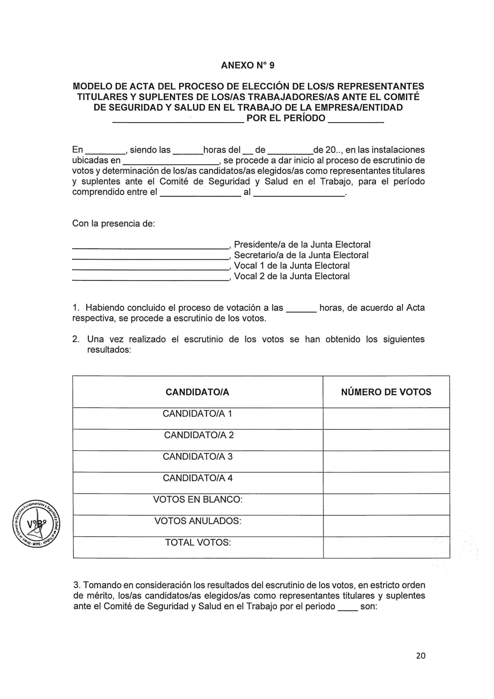

**Transcripción por reconocimiento de imagen:**

ANEXO N* 9

MODELO DE ACTA DEL PROCESO DE ELECCIÓN DE LOS/S REPRESENTANTES
TITULARES Y SUPLENTES DE LOS/AS TRABAJADORES/AS ANTE EL COMITÉ
DE SEGURIDAD Y SALUD EN EL TRABAJO DE LA EMPRESA/ENTIDAD

POR EL PERIODO

En , Siendo las horas del __ de de 20.., en las instalaciones
ubicadas en , Se procede a dar inicio al proceso de escrutinio de
votos y determinación de los/as candidatos/as elegidos/as como representantes titulares
y suplentes ante el Comité de Seguridad y Salud en el Trabajo, para el período
comprendido entre el al

Con la presencia de:

, Presidente/a de la Junta Electoral
, Secretario/a de la Junta Electoral
, Vocal 1 de la Junta Electoral
, Vocal 2 de la Junta Electoral

1. Habiendo concluido el proceso de votación a las horas, de acuerdo al Acta
respectiva, se procede a escrutinio de los votos.

2. Una vez realizado el escrutinio de los votos se han obtenido los siguientes
resultados:

CANDIDATO/A NÚMERO DE VOTOS

CANDIDATO/A 1

CANDIDATO/A 2

CANDIDATO/A 3

CANDIDATO/A 4

VOTOS EN BLANCO:

VOTOS ANULADOS:

TOTAL VOTOS:

3. Tomando en consideración los resultados del escrutinio de los votos, en estricto orden
de mérito, los/as candidatos/as elegidos/as como representantes titulares y suplentes
ante el Comité de Seguridad y Salud en el Trabajo por el periodo son:

20

---

## Página 24

**Página escaneada: imagen de referencia para comprobar tablas, formularios y sus casillas.**

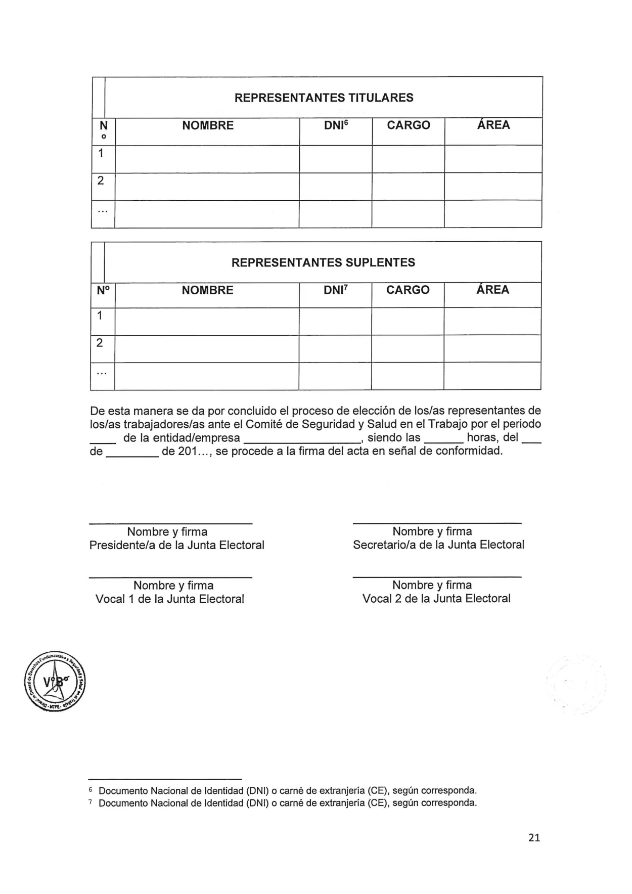

**Transcripción por reconocimiento de imagen:**

REPRESENTANTES TITULARES
DNIP CARGO AREA

N NOMBRE

o

REPRESENTANTES SUPLENTES
CARGO AREA

N? NOMBRE DNI”

De esta manera se da por concluido el proceso de elección de los/as representantes de
los/as trabajadores/as ante el Comité de Seguridad y Salud en el Trabajo por el periodo
de la entidad/empresa , siendo las horas, del ___

de de 201..., se procede a la firma del acta en señal de conformidad.

Nombre y firma Nombre y firma
Presidente/a de la Junta Electoral Secretario/a de la Junta Electoral

Nombre y firma Nombre y firma
Vocal 1 de la Junta Electoral Vocal 2 de la Junta Electoral

$ Documento Nacional de Identidad (DNI) o carné de extranjería (CE), según corresponda.
7 Documento Nacional de Identidad (DNI) o carné de extranjería (CE), según corresponda.

21

---

## Página 25

**Página escaneada: imagen de referencia para comprobar tablas, formularios y sus casillas.**

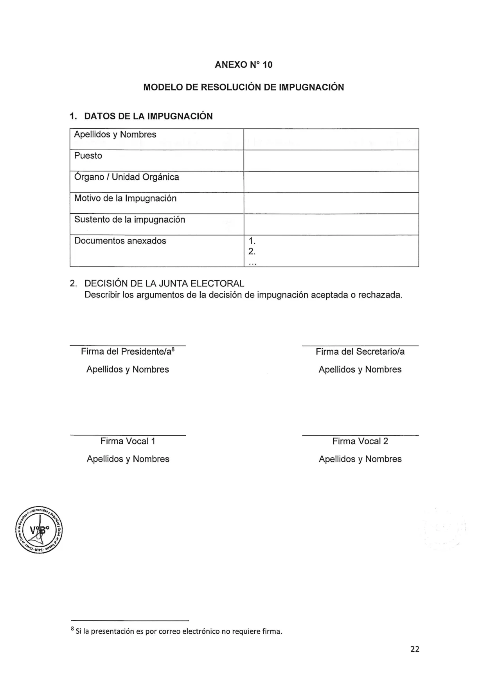

**Transcripción por reconocimiento de imagen:**

ANEXO N* 10

MODELO DE RESOLUCIÓN DE IMPUGNACIÓN

1. DATOS DE LA IMPUGNACIÓN

Apellidos y Nombres

Puesto

Órgano / Unidad Orgánica

Motivo de la Impugnación

Sustento de la impugnación

Documentos anexados

>

2. DECISIÓN DE LA JUNTA ELECTORAL

Describir los argumentos de la decisión de impugnación aceptada o rechazada.

Firma del Presidente/a?

Apellidos y Nombres

Firma Vocal 1

Apellidos y Nombres

8 Si la presentación es por correo electrónico no requiere firma.

Firma del Secretario/a

Apellidos y Nombres

Firma Vocal 2

Apellidos y Nombres

22

---

## Página 26

**Página escaneada: imagen de referencia para comprobar tablas, formularios y sus casillas.**

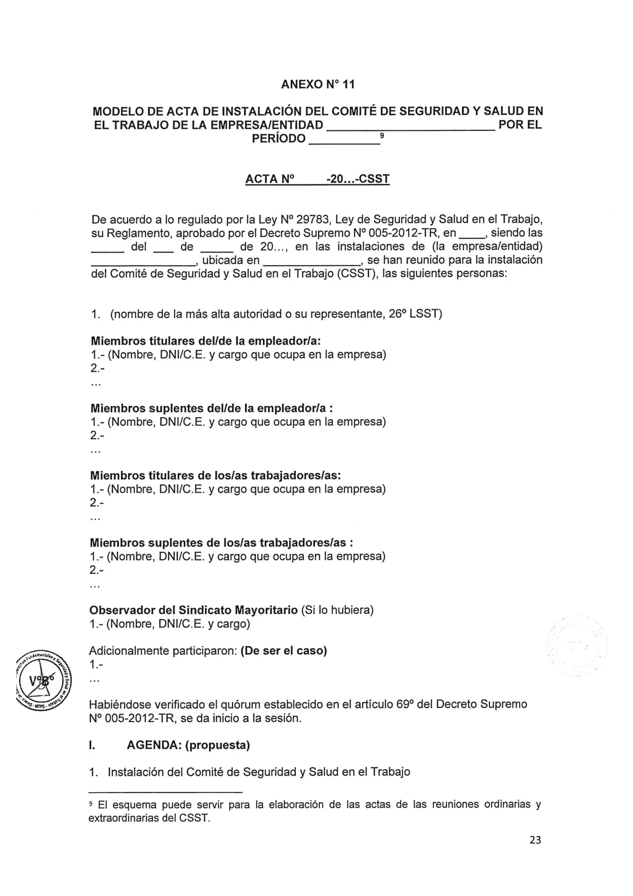

**Transcripción por reconocimiento de imagen:**

ANEXO N* 11

MODELO DE ACTA DE INSTALACIÓN DEL COMITÉ DE SEGURIDAD Y SALUD EN

EL TRABAJO DE LA EMPRESA/ENTIDAD POR EL
PERIODO 3
ACTA N? -20...-CSST

De acuerdo a lo regulado por la Ley N* 29783, Ley de Seguridad y Salud en el Trabajo,

su Reglamento, aprobado por el Decreto Supremo N* 005-2012-TR, en , Siendo las
del __ de de 20..., en las instalaciones de (la empresa/entidad)
, Ubicada en , se han reunido para la instalación

del Comité de Seguridad y Salud en el Trabajo (CSST), las siguientes personas:

1. (nombre de la más alta autoridad o su representante, 26? LSST)

Miembros titulares del/de la empleador/a:
1.- (Nombre, DNI/C.E. y cargo que ocupa en la empresa)
2.-

Miembros suplentes del/de la empleadorí/a :
1.- (Nombre, DNI/C.E. y cargo que ocupa en la empresa)
2.-

Miembros titulares de los/as trabajadores/as:
1.- (Nombre, DNI/C.E. y cargo que ocupa en la empresa)
2.-

Miembros suplentes de los/as trabajadores/as :
1.- (Nombre, DNI/C.E. y cargo que ocupa en la empresa)
2.-

Observador del Sindicato Mayoritario (Si lo hubiera)

1.- (Nombre, DNI/C.E. y cargo)

Adicionalmente participaron: (De ser el caso)

1.-

Habiéndose verificado el quórum establecido en el artículo 69% del Decreto Supremo
N* 005-2012-TR, se da inicio a la sesión.

L AGENDA: (propuesta)

1. Instalación del Comité de Seguridad y Salud en el Trabajo

2 El esquema puede servir para la elaboración de las actas de las reuniones ordinarias y
extraordinarias del CSST.

23

---

## Página 27

**Página escaneada: imagen de referencia para comprobar tablas, formularios y sus casillas.**

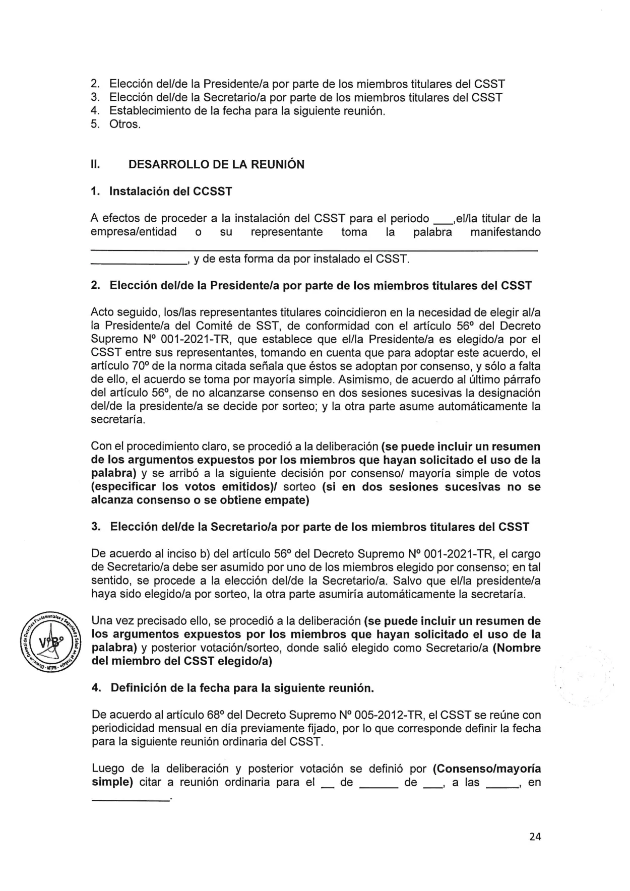

**Transcripción por reconocimiento de imagen:**

Elección del/de la Presidente/a por parte de los miembros titulares del CSST
Elección del/de la Secretario/a por parte de los miembros titulares del CSST
Establecimiento de la fecha para la siguiente reunión.

Otros.

Sa

tl DESARROLLO DE LA REUNIÓN
1. Instalación del CCSST

A efectos de proceder a la instalación del CSST para el periodo ___,el/la titular de la
empresa/entidad o su representante toma la palabra manifestando

, y de esta forma da por instalado el CSST.
2. Elección del/de la Presidente/a por parte de los miembros titulares del CSST

Acto seguido, los/las representantes titulares coincidieron en la necesidad de elegir al/a
la Presidente/a del Comité de SST, de conformidad con el artículo 56% del Decreto
Supremo N* 001-2021-TR, que establece que el/la Presidente/a es elegido/a por el
CSST entre sus representantes, tomando en cuenta que para adoptar este acuerdo, el
artículo 70* de la norma citada señala que éstos se adoptan por consenso, y sólo a falta
de ello, el acuerdo se toma por mayoría simple. Asimismo, de acuerdo al último párrafo
del artículo 56%, de no alcanzarse consenso en dos sesiones sucesivas la designación
del/de la presidente/a se decide por sorteo; y la otra parte asume automáticamente la
secretaría.

Con el procedimiento claro, se procedió a la deliberación (se puede incluir un resumen
de los argumentos expuestos por los miembros que hayan solicitado el uso de la
palabra) y se arribó a la siguiente decisión por consenso/ mayoría simple de votos
(especificar los votos emitidos)/ sorteo (si en dos sesiones sucesivas no se
alcanza consenso o se obtiene empate)

3. Elección del/de la Secretario/a por parte de los miembros titulares del CSST

De acuerdo al inciso b) del artículo 56% del Decreto Supremo N* 001-2021-TR, el cargo
de Secretario/a debe ser asumido por uno de los miembros elegido por consenso; en tal
sentido, se procede a la elección del/de la Secretario/a. Salvo que el/la presidente/a
haya sido elegido/a por sorteo, la otra parte asumiría automáticamente la secretaría.

Una vez precisado ello, se procedió a la deliberación (se puede incluir un resumen de
los argumentos expuestos por los miembros que hayan solicitado el uso de la
palabra) y posterior votación/sorteo, donde salió elegido como Secretario/a (Nombre
del miembro del CSST elegido/a)

4. Definición de la fecha para la siguiente reunión.

De acuerdo al artículo 68” del Decreto Supremo N* 005-2012-TR, el CSST se reúne con
periodicidad mensual en día previamente fijado, por lo que corresponde definir la fecha
para la siguiente reunión ordinaria del CSST.

Luego de la deliberación y posterior votación se definió por (Consenso/mayoría
simple) citar a reunión ordinaria para el de de , a las , en

24

---

## Página 28

**Página escaneada: imagen de referencia para comprobar tablas, formularios y sus casillas.**

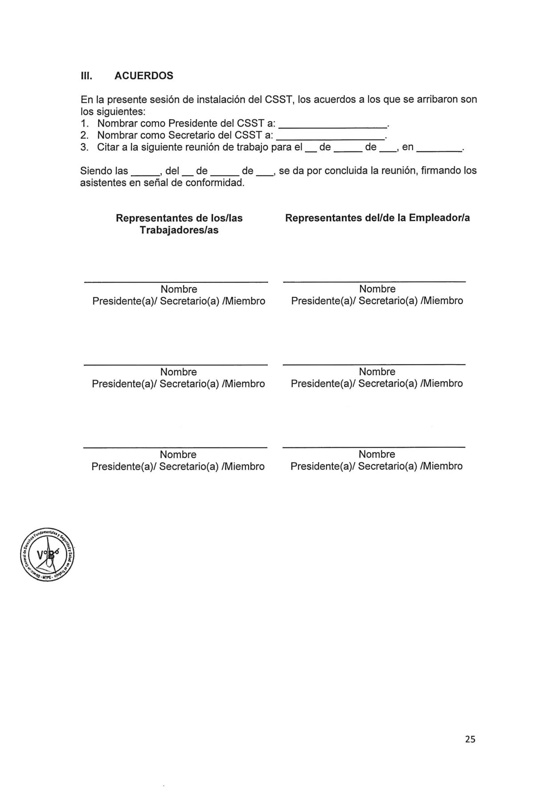

**Transcripción por reconocimiento de imagen:**

Ml. ACUERDOS

En la presente sesión de instalación del CSST, los acuerdos a los que se arribaron son
los siguientes:

1. Nombrar como Presidente del CSST a:

2. Nombrar como Secretario del CSST a:

3. Citar a la siguiente reunión de trabajo para el __ de de__,en
Siendo las , del __ de de , se da por concluida la reunión, firmando los

asistentes en señal de conformidad.

Representantes de los/las Representantes del/de la Empleador/a
Trabajadores/as

Nombre Nombre

Presidente(a)/ Secretario(a) [Miembro Presidente(a)/ Secretario(a) [Miembro
Nombre Nombre

Presidente(a)/ Secretario(a) [Miembro Presidente(a)/ Secretario(a) /Miembro
Nombre Nombre

Presidente(a)/ Secretario(a) [Miembro Presidente(a)/ Secretario(a) [Miembro

25

---
