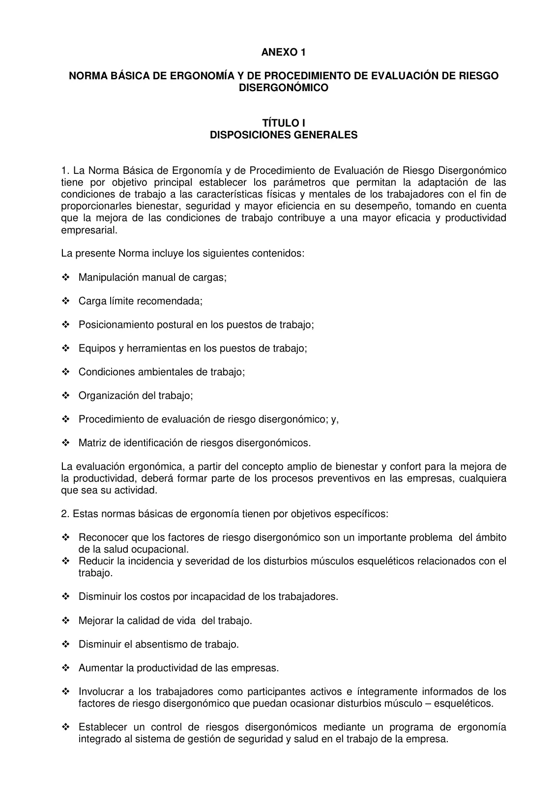
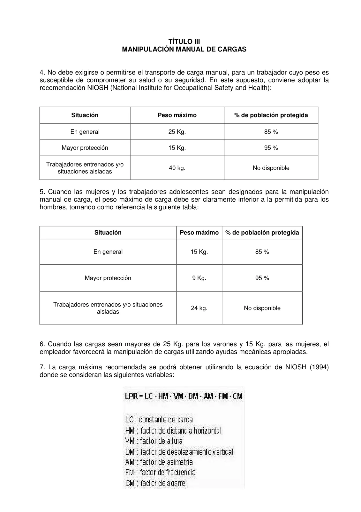
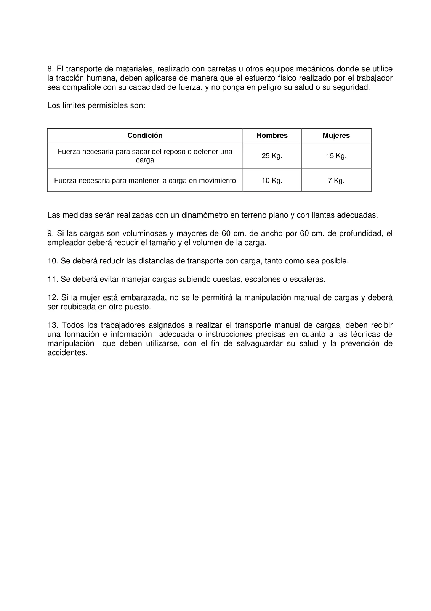
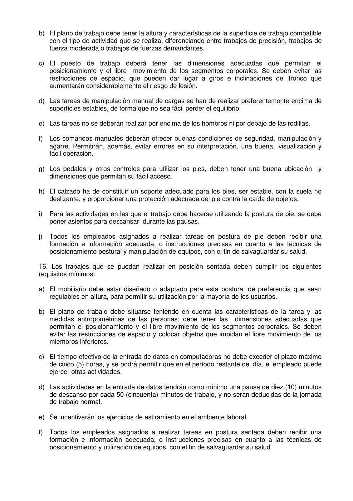
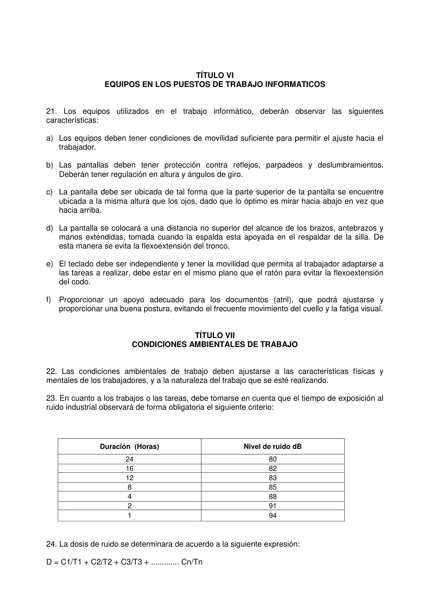
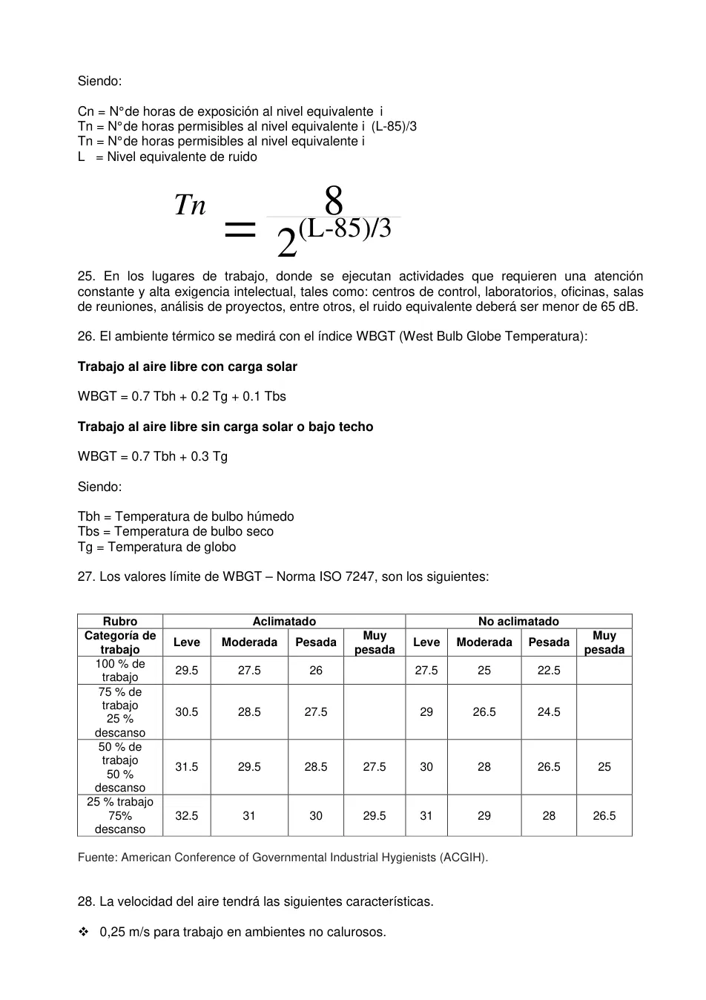
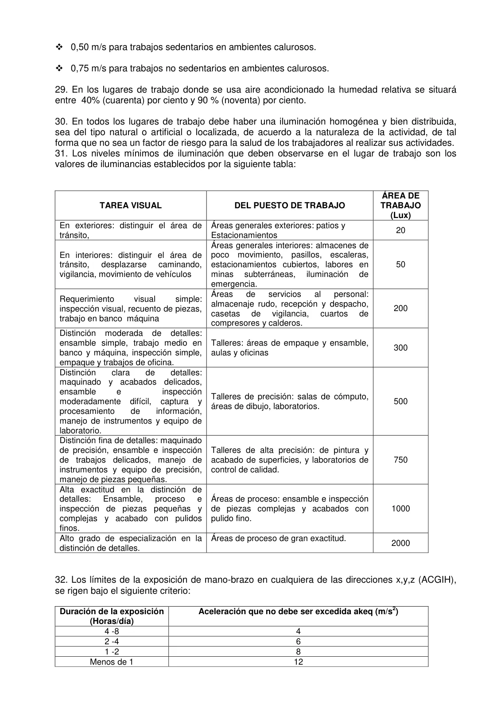
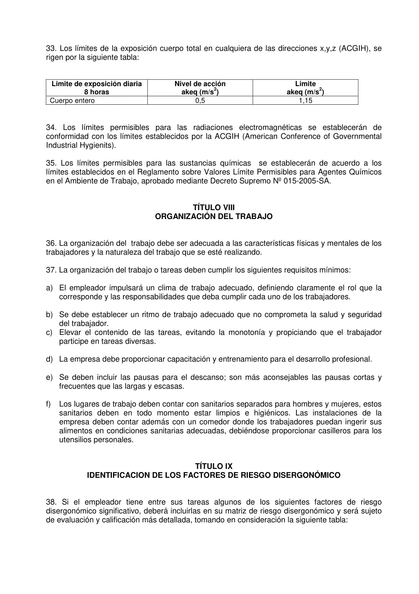
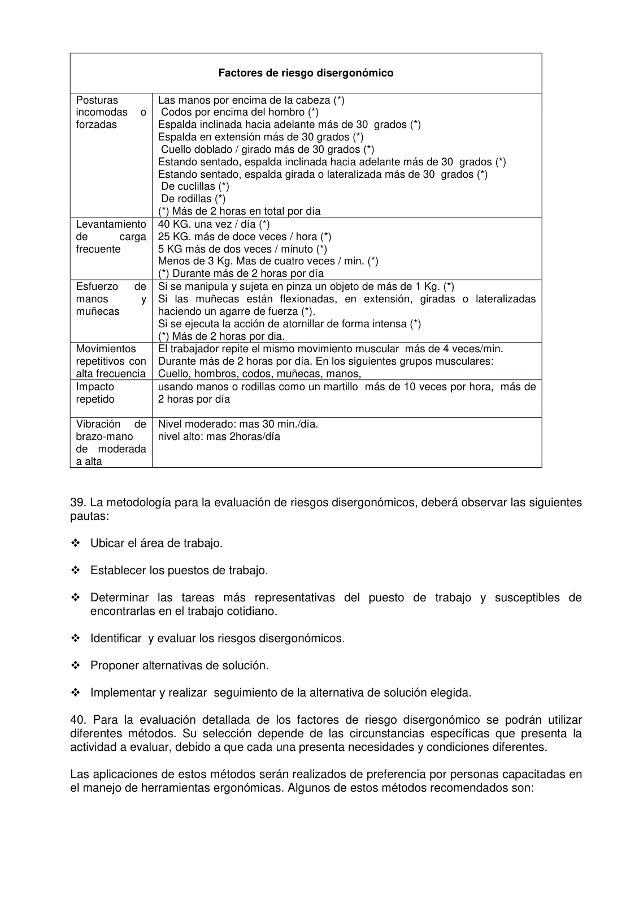
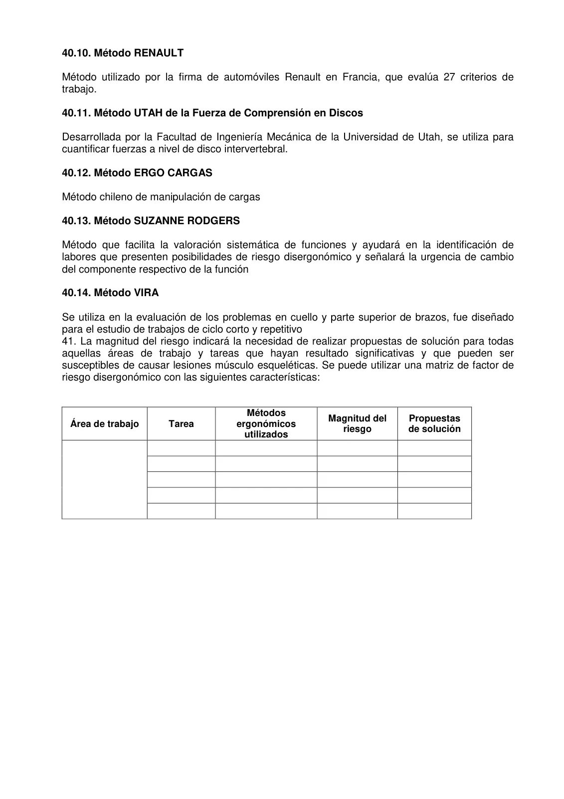

# R. M. N.° 375-2008-TR — Anexo de Ergonomía y Riesgo Disergonómico

**Archivo fuente:** `RM 375-2008-TR Anexo 1 - Norma básica de ergonomía y proc de eval de riesgos disergonómicos_VALORES.pdf`
**Páginas del PDF:** 17

> Conversión a Markdown página por página. Cuando la página contiene formularios escaneados, se adjunta su imagen original. El OCR de tablas y textos escaneados puede contener errores; contrastar con el documento original. No se ha verificado la vigencia normativa ni consolidado modificaciones posteriores.

## Índice de páginas

- [Página 1](#pagina-1)
- [Página 2](#pagina-2)
- [Página 3](#pagina-3)
- [Página 4](#pagina-4)
- [Página 5](#pagina-5)
- [Página 6](#pagina-6)
- [Página 7](#pagina-7)
- [Página 8](#pagina-8)
- [Página 9](#pagina-9)
- [Página 10](#pagina-10)
- [Página 11](#pagina-11)
- [Página 12](#pagina-12)
- [Página 13](#pagina-13)
- [Página 14](#pagina-14)
- [Página 15](#pagina-15)
- [Página 16](#pagina-16)
- [Página 17](#pagina-17)

---

## Página 1

APRUEBAN LA NORMA BÁSICA DE ERGONOMÍA Y DE PROCEDIMIENTO DE EVALUACIÓN DE RIESGO DISERGONÓMICO Lima, VISTOS: El Oficio Nº 2042-2008-MTPE/2 del Despacho del Vice Ministro de Trabajo, y el Oficio Nº 899-2008-MTPE/2/12.4 de la Dirección de Protección del Menor y de la Seguridad y Salud en el Trabajo; y, CONSIDERANDO: Que, el literal o) del artículo 5º de la Ley Nº 27711, Ley del Ministerio de Trabajo y Promoción del Empleo, señala que el Sector Trabajo tiene como atribuciones definir, concertar, coordinar, dirigir, supervisar y evaluar la política de higiene y seguridad ocupacional, y establecer las normas de prevención y protección contra riesgos ocupacionales que aseguren la salud integral de los trabajadores, en aras del mejoramiento de las condiciones y el medio ambiente de trabajo; Que, la Octava Disposición Transitoria del Reglamento de Seguridad y Salud en el Trabajo, establece que el Registro de Monitoreo de Agentes y Factores de Riesgo Disergonómico será obligatorio una vez que se apruebe el instrumento para el monitoreo de agentes y factores de riesgo disergonómico, por lo que se hace necesario contar con un procedimiento de evaluación de los aspectos ergonómicos; Que, el Sector ha procedido a la elaboración de la Norma Básica de Ergonomía y de Procedimiento de Evaluación de Riesgo Disergonómico, con la finalidad que las empresas puedan aplicarlas en sus diferentes áreas y puestos de trabajo, así como a sus respectivas tareas, contribuyendo de esa forma al bienestar físico, mental y social del trabajador; Que, en mérito a lo expuesto en los párrafos precedentes, es necesario emitir el acto administrativo que apruebe la Norma Básica de Ergonomía y de Procedimiento de Evaluación de Riesgo Disergonómico, en cumplimiento de lo establecido en el Reglamento de Seguridad y Salud en el Trabajo, aprobado mediante Decreto Supremo Nº 009-2005-TR; Con las visaciones del Vice Ministro de Trabajo y del Director General de la Oficina de Asesoría Jurídica; y, De conformidad con lo dispuesto en el artículo 8º de la Ley Nº 27711, Ley del Ministerio de Trabajo y Promoción del Empleo, los artículos 11º y 12º literal d) de su Reglamento de Organización y Funciones, aprobado por Resolución Ministerial Nº 173-2002-TR y sus modificatorias, y el artículo 25º numeral 8) de la Ley Nº 29158, Ley Orgánica del Poder Ejecutivo; SE RESUELVE:

Artículo 1º.- Aprobar la “Norma Básica de Ergonomía y de Procedimiento de Evaluación de Riesgo Disergonómico”, en mérito a los fundamentos expuestos en la parte considerativa de la presente resolución ministerial, que en anexo forma parte de la misma.

Artículo 2º.- La Autoridad Administrativa de Trabajo, es responsable de velar por el cumplimiento de la presente Norma.

Artículo 3º.- El anexo de la presente Norma deberá ser registrada en el Portal del Ministerio de Trabajo y Promoción del Empleo, www.mintra.gob.pe, dentro de los dos días siguientes de su publicación en el Diario Oficial El Peruano, siendo responsable de su cumplimiento la Oficina General de Estadística e Informática. Regístrese, comuníquese y publíquese.

---

## Página 2

**Vista original del cuadro o formulario (para comprobar campos, filas, valores y diseño):**

ANEXO 1 NORMA BÁSICA DE ERGONOMÍA Y DE PROCEDIMIENTO DE EVALUACIÓN DE RIESGO DISERGONÓMICO TÍTULO I DISPOSICIONES GENERALES

1. La Norma Básica de Ergonomía y de Procedimiento de Evaluación de Riesgo Disergonómico tiene por objetivo principal establecer los parámetros que permitan la adaptación de las condiciones de trabajo a las características físicas y mentales de los trabajadores con el fin de proporcionarles bienestar, seguridad y mayor eficiencia en su desempeño, tomando en cuenta que la mejora de las condiciones de trabajo contribuye a una mayor eficacia y productividad empresarial. La presente Norma incluye los siguientes contenidos:  Manipulación manual de cargas;  Carga límite recomendada;  Posicionamiento postural en los puestos de trabajo;  Equipos y herramientas en los puestos de trabajo;  Condiciones ambientales de trabajo;  Organización del trabajo;  Procedimiento de evaluación de riesgo disergonómico; y,  Matriz de identificación de riesgos disergonómicos. La evaluación ergonómica, a partir del concepto amplio de bienestar y confort para la mejora de la productividad, deberá formar parte de los procesos preventivos en las empresas, cualquiera que sea su actividad.

2. Estas normas básicas de ergonomía tienen por objetivos específicos:  Reconocer que los factores de riesgo disergonómico son un importante problema  del ámbito

de la salud ocupacional.  Reducir la incidencia y severidad de los disturbios músculos esqueléticos relacionados con el

trabajo.  Disminuir los costos por incapacidad de los trabajadores.  Mejorar la calidad de vida  del trabajo.  Disminuir el absentismo de trabajo.  Aumentar la productividad de las empresas.  Involucrar a los trabajadores como participantes activos e íntegramente informados de los

factores de riesgo disergonómico que puedan ocasionar disturbios músculo – esqueléticos.  Establecer un control de riesgos disergonómicos mediante un programa de ergonomía

integrado al sistema de gestión de seguridad y salud en el trabajo de la empresa.

---

## Página 3

TÍTULO II GLOSARIO DE TÉRMINOS

3. Para efectos de la presente Norma, se deberá entender por:

3.1. Análisis de trabajo Es la metodología utilizada en ergonomía para describir las actividades con el propósito de conocer las demandas que implican y compararlas con las capacidades humanas.

3.2. Carga Cualquier objeto susceptible de ser movido. Incluye, por ejemplo, la manipulación de personas (como los pacientes en un hospital) y la manipulación de animales en una granja o en una clínica veterinaria. Se considerarán también cargas los materiales que se manipulen, por ejemplo, por medio de una grúa u otro medio mecánico, pero que requieran aún del esfuerzo humano para moverlos o colocarlos en su posición definitiva.

3.3. Carga de trabajo Es el conjunto de requerimientos físicos y mentales a los que se ve sometido el trabajador a lo largo de su jornada laboral.

3.4. Carga física de trabajo Entendida como el conjunto de requerimientos físicos a los que la persona está expuesta a lo largo de su jornada laboral, y que de forma independiente o combinada, pueden alcanzar un nivel de intensidad, duración o frecuencia suficientes para causar un daño a la salud a las personas expuestas.

3.5. Carga mental de trabajo Es el esfuerzo intelectual que debe realizar el trabajador, para hacer frente al conjunto de demandas que recibe en el curso de realización de su trabajo. Este factor valora la carga mental a partir de los siguientes indicadores:

• Las presiones de tiempo: contempla a partir del tiempo asignado a la tarea, la recuperación de retrasos y el tiempo de trabajo con rapidez.

• Esfuerzo de atención: este viene dado por una parte, por la intensidad o el esfuerzo de concentración o reflexión necesarias para recibir las informaciones del proceso y elaborar las respuestas adecuadas y por la constancia con que debe ser sostenido este esfuerzo. El esfuerzo de atención puede incrementarse en función de la frecuencia de aparición de incidentes y las consecuencias que pudieran ocasionarle durante el proceso por una equivocación del trabajador.

• La fatiga percibida: la fatiga es una de las principales consecuencias que se desprende de una sobrecarga de las exigencias de la tarea.

• El número de informaciones que se precisan para realizar la tarea y el nivel de complejidad de las mismas, son dos factores a considerar para determinar la sobrecarga; así se mide la cantidad de información manejada y la complejidad de esa información.

• La percepción subjetiva de la dificultad que tiene para el trabajador su trabajo.

---

## Página 4

3.6. Ergonomía Llamada también ingeniería humana, es la ciencia que busca optimizar la interacción entre el trabajador, máquina y ambiente de trabajo con el fin de adecuar los puestos, ambientes y la organización del trabajo a las capacidades y limitaciones de los trabajadores, con el fin de minimizar el estrés y la fatiga y con ello incrementar el rendimiento y la seguridad del trabajador.

3.7. Factores de Riesgo Biopsicosociales Se llaman así, a aquellas condiciones que se encuentran presentes en una situación laboral y que están directamente relacionadas con el ambiente, la organización, el contenido del trabajo y la realización de las tareas, y que afectan el bienestar o a la salud (física, psíquica y social) del trabajador, así como al desarrollo del trabajo.

3.8. Factores de Riesgo Disergonómico Es aquel conjunto de atributos de la tarea o del puesto, más o menos claramente definidos, que inciden en aumentar la probabilidad de que un sujeto, expuesto a ellos, desarrolle una lesión en su trabajo. Incluyen aspectos relacionados con la manipulación manual de cargas, sobreesfuerzos, posturas de trabajo, movimientos repetitivos.

3.9. Fatiga Consecuencia lógica del esfuerzo realizado, y debe estar dentro de unos límites que permitan al trabajador recuperarse después de una jornada de descanso. Este equilibrio se rompe si la actividad laboral exige al trabajador energía por encima de sus posibilidades, con el consiguiente riesgo para la salud.

3.10. Manipulación manual de cargas Cualquier operación de transporte o sujeción de una carga por parte de uno o varios trabajadores, como el levantamiento, la colocación, el empuje, la tracción o el desplazamiento, que por sus características o condiciones ergonómicas inadecuadas entrañe riesgos, en particular dorso – lumbares, para los trabajadores.

3.11. Medicina Ocupacional o del Trabajo Es el conjunto de las actividades de las Ciencias de la Salud dirigidas hacia la promoción de la calidad de vida de los trabajadores, el diagnostico precoz y el tratamiento oportuno; asimismo, se refiere a la rehabilitación y la readaptación laboral, y la atención de las contingencias derivadas de los accidentes de trabajo y de las enfermedades profesionales u ocupacionales (ATEP ó ATEO), a través del mantenimiento y mejoramiento de sus condiciones de salud.

3.12. Plano de trabajo Es la altura en la que se desarrolla una tarea. Para trabajos de precisión se fija a la altura de los brazos con los puños entrelazados y, en cambio, para trabajos medianos demandantes de fuerza moderada se fija a la altura de los codos; asimismo, para trabajos demandantes de esfuerzo se fija a la altura de las muñecas.

3.13. Posturas forzadas Se definen como aquellas posiciones de trabajo que supongan que una o varias regiones anatómicas dejan de estar en una posición natural de confort para pasar a una posición que genera hiperextensiones, hiperflexiones y/o hiperrotaciones osteoarticulares, con la consecuente producción de lesiones por sobrecarga.

---

## Página 5

3.14. Puesto de trabajo Trabajo total asignado a un trabajador individual, está constituido por un conjunto específico de funciones, deberes y responsabilidades. Supone en su titular ciertas aptitudes generales, ciertas capacidades concretas y ciertos conocimientos prácticos relacionados con las maneras internas de funcionar y con los modos externos de relacionarse.

3.15. Riesgo Disergonómico Entenderemos por riesgo disergonómico, aquella expresión matemática referida a la probabilidad de sufrir un evento adverso e indeseado (accidente o enfermedad) en el trabajo, y condicionado por ciertos factores de riesgo disergonómico.

3.16. Sistemas de gestión de la seguridad y salud en el trabajo Conjunto de elementos interrelacionados o interactivos que tienen por objeto establecer una política y objetivos de seguridad y salud en el trabajo, y los mecanismos y acciones necesarios para alcanzar dichos objetivos.

3.17. Tarea Acto o secuencia de actos agrupados en el tiempo, destinados a contribuir a un resultado final específico, para el alcance de un objetivo

3.18. Trabajador adolescente Refiere a aquel trabajador comprendido entre los catorce (14) y los diecisiete (17) años de edad.

3.19. Trabajador entrenado Refiere a aquel trabajador mayor de dieciocho (18) años de edad, que realice tareas de manipulación de cargas en un tiempo no menor de 2 horas por día.

3.20. Trabajo repetitivo Movimientos continuos mantenidos durante un trabajo que implica la acción conjunta de los músculos, los huesos, las articulaciones y los nervios de una parte del cuerpo, y que puede provocar en esta misma zona la fatiga muscular, la sobrecarga, el dolor y, por último, una lesión.

3.21. Trabajos con pantallas de visualización de datos Involucra la labor que realiza un trabajador en base al uso del hardware y el software (los que forman parte de la ofimática). Se consideran trabajadores usuarios de pantallas de visualización a todos aquellos que superen las 4 horas diarias o 20 horas semanales de trabajo efectivo con dichos equipos.

3.22. Trastornos músculo esqueléticos Son lesiones de músculos, tendones, nervios y articulaciones que se localizan con más frecuencia en cuello, espalda, hombros, codos, muñecas y manos. Reciben nombres como: contracturas, tendinitis, síndrome del túnel carpiano, lumbalgias, cervicalgias, dorsalgias, etc. El síntoma predominante es el dolor, asociado a la inflamación, pérdida de  fuerza, y dificultad o imposibilidad para realizar algunos movimientos.

---

## Página 6

**Vista original del cuadro o formulario (para comprobar campos, filas, valores y diseño):**

### TÍTULO III MANIPULACIÓN MANUAL DE CARGAS

**Cuadro del documento (filas: 31; columnas: 7):**

| MANIPULACIÓN MANUAL DE CARGAS | Columna 2 | Columna 3 | Columna 4 | Columna 5 |
| --- | --- | --- | --- | --- |
| 4. No debe exigirse o permitirse el transporte de carga manual, para un trabajador cuyo peso es |  |  |  |  |
| susceptible de comprometer su salud o su seguridad. En este supuesto, conviene adoptar la |  |  |  |  |
| recomendación NIOSH (National Institute for Occupational Safety and Health): |  |  |  |  |
| Situación | Peso máximo |  |  | % de población protegida |
| En general | 25 Kg. |  |  | 85 % |
| Mayor protección | 15 Kg. |  |  | 95 % |
| Trabajadores entrenados y/o / situaciones aisladas | 40 kg. |  |  | No disponible |
| 5. Cuando las mujeres y los trabajadores adolescentes sean designados para la manipulación |  |  |  |  |
| manual de carga, el peso máximo de carga debe ser claramente inferior a la permitida para los |  |  |  |  |
| hombres, tomando como referencia la siguiente tabla: |  |  |  |  |
| Situación |  | Peso máximo | % de población protegida |  |
| En general |  | 15 Kg. | 85 % |  |
| Mayor protección |  | 9 Kg. | 95 % |  |
| Trabajadores entrenados y/o situaciones / aisladas |  | 24 kg. | No disponible |  |
| 6. Cuando las cargas sean mayores de 25 Kg. para los varones y 15 Kg. para las mujeres, el |  |  |  |  |
| empleador favorecerá la manipulación de cargas utilizando ayudas mecánicas apropiadas. |  |  |  |  |
| 7. La carga máxima recomendada se podrá obtener utilizando la ecuación de NIOSH (1994) |  |  |  |  |
| donde se consideran las siguientes variables: |  |  |  |  |

---

## Página 7

**Vista original del cuadro o formulario (para comprobar campos, filas, valores y diseño):**

**Cuadro del documento (filas: 55; columnas: 4):**

| 8. El transporte de materiales, realizado con carretas u otros equipos mecánicos donde se utilice | Columna 2 | Columna 3 |
| --- | --- | --- |
| la tracción humana, deben aplicarse de manera que el esfuerzo físico realizado por el trabajador |  |  |
| sea compatible con su capacidad de fuerza, y no ponga en peligro su salud o su seguridad. |  |  |
| Los límites permisibles son: |  |  |
| Condición | Hombres | Mujeres |
| Fuerza necesaria para sacar del reposo o detener una / carga | 25 Kg. | 15 Kg. |
| Fuerza necesaria para mantener la carga en movimiento | 10 Kg. | 7 Kg. |
| Las medidas serán realizadas con un dinamómetro en terreno plano y con llantas adecuadas. |  |  |
| 9. Si las cargas son voluminosas y mayores de 60 cm. de ancho por 60 cm. de profundidad, el |  |  |
| empleador deberá reducir el tamaño y el volumen de la carga. |  |  |
| 10. Se deberá reducir las distancias de transporte con carga, tanto como sea posible. |  |  |
| 11. Se deberá evitar manejar cargas subiendo cuestas, escalones o escaleras. |  |  |
| 12. Si la mujer está embarazada, no se le permitirá la manipulación manual de cargas y deberá |  |  |
| ser reubicada en otro puesto. |  |  |
| 13. Todos los trabajadores asignados a realizar el transporte manual de cargas, deben recibir |  |  |
| una formación e información adecuada o instrucciones precisas en cuanto a las técnicas de |  |  |
| manipulación que deben utilizarse, con el fin de salvaguardar su salud y la prevención de |  |  |
| accidentes. |  |  |

---

## Página 8

TÍTULO IV POSICIONAMIENTO POSTURAL EN LOS PUESTOS DE TRABAJO

14. Existen básicamente dos formas o posibilidades de trabajo: de pie o sentado. Se tratará en lo posible de alternar dichas posibilidades, para que un tiempo el trabajador se encuentre de pie y otro tiempo sentado. Se puede utilizar el siguiente diagrama para el posicionamiento postural en los puestos de trabajo:

15. Los  trabajos o las tareas que se tienen que realizar de pie deben cumplir los siguientes requisitos mínimos:

a) Evitar que en el desarrollo de las tareas se utilicen flexión y torsión del cuerpo combinados;

está combinación es el origen y causa de la mayoría de las lesiones músculo esqueléticas.

---

## Página 9

**Vista original del cuadro o formulario (para comprobar campos, filas, valores y diseño):**

b) El plano de trabajo debe tener la altura y características de la superficie de trabajo compatible

con el tipo de actividad que se realiza, diferenciando entre trabajos de precisión, trabajos de fuerza moderada o trabajos de fuerzas demandantes.

c) El puesto de trabajo deberá tener las dimensiones adecuadas que permitan el

posicionamiento y el libre  movimiento de los segmentos corporales. Se deben evitar las restricciones de espacio, que pueden dar lugar a giros e inclinaciones del tronco que aumentarán considerablemente el riesgo de lesión.

d) Las tareas de manipulación manual de cargas se han de realizar preferentemente encima de

superficies estables, de forma que no sea fácil perder el equilibrio.

e) Las tareas no se deberán realizar por encima de los hombros ni por debajo de las rodillas.

f) Los comandos manuales deberán ofrecer buenas condiciones de seguridad, manipulación y

agarre. Permitirán, además, evitar errores en su interpretación, una buena  visualización y fácil operación.

g) Los pedales y otros controles para utilizar los pies, deben tener una buena ubicación  y

dimensiones que permitan su fácil acceso.

h) El calzado ha de constituir un soporte adecuado para los pies, ser estable, con la suela no

deslizante, y proporcionar una protección adecuada del pie contra la caída de objetos.

i) Para las actividades en las que el trabajo debe hacerse utilizando la postura de pie, se debe

poner asientos para descansar  durante las pausas.

j) Todos los empleados asignados a realizar tareas en postura de pie deben recibir una

formación e información adecuada, o instrucciones precisas en cuanto a las técnicas de posicionamiento postural y manipulación de equipos, con el fin de salvaguardar su salud.

16. Los trabajos que se puedan realizar en posición sentada deben cumplir los siguientes requisitos mínimos:

a) El mobiliario debe estar diseñado o adaptado para esta postura, de preferencia que sean

regulables en altura, para permitir su utilización por la mayoría de los usuarios.

b) El plano de trabajo debe situarse teniendo en cuenta las características de la tarea y las medidas antropométricas de las personas; debe tener las  dimensiones adecuadas que permitan el posicionamiento y el libre movimiento de los segmentos corporales. Se deben evitar las restricciones de espacio y colocar objetos que impidan el libre movimiento de los miembros inferiores.

c) El tiempo efectivo de la entrada de datos en computadoras no debe exceder el plazo máximo de cinco (5) horas, y se podrá permitir que en el período restante del día, el empleado puede ejercer otras actividades.

d) Las actividades en la entrada de datos tendrán como mínimo una pausa de diez (10) minutos de descanso por cada 50 (cincuenta) minutos de trabajo, y no serán deducidas de la jornada de trabajo normal.

e) Se incentivarán los ejercicios de estiramiento en el ambiente laboral.

f) Todos los empleados asignados a realizar tareas en postura sentada deben recibir una formación e información adecuada, o instrucciones precisas en cuanto a las técnicas de posicionamiento y utilización de equipos, con el fin de salvaguardar su salud.

---

## Página 10

17. Los asientos utilizados en los puestos de trabajo deberán cumplir los siguientes requisitos mínimos de confort:

a) La silla debe permitir libertad de movimientos. Los ajustes deberán ser accionados desde la posición normal de sentado.

b) La altura del asiento de la silla debe ser regulable (adaptable a las distintas tipologías físicas de las personas); la ideal es la que permite que la persona se siente con los pies planos sobre el suelo y los muslos en posición horizontal con respecto al cuerpo o formando un ángulo entre 90 y 110 grados. Con esas características, la altura de la mesa se concretará a la altura del codo.

c) En trabajos administrativos, la silla debe tener al menos 5 ruedas para proporcionar una estabilidad adecuada

d) Las sillas de trabajo deberán tener un tapiz redondeado para evitar compresión mecánica del muslo; el material de revestimiento del asiento de la silla es recomendable que sea de tejido transpirable y flexible y que tenga un acolchamiento de 20 mm. de espesor, como mínimo. El material de la tapicería y el del revestimiento interior tienen que permitir una buena disipación de la humedad y del calor. Así mismo, conviene evitar los materiales deslizantes.

e) El respaldo de la silla debe ser regulable en altura y ángulo de inclinación. Su forma debe ser anatómica, adaptada al cuerpo para proteger la región lumbar.

f) Los reposa brazos son recomendables para dar apoyo y descanso a los hombros y a los brazos, aunque su función principal es facilitar los cambios de posturas y las acciones de sentarse y levantarse de la silla. TÍTULO V EQUIPOS Y HERRAMIENTAS EN LOS PUESTOS DE TRABAJO DE PRODUCCION

18. Todos los equipos y herramientas que componen un puesto de trabajo deben estar adaptados a las características físicas y mentales de los trabajadores, y a la naturaleza del trabajo que se esté realizando.

19. Las herramientas se seleccionaran de acuerdo a los siguientes criterios:  Son adecuadas para las tareas que se están realizando.  Se ajustan al espacio disponible en el trabajo.  Reducen la fuerza muscular que se tiene que aplicar.  Se ajustan a la mano y todos los dedos circundan el mango.  Pueden ser utilizadas en una postura cómoda de trabajo.  No causan presión de contacto dañino ni tensión muscular.  No causan riesgos de seguridad y salud.

20. Todos los empleados asignados a utilizar las herramientas de trabajo, deben recibir una formación e información  adecuada o instrucciones precisas en cuanto a las técnicas de utilización que deben realizarse, con el fin de salvaguardar su salud y la prevención de accidentes.

---

## Página 11

**Vista original del cuadro o formulario (para comprobar campos, filas, valores y diseño):**

TÍTULO VI EQUIPOS EN LOS PUESTOS DE TRABAJO INFORMATICOS

21. Los equipos utilizados en el trabajo informático, deberán observar las siguientes características:

a) Los equipos deben tener condiciones de movilidad suficiente para permitir el ajuste hacia el trabajador.

b) Las pantallas deben tener protección contra reflejos, parpadeos y deslumbramientos. Deberán tener regulación en altura y ángulos de giro.

c) La pantalla debe ser ubicada de tal forma que la parte superior de la pantalla se encuentre ubicada a la misma altura que los ojos, dado que lo óptimo es mirar hacia abajo en vez que hacia arriba.

d) La pantalla se colocará a una distancia no superior del alcance de los brazos, antebrazos y manos extendidas, tomada cuando la espalda esta apoyada en el respaldar de la silla. De esta manera se evita la flexoextensión del tronco.

e) El teclado debe ser independiente y tener la movilidad que permita al trabajador adaptarse a las tareas a realizar, debe estar en el mismo plano que el ratón para evitar la flexoextensión del codo.

f) Proporcionar un apoyo adecuado para los documentos (atril), que podrá ajustarse y proporcionar una buena postura, evitando el frecuente movimiento del cuello y la fatiga visual.

**Cuadro del documento (filas: 27; columnas: 4):**

| TÍTULO VII | Columna 2 | Columna 3 |
| --- | --- | --- |
| CONDICIONES AMBIENTALES DE TRABAJO |  |  |
| 22. Las condiciones ambientales de trabajo deben ajustarse a las características físicas y |  |  |
| mentales de los trabajadores, y a la naturaleza del trabajo que se esté realizando. |  |  |
| 23. En cuanto a los trabajos o las tareas, debe tomarse en cuenta que el tiempo de exposición al |  |  |
| ruido industrial observará de forma obligatoria el siguiente criterio: |  |  |
|  | Duración (Horas) | Nivel de ruido dB |
|  | 24 | 80 |
|  | 16 | 82 |
|  | 12 | 83 |
|  | 8 | 85 |
|  | 4 | 88 |
|  | 2 | 91 |
|  | 1 | 94 |
| 24. La dosis de ruido se determinara de acuerdo a la siguiente expresión: |  |  |
| D = C1/T1 + C2/T2 + C3/T3 + ............. Cn/Tn |  |  |

---

## Página 12

**Cuadro del documento (filas: 51; columnas: 10):**

| Siendo: | Columna 2 | Columna 3 | Columna 4 | Columna 5 | Columna 6 | Columna 7 | Columna 8 | Columna 9 |
| --- | --- | --- | --- | --- | --- | --- | --- | --- |
| Cn = N° de horas de exposición al nivel equivalente i |  |  |  |  |  |  |  |  |
| Tn = N° de horas permisibles al nivel equivalente i (L-85)/3 |  |  |  |  |  |  |  |  |
| Tn = N° de horas permisibles al nivel equivalente i |  |  |  |  |  |  |  |  |
| L = Nivel equivalente de ruido |  |  |  |  |  |  |  |  |
| 8 / Tn |  |  |  |  |  |  |  |  |
| = / (L-85)/3 |  |  |  |  |  |  |  |  |
| 2 |  |  |  |  |  |  |  |  |
| 25. En los lugares de trabajo, donde se ejecutan actividades que requieren una atención |  |  |  |  |  |  |  |  |
| constante y alta exigencia intelectual, tales como: centros de control, laboratorios, oficinas, salas |  |  |  |  |  |  |  |  |
| de reuniones, análisis de proyectos, entre otros, el ruido equivalente deberá ser menor de 65 dB. |  |  |  |  |  |  |  |  |
| 26. El ambiente térmico se medirá con el índice WBGT (West Bulb Globe Temperatura): |  |  |  |  |  |  |  |  |
| Trabajo al aire libre con carga solar |  |  |  |  |  |  |  |  |
| WBGT = 0.7 Tbh + 0.2 Tg + 0.1 Tbs |  |  |  |  |  |  |  |  |
| Trabajo al aire libre sin carga solar o bajo techo |  |  |  |  |  |  |  |  |
| WBGT = 0.7 Tbh + 0.3 Tg |  |  |  |  |  |  |  |  |
| Siendo: |  |  |  |  |  |  |  |  |
| Tbh = Temperatura de bulbo húmedo |  |  |  |  |  |  |  |  |
| Tbs = Temperatura de bulbo seco |  |  |  |  |  |  |  |  |
| Tg = Temperatura de globo |  |  |  |  |  |  |  |  |
| 27. Los valores límite de WBGT – Norma ISO 7247, son los siguientes: |  |  |  |  |  |  |  |  |
| Rubro | Aclimatado |  |  |  | No aclimatado |  |  |  |
| Categoría de / trabajo | Leve | Moderada | Pesada | Muy / pesada | Leve | Moderada | Pesada | Muy / pesada |
| 100 % de / trabajo | 29.5 | 27.5 | 26 |  | 27.5 | 25 | 22.5 |  |
| 75 % de / trabajo / 25 % / descanso | 30.5 | 28.5 | 27.5 |  | 29 | 26.5 | 24.5 |  |
| 50 % de / trabajo / 50 % / descanso | 31.5 | 29.5 | 28.5 | 27.5 | 30 | 28 | 26.5 | 25 |
| 25 % trabajo / 75% / descanso | 32.5 | 31 | 30 | 29.5 | 31 | 29 | 28 | 26.5 |
| Fuente: American Conference of Governmental Industrial Hygienists (ACGIH). |  |  |  |  |  |  |  |  |
| 28. La velocidad del aire tendrá las siguientes características. |  |  |  |  |  |  |  |  |
|  0,25 m/s para trabajo en ambientes no calurosos. |  |  |  |  |  |  |  |  |

**Gráfico o cuadro original:**

---

## Página 13

**Vista original del cuadro o formulario (para comprobar campos, filas, valores y diseño):**

**Cuadro del documento (filas: 34; columnas: 5):**

|  0,50 m/s para trabajos sedentarios en ambientes calurosos. | Columna 2 | Columna 3 | Columna 4 |
| --- | --- | --- | --- |
|  0,75 m/s para trabajos no sedentarios en ambientes calurosos. |  |  |  |
| 29. En los lugares de trabajo donde se usa aire acondicionado la humedad relativa se situará |  |  |  |
| entre 40% (cuarenta) por ciento y 90 % (noventa) por ciento. |  |  |  |
| 30. En todos los lugares de trabajo debe haber una iluminación homogénea y bien distribuida, |  |  |  |
| sea del tipo natural o artificial o localizada, de acuerdo a la naturaleza de la actividad, de tal |  |  |  |
| forma que no sea un factor de riesgo para la salud de los trabajadores al realizar sus actividades. |  |  |  |
| 31. Los niveles mínimos de iluminación que deben observarse en el lugar de trabajo son los |  |  |  |
| valores de iluminancias establecidos por la siguiente tabla: |  |  |  |
| TAREA VISUAL |  | DEL PUESTO DE TRABAJO | ÁREA DE / TRABAJO / (Lux) |
| En exteriores: distinguir el área de / tránsito, |  | Áreas generales exteriores: patios y / Estacionamientos | 20 |
| En interiores: distinguir el área de / tránsito, desplazarse caminando, / vigilancia, movimiento de vehículos |  | Áreas generales interiores: almacenes de / poco movimiento, pasillos, escaleras, / estacionamientos cubiertos, labores en / minas subterráneas, iluminación de / emergencia. | 50 |
| Requerimiento visual simple: / inspección visual, recuento de piezas, / trabajo en banco máquina |  | Áreas de servicios al personal: / almacenaje rudo, recepción y despacho, / casetas de vigilancia, cuartos de / compresores y calderos. | 200 |
| Distinción moderada de detalles: / ensamble simple, trabajo medio en / banco y máquina, inspección simple, / empaque y trabajos de oficina. |  | Talleres: áreas de empaque y ensamble, / aulas y oficinas | 300 |
| Distinción clara de detalles: / maquinado y acabados delicados, / ensamble e inspección / moderadamente difícil, captura y / procesamiento de información, / manejo de instrumentos y equipo de / laboratorio. |  | Talleres de precisión: salas de cómputo, / áreas de dibujo, laboratorios. | 500 |
| Distinción fina de detalles: maquinado / de precisión, ensamble e inspección / de trabajos delicados, manejo de / instrumentos y equipo de precisión, / manejo de piezas pequeñas. |  | Talleres de alta precisión: de pintura y / acabado de superficies, y laboratorios de / control de calidad. | 750 |
| Alta exactitud en la distinción de / detalles: Ensamble, proceso e / inspección de piezas pequeñas y / complejas y acabado con pulidos / finos. |  | Áreas de proceso: ensamble e inspección / de piezas complejas y acabados con / pulido fino. | 1000 |
| Alto grado de especialización en la / distinción de detalles. |  | Áreas de proceso de gran exactitud. | 2000 |
| 32. Los límites de la exposición de mano-brazo en cualquiera de las direcciones x,y,z (ACGIH), |  |  |  |
| se rigen bajo el siguiente criterio: |  |  |  |
| Duración de la exposición / (Horas/día) | Aceleración que no debe ser excedida akeq (m/s2) |  |  |
| 4 -8 | 4 |  |  |
| 2 -4 | 6 |  |  |
| 1 -2 | 8 |  |  |
| Menos de 1 | 12 |  |  |

---

## Página 14

**Vista original del cuadro o formulario (para comprobar campos, filas, valores y diseño):**

**Cuadro del documento (filas: 48; columnas: 4):**

| 33. Los límites de la exposición cuerpo total en cualquiera de las direcciones x,y,z (ACGIH), se | Columna 2 | Columna 3 |
| --- | --- | --- |
| rigen por la siguiente tabla: |  |  |
| Limite de exposición diaria / 8 horas | Nivel de acción / akeq (m/s2) | Limite / akeq (m/s2) |
| Cuerpo entero | 0,5 | 1,15 |
| 34. Los límites permisibles para las radiaciones electromagnéticas se establecerán de |  |  |
| conformidad con los límites establecidos por la ACGIH (American Conference of Governmental |  |  |
| Industrial Hygienits). |  |  |
| 35. Los límites permisibles para las sustancias químicas se establecerán de acuerdo a los |  |  |
| límites establecidos en el Reglamento sobre Valores Límite Permisibles para Agentes Químicos |  |  |
| en el Ambiente de Trabajo, aprobado mediante Decreto Supremo Nº 015-2005-SA. |  |  |
| TÍTULO VIII |  |  |
| ORGANIZACIÓN DEL TRABAJO |  |  |
| 36. La organización del trabajo debe ser adecuada a las características físicas y mentales de los |  |  |
| trabajadores y la naturaleza del trabajo que se esté realizando. |  |  |
| 37. La organización del trabajo o tareas deben cumplir los siguientes requisitos mínimos: |  |  |
| a) El empleador impulsará un clima de trabajo adecuado, definiendo claramente el rol que la |  |  |
| corresponde y las responsabilidades que deba cumplir cada uno de los trabajadores. |  |  |
| b) Se debe establecer un ritmo de trabajo adecuado que no comprometa la salud y seguridad |  |  |
| del trabajador. |  |  |
| c) Elevar el contenido de las tareas, evitando la monotonía y propiciando que el trabajador |  |  |
| participe en tareas diversas. |  |  |
| d) La empresa debe proporcionar capacitación y entrenamiento para el desarrollo profesional. |  |  |
| e) Se deben incluir las pausas para el descanso; son más aconsejables las pausas cortas y |  |  |
| frecuentes que las largas y escasas. |  |  |
| f) Los lugares de trabajo deben contar con sanitarios separados para hombres y mujeres, estos |  |  |
| sanitarios deben en todo momento estar limpios e higiénicos. Las instalaciones de la |  |  |
| empresa deben contar además con un comedor donde los trabajadores puedan ingerir sus |  |  |
| alimentos en condiciones sanitarias adecuadas, debiéndose proporcionar casilleros para los |  |  |
| utensilios personales. |  |  |
| TÍTULO IX |  |  |

TÍTULO IX IDENTIFICACION DE LOS FACTORES DE RIESGO DISERGONÓMICO

38. Si el empleador tiene entre sus tareas algunos de los siguientes factores de riesgo disergonómico significativo, deberá incluirlas en su matriz de riesgo disergonómico y será sujeto de evaluación y calificación más detallada, tomando en consideración la siguiente tabla:

---

## Página 15

**Vista original del cuadro o formulario (para comprobar campos, filas, valores y diseño):**

**Cuadro del documento (filas: 7; columnas: 2):**

| Factores de riesgo disergonómico | Columna 2 |
| --- | --- |
| Posturas / incomodas o / forzadas | Las manos por encima de la cabeza (*) / Codos por encima del hombro (*) / Espalda inclinada hacia adelante más de 30 grados (*) / Espalda en extensión más de 30 grados (*) / Cuello doblado / girado más de 30 grados (*) / Estando sentado, espalda inclinada hacia adelante más de 30 grados (*) / Estando sentado, espalda girada o lateralizada más de 30 grados (*) / De cuclillas (*) / De rodillas (*) / (*) Más de 2 horas en total por día |
| Levantamiento / de carga / frecuente | 40 KG. una vez / día (*) / 25 KG. más de doce veces / hora (*) / 5 KG más de dos veces / minuto (*) / Menos de 3 Kg. Mas de cuatro veces / min. (*) / (*) Durante más de 2 horas por día |
| Esfuerzo de / manos y / muñecas | Si se manipula y sujeta en pinza un objeto de más de 1 Kg. (*) / Si las muñecas están flexionadas, en extensión, giradas o lateralizadas / haciendo un agarre de fuerza (*). / Si se ejecuta la acción de atornillar de forma intensa (*) / (*) Más de 2 horas por dia. |
| Movimientos / repetitivos con / alta frecuencia | El trabajador repite el mismo movimiento muscular más de 4 veces/min. / Durante más de 2 horas por día. En los siguientes grupos musculares: / Cuello, hombros, codos, muñecas, manos, |
| Impacto / repetido | usando manos o rodillas como un martillo más de 10 veces por hora, más de / 2 horas por día |
| Vibración de / brazo-mano / de moderada / a alta | Nivel moderado: mas 30 min./día. / nivel alto: mas 2horas/día |

39. La metodología para la evaluación de riesgos disergonómicos, deberá observar las siguientes pautas:  Ubicar el área de trabajo.  Establecer los puestos de trabajo.  Determinar las tareas más representativas del puesto de trabajo y susceptibles de

encontrarlas en el trabajo cotidiano.  Identificar  y evaluar los riesgos disergonómicos.  Proponer alternativas de solución.  Implementar y realizar  seguimiento de la alternativa de solución elegida.

40. Para la evaluación detallada de los factores de riesgo disergonómico se podrán utilizar diferentes métodos. Su selección depende de las circunstancias específicas que presenta la actividad a evaluar, debido a que cada una presenta necesidades y condiciones diferentes. Las aplicaciones de estos métodos serán realizados de preferencia por personas capacitadas en el manejo de herramientas ergonómicas. Algunos de estos métodos recomendados son:

---

## Página 16

40.1. Método Ergo IBV Método de evaluación de riesgos laborales asociados a la carga física (Instituto de Biomecánica de Valencia, 1996). Apartados de tareas repetitivas de un miembro superior con ciclos de trabajo definidos, y también de tareas con posturas forzadas.

40.2. Método RULA Método destinado a valorar los factores de riesgo de las desviaciones articulares, el esfuerzo o la fuerza y la repetitividad para las extremidades siguientes: brazos, antebrazos, muñecas, hombros, cuello, tronco y piernas. Respecto al ámbito de aplicación, se recomienda limitarlo a trabajos repetitivos en posición sentada.

40.3. Método REBA Método destinado a valorar los factores de riesgo de las desviaciones articulares, el esfuerzo o la fuerza y la repetitividad para las extremidades siguientes: brazos, antebrazos, muñecas, hombros, cuello, tronco y piernas. Respecto al ámbito de aplicación, se puede aplicar a cualquier actividad, incluso a las actividades en las que los objetos que se tienen que manipular son imprevisibles (personas, animales), o si las condiciones de trabajo son muy variables (almacenes).

40.4. Método OWAS Método destinado a valorar el esfuerzo postural de cuerpo entero. A pesar de que el ámbito de aplicación se puede generalizar, la fiabilidad puede disminuir en operaciones de tipo repetitivo o de esfuerzo mantenido localizado en extremidades superiores, cuello y hombros.

40.5. Método Job Strain Index (JSI) Método destinado a valorar los factores de riesgo de las desviaciones articulares, el esfuerzo o la fuerza y la repetitividad para las extremidades distales siguientes: manos y muñecas. Respecto al ámbito de aplicación, se recomienda limitarlo a trabajos repetitivos en posición sentada.

40.6. Método Check – List OCRA Método destinado a valorar tareas con movimientos repetitivos y permite, con menor esfuerzo, obtener un resultado básico de valoración del riesgo por movimientos repetitivos de los miembros superiores (mano, muñeca, antebrazo y brazo), previniendo sobre la necesidad de realizar estudios más detallados.

40.7. Método Carga Límite Recomendada por el NIOSH (National Institute for Occupational Safety and Health) Método que define el peso de la carga para las condiciones de la tarea en trabajadores saludables que pudieran realizar su labor por un periodo de 8 horas sin aumentar el riesgo de desarrollar una dolencia músculo esquelética.

40.8. Método de la frecuencia cardiaca Utilizado  para determinar el consumo energético del trabajador durante su jornada laboral, determina el porcentaje de reposo en función del consumo energético y el tiempo en la cual gasta su reserva de energía.

40.9. Método LEST (Laboratorio de Economía y Sociología del Trabajo) Método francés destinado a variables de carga mental, factores psicosociales y tiempos de trabajo.

---

## Página 17

**Vista original del cuadro o formulario (para comprobar campos, filas, valores y diseño):**

40.10. Método RENAULT Método utilizado por la firma de automóviles Renault en Francia, que evalúa 27 criterios de trabajo.

40.11. Método UTAH de la Fuerza de Comprensión en Discos Desarrollada por la Facultad de Ingeniería Mecánica de la Universidad de Utah, se utiliza para cuantificar fuerzas a nivel de disco intervertebral.

40.12. Método ERGO CARGAS Método chileno de manipulación de cargas

40.13. Método SUZANNE RODGERS Método que facilita la valoración sistemática de funciones y ayudará en la identificación de labores que presenten posibilidades de riesgo disergonómico y señalará la urgencia de cambio del componente respectivo de la función

40.14. Método VIRA Se utiliza en la evaluación de los problemas en cuello y parte superior de brazos, fue diseñado para el estudio de trabajos de ciclo corto y repetitivo

41. La magnitud del riesgo indicará la necesidad de realizar propuestas de solución para todas aquellas áreas de trabajo y tareas que hayan resultado significativas y que pueden ser susceptibles de causar lesiones músculo esqueléticas. Se puede utilizar una matriz de factor de riesgo disergonómico con las siguientes características:

**Cuadro del documento (filas: 7; columnas: 6):**

| Área de trabajo | Tarea | Métodos / ergonómicos / utilizados | Magnitud del / riesgo | Propuestas / de solución |
| --- | --- | --- | --- | --- |

---
