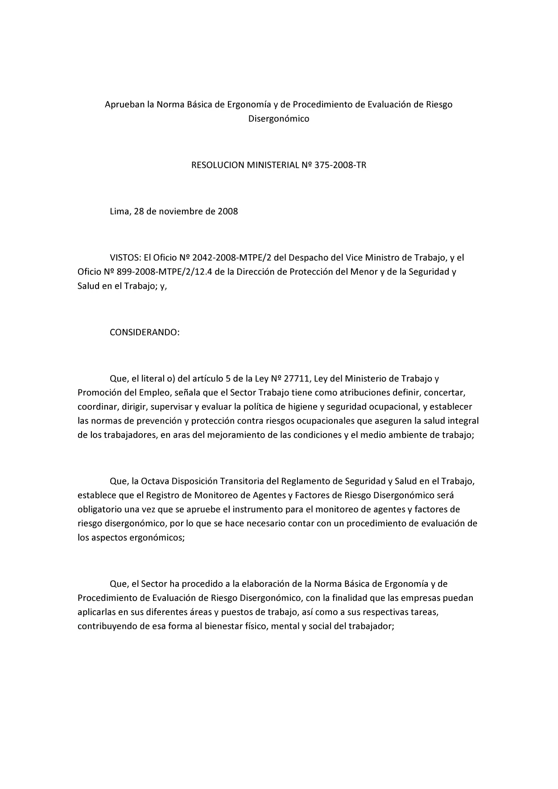
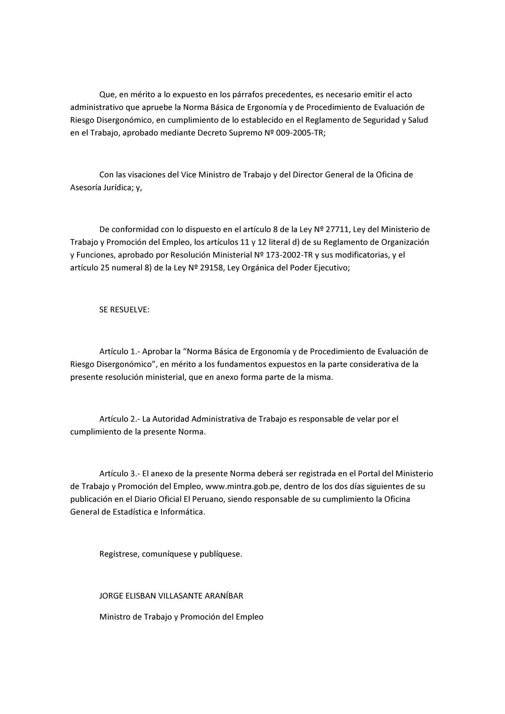

# R. M. N.° 375-2008-TR — Resolución

**Archivo fuente:** `RM_375-2008-TR Norma básica de Ergonomía.pdf`
**Páginas del PDF:** 2

> Conversión a Markdown página por página. Cuando la página contiene formularios escaneados, se adjunta su imagen original. El OCR de tablas y textos escaneados puede contener errores; contrastar con el documento original. No se ha verificado la vigencia normativa ni consolidado modificaciones posteriores.

## Índice de páginas

- [Página 1](#pagina-1)
- [Página 2](#pagina-2)

---

## Página 1

**Página escaneada: imagen de referencia para comprobar tablas, formularios y sus casillas.**

**Transcripción por reconocimiento de imagen:**

Aprueban la Norma Básica de Ergonomía y de Procedimiento de Evaluación de Riesgo
Disergonómico

RESOLUCION MINISTERIAL N2 375-2008-TR

Lima, 28 de noviembre de 2008

VISTOS: El Oficio N* 2042-2008-MTPE/2 del Despacho del Vice Ministro de Trabajo, y el
Oficio N2 899-2008-MTPE/2/12.4 de la Dirección de Protección del Menor y de la Seguridad y
Salud en el Trabajo; y,

CONSIDERANDO:

Que, el literal 0) del artículo 5 de la Ley N? 27711, Ley del Ministerio de Trabajo y
Promoción del Empleo, señala que el Sector Trabajo tiene como atribuciones definir, concertar,
coordinar, dirigir, supervisar y evaluar la política de higiene y seguridad ocupacional, y establecer
las normas de prevención y protección contra riesgos ocupacionales que aseguren la salud integral
de los trabajadores, en aras del mejoramiento de las condiciones y el medio ambiente de trabajo;

Que, la Octava Disposición Transitoria del Reglamento de Seguridad y Salud en el Trabajo,
establece que el Registro de Monitoreo de Agentes y Factores de Riesgo Disergonómico será
obligatorio una vez que se apruebe el instrumento para el monitoreo de agentes y factores de
riesgo disergonómico, por lo que se hace necesario contar con un procedimiento de evaluación de
los aspectos ergonómicos;

Que, el Sector ha procedido a la elaboración de la Norma Básica de Ergonomía y de
Procedimiento de Evaluación de Riesgo Disergonómico, con la finalidad que las empresas puedan
aplicarlas en sus diferentes áreas y puestos de trabajo, así como a sus respectivas tareas,
contribuyendo de esa forma al bienestar físico, mental y social del trabajador;

---

## Página 2

**Página escaneada: imagen de referencia para comprobar tablas, formularios y sus casillas.**

**Transcripción por reconocimiento de imagen:**

Que, en mérito a lo expuesto en los párrafos precedentes, es necesario emitir el acto
administrativo que apruebe la Norma Básica de Ergonomía y de Procedimiento de Evaluación de
Riesgo Disergonómico, en cumplimiento de lo establecido en el Reglamento de Seguridad y Salud
en el Trabajo, aprobado mediante Decreto Supremo N2 009-2005-TR;

Con las visaciones del Vice Ministro de Trabajo y del Director General de la Oficina de
Asesoría Jurídica; y,

De conformidad con lo dispuesto en el artículo 8 de la Ley N2 27711, Ley del Ministerio de
Trabajo y Promoción del Empleo, los artículos 11 y 12 literal d) de su Reglamento de Organización
y Funciones, aprobado por Resolución Ministerial N2 173-2002-TR y sus modificatorias, y el
artículo 25 numeral 8) de la Ley N2 29158, Ley Orgánica del Poder Ejecutivo;

SE RESUELVE:

Artículo 1.- Aprobar la “Norma Básica de Ergonomía y de Procedimiento de Evaluación de
Riesgo Disergonómico”, en mérito a los fundamentos expuestos en la parte considerativa de la
presente resolución ministerial, que en anexo forma parte de la misma.

Artículo 2.- La Autoridad Administrativa de Trabajo es responsable de velar por el
cumplimiento de la presente Norma.

Artículo 3.- El anexo de la presente Norma deberá ser registrada en el Portal del Ministerio
de Trabajo y Promoción del Empleo, www.mintra.gob.pe, dentro de los dos días siguientes de su
publicación en el Diario Oficial El Peruano, siendo responsable de su cumplimiento la Oficina
General de Estadística e Informática.

Regístrese, comuníquese y publíquese.

JORGE ELISBAN VILLASANTE ARANÍBAR

Ministro de Trabajo y Promoción del Empleo

---
