# R. M. N.° 050-2013-TR — Formatos referenciales SGSST

**Archivo fuente:** `RM-050-2013-TR-Formatos-referenciales SSO.pdf`
**Páginas del PDF:** 186

> Conversión a Markdown página por página. Cuando la página contiene formularios escaneados, se adjunta su imagen original. El OCR de tablas y textos escaneados puede contener errores; contrastar con el documento original. No se ha verificado la vigencia normativa ni consolidado modificaciones posteriores.

## Índice de páginas

- [Página 1](#pagina-1)
- [Página 2](#pagina-2)
- [Página 3](#pagina-3)
- [Página 4](#pagina-4)
- [Página 5](#pagina-5)
- [Página 6](#pagina-6)
- [Página 7](#pagina-7)
- [Página 8](#pagina-8)
- [Página 9](#pagina-9)
- [Página 10](#pagina-10)
- [Página 11](#pagina-11)
- [Página 12](#pagina-12)
- [Página 13](#pagina-13)
- [Página 14](#pagina-14)
- [Página 15](#pagina-15)
- [Página 16](#pagina-16)
- [Página 17](#pagina-17)
- [Página 18](#pagina-18)
- [Página 19](#pagina-19)
- [Página 20](#pagina-20)
- [Página 21](#pagina-21)
- [Página 22](#pagina-22)
- [Página 23](#pagina-23)
- [Página 24](#pagina-24)
- [Página 25](#pagina-25)
- [Página 26](#pagina-26)
- [Página 27](#pagina-27)
- [Página 28](#pagina-28)
- [Página 29](#pagina-29)
- [Página 30](#pagina-30)
- [Página 31](#pagina-31)
- [Página 32](#pagina-32)
- [Página 33](#pagina-33)
- [Página 34](#pagina-34)
- [Página 35](#pagina-35)
- [Página 36](#pagina-36)
- [Página 37](#pagina-37)
- [Página 38](#pagina-38)
- [Página 39](#pagina-39)
- [Página 40](#pagina-40)
- [Página 41](#pagina-41)
- [Página 42](#pagina-42)
- [Página 43](#pagina-43)
- [Página 44](#pagina-44)
- [Página 45](#pagina-45)
- [Página 46](#pagina-46)
- [Página 47](#pagina-47)
- [Página 48](#pagina-48)
- [Página 49](#pagina-49)
- [Página 50](#pagina-50)
- [Página 51](#pagina-51)
- [Página 52](#pagina-52)
- [Página 53](#pagina-53)
- [Página 54](#pagina-54)
- [Página 55](#pagina-55)
- [Página 56](#pagina-56)
- [Página 57](#pagina-57)
- [Página 58](#pagina-58)
- [Página 59](#pagina-59)
- [Página 60](#pagina-60)
- [Página 61](#pagina-61)
- [Página 62](#pagina-62)
- [Página 63](#pagina-63)
- [Página 64](#pagina-64)
- [Página 65](#pagina-65)
- [Página 66](#pagina-66)
- [Página 67](#pagina-67)
- [Página 68](#pagina-68)
- [Página 69](#pagina-69)
- [Página 70](#pagina-70)
- [Página 71](#pagina-71)
- [Página 72](#pagina-72)
- [Página 73](#pagina-73)
- [Página 74](#pagina-74)
- [Página 75](#pagina-75)
- [Página 76](#pagina-76)
- [Página 77](#pagina-77)
- [Página 78](#pagina-78)
- [Página 79](#pagina-79)
- [Página 80](#pagina-80)
- [Página 81](#pagina-81)
- [Página 82](#pagina-82)
- [Página 83](#pagina-83)
- [Página 84](#pagina-84)
- [Página 85](#pagina-85)
- [Página 86](#pagina-86)
- [Página 87](#pagina-87)
- [Página 88](#pagina-88)
- [Página 89](#pagina-89)
- [Página 90](#pagina-90)
- [Página 91](#pagina-91)
- [Página 92](#pagina-92)
- [Página 93](#pagina-93)
- [Página 94](#pagina-94)
- [Página 95](#pagina-95)
- [Página 96](#pagina-96)
- [Página 97](#pagina-97)
- [Página 98](#pagina-98)
- [Página 99](#pagina-99)
- [Página 100](#pagina-100)
- [Página 101](#pagina-101)
- [Página 102](#pagina-102)
- [Página 103](#pagina-103)
- [Página 104](#pagina-104)
- [Página 105](#pagina-105)
- [Página 106](#pagina-106)
- [Página 107](#pagina-107)
- [Página 108](#pagina-108)
- [Página 109](#pagina-109)
- [Página 110](#pagina-110)
- [Página 111](#pagina-111)
- [Página 112](#pagina-112)
- [Página 113](#pagina-113)
- [Página 114](#pagina-114)
- [Página 115](#pagina-115)
- [Página 116](#pagina-116)
- [Página 117](#pagina-117)
- [Página 118](#pagina-118)
- [Página 119](#pagina-119)
- [Página 120](#pagina-120)
- [Página 121](#pagina-121)
- [Página 122](#pagina-122)
- [Página 123](#pagina-123)
- [Página 124](#pagina-124)
- [Página 125](#pagina-125)
- [Página 126](#pagina-126)
- [Página 127](#pagina-127)
- [Página 128](#pagina-128)
- [Página 129](#pagina-129)
- [Página 130](#pagina-130)
- [Página 131](#pagina-131)
- [Página 132](#pagina-132)
- [Página 133](#pagina-133)
- [Página 134](#pagina-134)
- [Página 135](#pagina-135)
- [Página 136](#pagina-136)
- [Página 137](#pagina-137)
- [Página 138](#pagina-138)
- [Página 139](#pagina-139)
- [Página 140](#pagina-140)
- [Página 141](#pagina-141)
- [Página 142](#pagina-142)
- [Página 143](#pagina-143)
- [Página 144](#pagina-144)
- [Página 145](#pagina-145)
- [Página 146](#pagina-146)
- [Página 147](#pagina-147)
- [Página 148](#pagina-148)
- [Página 149](#pagina-149)
- [Página 150](#pagina-150)
- [Página 151](#pagina-151)
- [Página 152](#pagina-152)
- [Página 153](#pagina-153)
- [Página 154](#pagina-154)
- [Página 155](#pagina-155)
- [Página 156](#pagina-156)
- [Página 157](#pagina-157)
- [Página 158](#pagina-158)
- [Página 159](#pagina-159)
- [Página 160](#pagina-160)
- [Página 161](#pagina-161)
- [Página 162](#pagina-162)
- [Página 163](#pagina-163)
- [Página 164](#pagina-164)
- [Página 165](#pagina-165)
- [Página 166](#pagina-166)
- [Página 167](#pagina-167)
- [Página 168](#pagina-168)
- [Página 169](#pagina-169)
- [Página 170](#pagina-170)
- [Página 171](#pagina-171)
- [Página 172](#pagina-172)
- [Página 173](#pagina-173)
- [Página 174](#pagina-174)
- [Página 175](#pagina-175)
- [Página 176](#pagina-176)
- [Página 177](#pagina-177)
- [Página 178](#pagina-178)
- [Página 179](#pagina-179)
- [Página 180](#pagina-180)
- [Página 181](#pagina-181)
- [Página 182](#pagina-182)
- [Página 183](#pagina-183)
- [Página 184](#pagina-184)
- [Página 185](#pagina-185)
- [Página 186](#pagina-186)

---

## Página 1

**Página escaneada: imagen de referencia para comprobar tablas, formularios y sus casillas.**

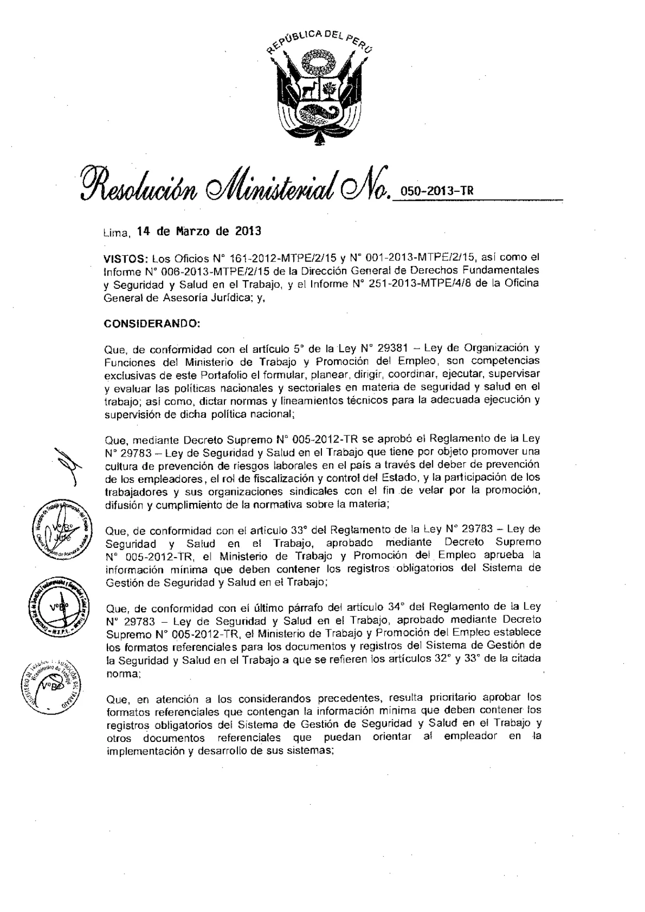

**Transcripción por reconocimiento de imagen:**

Ñ CAD,
¿gosuc ABEL ag,

tima, 14 de Marzo de 2013

VISTOS: Los Oficios N* 161-2012-MTPE/2/15 y N” 001-2013-MTPE/2/15, as| como el
informe N* 006-2013-MTPE/2/15 de la Dirección General de Derechos Fundamentales
y Seguridad y Salud en el Trabajo, y el Informe N* 251-2013-MTPE/4/8 de la Oficina
General de Asesoría Jurídica; y,

CONSIDERANDO:

Que, de conformidad con el artículo 5” de la Ley N” 29381 — Ley de Organización y
Funciones del Ministerio de Trabajo y Promoción del Empleo, son competencias
exclusivas de este Portafolio el formular, planear, dirigir, coordinar, ejecutar, supervisar
y evaluar las políticas nacionales y sectoriales en materia de seguridad y salud en el
trabajo; asi como, dictar normas y lineamientos técnicos para la adecuada ejecución y
supervisión de dicha política nacional;

Que, mediante Decreto Supremo N* 005-2012-TR se aprobó ej Reglamento de la Ley
N” 29783 — Ley de Seguridad y Salud en el Trabajo que tiene por objeto promover una
cultura de prevención de riesgos laborales en el país a través del deber de prevención
de los empleadores, el rol de fiscalización y control del Estado, y la participación de los
trabajadores y sus organizaciones sindicales con el fin de velar por la promoción,
difusión y cumplimiento de la normativa sobre la materia;

Que, de conformidad con el articulo 33* del Reglamento de la Ley N* 29783 -- Ley de
Seguridad y Salud en el Trabajo, aprobado mediante Decreto Supremo
N* 005-2012-TR, el Ministerio de Trabajo y Promoción del Empleo aprueba la
información mínima que deben contener los registros obligatorios del Sistema de
Gestión de Seguridad y Salud en et Trabajo;

Que, de conformidad con el último párrafo del artículo 34” dei Reglamento de la Ley
N" 29783 — Ley de Seguridad y Salud en el Trabajo, aprobado mediante Decreto
Supremo N? 005-2012-TR, el Ministerio de Trabajo y Promoción del Empleo establece
los formatos referenciales para los documentos y registros del Sistema de Gestión de
la Seguridad y Salud en el Trabajo a que se refieren los artículos 32” y 33” de la citada
norma; .

Que, en atención a los considerandos precedentes, resulta prioritario aprobar los
formatos referenciales que contengan la información mínima que deben contener tos
registros obligatorios del Sistema de Gestión de Seguridad y Salud en el Trabajo y
otros documentos referenciales que puedan orientar af empleador en la
implementación y desarrollo de sus sistemas;

---

## Página 2

**Página escaneada: imagen de referencia para comprobar tablas, formularios y sus casillas.**

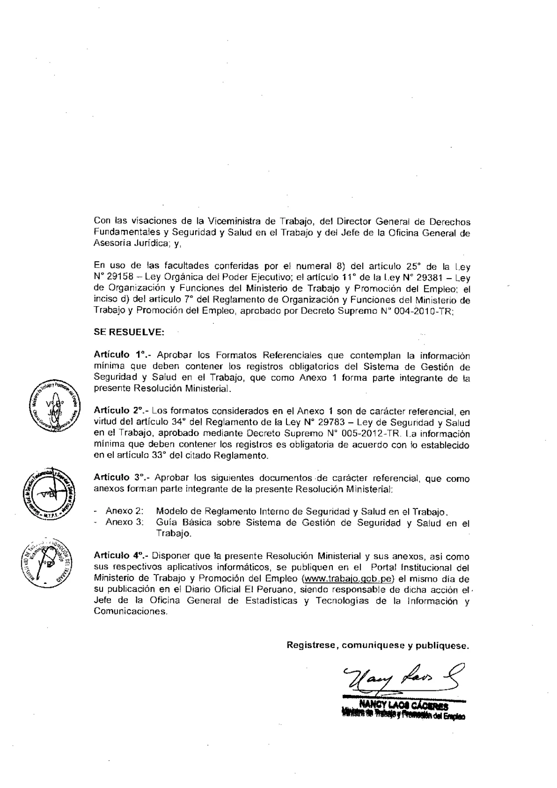

**Transcripción por reconocimiento de imagen:**

Con tas visaciones de la Viceministra de Trabajo, del Director General de Derechos
Fundamentales y Seguridad y Salud en el Trabajo y del Jefe de la Oficina General de
Asesoría Jurídica; y,

En uso de las facultades conferidas por el numeral 8) del artículo 25” de la Ley
N* 29158 — Ley Orgánica de! Poder Ejecutivo; el artículo 11” de la Ley N* 29381 — Ley
de Organización y Funciones del Ministerio de Trabajo y Promoción del Empleo: el
inciso d) del articulo 7” del Reglamento de Organización y Funciones del Ministerio de
Trabajo y Promoción del Empleo, aprobado por Decreto Supremo N* 004-2010-TR;

SE RESUELVE:

Artículo 1*.- Aprobar los Formatos Referenciales que contemplan la información
mínima que deben contener los registros obligatorios del Sistema de Gestión de
Seguridad y Salud en el Trabajo, que como Anexo 1 forma parte integrante de la
presente Resolución Ministerial.

Artículo 2”.- Los formatos considerados en el Anexo 1 son de carácter referencial, en
virtud del artículo 34” del Reglamento de la Ley N* 29783 — Ley de Seguridad y Salud
en el Trabajo, aprobado mediante Decreto Supremo N” D05-2012-TR. La información
mínima que deben contener los registros es obligatoria de acuerdo con lo establecido
en el artículo 33” del citado Reglamento.

Artículo 3”.- Aprobar los siguientes documentos -de carácter referencial, que como
anexos forman parte integrante de la presente Resolución Ministerial:

- Anexo 2: Modelo de Reglamento Interno de Seguridad y Salud en el Trabajo.
- Anexo3: Guía Básica sobre Sistema de Gestión de Seguridad y Salud en el
Trabajo.

Articulo 4”.- Disponer que la presente Resolución Ministerial y sus anexos, asi como
sus respectivos aplicativos informáticos, se publiquen en el Porta! fnstitucional del
Ministerio de Trabajo y Promoción del Empleo (www.trabajo.gob.pe) el mismo día de
su publicación en el Diario Oficial El Peruano, siendo responsable de dicha acción el-
Jefe de la Oficina General de Estadisticas y Tecnologías de la Información y
Comunicaciones.

Registrese, comuniquese y publiquese.

Hao

NANCYLACO
Mila: Paja y Premaalón cl Esmpieo

---

## Página 3

**Página escaneada: imagen de referencia para comprobar tablas, formularios y sus casillas.**

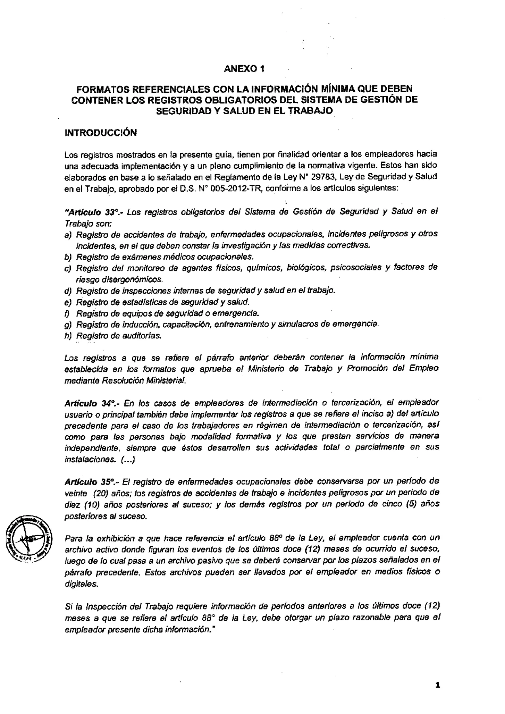

**Transcripción por reconocimiento de imagen:**

ANEXO t

FORMATOS REFERENCIALES CON LA INFORMACIÓN MÍNIMA QUE DEBEN
CONTENER LOS REGISTROS OBLIGATORIOS DEL SISTEMA DE GESTIÓN DE
SEGURIDAD Y SALUD EN EL TRABAJO

INTRODUCCIÓN

Los registros mostrados en la presente gula, tienen por finalidad orientar a los empleadores hacia
una adecuada implementación y a un pleno cumplimiento de ta normativa vigente. Estos han sido
elaborados en base a lo señalado en el Reglamento de la Ley N” 29783, Ley de Seguridad y Salud
en el Trabajo, aprobado por el D.S. N* 005-2012-TR, conforme a los artículos siguientes:

“Artículo 33".- Los registros obligatorios del Sistema de Gestión de Seguridad y Salud en el

Trabajo son:

a) Registro de accidentes de trabajo, enfermedades ocupecionales, incidentes peligrosos y otros
incidentes, en el que deben constar la investigación y las medidas correctivas.

b) Registro de exámenes médicos ocupacionales.

c) Registro del monitoreo de agentes físicos, químicos, biológicos, psicosociales y factores de
riesgo disergonómicos.

d) Registro de inspecciones internas de seguridad y salud en el trabajo.

e) Regístro de estadísticas de seguridad y salud.

f) Registro de equipos de seguridad o emergencia.

9) Registro de inducción, capacitación, entrenamiento y simulacros de emergencia.

h) Registro de auditorias.

Los registros a que se refiere el párrafo anterior deberán contener la información mínima
establecida en tos formatos que aprueba el Ministerio de Trabajo y Promoción del Empleo
mediante Resolución Ministerial,

Artículo 34".- En los casos de empleadores de intermediación o tercerización, el empleador
usuario o principal también debe implementar los registros a que se refiere el inciso a) del artículo
precedente para el caso de los trabajadores en régimen de intermediación o tercerización, así
como para las personas bajo modalidad formativa y los que prestan servícios de manera
independiente, siempre que éstos desarrollen sus actividades total o parcialmente en sus
instalaciones. (...)

Artículo 35".- El registro de enfermedades ocupacionales debe conservarse por un período de
veinte (20) años; los registros de accidentes de trabajo e incidentes peligrosos por un periodo de
diez (10) años posteriores al suceso; y los demás registros por un periodo de cinco (5) años
posteriores al suceso.

Para la exhibición a que hace referencia el artículo 88* de la Ley, el empleador cuenta con un
archivo activo donde figuran los eventos de los últimos doce (12) meses de ocurrido el suceso,
Juego de lo cual pasa a un archivo pasivo que se deberá conservar por los plazos señalados en el
párrafo precedente. Estos archivos pueden ser llevados por el empleador en medios físicos O
digitales.

Si fa Inspección del Trabajo requiere información de períodos anteriores a los últimos doce (12)
meses a que se refiere el artículo 88” de la Ley, debe otorgar un plazo razonable para que el
empleador presente dicha información.”

---

## Página 4

**Página escaneada: imagen de referencia para comprobar tablas, formularios y sus casillas.**

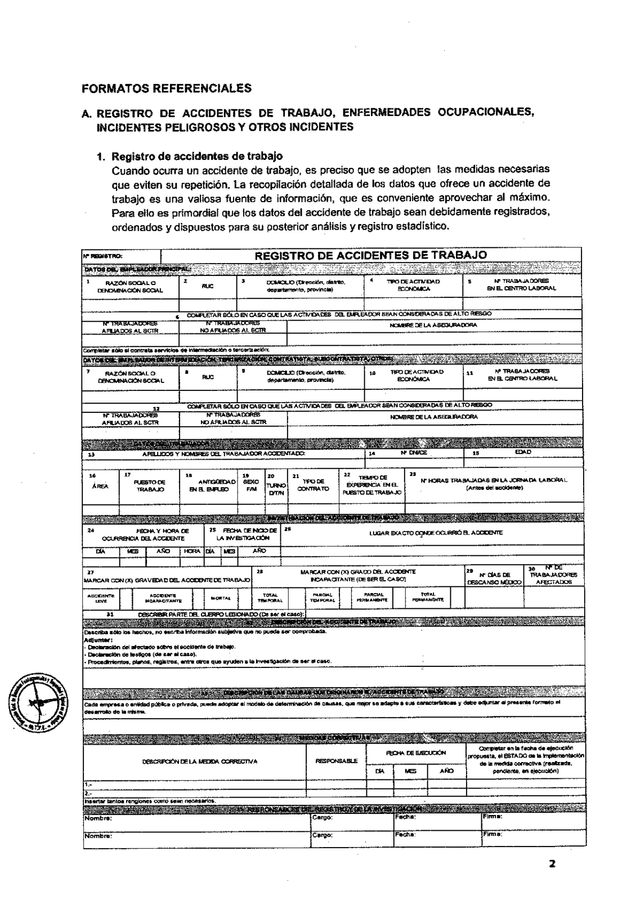

**Transcripción por reconocimiento de imagen:**

FORMATOS REFERENCIALES

A. REGISTRO DE ACCIDENTES DE TRABAJO, ENFERMEDADES OCUPACIONALES,
INCIDENTES PELIGROSOS Y OTROS INCIDENTES

1. Registro de accidentes de trabajo
Cuando ocurra un accidente de trabajo, es preciso que se adopten las medidas necesarias
que eviten su repetición. La recopilación detallada de los datos que ofrece un accidente de
trabajo es una valiosa fuente de información, que es conveniente aprovechar al máximo.
Para ello es primordial que los datos del accidente de trabajo sean debidamente registrados,
ordenados y dispuestos para su posterior análisis y registro estadístico.

pe raaIsTRO: REGISTRO DE ACCIDENTES DE TRABAJO

TPO DE ACTNIDAD.
ECONOMICA.

ac A ARESLO EN CASO GUELAS ACTIVIDADES DEL ENALEADOR SEAN CONSIDENADAS DE ALTO RESOO
[TRABAJADORES
NOMBRE DE LA ASEDURADORA

LL armanosaLoce | NOAFLIACOS AL SIR

[Completar 23 el contals servicios de hirrecación o tercerización:

= EONLETAR SÓLO EN CABO LEVAS ACIVICADES DEL BIELEADOR SEAN CONSEEADAS DE ALTO NESOO
TRABAJADORES. TV INTRABAJADORES
AFILIADOS AL£CTR. HO APRIADOS AL SCTR ¡ HOMBRE DE LA ASEURADORA

.
IT HORAS TRABAJADAS ENLA JORNADA LABORAL.
(Artes del accidente)

MARCAR CON (0 GRADO DEL ACODENTE
INCAPACITANTE (DE SER EL. CASO)

Dascelba sólo los hechos, no escrita información aubjetva que no puede sor comprobada.
[Actunter:

|- Decmaración del atoctado 2obra el soctiente ce trabajo.

|- Dectaración ds tesgos (de zar al cazo).

| Procedimientos, planos, ragletroz, entra ctrca que ayuden y lo irvesigación de ser al 0260,

---

## Página 5

**Página escaneada: imagen de referencia para comprobar tablas, formularios y sus casillas.**

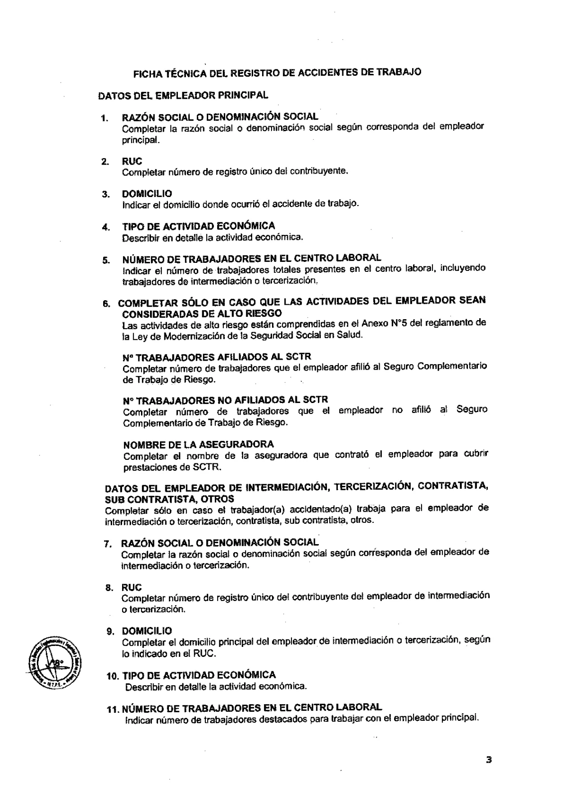

**Transcripción por reconocimiento de imagen:**

FICHA TÉCNICA DEL REGISTRO DE ACCIDENTES DE TRABAJO

DATOS DEL EMPLEADOR PRINCIPAL

1.

2

6,

RAZÓN SOCIAL O DENOMINACIÓN SOCIAL
Completar la razón social o denominación social según corresponda del empleador
principal.

RUC
Completar número de registro único del contribuyente,

DOMICILIO
Indicar el domicilio donde ocurrió el accidente de trabajo.

TIPO DE ACTIVIDAD ECONÓMICA
Describir en detalle la actividad económica.

NÚMERO DE TRABAJADORES EN EL CENTRO LABORAL
Indicar el número de trabajadores totales presentes en el centro laboral, incluyendo
trabajadores de intermediación o tercerización,

COMPLETAR SÓLO EN CASO QUE LAS ACTIVIDADES DEL EMPLEADOR SEAN
CONSIDERADAS DE ALTO RIESGO

Las actividades de alta riesgo están comprendidas en el Anexo N*5 del reglamento de
la Ley de Modernización de la Seguridad Social en Salud.

N* TRABAJADORES AFILIADOS AL SCTR
Completar número de trabajadores que el empleador afilió al Seguro Complementario
de Trabajo de Riesgo. .

N* TRABAJADORES NO AFILIADOS AL SCTR
Completar número de trabajadores que el empleador no afilió al Seguro
Complementario de Trabajo de Riesgo.

NOMBRE DE LA ASEGURADORA
Completar el nombre de la aseguradora que contrató el empleador para cubrir
prestaciones de SCTR.

DATOS DEL EMPLEADOR DE INTERMEDIACIÓN, TERCERIZACIÓN, CONTRATISTA,
SUB CONTRATISTA, OTROS

Completar sólo en caso et trabajador(a) accidentado(a) trabaja para el empleador de
intermediación o tercerización, contratista, sub contratista, otros.

7.

10.

4.

RAZÓN SOCIAL O DENOMINACIÓN SOCIAL
Completar la razón social o denominación sociai según corresponda del empleador de
intermediación o fercerización.

RUC
Completar número de registro único del contribuyente del empleador de intermediación
o tercerización.

DOMICILIO
Completar el domicilio principal del empleador de intermediación o tercerización, según
lo indicado en el RUC,

TIPO DE ACTIVIDAD ECONÓMICA
Describir en detalle la actividad económica.

NÚMERO DE TRABAJADORES EN EL CENTRO LABORAL
Indicar número de trabajadores destacados para trabajar con el empleador principal.

---

## Página 6

**Página escaneada: imagen de referencia para comprobar tablas, formularios y sus casillas.**

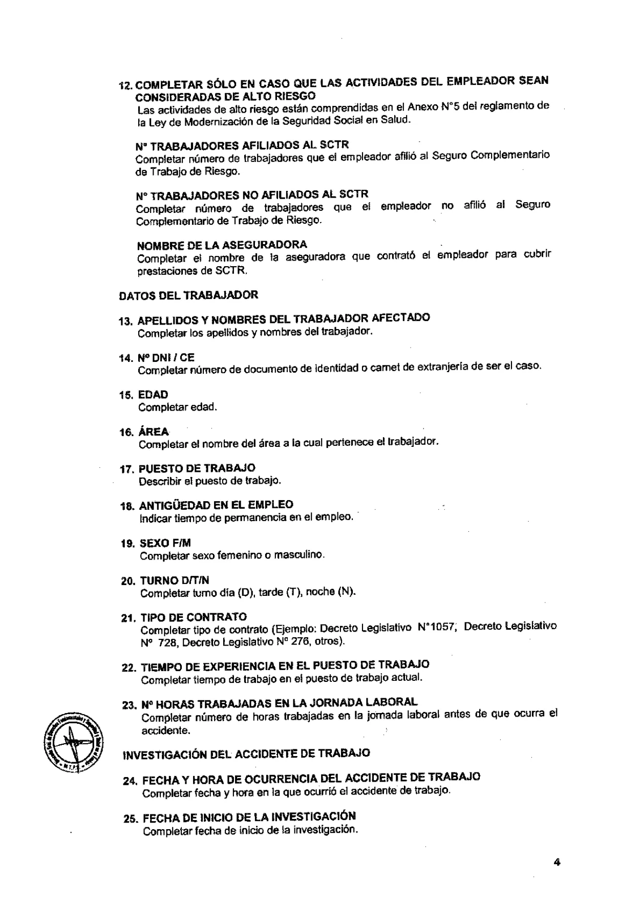

**Transcripción por reconocimiento de imagen:**

12. COMPLETAR SÓLO EN CASO QUE LAS ACTIVIDADES DEL EMPLEADOR SEAN
CONSIDERADAS DE ALTO RIESGO
Las actividades de alto riesgo están comprendidas en el Anexo N*5 del reglamento de
la Ley de Modernización de la Seguridad Social en Salud.

N" TRABAJADORES AFILIADOS AL SCTR
Completar número de trabajadores que el empleador afilió al Seguro Complementario
de Trabajo de Riesgo.

N* TRABAJADORES NO AFILIADOS AL SCTR
Completar número de trabajadores que el empleador no afilió al Seguro
Complementario de Trabajo de Riesgo. .

NOMBRE DE LA ASEGURADORA .
Completar ei nombre de la aseguradora que contrató el empleador para cubrir
prestaciones de SCTR.

DATOS DEL TRABAJADOR

13. APELLIDOS Y NOMBRES DEL TRABAJADOR AFECTADO
Completar los apellidos y nombres del trabajador.

14. N”DNI/ CE
Completar número de documento de identidad o camet de extranjería de ser el caso.

15. EDAD
Completar edad.

16. ÁREA
Completar el nombre del área a la cual pertenece el trabajador.

47. PUESTO DE TRABAJO
Describir el puesto de trabajo.

18. ANTIGUEDAD EN EL EMPLEO
Indicar tiempo de permanencia en el empleo.

19. SEXO F/M
Completar sexo femenino o masculino.

20. TURNO D/T/N
Completar tumo día (D), tarde (T), noche (N).

21. TIPO DE CONTRATO
Completar tipo de contrato (Ejemplo: Decreto Legislativo N*1057, Decreto Legislativo
N* 728, Decreto Legislativo N* 276, otros).

22. TIEMPO DE EXPERIENCIA EN EL PUESTO DE TRABAJO
Completar tiempo de trabajo en el puesto de trabajo actual.

23. N* HORAS TRABAJADAS EN LA JORNADA LABORAL
Completar número de horas trabajadas en la jomada laboral antes de que ocurra el
accidente.

INVESTIGACIÓN DEL ACCIDENTE DE TRABAJO

24. FECHA Y HORA DE OCURRENCIA DEL ACCIDENTE DE TRABAJO
Completar fecha y hora en la que ocurrió el accidente de trabajo.

25. FECHA DE INICIO DE LA INVESTIGACIÓN
Completar fecha de inicio de la investigación.

---

## Página 7

**Página escaneada: imagen de referencia para comprobar tablas, formularios y sus casillas.**

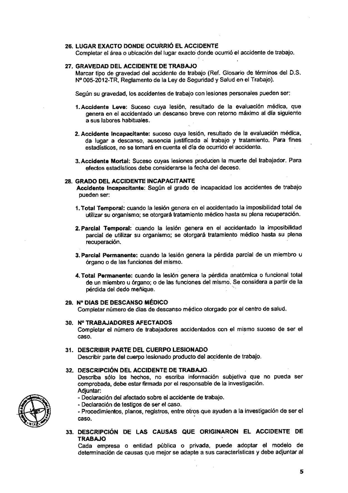

**Transcripción por reconocimiento de imagen:**

26. LUGAR EXACTO DONDE OCURRIÓ EL ACCIDENTE
Completar ej área o ubicación del jugar exacto donde ocurrió el accidente de trabajo.

27. GRAVEDAD DEL ACCIDENTE DE TRABAJO
Marcar tipo de gravedad del accidente de trabajo (Ref. Glosario de términos del D.S.
N* 005-2012-TR, Reglamento de la Ley de Seguridad y Salud en el Trabajo).

Según su gravedad, los accidentes de trabajo con lesiones personales pueden ser;

1.Accidente Leve: Suceso cuya lesión, resultado de la evaluación médica, que
genera en el accidentado un descanso breve con retorno máximo al día siguiente
a sus labores habituales.

2. Accidente Incapacitante: suceso cuya lesión, resultado de la evaluación médica,
da- lugar a descanso, ausencia justificada al trabajo y tratamiento. Para fines
estadísticos, no se tomará en cuenta el día de ocurrido el accidente.

3. Accidente Mortal: Suceso cuyas lesiones producen la muerte del trabajador. Para
efectos estadísticos debe considerarse la fecha del deceso,

28. GRADO DEL ACCIDENTE INCAPACITANTE
Accidente incapacitante: Según el grado de incapacidad los accidentes de trabajo
pueden ser:

1. Total Temporal: cuando la lesión genera en el accidentado la imposibilidad total de
utilizar su organismo; se otorgará tratamiento médico hasta su plena recuperación.

2.Parcial Temporal: cuando la lesión genera en el accidentado la imposibilidad
parcial de utilizar su organismo; se otorgará tratamiento médico hasta su plena
recuperación.

3. Parcial Permanente: cuando la lesión genera la pérdida parcial de un miembro u
órgano o de las funciones del mismo.

4. Total Permanente: cuando ta lesión genera la pérdida anatómica o funcional total
de un miembro u órgano; o de las funciones del mismo. Se considera a partir de la
pérdida del dedo meñique.

29. N" DIAS DE DESCANSO MÉDICO
Completar número de dias de descanso médico otorgado por el centro de salud.

30. N* TRABAJADORES AFECTADOS
Completar el número de trabajadores accidentados con el mismo suceso de ser el
Caso,

31. DESCRIBIR PARTE DEL CUERPO LESIONADO
Describir parte del cuerpo lesionado producto del accidente de trabajo,

32. DESCRIPCIÓN DEL ACCIDENTE DE TRABAJO. .
Describa sólo los hechos, no escriba información subjetiva que no pueda ser
comprobada, debe estar firmada por el responsable de la investigación.
Adjuntar:
- Declaración del afectado sobre el accidente de trabajo.
- Declaración de testigos de ser el caso.
- Procedimientos, planos, registros, entre otros que ayuden a la investigación de ser el
caso.

33. DESCRIPCIÓN DE LAS CAUSAS QUE ORIGINARON EL ACCIDENTE DE
TRABAJO :
Cada empresa o entidad pública o privada, puede adoptar el modelo de
determinación de causas que mejor se adapte a sus características y debe adjuntar al

---

## Página 8

**Página escaneada: imagen de referencia para comprobar tablas, formularios y sus casillas.**

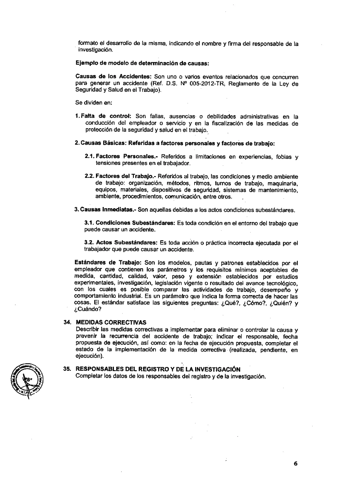

**Transcripción por reconocimiento de imagen:**

35.

formato el desarrolio de la misma, indicando el nombre y firma del responsable de la
investigación.

Ejemplo de modelo de determinación de causas:

Causas de los Accidentes: Son uno a varios eventos relacionados que concurren
para generar un accidente (Ref. D.S. N* 005-2012-TR;, Reglamento de la Ley de
Seguridad y Salud en el Trabajo).

Se dividen en:

1.Falta de control: Son fallas, ausencias o debilidades administrativas en la
conducción del empleador o servicio y en la fiscalización de las medidas de
protección de la seguridad y salud en el trabajo.

2.Causas Básicas: Referidas a factores personales y factores de trabajo:

2.1. Factores Personales.- Referidos a limitaciones en experiencias, fobias y
tensiones presentes en el trabajador.

2.2. Factores del Trabajo.- Referidos al trabajo, las condiciones y medio ambiente
de trabajo: organización, métodos, ritmos, turnos de trabajo, maquinaria,
equipos, materiales, dispositivos de seguridad, sistemas de mantenimiento,
ambiente, procedimientos, comunicación, entre otros.

3. Causas Inmediatas.- Son aquellas debidas a los actos condiciones subestándares.

3.1. Condiciones Subestándares: Es toda condición en el entorno del trabajo que
puede causar un accidente.

3.2. Actos Subestándares: Es toda acción o práctica incorrecta ejecutada por el
trabajador que puede causar un accidente.

Estándares de Trabajo: Son los modelos, pautas y patrones establecidos por el
empleador que contienen los parámetros y los requisitos minimos aceptables de
medida, cantidad, calidad, valor, peso y extensión establecidos por estudios
experimentales, investigación, legislación vigente o resultado del avance tecnológico,
con los cuales es posible comparar las actividades de trabajo, desempeño y
comportamiento industrial. Es un parámetro que indica la forma correcta de hacer las
cosas. El estándar satisface las siguientes preguntas: ¿Qué?, ¿Cómo?, ¿Quién? y
¿Cuándo?

|. MEDIDAS CORRECTIVAS

Describir las medidas correctivas a implementar para eliminar o controlar la causa y
prevenir la recurrencia del accidente de trabajo; indicar el responsable, fecha
propuesta de ejecución, así como: en la fecha de ejecución propuesta, completar el
estado de la implementación de la medida correctiva (realizada, pendiente, en
ejecución).

RESPONSABLES DEL REGISTRO Y DE LA INVESTIGACIÓN
Completar los datos de los responsables del registro y de la investigación.

---

## Página 9

**Página escaneada: imagen de referencia para comprobar tablas, formularios y sus casillas.**

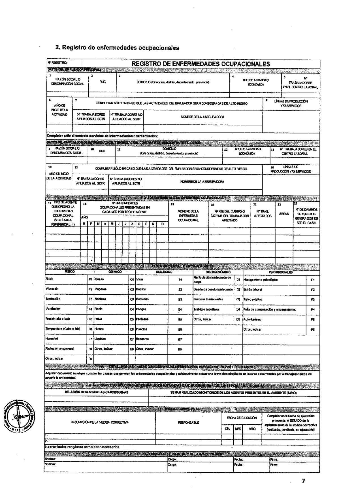

**Transcripción por reconocimiento de imagen:**

2, Registro de enfermedades ocupacionales

PACHO!

ENFERMEDADES OCUI

ES z

'DOMCLD (Drección, sti, departarto, provincia)

COMPLETAR SÓLO ENCASO QUE LAS ACTIVIDADES DA. EMPLEADOR SEAN CONSEERADAS DEALTORESGO

E TRABAJADORES | TRABAJADORES NO]
AFLADOS AL SCTR. | AFIIADOS ALSCTR OUBRE PELA ASERBADO

[Completar sólo e3 contrata servolos de intermediación o torcarización

¡Ruido Fr [Gasas. D1 [hostigamiento peicológica Pr
¡Visración “] 02 |Estrás tanoral r
[Posturas hadecuadas CS [Termo rotativo. e
Fassa sprite o

oro, car 25 Jruttrano EN
or, car ”

EN

Camplelar tech d epcución
EA DEN propuesto, ESTADO de lo
rdomniacin e la muda correcta

(raatzade, percnta, an ojecución)

---

## Página 10

**Página escaneada: imagen de referencia para comprobar tablas, formularios y sus casillas.**

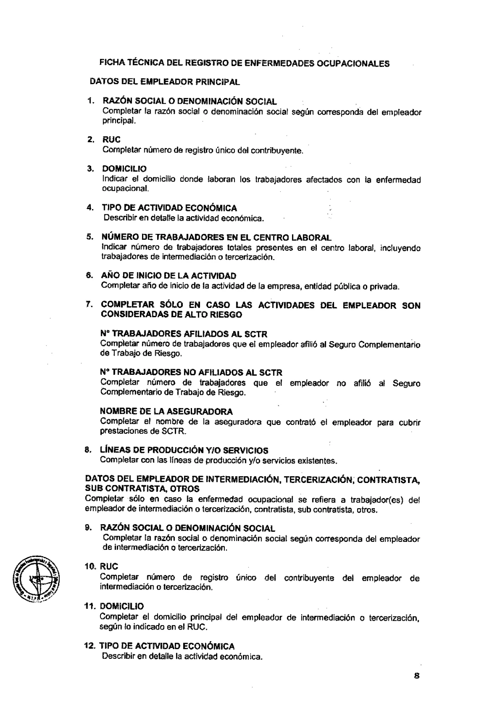

**Transcripción por reconocimiento de imagen:**

FICHA TÉCNICA DEL REGISTRO DE ENFERMEDADES OCUPACIONALES
DATOS DEL EMPLEADOR PRINCIPAL

1. RAZÓN SOCIAL O DENOMINACIÓN SOCIAL
Completar fa razón social o denominación social según corresponda del empleador
principal.

2. RUC
Completar número de registro único del contribuyente.

3. DOMICILIO
Indicar el domicilio donde laboran los trabajadores afectados con la enfermedad
ocupacional.

4, TIPO DE ACTIVIDAD ECONÓMICA
Describir en detalle la actividad económica.

5. NÚMERO DE TRABAJADORES EN EL CENTRO LABORAL
indicar número de trabajadores totales presentes en el centro laboral, incluyendo
trabajadores de intermediación o tercerización.

6. AÑO DE INICIO DE LA ACTIVIDAD
Completar año de inicio de ta actividad de la empresa, entidad pública o privada.

7. COMPLETAR SÓLO EN CASO LAS ACTIVIDADES DEL EMPLEADOR SON
CONSIDERADAS DE ALTO RIESGO

N”* TRABAJADORES AFILIADOS AL SCTR
Completar número de trabajadores que el empleador afilió al Seguro Complementario
de Trabajo de Riesgo.

N* TRABAJADORES NO AFILIADOS AL SCTR
Completar número de trabajadores que el empleador no afilió al Seguro
Complementario de Trabajo de Riesgo.

NOMBRE DE LA ASEGURADORA
Completar el nombre de la aseguradora que contrató el empleador para cubrir
prestaciones de SCTR.

8. LÍNEAS DE PRODUCCIÓN Y/O SERVICIOS
Completar con las líneas de producción y/o servicios existentes.

DATOS DEL EMPLEADOR DE INTERMEDIACIÓN, TERCERIZACIÓN, CONTRATISTA,
SUB CONTRATISTA, OTROS

Completar sólo en caso la enfermedad ocupacional se refiera a trabajador(es) def
empleador de intermediación o tercerización, contratista, sub contratista, otros.

9. RAZÓN SOCIAL O DENOMINACIÓN SOCIAL
Completar la razón social o denominación social según corresponda del empleador
de intermediación o tercerización.

10. RUC
Completar número de registro único del contribuyente del empleador de
intermediación o tercerización.

11. DOMICILIO
Completar el domicilio principal del empleador de intermediación o tercerización,
según to indicado en el RUC.

12. TIPO DE ACTIVIDAD ECONÓMICA
Describir en detalle la actividad económica.

---

## Página 11

**Página escaneada: imagen de referencia para comprobar tablas, formularios y sus casillas.**

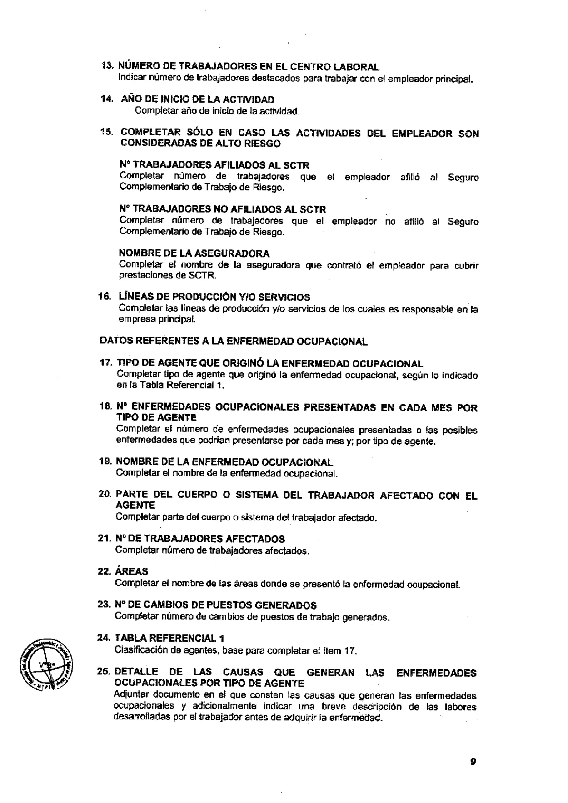

**Transcripción por reconocimiento de imagen:**

13.

14,

15.

16.

NÚMERO DE TRABAJADORES EN EL. CENTRO LABORAL
Indicar número de trabajadores destacados para trabajar con el empleador principal.

AÑO DE INICIO DE LA ACTIVIDAD
Completar año de inicio de la actividad.

COMPLETAR SÓLO EN CASO LAS ACTIVIDADES DEL EMPLEADOR SON
CONSIDERADAS DE ALTO RIESGO

N? TRABAJADORES AFILIADOS AL SCTR
Completar número de trabajadores que el empleador afilió al Seguro
Complementario de Trabajo de Riesgo.

N* TRABAJADORES NO AFILIADOS AL SCTR
Completar número de trabajadores que el empleador no afilió al Seguro
Complementario de Trabajo de Riesgo.

NOMBRE DE LA ASEGURADORA
Completar el nombre de la aseguradora que contrató el ' empleador para cubrir
prestaciones de SCTR.

LÍNEAS DE PRODUCCIÓN Y/O SERVICIOS -
Completar tas líneas de producción y/o servicios de los cuales es responsable en la
empresa principal.

DATOS REFERENTES A LA ENFERMEDAD OCUPACIONAL

17.

18.

19,

20.

21.

22.

TIPO DE AGENTE QUE ORIGINÓ LA ENFERMEDAD OCUPACIONAL
Completar tipo de agente que originó la enfermedad ocupacional, según lo indicado
en la Tabla Referencial 1.

N” ENFERMEDADES OCUPACIONALES PRESENTADAS EN CADA MES POR
TIPO DE AGENTE

Completar el número de enfermedades ocupacionales presentadas o las posibles
enfermedades que podrian presentarse por cada mes y; por tipo de agente.

NOMBRE DE LA ENFERMEDAD OCUPACIONAL
Completar el nombre de la enfermedad ocupacional.

PARTE DEL CUERPO O SISTEMA DEL TRABAJADOR AFECTADO CON EL
AGENTE
Completar parte del cuerpo o sistema del trabajador afectado.

N*DE TRABAJADORES AFECTADOS

Completar número de trabajadores afectados.

ÁREAS

Completar el nombre de las áreas donde se presentó la enfermedad ocupacional.

23, N” DE CAMBIOS DE PUESTOS GENERADOS

Completar número de cambios de puestos de trabajo generados.

24. TABLA REFERENCIAL 1

Clasificación de agentes, base para completar el item 17.

25. DETALLE DE LAS CAUSAS QUE GENERAN LAS ENFERMEDADES

OCUPACIONALES POR TIPO DE AGENTE

Adjuntar documento en el que consten las causas que generan las enfermedades
ocupacionales y adicionalmente indicar una breve descripción de las labores
desarrolladas por el trabajador antes de adquirir la enfermédad.

---

## Página 12

**Página escaneada: imagen de referencia para comprobar tablas, formularios y sus casillas.**

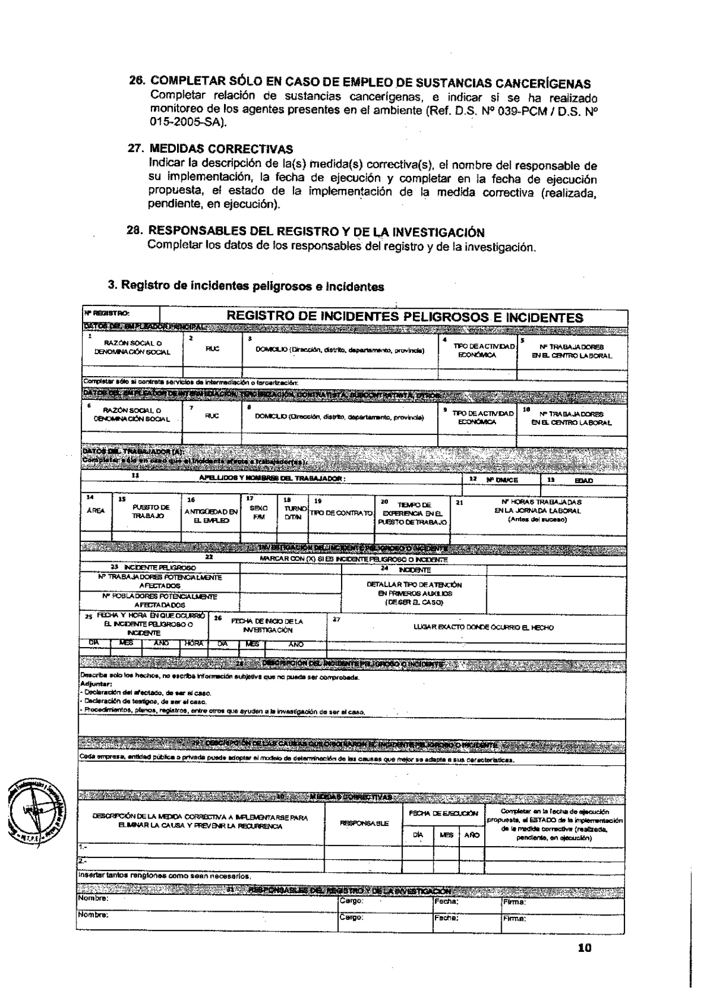

**Transcripción por reconocimiento de imagen:**

26. COMPLETAR SÓLO EN CASO DE EMPLEO DE SUSTANCIAS CANCERÍGENAS
Completar relación de sustancias cancerígenas, e indicar si se ha realizado
monitoreo de los agentes presentes en el ambiente (Ref. D.S, N* 039-PCM / D.S. N*
015-2005-SA).

27. MEDIDAS CORRECTIVAS
Indicar la descripción de la(s) medida(s) correctiva(s), el nombre del responsable de
su implementación, la fecha de ejecución y completar en la fecha de ejecución
propuesta, el estado de la implementación de la medida correctiva (realizada,
pendiente, en ejecución).

28. RESPONSABLES DEL REGISTRO Y DE LA INVESTIGACIÓN
Completar los datos de los responsables del registro y de la investigación.

3. Registro de incidentes peligrosos e incidentes

PELIGROSOS E INCIDENTE:

DA

NY HORAS TRABAJADAS

DETALLAR TFO DE ATENCIÓN
PRIMEROS AUIOS
(DESER A. CASO)

LUGAR EXACTO DONDE ÓCURRIO El HECHO

pS br
Describa solo tos hechos, no escriba Irformación subjotva que na pueda ses comprobada.
Adjuntar:
|- Declaración del afectaco, de sar el caso,
| Dacieración du testigos, de sor el caso.
Procedimientos, planos, regiatros, entre ctros que ayuden aa invastigación de 1er al caso,

Des sida e

aa A de
de las causas que mejor so adapta a $us corecteriaica:

ida puedo adoptar el modelo de determinación:

OESORPOIÓN DELA MEDIDA CORRECTA A IMPLEMENTARSE PARA
ELIMINAR LA CAUSA Y PREVENR LA RECURRENCA de le medida correctiva (reaftzada,

penciente, en ejecución)

Insariartantos renglones como Sonn necesario!

---

## Página 13

**Página escaneada: imagen de referencia para comprobar tablas, formularios y sus casillas.**

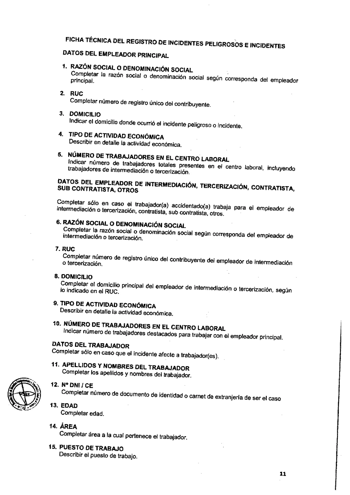

**Transcripción por reconocimiento de imagen:**

FICHA TÉCNICA DEL REGISTRO DE INCIDENTES PELIGROSOS E INCIDENTES
DATOS DEL EMPLEADOR PRINCIPAL

1. RAZÓN SOCIAL O DENOMINACIÓN SOCIAL .
Completar la razón social o denominación social según corresponda del empleador
principal.

2. RUC
Completar número de registro único del contribuyente.

3. DOMICILIO
Indicar el domicilio donde ocurrió el incidente peligroso o incidente.

4. TIPO DE ACTIVIDAD ECONÓMICA
Describir en detalle la actividad económica,

5. NÚMERO DE TRABAJADORES EN EL. CENTRO LABORAL
indicar número de trabajadores totales presentes en el centro laboral, incluyendo
trabajadores de intermediación o tercerización.

DATOS DEL EMPLEADOR DE INTERMEDIACIÓN, TERCERIZACIÓN, CONTRATISTA,
SUB CONTRATISTA, OTROS

Completar sóto en caso ei trabajador(a) accidentado(a) trabaja para el empleador de
intermediación o tercerización, contratista, sub contratista, otros,

6. RAZÓN SOCIAL O DENOMINACIÓN SOCIAL
Completar la razón social o denominación social según corresponda del empleador de
intermediación o tercerización.

7. RUC
Completar número de registro único del contribuyente del empleador de intermediación
o tercerización.

8. DOMICILIO
Completar el domicilio principal del empleador de intermediación o tercerización, según
lo indicado en el RUC.

9. TIPO DE ACTIVIDAD ECONÓMICA
Describir en detalle la actividad económica,

10. NÚMERO DE TRABAJADORES EN EL CENTRO LABORAL
indicar número de trabajadores destacados para trabajar con el empleador principal.

DATOS DEL TRABAJADOR
Completar sólo en caso que el incidente afecte a trabajador(es).

11. APELLIDOS Y NOMBRES DEL TRABAJADOR
Completar los apellidos y nombres del trabajador.

42. N* DNI / CE
Completar número de documento de identidad o carnet de extranjería de ser el caso

13. EDAD
Completar edad.

14. ÁREA
Completar área a la cual pertenece el trabajador,

15. PUESTO DE TRABAJO
Describir el puesto de trabajo.

11

---

## Página 14

**Página escaneada: imagen de referencia para comprobar tablas, formularios y sus casillas.**

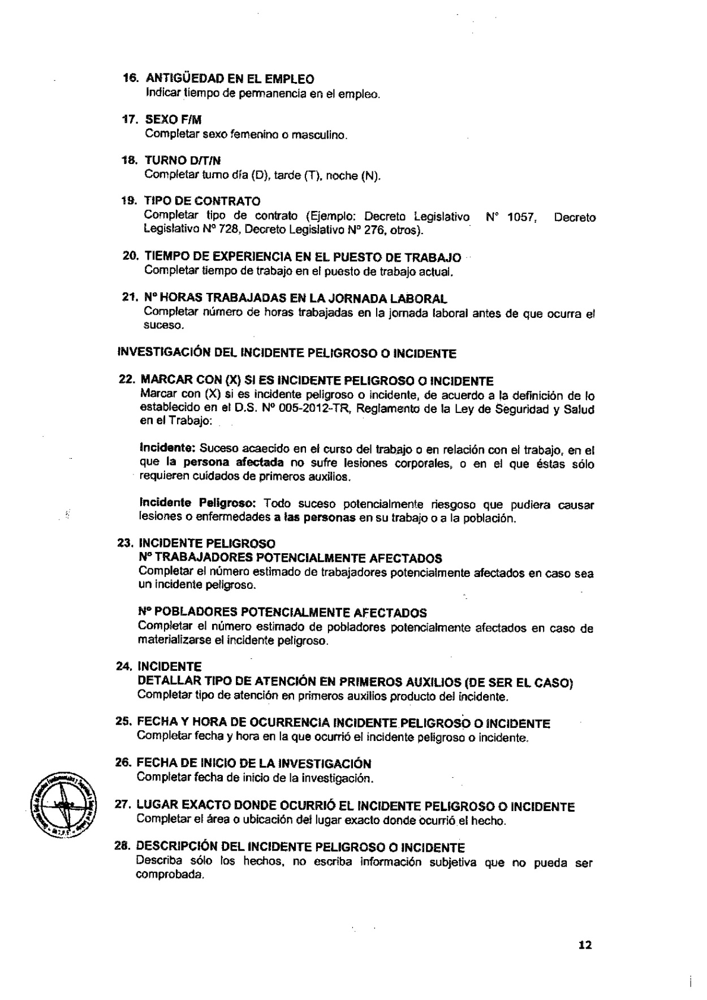

**Transcripción por reconocimiento de imagen:**

16. ANTIGUEDAD EN EL EMPLEO

Indicar tiempo de permanencia en el empleo.

17. SEXO F/M

Completar sexo femenino o masculino.

18. TURNO D/T/N

Completar tumo día (D), tarde (T), noche (N).

19. TIPO DE CONTRATO

Completar tipo de contrato (Ejemplo: Decreto Legislativo N* 1057, Decreto
Legislativo N” 728, Decreto Legislativo N” 276, otros).

20. TIEMPO DE EXPERIENCIA EN EL PUESTO DE TRABAJO

Completar tiempo de trabajo en el puesto de trabajo actual,

21. N* HORAS TRABAJADAS EN LA JORNADA LABORAL

Completar número de horas trabajadas en la jornada laboral antes de que ocurra el
SUCESO.

INVESTIGACIÓN DEL INCIDENTE PELIGROSO O INCIDENTE

22. MARCAR CON (X) SI ES INCIDENTE PELIGROSO O INCIDENTE

Marcar con (X) si es incidente peligroso o incidente, de acuerdo a la definición de lo
establecido en el D.S. N* 005-2012-TR, Reglamento de la Ley de Seguridad y Salud
en el Trabajo:

Incidente: Suceso acaecido en el curso del trabajo o en relación con el trabajo, en el
que la persona afectada no sufre lesiones corporales, o en el que éstas sólo
requieren cuidados de primeros auxilios.

Incidente Peligroso: Todo suceso potencialmente riesgoso que pudiera causar
lesiones o enfermedades a las personas en su trabajo o a la población,

INCIDENTE PELIGROSO

N” TRABAJADORES POTENCIALMENTE AFECTADOS

Completar el número estimado de trabajadores potencialmente afectados en caso sea
un incidente peligroso.

N” POBLADORES POTENCIALMENTE AFECTADOS
Completar el número estimado de pobladores potencialmente afectados en caso de
materializarse el incidente peligroso.

, INCIDENTE

26.

27

28.

DETALLAR TIPO DE ATENCIÓN EN PRIMEROS AUXILIOS (DE SER El, CASO)
Completar tipo de atención en primeros auxilios producto del incidente.

FECHA Y HORA DE OCURRENCIA INCIDENTE PELIGROSO O INCIDENTE
Completar fecha y hora en la que ocurrió el incidente peligroso o incidente.

FECHA DE INICIO DE LA INVESTIGACIÓN
Completar fecha de inicio de la investigación.

LUGAR EXACTO DONDE OCURRIÓ EL INCIDENTE PELIGROSO O INCIDENTE
Completar el área o ubicación del lugar exacto donde ocurrió el hecho.

DESCRIPCIÓN DEL INCIDENTE PELIGROSO O INCIDENTE

Describa sólo los hechos, no escriba información subjetiva que no pueda ser
comprobada,

12

---

## Página 15

**Página escaneada: imagen de referencia para comprobar tablas, formularios y sus casillas.**

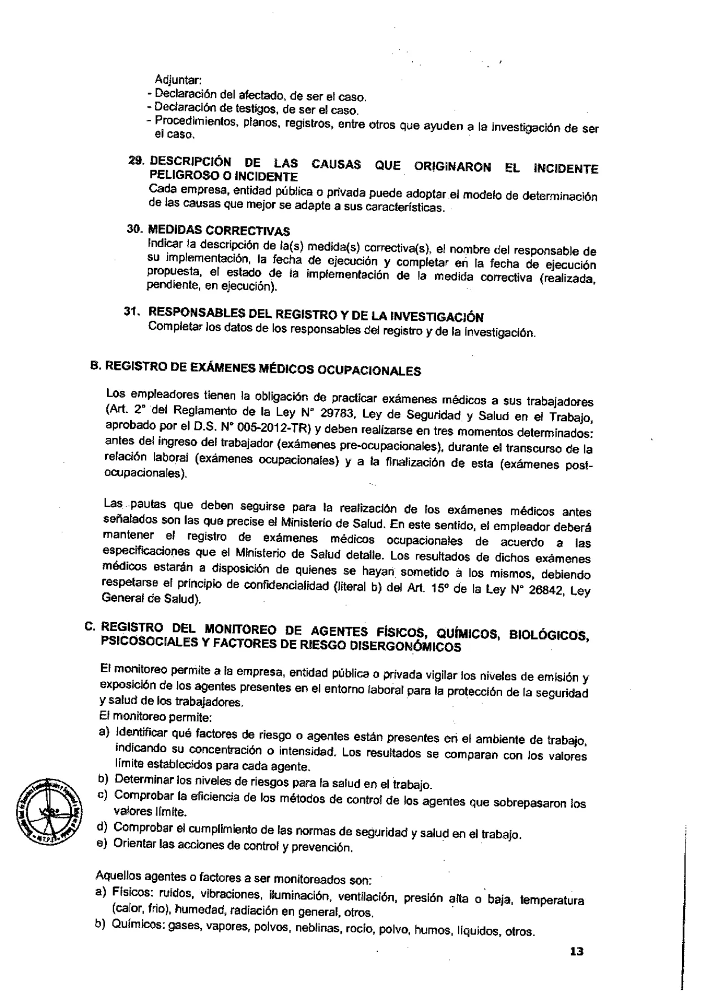

**Transcripción por reconocimiento de imagen:**

Agjuntar:

- Declaración del afectado, de ser el caso,

- Declaración de testigos, de ser el caso.

- Procedimientos, planos, registros, entre otros que ayuden a la investigación de ser
el caso.

29. DESCRIPCIÓN DE LAS CAUSAS QUE ORIGINARON EL INCIDENTE
PELIGROSO O INCIDENTE
Cada empresa, entidad pública o privada puede adoptar el modelo de determinación
de las causas que mejor se adapte a sus características.

30. MEDIDAS CORRECTIVAS
Indicar la descripción de la(s) medida(s) correctiva(s), el nombre del responsable de
su implementación, la fecha de ejecución y completar en la fecha de ejecución
propuesta, el estado de la implementación de la medida correctiva (realizada,
pendiente, en ejecución).

31. RESPONSABLES DEL REGISTRO Y DE LA INVESTIGACIÓN
Completar los datos de los responsables del registro y de la investigación.

B. REGISTRO DE EXÁMENES MÉDICOS OCUPACIONALES

Los empleadores tienen la obligación de practicar exámenes médicos a sus trabajadores
(Art. 2” del Reglamento de la Ley N” 29783, Ley de Seguridad y Salud en el Trabajo,
aprobado por el D.S. N* 005-2012-TR) y deben realizarse en tres momentos determinados:
antes del ingreso del trabajador (exámenes pre-ocupacionales), durante el transcurso de la
relación laboral (exámenes ocupacionales) y a la finalización de esta (exámenes post-
ocupacionales).

Las -pautas que deben seguirse para la realización de los exámenes médicos antes
señalados son las que precise el Ministerio de Salud. En este sentido, el empleador deberá
mantener el registro de exámenes médicos ocupacionales de acuerdo a las
especificaciones que el Ministerio de Salud detalle. Los resultados de dichos exámenes
médicos estarán a disposición de quienes se hayan sometido á los mismos, debiendo
respetarse el principio de confidencialidad Qiteral b) del Art. 15% de la Ley N* 26842, Ley
General de Salud).

C. REGISTRO DEL MONITOREO DE AGENTES FÍSICOS, QUÍMICOS, BIOLÓGICOS,
PSICOSOCIALES Y FACTORES DE RIESGO DISERGONÓMICOS

El monitoreo permite a la empresa, entidad pública o privada vigilarlos niveles de emisión y
exposición de los agentes presentes en el entorno laboral para la protección de la seguridad
y salud de los trabajadores.

El monitoreo permite:

a) Identificar qué factores de riesgo o agentes están presentes eri el ambiente de trabajo,
indicando su concentración o intensidad. Los resultados se comparan con los valores
límite establecidos para cada agente.

b) Determinar los niveles de riesgos para la salud en el trabajo.

€) Comprobar la eficiencia de los métodos de control de los agentes que sobrepasaron los
valores límite.

d) Comprobar el cumplimiento de las normas de seguridad y salud en el trabajo.

€) Orientar las acciones de contro! y prevención,

Aquellos agentes o factores a ser monitoreados son: Ñ
a) Físicos: ruidos, vibraciones, iluminación, ventilación, presión alta o baja, temperatura
(calor, frio), humedad, radiación en general, otros,
b) Químicos: gases, vapores, polvos, neblinas, rocio, polvo, humos, liquidos, otros.
13

---

## Página 16

**Página escaneada: imagen de referencia para comprobar tablas, formularios y sus casillas.**

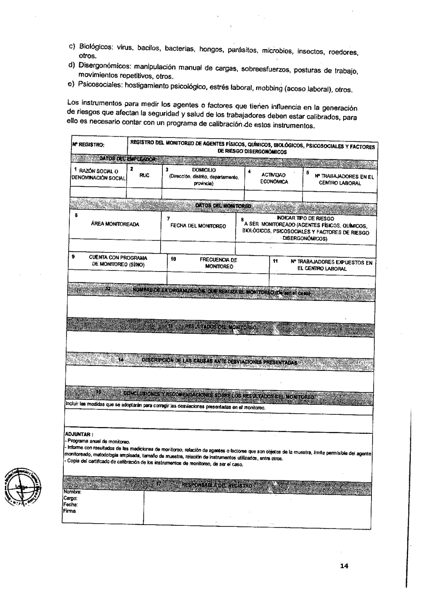

**Transcripción por reconocimiento de imagen:**

c) Biológicos: virus, bacilos, bacterias, hongos, parásitos, microbios, insectos, roedores,
otros.

d) Disergonómicos: manipulación manual de Cargas, sobreesfusrzos, posturas de trabajo,
movimientos repetitivos, otros.

e) Psicosociales: hostigamiento psicológico, estrés laboral, mobbing (acoso Jabora!), otros.

Los instrumentos para medir los agentes o factores que tieñien influencia en la generación
de riesgos que afectan la seguridad y salud de los trabajadores deben estar calibrados, para
ello es necesario contar con un programa de calibración de estos instrumentos.

2
IN" REGISTRO:

REGISTRO DEL MONIFORED DE AGENTES FÍSICOS, QUÍMICOS, BIOLÓGICOS, PSICOSOCIALES Y FACTORES
DE RIESGO DISERGONÓMICOS

. 5
Ñ ACTIVIDAD N' TRABAJADORES EN El
Dirección, Polo ento, ECONÓMICA CENTRO LABORAL.

8 INDICAR TIPO DE RIESGO
A SER MONITOREADO (AGENTES FÍSICOS, QUÍMICOS,
BIOLÓGICOS, PSICOSOCIALES Y FACTORES DE RIESGO.
DISERGONÓMICOS)

CUENTA CON PROGRAMA FRECUENCIA DE N* TRABAJADORES EXPUESTOS EN
DE MONITOREO (S/NO) MONITOREO EL CENTRO LABORAL

- Programa anuel de monitoreo.

- Informe con resultados de las mediciones de monitoreo, relación do agentes o factores que son objetos de la muestra, limite permisible del agente|
moniloreado, metodología empleada, tamaño de muestra, relación de instrumentos utilizados, entre Otros.

|- Copia del certificado de calibración de los instrumentos de monitoreo, de ser el caso.

14

---

## Página 17

**Página escaneada: imagen de referencia para comprobar tablas, formularios y sus casillas.**

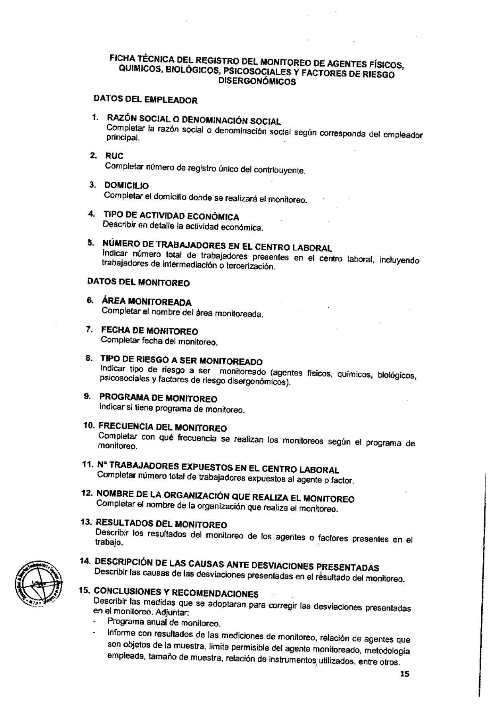

**Transcripción por reconocimiento de imagen:**

FICHA TÉCNICA DEL REGISTRO DEL MONITOREO DE AGENTES FÍSICOS,
QUIMICOS, BIOLÓGICOS, PSICOSOCIALES Y FACTORES DE RIESGO
DISERGONÓMICOS

DATOS DEL EMPLEADOR

1. RAZÓN SOCIAL O DENOMINACIÓN SOCIAL
Completar la razón social o denominación social según corresponda del empleador
principal.

2. RUC
Completar número de registro único del contribuyente.

3. DOMICILIO
Completar el domicilio donde se realizará el monitoreo.

4. TIPODE ACTIVIDAD ECONÓMICA
Describir en detalle la actividad económica.

5. NÚMERO DE TRABAJADORES EN EL CENTRO LABORAL
Indicar número total de trabajadores presentes en el centro laboral, incluyendo
trabajadores de intermediación o tercerización.

DATOS DEL MONITOREO

6. ÁREA MONITOREADA
Completar el nombre del área monitoreada,

7. FECHA DE MONITOREO
Completar fecha del monitoreo,

8. TIPO DE RIESGO A SER MONITOREADO
Indicar tipo de riesgo a ser monitoreado (agentes físicos, químicos, biológicos,
psicosociales y factores de riesgo disergonómicos).

9. PROGRAMA DE MONITOREO
indicar si tiene programa de monitoreo.

10. FRECUENCIA DEL MONITOREO
Completar con qué frecuencia se realizan los monitoreos según el programa de
monitoreo,

11. N” TRABAJADORES EXPUESTOS EN EL CENTRO LABORAL
Completar número total de trabajadores expuestos al agente o factor.

12. NOMBRE DE LA ORGANIZACIÓN QUE REALIZA EL MONITOREO
Completar el nombre de la organización que realiza el monitoreo.

13. RESULTADOS DEL MONITOREO
Describir los resultados del monitoreo de los “agerites o factores presentes en el
trabajo. Ñ

14. DESCRIPCIÓN DE LAS CAUSAS ANTE DESVIACIONES PRESENTADAS
Describir fas causas de las desviaciones presentadas en el rásultado del monitoreo.

15. CONCLUSIONES Y RECOMENDACIONES

Describir las medidas que se adoptaran para corregir las desviaciones presentadas

en el monitoreo. Adjuntar:

- Programa anual de monitoreo.

- Informe con resultados de las mediciones de monitoreo, relación de agentes que
son objetos de la muestra, limite permisible del agente monitoreado, metodología
empleada, tamaño de muestra, relación de instrumentos utilizados, entre otros.

15

---

## Página 18

**Página escaneada: imagen de referencia para comprobar tablas, formularios y sus casillas.**

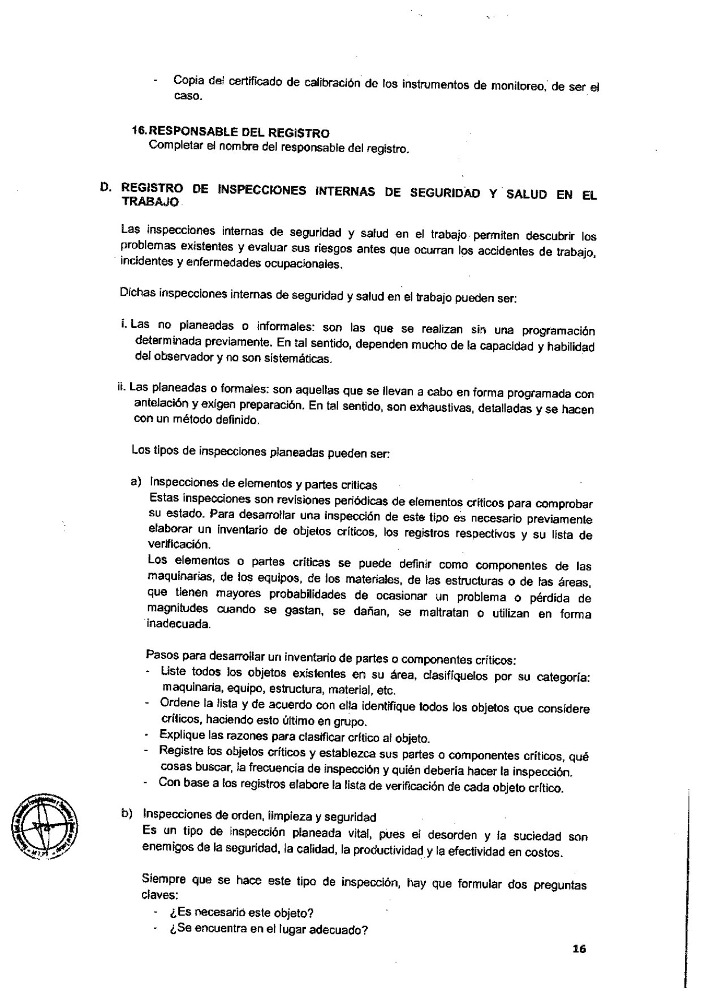

**Transcripción por reconocimiento de imagen:**

- Copia del certificado de calibración de los instrumentos de monitoreo, de ser el
caso.

16. RESPONSABLE DEL REGISTRO
Completar el nombre del responsable del registro.

D. REGISTRO DE INSPECCIONES INTERNAS DE SEGURIDAD Y SALUD EN EL
TRABAJO

Las inspecciones internas de seguridad y salud en el trabajo- permiten descubrir los
problemas existentes y evaluar sus riesgos antes que ocurran los accidentes de trabajo,
incidentes y enfermedades ocupacionales.

Dichas inspecciones internas de seguridad y salud en el trabajo pueden ser:

í.Las no planeadas o informales: son las que se realizan sin una programación
determinada previamente. En tal sentido, dependen mucho de la capacidad y habilidad
del observador y no son sistemáticas.

ii. Las planeadas o formales: son aquellas Que se llevan a cabo en forma programada con
antelación y exigen preparación. En tal sentido, son exhaustivas, detalladas y se hacen
con un método definido,

Los tipos de inspecciones planeadas pueden ser:

a) Inspecciones de elementos y partes criticas

Estas inspecciones son revisiones periódicas de elementos críticos para comprobar
su estado. Para desarrollar una inspección de este tipo es necesario previamente
elaborar un inventario de objetos críticos, los registros respectivos y su lista de
verificación,

Los elementos o partes críticas se puede definir como componentes de las
maquinarias, de los equipos, de los materiales, de las estructuras o de fas áreas,
que tienen mayores probabilidades de ocasionar un problema o pérdida de
magnitudes cuando se gastan, se dañan, se maltratan o utilizan en forma
inadecuada.

Pasos para desarrollar ur inventario de partes o componentes críticos:

- Liste todos los objetos existentes en su área, clasifiquelos por su categoría:
maquinaria, equipo, estructura, material, etc.

- Ordene la lista y de acuerdo con ella identifique todos los objetos que considere
críticos, haciendo esto último en grupo.

- Explique las razones para ctasificar crítico at objeto.

- Registre los objetos críticos y establezca sus partes o componentes críticos, qué
cosas buscar, la frecuencia de inspección y quién debería hacer la inspección.

- Con base a los registros elabore la lista de verificación de cada objeto crítico,

b) Inspecciones de orden, limpieza y seguridad
Es un tipo de inspección planeada vital, pues el desorden y la suciedad son
enemigos de la seguridad, ¡a calidad, la productividad y la efectividad en costos.

Siempre que se hace este tipo de inspección, hay que formular dos preguntas
claves:
- ¿Es necesarió este objeto?

- ¿Se encuentra en el lugar adecuado?
16

---

## Página 19

**Página escaneada: imagen de referencia para comprobar tablas, formularios y sus casillas.**

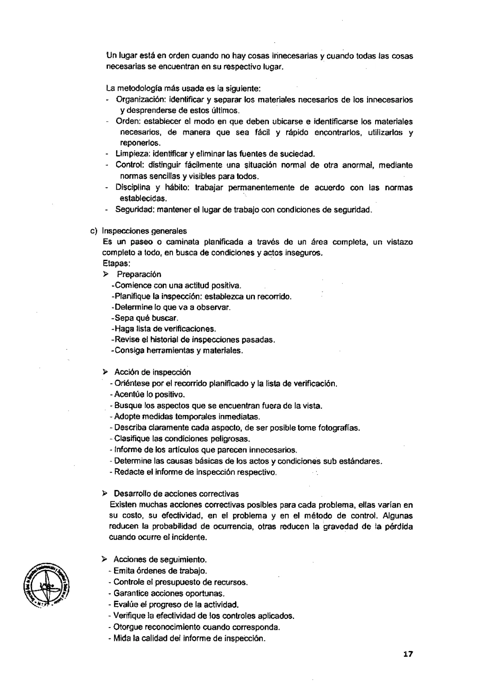

**Transcripción por reconocimiento de imagen:**

c)

Un lugar está en orden cuando no hay cosas irínecesarias y cuando todas las cosas
necesarias se encuentran en su respectivo lugar.

La metodología más usada es la siguiente:

- Organización: identificar y separar los materiales necesarios de los innecesarios
y desprenderse de estos últimos.

- Orden: establecer el modo en que deben ubicarse e identificarse los materiales
necesarios, de manera que sea fácil y rápido encontrarlos, utilizarlos y
reponerlos.

- Limpieza: identificar y eliminar las fuentes de suciedad.

- Control: distinguir fáciimente una situación normal de otra anormal, mediante
normas sencillas y visibles para todos.

- Disciplina y hábito: trabajar permanentemente de acuerdo con las normas
establecidas.

- Seguridad: mantener el lugar de trabajo con condiciones de seguridad.

Inspecciones generales
Es un paseo o caminata planificada a través de un área completa, un vistazo
completo a todo, en busca de condiciones y actos inseguros.
Etapas:
> Preparación
-Comience con una actitud positiva.
-Planifique la inspección: establezca un recorrido.
«Determine lo que va a observar.
-Sepa qué buscar.
-Haga lista de verificaciones.
-Revise el historial de inspecciones pasadas.
-Consiga herramientas y materiales.

> Acción de inspección
- Oriéntese por el recorrido planificado y la lista de verificación,
- Acentúe lo positivo.
- Busque los aspectos que se encuentran fuera de la vista.
- Adopte medidas temporales inmediatas.
- Describa claramente cada aspecto, de ser posible tome fotografías.
- Clasifique las condiciones peligrosas.
- informe de los articulos que parecen innecesarios,
- Determine las causas básicas de los actos y condiciones sub estándares.
- Redacte el informe de inspección respectivo,

» Desarrollo de acciones correctivas
Existen muchas acciones correctivas posibles para cada problema, ellas varían en
su costo, su efectividad, en el problema y en el método de control. Algunas
reducen la probabilidad de ocurrencia, otras reducen la gravedad de la pérdida
cuando ocurre el incidente,

> Acciones de seguimiento.
- Emita órdenes de trabajo.
- Controle el presupuesto de recursos.
- Garantice acciones oportunas.
- Evalúe el progreso de la actividad,
- Verifique la efectividad de los controles aplicados.
- Otorgue reconocimiento cuando corresponda.
- Mida la calidad del informe de inspección.

17

---

## Página 20

**Página escaneada: imagen de referencia para comprobar tablas, formularios y sus casillas.**

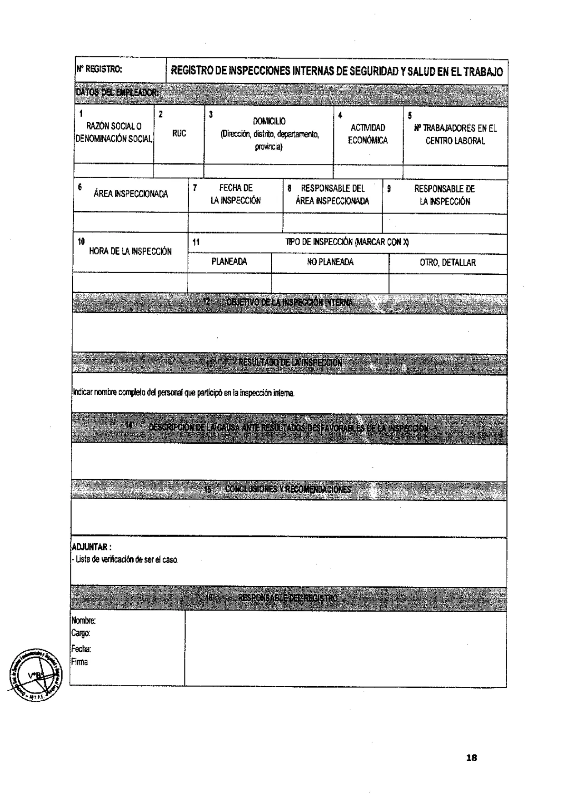

**Transcripción por reconocimiento de imagen:**

N* REGISTRO: E DE INSPECCIONES INTERNAS DE SEGURI

A

DAD Y SALUD EN EL TRABAJO

NES

4 5

ACTIVIDAD
ECONÓMICA

AP TRABAJADORES EN EL
CENTRO LABORAL

RAZÓN SOCIAL O
DENOMINACIÓN SOCIAL

(Dirección, distrito, departamento,
provincia)

6 7 FECHADE 8 RESPONSABLEDEL ]8  RESPONSABLEDE
ÁRERINSPECCONADA LA INSPECCIÓN ÁREA INSPECCIONADA LA INSPECCIÓN
1 m TPO DE INSPECCÓN MARCAR CON Y
HORA DE LA INSPECCIÓN
PLANEADA NO PLANEADA OTRO, DETALLAR

Indicar nombre completo del personal que participó en la inspección intema.

PJUNTAR :
|- Lista de venticación de ser el caso.

Nombre:

¡Fecha
¡Firma

18

---

## Página 21

**Página escaneada: imagen de referencia para comprobar tablas, formularios y sus casillas.**

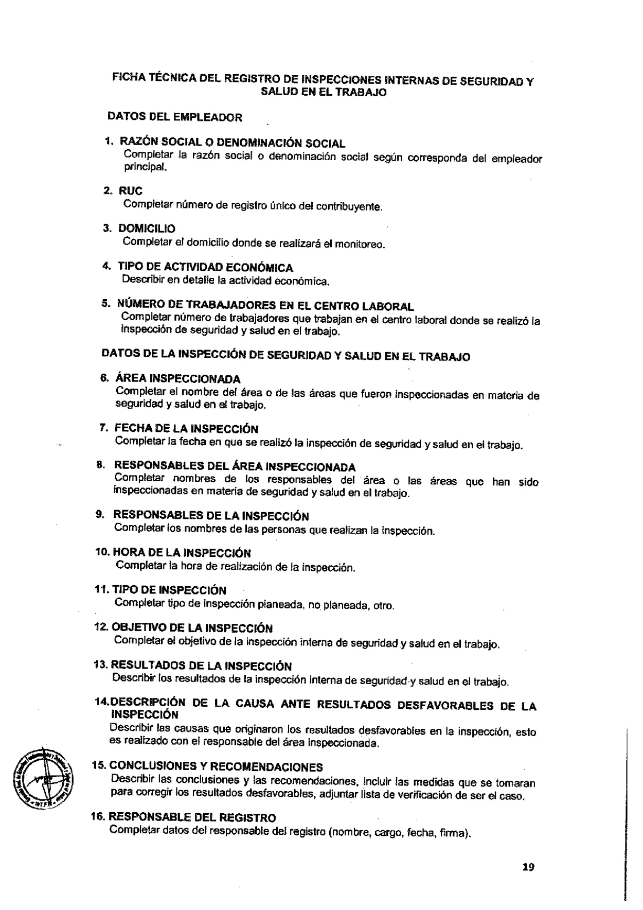

**Transcripción por reconocimiento de imagen:**

FICHA TÉCNICA DEL REGISTRO DE INSPECCIONES INTERNAS DE SEGURIDAD Y
SALUD EN EL TRABAJO

DATOS DEL EMPLEADOR

1. RAZÓN SOCIAL O DENOMINACIÓN SOCIAL
Completar la razón social o denominación social según corresponda del empleador
principal.

2. RUC
Completar número de registro único del contribuyente.

3. DOMICILIO
Completar el domicilio donde se realizará el monitoreo.

4. TIPO DE ACTIVIDAD ECONÓMICA
Describir en detalle la actividad económica.

5. NÚMERO DE TRABAJADORES EN EL CENTRO LABORAL
Completar número de trabajadores que trabajan en el centro laboral donde se realizó la
inspección de seguridad y salud en el trabajo,

DATOS DE LA INSPECCIÓN DE SEGURIDAD Y SALUD EN EL TRABAJO

6. ÁREA INSPECCIONADA
Completar el nombre del área o de las áreas que fueron inspeccioradas en materia de
seguridad y salud en el trabajo.

7. FECHA DE LA INSPECCIÓN
Completar la fecha en que se realizó la inspección de seguridad y salud en el trabajo.

8. RESPONSABLES DEL ÁREA INSPECCIONADA
Completar nombres de los responsables del área o las áreas que han sido
inspeccionadas en materia de seguridad y salud en el trabajo.

9. RESPONSABLES DE LA INSPECCIÓN
Completar los nombres de las personas que realizan la inspección.

10, HORA DE LA INSPECCIÓN
Completar la hora de realización de la inspección.

11. TIPO DE INSPECCIÓN
Completar tipo de inspección planeada, no planeada, otro.

12. OBJETIVO DE LA INSPECCIÓN
Completar el objetivo de la inspección interna de seguridad y salud en el trabajo,

13, RESULTADOS DE LA INSPECCIÓN
Describir los resultados de la inspección interna de seguridad y salud en el trabajo.

14.DESCRIPCIÓN DE LA CAUSA ANTE RESULTADOS DESFAVORABLES DE LA
INSPECCIÓN
Describir las causas que originaron los resultados desfavorables en la inspección, esto
es realizado con el responsabie del área inspeccionada.

15. CONCLUSIONES Y RECOMENDACIONES

Describir las conclusiones y las recomendaciones, incluir las medidas que se tomaran
Para corregir los resultados desfavorables, adjuntar lista de verificación de ser el caso,

16. RESPONSABLE DEL REGISTRO
Completar datos de! responsable del registro (nombre, cargo, fecha, firma).

19

---

## Página 22

**Página escaneada: imagen de referencia para comprobar tablas, formularios y sus casillas.**

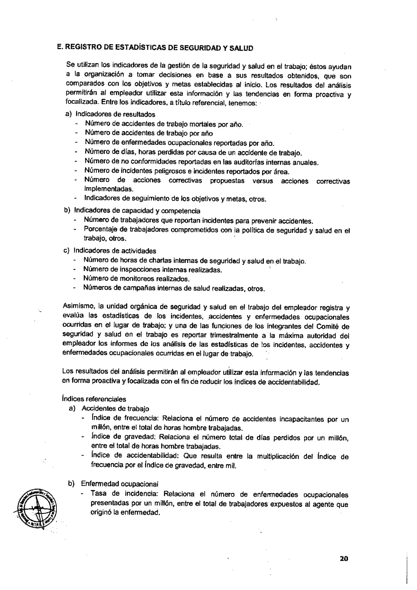

**Transcripción por reconocimiento de imagen:**

E. REGISTRO DE ESTADÍSTICAS DE SEGURIDAD Y SALUD

Se utilizan los indicadores de la gestión de la seguridad y salud en el trabajo; éstos ayudan
a la organización a tomar decisiones en base a sus resultados obtenidos, que son
comparados con los objetivos y metas establecidas al inicio. Los resultados del análisis
permitirán al empleador utilizar esta información y las tendencias en forma proactiva y
focalizada. Entre los indicadores, a título referencial, tenemos: -

a) indicadores de resultados
- Número de accidentes de trabajo mortales por año.
- Número de accidentes de trabajo por año
- Número de enfermedades ocupacionales reportadas por año.
- Número de días, horas perdidas por causa de un accidente de trabajo.
- Número de no conformidades reportadas en las auditorías internas anuales.
- Número de incidentes peligrosos e incidentes reportados por área.
- Número de acciones correctivas propuestas versus acciones correctivas
implementadas.
+ Indicadores de seguimiento de los objetivos y metas, otros.

b) Indicadores de capacidad y competencia
- Número de trabajadores que reportan incidentes para prevenir accidentes.
- Porcentaje de trabajadores comprometidos con la política de seguridad y salud en el
trabajo, otros.

c) indicadores de actividades
- Número de horas de charlas internas de seguridad y salud en el trabajo.
- Número de inspecciones internas realizadas.
- Número de monitoreos realizados.
- Números de campañas internas de salud realizadas, otros.

Asimismo, ta unidad orgánica de seguridad y salud en el trabajo del empleador registra y
evalúa las estadísticas de los incidentes, accidentes y enfermedades ocupacionales
ocurridas en el jugar de trabajo; y una de las funciones de los integrantes del Comité de
seguridad y salud en el trabajo es reportar trimestralmente a la máxima autoridad del
empleador los informes de los análisis de las estadísticas de los incidentes, accidentes y
enfermedades ocupacionales ocurridas en el lugar de trabajo.

Los resultados dei análisis permitirán al empleador utilizar esta infórmación y las tendencias
en forma proactiva y focalizada con el fin de reducir los índices de accidentabilidad.

Índices referenciales
a) Accidentes de trabajo

- Índice de frecuencia: Relaciona el número de accidentes incapacitantes por un
millón, entre el total de horas hombre trabajadas.

- Índice de gravedad: Relaciona el número total de días perdidos por un millón,
entre el total de horas hombre trabajadas.

- Índice de accidentabilidad: Que resulta entre la multiplicación del Índice de
frecuencia por el Índice de gravedad, entre mil.

b) Enfermedad ocupacional
- Tasa de incidencia: Relaciona el número de enfermedades ocupacionales
presentadas por un millón, entre el total de trabajadores expuestos al agente que
originó la enfermedad.

---

## Página 23

**Página escaneada: imagen de referencia para comprobar tablas, formularios y sus casillas.**

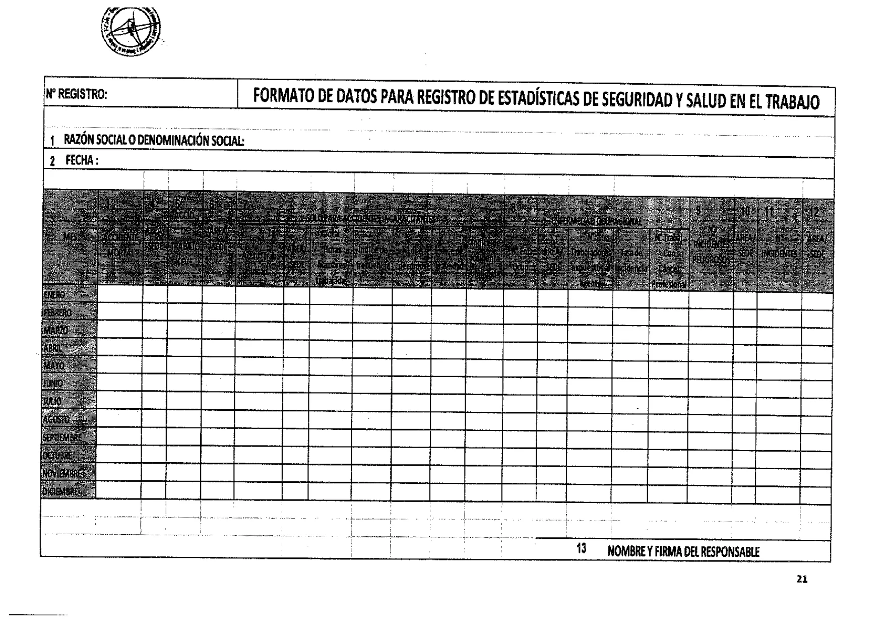

**Transcripción por reconocimiento de imagen:**

ZO

QT

IN REGISTRO: FORMATO DE DATOS PARA REGISTRO DE ESTADÍSTICAS DE SEGURIDAD Y SALUD EN EL TRABAJO

1 RAZÓN SOCIALO DENOMINACIÓN SOCIAL
2 FECHA:

13 NOMBRE Y FIRMA DEL RESPONSABLE

---

## Página 24

**Página escaneada: imagen de referencia para comprobar tablas, formularios y sus casillas.**

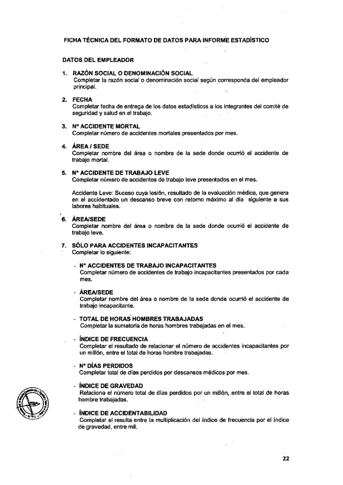

**Transcripción por reconocimiento de imagen:**

FICHA TÉCNICA DEL FORMATO DE DATOS PARA INFORME ESTADÍSTICO

DATOS DEL EMPLEADOR

>

3.

RAZÓN SOCIAL O DENOMINACIÓN SOCIAL
Completar la razón social o denominación social según corresponda del empleador
principal. /

FECHA
Completar fecha de entrega de los datos estadísticos a los integrantes del comité de
seguridad y salud en el trabajo.

N? ACCIDENTE MORTAL
Completar número de accidentes mortales presentados por mes.

ÁREA / SEDE
Completar nombre del área o nombre de la sede donde ocurrió el accidente de
trabajo mortal,

N* ACCIDENTE DE TRABAJO LEVE
Completar número de accidentes de trabajo leve presentados en el mes,

Accidente Leve: Suceso cuya lesión, resultado de la evaluación médica, que genera
en el accidentado un descanso breve con retorno máximo al día siguiente a sus
labores habituales.

ÁREA/SEDE
Completar nombre del área o nombre de la sede donde ocurrió el accidente de
trabajo leve.

SÓLO PARA ACCIDENTES INCAPACITANTES
Completar lo siguiente:

N* ACCIDENTES DE TRABAJO INCAPACITANTES
Completar número de accidentes de trabajo incapacitantes presentados por cada
mes.

ÁREA/SEDE
Completar nombre del área o nombre de la sede donde ocurrió el accidente de
trabajo incapacitante.

TOTAL DE HORAS HOMBRES TRABAJADAS
Completar la sumatoria de horas hombres trabajadas en el mes.

ÍNDICE DE FRECUENCIA
Completar el resultado de relacionar el número de accidentes incapacitantes por
un millón, entre el total de horas hombre trabajadas.

N? DÍAS PERDIDOS
Completar total de días perdidos por descansos médicos por mes,

ÍNDICE DE GRAVEDAD
Relaciona el número total de días perdidos por un millón, entre el total de horas
hombre trabajadas.

ÍNDICE DE ACCIDENTABILIDAD
Completar el resulta entre la multiplicación del índice de frecuencia por el indice
de gravedad, entre mil.

22

---

## Página 25

**Página escaneada: imagen de referencia para comprobar tablas, formularios y sus casillas.**

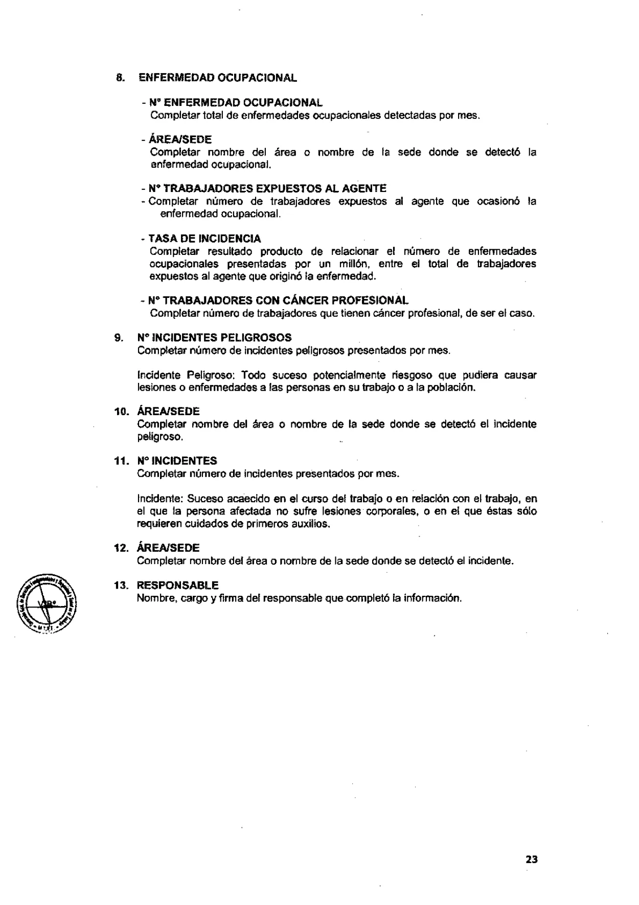

**Transcripción por reconocimiento de imagen:**

40.

1.

12.

13,

ENFERMEDAD OCUPACIONAL

- N” ENFERMEDAD OCUPACIONAL
Completar total de enfermedades ocupacionales detectadas por mes.

- ÁREA/SEDE
Completar nombre del área o nombre de la sede donde se detectó la
enfermedad ocupacional.

- N*” TRABAJADORES EXPUESTOS AL AGENTE
- Completar número de trabajadores expuestos al agente que ocasionó la
enfermedad ocupacional.

- TASA DE INCIDENCIA
Completar resultado producto de relacionar el número de enfermedades
ocupacionales presentadas por un millón, entre el total de trabajadores
expuestos al agente que originó la enfermedad.

- N” TRABAJADORES CON CÁNCER PROFESIONAL
Completar número de trabajadores que tienen cáncer profesional, de ser el caso.

N* INCIDENTES PELIGROSOS
Completar número de incidentes pellgrosos presentados por mes.

Incidente Peligroso: Todo suceso potencialmente riesgoso que pudiera causar
lesiones o enfermedades a fas personas en su trabajo o a la población.

ÁREA/SEDE
Completar nombre del área o nombre de la sede donde se detectó el incidente
peligroso.

N* INCIDENTES
Completar número de incidentes presentados por mes.

Incidente: Suceso acaecido en el curso del trabajo o en relación con el trabajo, en
el que la persona afectada no sufre lesiones corporales, o en el que éstas sólo
requieren cuidados de primeros auxilios.

ÁREA/SEDE
Completar nombre del área o nombre de la sede donde se detectó el incidente.

RESPONSABLE
Nombre, cargo y firma del responsable que completó la información.

23

---

## Página 26

**Página escaneada: imagen de referencia para comprobar tablas, formularios y sus casillas.**

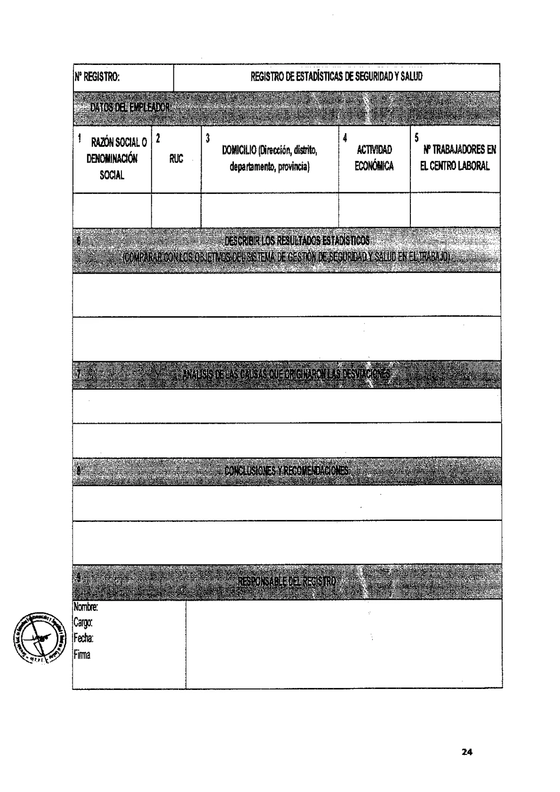

**Transcripción por reconocimiento de imagen:**

REGISTRO DE ESTADÍSTICAS DE SEGURIDAD Y SALUD

DOMICILIO (Dirección, distrito,
departamento, provincia)

24

---

## Página 27

**Página escaneada: imagen de referencia para comprobar tablas, formularios y sus casillas.**

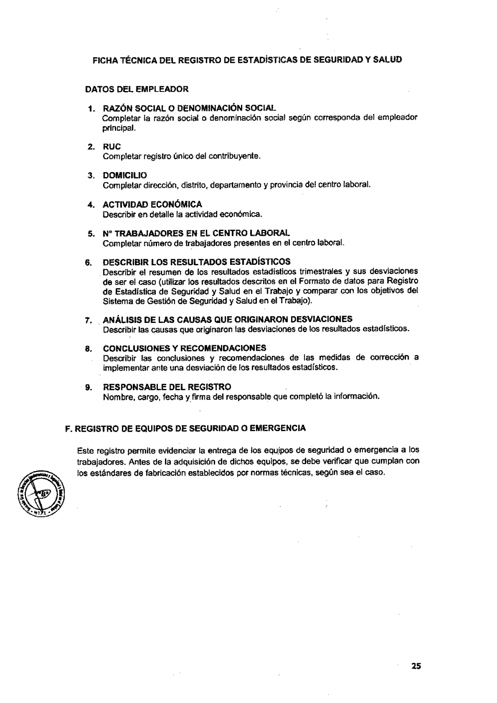

**Transcripción por reconocimiento de imagen:**

FICHA TÉCNICA DEL REGISTRO DE ESTADÍSTICAS DE SEGURIDAD Y SALUD

DATOS DEL EMPLEADOR

1. RAZÓN SOCIAL O DENOMINACIÓN SOCIAL
Completar la razón social o denominación social según corresponda del empleador

principal.

2. RUC
Completar registro único del contribuyente.

3. DOMICILIO
Completar dirección, distrito, departamento y provincia del centro laboral.

4. ACTIVIDAD ECONÓMICA
Describir en detalle la actividad económica.

5. N” TRABAJADORES EN El. CENTRO LABORAL
Completar número de trabajadores presentes en el centro laboral.

6. DESCRIBIR LOS RESULTADOS ESTADÍSTICOS
Describir el resumen de los resultados estadísticos trimestrales y sus desviaciones
de ser el caso (utilizar los resultados descritos en el Formato de datos para Registro
de Estadística de Seguridad y Salud en el Trabajo y comparar con los objetivos del
Sistema de Gestión de Seguridad y Salud en el Trabajo).

7. . ANÁLISIS DE LAS CAUSAS QUE ORIGINARON DESVIACIONES
Desoribir las causas que originaron tas desviaciones de los resultados estadísticos.

8. CONCLUSIONES Y RECOMENDACIONES
Describir las conclusiones y recomendaciones de las medidas de corrección a
implementar ante una desviación de los resultados estadísticos.

9. RESPONSABLE DEL REGISTRO -
Nombre, cargo, fecha y firma del responsable que completó la información.

F. REGISTRO DE EQUIPOS DE SEGURIDAD O EMERGENCIA

Este registro permite evidenciar la entrega de los equipos de seguridad o emergencia a los
trabajadores, Antes de la adquisición de dichos equipos, se debe verificar que cumplan con
los estándares de fabricación establecidos por normas técnicas, según sea el caso.

25

---

## Página 28

**Página escaneada: imagen de referencia para comprobar tablas, formularios y sus casillas.**

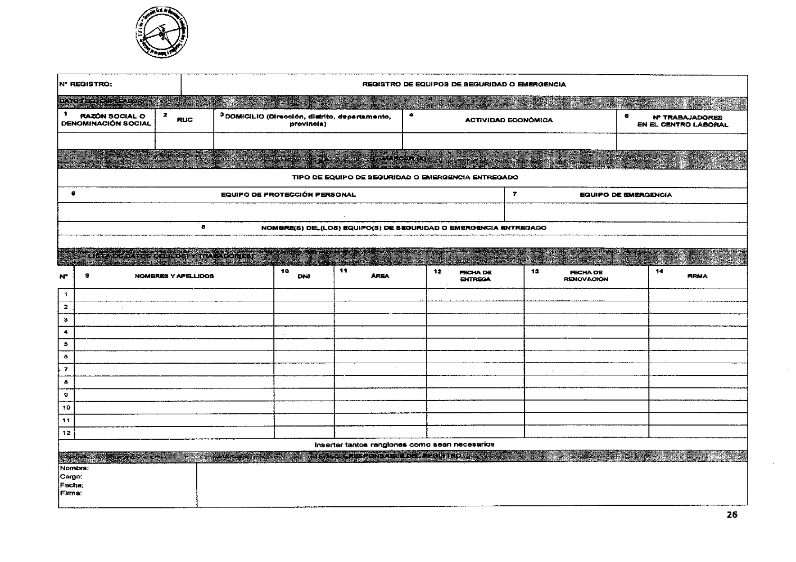

**Transcripción por reconocimiento de imagen:**

RAZÓN SOCIAL O
DENOMINACIÓN SOCIAL.

REGISTRO DE EQUIPOS DE SEGURIDAD O EMERGENCIA

3 DOMICILIO (Diracción, distrito, departamento,
provinola)

TIPO DE EQUIPO DE SEGURIDAD O EMERGENCIA ENTREGADO

EQUIPO DE PROTECCIÓN PERSONAL 7 EQUIPO DE EMERGENCIA

NOMBRE(S) DEL (LOS) EQUIPO(S) DE SEOUFIDAD O EMERGENCIA ENTREGADO

FECHA DE
REMOVACIÓN

Insertar tantor renglones como sean necesarios

26

---

## Página 29

**Página escaneada: imagen de referencia para comprobar tablas, formularios y sus casillas.**

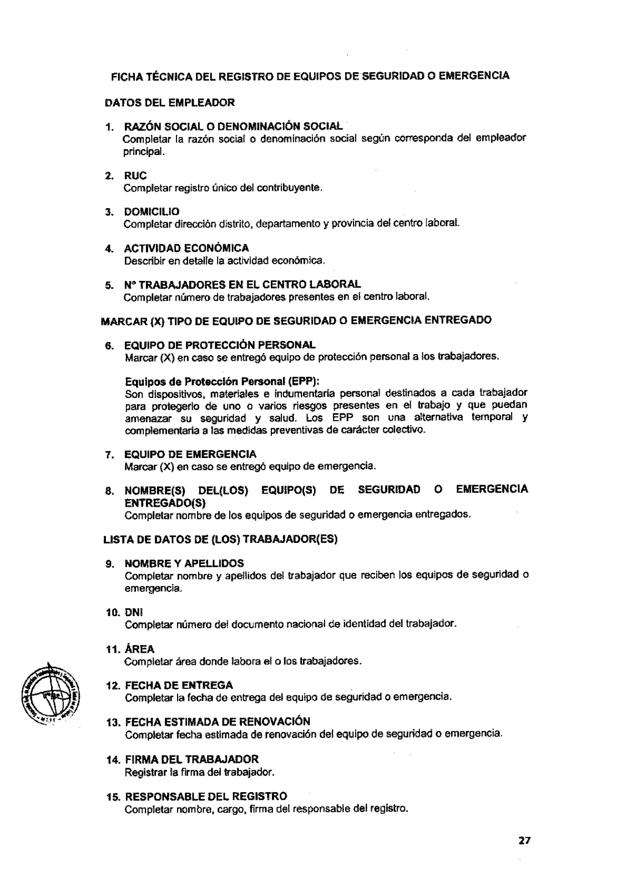

**Transcripción por reconocimiento de imagen:**

FICHA TÉCNICA DEL REGISTRO DE EQUIPOS DE SEGURIDAD O EMERGENCIA
DATOS DEL EMPLEADOR

4. RAZÓN SOCIAL O DENOMINACIÓN SOCIAL
Completar la razón social o denominación social según corresponda del empleador
principal.

2. RUC
Completar registro Único del contribuyente.

3. DOMICILIO
Completar dirección distrito, departamento y provincia del centro laboral.

4. ACTIVIDAD ECONÓMICA
Describir en detaile la actividad económica,

5. N”TRABAJADORES EN EL CENTRO LABORAL
Completar número de trabajadores presentes en el centro laboral.

MARCAR (X) TIPO DE EQUIPO DE SEGURIDAD O EMERGENCIA ENTREGADO

6. EQUIPO DE PROTECCIÓN PERSONAL
Marcar (X) en caso se entregó equipo de protección personal a los trabajadores.

Equipos de Protección Personal (EPP):

Son dispositivos, materiales e indumentaria personal destinados a cada trabajador
para protegerlo de uno o varios riesgos presentes en el trabajo y que puedan
amenazar su seguridad y salud. Los EPP son una alternativa temporal y
complementaria a las medidas preventivas de carácter colectivo.

7. EQUIPO DE EMERGENCIA
Marcar (X) en caso se entregó equipo de emergencia.

8. NOMBRE(S) DEL(LOS) EQUIPO(S) DE SEGURIDAD O EMERGENCIA

ENTREGADO(S)
Completar nombre de los equipos de seguridad o emergencia entregados.

LISTA DE DATOS DE (LOS) TRABAJADOR(ES)

9. NOMBRE Y APELLIDOS
Completar nombre y apellidos del trabajador que reciben los equipos de seguridad o
emergencia.

10. DNI
Completar número de! docurnento nacional de identidad del trabajador.

11. ÁREA
Completar área donde labora el o los trabajadores.

12. FECHA DE ENTREGA
Completar la fecha de entrega del equipo de seguridad o emergencia.

13. FECHA ESTIMADA DE RENOVACIÓN
Completar fecha estimada de renovación del equipo de seguridad o emergencia.

14. FIRMA DEL TRABAJADOR
Registrar la firma del trabajador.

15. RESPONSABLE DEL REGISTRO
Completar nombre, cargo, firma del responsable del registro,

27

---

## Página 30

**Página escaneada: imagen de referencia para comprobar tablas, formularios y sus casillas.**

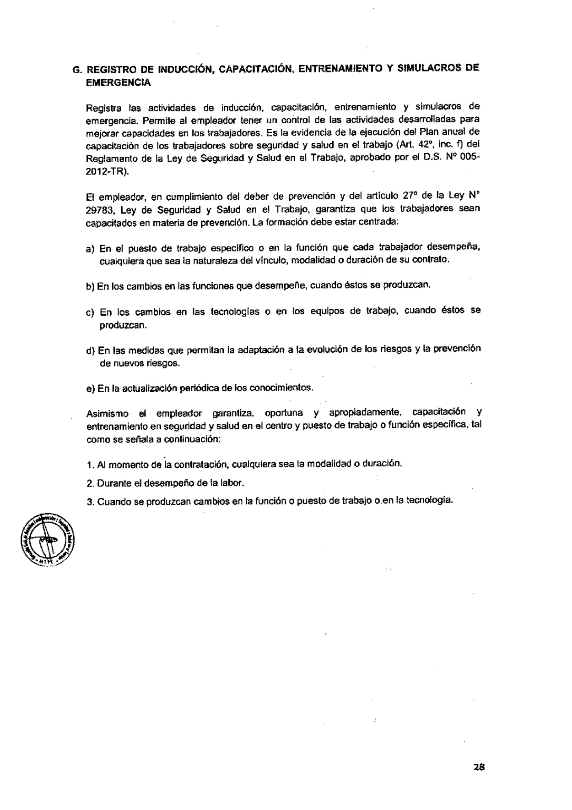

**Transcripción por reconocimiento de imagen:**

G. REGISTRO DE INDUCCIÓN, CAPACITACIÓN, ENTRENAMIENTO Y SIMULACROS DE
EMERGENCIA

Registra las actividades de inducción, capacitación, entrenamiento y simulacros de
emergencia. Permite al empleador tener un control de las actividades desarrolladas para
mejorar capacidades en los trabajadores. Es la evidencia de la ejecución del Plan anual de
capacitación de los trabajadores sobre seguridad y salud en el trabajo (Art. 42”, inc, f) dei
Reglamento de la Ley de Seguridad y Salud en el Trabajo, aprobado por el D.S. N” 005-
2012-TR).

El empleador, en cumplimiento del deber de prevención y del artículo 27” de la Ley N*
29783, Ley de Seguridad y Salud en el Trabajo, garantiza que los trabajadores sean
capacitados en materia de prevención. La formación debe estar centrada:

a) En el puesto de trabajo especifico o en la función que cada trabajador desempeña,
cualquiera que sea la naturaleza del vínculo, modalidad o duración de su contrato.

b) En los cambios en las funciones que desempeñe, cuando éstos se produzcan,

e) En los cambios en las tecnologias o en los equipos de trabajo, cuando éstos se
produzcan.

d) En las medidas que permitan la adaptación a la evolución de los riesgos y la prevención
de nuevos riesgos.

6) En la actualización periódica de los conocimientos,

Asimismo el empleador garantiza, oportuna y apropiadamente, capacitación y
entrenamiento en seguridad y salud en el centro y puesto de trabajo o función específica, tal
como se señala a continuación:

4. Al momento de la contratación, cualquiera sea la modalidad o duración.

2. Durante el desempeño de la labor.

3. Cuando se produzcan cambios en la función o puesto de trabajo o.en la tecnología.

---

## Página 31

**Página escaneada: imagen de referencia para comprobar tablas, formularios y sus casillas.**

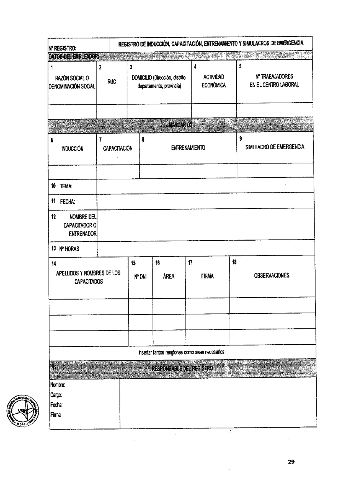

**Transcripción por reconocimiento de imagen:**

RAZÓN SOCIAL O

DENOMINACIÓN SOCIAL! PU

DOMICILIO (Dirección, dstit,
departamento, provincia)

ECONÓMICA

| REGISTRO REGISTRO DE INDUCCIÓN, CAPACITACIÓN, ENTRENAMIENTO Y SIMULACROS DE EMERGENCIA

N* TRABAJADORES
EN EL CENTRO LABORAL

o

7
CAPACITACIÓN

ENTRENAMIENTO

9

SIMULACRO DE EMERGENCIA

n NOMBRE DEI
CAPACITADOR O

ENTRENADOR;

13 NP HORAS

4

APELLIDOS Y NOMBRES DE LOS
CAPACITADOS

OBSERVACIONES

Insertar tantos renglones como sean necesanos.

29

---

## Página 32

**Página escaneada: imagen de referencia para comprobar tablas, formularios y sus casillas.**

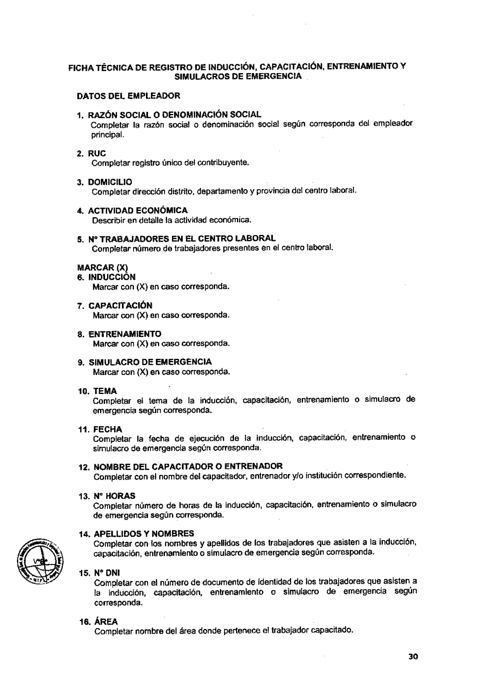

**Transcripción por reconocimiento de imagen:**

FICHA TÉCNICA DE REGISTRO DE INDUCCIÓN, CAPACITACIÓN, ENTRENAMIENTO Y
SIMULACROS DE EMERGENCIA

DATOS DEL EMPLEADOR

1. RAZÓN SOCIAL O DENOMINACIÓN SOCIAL
Completar la razón social o denominación social según corresponda del empleador
principal.

2. RUC
Completar registro único del contribuyente,

3, DOMICILIO
Completar dirección distrito, departamento y provincia del centro laboral,

4, ACTIVIDAD ECONÓMICA
Describir en detalle la actividad económica.

5. N” TRABAJADORES EN EL CENTRO LABORAL
Completar número de trabajadores presentes en el centro laboral,

MARCAR (X]
6. INDUCCIÓN
Marcar con (X) en caso corresponda.

7. CAPACITACIÓN
Marcar con (X) en caso corresponda.

8. ENTRENAMIENTO
Marcar con (X) en caso corresponda.

9. SIMULACRO DE EMERGENCIA
Marcar con (X) en caso corresponda.

30. TEMA
Completar el tema de la inducción, capacitación, entrenamiento o simulacro de
emergencia según corresponda.

11. FECHA :
Completar la fecha de ejecución de la inducción, capacitación, entrenamiento o
simulacro de emergencia según corresponda.

12. NOMBRE DEL CAPACITADOR O ENTRENADOR
Completar con el nombre del capacitador, entrenador y/o institución correspondiente.

13. N” HORAS
Completar número de horas de la inducción, capacitación, entrenamiento o simulacro
de emergencia según corresponda.

14. APELLIDOS Y NOMBRES
Completar con los nombres y apellidos de los trabajadores que asisten a la inducción,
capacitación, entrenamiento o simulacro de emergencia según corresponda.

15. N* DNI
Completar con el número de documento de identidad de los trabajadores que asisten a
la inducción, capacitación, entrenamiento o simulacro de emergencia según
corresponda.

16. ÁREA
Completar nombre del área donde pertenece el trabajador capacitado,

30

---

## Página 33

**Página escaneada: imagen de referencia para comprobar tablas, formularios y sus casillas.**

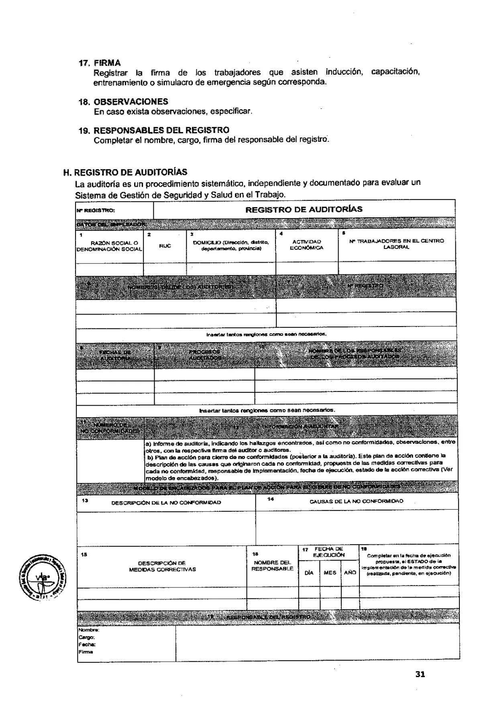

**Transcripción por reconocimiento de imagen:**

17. FIRMA :
Registrar la firma de los trabajadores que asisten inducción,
entrenamiento o simulacro de emergencia según corresponda.

18. OBSERVACIONES
En caso exista observaciones, especificar. Ñ

capacitación,

19. RESPONSABLES DEL REGISTRO
Completar el nombre, cargo, firma del responsable del registro.

H. REGISTRO DE AUDITORÍAS

La auditoría es un procedimiento sistemático, independiente y documentado para evaluar un
Sistema de Gestión de Seguridad y Salud en el Trabajo.

DOMICILIO (Dirección, distrito, ACTIVIDAD:
departamento, provincia) ECONÓMICA

N* TRABAJADORES EN EL CENTRO
LABORAL

insartar tantos renglones como sean necesarios.

Inseriar tantos renglones como s8an neces:

q
jotros, con la respectiva firma del auditor o auditores.
b) Pian de acción para cierra de no conformidades (poslerior a la auditoria). Este plan de acción contiene la
ldescripción de las causas que originaron cada no conformidad, propuesta de las medidas correctivas para

[cada na conformidad, responsable de impiementación, fecha de ejecución, estado de ta acción correctiva (Ver
encabezados)

DESCRIPCIÓN DE LA NO CONFORMIDAD. CAUSAS DE LA NO CONFORMIDAD

47 FECHA DE .
15 ul EJECUCIÓN Completar an la foca de ejecución
DESCRIPCIÓN DE NOMBRE DEL propuesta, el ESTADO de la
MEDIDAS CORRECTIVAS RESPONSABLE pia | mes Llano implementación de in medids comectiva.

(csglizacta, pendiente, en ejecución)

31

---

## Página 34

**Página escaneada: imagen de referencia para comprobar tablas, formularios y sus casillas.**

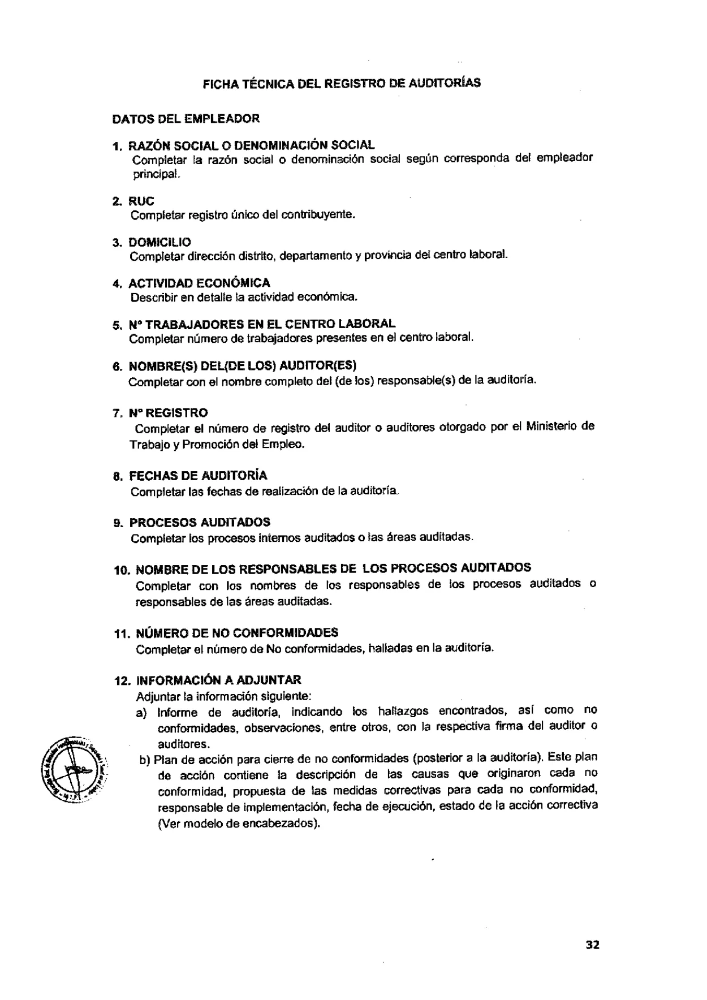

**Transcripción por reconocimiento de imagen:**

FICHA TÉCNICA DEL REGISTRO DE AUDITORÍAS

DATOS DEL EMPLEADOR

1. RAZÓN SOCIAL O DENOMINACIÓN SOCIAL
Completar la razón social o denominación social según corresponda del empleador
principal.

2. RUC
Completar registro único del contribuyente.

3. DOMICILIO
Completar dirección distrito, departamento y provincia del centro laboral.

4, ACTIVIDAD ECONÓMICA
Describir en detalle ta actividad económica.

5. N* TRABAJADORES EN EL CENTRO LABORAL
Completar número de trabajadores presentes en el centro laboral.

6. NOMBRE(S) DEL(DE LOS) AUDITOR(ES)
Completar con el nombre completo dei (de los) responsable(s) de la auditoría.

7, N” REGISTRO
Completar el número de registro del auditor o auditores otorgado por el Ministerio de
Trabajo y Promoción del Empleo.

8. FECHAS DE AUDITORÍA
Completar las fechas de realización de la auditoría.

9. PROCESOS AUDITADOS
Completar los procesos internos auditados o las áreas auditadas.

10. NOMBRE DE LOS RESPONSABLES DE LOS PROCESOS AUDITADOS
Completar con los nombres de los responsables de los procesos auditados o
responsables de las áreas auditadas.

11. NÚMERO DE NO CONFORMIDADES
Completar el número de No conformidades, halladas en la auditoría.

12. INFORMACIÓN A ADJUNTAR

Adjuntar la información siguiente:

a) Informe de auditoría, indicando los hallazgos encontrados, así como no
conformidades, observaciones, entre otros, con la respectiva firma del auditor o
auditores.

b) Plan de acción para cierre de no conformidades (posterior a la auditoría). Este plan
de acción contiene la descripción de les causas que originaron cada no
conformidad, propuesta de las medidas correctivas para cada no conformidad,
responsable de implementación, fecha de ejecución, estado de la acción correctiva
(Ver modelo de encabezados).

32

---

## Página 35

**Página escaneada: imagen de referencia para comprobar tablas, formularios y sus casillas.**

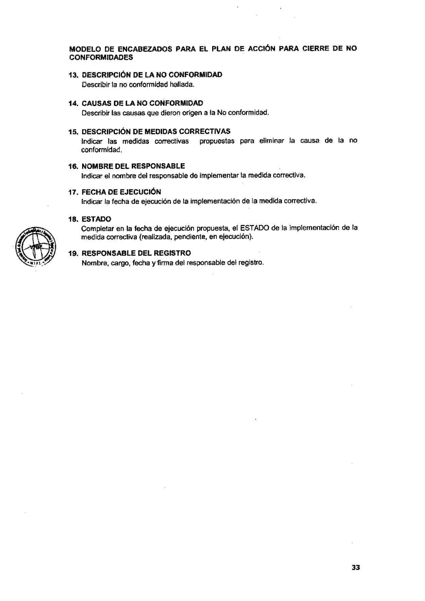

**Transcripción por reconocimiento de imagen:**

MODELO DE ENCABEZADOS PARA EL PLAN DE ACCIÓN PARA CIERRE DE NO
CONFORMIDADES

13. DESCRIPCIÓN DE LA NO CONFORMIDAD
Describir la no conformidad hallada.

14, CAUSAS DE LA NO CONFORMIDAD
Describir las causas que dieron origen a la No conformidad,

15, DESCRIPCIÓN DE MEDIDAS CORRECTIVAS
indicar tas medidas correctivas propuestas para eliminar la causa de la no
conformidad,

16. NOMBRE DEL RESPONSABLE .
Indicar el nombre del responsable de implementar la medida correctiva.

17. FECHA DE EJECUCIÓN
Indicar la fecha de ejecución de la implementación de ia medida correctiva.

18. ESTADO
Completar en la fecha de ejecución propuesta, el ESTADO de la implementación de la
medida correctiva (realizada, pendiente, en ejecución).

19. RESPONSABLE DEL REGISTRO
Nombre, cargo, fecha y firma del responsable del registro.

33

---

## Página 36

**Página escaneada: imagen de referencia para comprobar tablas, formularios y sus casillas.**

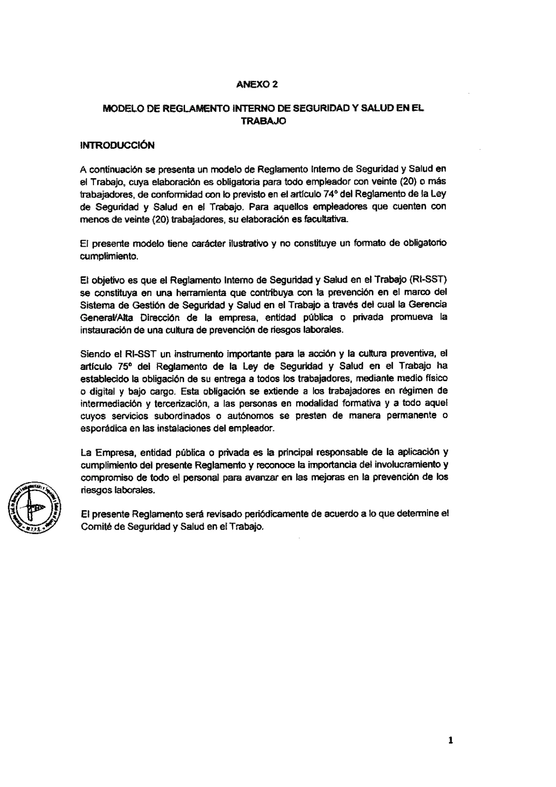

**Transcripción por reconocimiento de imagen:**

ANEXO 2

MODELO DE REGLAMENTO INTERNO DE SEGURIDAD Y SALUD EN EL.
TRABAJO

INTRODUCCIÓN

A continuación se presenta un modelo de Reglamento intemo de Seguridad y Salud en
el Trabajo, cuya elaboración es obligatoria para todo empleador con veinte (20) o más
trabajadores, de conformidad con to previsto en el artículo 74? del Reglamento de la Ley
de Seguridad y Salud en el Trabajo. Para aquellos empleadores que cuenten con
menos de veinte (20) trabajadores, su elaboración es facultativa.

El presente modelo tiene carácter ilustrativo y mo constituye un formato de obligatorio
cumplimiento.

El objetivo es que el Reglamento interno de Seguridad y Salud en el Trabajo (Ri-SST)
se constituya en una herramienta que contribuya con la prevención en el marco del
Sistema de Gestión de Seguridad y Salud en el Trabajo a través del cual la Gerencia
GeneraVAlta Dirección de la empresa, entidad publica o privada promueva la
instauración de una cultura de prevención de riesgos laborales.

Siendo el RI-SST un instrumento importante para la acción y la cultura preventiva, el
artículo 75% del Reglamento de la Ley de Seguridad y Salud en el Trabajo ha
establecido la obligación de su entrega a todos los trabajadores, mediante medio físico
o digital y bajo cargo. Esta obligación se extiende a los trabajadores en régimen de
intermediación y tercerización, a las personas en modalidad formativa y a todo aquel
cuyos servicios subordinados o autónomos se presten de manera permanente o
esporádica en las instalaciones del empleador.

La Empresa, entidad pública o privada es la principal responsable de la aplicación y
cumplimiento del presente Reglamento y reconoce la importancia dei involucramiento y
compromiso de todo el personal para avanzar en las mejoras en la prevención de los
riesgos laborales.

El presente Reglamento será revisado periódicamente de acuerdo a lo que determine el
Comité de Seguridad y Salud en el Trabajo.

---

## Página 37

**Página escaneada: imagen de referencia para comprobar tablas, formularios y sus casillas.**

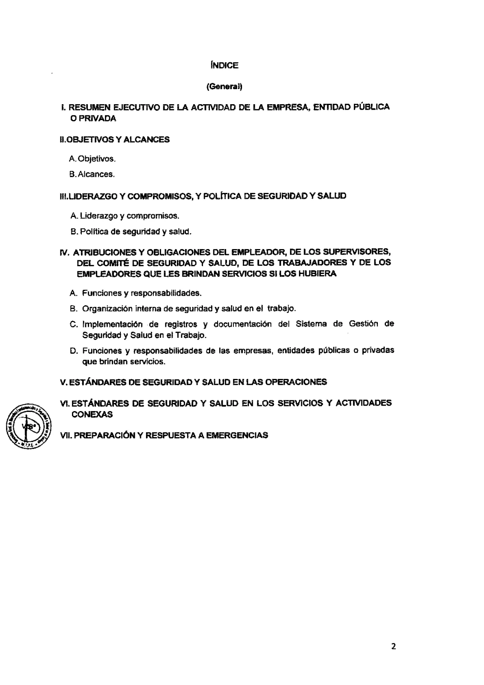

**Transcripción por reconocimiento de imagen:**

ÍNDICE

(General)
l. RESUMEN EJECUTIVO DE LA ACTIVIDAD DE LA EMPRESA, ENTIDAD PÚBLICA
O PRIVADA
H.OBJETIVOS Y ALCANCES
A. Objetivos.
B.Alcances.

LIDERAZGO Y COMPROMISOS, Y POLÍTICA DE SEGURIDAD Y SALUD

A. Liderazgo y compromisos.
B. Política de seguridad y salud.

MV, ATRIBUCIONES Y OBLIGACIONES DEL EMPLEADOR, DE LOS SUPERVISORES,
DEL COMITÉ DE SEGURIDAD Y SALUD, DE LOS TRABAJADORES Y DE LOS
EMPLEADORES QUE LES BRINDAN SERVICIOS SI LOS HUBIERA

A. Funciones y responsabilidades.
B. Organización interna de seguridad y salud en el trabajo.

C. Implementación de registros y documentación del Sistema de Gestión de
Seguridad y Salud en el Trabajo.

D. Funciones y responsabilidades de las empresas, entidades públicas o privadas
que brindan servicios.

V. ESTÁNDARES DE SEGURIDAD Y SALUD EN LAS OPERACIONES

VI. ESTÁNDARES DE SEGURIDAD Y SALUD EN LOS SERVICIOS Y ACTIVIDADES
CONEXAS

VII. PREPARACIÓN Y RESPUESTA A EMERGENCIAS

---

## Página 38

**Página escaneada: imagen de referencia para comprobar tablas, formularios y sus casillas.**

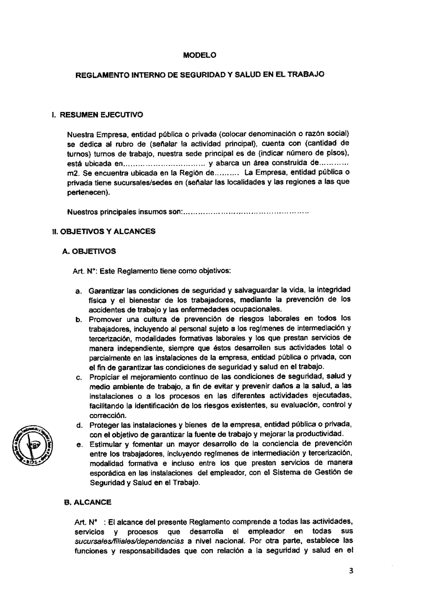

**Transcripción por reconocimiento de imagen:**

MODELO

REGLAMENTO INTERNO DE SEGURIDAD Y SALUD EN EL TRABAJO

1, RESUMEN EJECUTIVO

Nuestra Empresa, entidad pública o privada (colocar denominación o razón social)
se dedica al rubro de (señalar la actividad principal), cuenta con (cantidad de
turnos) tumos de trabajo, nuestra sede principal es de (indicar número de pisos).
está ubicada en.. .. . . y abarca un área construida de... ..

m2. Se encuentra ubicada e en 0 ta Región de.. .. La Empresa, entidad pública )
privada tiene sucursales/sedes en (señalar las localidades y las regiones a las que
pertenecen).

Nuestros principales InSUMOS SOM. .ooooooocococccconono nor non conno nan nrnn ano cono
1. OBJETIVOS Y ALCANCES
A. OBJETIVOS
Art. N”: Este Reglamento tiene como objetivos:

a. Garantizar las condiciones de seguridad y salvaguardar la vida, la integridad
física y el bienestar de los trabajadores, mediante la prevención de los
accidentes de trabajo y las enfermedades ocupacionales.

b. Promover una cultura de prevención de riesgos laborales en todos los
trabajadores, incluyendo al persona! sujeto a los regímenes de intermediación y
tercerización, modalidades formativas laborales y los que prestan servicios de
manera independiente, siempre que éstos desarrollen sus actividades total o
parcialmente en las instalaciones de la empresa, entidad pública o privada, con
el fin de garantizar tas condiciones de seguridad y salud en el trabajo.

c. Propiciar el mejoramiento continuo de las condiciones de seguridad, salud y
medio ambiente de trabajo, a fin de evitar y prevenir daños a la salud, a las
instalaciones o a los procesos en las diferentes actividades ejecutadas,
facilitando la identificación de los riesgos existentes, su evaluación, control y
corrección.

d. Proteger las instalaciones y bienes de la empresa, entidad pública o privada,
con el objetivo de garantizar la fuente de trabajo y mejorar la productividad.

e. Estimular y fomentar un mayor desarrollo de la conciencia de prevención
entre los trabajadores, incluyendo regimenes de intermediación y tercerización,
modalidad formativa e incluso entre los que presten servicios de manera
esporádica en las instalaciones del empleador, con el Sistema de Gestión de
Seguridad y Salud en el Trabajo.

B. ALCANCE

Art. N* : El alcance del presente Reglamento comprende a todas las actividades,
servicios y procesos que desarrolla el empleador en todas sus
sucursalesiiliales/dependencias a nivel nacional. Por otra parte, establece las
funciones y responsabilidades que con relación a la seguridad y salud en el

3

---

## Página 39

**Página escaneada: imagen de referencia para comprobar tablas, formularios y sus casillas.**

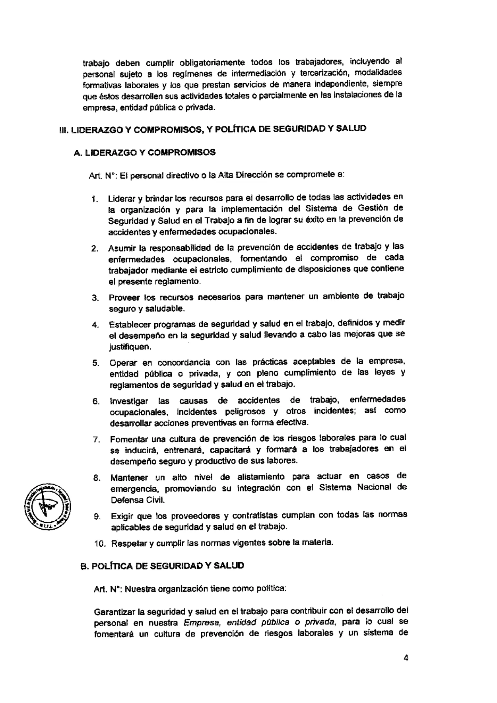

**Transcripción por reconocimiento de imagen:**

trabajo deben cumplir obligatoriamente todos los trabajadores, incluyendo al
personal sujeto a los regímenes de intermediación y tercerización, modalidades
formativas laborales y los que prestan servicios de manera independiente, siempre
que éstos desarrollen sus actividades totales o parcialmente en las instalaciones de la
empresa, entidad pública o privada.

lit. LIDERAZGO Y COMPROMISOS, Y POLÍTICA DE SEGURIDAD Y SALUD
A. LIDERAZGO Y COMPROMISOS
Art. N”: El personal directivo o la Alta Dirección se compromete a:

4.  Liderar y brindar los recursos para el desarrollo de todas las actividades en
la organización y para la implementación del Sistema de Gestión de
Seguridad y Salud en el Trabajo a fin de lograr su éxito en la prevención de
accidentes y enfermedades ocupacionales.

2. Asumir la responsabilidad de la prevención de accidentes de trabajo y las
enfermedades ocupacionales, fomentando el compromiso de cada
trabajador mediante el estricto cumplimiento de disposiciones que contiene
el presente reglamento.

3. Proveer los recursos necesarios para mantener un ambiente de trabajo
seguro y saludable.

4. Establecer programas de seguridad y salud en el trabajo, definidos y medir
el desempeño en la seguridad y salud llevando a cabo las mejoras que se
justifiquen.

5. Operar en concordancia con las prácticas aceptables de la empresa,
entidad pública o privada, y con pleno cumplimiento de las leyes y
reglamentos de seguridad y salud en el trabajo.

6. investigar las causas de accidentes de trabajo, enfermedades
ocupacionales, incidentes peligrosos y otros incidentes; así como
desarrollar acciones preventivas en forma efectiva.

7. Fomentar una cultura de prevención de los riesgos laborales para lo cual
se inducirá, entrenará, capacitará y formará a los trabajadores en el
desempeño seguro y productivo de sus labores.

8. Mantener un alto nivel de alistamiento para actuar en casos de
emergencia, promoviendo su integración con el Sistema Nacional de
Defensa Civil.

9. Exigir que los proveedores y contratistas cumplan con todas las normas
aplicables de seguridad y salud en el trabajo.

10. Respetar y cumplir las normas vigentes sobre la materia.
B. POLÍTICA DE SEGURIDAD Y SALUD
Art. N”: Nuestra organización tiene como política:
Garantizar la seguridad y salud en el trabajo para contribuir con el desarrollo del

personal en nuestra Empresa, entidad pública o privada, para lo cual se
fomentará un cultura de prevención de riesgos laborales y un sistema de

4

---

## Página 40

**Página escaneada: imagen de referencia para comprobar tablas, formularios y sus casillas.**

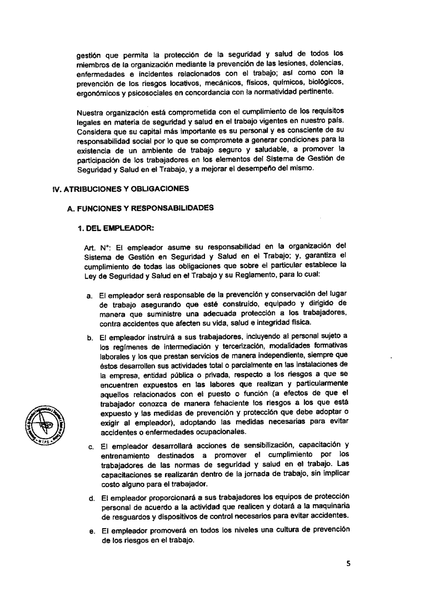

**Transcripción por reconocimiento de imagen:**

gestión que permita la protección de la seguridad y salud de todos los
miembros de la organización mediante la prevención de las lesiones, dolencias,
enfermedades e incidentes relacionados con el trabajo; así como con la
prevención de los riesgos locativos, mecánicos, físicos, químicos, biológicos,
ergonómicos y psicosociales en concordancia con la normatividad pertinente.

Nuestra organización está comprometida con el cumplimiento de los requisitos
legales en materia de seguridad y salud en el trabajo vigentes en nuestro país.
Considera que su capital más importante es su personal y es consciente de su
responsabilidad social por lo que se compromete a generar condiciones para la
existencia de un ambiente de trabajo seguro y saludable, a promover la
participación de los trabajadores en los elementos del Sistema de Gestión de
Seguridad y Salud en el Trabajo, y a mejorar el desempeño del mismo,

IV. ATRIBUCIONES Y OBLIGACIONES
A. FUNCIONES Y RESPONSABILIDADES
1. DEL EMPLEADOR:

Art N*: El empleador asume su responsabilidad en la organización del
Sistema de Gestión en Seguridad y Salud en el Trabajo; y, garantiza el
cumplimiento de todas las obligaciones que sobre el particular establece la
Ley de Seguridad y Salud en el Trabajo y su Reglamento, para lo cual:

a. Elempleador será responsable de la prevención y conservación del lugar
de trabajo asegurando que esté construido, equipado y dirigido de
manera que suministre una adecuada protección a los trabajadores,
contra accidentes que afecten su vida, salud e integridad física.

b. El empleador instruirá a sus trabajadores, incluyendo al personal sujeto a
los regimenes de intermediación y tercerización, modalidades formativas
laborales y los que prestan servicios de manera independiente, siempre que
éstos desarrollen sus actividades total o parcialmente en tas instalaciones de
la empresa, entidad pública o privada, respecto a los riesgos a que se
encuentren expuestos en las labores que realizan y particularmente
aquellos relacionados con et puesto o función (a efectos de que el
trabajador conozca de manera fehaciente los riesgos a los que está
expuesto y las medidas de prevención y protección que debe adoptar o
exigir al empleados), adoptando las medidas necesarias para evitar
accidentes o enfermedades ocupacionales.

c. El empleador desarrollará acciones de sensibilización, capacitación y
entrenamiento destinados a promover el cumplimiento por los
trabajadores de las normas de seguridad y salud en el trabajo. Las
capacitaciones se realizarán dentro de la jornada de trabajo, sin implicar
costo alguno para el trabajador.

3. El empleador proporcionará a sus trabajadores los equipos de protección
personal de acuerdo a la actividad que realicen y dotará a la maquinaria
de resguardos y dispositivos de control necesarios para evitar accidentes.

e. El empleador promoverá en todos los niveles una cultura de prevención
de los riesgos en el trabajo.

---

## Página 41

**Página escaneada: imagen de referencia para comprobar tablas, formularios y sus casillas.**

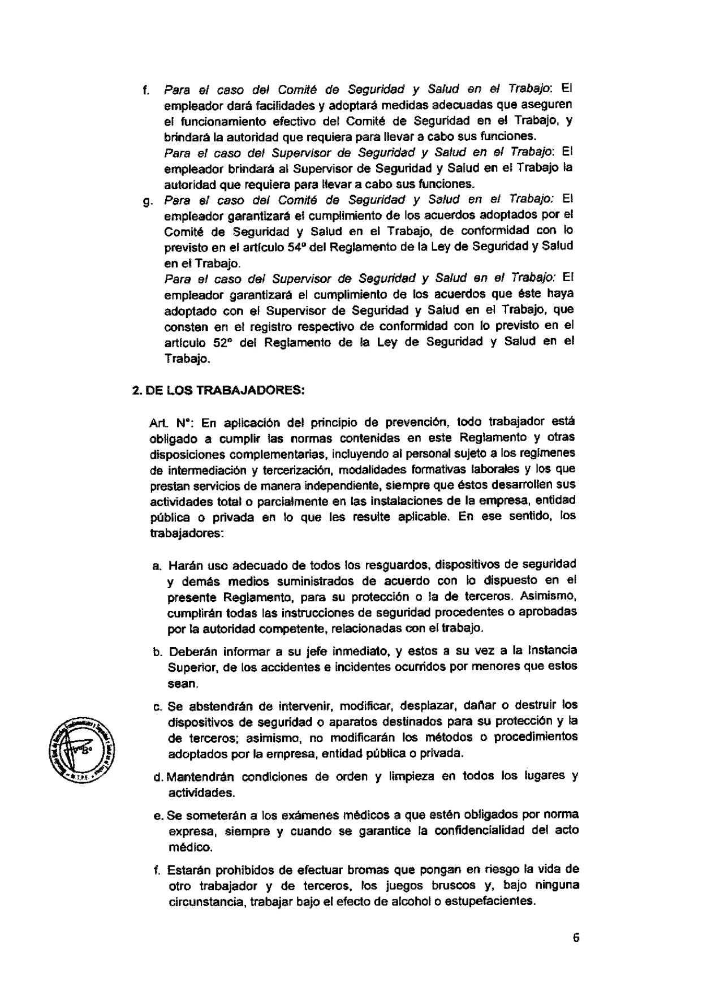

**Transcripción por reconocimiento de imagen:**

f Para el caso del Comité de Seguridad y Salud en el Trabajo: El
empleador dará facilidades y adoptará medidas adecuadas que aseguren
el funcionamiento efectivo de! Comité de Seguridad en el Trabajo, y
brindará la autoridad que requiera para llevar a cabo sus funciones.

Para el caso del Supervisor de Seguridad y Salud en el Trabajo: El
empleador brindará al Supervisor de Seguridad y Salud en el Trabajo ta
autoridad que requiera para levar a cabo sus funciones.

g. Para el caso del Comité de Seguridad y Salud en el Trabajo: El

empleador garantizará ei cumplimiento de los acuerdos adoptados por el
Comité de Seguridad y Salud en el Trabajo, de conformidad con lo
previsto en el artículo 54” del Reglamento de la Ley de Seguridad y Salud
en el Trabajo.
Para el caso del Supervisor de Seguridad y Salud en el Trabajo: El
empleador garantizará el cumplimiento de los acuerdos que éste haya
adoptado con el Supervisor de Seguridad y Salud en el Trabajo, que
consten en el registro respectivo de conformidad con lo previsto en el
artículo 52% del Reglamento de la Ley de Seguridad y Salud en el
Trabajo.

2. DE LOS TRABAJADORES:

Art. N”: En aplicación del principio de prevención, todo trabajador está
obligado a cumplir las normas contenidas en este Reglamento y otras
disposiciones complementarias, incluyendo al personal sujeto a los regimenes
de intermediación y tercerización, modalidades formativas laborales y los que
prestan servicios de manera independiente, siempre que éstos desarrollen sus
actividades total o parcialmente en las instalaciones de la empresa, entidad
pública o privada en lo que les resulte aplicable. En ese sentido, los
trabajadores:

a. Harán uso adecuado de todos los resguardos, dispositivos de seguridad
y demás medios suministrados de acuerdo con lo dispuesto en el
presente Reglamento, para su protección o la de terceros. Asimismo,
cumplirán todas las instrucciones de seguridad procedentes o aprobadas
por la autoridad competente, relacionadas con el trabajo.

b. Deberán informar a su jefe inmediato, y estos a su vez a la instancia
Superior, de los accidentes e incidentes ocurridos por menores que estos
sean.

c. Se abstendrán de intervenir, modificar, desplazar, dañar o destruir los
dispositivos de seguridad o aparatos destinados para su protección y la
de terceros; asimismo, no modificarán los métodos o procedimientos
adoptados por la empresa, entidad pública o privada.

d. Mantendrán condiciones de orden y limpieza en todos los lugares y
actividades.

e. Se someterán a los exámenes médicos a que estén obligados por norma
expresa, siempre y cuando se garantice la confidencialidad del acto
médico.

f. Estarán prohibidos de efectuar bromas que pongan en riesgo la vida de
otro trabajador y de terceros, los juegos bruscos y, bajo ninguna
circunstancia, trabajar bajo el efecto de alcohol o estupefacientes.

---

## Página 42

**Página escaneada: imagen de referencia para comprobar tablas, formularios y sus casillas.**

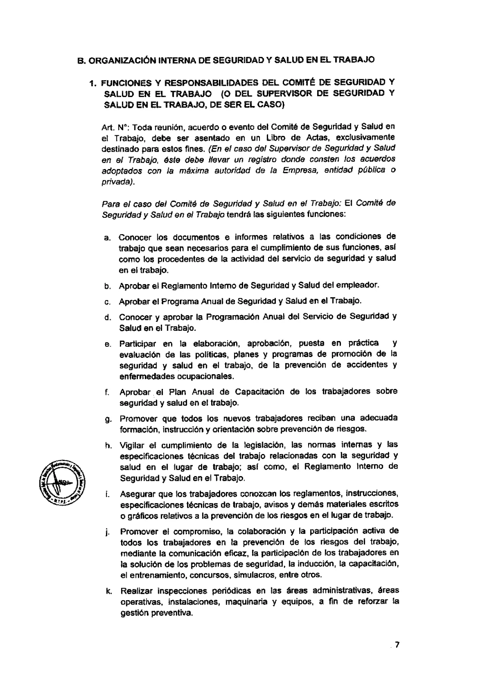

**Transcripción por reconocimiento de imagen:**

B. ORGANIZACIÓN INTERNA DE SEGURIDAD Y SALUD EN EL TRABAJO

1. FUNCIONES Y RESPONSABILIDADES DEL COMITÉ DE SEGURIDAD Y
SALUD EN EL TRABAJO (O DEL SUPERVISOR DE SEGURIDAD Y
SALUD EN EL TRABAJO, DE SER El. CASO)

Art. N”: Toda reunión, acuerdo o evento del Comité de Seguridad y Salud en
el Trabajo, debe ser asentado en un Libro de Actas, exclusivamente
destinado para estos fines. (En el caso del Supervisor de Seguridad y Salud
en el Trabajo, éste debe llevar un registro donde consten los acuerdos
adoptados con la máxima autoridad de la Empresa, entidad pública o
privada).

Para el caso del Comité de Seguridad y Salud en el Trabajo: El Comité de
Seguridad y Salud en el Trabajo tendrá las siguientes funciones:

a. Conocer los documentos e informes relativos a las condiciones de
trabajo que sean necesarios para el cumplimiento de sus funciones, así
como los procedentes de la actividad del servicio de seguridad y salud
en el trabajo.

b. Aprobar el Reglamento Intemo de Seguridad y Salud del empleador.
c. Aprobar el Programa Anual de Seguridad y Salud en el Trabajo.

d. Conocer y aprobar la Programación Anual del Servicio de Seguridad y
Salud en el Trabajo.

e. Participar en la elaboración, aprobación, puesta en práctica y
evaluación de las políticas, planes y programas de promoción de la
seguridad y salud en el trabajo, de la prevención de accidentes y
enfermedades ocupacionales.

f Aprobar el Plan Anual de Capacitación de los trabajadores sobre
seguridad y salud en el trabajo.

9. Promover que todos los nuevos trabajadores reciban una adecuada
formación, instrucción y orientación sobre prevención de riesgos.

h. Vigilar el cumplimiento de la legislación, las normas internas y las
especificaciones técnicas del trabajo relacionadas con la seguridad y
salud en el lugar de trabajo; así como, el Reglamento Interno de
Seguridad y Salud en el Trabajo.

i. Asegurar que los trabajadores conozcan los reglamentos, instrucciones,
especificaciones técnicas de trabajo, avisos y demás materiales escritos
o gráficos relativos a la prevención de los riesgos en el lugar de trabajo.

j. Promover el compromiso, la colaboración y la participación activa de
todos los trabajadores en ta prevención de los riesgos del trabajo,
mediante la comunicación eficaz, la participación de los trabajadores en
la solución de los problemas de seguridad, la inducción, la capacitación,
el entrenamiento, concursos, simulacros, entre otros.

k. Realizar inspecciones periódicas en las áreas administrativas, áreas
Operativas, instalaciones, maquinaria y equipos, a fin de reforzar ia
gestión preventiva.

---

## Página 43

**Página escaneada: imagen de referencia para comprobar tablas, formularios y sus casillas.**

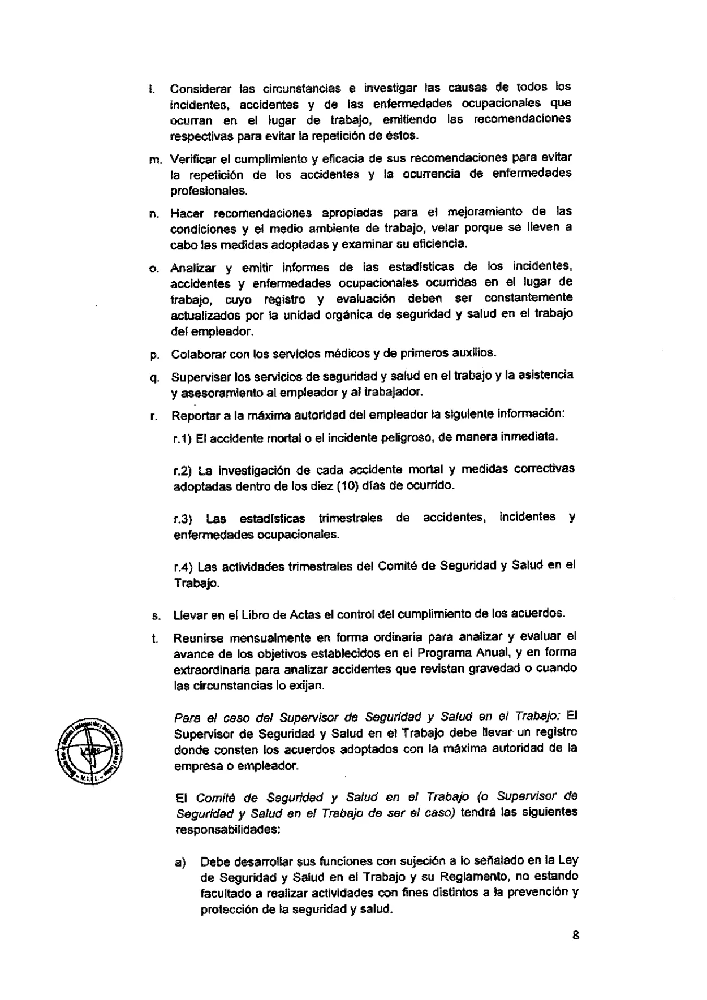

**Transcripción por reconocimiento de imagen:**

Considerar las circunstancias e investigar las causas de todos los
incidentes, accidentes y de las enfermedades ocupacionales que
ocurran en el jugar de trabajo, emitiendo las recomendaciones
respectivas para evitar la repetición de éstos.

. Verificar el cumplimiento y eficacia de sus recomendaciones para evitar

la repetición de los accidentes y la ocurrencia de enfermedades
profesionales.

Hacer recomendaciones apropiadas para el mejoramiento de las
condiciones y el medio ambiente de trabajo, velar porque se lleven a
cabo las medidas adoptadas y examinar su eficiencia.

. Analizar y emitir informes de las estadisticas de los incidentes,

accidentes y enfermedades ocupacionales ocurridas en el lugar de
trabajo, cuyo registto y evaluación deben ser constantemente
actualizados por la unidad orgánica de seguridad y salud en el trabajo
del empleador.

Colaborar con los servicios médicos y de primeros auxilios.

Supervisar los servicios de seguridad y salud en el trabajo y la asistencia
y asesoramiento al empleador y al trabajador,

Reportar a la máxima autoridad del empleador ta siguiente información:
1.1) El accidente mortal o el incidente peligroso, de manera inmediata.

1.2) La investigación de cada accidente mortal y medidas correctivas
adoptadas dentro de los diez (10) días de ocurrido.

1.3) Las estadísticas trimestrales de accidentes, incidentes y
enfermedades ocupacionales.

r.4) Las actividades trimestrales del Comité de Seguridad y Salud en el
Trabajo.

Llevar en el Libro de Actas el contro! del cumplimiento de los acuerdos.

Reunirse mensualmente en forma ordinaria para analizar y evaluar el
avance de los objetivos establecidos en el Programa Anual, y en forma
extraordinaria para analizar accidentes que revistan gravedad o cuando
las circunstancias lo exijan.

Para el caso del Supervisor de Seguridad y Salud en el Trabajo: El
Supervisor de Seguridad y Salud en el Trabajo debe llevar un registro
donde consten los acuerdos adoptados con la máxima autoridad de la
empresa o empleador.

El Comité de Seguridad y Salud en el Trabajo (o Supervisor de
Seguridad y Salud en el Trabajo de ser el caso) tendrá las siguientes
responsabilidades:

a) Debe desarrollar sus funciones con sujeción a lo señalado en la Ley
de Seguridad y Salud en el Trabajo y su Reglamento, no estando
facultado a realizar actividades con fines distintos a la prevención y
protección de la seguridad y salud.

---

## Página 44

**Página escaneada: imagen de referencia para comprobar tablas, formularios y sus casillas.**

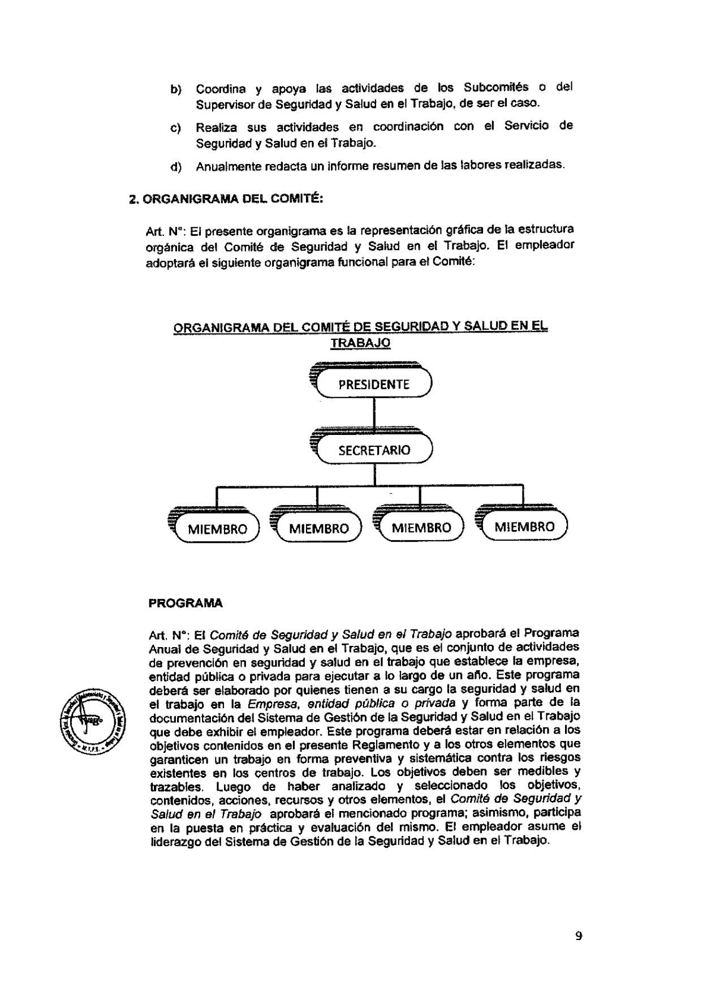

**Transcripción por reconocimiento de imagen:**

b) Coordina y apoya las actividades de los Subcomités o del
Supervisor de Seguridad y Salud en el Trabajo, de ser el caso.

c) Realiza sus actividades en coordinación con el Servicio de
Seguridad y Salud en ei Trabajo.

d) Anualmente redacta un informe resumen de las labores realizadas.
. ORGANIGRAMA DEL COMITÉ:
Art. N": El presente organigrama es la representación gráfica de la estructura

orgánica del Comité de Seguridad y Salud en el Trabajo. El empleador
adoptará el siguiente organigrama funcional para el Comité:

ORGANIGRAMA DEL COMITÉ DE SEGURIDAD Y SALUD EN.EL

TRABAJO

PROGRAMA

Art, N": El Comité de Seguridad y Salud en el Trabajo aprobará el Programa
Anual de Seguridad y Salud en el Trabajo, que es el conjunto de actividades
de prevención en seguridad y salud en el trabajo que establece la empresa,
entidad pública o privada para ejecutar a lo largo de un año. Este programa
deberá ser elaborado por quienes tienen a su cargo la seguridad y salud en
el trabajo en la Empresa, entidad pública o privada y forma parte de la
documentación del Sistema de Gestión de la Seguridad y Salud en el Trabajo
que debe exhibir el empleador. Este programa deberá estar en relación a los
objetivos contenidos en el presente Reglamento y a los otros elementos que
garanticen un trabajo en forma preventiva y sistemática contra los riesgos
existentes en los centros de trabajo. Los objetivos deben ser medibles y
trazables. Luego de haber analizado y seleccionado los objetivos,
contenidos, acciones, recursos y otros elementos, el Comité de Seguridad y
Salud en el Trabajo aprobará el mencionado programa; asimismo, participa
en la puesta en práctica y evaluación del mismo. El empleador asume el
liderazgo del Sistema de Gestión de la Seguridad y Salud en el Trabajo.

---

## Página 45

**Página escaneada: imagen de referencia para comprobar tablas, formularios y sus casillas.**

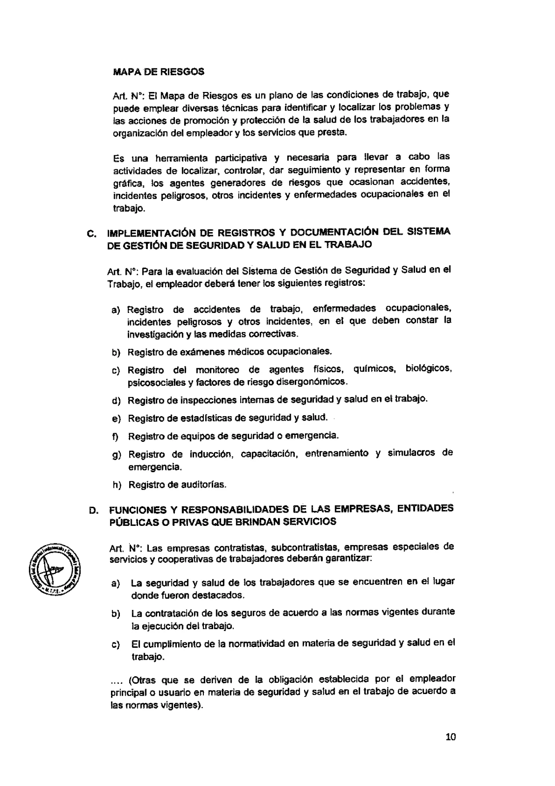

**Transcripción por reconocimiento de imagen:**

Cc.

MAPA DE RIESGOS

Art. N*: El Mapa de Riesgos es un plano de las condiciones de trabajo, que
puede emplear diversas técnicas para identificar y localizar los problemas y
las acciones de promoción y protección de la salud de los trabajadores en la
organización del empleador y tos servicios que presta.

Es una herramienta participativa y necesaria para llevar a cabo las
actividades de localizar, controlar, dar seguimiento y representar en forma
gráfica, los agentes generadores de riesgos que ocasionan accidentes,
incidentes peligrosos, otros incidentes y enfermedades ocupacionales en el
trabajo.

IMPLEMENTACIÓN DE REGISTROS Y DOCUMENTACIÓN DEL SISTEMA
DE GESTIÓN DE SEGURIDAD Y SALUD EN EL TRABAJO

Art. N*: Para la evaluación del Sistema de Gestión de Seguridad y Salud en el
Trabajo, el empleador deberá tener los siguientes registros:

a) Registro de accidentes de trabajo, enfermedades ocupacionales,
incidentes peligrosos y otros incidentes, en el que deben constar la
investigación y las medidas correctivas.

b) Registro de exámenes médicos ocupacionales.

c) Registro del monitoreo de agentes físicos, químicos, biológicos,
psicosociales y factores de riesgo disergonómicos.

d) Registro de inspecciones intemas de seguridad y salud en ei trabajo.
e) Registro de estadísticas de seguridad y salud.
f) Registro de equipos de seguridad o emergencia.

g) Registro de inducción, capacitación, entrenamiento y simulacros de
emergencia.

h) Registro de auditorías.

FUNCIONES Y RESPONSABILIDADES DE LAS EMPRESAS, ENTIDADES
PÚBLICAS O PRIVAS QUE BRINDAN SERVICIOS

Art, N”: Las empresas contratistas, subcontratistas, empresas especiales de
servicios y cooperativas de trabajadores deberán garantizar:

a) La seguridad y salud de los trabajadores que se encuentren en el lugar
donde fueron destacados.

b) La contratación de los seguros de acuerdo a las normas vigentes durante
la ejecución del trabajo.

c) El cumplimiento de la normatividad en materia de seguridad y salud en el
trabajo.

.... (Otras que se deriven de la obligación establecida por el empleador
principal o usuario en materia de seguridad y salud en el trabajo de acuerdo a
las normas vigentes).

10

---

## Página 46

**Página escaneada: imagen de referencia para comprobar tablas, formularios y sus casillas.**

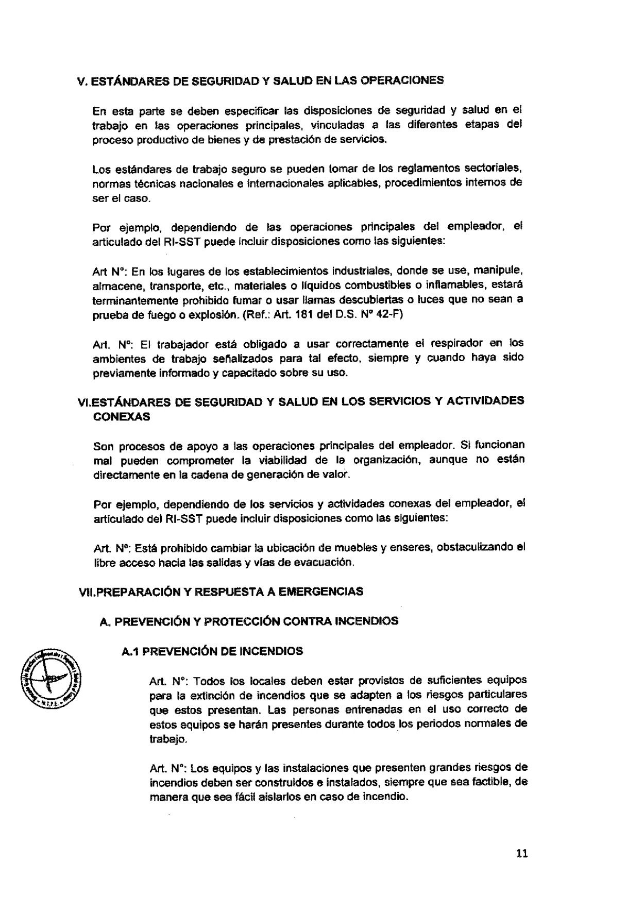

**Transcripción por reconocimiento de imagen:**

Y. ESTÁNDARES DE SEGURIDAD Y SALUD EN LAS OPERACIONES

En esta parte se deben especificar las disposiciones de seguridad y salud en el
trabajo en las operaciones principales, vinculadas a las diferentes etapas del
proceso productivo de bienes y de prestación de servicios,

Los estándares de trabajo seguro se pueden lomar de los reglamentos sectoriales,
normas técnicas nacionales e intemacionales aplicables, procedimientos internos de
ser el caso.

Por ejemplo, dependiendo de tas operaciones principales del empleador, el
articulado de! RI-SST puede incluir disposiciones como las siguientes:

Art N”: En los lugares de los establecimientos industriales, donde se use, manipule,
almacene, transporte, etc., materiales o líquidos combustibles o inflamables, estará
terminantemente prohibido fumar o usar llamas descubiertas o luces que no sean a
prueba de fuego o explosión. (Ref.: Art. 181 del D.S. N* 42-F)

Art. N“ El trabajador está obligado a usar correctamente ei respirador en los
ambientes de trabajo señalizados para tal efecto, siempre y cuando haya sido
previamente informado y capacitado sobre su uso.

VI.ESTÁNDARES DE SEGURIDAD Y SALUD EN LOS SERVICIOS Y ACTIVIDADES
CONEXAS

Son procesos de apoyo a las operaciones principales del empleador. Si funcionan
mal pueden comprometer la viabilidad de la organización, aunque no están
directamente en la cadena de generación de valor.

Por ejemplo, dependiendo de los servicios y actividades conexas del empleador, el
articulado del RI-SST puede incluir disposiciones como las siguientes:

Art. N*: Está prohibido cambiar la ubicación de muebles y enseres, obstaculizando el
libre acceso hacia las salidas y vías de evacuación.

VIl.PREPARACIÓN Y RESPUESTA A EMERGENCIAS
A. PREVENCIÓN Y PROTECCIÓN CONTRA INCENDIOS
A.1 PREVENCIÓN DE INCENDIOS
Art. N*: Todos los locales deben estar provistos de suficientes equipos
para la extinción de incendios que se adapten a los riesgos particulares
que estos presentan. Las personas entrenadas en el uso correcto de

estos equipos se harán presentes durante todos los periodos normales de
trabajo.

Art. N”: Los equipos y las instalaciones que presenten grandes riesgos de
incendios deben ser construidos e instalados, siempre que sea factible, de
manera que sea fácil aislarlos en caso de incendio.

11

---

## Página 47

**Página escaneada: imagen de referencia para comprobar tablas, formularios y sus casillas.**

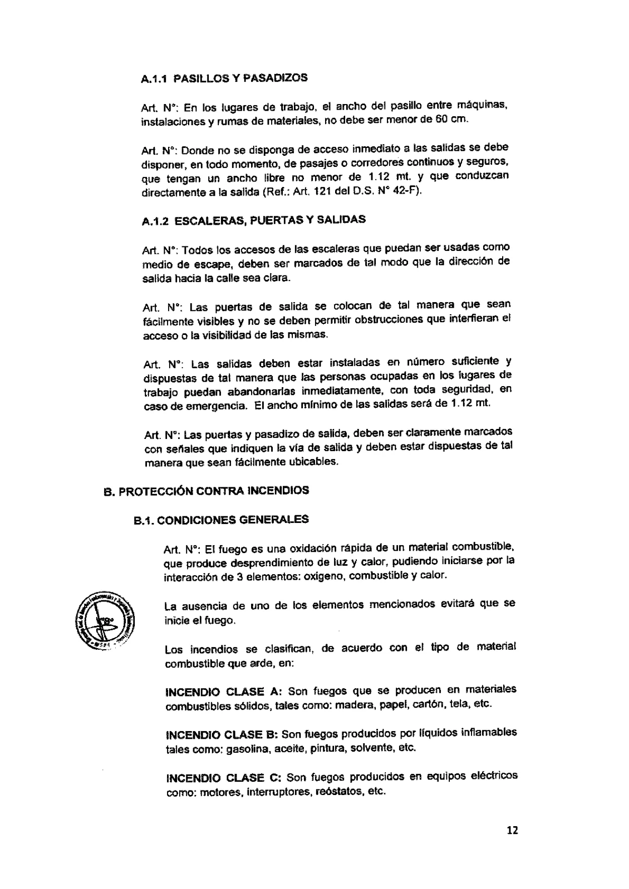

**Transcripción por reconocimiento de imagen:**

A.1.1 PASILLOS Y PASADIZOS

Art, N” En los lugares de trabajo, el ancho del pasillo entre máquinas,
instalaciones y rumas de materiales, no debe ser menor de 60 cm.

Art. N”: Donde no se disponga de acceso inmediato a las salidas se debe
disponer, en todo momento, de pasajes o corredores continuos y Seguros,
que tengan un ancho libre no menor de 1.12 mt. y que conduzcan
directamente a la salida (Ref.: Art. 121 del D.S. N* 42-F).

A.1.2 ESCALERAS, PUERTAS Y SALIDAS

Art. N”: Todos los accesos de las escaleras que puedan ser usadas como
medio de escape, deben ser marcados de tal modo que la dirección de
salida hacia la calle sea clara.

Art. N*: Las puertas de salida se colocan de tal manera que sean
fácilmente visibles y no se deben permitir obstrucciones que interfieran el
acceso o la visibilidad de las mismas.

Art. N”: Las salidas deben estar instaladas en número suficiente y
dispuestas de tal manera que las personas ocupadas en los lugares de
trabajo puedan abandonarias inmediatamente, con toda seguridad, en
caso de emergencia. El ancho mínimo de las salidas será de 1.12 mt.

Art. N': Las puertas y pasadizo de salida, deben ser claramente marcados
con señales que indiquen la vía de salida y deben estar dispuestas de tal
manera que sean fácilmente ubicables.
B. PROTECCIÓN CONTRA INCENDIOS
B.4. CONDICIONES GENERALES
Art. N*: El fuego es una oxidación rápida de un material combustible,
que produce desprendimiento de luz y calor, pudiendo iniciarse por la

interacción de 3 elementos: oxigeno, combustible y calor.

La ausencia de uno de los elementos mencionados evitará que se
inicie el fuego.

Los incendios se clasifican, de acuerdo con el tipo de material
combustible que arde, en:

INCENDIO CLASE A: Son fuegos que se producen en materiales
combustibles sólidos, tales como: madera, papel, cartón, tela, etc.

INCENDIO CLASE B: Son fuegos producidos por líquidos inflamables
tales como: gasolina, aceite, pintura, solvente, etc.

INCENDIO CLASE C: Son fuegos producidos en equipos eléctricos
como: motores, interruptores, reóstatos, etc.

12

---

## Página 48

**Página escaneada: imagen de referencia para comprobar tablas, formularios y sus casillas.**

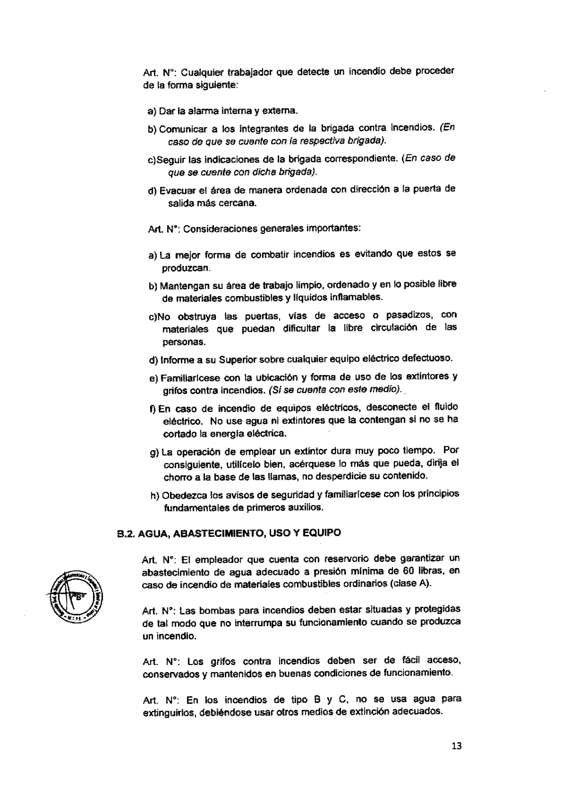

**Transcripción por reconocimiento de imagen:**

Art. N”: Cualquier trabajador que detecte un incendio debe proceder
de la forma siguiente:

a) Dar la alarma interna y externa.

b) Comunicar a los integrantes de la brigada contra incendios. (En
caso de que se cuente con la respectiva brigada).

c) Seguir las indicaciones de la brigada correspondiente. (En caso de
que se cuente con dicha brigada).

d) Evacuar el área de manera ordenada con dirección a la puerta de
salida más cercana.

Art. N”: Consideraciones generales importantes:

a) La mejor forma de combatir incendios es evitando que estos se
produzcan.

b) Mantengan su área de trabajo limpio, ordenado y en lo posible libre
de materiales combustibles y líquidos inflamables.

c)JNo obstruya las puertas, vías de acceso o pasadizos, con
materiales que puedan dificultar la libre circulación de las
personas.

d) Informe a su Superior sobre cuaiquier equipo eléctrico defectuoso.

e) Familiaricese con la ubicación y forma de uso de los extintores y
grifos contra incendios. (Si se cuenta con este medio).

f En caso de incendio de equipos eléctricos, desconecte el fluido
eléctrico. No use agua ni extintores que la contengan si no se ha
cortado la energía eléctrica.

g) La operación de emplear un extintor dura muy poco tiempo. Por
consiguiente, utilícelo bien, acérquese lo más que pueda, dirija el
chorro a la base de las llamas, no desperdicie su contenido.

h) Obedezca los avisos de seguridad y familiaricese con los principios
fundamentales de primeros auxilios.

B.2. AGUA, ABASTECIMIENTO, USO Y EQUIPO

Art. N”: El empleador que cuenta con reservorio debe garantizar un
abastecimiento de agua adecuado a presión mínima de 60 libras, en
caso de incendio de materiales combustibles ordinarios (clase A).

Art. N”: Las bombas para incendios deben estar situadas y protegidas
de tal modo que no interrumpa su funcionamiento cuando se produzca
un incendio.

Art N*: Los grifos contra incendios deben ser de fácil acceso,
conservados y mantenidos en buenas condiciones de funcionamiento.

Art. N”. En los incendios de tipo B y C, no se usa agua para
extinguirios, debiéndose usar otros medios de extinción adecuados.

13

---

## Página 49

**Página escaneada: imagen de referencia para comprobar tablas, formularios y sus casillas.**

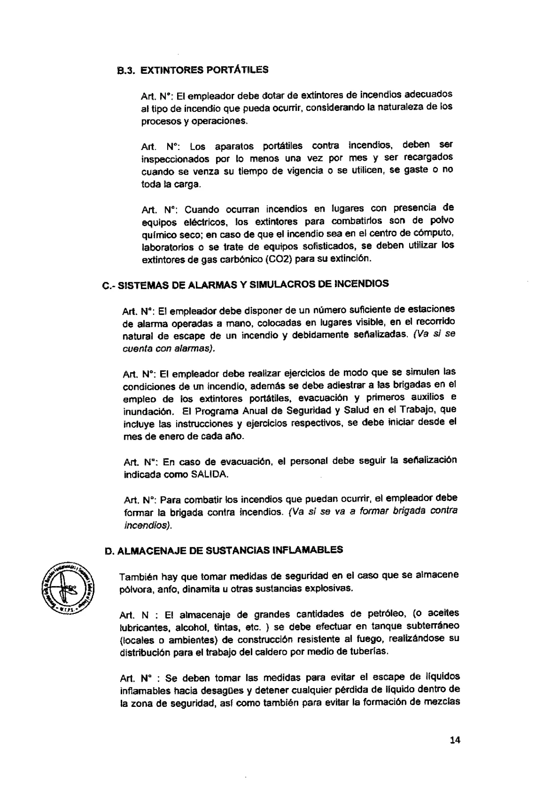

**Transcripción por reconocimiento de imagen:**

B.3. EXTINTORES PORTÁTILES

Art. N”: El empleador debe dotar de extintores de incendios adecuados
al tipo de incendio que pueda ocurrir, considerando la naturaleza de los
procesos y operaciones.

Art N*” Los aparatos portátiles contra incendios, deben ser
inspeccionados por lo menos una vez por mes y ser recargados
cuando se venza su tiempo de vigencia o se utilicen, se gaste o no
toda la carga.

Art. N*: Cuando ocurran incendios en lugares con presencia de
equipos eléctricos, los extintores para combatirlos son de polvo
químico seco; en caso de que el incendio sea en el centro de cómputo,
laboratorios o se trate de equipos sofisticados, se deben utilizar los
extintores de gas carbónico (CO2) para su extinción.

C.- SISTEMAS DE ALARMAS Y SIMULACROS DE INCENDIOS

Art. N*: El empleador debe disponer de un número suficiente de estaciones
de alarma operadas a mano, colocadas en lugares visible, en el recorrido
natural de escape de un incendio y debidamente señalizadas. (Va si se
cuenta con alarmas).

Art. N”: El empleador debe realizar ejercicios de modo que se simulen las
condiciones de un incendio, además se debe adiestrar a las brigadas en el
empleo de los extintores portátiles, evacuación y primeros auxilios e
inundación. El Programa Anual de Seguridad y Salud en el Trabajo, que
incluye las instrucciones y ejercicios respectivos, se debe iniciar desde el
mes de enero de cada año.

Art. N“: En caso de evacuación, el personal debe seguir la señalización
indicada como SALIDA.

Art. N”: Para combatir los incendios que puedan ocurrir, el empleador debe
formar la brigada contra incendios. (Va sí se va a formar brigada contra
incendios).

D. ALMACENAJE DE SUSTANCIAS INFLAMABLES

También hay que tomar medidas de seguridad en el caso que se almacene
pólvora, anfo, dinamita u otras sustancias explosivas.

Art. N ; El almacenaje de grandes cantidades de petróleo, (o aceites
lubricantes, alcohol, tintas, etc. ) se debe efectuar en tanque subterráneo
(locales o ambientes) de construcción resistente al fuego, realizándose su
distribución para el trabajo del caldero por medio de tuberías.

Art. N* ; Se deben tomar las medidas para evitar el escape de líquidos

inflamables hacia desagles y detener cualquier pérdida de iiquido dentro de
la zona de seguridad, así como también para evitar la formación de mezcias

14

---

## Página 50

**Página escaneada: imagen de referencia para comprobar tablas, formularios y sus casillas.**

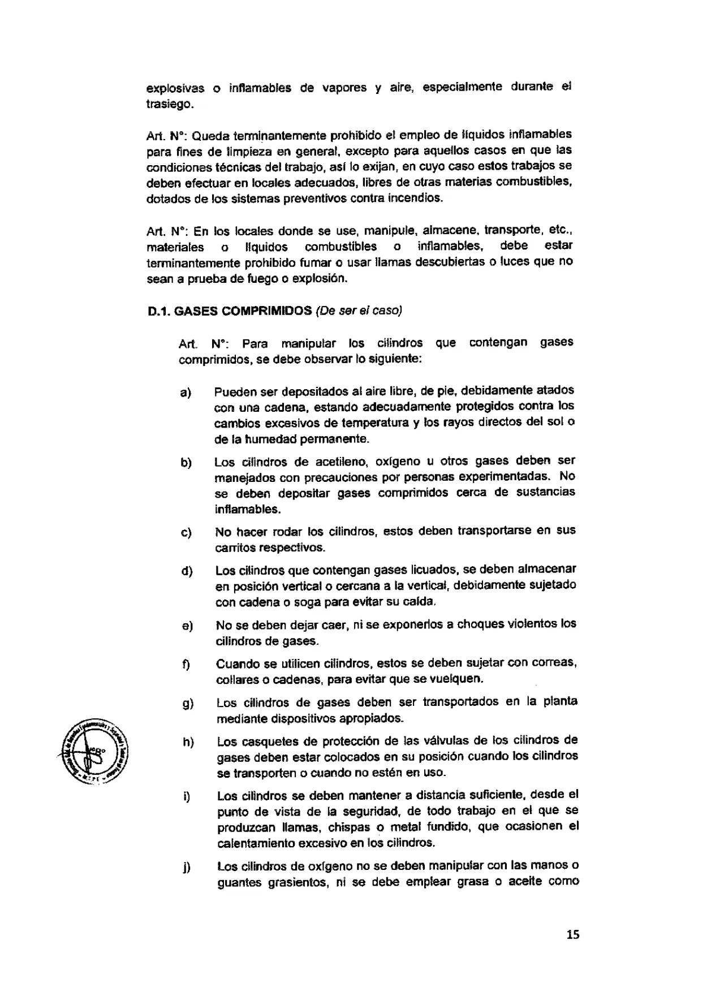

**Transcripción por reconocimiento de imagen:**

explosivas o inflamables de vapores y aire, especialmente durante ei
trasiego.

Art. N”: Queda terminantemente prohibido el empleo de ¡líquidos inflamables
para fines de limpieza en general, excepto para aquellos casos en que las
condiciones técnicas del trabajo, así lo exijan, en cuyo caso estos trabajos se
deben efectuar en locales adecuados, libres de otras materias combustibles,
dotados de los sistemas preventivos contra incendios.

Art. N”: En los locales donde se use, manipule, almacene, transporte, etc.,
materiales O liquidos combustibles o inflamables, debe estar
terminantemente prohibido fumar o usar llamas descubiertas o luces que no
sean a prueba de fuego o explosión.

D.1. GASES COMPRIMIDOS (De ser el caso)

Art N*“ Para manipular los cilindros que contengan gases
comprimidos, se debe observar lo siguiente:

a) Pueden ser depositados al aire libre, de pie, debidamente atados
con una cadena, estando adecuadamente protegidos contra los
cambios excesivos de temperatura y los rayos directos del sol o
de la humedad permanente.

b) Los cilindros de acetileno, oxígeno u otros gases deben ser
manejados con precauciones por personas experimentadas. No
se deben depositar gases comprimidos cerca de sustancias
inflamables.

c) No hacer rodar los cilindros, estos deben transportarse en sus
carritos respectivos.

d) Los cilindros que contengan gases licuados, se deben almacenar
en posición vertical o cercana a la vertical, debidamente sujetado
con cadena o soga para evitar su caída,

8) No se deben dejar caer, ni se exponerlos a choques violentos los
cilindros de gases.

1 Cuando se utilicen cilindros, estos se deben sujetar con correas,
collares o cadenas, para evitar que se vuelquen.

ga) Los cilindros de gases deben ser transportados en la planta
mediante dispositivos apropiados.

h) Los casquetes de protección de las válvulas de tos cilindros de
gases deben estar colocados en su posición cuando los cilindros
se transporten o cuando no estén en uso.

5] Los cilindros se deben mantener a distancia suficiente, desde el
punto de vista de la seguridad, de todo trabajo en el que se
produzcan llamas, chispas o meta! fundido, que ocasionen el
calentamiento excesivo en los cilindros,

i) Los cilindros de oxígeno no se deben manipular con las manos o
guantes grasientos, ni se debe emplear grasa o aceite como

15

---

## Página 51

**Página escaneada: imagen de referencia para comprobar tablas, formularios y sus casillas.**

**Transcripción por reconocimiento de imagen:**

lubricante en las válvulas, accesorios, manómetros o en el
equipo regulador.

E. ELIMINACIÓN DE DESPERDICIOS

Art. N”: No se debe permitir que se acumulen en el piso desperdicios de
material inflamable, los cuales deben ser destruidos o acumulados
separadamente de otros desperdicios.

Art, N*: Se debe disponer de recipientes para recoger inmediatamente los
trapos saturados de aceite, pintura u otros materiales combustibles, sujeto a
combustión espontánea en los lugares de trabajo donde estos se
produzcan,

Art. N*: Diariamente el encargado de limpieza debe recolectar los
recipientes de basura de cada ambiente, colocándolos en un lugar
determinado para ser erradicados de ta empresa, entidad pública o privada.

F. SEÑALES DE SEGURIDAD
F.1. OBJETO

Art. N”: El objeto de las señales de seguridad es el hacer conocer con
la mayor rapidez posible, la posibilidad de accidente y el tipo de
accidente y la existencia de circunstancias particulares.

F.2. DIMENSIONES DE LAS SEÑALES DE SEGURIDAD

Art. N” : Las señales de seguridad serán tan grandes como sea
posible y su tamaño será congruente con el lugar en que se colocan o
el tamaño de los objetos, dispositivos o materiales a los cuales se
fijan. En todos los casos el símbolo de seguridad, debe ser
identificado desde una distancia segura.

Art. N”: Las dimensiones de las señales de seguridad son las

siguientes:

-Círculo : 20 cm. de diámetro

-Cuadrado : 20 cm. de lado

-Rectángulo : 20 cm. de altura y 30 cm. de base
-Triángulo equilátero : 20 cm. de lado

Estas dimensiones pueden multiplicarse pos las series siguientes:
1.25, 1.75, 2, 2.25, 2.5, y 3.5, según sea necesario ampliar el
tamaño.

F.3.APLICACIÓN DE LOS COLORES Y SÍMBOLOS EN LAS SEÑALES
DE SEGURIDAD

Art. N”: Las señales de prohibición tienen como color de fondo blanco,
la corona circular y la barra transversal son rojos, el símbolo de
seguridad negro y se ubica al centro y no se superpone a la barra

16

---

## Página 52

**Página escaneada: imagen de referencia para comprobar tablas, formularios y sus casillas.**

**Transcripción por reconocimiento de imagen:**

transversal, el color rojo cubre como mínimo el 35% del área de la
señal.

Art. N” : Las señales de advertencia tienen como color de fondo el
amarillo, la banda triangular negra, el símbolo de seguridad negro y
ubicado en el centro, el color amarillo debe cubrir como mínimo el
50% de área de la señal.

Art. N* : Las señales de obligatoriedad tendrán un color de fondo azul,
la banda circular es blanca, el símbolo de seguridad es blanco y debe
estar ubicado en el centro, el color azul cubre como mínimo el 50% del
área de la señal.

Art, N* : Las señales informativas se deben ubicar en equipos de
seguridad en general, rutas de escape, etc. Las formas de las señales
informativas deben ser cuadradas o rectangulares, según convengan
a le ubicación del símbolo de seguridad o el texto. El símbolo de
seguridad es blanco, el color de fondo es verde y debe cubrir como
mínimo el 50% del área de la señal.

G. PRIMEROS AUXILIOS (Se sugieren algunos casos)
G.1. GENERALIDADES

Art. N': El principal objetivo de los primeros auxilios es evitar por todos los
medios posibles la muerte o la invalidez de la persona accidentada.

Otros de los objetivos principales es brindar un auxilio a la persona
accidentada, mientras se espera la llegada del médico o se le traslada a
un hospital,

G.2. REGLAS GENERALES

Art. N*: Cuando se presente la necesidad de un tratamiento de
emergencia, siga estas reglas básicas:
a) Evite el nerviosismo y el pánico.

b) Si se requiere acción inmediata para salvar una vida (respiración
artificial, control de hemorragias, etc.) haga el tratamiento
adecuado sin demora.

c) Haga un examen cuidadoso de la víctima.

d) Nunca mueva a la persona lesionada, a menos que sea
absolutamente necesario para retirarla del peligro.

e) Avise al médico inmediatamente.
G.3. TRATAMIENTOS
1. SHOCK
Art. N*: Cuando ocurra un “shock” siga estas reglas básicas:

17

---

## Página 53

**Página escaneada: imagen de referencia para comprobar tablas, formularios y sus casillas.**

**Transcripción por reconocimiento de imagen:**

a) Acostar al paciente con la cabeza hacia abajo, esto se puede
conseguir levantando los pies de la camilla o banca, donde
esté acostado el paciente, 6 pulgadas más alto que la
cabeza.

b) Constatar que la boca del paciente esté libre de cuerpos
extraños y que la lengua esté hacia adelante.

c) Suministrar al paciente abundante cantidad de aire fresco U
oxígeno si existe disponible.

d) Evitar el enfriamiento, por lo que se debe abrigar al paciente
con una frazada y llevarlo al médico.
2. HERIDAS CON HEMORRAGIAS

Art. N”: Seguir el siguiente tratamiento:

a) Se puede parar o retardar la hemorragia colocando una
venda o pañuelo limpio sobre la herida y presionando
moderadamente.

b) Si la hemorragia persiste, aplique un torniquete (cinturón,
pañuelo, etc.), en la zona inmediatamente superior a la herida
y ajuste fuertemente.

c) Acueste al paciente y trate de mantenerlo abrigado.
d) Conduzca al herido al hospital.

Si el viaje es largo, suelte el tomiquete cada 15 minutos para que
circule la sangre.

3. FRACTURAS
Art. N”; Siga el siguiente tratamiento:

a) No doble, ni tuerza, ni jale el miembro fracturado.
b) Mantenga al paciente descansando y abrigado,

c) Por fracturas de espalda, cuello, brazo o de la pierna, no
mueva al paciente y llame al médico.

d) Por fracturas de cualquier otra parte del cuerpo, lleve al
accidentado al médico.

e) Si hay duda acerca de si un hueso está o no fracturado,
trátese como fractura.

4, QUEMADURAS

Art. N*: Son lesiones que se producen a causa del calor seco o
del calor húmedo y se clasifican de acuerdo al grado de lesión
que causa en los tejidos del cuerpo en 1er, 2do y 3er grado.

18

---

## Página 54

**Página escaneada: imagen de referencia para comprobar tablas, formularios y sus casillas.**

**Transcripción por reconocimiento de imagen:**

a) Para quemaduras leves o de primer grado se puede aplicar
ungUento y puede ser cubierta por una gasa esterilizada.

b) Para quemaduras de segundo y tercer grado quite la ropa
suelta y aplique una gasa esterilizada, lo suficientemente
grande para cubrir la quemadura y la zona circundante para
evitar el contacto del aire con la quemadura.

5. RESPIRACIÓN BOCA A BOCA

Art. N”: Es un método efectivo mediante el cual se revive a una
persona que no puede respirar por sí misma, su aplicación nunca
daña a la víctima, aunque la falta de ésta puede resultar fatal ya
que cualquier demora puede producir consecuencias graves O
fatales.

a) Acueste de espaldas y en su posición horizontal al lesionado
y colóquese al lado junto a la cabeza.

b) Levante ta mandíbula inferior para asegurar el paso del aire.

ce) Trate de cubrir la boca, para ello introduzca el dedo, pulgar y
tire del mentón hacia delante, con la otra mano tape los
orificios nasales (eso evita la pérdida del aire).

d) Respire profundamente y coloque su boca sobre la de la
víctima y sople en forma suave y regular.

e) Retire su boca para permitir que la víctima exhale, vuelva a
soplar y repita 12 veces por minuto como mínimo. Algunas
veces la víctima cierra la boca fuertemente, por lo que
resulta dificil abrirla, en estos casos sople el aire por ta
nariz, selle los labios con el índice de la mano que contiene
la barbilla.

6.4, BOTIQUÍN DE PRIMEROS AUXILIOS

Art. N”: La empresa, entidad pública o privada abastecerá de
manera que haya siempre un stock permanente de los siguientes
medicamentos y materiales en el Botiquín:

a) instrumentos: Tijeras, pinzas, navaja u hoja de afeitar,
termómetro bucal, torniquetes, etc.

b) Vendas: Gasa esterilizada, rollo de tela adhesiva O
esparadrapo, caja de curitas, paquetes de algodón absorbente,
etc.

c) Drogas: Agua oxigenada, alcohol, yodo, mercurio, cromo,
picrato de butesin, jabón germicida, aspirina (o equivalente),
antibióticos, calmantes de dolor, entre otros.

19

---

## Página 55

**Página escaneada: imagen de referencia para comprobar tablas, formularios y sus casillas.**

**Transcripción por reconocimiento de imagen:**

ANEXO 3

GUÍA BÁSICA SOBRE SISTEMA DE GESTIÓN DE SEGURIDAD Y SALUD EN EL
TRABAJO

INTRODUCCIÓN

La presente Guía Básica sobre Sistemas de Gestión en Seguridad y Salud en el Trabajo (SST) se
ha elaborado considerando un marco para abordar globalmente ta gestión de la prevención de los
riesgos laborales y para mejorar su funcionamiento de una forma organizada y continua. En tal
sentido, se revisaron los enfoques de las Directrices de la OIT sobre Sistemas de Gestión en
Seguridad y Salud en el Trabajo (ILO/OSH 2001), OHSAS 18001 Sistemas de Gestión de
Seguridad y Salud Ocupacional y la normativa nacional: Ley N” 29783, Ley de Seguridad y Salud
en el Trabajo y su Reglamento aprobado mediante el Decreto Supremo N? 005-2012-TR.

Esta guía básica es de uso referencial para todas las empresas, entidades públicas o
privadas del sector industria, comercio, servicios y otros. En esta guía se encontrarán pautas
de los principales aspectos de un sistema de gestión; como la de elaborar una política, desarrollar
o implementar medidas de contro! adecuadas, verificar las medidas tomadas y comprobar que
éstas hayan dado resultados positivos y finalmente, actuar para corregir los problemas
encontrados y proponer las acciones en pro de mejoras continuas.

La guía básica comprende cinco partes:

1.- Lista de verificación de lineamientos del Sistema de Gestión de Seguridad y Salud en el
Trabajo.

2.- Plan y programa anual de Seguridad y Salud en el Trabajo.

3.- Identificación de Peligros y Evaluación de Riesgos Laborales.

4.- Mapa de Riesgos.

5.- Auditoria del Sistema de Gestión de Seguridad y Salud en el Trabajo.

Asimismo, esta gula puede ser usada por los inspectores de trabajo, auditores, supervisores y
comités de seguridad y salud en el trabajo, así como otras personas encargadas de la seguridad y
salud en los centros de trabajo, para verificar los aspectos del sistema de gestión en seguridad y
salud en el trabajo que han sido implementados y los que están pendientes, con el fin de identificar
las actividades prioritarias que puedan ser recomendadas para su inmediata implementación.

Finalmente, esperamos que la aplicación de la presente gula sea un instrumento que garantice
progresivamente la implementación de un sistema de prevención de riesgos laborales y ayude al
esfuerzo de los empleadores y trabajadores para reducir significativamente los accidentes de
trabajo y enfermedades ocupacionales, en pro de mejoras del bienestar de los trabajadores, de
sus familias y del pals.

---

## Página 56

**Página escaneada: imagen de referencia para comprobar tablas, formularios y sus casillas.**

**Transcripción por reconocimiento de imagen:**

LINEAMIENTOS

INDICADOR

CUMPLIMIENTO

1. LISTA DE VERIFICACIÓN DE LINEAMIENTOS DEL SISTEMA DE GESTIÓN DE SEGURIDAD Y SALUD EN EL TRABAJO

FUENTE sI

NO

]

OBSERVACIÓN

l. Compromiso e involucramiento

Principios

El empleador proporciona los recursos necesarios para que se implemente
un sistema de gestión de seguridad y salud en el trabajo,

Se ha cumplido lo planificado en los diferentes programas de seguridad y
salud en el trabajo.

[Se implementan acciones preventivas de seguridad y salud en el trabajo
para asegurar la mejora continua.

Se reconoce el desempeño del trabajador para mejorar la autoestima y se
fomenta el trabajo en equipo.

Se realizan actividades para fomentar una cultura de prevención de riesgos
de! trabajo en toda la empresa, entidad pública o privada.

Se promueve un buen clima laboral para reforzar la empatía entre
empleador y trabajador y viceversa.

Existen medios que permiten el aporte de los trabajadores al empleador en
materia de seguridad y salud en el trabajo.

Existen mecanismos de reconocimiento del personal proactivo interesado
en el mejoramiento continuo de la seguridad y salud en el trabajo.

Se tiene evaluado los principales riesgos que ocasionan mayores pérdidas.

Se fomenta la participación de los representantes de trabajadores y de las
organizaciones sindicales en las decisiones sobre la seguridad y salud en
el trabajo.

M. Política de seguridad y salud ocupacional

Política

Existe una política documentada en materia de seguridad y salud en el
trabajo, específica y apropiada para la empresa, entidad pública o privada.

La política de seguridad y salud en el trabajo está firmada por la máxima
autoridad de la empresa, entidad pública o privada.

Los trabajadores conocen y están comprometidos con lo establecido en la
política de seguridad y salud en el trabajo.

Su contenido comprende :

- El compromiso de protección de todos
organización.

-— Cumplimiento de la normatividad.

- Garantia de protección, participación, consuita y participación en los
elementos del sistema de gestión de seguridad y salud en el trabajo

los miembros de la

---

## Página 57

**Página escaneada: imagen de referencia para comprobar tablas, formularios y sus casillas.**

**Transcripción por reconocimiento de imagen:**

1. LISTA DE VERIFICACIÓN DE LINEAMIENTOS DEL SISTEMA DE GESTIÓN DE SEGURIDAD Y SALUD EN EL TRABAJO

LINEAMIENTOS INDICADOR CUMPLIMIENTO

FUENTE si [_NO OBSERVACIÓN

por parte de los trabajadores y sus representantes.

- La mejora continua en materia de seguridad y salud en el trabajo

- Integración del Sistema de Gestión de Seguridad y Salud en el Trabajo
con otros sistemas de ser el caso.

Se toman decisiones en base al análisis de inspecciones, auditorias,
informes de investigación de accidentes, informe de estadísticas, avances
de programas de seguridad y salud en el trabajo y opiniones de

Di ión
trección trabajadores, dando el seguimiento de las mismas.

El empleador delega funciones y autoridad al personal encargado de|
implementar el sistema de gestión de Seguridad y Salud en el Trabajo.

r El empleador asume el liderazgo en la gestión de la seguridad y salud en |
el trabajo.

El empleador dispone los recursos necesarios para mejorar la gestión de la
seguridad y salud en el trabajo.

Liderazgo

Existen responsabilidades específicas en seguridad y salud en el trabajo de
los niveles de mando de la empresa, entidad pública o privada.

Use ha destinado presupuesto para implementar o mejorar el sistema de
gestión de seguridad y salud el trabajo.

Organización

El Comité o Supervisor de Seguridad y Salud en el Trabajo participa en la
definición de estimulos y sanciones.

El empleador ha definido los requisitos de competencia necesarios para
cada puesto de trabajo y adopta disposiciones de capacitación en materia
de seguridad y salud en el trabajo para que éste asuma sus deberes con
responsabilidad. |

Competencia

IU. Planeamiento y aplicación

—
Se ha realizado una evaluación inicial o estudio de línea base como
diagnóstico participativo del estado de la salud y seguridad en el trabajo.

Diagnóstico Tos resultados han sido comparados con lo establecido en la Ley de SST y]
su Reglamento y otros dispositivos legales pertinentes, y servirán de base
para planificar, aplicar el sistema y como referencia para medir su mejora
continua.

---

## Página 58

**Página escaneada: imagen de referencia para comprobar tablas, formularios y sus casillas.**

**Transcripción por reconocimiento de imagen:**

ÓN DE LINEAMIENTOS DEL SISTEMA DE GESTIÓN DE SEGURIDAD Y SALUD EN EL TRABAJO

CUMPLIMIENTO
FUENTE E NO OBSERVACIÓN

1. LISTA DE VERIFICACI

LINEAMIENTOS INDICADOR
| La planificación permite:

— Cumplir con nomas nacionales
- Mejorar el desempeño
- Mantener procesos productivos seguros o de servicios seguros. |
El empleador ha establecido procedimientos para identificar peligros y
evaluar riesgos.
Comprende estos procedimientos:
- Todas las actividades
—- Todo el personal
— Todas las instalaciones
El empleador aplica medidas para: ]
- Gestionar, eliminar y controlar riesgos.
— Diseñar ambiente y puesto de trabajo, seleccionar equipos y métodos
de trabajo que garanticen la seguridad y salud del trabajador.
— Eliminar las situaciones y agentes peligrosos o sustituirios.
identificación de -  Modemizar los planes y programas de prevención de riesgos laborales.
pellgros, evaluación | = Mantener políticas de protección.
y control de riesgos | -— Capacitar anticipadamente al trabajador.

Planeamiento para la

El empleador actualiza la evaluación de riesgo una (01) vez al año como
mínimo o cuando cambien las condiciones o se hayan producido daños.

La evaluación de riesgo considera:

-  Contrales periódicos de las condiciones de trabajo y de la salud de los
trabajadores.

— Medidas de prevención.

Los representantes de los trabajadores han participado en la identificación

de peligros y evaluación de riesgos, han sugerido las medidas de control y

verificado su aplicación. AÑ

---

## Página 59

**Página escaneada: imagen de referencia para comprobar tablas, formularios y sus casillas.**

**Transcripción por reconocimiento de imagen:**

1. LISTA DE VERIFICACIÓN DE LINEAMIENTOS DEL SISTEMA DE GESTIÓN DE SEGURIDAD Y SALUD EN EL TRABAJO

CUMPLIMIENTO
FUENTE si [ no OBSERVACIÓN

LENEAMIENTOS INDICADOR

Los objetivos se centran en el logro de resultados realistas y posibles de

aplicar, que comprende:

-- Reducción de los riesgos del trabajo.

.. Reducción de los accidentes de trabajo y enfermedades
ocupacionales.

- La mejora continua de los procesos, la gestión del cambio, la
preparación y respuesta a situaciones de emergencia.

- Definición de metas, indicadores, responsabilidades.

- Selección de criterios de medición para confirmar su logro.

La empresa, entidad pública o privada cuenta con objetivos cuantificables

de seguridad y salud en el trabajo que abarca a todos los niveles de la

organización y están documentados.

Existe un programa anual de seguridad y salud en el trabajo.

Las actividades programadas están relacionadas con el logro de los V
objetivos.
Se definen responsables de fas actividades en el programa de seguridad y

Objetivos

Programa de salud en el trabajo.
seguridad y salud en - pS —
el trabajo Se definen tiempos y plazos para el cumplimiento y se realiza seguimiento

Se establecen actividades preventivas ante los riesgos que inciden en la

periódico.
Se señala dotación de recursos humanos y económicos |

Y
función de procreación del trabajador.

IV. Implementación y operación

El Comité de Seguridad y Salud en el Trabajo está constituido de forma
paritaria. (Para el caso de empleadores con 20 o más trabajadores).

Existe al menos un Supervisor de Seguridad y Salud (para el caso de
empleadores con menos de 20 trabajadores).

Estructura y El empleador es responsable de:
responsabilidades |- Garantizar la seguridad y salud de los trabajadores.
— Actúa para mejorar el nivel de seguridad y salud en el trabajo,
- Actúa en tomar medidas de prevención de riesgo ante modificaciones

de las condiciones de trabajo.
- Realiza los exámenes médicos ocupacionales al trabajador antes,

---

## Página 60

**Página escaneada: imagen de referencia para comprobar tablas, formularios y sus casillas.**

**Transcripción por reconocimiento de imagen:**

1. LISTA DE VERIFICACIÓN DE LINEAMIENTOS DEL SISTEMA DE GESTIÓN DE SEGURIDAD Y SALUD EN EL TRABAJO

CUMPLIMIENTO
LINEAMIENTOS INDICADOR FUENTE sI NO

durante y al término de la relación laboral. |

OBSERVACIÓN

El empleador considera las competencias del trabajador en materia de
seguridad y salud en el trabajo, al asignarle sus labores. ed
El empleador controla que solo el personal capacitado y protegido acceda a
zonas de alto riesgo.

El empleador prevé que la exposición a agentes físicos, químicos,
biológicos, disergonómicos y psicosociales no generen daño al trabajador o
trabajadora.

El empleador asume los costos de las acciones de seguridad y salud
ejecutadas en el centro de trabajo.

El empleador toma medidas para transmitir al trabajador información sobre
los riesgos en el centro de trabajo y las medidas de protección que
corresponda.

—Á

A A E O DO | —)
El empleador imparte la capacitación dentro de la jornada de trabajo.

El costo de las capacitaciones es integramente asumido por el empleador.

Los representantes de los trabajadores han revisado el programa de T

capacitación.

La capacitación se imparte por personal competente y con experiencia en

la materia.

Fe ha capacitado a los miegranes del comió de seguridad y salud en 1] YY]

trabajo o al supervisor de seguridad y salud en el trabajo.

Las capacitaciones están documentadas.

Mes han realizado capacitaciones de seguridad y salud en el trabajo:

— Al momento de la contratación, cualquiera sea la modalidad o duración.

- Durante el desempeño de la labor.

- Especifica en el puesto de trabajo o en la función que cada trabajador
desempeña, cualquiera que sea la naturaleza del vinculo, modalidad o
duración de su contrato.

Capacitación

---

## Página 61

**Página escaneada: imagen de referencia para comprobar tablas, formularios y sus casillas.**

**Transcripción por reconocimiento de imagen:**

CACIÓN DE LINEAMIENTOS DEL SISTEMA

SEGURIDAD Y SA

CUMPLIMIENTO
FUENTE Sí NO | OBSERVACIÓN

N EL TRABAJO

LINEAMIENTOS INDICADOR

- Cuando se produce cambios en las funciones que desempeña el
trabajador.

- Cuando se produce cambios en las tecnologías o en los equipos de
trabajo.

— En las medidas que permitan la adaptación a la evolución de los riesgos
y la prevención de nuevos riesgos.

- Para la actualización periódica de los conocimientos.

-- Utilización y mantenimiento preventivo de las maquinarias y equipos.

- Uso apropiado de los materiales peligrosos.

Las medidas de prevención y protección se aplican en el orden de

prioridad:

—- Eliminación de los peligros y riesgos.

— Tratamiento, contro! o aislamiento de los peligros y riesgos, adoptando
medidas técnicas o administrativas.

— Minimizar los peligros y riesgos, adoptando sistemas de trabajo seguro

Medidas de que incluyan disposiciones administrativas de control.

prevención - Programar la sustitución progresiva y en la brevedad posible, de los
procedimientos, técnicas, medios, sustancias y productos peligrosos
por aquellos que produzcan un menor riesgo o ningún riesgo para el
trabajador.

— En último caso, facilitar equipos de protección personal adecuados,
asegurándose que los trabajadores los utilicen y conserven en forma
correcta.

La empresa, entidad pública o privada ha elaborado planes y

procedimientos para enfrentar y responder ante situaciones de

emergencias.

Se tiene organizada la brigada para actuar en caso de: incendios, primeros

auxilios, evacuación.

La empresa, entidad pública o privada revisa los planes y procedimientos

ante situaciones de emergencias en forma periódica.

Preparación y
respuestas ante
emergencias

— AAA]
El empleador ha dado las instrucciones a los trabajadores para que en
caso de un peligro grave e inminente puedan interrumpir sus labores y/o
evacuar la zona de riesgo.

---

## Página 62

**Página escaneada: imagen de referencia para comprobar tablas, formularios y sus casillas.**

**Transcripción por reconocimiento de imagen:**

1. LISTA DE VERIFICACIÓN DE LINEAMIENTOS DEL SISTEMA DE GESTIÓN DE SEGURIDAD Y SALUD EN EL TRABAJO

LINEAMIENTOS

INDICADOR

CUMPLIMIENTO

FUENTE

NO

OBSERVACIÓN

Contratistas,
Subcontratistas,
empresa, entidad
pública o privada, de
servicios y
cooperativas

El empleador que asume el contrato principal en cuyas instalaciones

desarrollan actividades, trabajadores de contratistas, subcontratistas,

empresas especiales de servicios y cooperativas de trabajadores,

garantiza:

- La coordinación de la gestión en prevención de riesgos laborales.

-  Laseguridad y salud de los trabajadores.

- La verificación de la contratación de los seguros de acuerdo a ley por
cada empleador.

- La vigilancia del cumplimiento de la normatividad en materia de
seguridad y salud en el trabajo por parte de la empresa, entidad pública
o privada que destacan su personal.

Todos los trabajadores tienen el mismo nivel de protección en materia de
seguridad y salud en el trabajo sea que tengan vinculo laboral con el
empleador o con contratistas, subcontratistas, empresa especiales de
servicios o cooperativas de trabajadores.

Consulta y
comunicación

Los trabajadores han participado en:

— La consulta, información y capacitación en seguridad y salud en el
trabajo.

— La elección de sus representantes ante el Comité de seguridad y salud
en el trabajo

— La conformación del Comité de seguridad y salud en ei trabajo.

—- El reconocimiento de sus representantes por parte del empleador.

Los trabajadores han sido consultados ante los cambios realizados en las
operaciones, procesos y organización del trabajo que repercuta en su
seguridad y salud.

Existe procedimientos para asegurar que las informaciones pertinentes
lleguen a los trabajadores correspondientes de la organización

V. Evaluación normativa

Requisitos legales y
de otro tipo

La empresa, entidad pública o privada tiene un procedimiento para
identificar, acceder y monitorear el cumplimiento de la normatividad
aplicable al sistema de gestión de seguridad y salud en el trabajo y se

---

## Página 63

**Página escaneada: imagen de referencia para comprobar tablas, formularios y sus casillas.**

**Transcripción por reconocimiento de imagen:**

1. LISTA DE VERIFICACIÓN DE LINEAMIENTOS DEL SISTEMA DE GESTIÓN DE SEGURIDAD Y SALUD EN EL TRABAJO

CUMPLIMIENTO
FUENTE sI NO. OBSERVACIÓN

LINEAMIENTOS INDICADOR

mantiene actualizada

La empresa, entídad pública o privada con 20 o más trabajadores ha
elaborado su Reglamento interno de Seguridad y Salud en el Trabajo.

La empresa, entidad pública o privada con 20 o más trabajadores tiene un
Libro del Comité de Seguridad y Salud en el Trabajo (Salvo que una norma
sectorial no establezca un número mínimo inferior).

Los equipos a presión que posee la empresa entidad pública o privada
tienen su libro de servicio autorizado por el MTPE.

El empleador adopta las medidas necesarias y oportunas, cuando detecta
que la utilización de ropas y/o equipos de trabajo o de protección personal
representan riesgos específicos para la seguridad y salud de los
trabajadores.

El empleador toma medidas que eviten las labores peligrosas a
trabajadoras en periodo de embarazo o lactancia conforme a ley. —

e
El empleador no emplea a niños, ni adolescentes en actividades peligrosas.
El empleador evalúa el puesto de trabajo que va a desempeñar un
adolescente trabajador previamente a su incorporación laboral a fin de
determinar la naturaleza, el grado y la duración de la exposición a! riesgo,
con el objeto de adoptar medidas preventivas necesarias.

La empresa, entidad pública o privada dispondrá lo necesario para que:

- Las máquinas, equipos, sustancias, productos o útiles de trabajo no
constituyan una fuente de peligro.

- Se proporcione información y capacitación sobre la instalación,
adecuada utilización y mantenimiento preventivo de las maquinarias y
equipos.

— Se proporcione información y capacitación para el uso apropiado de los
materiales peligrosos.

- Las instrucciones, manuales, avisos de peligro u otras medidas de
precaución colocadas en los equipos y maquinarias estén traducido al
castellano.

- Las informaciones relativas a las máquinas, equipos, productos,
sustancias a útiles de trabajo son comprensibles para los trabajadores.

---

## Página 64

**Página escaneada: imagen de referencia para comprobar tablas, formularios y sus casillas.**

**Transcripción por reconocimiento de imagen:**

1. LI DE VERIFICACIÓN DE LINEAMIENTOS DEL SISTEMA DE GESTIÓN DE SEGURIDAD Y SALUD EN EL TRABAJO
CUMPLIMIENTO
LINEAMIENTOS INDICADOR FUENTE sI 17] OBSERVACIÓN

vi. Verificación

Los trabajadores cumplen con:

- Las normas, reglamentos e instrucciones de los programas de
seguridad y salud en el trabajo que se apliquen en el lugar de trabajo y
con las instrucciones que les impartan sus superiores jerárquicos
directos.

- Usar adecuadamente los instrumentos y materiales de trabajo, asf
como los equipos de protección personal y colectiva.

- No operar o manipular equipos, maquinarias, herramientas u otros
elementos para los cuales no hayan sido autorizados y, en caso de ser
necesario, capacitados.

- Cooperar y participar en el proceso de investigación de los accidentes
de trabajo, incidentes peligrosos, otros incidentes y las enfermedades
ocupacionales cuando la autoridad competente io requiera.

- Velar por el cuidado integral individual y colectivo, de su salud fisica y
mental,

- Someterse a exámenes médicos obligatorios

- Participar en los organismos paritarios de seguridad y salud en el
trabajo.

- Comunicar al empleador situaciones que ponga o pueda poner en
riesgo su seguridad y salud y/o las instalaciones físicas

— Reportar a los representantes de seguridad de forma inmediata, la
ocurrencia de cualquier accidente de trabajo, incidente peligroso o
incidente.

- Concurrir a la capacitación y entrenamiento sobre seguridad y salud en

el trabajo.

Supervisión,
monitoreo y
seguimiento de
desempeño

La vigilancia y control de la seguridad y salud en el trabajo permite evaluar
con regularidad tos resultados logrados en materia de seguridad y salud en
el trabajo.

La supervisión permite:

- Identificar las faltas o deficiencias en el sistema de gestión de la
seguridad y salud en el trabajo.

- Adoptar las medidas preventivas y correctivas,

---

## Página 65

**Página escaneada: imagen de referencia para comprobar tablas, formularios y sus casillas.**

**Transcripción por reconocimiento de imagen:**

LINEAMIENTOS

INDICADOR

CUMPLIMIENTO

W

El monitoreo permite la medición cuantitativa y cualitativa apropiadas.

FUENTE sI NO

OBSERVACIÓN

Se monitorea el grado de cumplimiento de los objetivos de la seguridad y
salud en el trabajo.

ANS

Salud en el trabajo

El empleador realiza exámenes médicos antes, durante y al término de la
relación laboral a tos trabajadores (incluyendo a los adolescentes).

Los trabajadores son informados:

- A título grupal, de las razones para los exámenes de salud
ocupacional.

-  Atítulo personal, sobre jos resultados de los informes médicos relativos
a la evaluación de su salud,

- Los resultados de los exámenes médicos no son pasibles de uso para
ejercer discriminación.

Los resultados de los exámenes médicos son considerados para tomar
acciones preventivas o correctivas al respecto.

Accidentes,
incidentes peligrosos
e incidentes, no
conformidad, acción
correctiva y
preventiva

El empleador notifica al Ministerio de Trabajo y Promoción del Empleo los
accidentes de trabajo mortales dentro de las 24 horas de ocurridos.

El empleador notifica al Ministerio de Trabajo y Promoción del Empleo,
dentro de las 24 horas de producidos, los incidentes peligrosos que han
puesto en riesgo la salud y la integridad física de los trabajadores y/o a la
población.

Se implementan las medidas correctivas propuestas en los registros de
accidentes de trabajo, incidentes peligrosos y otros incidentes.

Se implementan las medidas correctivas producto de la no conformidad
hallada en las auditorías de seguridad y salud en el trabajo.

Se implementan medidas preventivas de seguridad y salud en el trabajo,

Investigación de
accidentes y
enfermedades

ocupacionales preventivas adoptadas.

El empleador ha realizado las investigaciones de accidentes de trabajo,
enfermedades ocupacionales e incidentes peligrosos, y ha comunicado a la
autoridad administrativa de trabajo, indicando las medidas correctivas y

10

---

## Página 66

**Página escaneada: imagen de referencia para comprobar tablas, formularios y sus casillas.**

**Transcripción por reconocimiento de imagen:**

LINEAMIENTOS

INDICADOR

- Determinar las causas e implementar las medidas correctivas,

- Comprobar la eficacia de las medidas de Seguridad y salud vigentes al
momento de hecho,

-_ Determinar la necesidad modificar dichas medidas.

Se investiga los accidentes de trabajo, enfermedades ocupacionales e
incidentes peligrosos para:

Se toma medidas correctivas para reducir las Consecuencias de
accidentes.

Se ha documentado los cambios en los procedimientos Como consecuencia
de las acciones correctivas.

El trabajador ha sido transferido en caso de accidente de trabajo o
enfermedad ocupacional a otro Puesto que implique menos riesgo.

Control de las
Operaciones

La empresa, entidad pública o privada ha identificado tas Operaciones y
actividades que están asociadas con riesgos donde las medidas de control
necesitan ser aplicadas.

La empresa, entidad pública o privada ha establecido procedimientos para |”
el diseño del lugar de trabajo, procesos Operativos, instalaciones,
maquinarias y organización del trabajo que incluye la adaptación a las
capacidades humanas 2 modo de reducir los riesgos en sus fuentes.

Gestión del cambio

Auditorias

Se ha evaluado las medidas de seguridad debido a cambios internos,
método de trabajo, estructura organizativa y cambios externos normativos,
conocimientos en el campo de la seguridad, cambios tecnológicos,
adaptándose las medidas de prevención antes de introducirlos.

Se cuenta con un Programa de auditorías.

El empleador realiza auditorías internas periódicas para Comprobar la
adecuada aplicación del sistema de gestión de la seguridad y salud en el

trabajo.
E

Las auditorias extemas son realizadas por auditores independientes con ta
participación de los trabajadores o sus representantes.

+

Los resultados de las auditorias son comunicados a la alta dirección de la
empresa, entidad pública o privada.

11

---

## Página 67

**Página escaneada: imagen de referencia para comprobar tablas, formularios y sus casillas.**

**Transcripción por reconocimiento de imagen:**

1. LISTA DE VERIFICACIÓN DE LINEAMIENTOS DEl, SISTEMA DE GESTIÓN DE SEGURIDAD Y SALUD EN EL TRABAJO

CUMPLIMIENTO
FUENTE _| sI NO OBSERVACIÓN

LINEAMIENTOS INDICADOR

Vii. Control de información y documentos

La empresa, entidad pública o privada establece y mantiene información en

medios apropiados para describir los componentes del sistema de gestión y

su relación entre ellos.

Los procedimientos de la empresa, entidad pública o privada, en la gestión

de la seguridad y salud en el trabaja, se revisan periódicamente.

El empleador establece y mantiene disposiciones y procedimientos para:

- Recibir, documentar y responder adecuadamente a las comunicaciones
internas y externas relativas a la seguridad y salud en el trabajo.

- Garantizar la comunicación interna de la información relativa a ia
seguridad y salud en el trabajo entre los distintos niveles y cargos de la
organización.

- Garantizar que las sugerencias de los trabajadores o de sus
representantes sobre seguridad y salud en el trabajo se reciban y
atiendan en forma oportuna y adecuada

El empleador entrega adjunto a los contratos de trabajo las

recomendaciones de seguridad y salud considerando los riesgos del centro

de labores y los relacionados con el puesto o función del trabajador.

El empleador ha:

-  Faellitado al trabajador una copia del reglamento interno de seguridad y
salud en el trabajo.

- Capacitado al trabajador en referencia al contenido del reglamento
interno de seguridad.

- Asegurado poner en práctica las medidas de seguridad y salud en el
trabajo.

- Elaborado un mapa de riesgos del centro de trabajo y lo exhibe en un
lugar visible.

— El empleador entrega al trabajador las recomendaciones de seguridad
y salud en el trabajo considerando los riesgos del centro de labores y
los relacionados con el puesto o función, el primer día de labores.

El empleador mantiene procedimientos para garantizan que:

- Se identifiquen, evalúen e incorporen en las especificaciones relativas a
compras y arrendamiento financiero, disposiciones relativas al
cumplimiento por parte de la organización de los requisitos de
seguridad y salud. [

Documentos

12

---

## Página 68

**Página escaneada: imagen de referencia para comprobar tablas, formularios y sus casillas.**

**Transcripción por reconocimiento de imagen:**

1. LISTA DE VERIFICACIÓN DE LINEAMIENTOS DEL SISTEMA DE GESTIÓN DE SEGURIDAD Y SALUD EN EL TRABAJO
CUMPLIMIENTO

INDICADOR FUENTE _[ SI _[ No OBSERVACIÓN

- Se identifiquen las obligaciones y los requisitos tanto legales como de la | NN
propia organización en materia de seguridad y salud en el trabajo antes
de la adquisición de bienes y servicios.

- Se adopten disposiciones para que se cumplan dichos requisitos antes
de utilizar los bienes y servicios mencionados.

La empresa, entidad pública o privada establece procedimientos para el

control de los documentos que se generen por esta lista de verificación.

Este control asegura que los documentos y datos:

—  Puedan ser fácilmente localizados.

—  Puedan ser analizados y verificados periódicamente.

— Están disponibles en los locales.

- Sean removidos cuando los datos sean obsoletos.

- Sean adecuadamente archivados.

El empleador ha implementado registros y documentos del sistema de

gestión actualizados y a disposición del trabajador referido a:

- Registro de accidentes de trabajo, enfermedades ocupacionales,
incidentes peligrosos y otros incidentes, en el que deben constar la
investigación y las medidas correctivas.

- Registro de exámenes médicos ocupacionales.

- Registro del monitoreo de agentes físicos, químicos, biológicos,
psicosociales y factores de riesgo disergonómicos.

- Registro de inspecciones internas de seguridad y salud en el trabajo.

LINEAMIENTOS

Control de la
documentación y de
los datos

Gestión de los - Registro de estadísticas de seguridad y salud.
registros

- Registro de equipos de seguridad o emergencia,

— Registro de inducción, capacitación, entrenamiento y simulacros de
emergencia.

- Registro de auditorias.

La empresa, entidad pública o privada cuenta con registro de accidente de
trabajo y enfermedad ocupacional e incidentes peligrosos y otros incidentes
ocurridos a:

|- Sus trabajadores. 1

13

---

## Página 69

**Página escaneada: imagen de referencia para comprobar tablas, formularios y sus casillas.**

**Transcripción por reconocimiento de imagen:**

1. LISTA DE VERIFICACIÓN DE LINEAMIENTOS DEL SISTEMA DE GESTIÓN DE SEGURIDAD Y SA

CUMPLIMIENTO
FUENTE [sI NO OBSERVACIÓN

EN EL TRABAJO

LINEAMIENTOS INDICADOR

- Trabajadores de intermediación laboral y/o tercerización.

- Beneficiarios bajo modalidades formativas.

- Personal que presta servicios de manera Independiente, desarrollando
sus actividades total o parcialmente en las instalaciones de la empresa,
entidad pública o privada.

Los registros mencionados son:

-  Legibles e identificables.

- Permite su seguimiento.

- Son archivados y adecuadamente protegidos.

VIII. Revisión por ta dirección

La alta dirección:

Revisa y analiza periódicamente el sistema de gestión para asegurar que

es apropiada y efectiva. L

Las disposiciones adoptadas por la dirección para la mejora continua del

sistema de gestión de la seguridad y salud en el trabajo, deben tener en

cuenta:

- Los objetivos de la seguridad y salud en el trabajo de la empresa,
entidad pública o privada.

- Los resultados de la identificación de los peligros y evaluación de los
riesgos.

— Los resuitados de la supervisión y medición de la eficiencia,

Gestión de la mejora La investigación de accidentes, enfermedades ocupacionales,

continua incidentes peligrosos y otros incidentes relacionados con el trabajo.

— Los resultados y recomendaciones de las auditorias y evaluaciones
realizadas por la dirección de ta empresa, entidad pública o privada.

- Las recomendaciones del Comité de seguridad y salud, o del
Supervisor de seguridad y salud.

-- Los cambios en las normas.

— La información pertinente nueva.

— Los resultados de los programas anuales de seguridad y salud en el
trabajo.

La metodología de mejoramiento continuo considera:
— La identificación de las desviaciones de las prácticas y condiciones
aceptadas como seguras. l

14

---

## Página 70

**Página escaneada: imagen de referencia para comprobar tablas, formularios y sus casillas.**

**Transcripción por reconocimiento de imagen:**

LINEAMIENTOS

INDICADOR

CUMPLIMIENTO

1. LISTA DE VERIFICACIÓN DE LINEAMIENTOS DEL SISTEMA DE GESTIÓN DE SEGURIDAD Y SALUD EN EL TRABAJO

FUENTE si]

NO

OBSERVACIÓN

El establecimiento de estándares de seguridad,

— La medición y evaluación periódica del desempeño con respecto a los
estándares de la empresa, entidad pública a privada.

-_ La corrección y reconocimiento del desempeño.

La investigación y auditorías permiten a la dirección de la empresa, entidad

pública o privada lograr los fines previstos y determinar, de ser el caso,

cambios en la política y objetivos de! sistema de gestión de seguridad y

salud en el trabajo.

La investigación de los accidentes, enfermedades ocupacionales,

incidentes peligrosos y otros incidentes, permite identificar:

- Las causas inmediatas (actos y condiciones subestándares),

— Las causas básicas (factores personales y factores del trabajo)

- Deficiencia del sistema de gestión de la seguridad y salud en el trabajo,
para la planificación de la acción correctiva pertinente,

El empleador ha modificado las medidas de prevención de riesgos
laborales cuando resulten inadecuadas e insuficientes para garantizar la
seguridad y salud de los trabajadores incluyendo al personal de los
regímenes de intermediación y tercerización, modalidad formativa e inciuso
a los que prestan servicios de manera independiente, siempre que éstos
desarrollen sus actividades total o parcialmente en las instalaciones de la
empresa, entidad pública o privada durante el desarrollo de las
operaciones.

15

---

## Página 71

**Página escaneada: imagen de referencia para comprobar tablas, formularios y sus casillas.**

**Transcripción por reconocimiento de imagen:**

PLAN ANUAL DE SEGURIDAD Y SALUD EN EL TRABAJO

Un plan de seguridad y salud en el trabajo es aquel documento de gestión, mediante el cual el
empleador desarrolla la implementación del sistema de gestión de seguridad y salud en el trabajo en
base a los resultados de la evaluación inicial o de evaluaciones posteriores o de otros datos
disponibles, con la participación de los trabajadores, sus representantes y la organización sindical.

La planificación, desarrollo y aplicación del Sistema de Gestión de la Seguridad y Salud en el Trabajo

permite a la empresa, entidad pública o privada:

a) Cumplir, como minimo, las disposiciones de las leyes y reglamentos nacionales, los acuerdos
convencionales y otras derivadas de la práctica preventiva.

b) Mejorar el desempeño laboral en forma segura.

Cc) Mantener los procesos productivos o de servicios de manera que sean seguros y saludables.

El plan de anual de seguridad y salud en el trabajo está constituido por un conjunto de programas
como:

- Programa de seguridad y salud en el trabajo.
+ Programa de capacitación y entrenamiento.
- Programación Anual del Servicio de Seguridad y Salud en el Trabajo, otros.

Estructura básica que comprender el Plan Anual de Seguridad y Salud en el Trabajo:
4. Alcance

2. Elaboración de línea de base del Sistema de Gestión de la Seguridad y Salud en el Trabajo
Se puede utilizar la “Lista de verificación de los lineamientos del sistema de gestión de seguridad y
salud en el trabajo está basada en la ley de seguridad y salud en el trabajo Ley N* 29783".

3. Política de seguridad y salud en el trabajo

Para definir ja política se debe tener en cuenta los principios establecidos en el Art. N* 23 de la
Ley de seguridad y salud en el trabajo y la Ley N* 29783.

4. Objetivos y Metas
Ejemplos referenciales:

. OBJETIVO OBJETIVO

GENERAL ESPECÍFICO INDICADORES RESPONSABLE

de seguridad y salud
en el trabajo dirigidas
a preparación y
respuesta a
emergencias

N* Inspecciones
ejecutadas x 100%

N” Inspecciones
programadas

Definir
Tesponsable

---

## Página 72

**Página escaneada: imagen de referencia para comprobar tablas, formularios y sus casillas.**

**Transcripción por reconocimiento de imagen:**

DGRA

2 LAR

1

4.

12.

13,

14.

Comité de Seguridad y Salud en el Trabajo o supervisor de seguridad y salud en el trabajo y
reglamento interno de seguridad y salud en el trabajo

Se menciona a los integrantes del comité de seguridad y salud en el trabajo o al supervisor de
seguridad y salud en el trabajo,

Se menciona las consideraciones básicas del reglamento intemo de seguridad y salud en el
trabajo.

Identificación de peligros y evaluación de riesgos laborales y mapa de rissgos
Definir la metodología a emplear y la planificación de las actividades para elaborar la identificación
de peligros y evaluación de riesgos laborales.

Organización y responsabilidades
Definir las responsabilidades en la implementación y mantenimiento del sistema de gestión de
seguridad y salud en el trabajo.

Capacitaciones en seguridad y salud en el trabajo
Incluir el programa de capacitaciones de seguridad y salud en el trabajo.

Procedimientos
Mencionar ta lista de procedimientos existentes de acuerdo a lo establecido en la Ley de
Seguridad y Salud en el Trabajo.

Inspecciones internas de seguridad y salud en el trabajo
Se determina el equipo de trabajo y los tipos de inspecciones internas que se realizarán.

Salud Ocupacional

Todo empleador organiza un servicio de seguridad y salud en el trabajo propio o común a varios
empleadores, cuya finalidad es esencialmente preventiva, se desarrolla el programa anual del
servicio de seguridad y salud en el trabajo.

Clientes, subcontratos y proveedores

Cllentes, subcontratas y servicios
Se establecen lineamientos de seguridad y salud en el trabajo.

Proveedores
Se establecen lineamientos de seguridad y salud en el trabajo desde el ingreso.

Plan de contingencias

Se establecen procedimientos y acciones básicas de respuesta que se toman para afrontar de
manera oportuna, adecuada y efectiva en el caso de un accidente y/o estado de emergencia
durante el desarrollo del trabajo, que cubra:

- Manejo de sustancias peligrosas.

- Plan de respuesta a emergencias y respuesta.

Investigación de accidentes, incidentes y enfermedades ocupacionales

Proceso de identificación de los factores, elementos, circunstancias y puntos críticos que
concurren para causar los accidentes e incidentes, La finalidad de la investigación es revelar la red
de causalidad y de ese modo permite a la dirección del empleador tomar las acciones correctivas y
prevenir la recurrencia de los mismos. Se menciona las actividades a realizar ante estos sucesos.

17

---

## Página 73

**Página escaneada: imagen de referencia para comprobar tablas, formularios y sus casillas.**

**Transcripción por reconocimiento de imagen:**

46.

17.

. Auditorias

El empleador realiza auditorías periódicas a fin de comprobar si el Sistema de Gestión de la
Seguridad y Salud en el Trabajo ha sido aplicado, es adecuado y eficaz para la prevención de
riesgos laborales y la seguridad y salud de los trabajadores. Se menciona las fechas de ejecución
de las auditorias.

El Ministerio de Trabajo y Promoción del Empleo reguiará el registro y acreditación de los
auditores autorizados.

Estadísticas
Los registros y evaluación de los datos estadísticos deben ser constantemente actualizados por la
unidad orgánica de seguridad y salud en el trabajo del empleador.

Implementación del Plan

Presupuesto
Se considera el presupuesto de la implementación de ta seguridad y salud en el trabajo.

Programa de seguridad y salud en el trabajo
Conjunto de actividades de prevención en seguridad y salud en el trabajo que establece la
empresa, entidad pública o privada para ejecutar a lo largo de un año.

Se realizará un control para verificar el cumplimiento de las actividades

+ Respecto a las actividades a realizar se tomará en cuenta la prevención de los riesgos críticos
o que son importantes o intolerables.

+ El programa contendrá actividades, detalle, responsables, recursos y plazos de ejecución.
Mediante el Programa Anual de Seguridad y Salud en el Trabajo se establecen las actividades y
responsabilidades con la finalidad de prevenir accidentes de trabajo, enfermedades
ocupacionales y proteger la salud de los trabajadores, incluyendo regimenes de intermediación y
tercerización, modalidad formativa de la empresa, entidad pública o privada durante el desarrallo
de las operaciones. Debe ser revisada por lo menos una vez al año.

18

---

## Página 74

**Página escaneada: imagen de referencia para comprobar tablas, formularios y sus casillas.**

**Transcripción por reconocimiento de imagen:**

DESEGURIDAD

Ejemplo de esquema referencial del programa anual de seguridad y salud en el trabajo.

PROGRAMA ANUAL DE SEGURIDAD Y SALUD EN El TRABAJO

(Elerplo: Organizar a implementar el Sisterra de Gestión de Seguridad y Salud en al Trabajo)
(Eiempla: Definir la poltica y jos objstvos del Sistema de Gestión de Segurisad y Salud en el Trabajo).

(Ejemplo: 100 % de cunpliriento en 3 mesos).

[Biomplo: (N' Actividades Realzadas /N Actividaos Propuestas )x 100%
[Ejsrmplo: S/ XY 2.000
Y (Elena: Ley N' 20783, D.S. N' 005-2012 -TR, Recurso Humano, Guías, Procediriento, entre otros.)

Eermplo:

Realizar actividades de información
¡sobre la Importancia de la colaboración
¡en el diagnóstico inicial del estado da ia|
beguridad y salud en el trabajo.

Bmplo:
[Resizar el ciegnéstico hicial de
seguridad y salud en el trabajo.

Elaborar la pollica del Sistema dol
IGesilón de Seguridad y Salud en al
Trabajo.

---

## Página 75

**Página escaneada: imagen de referencia para comprobar tablas, formularios y sus casillas.**

**Transcripción por reconocimiento de imagen:**

2:- PLAN Y PRDGRA AD Y SALUD E EL

18.- Mantenimiento de registros

Mantener registros del sistema de gestión de seguridad y salud en el trabajo y elaborar
procedimiento de ser el caso para el cumplimiento del Art. 35% del Reglamento de la Ley N*
29783, Ley de Seguridad y Salud en el Trabajo que señala:

El registro de enfermedades ocupacionales debe conservarse por un perlodo de veinte (20)
años; los registros de accidentes de trabajo e incidentes peligrosos por un periodo de diez (10)
años posteriores al suceso; y los demás registros por un periodo de cinco (5) años posteriores al
suceso.

Para la exhibición a que hace referencia el artículo 88" de la Ley de Seguridad y Salud en el
Trabajo (Registro de accidentes de trabajo, enfermedades ocupacionales e incidentes
peligrosos), el empleador cuenta con un archivo activo donde figuran los eventos de los últimos
doce (12) meses de ocurrido el suceso, luego de lo cual pasa a un archivo pasivo que se deberá
conservar por los plazos señalados en el párrafo precedente. Estos archivos pueden ser llevados
por el empleador en medios físicos o digitales. Si la Inspección del Trabajo requiere información
de perlodos anteriores a los últimos doce (12) meses a que se refiere el artículo 88” de la Ley de
Seguridad y Salud en el Trabajo, debe otorgar un plazo razonable para que el empleador
presente dicha información,

19.- Revisión del sistema de gestión de seguridad y salud en el trabajo por el empleador

La revisión del sistema de gestión de la seguridad y salud en el trabajo se realiza por lo
menos una (1) vez al año. El alcance de la revisión debe definirse según las necesidades y
riesgos presentes.

Las conclusiones del examen realizado por el empleador deben registrarse y comunicarse:

a) A las personas responsables de los aspectos críticos y pertinentes del sistema de gestión
de la seguridad y salud en el trabajo para que puedan adoptar las medidas oportunas.

b) Al Comité o al Supervisor de seguridad y salud del trabajo, los trabajadores y ta
organización sindical.

20

---

## Página 76

**Página escaneada: imagen de referencia para comprobar tablas, formularios y sus casillas.**

**Transcripción por reconocimiento de imagen:**

La identificación de riesgos, es la acción de observar, identificar, analizar los peligros o
factores de riesgo relacionados con los aspectos del trabajo, ambiente de trabajo, estructura
e instalaciones, equipos de trabajo como ta maquinaria y herramientas, as! como los riesgos
Químicos, físicos, biológico y disergonómicos presentes en la organización respectivamente.

La evaluación deberá realizarse considerando la información sobre la organización, las
características y complejidad del trabajo, los materiales utilizados, los equipos existentes y
el estado de salud de los trabajadores, valorando los riesgos existentes en función de
criterios objetivos que brinden confianza sobre los resultados a alcanzar.

Algunas consideraciones a tener en cuenta:

* Que el estudio sea completo: que no se pasen por aito orígenes, causas o efectos de
incidentes/accidentes significativos.

»  Queel estudio sea consistente con el método elegido.

+ El contacto con la realidad de la planta: una visita detaliada a la planta, asf como pruebas
facilitan este objetivo de realismo.

* Tener en cuenta que los métodos para análisis y evaluación de riesgos son todos, en el
fondo, escrutinios en los que se formulan preguntas al proceso, al equipo, a los sistemas
de control, a los medios de protección (pasiva y activa), a la actuación de los operadores
(factor humano) y a los entomos interior y exterior de la instalación (existente o en
proyecto).

Existen varias metodologías de estudio para el análisis y evaluación de riesgos, entre ellos
tenemos algunas:

Métodos Cualitativos:

Tienen como objetivo establecer la identificación de los riesgos en el origen, asi como la
estructura y/o secuencia con que se manifiestan cuando se convierten en accidente,

Algunas Clasificaciones:

» Análisis Histórico de Riesgos

+ Análisis Preliminar de Riesgos

» Análisis: ¿Qué Pasa Si?

* Análisis mediante listas de comprobación

Métodos Cuantitativos:

Evolución probable del accidente desde el origen (fallos en equipos y operaciones) hasta
establecer la variación del riesgo (R) con la distancia, así como la particularización de dicha
variación estableciendo los valores concretos al riesgo para los sujetos pacientes
(habitantes, casas, otras instalaciones, etc.) situados en localizaciones a distancias
concretas.

Algunas Clasificaciones:

* Análisis Cuantitativo mediante árboles de fallos.

> Análisis cuantitativo mediante árboles de sucesos.
* Análisis cuantitativo de causas y consecuencias,

21

---

## Página 77

**Página escaneada: imagen de referencia para comprobar tablas, formularios y sus casillas.**

**Transcripción por reconocimiento de imagen:**

Método Comparativo:
Se basa en la experiencia previa acumulada en un campo determinado, bien como registro
de accidentes previos o compilados en forma de códigos o lista de comprobación.

Métodos Generalizados:
Proporcionan esquemas de razonamientos aplicables en principio a cuatquier situación, que
los convierte en análisis versátiles de gran utilidad.

A continuación presentamos tres modelos de métodos generalizados que pueden servir como
referencia para el sistema de gestión de seguridad y salud en el trabajo.

Método 1:
Matriz de evaluación de riesgos de 6 x 6

Severidad de las consecuencias Vs Probabilidad / frecuencia

Catastróficos

(50)
o
E
É | Moderado alto
S (10)
E]
” Moderado

(5)

Moderado Leve
(2)
Mínima
(1)
Baja Puede
b:
probabilidad | suceder a probable
(2) (3) (5)
PROBABILIDAD
VALORACIÓN DE RIESGOS

RIESGO CRITICO 50<X<= 250
RIESGO ALTO 10<X<=50
RIESGO MEDIO 3<X<=10
RIESGO BAJO X<=3

22

---

## Página 78

**Página escaneada: imagen de referencia para comprobar tablas, formularios y sus casillas.**

**Transcripción por reconocimiento de imagen:**

Matriz de identificación de peligros y evaluación de riesgos

Razón Social o Denominación
Soctal:

Area:

Proceso:

Cumplimiento

Cpacitación,
aduellzadón de
procedimientos

Método 2:

PER

En esta evaluación se debe haltar el nivel de probabilidad de ocurrencia del daño, nivel de
consecuencias previsibles, nivel de exposición y finalmente la valorización del riesgo:

Para establecer el nivel de probabilidad (NP) del daño se debe tener en cuenta el nivel de
deficiencia detectado y si las medidas de control son adecuadas según la escala:

El daño ocurrirá raras veces.

El daño ocurrirá en algunas ocasiones.

El daño ocurrirá siempre o casí siempre.

Para determinar el nivel de las consecuencias previsibles (NC) deben considerarse la
naturaleza del daño y las partes del cuerpo afectadas según:

Lesión sin incapacidad: pequeños cortes o magulladuras, irritación de los ojos
por polvo.

Malestias e incomodidad: dolor de cabeza, disconfort.

Lesión con incapacidad temporal: fracturas menores.
ál Daño a la salud reversible: sordera, dermatitis, asma, trastomos músculo-

Lesión con incapacidad permanente: amputaciones, fracturas mayores, Muerte.
Daño a la salud irreversible: intoxicaciones, lesiones múltiples, lesiones fatales.

23

---

## Página 79

**Página escaneada: imagen de referencia para comprobar tablas, formularios y sus casillas.**

**Transcripción por reconocimiento de imagen:**

3. IDENTIFICACIÓN DE

ales

El nivel de exposición (NE), es una medida de la frecuencia con la que se da la exposición al
riesgo. Habitualmente viene dado por el tiempo de permanencia en áreas de trabajo, tiempo de
operaciones o tareas, de contacto con máquinas, herramientas, etc. Este nivel de exposición se
presenta:

Alguna vez en su jomada laboral y con periodo corto de tiempo.
Al menios una vez al año.

Varias veces en su jomada labora! aunque sea con tiempos cortos.
Al menos una vez al mes.

Continuamente o varias veces en su jomada laboral con tiempo prolongado.
Al menos una vez al día.

El nivel de riesgo se determina combinando la probabilidad con la consecuencia del daño, según
la matriz:

VALORACIÓN DEL RIESGO, con el valor del riesgo obtenido y comparándolo con el valor
tolerable, se emite un juicio sobre la tolerabilidad del riesgo en cuestión,

No se debe comenzar ni continuar el trabajo hasta que se reduzca el riesgo. Si no
es posible reducir el riesgo, incluso con recursos ilimitados, debe prohibirse el
trabajo.

No debe comenzarse el trabajo hasta que se haya reducido el riesgo. Puede que
se precisen recursos considerables para controlar el riesgo. Cuando el riesgo
corresponda a un trabajo que se está realizando, debe remediarse el problema en
un tiempo inferior al de los riesgos moderados.

Se deben hacer esfuerzos para reducir el riesgo, determinando las inversiones
precisas. Las medidas para reducir el riesgo deben implantarse en un periodo
determinado.

Cuando el riesgo moderado está asociado con consecuencias extremadamente
dañinas (mortal o muy graves), se precisará una acción posterior para establecer,
con más precisión, la probabilidad de daño como base para determinar la
necesidad de mejora de las medidas de control,

No se necesita mejorar la acción preventiva. Sin embargo se deben considerar
soluciones más rentables o mejoras que no supongan una carga económica
importante.

Se requieren comprobaciones periódicas para asegurar que se mantiene la
eficacia de las medidas de control.

No se necesita adoptar ninguna acción.

24

---

## Página 80

**Página escaneada: imagen de referencia para comprobar tablas, formularios y sus casillas.**

**Transcripción por reconocimiento de imagen:**

PROBABILIDAD

Trivial

CONSECUENCIA

Tolerable

4 5-8 9-16
Tolerable Moderado importante |
5-3 9-16 17-24
Moderado Importante Intolerable
9-16 17-24 25-36

MAS DE12

Existen parcialmente
no son satisfactorios

No existen

Personal entrenado, Conoce
el peligro y lo previene

Personal parcialmente
entrenado, conoce el peligro

pero no toma acciones de
control

Personal no entrenado, no
conoce el peligro, no toma
acciones de control

Esporadicamente (SO)|

Al menos una vez al
mes (5)

Eventualmente (SO)

Al menos una vez al
día(s)

reversible

inevessible

Dafo ala salud

25

---

## Página 81

**Página escaneada: imagen de referencia para comprobar tablas, formularios y sus casillas.**

**Transcripción por reconocimiento de imagen:**

Chcr
a

Ejemplo de elaboración de una matriz de identificación de peligros y evaluación de riesgos:

Razón Social o Denominación

Sociat:

Aroa: Proceso:
q ¡€

Actividad o trabajo:
qÁ>3A A __Q  ——

Método 3:

Proceso de identificación de Peligros, Evaluación y Control de Rlesgos Ocupacionales

La metodología está basada en el

enfoque integral, interdisciplinario y participativo.

> ESTIMACIÓN DE LAS CONSECUENCIAS.- Es la consecuencia de un evento específico y
representa el costo del daño, pérdida o lesión, como se puede observar en el cuadro N* 01.

CUADRO N* 01

SEVERIDAD DE LAS
CONSECUENCIAS

LIGERAMENTE DAÑINO

DEFINICIÓN

-
Daños superficiales sin pérdida de jornada laboral, golpes y
cortes pequeños, molestias e irritación leves, dolor de cabe: ,
disconfort. Pérdidas menores hasta doscientos sesenta soles

DAÑINO

y

(s/.260).

Daños leves con baja temporal, sin secuelas ni compromiso para
la vida del trabajador, clientes o de terceros, tales como
laceraciones, Conmociones, quemaduras, fracturas menores,
dermatitis, etc, Pérdida de doscientos sesenta soles (s/.260)
hasta doscientos sesenta mil soles (s/.260000). Paralización
corto periodo de tiempo el trabajo. Comienza a perder imagen

EXTREMADAMENTE

DAÑINO

Daños graves que ocasionan incapacidad laboral permanente e
incluso la muerte del trabajador, clientes o terceros, tales como
amputaciones, fracturas mayores, intoxicaciones, enfermedades
profesionales irreversibles, cáncer, etc, Pérdida de más de
doscientos sesenta mil soles (s/.280000). Pérdida de clientes,
Cierre de línea importante. Quebranto de actividad productiva,

26

---

## Página 82

**Página escaneada: imagen de referencia para comprobar tablas, formularios y sus casillas.**

**Transcripción por reconocimiento de imagen:**

3.- IDENTIFICACIÓN DE PELIGROS Y EVALUACIÓN DE RIESGOS LABORALES

Afecta el medio ambiente.

> ESTIMACIÓN DE LA PROBABILIDAD.- Es la cantidad de veces en que se presenta un
evento específico por un periodo de tiempo dado, como se puede observar en el cuadro N*

02.
CUADRO N” 02
[PROBABILIDAD DEFINICIÓN
Is |

BAJA El daño ocurrirá raras veces

MEDIA El daño ocurrirá en algunas ocasiones
P

ALTA El daño ocurrirá siempre o casi siempre

> NIVEL DE RIESGO.- Una vez estimado ei riesgo, se procede a valorarlo. El método brinda
Una matriz que permite cualificar el hivel de riesgo, a partir de la conjugación de la severidad
de las consecuencias y de la probabilidad de ocurrencia que el daño propuesto se
materialice, como se Puede determinar en el cuadro N* 03,

CUADRO N> 03

| SEVERIDAD DELAS CONSECUENCIAS

PROBABILIDAD LIGERAMENTE DAÑINO EXTREMADA-MENTE
DAÑINO DAÑINO

BAJA Riesgo Trivia! Riesgo Tolerabíe Riesgo Moderado

MEDIA Riesgo Tolerable Riesgo Moderado Riesgo Importante

ALTA | Riesgo Moderado Riesgo importante Riesgo Intolerabte

interpretación según la Metodología de Portuondo y Col... A partir de la conjugación de severidad
y probabilidad en una matriz, se determina el nivel de riesgo. Así mismo cuando se analiza la
severidad, y ésta es clasificada como "extremadamente dañino”, al determinar el nivel del riesgo, se
procederá a asumir como resultado, el nivel inmediato superior del que se obtenga del cruzamiento
en la matriz. :

> PRIORIDAD SEGÚN EL NIVEL DE RIESGO.. Al organizar la ejecución del plan de medidas
de control, se deberá comenzar por aquellas cuyos factores de riesgos generaron riesgos de
prioridad !, 1), MI, IV y por último la prioridad V, de esta forma se prioriza el control de los
Miesgos de mayor impacto, maximizando la prevención a partir det principio de la seguridad
integral, científica y participativa, como se detalla en el cuadro N* 4.

27

---

## Página 83

**Página escaneada: imagen de referencia para comprobar tablas, formularios y sus casillas.**

**Transcripción por reconocimiento de imagen:**

CUADRO N* 04

RIESGO ACCIÓN Y TEMPORIZACIÓN

DEL
RIESGO

PRIORIDAD

TRIVIAL No se requiere acción específica.

v

TOLERABLE

No se necesita mejorar la acción preventiva. Sin embargo
se deben considerar soluciones rentables o mejoras que no
supongan una carga económica importante

MODERADO

Se debe reducir el riesgo, determinando las inversiones
precisas. Las medidas para reducir el riesgo deben
implantarse en un periodo determinado.

IMPORTANTE

No debe comenzarse el trabajo hasta que se haya reducido
el riesgo. Incluso puede que se precisen recursos
considerables para controlar el riesgo.

INTOLERABLE

No debe comenzar ni continuar el trabajo hasta que se
reduzca el riesgo, incluso con recursos ilimitados, debe
prohibirse el trabajo (riesgo grave e inminente).

> VALORACION DEL RIESGO.- Para la valoración del riesgo se basa en la metodología de
Richard y Pickers; donde se obtiene de multiplicar las tres variables en relación a ta
Probabilidad, Frecuencia y Consecuencia.

CUADRO N” 5 — PROBABILIDAD

PROBABILIDAD DEL SUCESO

VALORES

Ocurre frecuentemente 10

Muy posible

Poco usual, pero posible (ha ocurrido)

Ocurrencia rara

Muy poco usual (no ha ocurrido, pero imaginable)

Ocurrencia virtualmente imposible 0,1

CUADRO N”6 - FRECUENCIA

FRECUENCIA DE EXPOSICIÓN A SITUACIÓN DE

VALORES
RIESGO

Continua

Ocasional
]

Frecuente (diaria)

Poco usual (mensual)

vn ojo

Raro

28

---

## Página 84

**Página escaneada: imagen de referencia para comprobar tablas, formularios y sus casillas.**

**Transcripción por reconocimiento de imagen:**

Muy raro (anual) 0,5
Ninguna 0,1
CUADRO N*7 — CONSECUENCIA

POSIBLES CONSECUENCIAS VALORES
Catástrofe (muchos muertos y/o daños por más de S/.3500000) 100

| Desastre (algunos muertos o/y daños de hasta S/.3500000) 40
Muy seria (muchos heridos, algún muerto o/y daños > 20
S/.350000)
Seria (daños > S/.35000) 7
Importante (daños > S/,3500) 3

Notable (daños > S/.350)

CUADRO N?8 - VALORACION DEL RIESGO

Mesa RIESGO IMPLICACIÓN

> 400 Muy alto Paralización de la actividad
De 200 a < 400 Alto Corrección inmediata

De 70a<200 Importante Precisa corrección
De20a<70 Posible Mantener alerta

29

---

## Página 85

**Página escaneada: imagen de referencia para comprobar tablas, formularios y sus casillas.**

**Transcripción por reconocimiento de imagen:**

FORMATO DEL PROCESO DE IDENTIFICACIÓN, EVALUACIÓN Y CONTROL DE RIESGOS OCUPACIONALES

1._DATOS GENERALES DE LA EMPRESA O INSTITUCIÓN
1 SECTOR

11213 DD MM AR
PÚBLICO PRIVADO 2)VISITA FECHA

4) RAZÓN SOCIAL O DENOMINACIÓN SOCIAL.

O NOMBRES Y APELLIDOS

5) RESPONSABLE DE LA EMPRESA O ENTIDAD
PÚBLICA O PRIVADA

aida

6) DIRECCIÓN

¡CN

Telf. | E-mail |

DISTRITO PROVINCIA. REGIÓN

7) ACTIVIDAD ECONÓMICA cHu RUS

8) GESTIÓN DE SST

Servicio | SI] NO | Comiá de | SI | No | Reglamento | SI] No] Programa | SI] No]

de SST SST. ylo Intemo de de anual

ssT de SST

Il, PROCESO DE IDENTIFICACIÓN, EVALUACIÓN Y CONTROL DE RIESGOS OCUPACIONALES

y) 2 4)
Area/Operación! Ne , 4) 5) Nivel y valoración de riesgo 6) Impacto Integral

Proceso Trabajadores Identificación de factor de riesgo Medidas de control (salud, económico,

Niveide | Valor del y '
P e Riesgo Riesgo socíal y ambiental)

-|

Examen | ST| No N" de Accidentes de Trabajo ocurridos el año anterior.
Médico AT. AT. Días
Ocupacional Mortales No mortales perdidos

—

1
3) Evaluado por: [8) Aprobado por ] TD) RIC MER

[ P=Probabilidad [Alta (A), Modia (M), Baja (B)] C= Consecuencia [Extremadamente Dañino (E. D), Daftine (D), Ligeramente Dafíino (L.D) ] NR=Nivel de Riesgo ]
[INTOLERABLE [A x E.D/0/M x E.D] = 1f [IMPORTANTE [B x E.D/ o/Ax D]= 2] [MODERADO (M x D/ o /A xL.D]=3] [TOLERABLE [8 x D/ o /Mx L.D]= 4 ] [ TRIVIAL (B x L.Dj= 5]

30

---

## Página 86

**Página escaneada: imagen de referencia para comprobar tablas, formularios y sus casillas.**

**Transcripción por reconocimiento de imagen:**

FICHA TÉCNICA DEL FORMATO DEL PROCESO DE IDENTIFICACIÓN, EVALUACIÓN Y
CONTROL DE RIESGOS OCUPACIONALES

l.- DATOS DE LA EMPRESA O INSTITUCIÓN
1) SECTOR: público o privado.
2) VISITA: se realizan tres visitas.

(1) La primera visita es de intervención y vigilancia al centro de trabajo para identificar los
factores de riesgos ocupacionales que pueden afectar la salud y seguridad de los
trabajadores y de terceros en el ambiente laboral.

(2) La segunda visita es de evaluación cualitativa y de los factores de riesgos
ocupacionales y de verificación de cumplimiento de las medidas preventivas y correctivas.

(3) La tercera visita es de control, permite controlar la disminución y la eliminación de los
factores de riesgos ocupacionales, haciendo un seguimiento de las medidas establecidas.

3) FECHA: Día de la visita al centro laboral.

4) RAZÓN SOCIAL O DENOMINACIÓN SOCIAL O NOMBRES Y APELLIDOS: Nombre det
empleador: la empresa, entidad pública o privada o persona natural.

$) RESPONSABLE DE LA EMPRESA, ENTIDAD PÚBLICA O PRIVADA: Nombre completo
de la persona que representa legalmente a la empresa, entidad pública o privada.

8) DIRECCIÓN: Lugar donde se realiza las actividades productivas o servicios del centro de
trabajo, indicando el distrito, provincia y departamento correspondiente.

7) ACTIVIDAD ECONÓMICA: Es la actividad económica que desarrolla la empresa de
acuerdo a la Clasificación internacional Industrial Uniforme (Revisión 4). Número det
Registro Único de! Contribuyente de la SUNAT, RUC,

8) GESTIÓN DE SEGURIDAD Y SALUD EN EL TRABAJO:

Marcar la casilla correspondiente si cuentan con los siguientes rubros:

SERVICIO DE SEGURIDAD Y SALUD EN EL TRABAJO: És el equipo multidisciplinario
profesional (médico, ingeniero, enfermera, o psicólogo) cuyas funciones están previstas en
el artículo 36? de la Ley N” 29783, Ley de Seguridad y Salud en el Trabajo.

COMITÉ DE SEGURIDAD Y SALUD EN EL TRABAJO O SUPERVISOR DE SST: Los
empleadores con veinte o más trabajadores a su cargo constituyen un comité de seguridad
y salud en el trabajo. En los centros de trabajo con menos de veinte trabajadores son los
mismos trabajadores quienes nombran al supervisor de seguridad y salud en el trabajo.

REGLAMENTO INTERNO DE SEGURIDAD Y SALUD EN EL TRABAJO: Los
empleadores con más de veinte trabajadores elaboran su Reglamento Interno de Seguridad
y Salud en el Trabajo.

PROGRAMA ANUAL DE SEGURIDAD Y SALUD EN EL TRABAJO (PASST): El
empleador establece el programa anual de seguridad y salud en el trabajo.

EXÁMENES MÉDICOS OCUPACIONALES: En cumplimiento del artículo 49” de la Ley N”
29783, Ley de Seguridad y Salud en el Trabajo, el empleador debe practicar exámenes

médicos antes, durante y al término de la relación laboral a los trabajadores, acordes con
los riesgos a los que están expuestos en sus labores.

31

---

## Página 87

**Página escaneada: imagen de referencia para comprobar tablas, formularios y sus casillas.**

**Transcripción por reconocimiento de imagen:**

trabajadores, valorando los riesgos en función de criterios objetivos que brinden confianza
Sobre los resultados a alcanzar,

1) ÁREA /OPERACIÓN/ PROCESO: Para el análisis de la identificación, evaluación y control
ocupacional, se completa un formato Por cada área, operación O proceso.

2) N* TRABAJADORES: Se registra la cantidad trabajadores según el género masculino y

femenino expuestos a los factores de riesgos.

3) TIEMPO DE EXPOSICIÓN (T.E): Es el tiempo que el trabajador está expuesto al factor de
riesgo, se considera definitivamente expuesto al 30% de sy jornada laboral.

como la maquinaria y herramientas, asi como los agentes químicos, físicos y/o biológicos y
de la organización del trabajo respectivamente, Ejemplo: motor sin guarda, ruido elevado,
nivel de luminancia muy bajo, condiciones inseguras falta orden y limpieza, etc.

NIVEL DE RIESGO: Para el resultado del nivel de riesgo, se multiplica las variables de la
Consecuencia por la probabilidad,

Los niveles de riesgo con sy respectiva prioridad son:

Intolerable [AXED]Jo[MXE. D] = Prioridad 1
Importante [BX E.DJo [A x D] = Prioridad 2
Moderado [M X DJo[AX L.D] = Prioridad 3
Tolerable [B x DJ o [Mx L.D] = Prioridad 4
Trivial [B X L.D] = Prioridad 5

Dónde:

C=Consecuencia

L.D= Ligeramente Dañino

D=Dañino y

ED= Extremadamente Dañino

P: Probabilidad = P

[B = Baja, M=Media: y A=Alta).

VALORACIÓN DEL RIESGO (VR): Para la valoración dej riesgo, se multiplica las tres
Variables en relación ala Probabilidad, frecuencia y consecuencia:

VR=PxFxC

Los valores se toman de los Cuadros N* 4, 2, 3, luego el resultado se Compara en el cuadro
N? 4 y se obtiene la valoración del riesgo (VR)

32

---

## Página 88

**Página escaneada: imagen de referencia para comprobar tablas, formularios y sus casillas.**

**Transcripción por reconocimiento de imagen:**

6) MEDIDAS DE CONTROL:
Control de Ingeniería: Pueden ser desde el ajuste o mantenimiento de la maquinaria,
sustitución de la tecnología; aislamiento parcial de la fuente por paredes (pantallas),
encapsulamiento de la fuente, aistamiento del trabajador en cabinas insonorizadas,
recubrimiento de techos y paredes por material absorbente de ondas sonoras; entre otras
medidas de ingeniería.

Control Organizativo: muchas de estas medidas son de Indole administrativas y están
destinadas a limitar el tiempo de exposición, número de trabajadores expuestos, descansos
en ambientes adecuados y rotación de puestos, en gran medida se considera los aspectos
laborales.

Control en el Trabajador: se fundamentan en el control del riesgo sobre el hombre, se
deben priorizar las medidas anteriores pero en ocasiones son las únicas medidas posibles
de cumplir. Ejemplo: Uso de equipos de protección personal (EPP), chequeo médico
especializado, educación ocupacional y examen psicológico.

7

IMPACTO INTEGRAL: Se considera el impacto integral (salud, económico, social y
ambiental) que refiere a los daños que puede ocasionar a la salud del trabajador, medio
ambiente, recursos de la empresa, clientes, terceros, calidad, productividad, etc. (Ejemplo:
el ruido provoca entre otros impactos, estrés y disconfort, lo que puede provocar ausencias
del trabajador, con necesidad se sustitución de otro con menos destreza lo que afecta
productividad y/o calidad).

8)

EVALUADO POR: El personal responsable que realiza la evaluación de riesgos
ocupacionales.

9) APROBADO POR: La firma del empleador de la empresa, o quien sea designada para
aprobar el informe, que se convertirá en herramienta operativa y fiscalizada.

10) RESPONSABLE DE CUMPLIMIENTO (R/C): El empleador es responsable de que se
cumpla cada medida, En algunos casos puede ser el trabajador, pero cuando el jefe es
quien exige que el trabajador la cumpla, entonces el responsable es dicho jefe,

11) FECHA DE CUMPLIMIENTO (F/C): Tiene en cuenta la fecha de cumplimiento de cada
Una de las medidas establecidas.

33

---

## Página 89

**Página escaneada: imagen de referencia para comprobar tablas, formularios y sus casillas.**

**Transcripción por reconocimiento de imagen:**

4.- MAPA DE RIESGOS

El Mapa de Riesgos es un plano de las condiciones de trabajo, que puede emplear diversas
técnicas para identificar y localizar los problemas y las acciones de promoción y protección de la
salud de los trabajadores en la organización del empleador y los servicios que presta.

Es una herramienta participativa y necesaria para llevar a cabo las actividades de localizar,
controlar, dar seguimiento y representar en forma gráfica, los agentes generadores de riesgos que
ocasionan accidentes, incidentes peligrosos, otros incidentes y enfermedades ocupacionales en el
trabajo.

¿Para qué sirve?

+ Facilitar el anáfisis colectivo de las condiciones de trabajo.

+ Como apoyo a las acciones recomendadas para el seguimiento, control y vigilancia de tos
factores de riesgo.

¿Cómo elaboramos un mapa de riesgos?

+ Elaborar un plano sencillo de las instalaciones de la empresa, entidad pública o privada ubicando
los puestos de trabajo, maquinarias o equipos existentes que generan riesgo alto.

+ Asignarle un simbolo que represente et tipo de riesgo.

+ Asignar un símbolo para adoptar las medidas de protección a utilizarse.

Recopilación de información:

» Identificación

+ Percepción de los riesgos

« Encuestas: sobre los riesgos laborales y las condiciones de trabajo.

s Lista de Verificación que pueden encontrarse en determinado ámbito de trabajo.

Simbología a utilizar:

Norma Técnica Peruana NTP 399.010 - 1 Señales de Seguridad.

34

---

## Página 90

**Página escaneada: imagen de referencia para comprobar tablas, formularios y sus casillas.**

**Transcripción por reconocimiento de imagen:**

4.-.MAPA DE RIESGOS

TABLAS - Forma gromric y siaifiado graeral ANEXO B

COEDEMATIVO
EJEMPLO DE SEÑALES DE SEGURIDAD Y SÍMBOLOS

IRALA DE XQUIPOS CONTRA INCENDIOS

SERALES DR PORICIÓN: FESALES DE TRONIMICIÓN

ScurcaDo señas os
ESPESA sunoLo aa SENA sheoLo Dro

35

---

## Página 91

**Página escaneada: imagen de referencia para comprobar tablas, formularios y sus casillas.**

**Transcripción por reconocimiento de imagen:**

SEÑAL DE
SEGURIDAD.

E lead

'SIGMIFICADO
DE LA SEÑAL

36

---

## Página 92

**Página escaneada: imagen de referencia para comprobar tablas, formularios y sus casillas.**

**Transcripción por reconocimiento de imagen:**

PLANCHADO

dl

LAVANDERÍA

EMBALAJE

LABORATORIO

Q!
LEYENDA

CUIDADO CUIDADO CUIDADO
PISO RESBALOSO CON BALONES DEGAS
SUS MANOS
J
USO OBLIGATORIO CUIDADO i E USO OBLIGATORIO
| DE PROTECCIÓN BALONES DE GAS DE MASCARILLA
] AUDITIVA
USO OBLIGATORIO | ¿ii USO OBLIGATORIO USO OBLIGATORIO

DE BOTAS DE dl hl DE GUANTES DE E i DE PROTECCIÓN
SEGURIDAD 0 y SEGURIDAD y OCULAR

PROHIBIDO HACER
FUEGO

37

---

## Página 93

**Página escaneada: imagen de referencia para comprobar tablas, formularios y sus casillas.**

**Transcripción por reconocimiento de imagen:**

5.-AUDITORIA

L SISTEMA DE GEST.
TRABAJO

IDAD Y SALUD EN El.

La Auditoría es un procedimiento sistemático, independiente y documentado para evaluar un
Sistema de Gestión de Seguridad y Salud en el Trabajo, que se llevará a cabo de acuerdo a la
regulación que establece el Ministerio de Trabajo y Promoción del Empleo.

Las auditorías periódicas que se realicen a los Sistemas de Gestión de Seguridad y Salud en el
Trabajo de las empresas, entidades públicas o privadas, tienen como principales objetivos:

a) Determinar si el Sistema de Gestión de Seguridad y Salud en el Trabajo se ha implementado y
mantenido correctamente,

b) Verificar la eficacia de la política y los objetivos de la organización.

c) Comprobar que las actividades de prevención realizadas luego de la evaluación de riesgos, se
adecúan a las normas de seguridad y salud en el trabajo vigentes.

d) Proponer las medidas preventivas y correctivas necesarias para eliminar o controlar jos
riesgos asociados al trabajo.

¿En qué consiste básicamente la labor de auditoria?

Las auditorias deben consistir en la revisión de documentación, el planeamiento del proceso (con
herramientas tales como un programa de auditoría, un plan de auditoria), trabajo de campo y la
emisión del informe final correspondiente que contenga, entre otros aspecto, los hallazgos
(conformidades y no conformidades) y las conclusiones.

El informe de auditoría es entregado al empleador para la gestión del cierre de las No
Conformidades presentadas y para evidenciar la conformidad de su Sistema de Gestión de
Seguridad y Salud en el Trabajo.

Algunos conceptos importantes a tener en cuenta
- Conformidad

Cumplimiento de un requisito normativo.

- No conformidad

incumplimiento de un requisito normativo,

+ No Conformidad Mayor

Incumplimiento de un requisito normativo, propio de la organización y/o legal, que vulnera o
pone en serio riesgo la integridad del Sistema de Gestión de Seguridad y Salud en el
Trabajo. Puede corresponder a la no aplicación de un artículo de una norma, el desarrollo
de un proceso sin control, ausencia consistente de registros declarados por la organización
o exigidos por la norma, o la repetición permanente y prolongada a través del tiempo de
pequeños incumplimientos asociados a un mismo proceso o actividad.

+ No Conformidad Menor

Desviación minima en relación con requisitos normativos, propios de la organización y/o
legales. Estos incumplimientos son esporádicos, dispersos y parciales y no afecta
mayormente la eficiencia e integridad del sistema de gestión.

38

---

## Página 94

**Página escaneada: imagen de referencia para comprobar tablas, formularios y sus casillas.**

**Transcripción por reconocimiento de imagen:**

- Observación

Situación especifica que no implica desviación ni incumplimiento de requisitos, pero que
constituye una oportunidad de mejora.

- Acción correctiva

Acción tomada para eliminar la causa de una no conformidad detectada, u otra situación
indeseable. La acción correctiva se toma para prevenir que algo vuelva a producirse.

- Acción preventiva

Acción tomada para eliminar la causa de una no conformidad potencial u otra situación
indeseable.

39

---

## Página 95

### ANEXO 1

FORMATOS REFERENCIALES CON LA INFORMACIÓN MÍNIMA QUE DEBEN CONTENER LOS REGISTROS OBLIGATORIOS DEL SISTEMA DE GESTIÓN DE SEGURIDAD Y SALUD EN EL TRABAJO INTRODUCCIÓN

Los registros mostrados en la presente guía, tienen por finalidad orientar a los empleadores hacia una adecuada implementación y a un pleno cumplimiento de la normativa vigente. Estos han sido elaborados en base a lo señalado en el Reglamento de la Ley N° 29783, Ley de Seguridad y Salud en el Trabajo, aprobado por el D.S. N° 005-2012-TR, conforme a los artículos siguientes:

“Artículo 33°.- Los registros obligatorios del Sistema de Gestión de Seguridad y Salud en el Trabajo son:

a) Registro de accidentes de trabajo, enfermedades ocupacionales, incidentes peligrosos y otros incidentes, en el que deben constar la investigación y las medidas correctivas.

b) Registro de exámenes médicos ocupacionales.

c) Registro del monitoreo de agentes físicos, químicos, biológicos, psicosociales y factores de riesgo disergonómicos.

d) Registro de inspecciones internas de seguridad y salud en el trabajo.

e) Registro de estadísticas de seguridad y salud.

f) Registro de equipos de seguridad o emergencia.

g) Registro de inducción, capacitación, entrenamiento y simulacros de emergencia.

h) Registro de auditorías. Los registros a que se refiere el párrafo anterior deberán contener la información mínima establecida en los formatos que aprueba el Ministerio de Trabajo y Promoción del Empleo mediante Resolución Ministerial.

Artículo 34º.- En los casos de empleadores de intermediación o tercerización, el empleador usuario o principal también debe implementar los registros a que se refiere el inciso a) del artículo precedente para el caso de los trabajadores en régimen de intermediación o tercerización, así como para las personas bajo modalidad formativa y los que prestan servicios de manera independiente, siempre que éstos desarrollen sus actividades total o parcialmente en sus instalaciones.  (…)

Artículo 35º.- El registro de enfermedades ocupacionales debe conservarse por un período de veinte  (20) años; los registros de accidentes de trabajo e incidentes peligrosos por un periodo de diez (10) años posteriores al suceso; y los demás registros por un periodo de cinco (5) años posteriores al suceso. Para la exhibición a que hace referencia el artículo 88º de la Ley, el empleador cuenta con un archivo activo donde figuran los eventos de los últimos doce (12) meses de ocurrido el suceso, luego de lo cual pasa a un archivo pasivo que se deberá conservar por los plazos señalados en el párrafo precedente. Estos archivos pueden ser llevados por el empleador en medios físicos o digitales. Si la Inspección del Trabajo requiere información de períodos anteriores a los últimos doce (12) meses a que se refiere el artículo 88° de la Ley, debe otorgar un plazo razonable para que el empleador presente dicha información.”

1

---

## Página 96

FORMATOS REFERENCIALES A. REGISTRO DE ACCIDENTES DE TRABAJO, ENFERMEDADES OCUPACIONALES, INCIDENTES PELIGROSOS Y OTROS INCIDENTES

1.  Registro de accidentes de trabajo

Cuando ocurra un accidente de trabajo, es preciso que se adopten  las medidas necesarias que eviten su repetición. La recopilación detallada de los datos que ofrece un accidente de trabajo es una valiosa fuente de información, que es conveniente aprovechar al máximo. Para ello es primordial que los datos del accidente de trabajo sean debidamente registrados, ordenados y dispuestos para su posterior análisis y registro estadístico.

**Cuadro del documento (filas: 42; columnas: 27):**

**Tabla extensa, reconstruida por filas y celdas:**
- Fila 1: C1: Nº REGISTRO:; C5: REGISTRO DE ACCIDENTES DE TRABAJO
- Fila 2: C1: DATOS DEL EMPLEADOR PRINCIPAL:
- Fila 3: C1: 1 RAZÓN SOCIAL O / DENOMINACIÓN SOCIAL; C6: 2 / RUC; C10: 3 DOMICILIO (Dirección, distrito, / departamento, provincia); C19: 4 TIPO DE ACTIVIDAD / ECONÓMICA; C24: 5 Nº TRABAJADORES / EN EL CENTRO LABORAL
- Fila 5: C1: 6 COMPLETAR SÓLO EN CASO QUE LAS ACTIVIDADES DEL EMPLEADOR SEAN CONSIDERADAS DE ALTO RIESGO
- Fila 6: C1: N° TRABAJADORES / AFILIADOS AL SCTR; C6: N° TRABAJADORES / NO AFILIADOS AL SCTR; C14: NOMBRE DE LA ASEGURADORA
- Fila 8: C1: Completar sólo si contrata servicios de intermediación o tercerización:
- Fila 9: C1: DATOS DEL EMPLEADOR DE INTERMEDIACIÓN, TERCERIZACIÓN, CONTRATISTA, SUBCONTRATISTA, OTROS:
- Fila 10: C1: 7 RAZÓN SOCIAL O / DENOMINACIÓN SOCIAL; C6: 8 / RUC; C10: 9 DOMICILIO (Dirección, distrito, / departamento, provincia); C19: 10 TIPO DE ACTIVIDAD / ECONÓMICA; C24: 11 Nº TRABAJADORES / EN EL CENTRO LABORAL
- Fila 12: C1: 12 COMPLETAR SÓLO EN CASO QUE LAS ACTIVIDADES DEL EMPLEADOR SEAN CONSIDERADAS DE ALTO RIESGO
- Fila 13: C1: N° TRABAJADORES / AFILIADOS AL SCTR; C6: N° TRABAJADORES / NO AFILIADOS AL SCTR; C14: NOMBRE DE LA ASEGURADORA
- Fila 15: C1: DATOS DEL TRABAJADOR :
- Fila 16: C1: 13 APELLIDOS Y NOMBRES DEL TRABAJADOR ACCIDENTADO:; C19: 14 Nº DNI/CE; C24: 15 EDAD
- Fila 18: C1: 16 / ÁREA; C2: 17 / PUESTO DE / TRABAJO; C6: 18 / ANTIGÜEDAD / EN EL EMPLEO; C10: 19 / SEXO / F/M; C12: 20 / TURNO / D/T/N; C14: 21 / TIPO DE / CONTRATO; C17: 22 / TIEMPO DE / EXPERIENCIA EN EL / PUESTO DE TRABAJO; C21: 23 / N° HORAS TRABAJADAS EN LA JORNADA LABORAL / (Antes del accidente)
- Fila 20: C1: INVESTIGACIÓN DEL ACCIDENTE DE TRABAJO
- Fila 21: C1: 24 FECHA Y HORA DE / OCURRENCIA DEL ACCIDENTE; C8: 2 5 FECHA DE INICIO DE / LA INVESTIGACIÓN; C13: 26 / LUGAR EXACTO DONDE OCURRIÓ EL ACCIDENTE
- Fila 22: C1: DÍA; C2: MES; C4: AÑO; C6: HORA; C8: DÍA; C9: MES; C10: AÑO
- Fila 24: C1: 27 / MARCAR CON (X) GRAVEDAD DEL ACCIDENTE DE TRABAJO; C11: 28 MARCAR CON (X) GRADO DEL ACCIDENTE / INCAPACITANTE (DE SER EL CASO); C24: 29 / Nº DÍAS DE / DESCANSO MÉDICO; C26: 30 Nº DE / TRABAJADORES / AFECTADOS
- Fila 25: C1: ACCIDENTE / LEVE; C3: ACCIDENTE / INCAPACITANTE; C8: M ORTAL; C11: TOTAL / TEM PORAL; C15: PARCIAL / TEM PORAL; C18: PARCIAL / PERM ANENTE; C21: TOTAL / PERM ANENTE
- Fila 26: C1: 31 DESCRIBIR PARTE DEL CUERPO LESIONADO (De ser el caso):
- Fila 27: C1: 32 DESCRIPCIÓN DEL ACCIDENTE DE TRABAJO
- Fila 28: C1: Describa sólo los hechos, no escriba información subjetiva que no pueda ser comprobada. / Adjuntar: / - Declaración del afectado sobre el accidente de trabajo. / - Declaración de testigos (de ser el caso). / - Procedimientos, planos, registros, entre otros que ayuden a la investigación de ser el caso.
- Fila 30: C1: 33 DESCRIPCIÓN DE LAS CAUSAS QUE ORIGINARON EL ACCIDENTE DE TRABAJO
- Fila 31: C1: Cada empresa o entidad pública o privada, puede adoptar el modelo de determinación de causas, que mejor se adapte a sus características y debe adjuntar al presente formato el / desarrollo de la misma.
- Fila 33: C1: 34 MEDIDAS CORRECTIVAS
- Fila 34: C1: DESCRIPCIÓN DE LA MEDIDA CORRECTIVA; C15: RESPONSABLE; C19: FECHA DE EJECUCIÓN; C24: Completar en la fecha de ejecución / propuesta, el ESTADO de la implementación / de la medida correctiva (realizada, / pendiente, en ejecución)
- Fila 35: C19: DÍA; C20: MES; C22: AÑO
- Fila 36: C1: 1.-
- Fila 37: C1: 2.-
- Fila 38: C1: Insertar tantos renglones como sean necesarios.
- Fila 39: C1: 35 RESPONSABLES DEL REGISTRO Y DE LA INVESTIGACIÓN
- Fila 40: C1: Nombre:; C16: Cargo:; C20: Fecha:; C25: Firma:
- Fila 41: C1: Nombre:; C16: Cargo:; C20: Fecha:; C25: Firma:

2

**Gráfico o cuadro original:**

---

## Página 97

### FICHA TÉCNICA DEL REGISTRO DE ACCIDENTES DE TRABAJO

### DATOS DEL EMPLEADOR PRINCIPAL

1. RAZÓN SOCIAL O DENOMINACIÓN SOCIAL Completar la razón social o denominación social según corresponda del empleador principal.

2. RUC Completar número de registro único del contribuyente.

3. DOMICILIO Indicar el domicilio donde ocurrió el accidente de trabajo.

4. TIPO DE ACTIVIDAD ECONÓMICA Describir en detalle la actividad económica.

5. NÚMERO DE TRABAJADORES EN EL CENTRO LABORAL Indicar el número de trabajadores totales presentes en el centro laboral, incluyendo trabajadores de intermediación o tercerización.

6.  COMPLETAR SÓLO EN CASO QUE LAS ACTIVIDADES DEL EMPLEADOR SEAN CONSIDERADAS DE ALTO RIESGO Las actividades de alto riesgo están comprendidas en el Anexo N°5 del reglamento de la Ley de Modernización de la Seguridad Social en Salud.

N° TRABAJADORES AFILIADOS AL SCTR Completar número de trabajadores que el empleador afilió al Seguro Complementario de Trabajo de Riesgo. N° TRABAJADORES NO AFILIADOS AL SCTR Completar número de trabajadores que el empleador no afilió al Seguro Complementario de Trabajo de Riesgo. NOMBRE DE LA ASEGURADORA Completar el nombre de la aseguradora que contrató el empleador para cubrir prestaciones de SCTR. DATOS DEL EMPLEADOR DE INTERMEDIACIÓN, TERCERIZACIÓN, CONTRATISTA, SUB CONTRATISTA, OTROS Completar sólo en caso el trabajador(a) accidentado(a) trabaja para el empleador de intermediación o tercerización, contratista, sub contratista, otros.

### 7. RAZÓN SOCIAL O DENOMINACIÓN SOCIAL

Completar la razón social o denominación social según corresponda del empleador de intermediación o tercerización.

8. RUC

Completar número de registro único del contribuyente del empleador de intermediación o tercerización.

9. DOMICILIO

Completar el domicilio principal del empleador de intermediación o tercerización, según lo indicado en el RUC.

10. TIPO DE ACTIVIDAD ECONÓMICA

Describir en detalle la actividad económica.

### 11. NÚMERO DE TRABAJADORES EN EL CENTRO LABORAL

Indicar número de trabajadores destacados para trabajar con el empleador principal.

3

---

## Página 98

### 12. COMPLETAR SÓLO EN CASO QUE LAS ACTIVIDADES DEL EMPLEADOR SEAN CONSIDERADAS DE ALTO RIESGO

Las actividades de alto riesgo están comprendidas en el Anexo N°5 del reglamento de la Ley de Modernización de la Seguridad Social en Salud.

N° TRABAJADORES AFILIADOS AL SCTR Completar número de trabajadores que el empleador afilió al Seguro Complementario de Trabajo de Riesgo. N° TRABAJADORES NO AFILIADOS AL SCTR Completar número de trabajadores que el empleador no afilió al Seguro Complementario de Trabajo de Riesgo.

NOMBRE DE LA ASEGURADORA Completar el nombre de la aseguradora que contrató el empleador para cubrir prestaciones de SCTR. DATOS DEL TRABAJADOR

### 13. APELLIDOS Y NOMBRES DEL TRABAJADOR AFECTADO

Completar los apellidos y nombres del trabajador.

14. Nº DNI / CE

Completar número de documento de identidad o carnet de extranjería de ser el caso.

15. EDAD

Completar edad.

16. ÁREA

Completar el nombre del área a la cual pertenece el trabajador.

17. PUESTO DE TRABAJO

Describir el puesto de trabajo.

18. ANTIGÜEDAD EN EL EMPLEO

Indicar tiempo de permanencia en el empleo.

19. SEXO F/M

Completar sexo femenino o masculino.

20. TURNO D/T/N

Completar turno día (D), tarde (T), noche (N).

21. TIPO DE CONTRATO

Completar tipo de contrato (Ejemplo: Decreto Legislativo  N°1057,  Decreto Legislativo Nº  728, Decreto Legislativo Nº 276, otros).

22. TIEMPO DE EXPERIENCIA EN EL PUESTO DE TRABAJO

Completar tiempo de trabajo en el puesto de trabajo actual.

23. Nº HORAS TRABAJADAS EN LA JORNADA LABORAL

Completar número de horas trabajadas en la jornada laboral antes de que ocurra el accidente.

### INVESTIGACIÓN DEL ACCIDENTE DE TRABAJO

### 24. FECHA Y HORA DE OCURRENCIA DEL ACCIDENTE DE TRABAJO

Completar fecha y hora en la que ocurrió el accidente de trabajo.

25. FECHA DE INICIO DE LA INVESTIGACIÓN

Completar fecha de inicio de la investigación.

4

---

## Página 99

### 26. LUGAR EXACTO DONDE OCURRIÓ EL ACCIDENTE

Completar el área o ubicación del lugar exacto donde ocurrió el accidente de trabajo.

27. GRAVEDAD DEL ACCIDENTE DE TRABAJO

Marcar tipo de gravedad del accidente de trabajo (Ref. Glosario de términos del D.S. Nº 005-2012-TR, Reglamento de la Ley de Seguridad y Salud en el Trabajo). Según su gravedad, los accidentes de trabajo con lesiones personales pueden ser:

1. Accidente Leve: Suceso cuya lesión, resultado de la evaluación médica, que genera en el accidentado un descanso breve con retorno máximo al día siguiente a sus labores habituales.

2. Accidente Incapacitante: suceso cuya lesión, resultado de la evaluación médica, da lugar a descanso, ausencia justificada al trabajo y tratamiento. Para fines estadísticos, no se tomará en cuenta el día de ocurrido el accidente.

3. Accidente Mortal: Suceso cuyas lesiones producen la muerte del trabajador. Para efectos estadísticos debe considerarse la fecha del deceso.

28. GRADO DEL ACCIDENTE INCAPACITANTE

Accidente Incapacitante: Según el grado de incapacidad los accidentes de trabajo

pueden ser:

1. Total Temporal: cuando la lesión genera en el accidentado la imposibilidad total de utilizar su organismo; se otorgará tratamiento médico hasta su plena recuperación.

2. Parcial Temporal: cuando la lesión genera en el accidentado la imposibilidad parcial de utilizar su organismo; se otorgará tratamiento médico hasta su plena recuperación.

3. Parcial Permanente: cuando la lesión genera la pérdida parcial de un miembro u órgano o de las funciones del mismo.

4. Total Permanente: cuando la lesión genera la pérdida anatómica o funcional total de un miembro u órgano; o de las funciones del mismo. Se considera a partir de la pérdida del dedo meñique.

29. Nº DIAS DE DESCANSO MÉDICO

Completar número de días de descanso médico otorgado por el centro de salud.

30. Nº TRABAJADORES AFECTADOS

Completar el número de trabajadores accidentados con el mismo suceso de ser el caso.

31. DESCRIBIR PARTE DEL CUERPO LESIONADO

Describir parte del cuerpo lesionado producto del accidente de trabajo.

32. DESCRIPCIÓN DEL ACCIDENTE DE TRABAJO

Describa sólo los hechos, no escriba información subjetiva que no pueda ser comprobada, debe estar firmada por el responsable de la investigación. Adjuntar: - Declaración del afectado sobre el accidente de trabajo. - Declaración de testigos de ser el caso. - Procedimientos, planos, registros, entre otros que ayuden a la investigación de ser el caso.

33. DESCRIPCIÓN DE LAS CAUSAS QUE ORIGINARON EL ACCIDENTE DE TRABAJO

Cada empresa o entidad pública o privada, puede adoptar el modelo de determinación de causas que mejor se adapte a sus características y debe adjuntar al

5

---

## Página 100

formato el desarrollo de la misma, indicando el nombre y firma del responsable de la investigación.

Ejemplo de modelo de determinación de causas: Causas de los Accidentes: Son uno o varios eventos relacionados que concurren para generar un accidente (Ref. D.S. Nº 005-2012-TR, Reglamento de la Ley de Seguridad y Salud en el Trabajo). Se dividen en:

1. Falta de control: Son fallas, ausencias o debilidades administrativas en la conducción del empleador o servicio y en la fiscalización de las medidas de protección de la seguridad y salud en el trabajo.

2. Causas Básicas: Referidas a factores personales y factores de trabajo:

2.1. Factores Personales.- Referidos a limitaciones en experiencias, fobias y tensiones presentes en el trabajador.

2.2. Factores del Trabajo.- Referidos al trabajo, las condiciones y medio ambiente de trabajo: organización, métodos, ritmos, turnos de trabajo, maquinaria, equipos, materiales, dispositivos de seguridad, sistemas de mantenimiento, ambiente, procedimientos, comunicación, entre otros.

3. Causas Inmediatas.- Son aquellas debidas a los actos condiciones subestándares.

3.1. Condiciones Subestándares: Es toda condición en el entorno del trabajo que puede causar un accidente.

3.2. Actos Subestándares: Es toda acción o práctica incorrecta ejecutada por el trabajador que puede causar un accidente.

Estándares de Trabajo: Son los modelos, pautas y patrones establecidos por el empleador que contienen los parámetros y los requisitos mínimos aceptables de medida, cantidad, calidad, valor, peso y extensión establecidos por estudios experimentales, investigación, legislación vigente o resultado del avance tecnológico, con los cuales es posible comparar las actividades de trabajo, desempeño y comportamiento industrial. Es un parámetro que indica la forma correcta de hacer las cosas. El estándar satisface las siguientes preguntas: ¿Qué?, ¿Cómo?, ¿Quién? y ¿Cuándo?

### 34. MEDIDAS CORRECTIVAS

Describir las medidas correctivas a implementar para eliminar o controlar la causa y prevenir la recurrencia del accidente de trabajo; indicar el responsable, fecha propuesta de ejecución, así como: en la fecha de ejecución propuesta, completar el estado de la implementación de la medida correctiva (realizada, pendiente, en ejecución).

35. RESPONSABLES DEL REGISTRO Y DE LA INVESTIGACIÓN Completar los datos de los responsables del registro y de la investigación.

6

---

## Página 101

2. Registro de enfermedades ocupacionales

**Cuadro del documento (filas: 49; columnas: 28):**

**Tabla extensa, reconstruida por filas y celdas:**
- Fila 1: C1: Nº REGISTRO:; C3: REGISTRO DE ENFERMEDADES OCUPACIONALES
- Fila 2: C1: DATOS DEL EMPLEADOR PRINCIPAL:
- Fila 3: C1: 1 / RAZÓN SOCIAL O / DENOMINACIÓN SOCIAL; C4: 2 / RUC; C8: 3 / DOMICILIO (Dirección, distrito, departamento, provincia); C19: 4 / TIPO DE ACTIVIDAD / ECONÓMICA; C26: 5 Nº / TRABAJADORES / EN EL CENTRO LABORAL
- Fila 5: C1: 6 / AÑO DE / INICIO DE LA / ACTIVIDAD; C2: 7 / COMPLETAR SÓLO EN CASO QUE LAS ACTIVIDADES DEL EMPLEADOR SEAN CONSIDERADAS DE ALTO RIESGO; C23: 8 LÍNEAS DE PRODUCCIÓN / Y/O SERVICIOS
- Fila 6: C2: N° TRABAJADORES / AFILIADOS AL SCTR; C7: N° TRABAJADORES NO / AFILIADOS AL SCTR; C12: NOMBRE DE LA ASEGURADORA
- Fila 8: C1: Completar sólo si contrata servicios de intermediación o tercerización:
- Fila 9: C1: DATOS DEL EMPLEADOR DE INTERMEDIACIÓN, TERCERIZACIÓN, CONTRATISTA, SUBCONTRATISTA, OTROS:
- Fila 10: C1: 9 RAZÓN SOCIAL O / DENOMINACIÓN SOCIAL; C4: 10 / RUC; C8: 11 DOMICILIO / (Dirección, distrito, departamento, provincia); C18: 12 TIPO DE ACTIVIDAD / ECONÓMICA; C24: 13 Nº TRABAJADORES EN EL / CENTRO LABORAL
- Fila 12: C1: 14 / AÑO DE INICIO / DE LA ACTIVIDAD; C2: 15 COMPLETAR SÓLO EN CASO QUE LAS ACTIVIDADES DEL EMPLEADOR SEAN CONSIDERADAS DE ALTO RIESGO; C23: 16 LÍNEAS DE / PRODUCCIÓN Y/O SERVICIOS
- Fila 13: C2: N° TRABAJADORES / AFILIADOS AL SCTR; C7: N° TRABAJADORES NO / AFILIADOS AL SCTR; C12: NOMBRE DE LA ASEGURADORA
- Fila 15: C1: DATOS REFERENTES A LA ENFERMEDAD OCUPACIONAL
- Fila 16: C1: 1 7 TIPO DE AGENTE / QUE ORIGINÓ LA / ENFERMEDAD / OCUPACIONAL / (VER TABLA / REFERENCIAL 1 ); C3: 18 N° ENFERMEDADES / OCUPACIONALES PRESENTADAS EN / CADA MES POR TIPO DE AGENTE; C15: 19 / NOMBRE DE LA / ENFERMEDAD / OCUPACIONAL; C17: 20 / PARTE DEL CUERPO O; C22: 21 / N° TRAB.; C25: 22 / ÁREAS; C27: 23 / N° DE CAMBIOS / DE PUESTOS
- Fila 17: C3: AÑO:; C17: SISTEMA DEL TRABAJADOR / AFECTADO; C22: AFECTADOS; C27: GENERADOS DE
- Fila 18: C3: E; C4: F; C5: M; C6: A; C7: M; C8: J; C9: J; C10: A; C11: S; C12: O; C13: N; C14: D; C27: SER EL CASO
- Fila 24: C1: 24 TABLA REFERENCIAL 1: TIPOS DE AGENTES
- Fila 25: C1: FÍSICO; C5: QUÍMICO; C11: BIOLÓGICO; C16: DISERGONÓMICO; C21: PSICOSOCIALES
- Fila 26: C1: Ruido; C4: F1; C5: Gases; C10: Q1; C11: Virus; C15: B1; C16: Manipulación inadecuada de / carga; C20: D1; C21: Hostigamiento psicológico; C28: P1
- Fila 27: C1: Vibración; C4: F2; C5: Vapores; C10: Q2; C11: Bacilos; C15: B2; C16: Diseño de puesto inadecuado; C20: D2; C21: Estrés laboral; C28: P2
- Fila 28: C1: Iluminación; C4: F3; C5: Neblinas; C10: Q3; C11: Bacterias; C15: B3; C16: Posturas inadecuadas; C20: D3; C21: Turno rotativo; C28: P3
- Fila 29: C1: Ventilación; C4: F4; C5: Rocío; C10: Q4; C11: Hongos; C15: B4; C16: Trabajos repetitivos; C20: D4; C21: Falta de comunicación y entrenamiento.; C28: P4
- Fila 30: C1: Presión alta o baja; C4: F5; C5: Polvo; C10: Q5; C11: Parásitos; C15: B5; C16: Otros, indicar; C20: D5; C21: Autoritarismo; C28: P5
- Fila 31: C1: Temperatura (Calor o frío); C4: F6; C5: Humos; C10: Q6; C11: Insectos; C15: B6; C21: Otros, indicar; C28: P6
- Fila 32: C1: Humedad; C4: F7; C5: Líquidos; C10: Q7; C11: Roedores; C15: B7
- Fila 33: C1: Radiación en general; C4: F8; C5: Otros, indicar; C10: Q8; C11: Otros, indicar; C15: B8
- Fila 34: C1: Otros, indicar; C4: F9
- Fila 35: C1: 25 DETALLE DE LAS CAUSAS QUE GENERAN LAS ENFERMEDADES OCUPACIONALES POR TIPO DE AGENTE
- Fila 36: C1: Adjuntar documento en el que consten las causas que generan las enfermedades ocupacionales y adicionalmente indicar una breve descripción de las labores desarrolladas por el trabajador antes de / adquirir la enfermedad.
- Fila 37: C1: 26 COMPLETAR SÓLO EN CASO DE EMPLEO DE SUSTANCIAS CANCERIGENAS (Ref. D.S. 039-93-PCM / D.S. 015-2005-SA)
- Fila 38: C1: RELACIÓN DE SUSTANCIAS CANCERIGENAS; C13: SE HAN REALIZADO MONITOREOS DE LOS AGENTES PRESENTES EN EL AMBIENTE (SI/NO)
- Fila 41: C1: 27 MEDIDAS CORRECTIVAS
- Fila 42: C1: DESCRIPCIÓN DE LA MEDIDA CORRECTIVA; C14: RESPONSABLE; C18: FECHA DE EJECUCIÓN; C23: Completar en la fecha de ejecución / propuesta, el ESTADO de la / implementación de la medida correctiva / (realizada, pendiente, en ejecución)
- Fila 43: C18: DÍA; C20: MES; C21: AÑO
- Fila 44: C1: 1.-
- Fila 45: C1: 2.-
- Fila 46: C1: Insertar tantos renglones como sean necesarios.
- Fila 47: C1: 28 RESPONSABLES DEL REGISTRO Y DE LA INVESTIGACIÓN
- Fila 48: C1: Nombre:; C15: Cargo:; C20: Fecha:; C24: Firma:
- Fila 49: C1: Nombre:; C15: Cargo:; C20: Fecha:; C24: Firma:

7

**Gráfico o cuadro original:**

---

## Página 102

### FICHA TÉCNICA DEL REGISTRO DE ENFERMEDADES OCUPACIONALES

### DATOS DEL EMPLEADOR PRINCIPAL

### 1. RAZÓN SOCIAL O DENOMINACIÓN SOCIAL

Completar la razón social o denominación social según corresponda del empleador principal.

2. RUC

Completar número de registro único del contribuyente.

3. DOMICILIO

Indicar el domicilio donde laboran los trabajadores afectados con la enfermedad ocupacional.

4. TIPO DE ACTIVIDAD ECONÓMICA

Describir en detalle la actividad económica.

5. NÚMERO DE TRABAJADORES EN EL CENTRO LABORAL

Indicar número de trabajadores totales presentes en el centro laboral, incluyendo trabajadores de intermediación o tercerización.

6. AÑO DE INICIO DE LA ACTIVIDAD

Completar año de inicio de la actividad de la empresa, entidad pública o privada.

7. COMPLETAR SÓLO EN CASO LAS ACTIVIDADES DEL EMPLEADOR SON CONSIDERADAS DE ALTO RIESGO N° TRABAJADORES AFILIADOS AL SCTR Completar número de trabajadores que el empleador afilió al Seguro Complementario de Trabajo de Riesgo. N° TRABAJADORES NO AFILIADOS AL SCTR

Completar número de trabajadores que el empleador no afilió al Seguro Complementario de Trabajo de Riesgo. NOMBRE DE LA ASEGURADORA

Completar el nombre de la aseguradora que contrató el empleador para cubrir prestaciones de SCTR.

8. LÍNEAS DE PRODUCCIÓN Y/O SERVICIOS

Completar con las líneas de producción y/o servicios existentes.

DATOS DEL EMPLEADOR DE INTERMEDIACIÓN, TERCERIZACIÓN, CONTRATISTA, SUB CONTRATISTA, OTROS Completar sólo en caso la enfermedad ocupacional se refiera a trabajador(es) del empleador de intermediación o tercerización, contratista, sub contratista, otros.

### 9. RAZÓN SOCIAL O DENOMINACIÓN SOCIAL

Completar la razón social o denominación social según corresponda del empleador de intermediación o tercerización.

10. RUC

Completar número de registro único del contribuyente del empleador de intermediación o tercerización.

11. DOMICILIO

Completar el domicilio principal del empleador de intermediación o tercerización, según lo indicado en el RUC.

12. TIPO DE ACTIVIDAD ECONÓMICA

Describir en detalle la actividad económica.

8

---

## Página 103

### 13. NÚMERO DE TRABAJADORES EN EL CENTRO LABORAL

Indicar número de trabajadores destacados para trabajar con el empleador principal.

14. AÑO DE INICIO DE LA ACTIVIDAD Completar año de inicio de la actividad.

15. COMPLETAR SÓLO EN CASO LAS ACTIVIDADES DEL EMPLEADOR SON CONSIDERADAS DE ALTO RIESGO

N° TRABAJADORES AFILIADOS AL SCTR Completar número de trabajadores que el empleador afilió al Seguro Complementario de Trabajo de Riesgo. N° TRABAJADORES NO AFILIADOS AL SCTR

Completar número de trabajadores que el empleador no afilió al Seguro Complementario de Trabajo de Riesgo. NOMBRE DE LA ASEGURADORA

Completar el nombre de la aseguradora que contrató el empleador para cubrir prestaciones de SCTR.

16. LÍNEAS DE PRODUCCIÓN Y/O SERVICIOS

Completar las líneas de producción y/o servicios de los cuales es responsable en la empresa principal. DATOS REFERENTES A LA ENFERMEDAD OCUPACIONAL

17. TIPO DE AGENTE QUE ORIGINÓ LA ENFERMEDAD OCUPACIONAL

Completar tipo de agente que originó la enfermedad ocupacional, según lo indicado en la Tabla Referencial 1.

18. Nº ENFERMEDADES OCUPACIONALES PRESENTADAS EN CADA MES POR TIPO DE AGENTE Completar el número de enfermedades ocupacionales presentadas o las posibles enfermedades que podrían presentarse por cada mes y; por tipo de agente.

19. NOMBRE DE LA ENFERMEDAD OCUPACIONAL

Completar el nombre de la enfermedad ocupacional.

20. PARTE DEL CUERPO O SISTEMA DEL TRABAJADOR AFECTADO CON EL AGENTE Completar parte del cuerpo o sistema del trabajador afectado.

21. Nº DE TRABAJADORES AFECTADOS

Completar número de trabajadores afectados.

22. ÁREAS

Completar el nombre de las áreas donde se presentó la enfermedad ocupacional.

23. Nº DE CAMBIOS DE PUESTOS GENERADOS

Completar número de cambios de puestos de trabajo generados.

24. TABLA REFERENCIAL 1

Clasificación de agentes, base para completar el ítem 17.

25. DETALLE DE LAS CAUSAS QUE GENERAN LAS ENFERMEDADES OCUPACIONALES POR TIPO DE AGENTE Adjuntar documento en el que consten las causas que generan las enfermedades ocupacionales y adicionalmente indicar una breve descripción de las labores desarrolladas por el trabajador antes de adquirir la enfermedad.

9

---

## Página 104

### 26. COMPLETAR SÓLO EN CASO DE EMPLEO DE SUSTANCIAS CANCERÍGENAS

Completar relación de sustancias cancerígenas, e indicar si se ha realizado monitoreo de los agentes presentes en el ambiente (Ref. D.S. Nº 039-PCM / D.S. Nº 015-2005-SA).

27. MEDIDAS CORRECTIVAS

Indicar la descripción de la(s) medida(s) correctiva(s), el nombre del responsable de su implementación, la fecha de ejecución y completar en la fecha de ejecución propuesta, el estado de la implementación de la medida correctiva (realizada, pendiente, en ejecución).

28. RESPONSABLES DEL REGISTRO Y DE LA INVESTIGACIÓN

Completar los datos de los responsables del registro y de la investigación.

3. Registro de incidentes peligrosos e incidentes

**Cuadro del documento (filas: 36; columnas: 22):**

| Nº REGISTRO: | Columna 2 | Columna 3 | REGISTRO DE INCIDENTES PELIGROSOS E INCIDENTES | Columna 5 | Columna 6 | Columna 7 | Columna 8 | Columna 9 | Columna 10 | Columna 11 | Columna 12 | Columna 13 | Columna 14 | Columna 15 | Columna 16 | Columna 17 | Columna 18 | Columna 19 | Columna 20 | Columna 21 |
| --- | --- | --- | --- | --- | --- | --- | --- | --- | --- | --- | --- | --- | --- | --- | --- | --- | --- | --- | --- | --- |
| DATOS DEL EMPLEADOR PRINCIPAL: |  |  |  |  |  |  |  |  |  |  |  |  |  |  |  |  |  |  |  |  |
| 1 / RAZÓN SOCIAL O / DENOMINACIÓN SOCIAL |  |  |  | 2 / RUC |  | 3 / DOMICILIO (Dirección, distrito, departamento, provincia) |  |  |  |  |  |  |  | 4 / TIPO DE ACTIVIDAD / ECONÓMICA |  |  |  |  | 5 / Nº TRABAJADORES / EN EL CENTRO LABORAL |  |
| Completar sólo si contrata servicios de intermediación o tercerización: |  |  |  |  |  |  |  |  |  |  |  |  |  |  |  |  |  |  |  |  |
| DATOS DEL EMPLEADOR DE INTERMEDIACIÓN, TERCERIZACIÓN, CONTRATISTA, SUBCONTRATISTA, OTROS: |  |  |  |  |  |  |  |  |  |  |  |  |  |  |  |  |  |  |  |  |
| 6 / RAZÓN SOCIAL O / DENOMINACIÓN SOCIAL |  |  |  | 7 / RUC |  | 8 / DOMICILIO (Dirección, distrito, departamento, provincia) |  |  |  |  |  |  |  | 9 / TIPO DE ACTIVIDAD / ECONÓMICA |  |  |  |  | 10 / Nº TRABAJADORES / EN EL CENTRO LABORAL |  |
| DATOS DEL TRABAJADOR (A): / Completar sólo en caso que el incidente afecte a trabajador(es). |  |  |  |  |  |  |  |  |  |  |  |  |  |  |  |  |  |  |  |  |
| 11 APELLIDOS Y NOMBRES DEL TRABAJADOR : |  |  |  |  |  |  |  |  |  |  |  |  |  |  |  | 12 Nº DNI/CE |  |  |  | 13 EDAD |
| 14 / ÁREA | 15 / PUESTO DE / TRABAJO |  |  | 16 / ANTIGÜEDAD EN / EL EMPLEO |  | 17 / SEXO / F/M |  | 18 / TURNO / D/T/N | 19 / TIPO DE CONTRATO |  |  | 20 / TIEMPO DE / EXPERIENCIA EN EL / PUESTO DE TRABAJO |  |  | 21 N° HORAS TRABAJADAS / EN LA JORNADA LABORAL / (Antes del suceso) |  |  |  |  |  |
| INVESTIGACIÓN DEL INCIDENTE PELIGROSO O INCIDENTE |  |  |  |  |  |  |  |  |  |  |  |  |  |  |  |  |  |  |  |  |
| 22 MARCAR CON (X) SI ES INCIDENTE PELIGROSO O INCIDENTE |  |  |  |  |  |  |  |  |  |  |  |  |  |  |  |  |  |  |  |  |
| 23 INCIDENTE PELIGROSO |  |  |  |  |  |  |  |  |  |  | 24 INCIDENTE |  |  |  |  |  |  |  |  |  |
| Nº TRABAJADORES POTENCIALMENTE / AFECTADOS |  |  |  |  |  |  |  |  |  |  | DETALLAR TIPO DE ATENCIÓN / EN PRIMEROS AUXILIOS / (DE SER EL CASO) |  |  |  |  |  |  |  |  |  |
| Nº POBLADORES POTENCIALMENTE / AFECTADADOS |  |  |  |  |  |  |  |  |  |  |  |  |  |  |  |  |  |  |  |  |
| 2 5 FECHA Y HORA EN QUE OCURRIÓ / EL INCIDENTE PELIGROSO O / INCIDENTE |  |  |  |  | 26 FECHA DE INICIO DE LA / INVESTIGACIÓN |  |  |  |  | 27 / LUGAR EXACTO DONDE OCURRIO EL HECHO |  |  |  |  |  |  |  |  |  |  |
| DÍA | MES | AÑO |  | HORA | DÍA | MES | AÑO |  |  |  |  |  |  |  |  |  |  |  |  |  |
| 28 DESCRIPCIÓN DEL INCIDENTE PELIGROSO O INCIDENTE |  |  |  |  |  |  |  |  |  |  |  |  |  |  |  |  |  |  |  |  |
| Describa solo los hechos, no escriba información subjetiva que no pueda ser comprobada. / Adjuntar: / - Declaración del afectado, de ser el caso. / - Declaración de testigos, de ser el caso. / - Procedimientos, planos, registros, entre otros que ayuden a la investigación de ser el caso. |  |  |  |  |  |  |  |  |  |  |  |  |  |  |  |  |  |  |  |  |
| 29 DESCRIPCIÓN DE LAS CAUSAS QUE ORIGINARON EL INCIDENTE PELIGROSO O INCIDENTE |  |  |  |  |  |  |  |  |  |  |  |  |  |  |  |  |  |  |  |  |
| Cada empresa, entidad pública o privada puede adoptar el modelo de determinación de las causas que mejor se adapte a sus características. |  |  |  |  |  |  |  |  |  |  |  |  |  |  |  |  |  |  |  |  |
| 30 MEDIDAS CORRECTIVAS |  |  |  |  |  |  |  |  |  |  |  |  |  |  |  |  |  |  |  |  |
| DESCRIPCIÓN DE LA MEDIDA CORRECTIVA A IMPLEMENTARSE PARA / ELIMINAR LA CAUSA Y PREVENIR LA RECURRENCIA |  |  |  |  |  |  |  |  |  | RESPONSABLE |  |  | FECHA DE EJECUCIÓN |  |  |  | Completar en la fecha de ejecución / propuesta, el ESTADO de la implementación / de la medida correctiva (realizada, / pendiente, en ejecución) |  |  |  |
|  |  |  |  |  |  |  |  |  |  |  |  |  | DÍA | MES |  | AÑO |  |  |  |  |
| 1.- |  |  |  |  |  |  |  |  |  |  |  |  |  |  |  |  |  |  |  |  |
| 2.- |  |  |  |  |  |  |  |  |  |  |  |  |  |  |  |  |  |  |  |  |
| Insertar tantos renglones como sean necesarios. |  |  |  |  |  |  |  |  |  |  |  |  |  |  |  |  |  |  |  |  |
| 31 RESPONSABLES DEL REGISTRO Y DE LA INVESTIGACIÓN |  |  |  |  |  |  |  |  |  |  |  |  |  |  |  |  |  |  |  |  |
| Nombre: |  |  |  |  |  |  |  |  |  |  | Cargo: |  |  | Fecha: |  |  |  | Firma: |  |  |
| Nombre: |  |  |  |  |  |  |  |  |  |  | Cargo: |  |  | Fecha: |  |  |  | Firma: |  |  |

10

**Gráfico o cuadro original:**

---

## Página 105

### FICHA TÉCNICA DEL REGISTRO DE INCIDENTES PELIGROSOS E INCIDENTES

### DATOS DEL EMPLEADOR PRINCIPAL

### 1.  RAZÓN SOCIAL O DENOMINACIÓN SOCIAL

Completar la razón social o denominación social según corresponda del empleador principal.

### 2. RUC

Completar número de registro único del contribuyente.

### 3. DOMICILIO

Indicar el domicilio donde ocurrió el incidente peligroso o incidente.

### 4. TIPO DE ACTIVIDAD ECONÓMICA

Describir en detalle la actividad económica.

5. NÚMERO DE TRABAJADORES EN EL CENTRO LABORAL

Indicar número de trabajadores totales presentes en el centro laboral, incluyendo trabajadores de intermediación o tercerización.

### DATOS DEL EMPLEADOR DE INTERMEDIACIÓN, TERCERIZACIÓN, CONTRATISTA, SUB CONTRATISTA, OTROS

Completar sólo en caso el trabajador(a) accidentado(a) trabaja para el empleador de intermediación o tercerización, contratista, sub contratista, otros.

### 6. RAZÓN SOCIAL O DENOMINACIÓN SOCIAL

Completar la razón social o denominación social según corresponda del empleador de intermediación o tercerización.

### 7. RUC

Completar número de registro único del contribuyente del empleador de intermediación o tercerización.

### 8. DOMICILIO

Completar el domicilio principal del empleador de intermediación o tercerización, según lo indicado en el RUC.

### 9. TIPO DE ACTIVIDAD ECONÓMICA

Describir en detalle la actividad económica.

10. NÚMERO DE TRABAJADORES EN EL CENTRO LABORAL

Indicar número de trabajadores destacados para trabajar con el empleador principal.

DATOS DEL TRABAJADOR Completar sólo en caso que el incidente afecte a trabajador(es).

### 11. APELLIDOS Y NOMBRES DEL TRABAJADOR

Completar los apellidos y nombres del trabajador.

12. Nº DNI / CE

Completar número de documento de identidad o carnet de extranjería de ser el caso

13. EDAD

Completar edad.

14. ÁREA

Completar área a la cual pertenece el trabajador.

### 15. PUESTO DE TRABAJO

Describir el puesto de trabajo.

11

---

## Página 106

### 16. ANTIGÜEDAD EN EL EMPLEO

Indicar tiempo de permanencia en el empleo.

17. SEXO F/M

Completar sexo femenino o masculino.

18. TURNO D/T/N

Completar turno día (D), tarde (T), noche (N).

19. TIPO DE CONTRATO

Completar tipo de contrato (Ejemplo: Decreto Legislativo  N° 1057,  Decreto Legislativo Nº 728, Decreto Legislativo Nº 276, otros).

### 20. TIEMPO DE EXPERIENCIA EN EL PUESTO DE TRABAJO

Completar tiempo de trabajo en el puesto de trabajo actual.

21. Nº HORAS TRABAJADAS EN LA JORNADA LABORAL

Completar número de horas trabajadas en la jornada laboral antes de que ocurra el suceso.

### INVESTIGACIÓN DEL INCIDENTE PELIGROSO O INCIDENTE

### 22. MARCAR CON (X) SI ES INCIDENTE PELIGROSO O INCIDENTE

Marcar con (X) si es incidente peligroso o incidente, de acuerdo a la definición de lo establecido en el D.S. Nº 005-2012-TR, Reglamento de la Ley de Seguridad y Salud en el Trabajo: Incidente: Suceso acaecido en el curso del trabajo o en relación con el trabajo, en el que la persona afectada no sufre lesiones corporales, o en el que éstas sólo requieren cuidados de primeros auxilios. Incidente Peligroso: Todo suceso potencialmente riesgoso que pudiera causar lesiones o enfermedades a las personas en su trabajo o a la población.

23. INCIDENTE PELIGROSO

Nº TRABAJADORES POTENCIALMENTE AFECTADOS Completar el número estimado de trabajadores potencialmente afectados en caso sea un incidente peligroso. Nº POBLADORES POTENCIALMENTE AFECTADOS Completar el número estimado de pobladores potencialmente afectados en caso de materializarse el incidente peligroso.

24. INCIDENTE

DETALLAR TIPO DE ATENCIÓN EN PRIMEROS AUXILIOS (DE SER EL CASO) Completar tipo de atención en primeros auxilios producto del incidente.

25. FECHA Y HORA DE OCURRENCIA INCIDENTE PELIGROSO O INCIDENTE

Completar fecha y hora en la que ocurrió el incidente peligroso o incidente.

26. FECHA DE INICIO DE LA INVESTIGACIÓN

Completar fecha de inicio de la investigación.

27. LUGAR EXACTO DONDE OCURRIÓ EL INCIDENTE PELIGROSO O INCIDENTE

Completar el área o ubicación del lugar exacto donde ocurrió el hecho.

28. DESCRIPCIÓN DEL INCIDENTE PELIGROSO O INCIDENTE

Describa sólo los hechos, no escriba información subjetiva que no pueda ser comprobada.

12

---

## Página 107

Adjuntar: - Declaración del afectado, de ser el caso. - Declaración de testigos, de ser el caso. - Procedimientos, planos, registros, entre otros que ayuden a la investigación de ser el caso.

29. DESCRIPCIÓN DE LAS CAUSAS QUE ORIGINARON EL INCIDENTE PELIGROSO O INCIDENTE Cada empresa, entidad pública o privada puede adoptar el modelo de determinación de las causas que mejor se adapte a sus características.

30. MEDIDAS CORRECTIVAS

Indicar la descripción de la(s) medida(s) correctiva(s), el nombre del responsable de su implementación, la fecha de ejecución y completar en la fecha de ejecución propuesta, el estado de la implementación de la medida correctiva (realizada, pendiente, en ejecución).

31.  RESPONSABLES DEL REGISTRO Y DE LA INVESTIGACIÓN

Completar los datos de los responsables del registro y de la investigación. B. REGISTRO DE EXÁMENES MÉDICOS OCUPACIONALES

Los empleadores tienen la obligación de practicar exámenes médicos a sus trabajadores (Art. 2° del Reglamento de la Ley N° 29783, Ley de Seguridad y Salud en el Trabajo, aprobado por el D.S. N° 005-2012-TR) y deben realizarse en tres momentos determinados: antes del ingreso del trabajador (exámenes pre-ocupacionales), durante el transcurso de la relación laboral (exámenes ocupacionales) y a la finalización de esta (exámenes post- ocupacionales). Las pautas que deben seguirse para la realización de los exámenes médicos antes señalados son las que precise el Ministerio de Salud. En este sentido, el empleador deberá mantener el registro de exámenes médicos ocupacionales de acuerdo a las especificaciones que el Ministerio de Salud detalle. Los resultados de dichos exámenes médicos estarán a disposición de quienes se hayan sometido a los mismos, debiendo respetarse el principio de confidencialidad (literal b) del Art. 15º de la Ley N° 26842, Ley General de Salud). C. REGISTRO DEL MONITOREO DE AGENTES FÍSICOS, QUÍMICOS, BIOLÓGICOS, PSICOSOCIALES Y FACTORES DE RIESGO DISERGONÓMICOS

El monitoreo permite a la empresa, entidad pública o privada vigilar los niveles de emisión y exposición de los agentes presentes en el entorno laboral para la protección de la seguridad y salud de los trabajadores. El monitoreo permite:

a) Identificar qué factores de riesgo o agentes están presentes en el ambiente de trabajo, indicando su concentración o intensidad. Los resultados se comparan con los valores límite establecidos para cada agente.

b) Determinar los niveles de riesgos para la salud en el trabajo.

c) Comprobar la eficiencia de los métodos de control de los agentes que sobrepasaron los valores límite.

d) Comprobar el cumplimiento de las normas de seguridad y salud en el trabajo.

e) Orientar las acciones de control y prevención. Aquellos agentes o factores a ser monitoreados son:

a) Físicos: ruidos, vibraciones, iluminación, ventilación, presión alta o baja, temperatura (calor, frio), humedad, radiación en general, otros.

b) Químicos: gases, vapores, polvos, neblinas, rocío, polvo, humos, líquidos, otros.

13

---

## Página 108

**Vista original del cuadro o formulario (para comprobar campos, filas, valores y diseño):**

c) Biológicos: virus, bacilos, bacterias, hongos, parásitos, microbios, insectos, roedores, otros.

d) Disergonómicos: manipulación manual de cargas, sobreesfuerzos, posturas de trabajo, movimientos repetitivos, otros.

e) Psicosociales: hostigamiento psicológico, estrés laboral, mobbing (acoso laboral), otros. Los instrumentos para medir los agentes o factores que tienen influencia en la generación de riesgos que afectan la seguridad y salud de los trabajadores deben estar calibrados, para ello es necesario contar con un programa de calibración de estos instrumentos.

**Cuadro del documento (filas: 21; columnas: 9):**

| Nº REGISTRO: | REGISTRO DEL MONITOREO DE AGENTES FÍSICOS, QUÍMICOS, BIOLÓGICOS, PSICOSOCIALES Y FACTORES / DE RIESGO DISERGONÓMICOS | Columna 3 | Columna 4 | Columna 5 | Columna 6 | Columna 7 | Columna 8 |
| --- | --- | --- | --- | --- | --- | --- | --- |
| DATOS DEL EMPLEADOR: |  |  |  |  |  |  |  |
| 1 RAZÓN SOCIAL O / DENOMINACIÓN SOCIAL | 2 / RUC | 3 DOMICILIO / (Dirección, distrito, departamento, / provincia) |  |  | 4 / ACTIVIDAD / ECONÓMICA |  | 5 / Nº TRABAJADORES EN EL / CENTRO LABORAL |
| DATOS DEL MONITOREO |  |  |  |  |  |  |  |
| 6 / ÁREA MONITOREADA |  | 7 / FECHA DEL MONITOREO |  | INDICAR TIPO DE RIESGO / 8 / A SER MONITOREADO (AGENTES FÍSICOS, QUÍMICOS, / BIOLÓGICOS, PSICOSOCIALES Y FACTORES DE RIESGO / DISERGONÓMICOS) |  |  |  |
| 9 CUENTA CON PROGRAMA / DE MONITOREO (SÍ/NO) |  |  | 10 FRECUENCIA DE / MONITOREO |  |  | 1 1 Nº TRABAJADORES EXPUESTOS EN / EL CENTRO LABORAL |  |
| 12 NOMBRE DE LA ORGANIZACIÓN QUE REALIZA EL MONITOREO (De ser el caso) |  |  |  |  |  |  |  |
| 13 RESULTADOS DEL MONITOREO |  |  |  |  |  |  |  |
| 14 DESCRIPCIÓN DE LAS CAUSAS ANTE DESVIACIONES PRESENTADAS |  |  |  |  |  |  |  |
| 15 CONCLUSIONES Y RECOMENDACIONES SOBRE LOS RESULTADOS DEL MONITOREO |  |  |  |  |  |  |  |
| Incluir las medidas que se adoptarán para corregir las desviaciones presentadas en el monitoreo. |  |  |  |  |  |  |  |
| ADJUNTAR : / - Programa anual de monitoreo. / - Informe con resultados de las mediciones de monitoreo, relación de agentes o factores que son objetos de la muestra, limite permisible del agente / monitoreado, metodología empleada, tamaño de muestra, relación de instrumentos utilizados, entre otros. / - Copia del certificado de calibración de los instrumentos de monitoreo, de ser el caso. |  |  |  |  |  |  |  |
| 17 RESPONSABLE DEL REGISTRO |  |  |  |  |  |  |  |
| Nombre: / Cargo: / Fecha: / Firma |  |  |  |  |  |  |  |

14

---

## Página 109

FICHA TÉCNICA DEL REGISTRO DEL MONITOREO DE AGENTES FÍSICOS, QUIMICOS, BIOLÓGICOS, PSICOSOCIALES Y FACTORES DE RIESGO DISERGONÓMICOS

### DATOS DEL EMPLEADOR

### 1. RAZÓN SOCIAL O DENOMINACIÓN SOCIAL

Completar la razón social o denominación social según corresponda del empleador principal.

2. RUC

Completar número de registro único del contribuyente.

3. DOMICILIO

Completar el domicilio donde se realizará el monitoreo.

4. TIPO DE ACTIVIDAD ECONÓMICA

Describir en detalle la actividad económica.

5. NÚMERO DE TRABAJADORES EN EL CENTRO LABORAL

Indicar número total de trabajadores presentes en el centro laboral, incluyendo trabajadores de intermediación o tercerización. DATOS DEL MONITOREO

### 6. ÁREA MONITOREADA

Completar el nombre del área monitoreada.

7. FECHA DE MONITOREO

Completar fecha del monitoreo.

8. TIPO DE RIESGO A SER MONITOREADO

Indicar tipo de riesgo a ser  monitoreado (agentes físicos, químicos, biológicos, psicosociales y factores de riesgo disergonómicos).

9. PROGRAMA DE MONITOREO

Indicar si tiene programa de monitoreo.

10. FRECUENCIA DEL MONITOREO

Completar con qué frecuencia se realizan los monitoreos según el programa de monitoreo.

11. N° TRABAJADORES EXPUESTOS EN EL CENTRO LABORAL

Completar número total de trabajadores expuestos al agente o factor.

12. NOMBRE DE LA ORGANIZACIÓN QUE REALIZA EL MONITOREO

Completar el nombre de la organización que realiza el monitoreo.

13. RESULTADOS DEL MONITOREO

Describir los resultados del monitoreo de los agentes o factores presentes en el trabajo.

14. DESCRIPCIÓN DE LAS CAUSAS ANTE DESVIACIONES PRESENTADAS

Describir las causas de las desviaciones presentadas en el resultado del monitoreo.

15. CONCLUSIONES Y RECOMENDACIONES

Describir las medidas que se adoptaran para corregir las desviaciones presentadas en el monitoreo. Adjuntar: - Programa anual de monitoreo. - Informe con resultados de las mediciones de monitoreo, relación de agentes que son objetos de la muestra, limite permisible del agente monitoreado, metodología empleada, tamaño de muestra, relación de instrumentos utilizados, entre otros.

15

---

## Página 110

- Copia del certificado de calibración de los instrumentos de monitoreo, de ser el caso.

### 16. RESPONSABLE DEL REGISTRO

Completar el nombre del responsable del registro.

### D. REGISTRO DE INSPECCIONES INTERNAS DE SEGURIDAD Y SALUD EN EL TRABAJO

Las inspecciones internas de seguridad y salud en el trabajo permiten descubrir los problemas existentes y evaluar sus riesgos antes que ocurran los accidentes de trabajo, incidentes y enfermedades ocupacionales.

Dichas inspecciones internas de seguridad y salud en el trabajo pueden ser:

i. Las no planeadas o informales: son las que se realizan sin una programación determinada previamente. En tal sentido, dependen mucho de la capacidad y habilidad del observador y no son sistemáticas.

ii. Las planeadas o formales: son aquellas que se llevan a cabo en forma programada con antelación y exigen preparación. En tal sentido, son exhaustivas, detalladas y se hacen con un método definido. Los tipos de inspecciones planeadas pueden ser:

a) Inspecciones de elementos y partes criticas

Estas inspecciones son revisiones periódicas de elementos críticos para comprobar su estado. Para desarrollar una inspección de este tipo es necesario previamente elaborar un inventario de objetos críticos, los registros respectivos y su lista de verificación. Los elementos o partes críticas se puede definir como componentes de las maquinarias, de los equipos, de los materiales, de las estructuras o de las áreas, que tienen mayores probabilidades de ocasionar un problema o pérdida de magnitudes cuando se gastan, se dañan, se maltratan o utilizan en forma inadecuada.

Pasos para desarrollar un inventario de partes o componentes críticos: - Liste todos los objetos existentes en su área, clasifíquelos por su categoría: maquinaria, equipo, estructura, material, etc. - Ordene la lista y de acuerdo con ella identifique todos los objetos que considere críticos, haciendo esto último en grupo. - Explique las razones para clasificar crítico al objeto. - Registre los objetos críticos y establezca sus partes o componentes críticos, qué cosas buscar, la frecuencia de inspección y quién debería hacer la inspección. - Con base a los registros elabore la lista de verificación de cada objeto crítico.

b) Inspecciones de orden, limpieza y seguridad

Es un tipo de inspección planeada vital, pues el desorden y la suciedad son enemigos de la seguridad, la calidad, la productividad y la efectividad en costos. Siempre que se hace este tipo de inspección, hay que formular dos preguntas claves:

- ¿Es necesario este objeto? - ¿Se encuentra en el lugar adecuado?

16

---

## Página 111

Un lugar está en orden cuando no hay cosas innecesarias y cuando todas las cosas necesarias se encuentran en su respectivo lugar.

La metodología más usada es la siguiente: - Organización: identificar y separar los materiales necesarios de los innecesarios

y desprenderse de estos últimos. - Orden: establecer el modo en que deben ubicarse e identificarse los materiales necesarios, de manera que sea fácil y rápido encontrarlos, utilizarlos y reponerlos. - Limpieza: identificar y eliminar las fuentes de suciedad. - Control: distinguir fácilmente una situación normal de otra anormal, mediante normas sencillas y visibles para todos. - Disciplina y hábito: trabajar permanentemente de acuerdo con las normas

establecidas. - Seguridad: mantener el lugar de trabajo con condiciones de seguridad.

c)  Inspecciones generales

Es un paseo o caminata planificada a través de un área completa, un vistazo completo a todo, en busca de condiciones y actos inseguros.

Etapas:   Preparación

- Comience con una actitud positiva. - Planifique la inspección: establezca un recorrido. - Determine lo que va a observar. - Sepa qué buscar. - Haga lista de verificaciones. - Revise el historial de inspecciones pasadas. - Consiga herramientas y materiales.  Acción de inspección

- Oriéntese por el recorrido planificado y la lista de verificación. - Acentúe lo positivo. - Busque los aspectos que se encuentran fuera de la vista. - Adopte medidas temporales inmediatas. - Describa claramente cada aspecto, de ser posible tome fotografías. - Clasifique las condiciones peligrosas. - Informe de los artículos que parecen innecesarios. - Determine las causas básicas de los actos y condiciones sub estándares. - Redacte el informe de inspección respectivo.  Desarrollo de acciones correctivas

Existen muchas acciones correctivas posibles para cada problema, ellas varían en su costo, su efectividad, en el problema y en el método de control. Algunas reducen la probabilidad de ocurrencia, otras reducen la gravedad de la pérdida cuando ocurre el incidente.  Acciones de seguimiento.

- Emita órdenes de trabajo. - Controle el presupuesto de recursos. - Garantice acciones oportunas. - Evalúe el progreso de la actividad. - Verifique la efectividad de los controles aplicados. - Otorgue reconocimiento cuando corresponda. - Mida la calidad del informe de inspección.

17

---

## Página 112

**Vista original del cuadro o formulario (para comprobar campos, filas, valores y diseño):**

**Cuadro del documento (filas: 20; columnas: 11):**

| N° REGISTRO: | Columna 2 | REGISTRO DE INSPECCIONES INTERNAS DE SEGURIDAD Y SALUD EN EL TRABAJO | Columna 4 | Columna 5 | Columna 6 | Columna 7 | Columna 8 | Columna 9 | Columna 10 | Columna 11 |
| --- | --- | --- | --- | --- | --- | --- | --- | --- | --- | --- |
| DATOS DEL EMPLEADOR: |  |  |  |  |  |  |  |  |  |  |
| 1 / RAZÓN SOCIAL O / DENOMINACIÓN SOCIAL | 2 / RUC |  |  | 3 / DOMICILIO / (Dirección, distrito, departamento, / provincia) |  |  | 4 / ACTIVIDAD / ECONÓMICA |  |  | 5 / Nº TRABAJADORES EN EL / CENTRO LABORAL |
| 6 / ÁREA INSPECCIONADA |  |  | 7 FECHA DE / LA INSPECCIÓN |  |  | 8 RESPONSABLE DEL / ÁREA INSPECCIONADA |  | 9 RESPONSABLE DE / LA INSPECCIÓN |  |  |
| 10 / HORA DE LA INSPECCIÓN |  |  | 11 TIPO DE INSPECCIÓN (MARCAR CON X) |  |  |  |  |  |  |  |
|  |  |  | PLANEADA |  | NO PLANEADA |  |  |  | OTRO, DETALLAR |  |
| 12 OBJETIVO DE LA INSPECCIÓN INTERNA |  |  |  |  |  |  |  |  |  |  |
| 13 RESULTADO DE LA INSPECCIÓN |  |  |  |  |  |  |  |  |  |  |
| Indicar nombre completo del personal que participó en la inspección interna. |  |  |  |  |  |  |  |  |  |  |
| 14 DESCRIPCIÓN DE LA CAUSA ANTE RESULTADOS DESFAVORABLES DE LA INSPECCIÓN |  |  |  |  |  |  |  |  |  |  |
| 15 CONCLUSIONES Y RECOMENDACIONES |  |  |  |  |  |  |  |  |  |  |
| ADJUNTAR : / - Lista de verificación de ser el caso. |  |  |  |  |  |  |  |  |  |  |
| 16 RESPONSABLE DEL REGISTRO |  |  |  |  |  |  |  |  |  |  |
| Nombre: / Cargo: / Fecha: / Firma |  |  |  |  |  |  |  |  |  |  |

18

---

## Página 113

### FICHA TÉCNICA DEL REGISTRO DE INSPECCIONES INTERNAS DE SEGURIDAD Y SALUD EN EL TRABAJO DATOS DEL EMPLEADOR

### 1. RAZÓN SOCIAL O DENOMINACIÓN SOCIAL

Completar la razón social o denominación social según corresponda del empleador principal.

2. RUC

Completar número de registro único del contribuyente.

3. DOMICILIO

Completar el domicilio donde se realizará el monitoreo.

4. TIPO DE ACTIVIDAD ECONÓMICA

Describir en detalle la actividad económica.

5. NÚMERO DE TRABAJADORES EN EL CENTRO LABORAL

Completar número de trabajadores que trabajan en el centro laboral donde se realizó la inspección de seguridad y salud en el trabajo. DATOS DE LA INSPECCIÓN DE SEGURIDAD Y SALUD EN EL TRABAJO

### 6. ÁREA INSPECCIONADA

Completar el nombre del área o de las áreas que fueron inspeccionadas en materia de seguridad y salud en el trabajo.

### 7. FECHA DE LA INSPECCIÓN

Completar la fecha en que se realizó la inspección de seguridad y salud en el trabajo.

### 8. RESPONSABLES DEL ÁREA INSPECCIONADA

Completar nombres de los responsables del área o las áreas que han sido inspeccionadas en materia de seguridad y salud en el trabajo.

9. RESPONSABLES DE LA INSPECCIÓN

Completar los nombres de las personas que realizan la inspección.

10. HORA DE LA INSPECCIÓN

Completar la hora de realización de la inspección.

### 11. TIPO DE INSPECCIÓN

Completar tipo de inspección planeada, no planeada, otro.

12. OBJETIVO DE LA INSPECCIÓN

Completar el objetivo de la inspección interna de seguridad y salud en el trabajo.

13. RESULTADOS DE LA INSPECCIÓN

Describir los resultados de la inspección interna de seguridad y salud en el trabajo.

14. DESCRIPCIÓN DE LA CAUSA ANTE RESULTADOS DESFAVORABLES DE LA INSPECCIÓN Describir las causas que originaron los resultados desfavorables en la inspección, esto es realizado con el responsable del área inspeccionada.

15. CONCLUSIONES Y RECOMENDACIONES

Describir las conclusiones y las recomendaciones, incluir las medidas que se tomaran para corregir los resultados desfavorables, adjuntar lista de verificación de ser el caso.

### 16. RESPONSABLE DEL REGISTRO

Completar datos del responsable del registro (nombre, cargo, fecha, firma).

19

---

## Página 114

### E. REGISTRO DE ESTADÍSTICAS DE SEGURIDAD Y SALUD

Se utilizan los indicadores de la gestión de la seguridad y salud en el trabajo; éstos ayudan a la organización a tomar decisiones en base a sus resultados obtenidos, que son comparados con los objetivos y metas establecidas al inicio. Los resultados del análisis permitirán al empleador utilizar esta información y las tendencias en forma proactiva y focalizada. Entre los indicadores, a título referencial, tenemos:

**Cuadro del documento (filas: 10; columnas: 2):**

| a) Indicadores de resultados | Columna 2 |
| --- | --- |
|  | - Número de accidentes de trabajo mortales por año. |
|  | - Número de accidentes de trabajo por año |
|  | - Número de enfermedades ocupacionales reportadas por año. |
|  | - Número de días, horas perdidas por causa de un accidente de trabajo. |
|  | - Número de no conformidades reportadas en las auditorías internas anuales. |
|  | - Número de incidentes peligrosos e incidentes reportados por área. |
|  | - Número de acciones correctivas propuestas versus acciones correctivas |
|  | implementadas. |
|  | - Indicadores de seguimiento de los objetivos y metas, otros. |

b) Indicadores de capacidad y competencia

- Número de trabajadores que reportan incidentes para prevenir accidentes. - Porcentaje de trabajadores comprometidos con la política de seguridad y salud en el trabajo, otros.

c) Indicadores de actividades

- Número de horas de charlas internas de seguridad y salud en el trabajo. - Número de inspecciones internas realizadas. - Número de monitoreos realizados. - Números de campañas internas de salud realizadas, otros.

Asimismo, la unidad orgánica de seguridad y salud en el trabajo del empleador registra y evalúa las estadísticas de los incidentes, accidentes y enfermedades ocupacionales ocurridas en el lugar de trabajo; y una de las funciones de los integrantes del Comité de seguridad y salud en el trabajo es reportar trimestralmente a la máxima autoridad del empleador los informes de los análisis de las estadísticas de los incidentes, accidentes y enfermedades ocupacionales ocurridas en el lugar de trabajo. Los resultados del análisis permitirán al empleador utilizar esta información y las tendencias en forma proactiva y focalizada con el fin de reducir los índices de accidentabilidad. Índices referenciales

a) Accidentes de trabajo

- Índice de frecuencia: Relaciona el número de accidentes incapacitantes por un millón, entre el total de horas hombre trabajadas. - Índice de gravedad: Relaciona el número total de días perdidos por un millón, entre el total de horas hombre trabajadas. - Índice de accidentabilidad: Que resulta entre la multiplicación del Índice de frecuencia por el Índice de gravedad, entre mil.

b) Enfermedad ocupacional

- Tasa de incidencia: Relaciona el número de enfermedades ocupacionales presentadas por un millón, entre el total de trabajadores expuestos al agente que originó la enfermedad.

20

---

## Página 115

**Cuadro del documento (filas: 22; columnas: 21):**

| N° REGISTRO: | Columna 2 | Columna 3 | Columna 4 | Columna 5 | FORMATO DE DATOS PARA REGISTRO DE ESTADÍSTICAS DE SEGURIDAD Y SALUD EN EL TRABAJO | Columna 7 | Columna 8 | Columna 9 | Columna 10 | Columna 11 | Columna 12 | Columna 13 | Columna 14 | Columna 15 | Columna 16 | Columna 17 | Columna 18 | Columna 19 | Columna 20 | Columna 21 |
| --- | --- | --- | --- | --- | --- | --- | --- | --- | --- | --- | --- | --- | --- | --- | --- | --- | --- | --- | --- | --- |
| RAZÓN SOCIAL O DENOMINACIÓN SOCIAL: / 1 |  |  |  |  |  |  |  |  |  |  |  |  |  |  |  |  |  |  |  |  |
| FECHA : / 2 |  |  |  |  |  |  |  |  |  |  |  |  |  |  |  |  |  |  |  |  |
| MES | 3 / N° / ACCIDENTE / MORTAL | 4 / ÁREA/ / SEDE | 5 / ACCID. / DE / TRABAJO / LEVE | 6 / ÁREA/ / SEDE | 7 / SOLO PARA ACCIDENTES INCAPACITANTES |  |  |  |  |  |  | 8 / ENFERMEDAD OCUPACIONAL |  |  |  |  | 9 / N° / INCIDENTES / PELIGROSOS | 10 / ÁREA/ / SEDE | 11 / N° / INCIDENTES | 12 / ÁREA/ / SEDE |
|  |  |  |  |  | N° / Accid. Trab. / Incap. | ÁREA/ / SEDE | Total / Horas / hombres / trabajadas | Índice de / frecuencia | N° dÍas / perdidos | Índice de / gravedad | Índice de / accidenta- / bilidad | N° Enf. / Ocup. | ÁREA/ / SEDE | N° / Trabajadores / expuestos al / agente | Tasa de / Incidencia | N° Trabaj. / Con / Cáncer / Profesional |  |  |  |  |
| ENERO |  |  |  |  |  |  |  |  |  |  |  |  |  |  |  |  |  |  |  |  |
| FEBRERO |  |  |  |  |  |  |  |  |  |  |  |  |  |  |  |  |  |  |  |  |
| MARZO |  |  |  |  |  |  |  |  |  |  |  |  |  |  |  |  |  |  |  |  |
| ABRIL |  |  |  |  |  |  |  |  |  |  |  |  |  |  |  |  |  |  |  |  |
| MAYO |  |  |  |  |  |  |  |  |  |  |  |  |  |  |  |  |  |  |  |  |
| JUNIO |  |  |  |  |  |  |  |  |  |  |  |  |  |  |  |  |  |  |  |  |
| JULIO |  |  |  |  |  |  |  |  |  |  |  |  |  |  |  |  |  |  |  |  |
| AGOSTO |  |  |  |  |  |  |  |  |  |  |  |  |  |  |  |  |  |  |  |  |
| SEPTIEMBRE |  |  |  |  |  |  |  |  |  |  |  |  |  |  |  |  |  |  |  |  |
| OCTUBRE |  |  |  |  |  |  |  |  |  |  |  |  |  |  |  |  |  |  |  |  |
| NOVIEMBRE |  |  |  |  |  |  |  |  |  |  |  |  |  |  |  |  |  |  |  |  |
| DICIEMBRE |  |  |  |  |  |  |  |  |  |  |  |  |  |  |  |  |  |  |  |  |
|  |  |  |  |  |  |  |  |  |  |  |  |  | 13 NOMBRE Y FIRMA DEL RESPONSABLE |  |  |  |  |  |  |  |

21

**Gráfico o cuadro original:**

---

## Página 116

### FICHA TÉCNICA DEL FORMATO DE DATOS PARA INFORME ESTADÍSTICO

### DATOS DEL EMPLEADOR

### 1. RAZÓN SOCIAL O DENOMINACIÓN SOCIAL

Completar la razón social o denominación social según corresponda del empleador principal.

2. FECHA

Completar fecha de entrega de los datos estadísticos a los integrantes del comité de seguridad y salud en el trabajo.

3. N° ACCIDENTE MORTAL

Completar número de accidentes mortales presentados por mes.

4. ÁREA / SEDE

Completar nombre del área o nombre de la sede donde ocurrió el accidente de trabajo mortal.

5. N° ACCIDENTE DE TRABAJO LEVE

Completar número de accidentes de trabajo leve presentados en el mes. Accidente Leve: Suceso cuya lesión, resultado de la evaluación médica, que genera en el accidentado un descanso breve con retorno máximo al día  siguiente a sus labores habituales.

### 6. ÁREA/SEDE

Completar nombre del área o nombre de la sede donde ocurrió el accidente de trabajo leve.

7. SÓLO PARA ACCIDENTES INCAPACITANTES

Completar lo siguiente:

### - N° ACCIDENTES DE TRABAJO INCAPACITANTES

Completar número de accidentes de trabajo incapacitantes presentados por cada mes.

### - ÁREA/SEDE

Completar nombre del área o nombre de la sede donde ocurrió el accidente de trabajo incapacitante.

### - TOTAL DE HORAS HOMBRES TRABAJADAS

Completar la sumatoria de horas hombres trabajadas en el mes.

### - ÍNDICE DE FRECUENCIA

Completar el resultado de relacionar el número de accidentes incapacitantes por un millón, entre el total de horas hombre trabajadas.

### - N° DÍAS PERDIDOS

Completar total de días perdidos por descansos médicos por mes.

### - ÍNDICE DE GRAVEDAD

Relaciona el número total de días perdidos por un millón, entre el total de horas hombre trabajadas.

### - ÍNDICE DE ACCIDENTABILIDAD

Completar el resulta entre la multiplicación del índice de frecuencia por el índice de gravedad, entre mil.

22

---

## Página 117

### 8. ENFERMEDAD OCUPACIONAL

### - N° ENFERMEDAD OCUPACIONAL

Completar total de enfermedades ocupacionales detectadas por mes.

### - ÁREA/SEDE

Completar nombre del área o nombre de la sede donde se detectó la enfermedad ocupacional.

- N° TRABAJADORES EXPUESTOS AL AGENTE - Completar número de trabajadores expuestos al agente que ocasionó la enfermedad ocupacional.

### - TASA DE INCIDENCIA

Completar resultado producto de relacionar el número de enfermedades ocupacionales presentadas por un millón, entre el total de trabajadores expuestos al agente que originó la enfermedad.

### - N° TRABAJADORES CON CÁNCER PROFESIONAL

Completar número de trabajadores que tienen cáncer profesional, de ser el caso.

9. N° INCIDENTES PELIGROSOS Completar número de incidentes peligrosos presentados por mes.

Incidente Peligroso: Todo suceso potencialmente riesgoso que pudiera causar lesiones o enfermedades a las personas en su trabajo o a la población.

10. ÁREA/SEDE

Completar nombre del área o nombre de la sede donde se detectó el incidente peligroso.

11. N° INCIDENTES

Completar número de incidentes presentados por mes.

Incidente: Suceso acaecido en el curso del trabajo o en relación con el trabajo, en el que la persona afectada no sufre lesiones corporales, o en el que éstas sólo requieren cuidados de primeros auxilios.

12. ÁREA/SEDE

Completar nombre del área o nombre de la sede donde se detectó el incidente.

13. RESPONSABLE

Nombre, cargo y firma del responsable que completó la información.

23

---

## Página 118

**Vista original del cuadro o formulario (para comprobar campos, filas, valores y diseño):**

**Cuadro del documento (filas: 15; columnas: 7):**

| N° REGISTRO: | Columna 2 | REGISTRO DE ESTADÍSTICAS DE SEGURIDAD Y SALUD | Columna 4 | Columna 5 | Columna 6 |
| --- | --- | --- | --- | --- | --- |
| DATOS DEL EMPLEADOR: |  |  |  |  |  |
| 1 / RAZÓN SOCIAL O / DENOMINACIÓN / SOCIAL | 2 / RUC |  | 3 / DOMICILIO (Dirección, distrito, / departamento, provincia) | 4 / ACTIVIDAD / ECONÓMICA | 5 / Nº TRABAJADORES EN / EL CENTRO LABORAL |
| 6 DESCRIBIR LOS RESULTADOS ESTADÍSTICOS / (COMPARAR CON LOS OBJETIVOS DEL SISTEMA DE GESTIÓN DE SEGURIDAD Y SALUD EN EL TRABAJO) |  |  |  |  |  |
| 7 ANÁLISIS DE LAS CAUSAS QUE ORIGINARON LAS DESVIACIONES |  |  |  |  |  |
| 8 CONCLUSIONES Y RECOMENDACIONES |  |  |  |  |  |
| 9 / RESPONSABLE DEL REGISTRO |  |  |  |  |  |
| Nombre: / Cargo: / Fecha: / Firma |  |  |  |  |  |

24

---

## Página 119

### FICHA TÉCNICA DEL REGISTRO DE ESTADÍSTICAS DE SEGURIDAD Y SALUD

### DATOS DEL EMPLEADOR

### 1. RAZÓN SOCIAL O DENOMINACIÓN SOCIAL

Completar la razón social o denominación social según corresponda del empleador principal.

2. RUC

Completar registro único del contribuyente.

3. DOMICILIO

Completar dirección, distrito, departamento y provincia del centro laboral.

4. ACTIVIDAD ECONÓMICA

Describir en detalle la actividad económica.

5. N° TRABAJADORES EN EL CENTRO LABORAL

Completar número de trabajadores presentes en el centro laboral.

6. DESCRIBIR LOS RESULTADOS ESTADÍSTICOS Describir el resumen de los resultados estadísticos trimestrales y sus desviaciones de ser el caso (utilizar los resultados descritos en el Formato de datos para Registro de Estadística de Seguridad y Salud en el Trabajo y comparar con los objetivos del Sistema de Gestión de Seguridad y Salud en el Trabajo).

7. ANÁLISIS DE LAS CAUSAS QUE ORIGINARON DESVIACIONES Describir las causas que originaron las desviaciones de los resultados estadísticos.

8. CONCLUSIONES Y RECOMENDACIONES Describir las conclusiones y recomendaciones de las medidas de corrección a implementar ante una desviación de los resultados estadísticos.

9. RESPONSABLE DEL REGISTRO Nombre, cargo, fecha y firma del responsable que completó la información. F. REGISTRO DE EQUIPOS DE SEGURIDAD O EMERGENCIA

Este registro permite evidenciar la entrega de los equipos de seguridad o emergencia a los trabajadores. Antes de la adquisición de dichos equipos, se debe verificar que cumplan con los estándares de fabricación establecidos por normas técnicas, según sea el caso.

25

---

## Página 120

**Vista original del cuadro o formulario (para comprobar campos, filas, valores y diseño):**

**Cuadro del documento (filas: 27; columnas: 14):**

| N° REGISTRO: | Columna 2 | Columna 3 | REGISTRO DE EQUIPOS DE SEGURIDAD O EMERGENCIA | Columna 5 | Columna 6 | Columna 7 | Columna 8 | Columna 9 | Columna 10 | Columna 11 | Columna 12 | Columna 13 |
| --- | --- | --- | --- | --- | --- | --- | --- | --- | --- | --- | --- | --- |
| DATOS DEL EMPLEADOR: |  |  |  |  |  |  |  |  |  |  |  |  |
| 1 / RAZÓN SOCIAL O / DENOMINACIÓN SOCIAL |  | 2 / RUC |  | 3DOMICILIO (Dirección, distrito, departamento, / provincia) |  |  | 4 / ACTIVIDAD ECONÓMICA |  |  |  | 5 Nº TRABAJADORES / EN EL CENTRO LABORAL |  |
| MARCAR (X) |  |  |  |  |  |  |  |  |  |  |  |  |
| TIPO DE EQUIPO DE SEGURIDAD O EMERGENCIA ENTREGADO |  |  |  |  |  |  |  |  |  |  |  |  |
| 6 EQUIPO DE PROTECCIÓN PERSONAL |  |  |  |  |  |  |  |  | 7 EQUIPO DE EMERGENCIA |  |  |  |
| 8 NOMBRE(S) DEL(LOS) EQUIPO(S) DE SEGURIDAD O EMERGENCIA ENTREGADO |  |  |  |  |  |  |  |  |  |  |  |  |
| LISTA DE DATOS DEL(LOS) Y TRABADOR(ES) |  |  |  |  |  |  |  |  |  |  |  |  |
| N° | 9 NOMBRES Y APELLIDOS |  |  |  | 10 / DNI | 11 / ÁREA |  | 12 FECHA DE / ENTREGA |  | 13 FECHA DE / RENOVACIÓN |  | 14 / FIRMA |
| 1 |  |  |  |  |  |  |  |  |  |  |  |  |
| 2 |  |  |  |  |  |  |  |  |  |  |  |  |
| 3 |  |  |  |  |  |  |  |  |  |  |  |  |
| 4 |  |  |  |  |  |  |  |  |  |  |  |  |
| 5 |  |  |  |  |  |  |  |  |  |  |  |  |
| 6 |  |  |  |  |  |  |  |  |  |  |  |  |
| 7 |  |  |  |  |  |  |  |  |  |  |  |  |
| 8 |  |  |  |  |  |  |  |  |  |  |  |  |
| 9 |  |  |  |  |  |  |  |  |  |  |  |  |
| 10 |  |  |  |  |  |  |  |  |  |  |  |  |
| 11 |  |  |  |  |  |  |  |  |  |  |  |  |
| 12 |  |  |  |  |  |  |  |  |  |  |  |  |
| Insertar tantos renglones como sean necesarios |  |  |  |  |  |  |  |  |  |  |  |  |
| 15 RESPONSABLE DEL REGISTRO |  |  |  |  |  |  |  |  |  |  |  |  |
| Nombre: / Cargo: / Fecha: / Firma: |  |  |  |  |  |  |  |  |  |  |  |  |

26

---

## Página 121

### FICHA TÉCNICA DEL REGISTRO DE EQUIPOS DE SEGURIDAD O EMERGENCIA

### DATOS DEL EMPLEADOR

### 1. RAZÓN SOCIAL O DENOMINACIÓN SOCIAL

Completar la razón social o denominación social según corresponda del empleador principal.

2. RUC

Completar registro único del contribuyente.

### 3. DOMICILIO

Completar dirección distrito, departamento y provincia del centro laboral.

### 4. ACTIVIDAD ECONÓMICA

Describir en detalle la actividad económica.

### 5. N° TRABAJADORES EN EL CENTRO LABORAL

Completar número de trabajadores presentes en el centro laboral. MARCAR (X) TIPO DE EQUIPO DE SEGURIDAD O EMERGENCIA ENTREGADO

### 6. EQUIPO DE PROTECCIÓN PERSONAL

Marcar (X) en caso se entregó equipo de protección personal a los trabajadores. Equipos de Protección Personal (EPP): Son dispositivos, materiales e indumentaria personal destinados a cada trabajador para protegerlo de uno o varios riesgos presentes en el trabajo y que puedan amenazar su seguridad y salud. Los EPP son una alternativa temporal y complementaria a las medidas preventivas de carácter colectivo.

7. EQUIPO DE EMERGENCIA

Marcar (X) en caso se entregó equipo de emergencia.

8. NOMBRE(S) DEL(LOS) EQUIPO(S) DE SEGURIDAD O EMERGENCIA ENTREGADO(S) Completar nombre de los equipos de seguridad o emergencia entregados. LISTA DE DATOS DE (LOS) TRABAJADOR(ES)

### 9. NOMBRE Y APELLIDOS

Completar nombre y apellidos del trabajador que reciben los equipos de seguridad o emergencia.

10. DNI

Completar número del documento nacional de identidad del trabajador.

11. ÁREA

Completar área donde labora el o los trabajadores.

### 12. FECHA DE ENTREGA

Completar la fecha de entrega del equipo de seguridad o emergencia.

13. FECHA ESTIMADA DE RENOVACIÓN

Completar fecha estimada de renovación del equipo de seguridad o emergencia.

14. FIRMA DEL TRABAJADOR

Registrar la firma del trabajador.

### 15. RESPONSABLE DEL REGISTRO

Completar nombre, cargo, firma del responsable del registro.

27

---

## Página 122

### G. REGISTRO DE INDUCCIÓN, CAPACITACIÓN, ENTRENAMIENTO Y SIMULACROS DE EMERGENCIA

Registra las actividades de inducción, capacitación, entrenamiento y simulacros de emergencia. Permite al empleador tener un control de las actividades desarrolladas para mejorar capacidades en los trabajadores. Es la evidencia de la ejecución del Plan anual de capacitación de los trabajadores sobre seguridad y salud en el trabajo (Art. 42º, inc. f) del Reglamento de la Ley de Seguridad y Salud en el Trabajo, aprobado por el D.S. Nº 005- 2012-TR). El empleador, en cumplimiento del deber de prevención y del artículo 27º de la Ley N° 29783, Ley de Seguridad y Salud en el Trabajo, garantiza que los trabajadores sean capacitados en materia de prevención. La formación debe estar centrada:

a) En el puesto de trabajo específico o en la función que cada trabajador desempeña, cualquiera que sea la naturaleza del vínculo, modalidad o duración de su contrato.

b) En los cambios en las funciones que desempeñe, cuando éstos se produzcan.

c) En los cambios en las tecnologías o en los equipos de trabajo, cuando éstos se produzcan.

d) En las medidas que permitan la adaptación a la evolución de los riesgos y la prevención de nuevos riesgos.

e) En la actualización periódica de los conocimientos.

Asimismo el empleador garantiza, oportuna y apropiadamente, capacitación y entrenamiento en seguridad y salud en el centro y puesto de trabajo o función específica, tal como se señala a continuación:

1. Al momento de la contratación, cualquiera sea la modalidad o duración.

2. Durante el desempeño de la labor.

3. Cuando se produzcan cambios en la función o puesto de trabajo o en la tecnología.

28

---

## Página 123

**Vista original del cuadro o formulario (para comprobar campos, filas, valores y diseño):**

**Cuadro del documento (filas: 18; columnas: 11):**

| N° REGISTRO: | Columna 2 | REGISTRO DE INDUCCIÓN, CAPACITACIÓN, ENTRENAMIENTO Y SIMULACROS DE EMERGENCIA | Columna 4 | Columna 5 | Columna 6 | Columna 7 | Columna 8 | Columna 9 | Columna 10 |
| --- | --- | --- | --- | --- | --- | --- | --- | --- | --- |
| DATOS DEL EMPLEADOR: |  |  |  |  |  |  |  |  |  |
| 1 / RAZÓN SOCIAL O / DENOMINACIÓN SOCIAL | 2 / RUC |  | 3 / DOMICILIO (Dirección, distrito, / departamento, provincia) |  |  |  | 4 / ACTIVIDAD / ECONÓMICA |  | 5 / Nº TRABAJADORES / EN EL CENTRO LABORAL |
| MARCAR (X) |  |  |  |  |  |  |  |  |  |
| 6 / INDUCCIÓN | 7 / CAPACITACIÓN |  |  | 8 / ENTRENAMIENTO |  |  |  |  | 9 / SIMULACRO DE EMERGENCIA |
| 1 0 TEMA: |  |  |  |  |  |  |  |  |  |
| 1 1 FECHA: |  |  |  |  |  |  |  |  |  |
| 12 NOMBRE DEL / CAPACITADOR O / ENTRENADOR |  |  |  |  |  |  |  |  |  |
| 1 3 Nº HORAS |  |  |  |  |  |  |  |  |  |
| 14 / APELLIDOS Y NOMBRES DE LOS / CAPACITADOS |  |  | 15 / Nº DNI |  | 16 / ÁREA | 17 / FIRMA |  | 18 / OBSERVACIONES |  |
| Insertar tantos renglones como sean necesarios. |  |  |  |  |  |  |  |  |  |
| 19 / RESPONSABLE DEL REGISTRO |  |  |  |  |  |  |  |  |  |
| Nombre: / Cargo: / Fecha: / Firma |  |  |  |  |  |  |  |  |  |

29

---

## Página 124

### FICHA TÉCNICA DE REGISTRO DE INDUCCIÓN, CAPACITACIÓN, ENTRENAMIENTO Y SIMULACROS DE EMERGENCIA

### DATOS DEL EMPLEADOR

### 1. RAZÓN SOCIAL O DENOMINACIÓN SOCIAL

Completar la razón social o denominación social según corresponda del empleador principal.

### 2. RUC

Completar registro único del contribuyente.

### 3. DOMICILIO

Completar dirección distrito, departamento y provincia del centro laboral.

### 4. ACTIVIDAD ECONÓMICA

Describir en detalle la actividad económica.

### 5. N° TRABAJADORES EN EL CENTRO LABORAL

Completar número de trabajadores presentes en el centro laboral. MARCAR (X)

6. INDUCCIÓN

Marcar con (X) en caso corresponda.

7. CAPACITACIÓN

Marcar con (X) en caso corresponda.

8. ENTRENAMIENTO

Marcar con (X) en caso corresponda.

9. SIMULACRO DE EMERGENCIA

Marcar con (X) en caso corresponda.

10. TEMA

Completar el tema de la inducción, capacitación, entrenamiento o simulacro de emergencia según corresponda.

11. FECHA

Completar la fecha de ejecución de la inducción, capacitación, entrenamiento o simulacro de emergencia según corresponda.

### 12. NOMBRE DEL CAPACITADOR O ENTRENADOR

Completar con el nombre del capacitador, entrenador y/o institución correspondiente.

### 13. N° HORAS

Completar número de horas de la inducción, capacitación, entrenamiento o simulacro de emergencia según corresponda.

### 14. APELLIDOS Y NOMBRES

Completar con los nombres y apellidos de los trabajadores que asisten a la inducción, capacitación, entrenamiento o simulacro de emergencia según corresponda.

### 15. N° DNI

Completar con el número de documento de identidad de los trabajadores que asisten a la inducción, capacitación, entrenamiento o simulacro de emergencia según corresponda.

### 16. ÁREA

Completar nombre del área donde pertenece el trabajador capacitado.

30

---

## Página 125

**Vista original del cuadro o formulario (para comprobar campos, filas, valores y diseño):**

### 17. FIRMA

Registrar la firma de los trabajadores que asisten inducción, capacitación, entrenamiento o simulacro de emergencia según corresponda.

### 18. OBSERVACIONES

En caso exista observaciones, especificar.

19. RESPONSABLES DEL REGISTRO

Completar el nombre, cargo, firma del responsable del registro. H. REGISTRO DE AUDITORÍAS

La auditoría es un procedimiento sistemático, independiente y documentado para evaluar un Sistema de Gestión de Seguridad y Salud en el Trabajo.

**Cuadro del documento (filas: 24; columnas: 12):**

| N° REGISTRO: | Columna 2 | REGISTRO DE AUDITORÍAS | Columna 4 | Columna 5 | Columna 6 | Columna 7 | Columna 8 | Columna 9 | Columna 10 | Columna 11 |
| --- | --- | --- | --- | --- | --- | --- | --- | --- | --- | --- |
| DATOS DEL EMPLEADOR: |  |  |  |  |  |  |  |  |  |  |
| 1 / RAZÓN SOCIAL O / DENOMINACIÓN SOCIAL | 2 / RUC |  | 3 / DOMICILIO (Dirección, distrito, / departamento, provincia) |  |  | 4 / ACTIVIDAD / ECONÓMICA |  |  | 5 / Nº TRABAJADORES EN EL CENTRO / LABORAL |  |
| 6 / NOMBRE(S) DEL(DE LOS) AUDITOR(ES) |  |  |  |  |  | 7 / N° REGISTRO |  |  |  |  |
| Insertar tantos renglones como sean necesarios. |  |  |  |  |  |  |  |  |  |  |
| 8 / FECHAS DE / AUDITORÍA |  | 9 / PROCESOS / AUDITADOS |  |  | 10 / NOMBRE DE LOS RESPONSABLES / DE LOS PROCESOS AUDITADOS |  |  |  |  |  |
| Insertar tantos renglones como sean necesarios. |  |  |  |  |  |  |  |  |  |  |
| 11 / NÚMERO DE / NO CONFORMIDADES | 12 INFORMACIÓN A ADJUNTAR |  |  |  |  |  |  |  |  |  |
|  | a) Informe de auditoría, indicando los hallazgos encontrados, así como no conformidades, observaciones, entre / otros, con la respectiva firma del auditor o auditores. / b) Plan de acción para cierre de no conformidades (posterior a la auditoría). Este plan de acción contiene la / descripción de las causas que originaron cada no conformidad, propuesta de las medidas correctivas para / cada no conformidad, responsable de implementación, fecha de ejecución, estado de la acción correctiva (Ver / modelo de encabezados). |  |  |  |  |  |  |  |  |  |
| MODELO DE ENCABEZADOS PARA EL PLAN DE ACCIÓN PARA EL CIERRE DE NO CONFORMIDADES |  |  |  |  |  |  |  |  |  |  |
| 13 / DESCRIPCIÓN DE LA NO CONFORMIDAD |  |  |  |  | 14 / CAUSAS DE LA NO CONFORMIDAD |  |  |  |  |  |
| 15 / DESCRIPCIÓN DE / MEDIDAS CORRECTIVAS |  |  |  | 16 / NOMBRE DEL / RESPONSABLE |  |  | 17 FECHA DE / EJECUCIÓN |  |  | 18 / Completar en la fecha de ejecución / propuesta, el ESTADO de la / implementación de la medida correctiva / (realizada, pendiente, en ejecución) |
|  |  |  |  |  |  |  | DÍA | MES | AÑO |  |
| 19 RESPONSABLE DEL REGISTRO |  |  |  |  |  |  |  |  |  |  |
| Nombre: / Cargo: / Fecha: / Firma |  |  |  |  |  |  |  |  |  |  |

31

---

## Página 126

### FICHA TÉCNICA DEL REGISTRO DE AUDITORÍAS DATOS DEL EMPLEADOR

### 1. RAZÓN SOCIAL O DENOMINACIÓN SOCIAL

Completar la razón social o denominación social según corresponda del empleador principal.

### 2. RUC

Completar registro único del contribuyente.

### 3. DOMICILIO

Completar dirección distrito, departamento y provincia del centro laboral.

### 4. ACTIVIDAD ECONÓMICA

Describir en detalle la actividad económica.

### 5. N° TRABAJADORES EN EL CENTRO LABORAL

Completar número de trabajadores presentes en el centro laboral.

### 6. NOMBRE(S) DEL(DE LOS) AUDITOR(ES)

Completar con el nombre completo del (de los) responsable(s) de la auditoría.

### 7. N° REGISTRO

Completar el número de registro del auditor o auditores otorgado por el Ministerio de Trabajo y Promoción del Empleo.

### 8. FECHAS DE AUDITORÍA

Completar las fechas de realización de la auditoría.

### 9. PROCESOS AUDITADOS

Completar los procesos internos auditados o las áreas auditadas.

### 10. NOMBRE DE LOS RESPONSABLES DE  LOS PROCESOS AUDITADOS

Completar con los nombres de los responsables de los procesos auditados o responsables de las áreas auditadas.

11. NÚMERO DE NO CONFORMIDADES

Completar el número de No conformidades, halladas en la auditoría.

12. INFORMACIÓN A ADJUNTAR

Adjuntar la información siguiente:

a) Informe de auditoría, indicando los hallazgos encontrados, así como no conformidades, observaciones, entre otros, con la respectiva firma del auditor o auditores.

b) Plan de acción para cierre de no conformidades (posterior a la auditoría). Este plan de acción contiene la descripción de las causas que originaron cada no conformidad, propuesta de las medidas correctivas para cada no conformidad, responsable de implementación, fecha de ejecución, estado de la acción correctiva (Ver modelo de encabezados).

32

---

## Página 127

### MODELO DE ENCABEZADOS PARA EL PLAN DE ACCIÓN PARA CIERRE DE NO CONFORMIDADES

### 13. DESCRIPCIÓN DE LA NO CONFORMIDAD

Describir la no conformidad hallada.

14. CAUSAS DE LA NO CONFORMIDAD

Describir las causas que dieron origen a la No conformidad.

15. DESCRIPCIÓN DE MEDIDAS CORRECTIVAS

Indicar las medidas correctivas  propuestas para eliminar la causa de la no conformidad.

16. NOMBRE DEL RESPONSABLE

Indicar el nombre del responsable de implementar la medida correctiva.

17. FECHA DE EJECUCIÓN

Indicar la fecha de ejecución de la implementación de la medida correctiva.

### 18. ESTADO

Completar en la fecha de ejecución propuesta, el ESTADO de la implementación de la medida correctiva (realizada, pendiente, en ejecución).

19. RESPONSABLE DEL REGISTRO

Nombre, cargo, fecha y firma del responsable del registro.

33

---

## Página 128

### ANEXO 2

### MODELO DE REGLAMENTO INTERNO DE SEGURIDAD Y SALUD EN EL TRABAJO

### INTRODUCCIÓN

A continuación se presenta un modelo de Reglamento Interno de Seguridad y Salud en el Trabajo, cuya elaboración es obligatoria para todo empleador con veinte (20) o más trabajadores, de conformidad con lo previsto en el artículo 74º del Reglamento de la Ley de Seguridad y Salud en el Trabajo. Para aquellos empleadores que cuenten con menos de veinte (20) trabajadores, su elaboración es facultativa.

El presente modelo tiene carácter ilustrativo y no constituye un formato de obligatorio cumplimiento.

El objetivo es que el Reglamento Interno de Seguridad y Salud en el Trabajo (RI-SST) se constituya en una herramienta que contribuya con la prevención en el marco del Sistema de Gestión de Seguridad y Salud en el Trabajo a través del cual la Gerencia General/Alta Dirección de la empresa, entidad pública o privada promueva la instauración de una cultura de prevención de riesgos laborales.

Siendo el RI-SST un instrumento importante para la acción y la cultura preventiva, el artículo 75º del Reglamento de la Ley de Seguridad y Salud en el Trabajo ha establecido la obligación de su entrega a todos los trabajadores, mediante medio físico o digital y bajo cargo. Esta obligación se extiende a los trabajadores en régimen de intermediación y tercerización, a las personas en modalidad formativa y a todo aquel cuyos servicios subordinados o autónomos se presten de manera permanente o esporádica en las instalaciones del empleador.

La Empresa, entidad pública o privada es la principal responsable de la aplicación y cumplimiento del presente Reglamento y reconoce la importancia del involucramiento y compromiso de todo el personal para avanzar en las mejoras en la prevención de los riesgos laborales.

El presente Reglamento será revisado periódicamente de acuerdo a lo que determine el Comité de Seguridad y Salud en el Trabajo.

1

---

## Página 129

### ÍNDICE

(General)

### I. RESUMEN EJECUTIVO DE LA ACTIVIDAD DE LA EMPRESA, ENTIDAD PÚBLICA O PRIVADA

### II. OBJETIVOS Y ALCANCES

A. Objetivos.

B. Alcances.

### III. LIDERAZGO Y COMPROMISOS, Y POLÍTICA DE SEGURIDAD Y SALUD

A. Liderazgo y compromisos.

B. Política de seguridad y salud.

IV.  ATRIBUCIONES Y OBLIGACIONES DEL EMPLEADOR, DE LOS SUPERVISORES, DEL COMITÉ DE SEGURIDAD Y SALUD, DE LOS TRABAJADORES Y DE LOS EMPLEADORES QUE LES BRINDAN SERVICIOS SI LOS HUBIERA

A. Funciones y responsabilidades.

B. Organización interna de seguridad y salud en el  trabajo.

C. Implementación de registros y documentación del Sistema de Gestión de Seguridad y Salud en el Trabajo.

D. Funciones y responsabilidades de las empresas, entidades públicas o privadas que brindan servicios.

### V. ESTÁNDARES DE SEGURIDAD Y SALUD EN LAS OPERACIONES

### VI. ESTÁNDARES DE SEGURIDAD Y SALUD EN LOS SERVICIOS Y ACTIVIDADES CONEXAS

### VII. PREPARACIÓN Y RESPUESTA A EMERGENCIAS

2

---

## Página 130

### MODELO

### REGLAMENTO INTERNO DE SEGURIDAD Y SALUD EN EL TRABAJO

### I.  RESUMEN EJECUTIVO

Nuestra Empresa, entidad pública o privada (colocar denominación o razón social) se dedica al rubro de (señalar la actividad principal), cuenta con (cantidad de turnos) turnos de trabajo, nuestra sede principal es de (indicar número de pisos), está ubicada en…………………………… y abarca un área construida de………… m2. Se encuentra ubicada en la Región de……….  La Empresa, entidad pública o privada tiene sucursales/sedes en (señalar las localidades y las regiones a las que pertenecen).

Nuestros principales insumos son:…………………………………………..

### II. OBJETIVOS Y ALCANCES

### A. OBJETIVOS

Art. N°: Este Reglamento tiene como objetivos:

a. Garantizar las condiciones de seguridad y salvaguardar la vida, la integridad física y el bienestar de los trabajadores, mediante la prevención de los accidentes de trabajo y las enfermedades ocupacionales. b. Promover una cultura de prevención de riesgos laborales en todos los trabajadores, incluyendo al personal sujeto a los regímenes de intermediación y tercerización, modalidades formativas laborales y los que prestan servicios de manera independiente, siempre que éstos desarrollen sus actividades total o parcialmente en las instalaciones de la empresa, entidad pública o privada, con el fin de garantizar las condiciones de seguridad y salud en el trabajo. c. Propiciar el mejoramiento continuo de las condiciones de seguridad, salud y medio ambiente de trabajo, a fin de evitar y prevenir daños a la salud, a las instalaciones o a los procesos en las diferentes actividades ejecutadas, facilitando la identificación de los riesgos existentes, su evaluación, control y corrección. d. Proteger las instalaciones y bienes  de la empresa, entidad pública o privada, con el objetivo de garantizar la fuente de trabajo y mejorar la productividad. e. Estimular y fomentar un mayor desarrollo de la conciencia de prevención entre los trabajadores, incluyendo regímenes de intermediación y tercerización, modalidad formativa e incluso entre los que presten servicios de manera esporádica en las instalaciones  del empleador, con el Sistema de Gestión de Seguridad y Salud en el Trabajo.

### B. ALCANCE

Art. N°   : El alcance del presente Reglamento comprende a todas las actividades, servicios y procesos que desarrolla el empleador en todas sus sucursales/filiales/dependencias a nivel nacional. Por otra parte, establece las funciones y responsabilidades que con relación a la seguridad y salud en el

3

---

## Página 131

trabajo deben cumplir obligatoriamente todos los trabajadores, incluyendo al personal sujeto a los regímenes de intermediación y tercerización, modalidades formativas laborales y los que prestan servicios de manera independiente, siempre que éstos desarrollen sus actividades totales o parcialmente en las instalaciones de la empresa, entidad pública o privada.

### III. LIDERAZGO Y COMPROMISOS, Y POLÍTICA DE SEGURIDAD Y SALUD

### A. LIDERAZGO Y COMPROMISOS

Art. N°: El personal directivo o la Alta Dirección se compromete a:

1. Liderar y brindar los recursos para el desarrollo de todas las actividades en la organización y para la implementación del Sistema de Gestión de Seguridad y Salud en el Trabajo a fin de lograr su éxito en la prevención de accidentes y enfermedades ocupacionales.

2. Asumir la responsabilidad de la prevención de accidentes de trabajo y las enfermedades ocupacionales, fomentando el compromiso de cada trabajador mediante el estricto cumplimiento de disposiciones que contiene el presente reglamento.

3. Proveer los recursos necesarios para mantener un ambiente de trabajo seguro y saludable.

4. Establecer programas de seguridad y salud en el trabajo, definidos y medir el desempeño en la seguridad y salud llevando a cabo las mejoras que se justifiquen.

5. Operar en concordancia con las prácticas aceptables de la empresa, entidad pública o privada, y con pleno cumplimiento de las leyes y reglamentos de seguridad y salud en el trabajo.

6. Investigar las causas de accidentes de trabajo, enfermedades ocupacionales, incidentes peligrosos y otros incidentes; así como desarrollar acciones preventivas en forma efectiva.

7. Fomentar una cultura de prevención de los riesgos laborales para lo cual se inducirá, entrenará, capacitará y formará a los trabajadores en el desempeño seguro y productivo de sus labores.

8. Mantener un alto nivel de alistamiento para actuar en casos de emergencia, promoviendo su integración con el Sistema Nacional de Defensa Civil.

9. Exigir que los proveedores y contratistas cumplan con todas las normas aplicables de seguridad y salud en el trabajo.

10. Respetar y cumplir las normas vigentes sobre la materia.

### B. POLÍTICA DE SEGURIDAD Y SALUD

Art. N°: Nuestra organización tiene como política:

Garantizar la seguridad y salud en el trabajo para contribuir con el desarrollo del personal en nuestra Empresa, entidad pública o privada, para lo cual se fomentará un cultura de prevención de riesgos laborales y un sistema de

4

---

## Página 132

gestión que permita la protección de la seguridad y salud de todos los miembros de la organización mediante la prevención de las lesiones, dolencias, enfermedades e incidentes relacionados con el trabajo; así como con la prevención de los riesgos locativos, mecánicos, físicos, químicos, biológicos, ergonómicos y psicosociales en concordancia con la normatividad pertinente.

Nuestra organización está comprometida con el cumplimiento de los requisitos legales en materia de seguridad y salud en el trabajo vigentes en nuestro país. Considera que su capital más importante es su personal y es consciente de su responsabilidad social por lo que se compromete a generar condiciones para la existencia de un ambiente de trabajo seguro y saludable, a promover la participación de los trabajadores en los elementos del Sistema de Gestión de Seguridad y Salud en el Trabajo, y a mejorar el desempeño del mismo.

### IV. ATRIBUCIONES Y OBLIGACIONES

### A. FUNCIONES Y RESPONSABILIDADES

### 1. DEL EMPLEADOR:

Art. N°: El empleador asume su responsabilidad en la organización del Sistema de Gestión en Seguridad y Salud en el Trabajo; y, garantiza el cumplimiento de todas las obligaciones que sobre el particular establece la Ley de Seguridad y Salud en el Trabajo y su Reglamento, para lo cual:

a. El empleador será responsable de la prevención y conservación del lugar de trabajo asegurando que esté construido, equipado y dirigido de manera que suministre una adecuada protección a los trabajadores, contra accidentes que afecten su vida, salud e integridad física.

b. El empleador instruirá a sus trabajadores, incluyendo al personal sujeto a los regímenes de intermediación y tercerización, modalidades formativas laborales y los que prestan servicios de manera independiente, siempre que éstos desarrollen sus actividades total o parcialmente en las instalaciones de la empresa, entidad pública o privada, respecto a los riesgos a que se encuentren expuestos en las labores que realizan y particularmente aquellos relacionados con el puesto o función (a efectos de que el trabajador conozca de manera fehaciente los riesgos a los que está expuesto y las medidas de prevención y protección que debe adoptar o exigir al empleador), adoptando las medidas necesarias para evitar accidentes o enfermedades ocupacionales.

c. El empleador desarrollará acciones de sensibilización, capacitación y entrenamiento destinados a promover el cumplimiento por los trabajadores de las normas de seguridad y salud en el trabajo. Las capacitaciones se realizarán dentro de la jornada de trabajo, sin implicar costo alguno para el trabajador.

d. El empleador proporcionará a sus trabajadores los equipos de protección personal de acuerdo a la actividad que realicen y dotará a la maquinaria de resguardos y dispositivos de control necesarios para evitar accidentes.

e. El empleador promoverá en todos los niveles una cultura de prevención de los riesgos en el trabajo.

5

---

## Página 133

f. Para el caso del Comité de Seguridad y Salud en el Trabajo: El empleador dará facilidades y adoptará medidas adecuadas que aseguren el funcionamiento efectivo del Comité de Seguridad en el Trabajo, y brindará la autoridad que requiera para llevar a cabo sus funciones. Para el caso del Supervisor de Seguridad y Salud en el Trabajo: El empleador brindará al Supervisor de Seguridad y Salud en el Trabajo la autoridad que requiera para llevar a cabo sus funciones. g. Para el caso del Comité de Seguridad y Salud en el Trabajo: El empleador garantizará el cumplimiento de los acuerdos adoptados por el Comité de Seguridad y Salud en el Trabajo, de conformidad con lo previsto en el artículo 54º del Reglamento de la Ley de Seguridad y Salud en el Trabajo. Para el caso del Supervisor de Seguridad y Salud en el Trabajo: El empleador garantizará el cumplimiento de los acuerdos que éste haya adoptado con el Supervisor de Seguridad y Salud en el Trabajo, que consten en el registro respectivo de conformidad con lo previsto en el artículo 52º del Reglamento de la Ley de Seguridad y Salud en el Trabajo.

### 2. DE LOS TRABAJADORES:

Art. N°: En aplicación del principio de prevención, todo trabajador está obligado a cumplir las normas contenidas en este Reglamento y otras disposiciones complementarias, incluyendo al personal sujeto a los regímenes de intermediación y tercerización, modalidades formativas laborales y los que prestan servicios de manera independiente, siempre que éstos desarrollen sus actividades total o parcialmente en las instalaciones de la empresa, entidad pública o privada en lo que les resulte aplicable. En ese sentido, los trabajadores:

a.  Harán uso adecuado de todos los resguardos, dispositivos de seguridad y demás medios suministrados de acuerdo con lo dispuesto en el presente Reglamento, para su protección o la de terceros. Asimismo, cumplirán todas las instrucciones de seguridad procedentes o aprobadas por la autoridad competente, relacionadas con el trabajo.

b.  Deberán informar a su jefe inmediato, y estos a su vez a la Instancia Superior, de los accidentes e incidentes ocurridos por menores que estos sean.

c. Se abstendrán de intervenir, modificar, desplazar, dañar o destruir los dispositivos de seguridad o aparatos destinados para su protección y la de terceros; asimismo, no modificarán los métodos o procedimientos adoptados por la empresa, entidad pública o privada.

d. Mantendrán condiciones de orden y limpieza en todos los lugares y actividades.

e. Se someterán a los exámenes médicos a que estén obligados por norma expresa, siempre y cuando se garantice la confidencialidad del acto médico.

f.  Estarán prohibidos de efectuar bromas que pongan en riesgo la vida de otro trabajador y de terceros, los juegos bruscos y, bajo ninguna circunstancia, trabajar bajo el efecto de alcohol o estupefacientes.

6

---

## Página 134

### B. ORGANIZACIÓN INTERNA DE SEGURIDAD Y SALUD EN EL TRABAJO

1. FUNCIONES Y RESPONSABILIDADES DEL COMITÉ DE SEGURIDAD Y SALUD EN EL TRABAJO  (O DEL SUPERVISOR DE SEGURIDAD Y SALUD EN EL TRABAJO, DE SER EL CASO)

Art. N°: Toda reunión, acuerdo o evento del Comité de Seguridad y Salud en el Trabajo, debe ser asentado en un Libro de Actas, exclusivamente destinado para estos fines. (En el caso del Supervisor de Seguridad y Salud en el Trabajo, éste debe llevar un registro donde consten los acuerdos adoptados con la máxima autoridad de la Empresa, entidad pública o privada).

Para el caso del Comité de Seguridad y Salud en el Trabajo: El Comité de Seguridad y Salud en el Trabajo tendrá las siguientes funciones:

a. Conocer los documentos e informes relativos a las condiciones de trabajo que sean necesarios para el cumplimiento de sus funciones, así como los procedentes de la actividad del servicio de seguridad y salud en el trabajo.

b. Aprobar el Reglamento Interno de Seguridad y Salud del empleador.

c. Aprobar el Programa Anual de Seguridad y Salud en el Trabajo.

d. Conocer y aprobar la Programación Anual del Servicio de Seguridad y Salud en el Trabajo.

e. Participar en la elaboración, aprobación, puesta en práctica  y evaluación de las políticas, planes y programas de promoción de la seguridad y salud en el trabajo, de la prevención de accidentes y enfermedades ocupacionales.

f. Aprobar el Plan Anual de Capacitación de los trabajadores sobre seguridad y salud en el trabajo.

g. Promover que todos los nuevos trabajadores reciban una adecuada formación, instrucción y orientación sobre prevención de riesgos.

h. Vigilar el cumplimiento de la legislación, las normas internas y las especificaciones técnicas del trabajo relacionadas con la seguridad y salud en el lugar de trabajo; así como, el Reglamento Interno de Seguridad y Salud en el Trabajo.

i. Asegurar que los trabajadores conozcan los reglamentos, instrucciones, especificaciones técnicas de trabajo, avisos y demás materiales escritos o gráficos relativos a la prevención de los riesgos en el lugar de trabajo.

j. Promover el compromiso, la colaboración y la participación activa de todos los trabajadores en la prevención de los riesgos del trabajo, mediante la comunicación eficaz, la participación de los trabajadores en la solución de los problemas de seguridad, la inducción, la capacitación, el entrenamiento, concursos, simulacros, entre otros.

k. Realizar inspecciones periódicas en las áreas administrativas, áreas operativas, instalaciones, maquinaria y equipos, a fin de reforzar la gestión preventiva.

7

---

## Página 135

l. Considerar las circunstancias e investigar las causas de todos los incidentes, accidentes y de las enfermedades ocupacionales que ocurran en el lugar de trabajo, emitiendo las recomendaciones respectivas para evitar la repetición de éstos.

m. Verificar el cumplimiento y eficacia de sus recomendaciones para evitar la repetición de los accidentes y la ocurrencia de enfermedades profesionales.

n. Hacer recomendaciones apropiadas para el mejoramiento de las condiciones y el medio ambiente de trabajo, velar porque se lleven a cabo las medidas adoptadas y examinar su eficiencia.

o. Analizar y emitir informes de las estadísticas de los incidentes, accidentes y enfermedades ocupacionales ocurridas en el lugar de trabajo, cuyo registro y evaluación deben ser constantemente actualizados por la unidad orgánica de seguridad y salud en el trabajo del empleador.

p. Colaborar con los servicios médicos y de primeros auxilios.

q. Supervisar los servicios de seguridad y salud en el trabajo y la asistencia y asesoramiento al empleador y al trabajador.

r. Reportar a la máxima autoridad del empleador la siguiente información:

r.1) El accidente mortal o el incidente peligroso, de manera inmediata.

r.2) La investigación de cada accidente mortal y medidas correctivas adoptadas dentro de los diez (10) días de ocurrido.

r.3) Las estadísticas trimestrales de accidentes, incidentes y enfermedades ocupacionales.

r.4) Las actividades trimestrales del Comité de Seguridad y Salud en el Trabajo.

s. Llevar en el Libro de Actas el control del cumplimiento de los acuerdos.

t. Reunirse mensualmente en forma ordinaria para analizar y evaluar el avance de los objetivos establecidos en el Programa Anual, y en forma extraordinaria para analizar accidentes que revistan gravedad o cuando las circunstancias lo exijan.

Para el caso del Supervisor de Seguridad y Salud en el Trabajo: El Supervisor de Seguridad y Salud en el Trabajo debe llevar un registro donde consten los acuerdos adoptados con la máxima autoridad de la empresa o empleador.

El Comité de Seguridad y Salud en el Trabajo (o Supervisor de Seguridad y Salud en el Trabajo de ser el caso) tendrá las siguientes responsabilidades:

a) Debe desarrollar sus funciones con sujeción a lo señalado en la Ley de Seguridad y Salud en el Trabajo y su Reglamento, no estando facultado a realizar actividades con fines distintos a la prevención y protección de la seguridad y salud.

8

---

## Página 136

b) Coordina y apoya las actividades de los Subcomités o del Supervisor de Seguridad y Salud en el Trabajo, de ser el caso.

c) Realiza sus actividades en coordinación con el Servicio de Seguridad y Salud en el Trabajo.

d) Anualmente redacta un informe resumen de las labores realizadas.

### 2. ORGANIGRAMA DEL COMITÉ:

Art. N°: El presente organigrama es la representación gráfica de la estructura orgánica del Comité de Seguridad y Salud en el Trabajo. El empleador adoptará el siguiente organigrama funcional para el Comité:

### ORGANIGRAMA DEL COMITÉ DE SEGURIDAD Y SALUD EN EL

### TRABAJO

### PRESIDENTE

### SECRETARIO

### MIEMBRO MIEMBRO MIEMBRO MIEMBRO

### PROGRAMA

Art. N°: El Comité de Seguridad y Salud en el Trabajo aprobará el Programa Anual de Seguridad y Salud en el Trabajo, que es el conjunto de actividades de prevención en seguridad y salud en el trabajo que establece la empresa, entidad pública o privada para ejecutar a lo largo de un año. Este programa deberá ser elaborado por quienes tienen a su cargo la seguridad y salud en el trabajo en la Empresa, entidad pública o privada y forma parte de la documentación del Sistema de Gestión de la Seguridad y Salud en el Trabajo que debe exhibir el empleador. Este programa deberá estar en relación a los objetivos contenidos en el presente Reglamento y a los otros elementos que garanticen un trabajo en forma preventiva y sistemática contra los riesgos existentes en los centros de trabajo. Los objetivos deben ser medibles y trazables. Luego de haber analizado y seleccionado los objetivos, contenidos, acciones, recursos y otros elementos, el Comité de Seguridad y Salud en el Trabajo  aprobará el mencionado programa; asimismo, participa en la puesta en práctica y evaluación del mismo. El empleador asume el liderazgo del Sistema de Gestión de la Seguridad y Salud en el Trabajo.

9

---

## Página 137

### MAPA DE RIESGOS

Art. N°: El Mapa de Riesgos es un plano de las condiciones de trabajo, que puede emplear diversas técnicas para identificar y localizar los problemas y las acciones de promoción y protección de la salud de los trabajadores en la organización del empleador y los servicios que presta.

Es una herramienta participativa y necesaria para llevar a cabo las actividades de localizar, controlar, dar seguimiento y representar en forma gráfica, los agentes generadores de riesgos que ocasionan accidentes, incidentes peligrosos, otros incidentes y enfermedades ocupacionales en el trabajo.

### C. IMPLEMENTACIÓN DE REGISTROS Y DOCUMENTACIÓN DEL SISTEMA DE GESTIÓN DE SEGURIDAD Y SALUD EN EL TRABAJO

Art. N°: Para la evaluación del Sistema de Gestión de Seguridad y Salud en el Trabajo, el empleador deberá tener los siguientes registros:

a) Registro de accidentes de trabajo, enfermedades ocupacionales, incidentes peligrosos y otros incidentes, en el que deben constar la investigación y las medidas correctivas.

b) Registro de exámenes médicos ocupacionales.

c) Registro del monitoreo de agentes físicos, químicos, biológicos, psicosociales y factores de riesgo disergonómicos.

d) Registro de inspecciones internas de seguridad y salud en el trabajo.

e) Registro de estadísticas de seguridad y salud.

f) Registro de equipos de seguridad o emergencia.

g) Registro de inducción, capacitación, entrenamiento y simulacros de emergencia.

h) Registro de auditorías.

### D. FUNCIONES Y RESPONSABILIDADES DE LAS EMPRESAS, ENTIDADES PÚBLICAS O PRIVAS QUE BRINDAN SERVICIOS

Art. N°: Las empresas contratistas, subcontratistas, empresas especiales de servicios y cooperativas de trabajadores deberán garantizar:

a) La seguridad y salud de los trabajadores que se encuentren en el lugar donde fueron destacados.

b) La contratación de los seguros de acuerdo a las normas vigentes durante la ejecución del trabajo.

c) El cumplimiento de la normatividad en materia de seguridad y salud en el trabajo.

…. (Otras que se deriven de la obligación establecida por el empleador principal o usuario en materia de seguridad y salud en el trabajo de acuerdo a las normas vigentes).

10

---

## Página 138

### V. ESTÁNDARES DE SEGURIDAD Y SALUD EN LAS OPERACIONES

En esta parte se deben especificar las disposiciones de seguridad y salud en el trabajo en las operaciones principales, vinculadas a las diferentes etapas del proceso productivo de bienes y de prestación de servicios.

Los estándares de trabajo seguro se pueden tomar de los reglamentos sectoriales, normas técnicas nacionales e internacionales aplicables, procedimientos internos de ser el caso.

Por ejemplo, dependiendo de las operaciones principales del empleador, el articulado del RI-SST puede incluir disposiciones como las siguientes:

Art N°: En los lugares de los establecimientos industriales, donde se use, manipule, almacene, transporte, etc., materiales o líquidos combustibles o inflamables, estará terminantemente prohibido fumar o usar llamas descubiertas o luces que no sean a prueba de fuego o explosión. (Ref.: Art. 181 del D.S. Nº 42-F)

Art. Nº: El trabajador está obligado a usar correctamente el respirador en los ambientes de trabajo señalizados para tal efecto, siempre y cuando haya sido previamente informado y capacitado sobre su uso.

### VI.ESTÁNDARES DE SEGURIDAD Y SALUD EN LOS SERVICIOS Y ACTIVIDADES CONEXAS

Son procesos de apoyo a las operaciones principales del empleador. Si funcionan mal pueden comprometer la viabilidad de la organización, aunque no están directamente en la cadena de generación de valor.

Por ejemplo, dependiendo de los servicios y actividades conexas del empleador, el articulado del RI-SST puede incluir disposiciones como las siguientes:

Art. Nº: Está prohibido cambiar la ubicación de muebles y enseres, obstaculizando el libre acceso hacia las salidas y vías de evacuación.

### VII.PREPARACIÓN Y RESPUESTA A EMERGENCIAS

### A. PREVENCIÓN Y PROTECCIÓN CONTRA INCENDIOS

### A.1 PREVENCIÓN DE INCENDIOS

Art. N°: Todos los locales deben estar provistos de suficientes equipos para la extinción de incendios que se adapten a los riesgos particulares que estos presentan. Las personas entrenadas en el uso correcto de estos equipos se harán presentes durante todos los periodos normales de trabajo.

Art. N°: Los equipos y las instalaciones que presenten grandes riesgos de incendios deben ser construidos e instalados, siempre que sea factible, de manera que sea fácil aislarlos en caso de incendio.

11

---

## Página 139

### A.1.1  PASILLOS Y PASADIZOS

Art. N°: En los lugares de trabajo, el ancho del pasillo entre máquinas, instalaciones y rumas de materiales, no debe ser menor de 60 cm.

Art. N°: Donde no se disponga de acceso inmediato a las salidas se debe disponer, en todo momento, de pasajes o corredores continuos y seguros, que tengan un ancho libre no menor de 1.12 mt. y que conduzcan directamente a la salida (Ref.: Art. 121 del D.S. N° 42-F).

### A.1.2  ESCALERAS, PUERTAS Y SALIDAS

Art. N°: Todos los accesos de las escaleras que puedan ser usadas como medio de escape, deben ser marcados de tal modo que la dirección de salida hacia la calle sea clara.

Art. N°: Las puertas de salida se colocan de tal manera que sean fácilmente visibles y no se deben permitir obstrucciones que interfieran el acceso o la visibilidad de las mismas.

Art. N°: Las salidas deben estar instaladas en número suficiente y dispuestas de tal manera que las personas ocupadas en los lugares de trabajo puedan abandonarlas inmediatamente, con toda seguridad, en caso de emergencia.  El ancho mínimo de las salidas será de 1.12 mt.

Art. N°: Las puertas y pasadizo de salida, deben ser claramente marcados con señales que indiquen la vía de salida y deben estar dispuestas de tal manera que sean fácilmente ubicables.

### B. PROTECCIÓN CONTRA INCENDIOS

### B.1. CONDICIONES GENERALES

Art. N°: El fuego es una oxidación rápida de un material combustible, que produce desprendimiento de luz y calor, pudiendo iniciarse por la interacción de 3 elementos: oxigeno, combustible y calor.

La ausencia de uno de los elementos mencionados evitará que se inicie el fuego.

Los incendios se clasifican, de acuerdo con el tipo de material combustible que arde, en:

INCENDIO CLASE A: Son fuegos que se producen en materiales combustibles sólidos, tales como: madera, papel, cartón, tela, etc.

INCENDIO CLASE B: Son fuegos producidos por líquidos inflamables tales como: gasolina, aceite, pintura, solvente, etc.

INCENDIO CLASE C: Son fuegos producidos en equipos eléctricos como: motores, interruptores, reóstatos, etc.

12

---

## Página 140

Art. N°: Cualquier trabajador que detecte un incendio debe proceder de la forma siguiente:

a) Dar la alarma interna y externa.

b) Comunicar a los integrantes de la brigada contra incendios. (En caso de que se cuente con la respectiva brigada).

c) Seguir las indicaciones de la brigada correspondiente. (En caso de que se cuente con dicha brigada).

d) Evacuar el área de manera ordenada con dirección a la puerta de salida más cercana.

Art. N°: Consideraciones generales importantes:

a) La mejor forma de combatir incendios es evitando que estos se produzcan.

b) Mantengan su área de trabajo limpio, ordenado y en lo posible libre de materiales combustibles y líquidos inflamables.

c) No obstruya las puertas, vías de acceso o pasadizos, con materiales que puedan dificultar la libre circulación de las personas.

d) Informe a su Superior sobre cualquier equipo eléctrico defectuoso.

e) Familiarícese con la ubicación y forma de uso de los extintores y grifos contra incendios. (Si se cuenta con este medio).

f) En caso de incendio de equipos eléctricos, desconecte el fluido eléctrico.  No use agua ni extintores que la contengan si no se ha cortado la energía eléctrica.

g) La operación de emplear un extintor dura muy poco tiempo.  Por consiguiente, utilícelo bien, acérquese lo más que pueda, dirija el chorro a la base de las llamas, no desperdicie su contenido.

h) Obedezca los avisos de seguridad y familiarícese con los principios fundamentales de primeros auxilios.

### B.2. AGUA, ABASTECIMIENTO, USO Y EQUIPO

Art. N°: El empleador que cuenta con reservorio debe garantizar un abastecimiento de agua adecuado a presión mínima de 60 libras, en caso de incendio de materiales combustibles ordinarios (clase A).

Art. N°: Las bombas para incendios deben estar situadas y protegidas de tal modo que no interrumpa su funcionamiento cuando se produzca un incendio.

Art. N°: Los grifos contra incendios deben ser de fácil acceso, conservados y mantenidos en buenas condiciones de funcionamiento.

Art. N°: En los incendios de tipo B y C, no se usa agua para extinguirlos, debiéndose usar otros medios de extinción adecuados.

13

---

## Página 141

### B.3.  EXTINTORES PORTÁTILES

Art. N°: El empleador debe dotar de extintores de incendios adecuados al tipo de incendio que pueda ocurrir, considerando la naturaleza de los procesos y operaciones.

Art. N°: Los aparatos portátiles contra incendios, deben ser inspeccionados por lo menos una vez por mes y ser recargados cuando se venza su tiempo de vigencia o se utilicen, se gaste o no toda la carga.

Art. N°: Cuando ocurran incendios en lugares con presencia de equipos eléctricos, los extintores para combatirlos son de polvo químico seco; en caso de que el incendio sea en el centro de cómputo, laboratorios o se trate de equipos sofisticados, se deben utilizar los extintores de gas carbónico (CO2) para su extinción.

### C.- SISTEMAS DE ALARMAS Y SIMULACROS DE INCENDIOS

Art. N°: El empleador debe disponer de un número suficiente de estaciones de alarma operadas a mano, colocadas en lugares visible, en el recorrido natural de escape de un incendio y debidamente señalizadas. (Va si se cuenta con alarmas).

Art. N°: El empleador debe realizar ejercicios de modo que se simulen las condiciones de un incendio, además se debe adiestrar a las brigadas en el empleo de los extintores portátiles, evacuación y primeros auxilios e inundación.  El Programa Anual de Seguridad y Salud en el Trabajo, que incluye las instrucciones y ejercicios respectivos, se debe iniciar desde el mes de enero de cada año.

Art. N°: En caso de evacuación, el personal debe seguir la señalización indicada como SALIDA.

Art. N°: Para combatir los incendios que puedan ocurrir, el empleador debe formar la brigada contra incendios. (Va si se va a formar brigada contra incendios).

### D. ALMACENAJE DE SUSTANCIAS INFLAMABLES

También hay que tomar medidas de seguridad en el caso que se almacene pólvora, anfo, dinamita u otras sustancias explosivas.

Art. N : El almacenaje de grandes cantidades de petróleo, (o aceites lubricantes, alcohol, tintas, etc. ) se debe efectuar en tanque subterráneo (locales o ambientes) de construcción resistente al fuego, realizándose su distribución para el trabajo del caldero por medio de tuberías.

Art. N° : Se deben tomar las medidas para evitar el escape de líquidos inflamables hacia desagües y detener cualquier pérdida de líquido dentro de la zona de seguridad, así como también para evitar la formación de mezclas

14

---

## Página 142

explosivas o inflamables de vapores y aire, especialmente durante el trasiego.

Art. N°: Queda terminantemente prohibido el empleo de líquidos inflamables para fines de limpieza en general, excepto para aquellos casos en que las condiciones técnicas del trabajo, así lo exijan, en cuyo caso estos trabajos se deben efectuar en locales adecuados, libres de otras materias combustibles, dotados de los sistemas preventivos contra incendios.

Art. N°: En los locales donde se use, manipule, almacene, transporte, etc., materiales o líquidos combustibles o inflamables, debe estar terminantemente prohibido fumar o usar llamas descubiertas o luces que no sean a prueba de fuego o explosión.

D.1. GASES COMPRIMIDOS (De ser el caso)

Art. N°: Para manipular los cilindros que contengan gases comprimidos, se debe observar lo siguiente:

a) Pueden ser depositados al aire libre, de pie, debidamente atados con una cadena, estando adecuadamente protegidos contra los cambios excesivos de temperatura y los rayos directos del sol o de la humedad permanente.

b) Los cilindros de acetileno, oxígeno u otros gases deben ser manejados con precauciones por personas experimentadas.  No se deben depositar gases comprimidos cerca de sustancias inflamables.

c) No hacer rodar los cilindros, estos deben transportarse en sus carritos respectivos.

d) Los cilindros que contengan gases licuados, se deben almacenar en posición vertical o cercana a la vertical, debidamente sujetado con cadena o soga para evitar su caída.

e) No se deben dejar caer, ni se exponerlos a choques violentos los cilindros de gases.

f) Cuando se utilicen cilindros, estos se deben sujetar con correas, collares o cadenas, para evitar que se vuelquen.

g) Los cilindros de gases deben ser transportados en la planta mediante dispositivos apropiados.

h) Los casquetes de protección de las válvulas de los cilindros de gases deben estar colocados en su posición cuando los cilindros se transporten o cuando no estén en uso.

i) Los cilindros se deben mantener a distancia suficiente, desde el punto de vista de la seguridad, de todo trabajo en el que se produzcan llamas, chispas o metal fundido, que ocasionen el calentamiento excesivo en los cilindros.

j) Los cilindros de oxígeno no se deben manipular con las manos o guantes grasientos, ni se debe emplear grasa o aceite como

15

---

## Página 143

lubricante en las válvulas, accesorios, manómetros o en el equipo regulador.

### E. ELIMINACIÓN DE DESPERDICIOS

Art. N°: No se debe permitir que se acumulen en el piso desperdicios de material inflamable, los cuales deben ser destruidos o acumulados separadamente de otros desperdicios.

Art. N°: Se debe disponer de recipientes para recoger inmediatamente los trapos saturados de aceite, pintura u otros materiales combustibles, sujeto a combustión espontánea en los lugares de trabajo donde estos se produzcan.

Art. N°: Diariamente el encargado de limpieza debe recolectar los recipientes de basura de cada ambiente, colocándolos en un lugar determinado para ser erradicados de la empresa, entidad pública o privada.

### F. SEÑALES DE SEGURIDAD

### F.1. OBJETO

Art. N°: El objeto de las señales de seguridad es el hacer conocer con la mayor rapidez posible, la posibilidad de accidente y el tipo de accidente y la existencia de circunstancias particulares.

### F.2. DIMENSIONES DE LAS SEÑALES DE SEGURIDAD

Art. N° : Las señales de seguridad serán tan grandes como sea posible y su tamaño será congruente con el lugar en que se colocan o el tamaño de los objetos, dispositivos o materiales a los cuales se fijan. En todos los casos el símbolo de seguridad, debe ser identificado desde una distancia segura.

Art. N°: Las dimensiones de las señales de seguridad son las siguientes:

- Círculo                                : 20 cm. de diámetro - Cuadrado                           : 20 cm. de lado - Rectángulo                         : 20 cm. de altura y 30 cm. de base - Triángulo equilátero           : 20 cm. de lado

Estas dimensiones pueden multiplicarse por las series siguientes:

1.25, 1.75, 2, 2.25, 2.5, y 3.5, según sea necesario ampliar el tamaño.

### F.3.APLICACIÓN DE LOS COLORES Y SÍMBOLOS EN LAS SEÑALES DE SEGURIDAD

Art. N°: Las señales de prohibición tienen como color de fondo blanco, la corona circular y la barra transversal son rojos, el símbolo de seguridad negro y se ubica al centro y no se superpone a la barra

16

---

## Página 144

transversal, el color rojo cubre como mínimo el 35% del área de la señal.

Art. N° : Las señales de advertencia tienen como color de fondo el amarillo, la banda triangular negra, el símbolo de seguridad negro y ubicado en el centro, el color amarillo debe cubrir como mínimo el 50% de área de la señal.

Art. N° : Las señales de obligatoriedad tendrán un color de fondo azul, la banda circular es blanca, el símbolo de seguridad es blanco y debe estar ubicado en el centro, el color azul cubre como mínimo el 50% del área de la señal.

Art. N° : Las señales informativas se deben ubicar en equipos de seguridad en general, rutas de escape, etc. Las formas de las señales informativas deben ser cuadradas o rectangulares, según convengan a la ubicación del símbolo de seguridad o el texto. El símbolo de seguridad es blanco, el color de fondo es verde y debe cubrir como mínimo el 50% del área de la señal.

G. PRIMEROS AUXILIOS (Se sugieren algunos casos)

### G.1. GENERALIDADES

Art. N°: El principal objetivo de los primeros auxilios es evitar por todos los medios posibles la muerte o la invalidez de la persona accidentada.

Otros de los objetivos principales es brindar un auxilio a la persona accidentada, mientras se espera la llegada del médico o se le traslada a un hospital.

### G.2. REGLAS GENERALES

Art. N°: Cuando se presente la necesidad de un tratamiento de emergencia, siga estas reglas básicas:

a) Evite el nerviosismo y el pánico.

b) Si se requiere acción inmediata para salvar una vida (respiración artificial, control de hemorragias, etc.) haga el tratamiento adecuado sin demora.

c) Haga un examen cuidadoso de la víctima.

d) Nunca mueva a la persona lesionada, a menos que sea absolutamente necesario para retirarla del peligro.

e) Avise al médico inmediatamente.

### G.3.TRATAMIENTOS

### 1. SHOCK

Art. N°: Cuando ocurra un “shock” siga estas reglas básicas:

17

---

## Página 145

a) Acostar al paciente con la cabeza hacia abajo, esto se puede conseguir levantando los pies de la camilla o banca, donde esté acostado el paciente, 6 pulgadas más alto que la cabeza.

b) Constatar que la boca del paciente esté libre de cuerpos extraños y que la lengua esté hacia adelante.

c) Suministrar al paciente abundante cantidad de aire fresco u oxígeno si existe disponible.

d) Evitar el enfriamiento, por lo que se debe abrigar al paciente con una frazada y llevarlo al médico.

### 2. HERIDAS CON HEMORRAGIAS

Art. N°: Seguir el siguiente tratamiento:

a) Se puede parar o retardar la hemorragia colocando una venda o pañuelo limpio sobre la herida y presionando moderadamente.

b) Si la hemorragia persiste, aplique un torniquete (cinturón, pañuelo, etc.), en la zona inmediatamente superior a la herida y ajuste fuertemente.

c) Acueste al paciente y trate de mantenerlo abrigado.

d) Conduzca al herido al hospital.

Si el viaje es largo, suelte el torniquete cada 15 minutos para que circule la sangre.

### 3. FRACTURAS

Art. N°: Siga el siguiente tratamiento:

a) No doble, ni tuerza, ni jale el miembro fracturado.

b) Mantenga al paciente descansando y abrigado.

c) Por fracturas de espalda, cuello, brazo o de la pierna, no mueva al paciente y llame al médico.

d) Por fracturas de cualquier otra parte del cuerpo, lleve al accidentado al médico.

e) Si hay duda acerca de si un hueso está o no fracturado, trátese como fractura.

### 4. QUEMADURAS

Art. N°: Son lesiones que se producen a causa del calor seco o del calor húmedo y se clasifican de acuerdo al grado de lesión que causa en los tejidos del cuerpo en 1er, 2do y 3er grado.

18

---

## Página 146

a) Para quemaduras leves o de primer grado se puede aplicar ungüento y puede ser cubierta por una gasa esterilizada.

b) Para quemaduras de segundo y tercer grado quite la ropa suelta y aplique una gasa esterilizada, lo suficientemente grande para cubrir la quemadura y la zona circundante para evitar el contacto del aire con la quemadura.

### 5. RESPIRACIÓN BOCA A BOCA

Art. N°: Es un método efectivo mediante el cual se revive a una persona que no puede respirar por sí misma, su aplicación nunca daña a la víctima, aunque la falta de ésta puede resultar fatal ya que  cualquier demora puede producir consecuencias graves o fatales.

a) Acueste de espaldas y en su posición horizontal al lesionado y colóquese al lado junto a la cabeza.

b) Levante la mandíbula inferior para asegurar el paso del aire.

c) Trate de cubrir la boca, para ello introduzca el dedo, pulgar y tire del mentón hacia delante, con la otra mano tape los orificios nasales (eso evita la pérdida del aire).

d) Respire profundamente y coloque su boca sobre la de la víctima y sople en forma suave y regular.

e) Retire su boca para permitir que la víctima exhale, vuelva a soplar y repita 12 veces por minuto como mínimo.  Algunas veces la víctima cierra la boca fuertemente, por lo que resulta difícil abrirla, en estos casos sople el aire por la nariz, selle los labios con el índice de la mano que contiene la barbilla.

### G.4. BOTIQUÍN DE PRIMEROS AUXILIOS

Art. N°: La empresa, entidad pública o privada abastecerá de manera que haya siempre un stock permanente de los siguientes medicamentos y materiales en el Botiquín:

a)  Instrumentos: Tijeras, pinzas, navaja u hoja de afeitar, termómetro bucal, torniquetes, etc.

b)  Vendas: Gasa esterilizada, rollo de tela adhesiva o esparadrapo, caja de curitas, paquetes de algodón absorbente, etc.

c)   Drogas: Agua oxigenada, alcohol, yodo, mercurio, cromo, picrato de butesin, jabón germicida, aspirina (o equivalente), antibióticos, calmantes de dolor, entre otros.

19

---

## Página 147

### ANEXO 3

### GUÍA BÁSICA SOBRE SISTEMA DE GESTIÓN DE SEGURIDAD Y SALUD EN EL TRABAJO

INTRODUCCIÓN La presente Guía Básica sobre Sistemas de Gestión en Seguridad y Salud en el Trabajo (SST) se ha elaborado considerando un marco para abordar globalmente la gestión de la prevención de los riesgos laborales y para mejorar su funcionamiento de una forma organizada y continua. En tal sentido, se revisaron los enfoques de las Directrices de la OIT sobre Sistemas de Gestión en Seguridad y Salud en el Trabajo (ILO/OSH 2001), OHSAS 18001 Sistemas de Gestión de Seguridad y Salud Ocupacional y la normativa nacional: Ley N° 29783, Ley de Seguridad y Salud en el Trabajo y su Reglamento aprobado mediante el Decreto Supremo N° 005-2012-TR. Esta guía básica es de uso referencial para todas las empresas, entidades públicas o privadas del sector industria, comercio, servicios y otros. En esta guía se encontrarán pautas de los principales aspectos de un sistema de gestión; como la de elaborar una política, desarrollar o implementar medidas de control adecuadas, verificar las medidas tomadas y comprobar que éstas hayan dado resultados positivos y finalmente, actuar para corregir los problemas encontrados y proponer las acciones en pro de mejoras continuas. La guía básica comprende cinco partes:

1.- Lista de verificación de lineamientos del Sistema de Gestión de Seguridad y Salud en el Trabajo.

2.- Plan y programa anual de Seguridad y Salud en el Trabajo.

3.- Identificación de Peligros y Evaluación de Riesgos Laborales.

4.- Mapa de Riesgos.

5.- Auditoría del Sistema de Gestión de Seguridad y Salud en el Trabajo. Asimismo, esta guía puede ser usada por los inspectores de trabajo, auditores, supervisores y comités de seguridad y salud en el trabajo, así como otras personas encargadas de la seguridad y salud en los centros de trabajo, para verificar los aspectos del sistema de gestión en seguridad y salud en el trabajo que han sido implementados y los que están pendientes, con el fin de identificar las actividades prioritarias que puedan ser recomendadas para su inmediata implementación. Finalmente, esperamos que la aplicación de la presente guía sea un instrumento que garantice progresivamente la implementación de un sistema de prevención de riesgos laborales y ayude al esfuerzo de los empleadores y trabajadores para reducir significativamente los accidentes de trabajo y enfermedades ocupacionales, en pro de mejoras del bienestar de los trabajadores, de sus familias y del país.

---

## Página 148

**Cuadro del documento (filas: 21; columnas: 8):**

| Columna 1 | 1. LISTA DE VERIFICACIÓN DE LINEAMIENTOS DEL SISTEMA DE GESTIÓN DE SEGURIDAD Y SALUD EN EL TRABAJO | Columna 3 | Columna 4 | Columna 5 | Columna 6 | Columna 7 |
| --- | --- | --- | --- | --- | --- | --- |
| LINEAMIENTOS |  | INDICADOR | CUMPLIMIENTO |  |  |  |
|  |  |  | FUENTE | SI | NO | OBSERVACIÓN |
| I. Compromiso e Involucramiento |  |  |  |  |  |  |
| Principios |  | El empleador proporciona los recursos necesarios para que se implemente / un sistema de gestión de seguridad y salud en el trabajo. |  |  |  |  |
|  |  | Se ha cumplido lo planificado en los diferentes programas de seguridad y / salud en el trabajo. |  |  |  |  |
|  |  | Se implementan acciones preventivas de seguridad y salud en el trabajo / para asegurar la mejora continua. |  |  |  |  |
|  |  | Se reconoce el desempeño del trabajador para mejorar la autoestima y se / fomenta el trabajo en equipo. |  |  |  |  |
|  |  | Se realizan actividades para fomentar una cultura de prevención de riesgos / del trabajo en toda la empresa, entidad pública o privada. |  |  |  |  |
|  |  | Se promueve un buen clima laboral para reforzar la empatía entre / empleador y trabajador y viceversa. |  |  |  |  |
|  |  | Existen medios que permiten el aporte de los trabajadores al empleador en / materia de seguridad y salud en el trabajo. |  |  |  |  |
|  |  | Existen mecanismos de reconocimiento del personal proactivo interesado / en el mejoramiento continuo de la seguridad y salud en el trabajo. |  |  |  |  |
|  |  | Se tiene evaluado los principales riesgos que ocasionan mayores pérdidas. |  |  |  |  |
|  |  | Se fomenta la participación de los representantes de trabajadores y de las / organizaciones sindicales en las decisiones sobre la seguridad y salud en / el trabajo. |  |  |  |  |
| II. Política de seguridad y salud ocupacional |  |  |  |  |  |  |
| Política |  | Existe una política documentada en materia de seguridad y salud en el / trabajo, específica y apropiada para la empresa, entidad pública o privada. |  |  |  |  |
|  |  | La política de seguridad y salud en el trabajo está firmada por la máxima / autoridad de la empresa, entidad pública o privada. |  |  |  |  |
|  |  | Los trabajadores conocen y están comprometidos con lo establecido en la / política de seguridad y salud en el trabajo. |  |  |  |  |
|  |  | Su contenido comprende : /  El compromiso de protección de todos los miembros de la / organización. /  Cumplimiento de la normatividad. /  Garantía de protección, participación, consulta y participación en los / elementos del sistema de gestión de seguridad y salud en el trabajo |  |  |  |  |

1

**Gráfico o cuadro original:**

---

## Página 149

**Cuadro del documento (filas: 17; columnas: 8):**

| Columna 1 | 1. LISTA DE VERIFICACIÓN DE LINEAMIENTOS DEL SISTEMA DE GESTIÓN DE SEGURIDAD Y SALUD EN EL TRABAJO | Columna 3 | Columna 4 | Columna 5 | Columna 6 | Columna 7 |
| --- | --- | --- | --- | --- | --- | --- |
| LINEAMIENTOS |  | INDICADOR | CUMPLIMIENTO |  |  |  |
|  |  |  | FUENTE | SI | NO | OBSERVACIÓN |
|  |  | por parte de los trabajadores y sus representantes. /  La mejora continua en materia de seguridad y salud en el trabajo /  Integración del Sistema de Gestión de Seguridad y Salud en el Trabajo / con otros sistemas de ser el caso. |  |  |  |  |
| Dirección |  | Se toman decisiones en base al análisis de inspecciones, auditorias, / informes de investigación de accidentes, informe de estadísticas, avances / de programas de seguridad y salud en el trabajo y opiniones de / trabajadores, dando el seguimiento de las mismas. |  |  |  |  |
|  |  | El empleador delega funciones y autoridad al personal encargado de / implementar el sistema de gestión de Seguridad y Salud en el Trabajo. |  |  |  |  |
| Liderazgo |  | El empleador asume el liderazgo en la gestión de la seguridad y salud en / el trabajo. |  |  |  |  |
|  |  | El empleador dispone los recursos necesarios para mejorar la gestión de la / seguridad y salud en el trabajo. |  |  |  |  |
| Organización |  | Existen responsabilidades específicas en seguridad y salud en el trabajo de / los niveles de mando de la empresa, entidad pública o privada. |  |  |  |  |
|  |  | Se ha destinado presupuesto para implementar o mejorar el sistema de / gestión de seguridad y salud el trabajo. |  |  |  |  |
|  |  | El Comité o Supervisor de Seguridad y Salud en el Trabajo participa en la / definición de estímulos y sanciones. |  |  |  |  |
| Competencia |  | El empleador ha definido los requisitos de competencia necesarios para / cada puesto de trabajo y adopta disposiciones de capacitación en materia / de seguridad y salud en el trabajo para que éste asuma sus deberes con / responsabilidad. |  |  |  |  |
| III. Planeamiento y aplicación |  |  |  |  |  |  |
| Diagnóstico |  | Se ha realizado una evaluación inicial o estudio de línea base como / diagnóstico participativo del estado de la salud y seguridad en el trabajo. |  |  |  |  |
|  |  | Los resultados han sido comparados con lo establecido en la Ley de SST y / su Reglamento y otros dispositivos legales pertinentes, y servirán de base / para planificar, aplicar el sistema y como referencia para medir su mejora / continua. |  |  |  |  |

2

**Gráfico o cuadro original:**

---

## Página 150

**Cuadro del documento (filas: 12; columnas: 8):**

| Columna 1 | 1. LISTA DE VERIFICACIÓN DE LINEAMIENTOS DEL SISTEMA DE GESTIÓN DE SEGURIDAD Y SALUD EN EL TRABAJO | Columna 3 | Columna 4 | Columna 5 | Columna 6 | Columna 7 |
| --- | --- | --- | --- | --- | --- | --- |
| LINEAMIENTOS |  | INDICADOR | CUMPLIMIENTO |  |  |  |
|  |  |  | FUENTE | SI | NO | OBSERVACIÓN |
|  |  | La planificación permite: /  Cumplir con normas nacionales /  Mejorar el desempeño /  Mantener procesos productivos seguros o de servicios seguros. |  |  |  |  |
| Planeamiento para la / identificación de / peligros, evaluación / y control de riesgos |  | El empleador ha establecido procedimientos para identificar peligros y / evaluar riesgos. |  |  |  |  |
|  |  | Comprende estos procedimientos: /  Todas las actividades /  Todo el personal /  Todas las instalaciones |  |  |  |  |
|  |  | El empleador aplica medidas para: /  Gestionar, eliminar y controlar riesgos. /  Diseñar ambiente y puesto de trabajo, seleccionar equipos y métodos / de trabajo que garanticen la seguridad y salud del trabajador. /  Eliminar las situaciones y agentes peligrosos o sustituirlos. /  Modernizar los planes y programas de prevención de riesgos laborales. /  Mantener políticas de protección. /  Capacitar anticipadamente al trabajador. |  |  |  |  |
|  |  | El empleador actualiza la evaluación de riesgo una (01) vez al año como / mínimo o cuando cambien las condiciones o se hayan producido daños. |  |  |  |  |
|  |  | La evaluación de riesgo considera: /  Controles periódicos de las condiciones de trabajo y de la salud de los / trabajadores. /  Medidas de prevención. |  |  |  |  |
|  |  | Los representantes de los trabajadores han participado en la identificación / de peligros y evaluación de riesgos, han sugerido las medidas de control y / verificado su aplicación. |  |  |  |  |

3

**Gráfico o cuadro original:**

---

## Página 151

**Cuadro del documento (filas: 17; columnas: 8):**

| Columna 1 | 1. LISTA DE VERIFICACIÓN DE LINEAMIENTOS DEL SISTEMA DE GESTIÓN DE SEGURIDAD Y SALUD EN EL TRABAJO | Columna 3 | Columna 4 | Columna 5 | Columna 6 | Columna 7 |
| --- | --- | --- | --- | --- | --- | --- |
| LINEAMIENTOS |  | INDICADOR | CUMPLIMIENTO |  |  |  |
|  |  |  | FUENTE | SI | NO | OBSERVACIÓN |
| Objetivos |  | Los objetivos se centran en el logro de resultados realistas y posibles de / aplicar, que comprende: /  Reducción de los riesgos del trabajo. /  Reducción de los accidentes de trabajo y enfermedades / ocupacionales. /  La mejora continua de los procesos, la gestión del cambio, la / preparación y respuesta a situaciones de emergencia. /  Definición de metas, indicadores, responsabilidades. /  Selección de criterios de medición para confirmar su logro. |  |  |  |  |
|  |  | La empresa, entidad pública o privada cuenta con objetivos cuantificables / de seguridad y salud en el trabajo que abarca a todos los niveles de la / organización y están documentados. |  |  |  |  |
| Programa de / seguridad y salud en / el trabajo |  | Existe un programa anual de seguridad y salud en el trabajo. |  |  |  |  |
|  |  | Las actividades programadas están relacionadas con el logro de los / objetivos. |  |  |  |  |
|  |  | Se definen responsables de las actividades en el programa de seguridad y / salud en el trabajo. |  |  |  |  |
|  |  | Se definen tiempos y plazos para el cumplimiento y se realiza seguimiento / periódico. |  |  |  |  |
|  |  | Se señala dotación de recursos humanos y económicos |  |  |  |  |
|  |  | Se establecen actividades preventivas ante los riesgos que inciden en la / función de procreación del trabajador. |  |  |  |  |
| IV. Implementación y operación |  |  |  |  |  |  |
| Estructura y / responsabilidades |  | El Comité de Seguridad y Salud en el Trabajo está constituido de forma / paritaria. (Para el caso de empleadores con 20 o más trabajadores). |  |  |  |  |
|  |  | Existe al menos un Supervisor de Seguridad y Salud (para el caso de / empleadores con menos de 20 trabajadores). |  |  |  |  |
|  |  | El empleador es responsable de: /  Garantizar la seguridad y salud de los trabajadores. /  Actúa para mejorar el nivel de seguridad y salud en el trabajo. /  Actúa en tomar medidas de prevención de riesgo ante modificaciones / de las condiciones de trabajo. /  Realiza los exámenes médicos ocupacionales al trabajador antes, |  |  |  |  |

4

**Gráfico o cuadro original:**

---

## Página 152

**Cuadro del documento (filas: 18; columnas: 8):**

| Columna 1 | 1. LISTA DE VERIFICACIÓN DE LINEAMIENTOS DEL SISTEMA DE GESTIÓN DE SEGURIDAD Y SALUD EN EL TRABAJO | Columna 3 | Columna 4 | Columna 5 | Columna 6 | Columna 7 |
| --- | --- | --- | --- | --- | --- | --- |
| LINEAMIENTOS |  | INDICADOR | CUMPLIMIENTO |  |  |  |
|  |  |  | FUENTE | SI | NO | OBSERVACIÓN |
|  |  | durante y al término de la relación laboral. |  |  |  |  |
|  |  | El empleador considera las competencias del trabajador en materia de / seguridad y salud en el trabajo, al asignarle sus labores. |  |  |  |  |
|  |  | El empleador controla que solo el personal capacitado y protegido acceda a / zonas de alto riesgo. |  |  |  |  |
|  |  | El empleador prevé que la exposición a agentes físicos, químicos, / biológicos, disergonómicos y psicosociales no generen daño al trabajador o / trabajadora. |  |  |  |  |
|  |  | El empleador asume los costos de las acciones de seguridad y salud / ejecutadas en el centro de trabajo. |  |  |  |  |
| Capacitación |  | El empleador toma medidas para transmitir al trabajador información sobre / los riesgos en el centro de trabajo y las medidas de protección que / corresponda. |  |  |  |  |
|  |  | El empleador imparte la capacitación dentro de la jornada de trabajo. |  |  |  |  |
|  |  | El costo de las capacitaciones es íntegramente asumido por el empleador. |  |  |  |  |
|  |  | Los representantes de los trabajadores han revisado el programa de / capacitación. |  |  |  |  |
|  |  | La capacitación se imparte por personal competente y con experiencia en / la materia. |  |  |  |  |
|  |  | Se ha capacitado a los integrantes del comité de seguridad y salud en el / trabajo o al supervisor de seguridad y salud en el trabajo. |  |  |  |  |
|  |  | Las capacitaciones están documentadas. |  |  |  |  |
|  |  | Se han realizado capacitaciones de seguridad y salud en el trabajo: /  Al momento de la contratación, cualquiera sea la modalidad o duración. /  Durante el desempeño de la labor. /  Específica en el puesto de trabajo o en la función que cada trabajador / desempeña, cualquiera que sea la naturaleza del vínculo, modalidad o / duración de su contrato. |  |  |  |  |

5

**Gráfico o cuadro original:**

---

## Página 153

**Cuadro del documento (filas: 11; columnas: 8):**

| Columna 1 | 1. LISTA DE VERIFICACIÓN DE LINEAMIENTOS DEL SISTEMA DE GESTIÓN DE SEGURIDAD Y SALUD EN EL TRABAJO | Columna 3 | Columna 4 | Columna 5 | Columna 6 | Columna 7 |
| --- | --- | --- | --- | --- | --- | --- |
| LINEAMIENTOS |  | INDICADOR | CUMPLIMIENTO |  |  |  |
|  |  |  | FUENTE | SI | NO | OBSERVACIÓN |
|  |  |  Cuando se produce cambios en las funciones que desempeña el / trabajador. /  Cuando se produce cambios en las tecnologías o en los equipos de / trabajo. /  En las medidas que permitan la adaptación a la evolución de los riesgos / y la prevención de nuevos riesgos. /  Para la actualización periódica de los conocimientos. /  Utilización y mantenimiento preventivo de las maquinarias y equipos. /  Uso apropiado de los materiales peligrosos. |  |  |  |  |
| Medidas de / prevención |  | Las medidas de prevención y protección se aplican en el orden de / prioridad: /  Eliminación de los peligros y riesgos. /  Tratamiento, control o aislamiento de los peligros y riesgos, adoptando / medidas técnicas o administrativas. /  Minimizar los peligros y riesgos, adoptando sistemas de trabajo seguro / que incluyan disposiciones administrativas de control. /  Programar la sustitución progresiva y en la brevedad posible, de los / procedimientos, técnicas, medios, sustancias y productos peligrosos / por aquellos que produzcan un menor riesgo o ningún riesgo para el / trabajador. /  En último caso, facilitar equipos de protección personal adecuados, / asegurándose que los trabajadores los utilicen y conserven en forma / correcta. |  |  |  |  |
| Preparación y / respuestas ante / emergencias |  | La empresa, entidad pública o privada ha elaborado planes y / procedimientos para enfrentar y responder ante situaciones de / emergencias. |  |  |  |  |
|  |  | Se tiene organizada la brigada para actuar en caso de: incendios, primeros / auxilios, evacuación. |  |  |  |  |
|  |  | La empresa, entidad pública o privada revisa los planes y procedimientos / ante situaciones de emergencias en forma periódica. |  |  |  |  |
|  |  | El empleador ha dado las instrucciones a los trabajadores para que en / caso de un peligro grave e inminente puedan interrumpir sus labores y/o / evacuar la zona de riesgo. |  |  |  |  |

6

**Gráfico o cuadro original:**

---

## Página 154

**Cuadro del documento (filas: 12; columnas: 8):**

| Columna 1 | 1. LISTA DE VERIFICACIÓN DE LINEAMIENTOS DEL SISTEMA DE GESTIÓN DE SEGURIDAD Y SALUD EN EL TRABAJO | Columna 3 | Columna 4 | Columna 5 | Columna 6 | Columna 7 |
| --- | --- | --- | --- | --- | --- | --- |
| LINEAMIENTOS |  | INDICADOR | CUMPLIMIENTO |  |  |  |
|  |  |  | FUENTE | SI | NO | OBSERVACIÓN |
| Contratistas, / Subcontratistas, / empresa, entidad / pública o privada, de / servicios y / cooperativas |  | El empleador que asume el contrato principal en cuyas instalaciones / desarrollan actividades, trabajadores de contratistas, subcontratistas, / empresas especiales de servicios y cooperativas de trabajadores, / garantiza: /  La coordinación de la gestión en prevención de riesgos laborales. /  La seguridad y salud de los trabajadores. /  La verificación de la contratación de los seguros de acuerdo a ley por / cada empleador. /  La vigilancia del cumplimiento de la normatividad en materia de / seguridad y salud en el trabajo por parte de la empresa, entidad pública / o privada que destacan su personal. |  |  |  |  |
|  |  | Todos los trabajadores tienen el mismo nivel de protección en materia de / seguridad y salud en el trabajo sea que tengan vínculo laboral con el / empleador o con contratistas, subcontratistas, empresa especiales de / servicios o cooperativas de trabajadores. |  |  |  |  |
| Consulta y / comunicación |  | Los trabajadores han participado en: /  La consulta, información y capacitación en seguridad y salud en el / trabajo. /  La elección de sus representantes ante el Comité de seguridad y salud / en el trabajo /  La conformación del Comité de seguridad y salud en el trabajo. /  El reconocimiento de sus representantes por parte del empleador. |  |  |  |  |
|  |  | Los trabajadores han sido consultados ante los cambios realizados en las / operaciones, procesos y organización del trabajo que repercuta en su / seguridad y salud. |  |  |  |  |
|  |  | Existe procedimientos para asegurar que las informaciones pertinentes / lleguen a los trabajadores correspondientes de la organización |  |  |  |  |
| V. Evaluación normativa |  |  |  |  |  |  |
| Requisitos legales y / de otro tipo |  | La empresa, entidad pública o privada tiene un procedimiento para / identificar, acceder y monitorear el cumplimiento de la normatividad / aplicable al sistema de gestión de seguridad y salud en el trabajo y se |  |  |  |  |

7

**Gráfico o cuadro original:**

---

## Página 155

**Cuadro del documento (filas: 14; columnas: 8):**

| Columna 1 | 1. LISTA DE VERIFICACIÓN DE LINEAMIENTOS DEL SISTEMA DE GESTIÓN DE SEGURIDAD Y SALUD EN EL TRABAJO | Columna 3 | Columna 4 | Columna 5 | Columna 6 | Columna 7 |
| --- | --- | --- | --- | --- | --- | --- |
| LINEAMIENTOS |  | INDICADOR | CUMPLIMIENTO |  |  |  |
|  |  |  | FUENTE | SI | NO | OBSERVACIÓN |
|  |  | mantiene actualizada |  |  |  |  |
|  |  | La empresa, entidad pública o privada con 20 o más trabajadores ha / elaborado su Reglamento Interno de Seguridad y Salud en el Trabajo. |  |  |  |  |
|  |  | La empresa, entidad pública o privada con 20 o más trabajadores tiene un / Libro del Comité de Seguridad y Salud en el Trabajo (Salvo que una norma / sectorial no establezca un número mínimo inferior). |  |  |  |  |
|  |  | Los equipos a presión que posee la empresa entidad pública o privada / tienen su libro de servicio autorizado por el MTPE. |  |  |  |  |
|  |  | El empleador adopta las medidas necesarias y oportunas, cuando detecta / que la utilización de ropas y/o equipos de trabajo o de protección personal / representan riesgos específicos para la seguridad y salud de los / trabajadores. |  |  |  |  |
|  |  | El empleador toma medidas que eviten las labores peligrosas a / trabajadoras en periodo de embarazo o lactancia conforme a ley. |  |  |  |  |
|  |  | El empleador no emplea a niños, ni adolescentes en actividades peligrosas. |  |  |  |  |
|  |  | El empleador evalúa el puesto de trabajo que va a desempeñar un / adolescente trabajador previamente a su incorporación laboral a fin de / determinar la naturaleza, el grado y la duración de la exposición al riesgo, / con el objeto de adoptar medidas preventivas necesarias. |  |  |  |  |
|  |  | La empresa, entidad pública o privada dispondrá lo necesario para que: /  Las máquinas, equipos, sustancias, productos o útiles de trabajo no / constituyan una fuente de peligro. /  Se proporcione información y capacitación sobre la instalación, / adecuada utilización y mantenimiento preventivo de las maquinarias y / equipos. /  Se proporcione información y capacitación para el uso apropiado de los / materiales peligrosos. /  Las instrucciones, manuales, avisos de peligro u otras medidas de / precaución colocadas en los equipos y maquinarias estén traducido al / castellano. /  Las informaciones relativas a las máquinas, equipos, productos, / sustancias o útiles de trabajo son comprensibles para los trabajadores. |  |  |  |  |

8

**Gráfico o cuadro original:**

---

## Página 156

**Cuadro del documento (filas: 9; columnas: 8):**

| Columna 1 | 1. LISTA DE VERIFICACIÓN DE LINEAMIENTOS DEL SISTEMA DE GESTIÓN DE SEGURIDAD Y SALUD EN EL TRABAJO | Columna 3 | Columna 4 | Columna 5 | Columna 6 | Columna 7 |
| --- | --- | --- | --- | --- | --- | --- |
| LINEAMIENTOS |  | INDICADOR | CUMPLIMIENTO |  |  |  |
|  |  |  | FUENTE | SI | NO | OBSERVACIÓN |
|  |  | Los trabajadores cumplen con: /  Las normas, reglamentos e instrucciones de los programas de / seguridad y salud en el trabajo que se apliquen en el lugar de trabajo y / con las instrucciones que les impartan sus superiores jerárquicos / directos. /  Usar adecuadamente los instrumentos y materiales de trabajo, así / como los equipos de protección personal y colectiva. /  No operar o manipular equipos, maquinarias, herramientas u otros / elementos para los cuales no hayan sido autorizados y, en caso de ser / necesario, capacitados. /  Cooperar y participar en el proceso de investigación de los accidentes / de trabajo, incidentes peligrosos, otros incidentes y las enfermedades / ocupacionales cuando la autoridad competente lo requiera. /  Velar por el cuidado integral individual y colectivo, de su salud física y / mental. /  Someterse a exámenes médicos obligatorios /  Participar en los organismos paritarios de seguridad y salud en el / trabajo. /  Comunicar al empleador situaciones que ponga o pueda poner en / riesgo su seguridad y salud y/o las instalaciones físicas /  Reportar a los representantes de seguridad de forma inmediata, la / ocurrencia de cualquier accidente de trabajo, incidente peligroso o / incidente. /  Concurrir a la capacitación y entrenamiento sobre seguridad y salud en / el trabajo. |  |  |  |  |
| VI. Verificación |  |  |  |  |  |  |
| Supervisión, / monitoreo y / seguimiento de / desempeño |  | La vigilancia y control de la seguridad y salud en el trabajo permite evaluar / con regularidad los resultados logrados en materia de seguridad y salud en / el trabajo. |  |  |  |  |
|  |  | La supervisión permite: /  Identificar las fallas o deficiencias en el sistema de gestión de la / seguridad y salud en el trabajo. /  Adoptar las medidas preventivas y correctivas. |  |  |  |  |

9

**Gráfico o cuadro original:**

---

## Página 157

**Cuadro del documento (filas: 16; columnas: 8):**

| Columna 1 | 1. LISTA DE VERIFICACIÓN DE LINEAMIENTOS DEL SISTEMA DE GESTIÓN DE SEGURIDAD Y SALUD EN EL TRABAJO | Columna 3 | Columna 4 | Columna 5 | Columna 6 | Columna 7 |
| --- | --- | --- | --- | --- | --- | --- |
| LINEAMIENTOS |  | INDICADOR | CUMPLIMIENTO |  |  |  |
|  |  |  | FUENTE | SI | NO | OBSERVACIÓN |
|  |  | El monitoreo permite la medición cuantitativa y cualitativa apropiadas. |  |  |  |  |
|  |  | Se monitorea el grado de cumplimiento de los objetivos de la seguridad y / salud en el trabajo. |  |  |  |  |
| Salud en el trabajo |  | El empleador realiza exámenes médicos antes, durante y al término de la / relación laboral a los trabajadores (incluyendo a los adolescentes). |  |  |  |  |
|  |  | Los trabajadores son informados: /  A título grupal, de las razones para los exámenes de salud / ocupacional. /  A título personal, sobre los resultados de los informes médicos relativos / a la evaluación de su salud. /  Los resultados de los exámenes médicos no son pasibles de uso para / ejercer discriminación. |  |  |  |  |
|  |  | Los resultados de los exámenes médicos son considerados para tomar / acciones preventivas o correctivas al respecto. |  |  |  |  |
| Accidentes, / incidentes peligrosos / e incidentes, no / conformidad, acción / correctiva y / preventiva |  | El empleador notifica al Ministerio de Trabajo y Promoción del Empleo los / accidentes de trabajo mortales dentro de las 24 horas de ocurridos. |  |  |  |  |
|  |  | El empleador notifica al Ministerio de Trabajo y Promoción del Empleo, / dentro de las 24 horas de producidos, los incidentes peligrosos que han / puesto en riesgo la salud y la integridad física de los trabajadores y/o a la / población. |  |  |  |  |
|  |  | Se implementan las medidas correctivas propuestas en los registros de / accidentes de trabajo, incidentes peligrosos y otros incidentes. |  |  |  |  |
|  |  | Se implementan las medidas correctivas producto de la no conformidad / hallada en las auditorías de seguridad y salud en el trabajo. |  |  |  |  |
|  |  | Se implementan medidas preventivas de seguridad y salud en el trabajo. |  |  |  |  |
| Investigación de / accidentes y / enfermedades / ocupacionales |  | El empleador ha realizado las investigaciones de accidentes de trabajo, / enfermedades ocupacionales e incidentes peligrosos, y ha comunicado a la / autoridad administrativa de trabajo, indicando las medidas correctivas y / preventivas adoptadas. |  |  |  |  |

10

**Gráfico o cuadro original:**

---

## Página 158

**Cuadro del documento (filas: 16; columnas: 8):**

| Columna 1 | 1. LISTA DE VERIFICACIÓN DE LINEAMIENTOS DEL SISTEMA DE GESTIÓN DE SEGURIDAD Y SALUD EN EL TRABAJO | Columna 3 | Columna 4 | Columna 5 | Columna 6 | Columna 7 |
| --- | --- | --- | --- | --- | --- | --- |
| LINEAMIENTOS |  | INDICADOR | CUMPLIMIENTO |  |  |  |
|  |  |  | FUENTE | SI | NO | OBSERVACIÓN |
|  |  | Se investiga los accidentes de trabajo, enfermedades ocupacionales e / incidentes peligrosos para: /  Determinar las causas e implementar las medidas correctivas. /  Comprobar la eficacia de las medidas de seguridad y salud vigentes al / momento de hecho. /  Determinar la necesidad modificar dichas medidas. |  |  |  |  |
|  |  | Se toma medidas correctivas para reducir las consecuencias de / accidentes. |  |  |  |  |
|  |  | Se ha documentado los cambios en los procedimientos como consecuencia / de las acciones correctivas. |  |  |  |  |
|  |  | El trabajador ha sido transferido en caso de accidente de trabajo o / enfermedad ocupacional a otro puesto que implique menos riesgo. |  |  |  |  |
| Control de las / operaciones |  | La empresa, entidad pública o privada ha identificado las operaciones y / actividades que están asociadas con riesgos donde las medidas de control / necesitan ser aplicadas. |  |  |  |  |
|  |  | La empresa, entidad pública o privada ha establecido procedimientos para / el diseño del lugar de trabajo, procesos operativos, instalaciones, / maquinarias y organización del trabajo que incluye la adaptación a las / capacidades humanas a modo de reducir los riesgos en sus fuentes. |  |  |  |  |
| Gestión del cambio |  | Se ha evaluado las medidas de seguridad debido a cambios internos, / método de trabajo, estructura organizativa y cambios externos normativos, / conocimientos en el campo de la seguridad, cambios tecnológicos, / adaptándose las medidas de prevención antes de introducirlos. |  |  |  |  |
| Auditorias |  | Se cuenta con un programa de auditorías. |  |  |  |  |
|  |  | El empleador realiza auditorías internas periódicas para comprobar la / adecuada aplicación del sistema de gestión de la seguridad y salud en el / trabajo. |  |  |  |  |
|  |  | Las auditorías externas son realizadas por auditores independientes con la / participación de los trabajadores o sus representantes. |  |  |  |  |
|  |  | Los resultados de las auditorías son comunicados a la alta dirección de la / empresa, entidad pública o privada. |  |  |  |  |

11

**Gráfico o cuadro original:**

---

## Página 159

**Cuadro del documento (filas: 12; columnas: 8):**

| Columna 1 | 1. LISTA DE VERIFICACIÓN DE LINEAMIENTOS DEL SISTEMA DE GESTIÓN DE SEGURIDAD Y SALUD EN EL TRABAJO | Columna 3 | Columna 4 | Columna 5 | Columna 6 | Columna 7 |
| --- | --- | --- | --- | --- | --- | --- |
| LINEAMIENTOS |  | INDICADOR | CUMPLIMIENTO |  |  |  |
|  |  |  | FUENTE | SI | NO | OBSERVACIÓN |
| VII. Control de información y documentos |  |  |  |  |  |  |
| Documentos |  | La empresa, entidad pública o privada establece y mantiene información en / medios apropiados para describir los componentes del sistema de gestión y / su relación entre ellos. |  |  |  |  |
|  |  | Los procedimientos de la empresa, entidad pública o privada, en la gestión / de la seguridad y salud en el trabajo, se revisan periódicamente. |  |  |  |  |
|  |  | El empleador establece y mantiene disposiciones y procedimientos para: / - Recibir, documentar y responder adecuadamente a las comunicaciones / internas y externas relativas a la seguridad y salud en el trabajo. / - Garantizar la comunicación interna de la información relativa a la / seguridad y salud en el trabajo entre los distintos niveles y cargos de la / organización. / - Garantizar que las sugerencias de los trabajadores o de sus / representantes sobre seguridad y salud en el trabajo se reciban y / atiendan en forma oportuna y adecuada |  |  |  |  |
|  |  | El empleador entrega adjunto a los contratos de trabajo las / recomendaciones de seguridad y salud considerando los riesgos del centro / de labores y los relacionados con el puesto o función del trabajador. |  |  |  |  |
|  |  | El empleador ha: /  Facilitado al trabajador una copia del reglamento interno de seguridad y / salud en el trabajo. /  Capacitado al trabajador en referencia al contenido del reglamento / interno de seguridad. /  Asegurado poner en práctica las medidas de seguridad y salud en el / trabajo. /  Elaborado un mapa de riesgos del centro de trabajo y lo exhibe en un / lugar visible. /  El empleador entrega al trabajador las recomendaciones de seguridad / y salud en el trabajo considerando los riesgos del centro de labores y / los relacionados con el puesto o función, el primer día de labores. |  |  |  |  |
|  |  | El empleador mantiene procedimientos para garantizan que: / - Se identifiquen, evalúen e incorporen en las especificaciones relativas a / compras y arrendamiento financiero, disposiciones relativas al / cumplimiento por parte de la organización de los requisitos de / seguridad y salud. |  |  |  |  |

12

**Gráfico o cuadro original:**

---

## Página 160

**Cuadro del documento (filas: 17; columnas: 8):**

| Columna 1 | 1. LISTA DE VERIFICACIÓN DE LINEAMIENTOS DEL SISTEMA DE GESTIÓN DE SEGURIDAD Y SALUD EN EL TRABAJO | Columna 3 | Columna 4 | Columna 5 | Columna 6 | Columna 7 |
| --- | --- | --- | --- | --- | --- | --- |
| LINEAMIENTOS |  | INDICADOR | CUMPLIMIENTO |  |  |  |
|  |  |  | FUENTE | SI | NO | OBSERVACIÓN |
|  |  | - Se identifiquen las obligaciones y los requisitos tanto legales como de la / propia organización en materia de seguridad y salud en el trabajo antes / de la adquisición de bienes y servicios. / - Se adopten disposiciones para que se cumplan dichos requisitos antes / de utilizar los bienes y servicios mencionados. |  |  |  |  |
| Control de la / documentación y de / los datos |  | La empresa, entidad pública o privada establece procedimientos para el / control de los documentos que se generen por esta lista de verificación. |  |  |  |  |
|  |  | Este control asegura que los documentos y datos: /  Puedan ser fácilmente localizados. /  Puedan ser analizados y verificados periódicamente. /  Están disponibles en los locales. /  Sean removidos cuando los datos sean obsoletos. /  Sean adecuadamente archivados. |  |  |  |  |
| Gestión de los / registros |  | El empleador ha implementado registros y documentos del sistema de / gestión actualizados y a disposición del trabajador referido a: /  Registro de accidentes de trabajo, enfermedades ocupacionales, / incidentes peligrosos y otros incidentes, en el que deben constar la / investigación y las medidas correctivas. |  |  |  |  |
|  |  |  Registro de exámenes médicos ocupacionales. |  |  |  |  |
|  |  |  Registro del monitoreo de agentes físicos, químicos, biológicos, / psicosociales y factores de riesgo disergonómicos. |  |  |  |  |
|  |  |  Registro de inspecciones internas de seguridad y salud en el trabajo. |  |  |  |  |
|  |  |  Registro de estadísticas de seguridad y salud. |  |  |  |  |
|  |  |  Registro de equipos de seguridad o emergencia. |  |  |  |  |
|  |  |  Registro de inducción, capacitación, entrenamiento y simulacros de / emergencia. |  |  |  |  |
|  |  |  Registro de auditorías. |  |  |  |  |
|  |  | La empresa, entidad pública o privada cuenta con registro de accidente de / trabajo y enfermedad ocupacional e incidentes peligrosos y otros incidentes / ocurridos a: /  Sus trabajadores. |  |  |  |  |

13

**Gráfico o cuadro original:**

---

## Página 161

**Cuadro del documento (filas: 11; columnas: 8):**

| Columna 1 | 1. LISTA DE VERIFICACIÓN DE LINEAMIENTOS DEL SISTEMA DE GESTIÓN DE SEGURIDAD Y SALUD EN EL TRABAJO | Columna 3 | Columna 4 | Columna 5 | Columna 6 | Columna 7 |
| --- | --- | --- | --- | --- | --- | --- |
| LINEAMIENTOS |  | INDICADOR | CUMPLIMIENTO |  |  |  |
|  |  |  | FUENTE | SI | NO | OBSERVACIÓN |
|  |  |  Trabajadores de intermediación laboral y/o tercerización. /  Beneficiarios bajo modalidades formativas. /  Personal que presta servicios de manera independiente, desarrollando / sus actividades total o parcialmente en las instalaciones de la empresa, / entidad pública o privada. |  |  |  |  |
|  |  | Los registros mencionados son: /  Legibles e identificables. /  Permite su seguimiento. /  Son archivados y adecuadamente protegidos. |  |  |  |  |
| VIII. Revisión por la dirección |  |  |  |  |  |  |
| Gestión de la mejora / continua |  | La alta dirección: / Revisa y analiza periódicamente el sistema de gestión para asegurar que / es apropiada y efectiva. |  |  |  |  |
|  |  | Las disposiciones adoptadas por la dirección para la mejora continua del / sistema de gestión de la seguridad y salud en el trabajo, deben tener en / cuenta: /  Los objetivos de la seguridad y salud en el trabajo de la empresa, / entidad pública o privada. /  Los resultados de la identificación de los peligros y evaluación de los / riesgos. /  Los resultados de la supervisión y medición de la eficiencia. /  La investigación de accidentes, enfermedades ocupacionales, / incidentes peligrosos y otros incidentes relacionados con el trabajo. /  Los resultados y recomendaciones de las auditorías y evaluaciones / realizadas por la dirección de la empresa, entidad pública o privada. /  Las recomendaciones del Comité de seguridad y salud, o del / Supervisor de seguridad y salud. /  Los cambios en las normas. /  La información pertinente nueva. /  Los resultados de los programas anuales de seguridad y salud en el / trabajo. |  |  |  |  |
|  |  | La metodología de mejoramiento continuo considera: /  La identificación de las desviaciones de las prácticas y condiciones / aceptadas como seguras. |  |  |  |  |

14

**Gráfico o cuadro original:**

---

## Página 162

**Cuadro del documento (filas: 9; columnas: 8):**

| Columna 1 | 1. LISTA DE VERIFICACIÓN DE LINEAMIENTOS DEL SISTEMA DE GESTIÓN DE SEGURIDAD Y SALUD EN EL TRABAJO | Columna 3 | Columna 4 | Columna 5 | Columna 6 | Columna 7 |
| --- | --- | --- | --- | --- | --- | --- |
| LINEAMIENTOS |  | INDICADOR | CUMPLIMIENTO |  |  |  |
|  |  |  | FUENTE | SI | NO | OBSERVACIÓN |
|  |  |  El establecimiento de estándares de seguridad. /  La medición y evaluación periódica del desempeño con respecto a los / estándares de la empresa, entidad pública o privada. /  La corrección y reconocimiento del desempeño. |  |  |  |  |
|  |  | La investigación y auditorías permiten a la dirección de la empresa, entidad / pública o privada lograr los fines previstos y determinar, de ser el caso, / cambios en la política y objetivos del sistema de gestión de seguridad y / salud en el trabajo. |  |  |  |  |
|  |  | La investigación de los accidentes, enfermedades ocupacionales, / incidentes peligrosos y otros incidentes, permite identificar: /  Las causas inmediatas (actos y condiciones subestándares), /  Las causas básicas (factores personales y factores del trabajo) /  Deficiencia del sistema de gestión de la seguridad y salud en el trabajo, / para la planificación de la acción correctiva pertinente. |  |  |  |  |
|  |  | El empleador ha modificado las medidas de prevención de riesgos / laborales cuando resulten inadecuadas e insuficientes para garantizar la / seguridad y salud de los trabajadores incluyendo al personal de los / regímenes de intermediación y tercerización, modalidad formativa e incluso / a los que prestan servicios de manera independiente, siempre que éstos / desarrollen sus actividades total o parcialmente en las instalaciones de la / empresa, entidad pública o privada durante el desarrollo de las / operaciones. |  |  |  |  |

15

**Gráfico o cuadro original:**

---

## Página 163

### 2.- PLAN Y PROGRAMA ANUAL DE SEGURIDAD Y SALUD EN EL TRABAJO

PLAN ANUAL DE SEGURIDAD Y SALUD EN EL TRABAJO Un plan de seguridad y salud en el trabajo es aquel documento de gestión, mediante el cual el empleador desarrolla la implementación del sistema de gestión de seguridad y salud en el trabajo en base a los resultados de la evaluación inicial o de evaluaciones posteriores o de otros datos disponibles, con la participación de los trabajadores, sus representantes y la organización sindical. La planificación, desarrollo y aplicación del Sistema de Gestión de la Seguridad y Salud en el Trabajo permite a la empresa, entidad pública o privada:

a) Cumplir, como mínimo, las disposiciones de las leyes y reglamentos nacionales, los acuerdos convencionales y otras derivadas de la práctica preventiva.

b) Mejorar el desempeño laboral en forma segura.

c) Mantener los procesos productivos o de servicios de manera que sean seguros y saludables. El plan de anual de seguridad y salud en el trabajo está constituido por un conjunto de programas como: - Programa de seguridad y salud en el trabajo. - Programa de capacitación y entrenamiento. - Programación Anual del Servicio de Seguridad y Salud en el Trabajo, otros. Estructura básica que comprender el Plan Anual de Seguridad y Salud en el Trabajo:

1. Alcance

2. Elaboración de línea de base del Sistema de Gestión de la Seguridad y Salud en el Trabajo

Se puede utilizar la “Lista de verificación de los lineamientos del sistema de gestión de seguridad y salud en el trabajo está basada en la ley de seguridad y salud en el trabajo Ley Nº 29783”.

3. Política de seguridad y salud en el trabajo

Para definir la política se debe tener en cuenta los principios establecidos en el Art. Nº 23 de la Ley de seguridad y salud en el trabajo y la Ley Nº 29783.

4. Objetivos y Metas

Ejemplos referenciales: OBJETIVO

**Cuadro del documento (filas: 14; columnas: 14):**

| OBJETIVO / GENERAL | Columna 2 | OBJETIVO / ESPECÍFICO | Columna 4 | META | Columna 6 | INDICADORES | Columna 8 | RESPONSABLE | Columna 10 |
| --- | --- | --- | --- | --- | --- | --- | --- | --- | --- |
|  |  |  |  |  |  |  | N° simulacros |  |  |
|  |  |  | Ejecutar los |  |  |  |  |  |  |
|  |  |  |  |  |  |  | ejecutados x 100% |  | Definir / responsable |
|  |  |  | simulacros |  | 80% |  |  |  |  |
|  | Mejorar los |  |  |  |  |  | N° simulacros |  |  |
|  |  |  | programados |  |  |  |  |  |  |
|  | procedimientos |  |  |  |  |  | programados |  |  |
|  | de preparación | Realizar inspecciones / de seguridad y salud / en el trabajo dirigidas / a preparación y / respuesta a / emergencias |  | 90% |  | N° Inspecciones / ejecutadas x 100% / N° Inspecciones / programadas |  | Definir / responsable |  |
|  | y respuesta |  |  |  |  |  |  |  |  |
|  | ante |  |  |  |  |  |  |  |  |
|  | emergencias |  |  |  |  |  |  |  |  |

16

**Gráfico o cuadro original:**

---

## Página 164

### 2.- PLAN Y PROGRAMA ANUAL DE SEGURIDAD Y SALUD EN EL TRABAJO

5. Comité de Seguridad y Salud en el Trabajo o supervisor de seguridad y salud en el trabajo y reglamento interno de seguridad y salud en el trabajo Se menciona a los integrantes del comité de seguridad y salud en el trabajo o al supervisor de seguridad y salud en el trabajo. Se menciona las consideraciones básicas del reglamento  interno de seguridad y salud en el trabajo.

6. Identificación de peligros y evaluación de riesgos laborales y mapa de riesgos

Definir la metodología a emplear y la planificación de las actividades para elaborar la identificación de peligros y evaluación de riesgos laborales.

7. Organización y responsabilidades

Definir las responsabilidades en la implementación y mantenimiento del sistema de gestión de seguridad y salud en el trabajo.

8. Capacitaciones en seguridad y salud en el trabajo

Incluir el programa de capacitaciones de seguridad y salud en el trabajo.

9. Procedimientos Mencionar la lista de procedimientos existentes de acuerdo a lo establecido en la Ley de Seguridad y Salud en el Trabajo.

10. Inspecciones internas de seguridad y salud en el trabajo

Se determina el equipo de trabajo y los tipos de inspecciones internas que se realizarán.

11. Salud Ocupacional

Todo empleador organiza un servicio de seguridad y salud en el trabajo propio o común a varios empleadores, cuya finalidad es esencialmente preventiva, se desarrolla el programa anual del servicio de seguridad y salud en el trabajo.

12.  Clientes, subcontratos y proveedores

Clientes, subcontratas y servicios Se establecen lineamientos de seguridad y salud en el trabajo.

Proveedores Se establecen lineamientos de seguridad y salud en el trabajo desde el ingreso.

13. Plan de contingencias

Se establecen procedimientos y acciones básicas de respuesta que se toman para afrontar de manera oportuna, adecuada y efectiva en el caso de un accidente y/o  estado de emergencia durante el desarrollo del trabajo, que cubra: - Manejo de sustancias peligrosas. - Plan de respuesta a emergencias y respuesta.

14. Investigación de accidentes, incidentes y enfermedades ocupacionales

Proceso de identificación de los factores, elementos, circunstancias y puntos críticos que concurren para causar los accidentes e incidentes. La finalidad de la investigación es revelar la red de causalidad y de ese modo permite a la dirección del empleador tomar las acciones correctivas y prevenir la recurrencia de los mismos. Se menciona las actividades a realizar ante estos sucesos.

17

---

## Página 165

### 2.- PLAN Y PROGRAMA ANUAL DE SEGURIDAD Y SALUD EN EL TRABAJO

15. Auditorias

El empleador realiza auditorías periódicas a fin de comprobar si el Sistema de Gestión de la Seguridad y Salud en el Trabajo ha sido aplicado, es adecuado y eficaz para la prevención de riesgos laborales y la seguridad y salud de los trabajadores. Se menciona las fechas de ejecución de las auditorías.

El Ministerio de Trabajo y Promoción del Empleo regulará el registro y acreditación de los auditores autorizados.

16. Estadísticas

Los registros y evaluación de los datos estadísticos deben ser constantemente actualizados por la unidad orgánica de seguridad y salud en el trabajo del empleador.

17. Implementación del Plan

Presupuesto Se considera el presupuesto de la implementación de la seguridad y salud en el trabajo. Programa de seguridad y salud en el trabajo Conjunto de actividades de prevención en seguridad y salud en el trabajo que establece la empresa, entidad pública o privada para ejecutar a lo largo de un año. Se realizará un control para verificar el cumplimiento de las actividades

 Respecto a las actividades a realizar se tomará en cuenta la prevención de los riesgos críticos

o que son importantes o intolerables.  El programa contendrá actividades, detalle, responsables, recursos y plazos de ejecución.

Mediante el Programa Anual de Seguridad y Salud en el Trabajo se establecen las actividades y responsabilidades con la finalidad de prevenir accidentes de trabajo, enfermedades ocupacionales y proteger la salud de los trabajadores, incluyendo regímenes de intermediación y tercerización, modalidad formativa de  la empresa, entidad pública o privada durante el desarrollo de las operaciones. Debe ser revisada por lo menos una vez al año.

18

---

## Página 166

### 2.- PLAN Y PROGRAMA ANUAL DE SEGURIDAD Y SALUD EN EL TRABAJO

Ejemplo de esquema referencial del programa anual de seguridad y salud en el trabajo.

**Cuadro del documento (filas: 39; columnas: 20):**

| PROGRAMA ANUAL DE SEGURIDAD Y SALUD EN EL TRABAJO | Columna 2 | Columna 3 | Columna 4 | Columna 5 | Columna 6 | Columna 7 | Columna 8 | Columna 9 | Columna 10 | Columna 11 | Columna 12 | Columna 13 | Columna 14 | Columna 15 | Columna 16 | Columna 17 | Columna 18 | Columna 19 | Columna 20 |
| --- | --- | --- | --- | --- | --- | --- | --- | --- | --- | --- | --- | --- | --- | --- | --- | --- | --- | --- | --- |
| DATOS DEL EMPLEADOR: |  |  |  |  |  |  |  |  |  |  |  |  |  |  |  |  |  |  |  |
| RAZÓN SOCIAL O DENOMINACIÓN / SOCIAL |  |  | RUC | DOMICILIO / (Dirección, distrito, departamento, provincia) |  |  |  |  |  |  |  |  |  | ACTIVIDAD / ECONÓMICA |  |  |  | Nº TRABAJADORES EN EL CENTRO / DE LABORES |  |
| Objetivo General 1 |  | (Ejemplo: Organizar e implementar el Sistema de Gestión de Seguridad y Salud en el Trabajo). |  |  |  |  |  |  |  |  |  |  |  |  |  |  |  |  |  |
| Objetivos / Específicos |  | (Ejemplo: Definir la política y los objetivos del Sistema de Gestión de Seguridad y Salud en el Trabajo). |  |  |  |  |  |  |  |  |  |  |  |  |  |  |  |  |  |
| Meta |  | (Ejemplo: 100 % de cumplimiento en 3 meses). |  |  |  |  |  |  |  |  |  |  |  |  |  |  |  |  |  |
| Indicador |  | Ejemplo: (N° Actividades Realizadas / N° Actividaes Propuestas )x 100% |  |  |  |  |  |  |  |  |  |  |  |  |  |  |  |  |  |
| Presupuesto |  | Ejemplo: S/ XYZ.000 |  |  |  |  |  |  |  |  |  |  |  |  |  |  |  |  |  |
| Recursos |  | (Ejemplo: Ley N° 29783, D.S. N° 005-2012 -TR, Recurso Humano, Guías, Procedimiento, entre otros.) |  |  |  |  |  |  |  |  |  |  |  |  |  |  |  |  |  |
| Nº | Descripción de la Actividad |  | Responsable / de Ejecución | Área | AÑO: |  |  |  |  |  |  |  |  |  |  |  | Fecha de / Verificación | Estado / (Realizado, / pendiente, en / proceso) | Observaciones |
|  |  |  |  |  | E | F | M | A | M | J | J | A | S | O | N | D |  |  |  |
| 1 | Ejemplo: / Realizar actividades de información / sobre la importancia de la colaboración / en el diagnóstico inicial del estado de la / seguridad y salud en el trabajo. |  | Definir / Responsables | Todas / las / áreas | x | x |  |  |  |  |  |  |  |  |  |  |  | Realizado | Ninguna |
| 2 | Ejemplo: / Realizar el diagnóstico inicial de / seguridad y salud en el trabajo. |  | Definir / Responsables | Todas / las / áreas |  | x |  |  |  |  |  |  |  |  |  |  |  | En proceso | Ninguna |
| 3 | Ejemplo: / Elaborar la política del Sistema de / Gestión de Seguridad y Salud en el / Trabajo. |  | Definir / Responsables | Definir / área |  |  | x |  |  |  |  |  |  |  |  |  |  | Pendiente | Ninguna |
| 4 |  |  |  |  |  |  |  |  |  |  |  |  |  |  |  |  |  |  |  |
| Objetivo General 2 |  |  |  |  |  |  |  |  |  |  |  |  |  |  |  |  |  |  |  |
| Objetivos / Específicos |  |  |  |  |  |  |  |  |  |  |  |  |  |  |  |  |  |  |  |
| Meta |  |  |  |  |  |  |  |  |  |  |  |  |  |  |  |  |  |  |  |
| Indicador |  |  |  |  |  |  |  |  |  |  |  |  |  |  |  |  |  |  |  |
| Presupuesto |  |  |  |  |  |  |  |  |  |  |  |  |  |  |  |  |  |  |  |
| Recursos |  |  |  |  |  |  |  |  |  |  |  |  |  |  |  |  |  |  |  |
| Nº | Descripción de la Actividad |  | Responsable / de Ejecución | Área | AÑO: |  |  |  |  |  |  |  |  |  |  |  | Fecha de / Verificación | Estado / (Realizado, / pendiente, en / proceso) | Observaciones |
|  |  |  |  |  | E | F | M | A | M | J | J | A | S | O | N | D |  |  |  |
| 1 |  |  |  |  |  |  |  |  |  |  |  |  |  |  |  |  |  |  |  |
| 2 |  |  |  |  |  |  |  |  |  |  |  |  |  |  |  |  |  |  |  |
| Objetivo General 3 |  |  |  |  |  |  |  |  |  |  |  |  |  |  |  |  |  |  |  |
| Objetivos / Específicos |  |  |  |  |  |  |  |  |  |  |  |  |  |  |  |  |  |  |  |
| Meta |  |  |  |  |  |  |  |  |  |  |  |  |  |  |  |  |  |  |  |
| Indicador |  |  |  |  |  |  |  |  |  |  |  |  |  |  |  |  |  |  |  |
| Presupuesto |  |  |  |  |  |  |  |  |  |  |  |  |  |  |  |  |  |  |  |
| Recursos |  |  |  |  |  |  |  |  |  |  |  |  |  |  |  |  |  |  |  |
| Nº | Descripción de la Actividad |  | Responsable / de Ejecución | Área | AÑO: |  |  |  |  |  |  |  |  |  |  |  | Fecha de / Verificación | Estado / (Realizado, / pendiente, en / proceso) | Observaciones |
|  |  |  |  |  | E | F | M | A | M | J | J | A | S | O | N | D |  |  |  |
| 1 |  |  |  |  |  |  |  |  |  |  |  |  |  |  |  |  |  |  |  |
| 2 |  |  |  |  |  |  |  |  |  |  |  |  |  |  |  |  |  |  |  |

19

**Gráfico o cuadro original:**

---

## Página 167

### 2.- PLAN Y PROGRAMA ANUAL DE SEGURIDAD Y SALUD EN EL TRABAJO

18.- Mantenimiento de registros

Mantener registros del sistema de gestión de seguridad y salud en el trabajo y elaborar procedimiento de ser el caso para el cumplimiento del Art. 35º del Reglamento de la Ley N° 29783, Ley de Seguridad y Salud en el Trabajo que señala: El registro de enfermedades ocupacionales debe conservarse por un período de veinte  (20) años; los registros de accidentes de trabajo e incidentes peligrosos por un periodo de diez (10) años posteriores al suceso; y los demás registros por un periodo de cinco (5) años posteriores al suceso. Para la exhibición a que hace referencia el artículo 88º de la Ley de Seguridad y Salud en el Trabajo (Registro de accidentes de trabajo, enfermedades ocupacionales e incidentes peligrosos), el empleador cuenta con un archivo activo donde figuran los eventos de los últimos doce (12) meses de ocurrido el suceso, luego de lo cual pasa a un archivo pasivo que se deberá conservar por los plazos señalados en el párrafo precedente. Estos archivos pueden ser llevados por el empleador en medios físicos o digitales. Si la Inspección del Trabajo requiere información de períodos anteriores a los últimos doce (12) meses a que se refiere el artículo 88° de la Ley de Seguridad y Salud en el Trabajo, debe otorgar un plazo razonable para que el empleador presente dicha información.

19.- Revisión del sistema de gestión de seguridad y salud en el trabajo por el empleador

La revisión del sistema de gestión de la seguridad y salud en el trabajo se realiza por lo menos una (1) vez al año. El alcance de la revisión debe definirse según las necesidades y riesgos presentes. Las conclusiones del examen realizado por el empleador deben registrarse y comunicarse:

a) A las personas responsables de los aspectos críticos y pertinentes del sistema de gestión de la seguridad y salud en el trabajo para que puedan adoptar las medidas oportunas.

b) Al Comité o al Supervisor de seguridad y salud del trabajo, los trabajadores y la organización sindical.

20

---

## Página 168

### 3.- IDENTIFICACIÓN DE PELIGROS Y EVALUACIÓN DE RIESGOS LABORALES

La identificación de riesgos, es la acción de observar, identificar, analizar los peligros o factores de riesgo relacionados con los aspectos del trabajo, ambiente de trabajo, estructura e instalaciones, equipos de trabajo como la maquinaria y herramientas, así como los riesgos químicos, físicos, biológico y disergonómicos presentes en la organización respectivamente. La evaluación deberá realizarse considerando la información sobre la organización, las características y complejidad del trabajo, los materiales utilizados, los equipos existentes y el estado de salud de los trabajadores, valorando los riesgos existentes en función de criterios objetivos que brinden confianza sobre los resultados a alcanzar. Algunas consideraciones a tener en cuenta:

• Que el estudio sea completo: que no se pasen por alto orígenes, causas o efectos de

incidentes/accidentes significativos.

• Que el estudio sea consistente con el método elegido.

• El contacto con la realidad de la planta: una visita detallada a la planta, así como pruebas

facilitan este objetivo de realismo.

• Tener en cuenta que los métodos para análisis y evaluación de riesgos son todos, en el

fondo, escrutinios en los que se formulan preguntas al proceso, al equipo, a los sistemas de control, a los medios de protección (pasiva y activa), a la actuación de los operadores (factor humano) y a los entornos interior y exterior de la instalación (existente o en proyecto). Existen varias metodologías de estudio para el análisis y evaluación de riesgos, entre ellos tenemos algunas: Métodos Cualitativos: Tienen como objetivo establecer la identificación de los riesgos en el origen, así como la estructura y/o secuencia con que se manifiestan cuando se convierten en accidente. Algunas Clasificaciones:

• Análisis Histórico de Riesgos

• Análisis Preliminar de Riesgos

• Análisis: ¿Qué Pasa Si?

• Análisis mediante listas de comprobación Métodos Cuantitativos: Evolución probable del accidente desde el origen (fallos en equipos y operaciones) hasta establecer la variación del riesgo (R) con la distancia, así como la particularización de dicha variación estableciendo los valores concretos al riesgo para los sujetos pacientes (habitantes, casas, otras instalaciones, etc.) situados en localizaciones a distancias concretas. Algunas Clasificaciones:

• Análisis Cuantitativo mediante árboles de fallos.

• Análisis cuantitativo mediante árboles de sucesos.

• Análisis cuantitativo de causas y consecuencias.

21

---

## Página 169

### 3.- IDENTIFICACIÓN DE PELIGROS Y EVALUACIÓN DE RIESGOS LABORALES

Método Comparativo: Se basa en la experiencia previa acumulada en un campo determinado, bien como registro de accidentes previos o compilados en forma de códigos o lista de comprobación. Métodos Generalizados: Proporcionan esquemas de razonamientos aplicables en principio a cualquier situación, que los convierte en análisis versátiles de gran utilidad. A continuación presentamos tres modelos de métodos generalizados que pueden servir como referencia para el sistema de gestión de seguridad y salud en el trabajo. Método 1: Matriz de evaluación de riesgos de 6 x 6 Severidad de las consecuencias Vs Probabilidad / frecuencia

**Cuadro del documento (filas: 14; columnas: 15):**

| SEVERIDAD | Catastróficos / (50) | Columna 3 | Columna 4 | Columna 5 | Columna 6 | Columna 7 | Columna 8 | Columna 9 | Columna 10 | Columna 11 |
| --- | --- | --- | --- | --- | --- | --- | --- | --- | --- | --- |
|  |  |  | 50 | 100 |  | 150 |  | 200 |  | 250 |
|  | Mayor / (20) |  |  |  |  |  |  |  |  |  |
|  |  |  | 20 | 40 |  | 60 |  | 80 |  | 100 |
|  | Moderado alto / (10) |  |  |  |  |  |  |  |  |  |
|  |  |  | 10 | 20 |  | 30 |  | 40 |  | 50 |
|  | Moderado / (5) |  |  |  |  |  |  |  |  |  |
|  |  |  | 5 | 10 |  | 15 |  | 20 |  | 25 |
|  | Moderado Leve / (2) |  |  |  |  |  |  |  |  |  |
|  |  |  | 2 | 4 |  | 6 |  | 8 |  | 10 |
|  | Mínima / (1) |  |  |  |  |  |  |  |  |  |
|  |  |  | 1 | 2 |  | 3 |  | 4 |  | 5 |
|  |  | Escasa / (1) |  | Baja / probabilidad / (2) | Puede / suceder / (3) |  | Probable / (4) |  | Muy / probable / (5) |  |
|  |  | PROBABILIDAD |  |  |  |  |  |  |  |  |

**Cuadro del documento (filas: 9; columnas: 4):**

| VALORACIÓN DE RIESGOS | Columna 2 | Columna 3 |
| --- | --- | --- |
| RIESGO CRITICO |  | 50<X<= 250 |
|  | ROJO |  |
| RIESGO ALTO |  | 10<X<=50 |
|  | NARANJA |  |
| RIESGO MEDIO |  | 3<X<=10 |
|  | AMARILLO |  |
| RIESGO BAJO |  | X<=3 |
|  | VERDE |  |

### RIESGO BAJO VERDE X<=3

22

**Gráfico o cuadro original:**

---

## Página 170

### 3.- IDENTIFICACIÓN DE PELIGROS Y EVALUACIÓN DE RIESGOS LABORALES

Matriz de identificación de peligros y evaluación de riesgos Razón Social o Denominación Social:___________________________________________________________ Area:_________________________     Proceso:_______________________________

**Cuadro del documento (filas: 5; columnas: 10):**

| N° | ACTIVIDAD | PELIGRO | CONSECUENCIA RIESGO | MEDIDAS DE / CONTROL / EXISTENTES | EVALUACIÓN DE RIESGO / IMPACTO | Columna 7 | Columna 8 | MEDIDAS DE / CONTROL A / IMPLEMENTAR | RESPONSABLE |
| --- | --- | --- | --- | --- | --- | --- | --- | --- | --- |
|  |  |  |  |  | SEGURIDAD Y SALUD |  |  |  |  |
|  |  |  |  |  | PROBABILIDAD (P) | SEVERIDAD (S) | Mr / PXS |  |  |
| 1 | Regado y / desatado | Roca / suelta | Desprendimiento de / rocas / daño a la salud | Cumplimiento / de / procedimeinto / de desatado de / rocas desde un / lugar seguro | 4 | 50 | 200 | Capacitación, / actualización de / procedimientos | Residente |
| 2 |  |  |  |  |  |  |  |  |  |

Método 2:

IPER En esta evaluación se debe hallar el nivel de probabilidad de ocurrencia del daño, nivel de consecuencias previsibles, nivel de exposición y finalmente la valorización del riesgo: Para establecer el nivel de probabilidad (NP) del daño se debe tener en cuenta el nivel de deficiencia detectado y si las medidas de control son adecuadas según la escala:

**Cuadro del documento (filas: 6; columnas: 3):**

| BAJA | El daño ocurrirá raras veces. |
| --- | --- |
| MEDIA | El daño ocurrirá en algunas ocasiones. |
| ALTA | El daño ocurrirá siempre o casi siempre. |

Para determinar el nivel de las consecuencias previsibles (NC) deben considerarse la naturaleza del daño y las partes del cuerpo afectadas según:

**Cuadro del documento (filas: 6; columnas: 3):**

| LIGERAMENTE | Lesión sin incapacidad: pequeños cortes o magulladuras, irritación de los ojos / por polvo. / Molestias e incomodidad: dolor de cabeza, disconfort. |
| --- | --- |
| DAÑINO |  |
| DAÑINO | Lesión con incapacidad temporal: fracturas menores. / Daño a la salud reversible: sordera, dermatitis, asma, trastornos músculo- / esqueléticos. |
| EXTREMADAMENTE | Lesión con incapacidad permanente: amputaciones, fracturas mayores. Muerte. / Daño a la salud irreversible: intoxicaciones, lesiones múltiples, lesiones fatales. |
| DAÑINO |  |

23

**Gráfico o cuadro original:**

---

## Página 171

### 3.- IDENTIFICACIÓN DE PELIGROS Y EVALUACIÓN DE RIESGOS LABORALES

El nivel de exposición (NE), es una medida de la frecuencia con la que se da la exposición al riesgo. Habitualmente viene dado por el tiempo de permanencia en áreas de trabajo, tiempo de operaciones o tareas, de contacto con máquinas, herramientas, etc. Este nivel de exposición se presenta:

**Cuadro del documento (filas: 5; columnas: 4):**

| ESPORÁDICAMENTE 1 | Alguna vez en su jornada laboral y con periodo corto de tiempo. / Al menos una vez al año. |
| --- | --- |
| EVENTUALMENTE 2 | Varias veces en su jornada laboral aunque sea con tiempos cortos. / Al menos una vez al mes. |
|  | Continuamente o varias veces en su jornada laboral con tiempo prolongado. / Al menos una vez al día. |
| PERMANENTEMENTE 3 |  |

El nivel de riesgo se determina combinando la probabilidad con la consecuencia del daño, según la matriz: VALORACIÓN DEL RIESGO, con el valor del riesgo obtenido y comparándolo con el valor tolerable, se emite un juicio sobre la tolerabilidad del riesgo en cuestión.

**Cuadro del documento (filas: 24; columnas: 6):**

| NIVEL DE | Columna 2 | Columna 3 |
| --- | --- | --- |
|  |  | INTERPRETACIÓN / SIGNIFICADO |
| RIESGO |  |  |
|  | No se debe comenzar ni continuar el trabajo hasta que se reduzca el riesgo. Si no / es posible reducir el riesgo, incluso con recursos ilimitados, debe prohibirse el / trabajo. |  |
| Intolerable |  |  |
| 25 – 36 |  |  |
|  | No debe comenzarse el trabajo hasta que se haya reducido el riesgo. Puede que / se precisen recursos considerables para controlar el riesgo. Cuando el riesgo / corresponda a un trabajo que se está realizando, debe remediarse el problema en / un tiempo inferior al de los riesgos moderados. |  |
| Importante |  |  |
| 17 - 24 |  |  |
|  | Se deben hacer esfuerzos para reducir el riesgo, determinando las inversiones / precisas. Las medidas para reducir el riesgo deben implantarse en un período / determinado. / Cuando el riesgo moderado está asociado con consecuencias extremadamente / dañinas (mortal o muy graves), se precisará una acción posterior para establecer, / con más precisión, la probabilidad de daño como base para determinar la / necesidad de mejora de las medidas de control. |  |
| Moderado |  |  |
| 9 - 16 |  |  |
|  | No se necesita mejorar la acción preventiva. Sin embargo se deben considerar / soluciones más rentables o mejoras que no supongan una carga económica / importante. / Se requieren comprobaciones periódicas para asegurar que se mantiene la / eficacia de las medidas de control. |  |
| Tolerable |  |  |
| 5 - 8 |  |  |
|  | No se necesita adoptar ninguna acción. |  |
| Trivial |  |  |
| 4 |  |  |

24

**Gráfico o cuadro original:**

---

## Página 172

**Vista original del cuadro o formulario (para comprobar campos, filas, valores y diseño):**

### 3.- IDENTIFICACIÓN DE PELIGROS Y EVALUACIÓN DE RIESGOS LABORALES

**Cuadro del documento (filas: 10; columnas: 13):**

| Columna 1 | Columna 2 | CONSECUENCIA | Columna 4 | Columna 5 | Columna 6 | Columna 7 | Columna 8 |
| --- | --- | --- | --- | --- | --- | --- | --- |
|  |  |  | LIGERAMENTE |  | DAÑINO |  | EXTREMADAMENTE |
|  |  |  | DAÑINO |  |  |  | DAÑINO |
| PROBABILIDAD | BAJA | Trivial / 4 |  | Tolerable / 5 - 8 |  | Moderado / 9 - 16 |  |
|  | MEDIA | Tolerable / 5 - 8 |  | Moderado / 9 - 16 |  | Importante / 17 - 24 |  |
|  | ALTA | Moderado / 9 - 16 |  | Importante / 17 - 24 |  | Intolerable / 25 - 36 |  |

25

---

## Página 173

**Vista original del cuadro o formulario (para comprobar campos, filas, valores y diseño):**

### 3.- IDENTIFICACIÓN DE PELIGROS Y EVALUACIÓN DE RIESGOS LABORALES

Ejemplo de elaboración de una matriz de identificación de peligros y evaluación de riesgos: Razón Social o Denominación Social:___________________________________________________________ Area:_________________________     Proceso:____________________________ Actividad o trabajo:________________________________________________

Método 3: Proceso de Identificación de Peligros, Evaluación y Control de Riesgos Ocupacionales La metodología está basada en el enfoque integral, interdisciplinario y participativo.

 ESTIMACIÓN DE LAS CONSECUENCIAS.- Es la consecuencia de un evento específico y representa el costo del daño, pérdida o lesión, como se puede observar en el cuadro N° 01. CUADRO N° 01

**Cuadro del documento (filas: 4; columnas: 2):**

| SEVERIDAD DE LAS / CONSECUENCIAS | DEFINICIÓN |
| --- | --- |
| LIGERAMENTE DAÑINO | Daños superficiales sin pérdida de jornada laboral, golpes y / cortes pequeños, molestias e irritación leves, dolor de cabeza, / disconfort. Pérdidas menores hasta doscientos sesenta soles / (s/.260). |
| DAÑINO | Daños leves con baja temporal, sin secuelas ni compromiso para / la vida del trabajador, clientes o de terceros, tales como / laceraciones, conmociones, quemaduras, fracturas menores, / dermatitis, etc. Pérdida de doscientos sesenta soles (s/.260) / hasta doscientos sesenta mil soles (s/.260000). Paralización / corto periodo de tiempo el trabajo. Comienza a perder imagen |
| EXTREMADAMENTE / DAÑINO | Daños graves que ocasionan incapacidad laboral permanente e / incluso la muerte del trabajador, clientes o terceros, tales como / amputaciones, fracturas mayores, intoxicaciones, enfermedades / profesionales irreversibles, cáncer, etc. Pérdida de más de / doscientos sesenta mil soles (s/.260000). Pérdida de clientes. / Cierre de línea importante. Quebranto de actividad productiva. |

26

---

## Página 174

### 3.- IDENTIFICACIÓN DE PELIGROS Y EVALUACIÓN DE RIESGOS LABORALES

Afecta el medio ambiente.

 ESTIMACIÓN DE LA PROBABILIDAD.- Es la cantidad de veces en que se presenta un evento específico por un periodo de tiempo dado, como se puede observar en el cuadro N°

02. CUADRO N° 02

**Cuadro del documento (filas: 4; columnas: 2):**

| PROBABILIDAD | DEFINICIÓN |
| --- | --- |
| BAJA | El daño ocurrirá raras veces |
| MEDIA | El daño ocurrirá en algunas ocasiones |
| ALTA | El daño ocurrirá siempre o casi siempre |

 NIVEL DE RIESGO.- Una vez estimado el riesgo, se procede a valorarlo. El método brinda una matriz que permite cualificar el nivel de riesgo, a partir de la conjugación de la severidad de las consecuencias y de la probabilidad de ocurrencia que el daño propuesto se materialice, como se puede determinar en el cuadro N° 03. CUADRO N° 03

**Cuadro del documento (filas: 5; columnas: 4):**

| PROBABILIDAD | SEVERIDAD DE LAS CONSECUENCIAS | Columna 3 | Columna 4 |
| --- | --- | --- | --- |
|  | LIGERAMENTE / DAÑINO | DAÑINO | EXTREMADA-MENTE / DAÑINO |
| BAJA | Riesgo Trivial | Riesgo Tolerable | Riesgo Moderado |
| MEDIA | Riesgo Tolerable | Riesgo Moderado | Riesgo Importante |
| ALTA | Riesgo Moderado | Riesgo Importante | Riesgo Intolerable |

Interpretación según la Metodología de Portuondo y Col.-. A partir de la conjugación de severidad y probabilidad en una matriz, se determina el nivel de riesgo. Así mismo cuando se analiza la severidad, y ésta es clasificada como “extremadamente dañino”, al determinar el nivel del riesgo, se procederá a asumir como resultado, el nivel inmediato superior del que se obtenga del cruzamiento en la matriz.

 PRIORIDAD SEGÚN EL NIVEL DE RIESGO.- Al organizar la ejecución del plan de medidas

de control, se deberá comenzar por aquellas cuyos factores de riesgos generaron riesgos de prioridad I, II, III, IV y por último la prioridad V,  de esta forma se prioriza el control de los riesgos de mayor impacto, maximizando la prevención a partir del principio de la seguridad integral, científica y participativa, como se detalla en el cuadro N° 4.

27

**Gráfico o cuadro original:**

---

## Página 175

### 3.- IDENTIFICACIÓN DE PELIGROS Y EVALUACIÓN DE RIESGOS LABORALES

### CUADRO N° 04

**Cuadro del documento (filas: 6; columnas: 3):**

| RIESGO | ACCIÓN Y TEMPORIZACIÓN | PRIORIDAD / DEL / RIESGO |
| --- | --- | --- |
| TRIVIAL | No se requiere acción específica. | V |
| TOLERABLE | No se necesita mejorar la acción preventiva. Sin embargo / se deben considerar soluciones rentables o mejoras que no / supongan una carga económica importante | IV |
| MODERADO | Se debe reducir el riesgo, determinando las inversiones / precisas. Las medidas para reducir el riesgo deben / implantarse en un periodo determinado. | III |
| IMPORTANTE | No debe comenzarse el trabajo hasta que se haya reducido / el riesgo. Incluso puede que se precisen recursos / considerables para controlar el riesgo. | II |
| INTOLERABLE | No debe comenzar ni continuar el trabajo hasta que se / reduzca el riesgo, incluso con recursos ilimitados, debe / prohibirse el trabajo (riesgo grave e inminente). | I |

 VALORACION DEL RIESGO.- Para la valoración del riesgo se basa en la metodología de

Richard y Pickers; donde se obtiene de multiplicar las tres variables en relación a la Probabilidad, Frecuencia y Consecuencia. CUADRO N° 5 – PROBABILIDAD

**Cuadro del documento (filas: 7; columnas: 2):**

| PROBABILIDAD DEL SUCESO | VALORES |
| --- | --- |
| Ocurre frecuentemente | 10 |
| Muy posible | 6 |
| Poco usual, pero posible (ha ocurrido) | 3 |
| Ocurrencia rara | 1 |
| Muy poco usual (no ha ocurrido, pero imaginable) | 0,5 |
| Ocurrencia virtualmente imposible | 0,1 |

### CUADRO N°6 – FRECUENCIA

**Cuadro del documento (filas: 6; columnas: 2):**

| FRECUENCIA DE EXPOSICIÓN A SITUACIÓN DE / RIESGO | VALORES |
| --- | --- |
| Continua | 10 |
| Frecuente (diaria) | 6 |
| Ocasional | 3 |
| Poco usual (mensual) | 2 |
| Raro | 1 |

28

**Gráfico o cuadro original:**

---

## Página 176

### 3.- IDENTIFICACIÓN DE PELIGROS Y EVALUACIÓN DE RIESGOS LABORALES

Muy raro (anual) 0,5

Ninguna 0,1

### CUADRO N°7 – CONSECUENCIA

**Cuadro del documento (filas: 7; columnas: 2):**

| POSIBLES CONSECUENCIAS | VALORES |
| --- | --- |
| Catástrofe (muchos muertos y/o daños por más de S/.3500000) | 100 |
| Desastre (algunos muertos o/y daños de hasta S/.3500000) | 40 |
| Muy seria (muchos heridos, algún muerto o/y daños > / S/.350000) | 20 |
| Seria (daños > S/.35000) | 7 |
| Importante (daños > S/.3500) | 3 |
| Notable (daños > S/.350) | 1 |

### CUADRO N°8 - VALORACION DEL RIESGO

**Cuadro del documento (filas: 5; columnas: 3):**

| VALOR DEL / RIESGO | RIESGO | IMPLICACIÓN |
| --- | --- | --- |
| > 400 | Muy alto | Paralización de la actividad |
| De 200 a < 400 | Alto | Corrección inmediata |
| De 70 a < 200 | Importante | Precisa corrección |
| De 20 a < 70 | Posible | Mantener alerta |

29

**Gráfico o cuadro original:**

---

## Página 177

### 3.- IDENTIFICACIÓN DE PELIGROS Y EVALUACIÓN DE RIESGOS LABORALES

**Cuadro del documento (filas: 33; columnas: 85):**

**Tabla extensa, reconstruida por filas y celdas:**
- Fila 1: C2: FORMATO DEL PROCESO DE IDENTIFICACIÓN, EVALUACIÓN Y CONTROL DE RIESGOS OCUPACIONALES
- Fila 2: C2: I. DATOS GENERALES DE LA EMPRESA O INSTITUCIÓN
- Fila 3: C2: 1) SECTOR; C57: 2)VISITA; C65: 1°; C66: 2; C68: 3; C71: 3)FECHA; C77: DD; C81: MM; C83: AA
- Fila 4: C32: PÚBLICO; C49: PRIVADO
- Fila 5: C2: 4) RAZÓN SOCIAL O DENOMINACIÓN SOCIAL
- Fila 7: C2: O NOMBRES Y APELLIDOS
- Fila 9: C2: 5) RESPONSABLE DE LA EMPRESA O ENTIDAD; C62: DNI
- Fila 10: C2: PÚBLICA O PRIVADA
- Fila 11: C59: Telf.; C71: E-mail
- Fila 12: C2: 6) DIRECCIÓN
- Fila 15: C2: DISTRITO; C39: PROVINCIA.; C65: REGIÓN
- Fila 17: C55: CIIU
- Fila 18: C2: 7) ACTIVIDAD ECONÓMICA; C65: RUC
- Fila 20: C2: 8) GESTIÓN DE SST
- Fila 21: C2: Servicio; C5: SÍ; C8: NO; C11: Comité de; C19: SÍ; C21: No; C23: Reglamento; C30: SÍ; C33: No; C36: Programa; C45: SÍ; C48: No; C57: Examen; C62: SÍ; C64: No; C65: N° de Accidentes de Trabajo ocurridos el año anterior.
- Fila 22: C2: de SST; C11: SST. y/o; C23: Interno de; C36: de anual; C57: Médico; C65: AT. / Mortales; C74: AT.; C81: Días
- Fila 23: C11: Supervisor; C23: SST; C36: de SST; C57: Ocupacional; C74: No mortales; C81: perdidos
- Fila 24: C1: II. PROCESO DE IDENTIFICACIÓN, EVALUACIÓN Y CONTROL DE RIESGOS OCUPACIONALES
- Fila 25: C1: 1) / Área/Operación/ / Proceso; C12: 2) / N° / Trabajadores; C20: 3) / T.E; C23: 4) / Identificación de factor de riesgo; C48: 5) Nivel y valoración de riesgo; C60: 6) / Medidas de control; C78: 7) / Impacto Integral / (salud, económico, / social y ambiental)
- Fila 26: C12: H; C16: M; C20: Hrs.; C48: P; C51: C; C52: Nivel de / Riesgo; C56: Valor del / Riesgo
- Fila 32: C1: 8) Evaluado por:; C24: 9) Aprobado por; C58: 10) R/C; C76: 11)F/C
- Fila 33: C1: [ P=Probabilidad [Alta (A), Media (M), Baja (B)] C= Consecuencia [Extremadamente Dañino (E. D), Dañino (D), Ligeramente Dañino (L.D) ] NR=Nivel de Riesgo ] / [ INTOLERABLE [A x E.D/ o /M x E.D ] = 1] [IMPORTANTE [B x E.D/ o /A x D] = 2 ] [ MODERADO [M x D/ o /A x L.D]=3] [TOLERABLE [B x D/ o /Mx L.D]= 4 ] [ TRIVIAL [B x L.D] = 5 ]

30

**Gráfico o cuadro original:**

---

## Página 178

### 3.- IDENTIFICACIÓN DE PELIGROS Y EVALUACIÓN DE RIESGOS LABORALES

### FICHA TÉCNICA DEL FORMATO DEL PROCESO DE IDENTIFICACIÓN, EVALUACIÓN Y CONTROL DE RIESGOS OCUPACIONALES

### I.- DATOS DE LA EMPRESA O INSTITUCIÓN

1) SECTOR: público o privado.

2) VISITA: se realizan tres visitas.

(1) La primera visita es de intervención y vigilancia al centro de trabajo para identificar los factores de riesgos ocupacionales que pueden afectar la salud y seguridad de los trabajadores y de terceros en el ambiente laboral.

(2) La segunda visita es de evaluación cualitativa y de los factores de riesgos ocupacionales y de verificación de cumplimiento de las medidas preventivas y correctivas.

(3) La tercera visita es de control, permite controlar la disminución y la eliminación de los factores de riesgos ocupacionales, haciendo un seguimiento de las  medidas establecidas.

3) FECHA: Día de la visita al centro laboral.

4) RAZÓN SOCIAL O DENOMINACIÓN SOCIAL O NOMBRES Y APELLIDOS: Nombre del empleador: la empresa, entidad pública o privada o persona natural.

5) RESPONSABLE DE LA EMPRESA, ENTIDAD PÚBLICA O PRIVADA: Nombre completo de la persona que representa legalmente a la empresa, entidad pública o privada.

6) DIRECCIÓN: Lugar donde se realiza las actividades productivas o servicios del centro de trabajo, indicando el distrito, provincia y departamento correspondiente.

7) ACTIVIDAD ECONÓMICA: Es la actividad económica que desarrolla la empresa de acuerdo a la Clasificación Internacional Industrial Uniforme (Revisión 4). Número del Registro Único del Contribuyente de la SUNAT, RUC.

### 8) GESTIÓN DE SEGURIDAD Y SALUD EN EL TRABAJO:

Marcar la casilla correspondiente si cuentan con los siguientes rubros:

SERVICIO DE SEGURIDAD Y SALUD EN EL TRABAJO: Es el equipo multidisciplinario profesional (médico, ingeniero, enfermera, o  psicólogo) cuyas funciones están previstas en el artículo 36° de la Ley N° 29783, Ley de Seguridad y Salud en el Trabajo.

COMITÉ DE SEGURIDAD Y SALUD EN EL TRABAJO O SUPERVISOR DE SST: Los empleadores con veinte o más trabajadores a su cargo constituyen un comité de seguridad y salud en el trabajo. En los centros de trabajo con menos de veinte trabajadores son los mismos trabajadores quienes nombran al supervisor de seguridad y salud en el trabajo.

REGLAMENTO INTERNO DE SEGURIDAD Y SALUD EN EL TRABAJO: Los empleadores con más de veinte trabajadores elaboran su Reglamento Interno de Seguridad y Salud en el Trabajo.

PROGRAMA ANUAL DE SEGURIDAD Y SALUD EN EL TRABAJO (PASST): El empleador establece el programa anual de seguridad y salud en el trabajo.

EXÁMENES MÉDICOS OCUPACIONALES: En cumplimiento del artículo 49º de la Ley N° 29783, Ley de Seguridad y Salud en el Trabajo, el empleador debe practicar exámenes médicos antes, durante y al término de la relación laboral a los trabajadores, acordes con los riesgos a los que están expuestos en sus labores.

31

---

## Página 179

### 3.- IDENTIFICACIÓN DE PELIGROS Y EVALUACIÓN DE RIESGOS LABORALES

II. PROCESO DE IDENTIFICACIÓN, EVALUACIÓN Y CONTROL OCUPACIONAL.- Deberá realizarse considerando la información sobre la organización, las características y complejidad del trabajo, los materiales utilizados, los equipos existentes y el estado de salud de los trabajadores, valorando los riesgos en función de criterios objetivos que brinden confianza sobre los resultados a alcanzar.

1) ÁREA /OPERACIÓN/ PROCESO: Para el análisis de la identificación, evaluación y control ocupacional, se completa un formato por cada área, operación o proceso.

2) N° TRABAJADORES: Se registra la cantidad trabajadores según el género masculino y

femenino expuestos a los factores de riesgos.

3) TIEMPO DE EXPOSICIÓN (T.E): Es el tiempo que el trabajador está expuesto al factor de riesgo, se considera definitivamente expuesto al 30% de su jornada laboral.

4) IDENTIFICACIÓN DE FACTORES DE RIESGOS OCUPACIONALES: Es la acción de

observar, identificar, analizar los peligros o factores de riesgos relacionados con los aspectos del trabajo, ambiente de trabajo, estructura e instalaciones, equipos de trabajo como la maquinaria y herramientas, así como los agentes químicos, físicos y/o biológicos y de la organización del trabajo respectivamente. Ejemplo: motor sin guarda, ruido elevado, nivel de iluminancia muy bajo, condiciones inseguras falta orden y limpieza, etc.

5) NIVEL DE RIESGO: Para el resultado del nivel de riesgo, se multiplica las variables de la

consecuencia por la probabilidad.

Los  niveles de riesgo con su respectiva prioridad son: Intolerable [A X E.D] o [M X E.D] = Prioridad 1

Importante [B X E.D] o [A X D] = Prioridad 2

Moderado [M X D] o [A X L.D] = Prioridad 3

Tolerable [B X D] o [Mx L.D] = Prioridad 4

Trivial [B X L.D] = Prioridad 5

Dónde:

C=Consecuencia

L.D= Ligeramente Dañino

D=Dañino y

ED= Extremadamente Dañino

P: Probabilidad = P

[B = Baja,  M=Media: y A=Alta].

VALORACIÓN DEL RIESGO (VR): Para la valoración del riesgo, se multiplica las tres variables en relación a la probabilidad, frecuencia y consecuencia:

VR=P x F x C

Los valores se toman de los cuadros N° 1, 2, 3, luego el resultado se compara en el cuadro N° 4 y se obtiene la valoración del riesgo (VR).

32

---

## Página 180

### 3.- IDENTIFICACIÓN DE PELIGROS Y EVALUACIÓN DE RIESGOS LABORALES

### 6) MEDIDAS DE CONTROL:

Control de Ingeniería: Pueden ser desde el ajuste o mantenimiento de la maquinaria, sustitución de la tecnología; aislamiento parcial de la fuente por paredes (pantallas), encapsulamiento de la fuente, aislamiento del trabajador en cabinas insonorizadas, recubrimiento de techos y paredes por material absorbente de ondas sonoras; entre otras medidas de ingeniería. Control Organizativo: muchas de estas medidas son de índole administrativas y están destinadas a limitar el tiempo de exposición, número de trabajadores expuestos, descansos en ambientes adecuados y rotación de puestos, en gran medida se considera los aspectos laborales. Control en el Trabajador: se fundamentan en el control del riesgo sobre el hombre, se deben priorizar las medidas anteriores pero en ocasiones son las únicas medidas posibles de cumplir.  Ejemplo: Uso de equipos de protección personal (EPP), chequeo médico especializado, educación ocupacional y examen psicológico.

7) IMPACTO INTEGRAL: Se considera el impacto integral (salud, económico, social y

ambiental) que refiere a los daños que puede ocasionar a la salud del trabajador, medio ambiente, recursos de la empresa, clientes, terceros, calidad, productividad, etc. (Ejemplo: el ruido provoca entre otros impactos, estrés y disconfort, lo que puede provocar ausencias del trabajador, con necesidad se sustitución de otro con menos destreza lo que afecta productividad y/o calidad).

8) EVALUADO POR: El personal responsable que realiza la evaluación de riesgos ocupacionales.

9) APROBADO POR: La firma del empleador de la empresa, o quien sea designada para aprobar el informe, que se convertirá en herramienta operativa y fiscalizada.

10) RESPONSABLE DE CUMPLIMIENTO (R/C): El empleador es responsable de que se cumpla cada medida. En algunos casos puede ser el trabajador, pero cuando el jefe es quien exige que el trabajador la cumpla, entonces el responsable es dicho jefe.

11) FECHA DE CUMPLIMIENTO (F/C): Tiene en cuenta la fecha de cumplimiento de cada una de las medidas establecidas.

33

---

## Página 181

### 4.- MAPA DE RIESGOS

El Mapa de Riesgos es un plano de las condiciones de trabajo, que puede emplear diversas técnicas para identificar y localizar los problemas y las acciones de promoción y protección de la salud de los trabajadores en la organización del empleador y los servicios que presta. Es una herramienta participativa y necesaria para llevar a cabo las actividades de localizar, controlar, dar seguimiento y representar en forma gráfica, los agentes generadores de riesgos que ocasionan accidentes, incidentes peligrosos, otros incidentes y enfermedades ocupacionales en el trabajo. ¿Para qué sirve?  Facilitar el análisis colectivo de las condiciones de trabajo.  Como apoyo a las acciones recomendadas para el seguimiento, control y vigilancia de los factores de riesgo. ¿Cómo elaboramos un mapa de riesgos?  Elaborar un plano sencillo de las instalaciones de la empresa, entidad pública o privada ubicando los puestos de trabajo, maquinarias o equipos existentes que generan riesgo alto.  Asignarle un símbolo que represente el tipo de riesgo.  Asignar un símbolo para adoptar las medidas de protección a utilizarse. Recopilación de Información:  Identificación  Percepción de los riesgos  Encuestas: sobre los riesgos laborales y las condiciones de trabajo.  Lista de Verificación que pueden encontrarse en determinado ámbito de trabajo.

Simbología a utilizar: Norma Técnica Peruana NTP 399.010 -  1 Señales de Seguridad.

34

---

## Página 182

**Página escaneada: imagen de referencia para comprobar tablas, formularios y sus casillas.**

**Transcripción por reconocimiento de imagen:**

4.- MAPA DE RIESGOS

TABLA 3 — Forma gecenétrica y significado general. ANEXO B.
A EJEMPLO DE SEÑALES DE SEGURIDAD Y SÍMBOLOS

SESALES DE EQUIPOS CONTRA INCENDIOS.

3

.:
—

tl

oscar Ñ

pr 1

men qu "

marce pa l

Bra a vea mao [ein (o)

PP” [otto
NN
Pe [rd
sor

SESALES DE PROMIMICIÓN SESALES DE PROMIMICIÓN

SIGNIFICADO SIGNIFICADO Seña DE
p SEÑAL OE SÍMBOLO

DELA SEÑAL SEGURIDAD. DELA SEÑAL

ii]

¡he

YAGALD

35

---

## Página 183

**Página escaneada: imagen de referencia para comprobar tablas, formularios y sus casillas.**

**Transcripción por reconocimiento de imagen:**

MAPA DE RIESGOS

SESALES DE OBLIGACIÓN
SESALES DE ADVERTENCIA

=1A =0
EZEGA FB
=44 =0

36

---

## Página 184

**Vista original del cuadro o formulario (para comprobar campos, filas, valores y diseño):**

### 4.- MAPA DE RIESGOS

Ejemplo referencial de un mapa de riesgos de una Lavandería Industrial:

### PLANCHADO

### LAVANDERÍA SECADO

### EMBALAJE

### TINTORERÍA

### LABORATORIO

### LABORATORIO

### LEYENDA

### CUIDADO BALONES DE GAS

### CUIDADO PISO RESBALOSO

### CUIDADO

### CON SUS MANOS

### USO OBLIGATORIO

### CUIDADO BALONES DE GAS

### USO OBLIGATORIO

### DE PROTECCIÓN

### DE MASCARILLA

### AUDITIVA

### USO OBLIGATORIO

### USO OBLIGATORIO

### USO OBLIGATORIO

### DE BOTAS DE

### DE GUANTES DE

### DE PROTECCIÓN

### SEGURIDAD

### SEGURIDAD

### OCULAR

### PROHIBIDO HACER

FUEGO

37

---

## Página 185

**Vista original del cuadro o formulario (para comprobar campos, filas, valores y diseño):**

### 5.-AUDITORIA DEL SISTEMA DE GESTION DE SEGURIDAD Y SALUD EN EL

### TRABAJO

La Auditoría es un procedimiento sistemático, independiente y documentado para evaluar un Sistema de Gestión de Seguridad y Salud en el Trabajo, que se llevará a cabo de acuerdo a la regulación que establece el Ministerio de Trabajo y Promoción del Empleo. Las auditorías periódicas que se realicen a los Sistemas de Gestión de Seguridad y Salud en el Trabajo de las empresas, entidades públicas o privadas, tienen como principales objetivos:

a) Determinar si el Sistema de Gestión de Seguridad y Salud en el Trabajo se ha implementado y mantenido correctamente.

b) Verificar la eficacia de la política y los objetivos de la organización.

c) Comprobar que las actividades de prevención realizadas luego de la evaluación de riesgos, se adecúan a las normas de seguridad y salud en el trabajo vigentes.

d) Proponer las medidas preventivas y correctivas necesarias para eliminar o controlar los riesgos asociados al trabajo. ¿En qué consiste básicamente la labor de auditoría? Las auditorías deben consistir en la revisión de documentación, el planeamiento del proceso (con herramientas tales como un programa de auditoría, un plan de auditoría), trabajo de campo y la emisión del informe final correspondiente que contenga, entre otros aspecto, los hallazgos (conformidades y no conformidades) y las conclusiones. El informe de auditoría es entregado al empleador para la gestión del cierre de las No Conformidades presentadas y para evidenciar la conformidad de su Sistema de Gestión de Seguridad y Salud en el Trabajo. Algunos conceptos importantes a tener en cuenta

- Conformidad

Cumplimiento de un requisito normativo.

- No conformidad

Incumplimiento de un requisito normativo.

 No Conformidad Mayor

Incumplimiento de un requisito normativo, propio de la organización y/o legal, que vulnera o pone en serio riesgo la integridad del Sistema de Gestión de Seguridad y Salud en el Trabajo. Puede corresponder a la no aplicación de un artículo de una norma,  el desarrollo de un proceso sin control, ausencia consistente de registros declarados por la organización o exigidos por la norma, o la repetición permanente y prolongada a través del tiempo de pequeños incumplimientos asociados a un mismo proceso o actividad.

 No Conformidad Menor

Desviación mínima en relación con requisitos normativos, propios de la organización y/o legales. Estos incumplimientos son esporádicos, dispersos y parciales y no afecta mayormente la eficiencia e integridad del sistema de gestión.

38

---

## Página 186

### 5.-AUDITORIA DEL SISTEMA DE GESTION DE SEGURIDAD Y SALUD EN EL

### TRABAJO

- Observación

Situación específica que no implica desviación ni incumplimiento de requisitos, pero que constituye una oportunidad de mejora.

- Acción correctiva

Acción tomada para eliminar la causa de una no conformidad detectada, u otra situación indeseable. La acción correctiva se toma para prevenir que algo vuelva a producirse.

- Acción preventiva

Acción tomada para eliminar la causa de una no conformidad potencial u otra situación indeseable.

39

---
