# R. M. N.° 374-2008-TR — Anexo de agentes para mujer gestante

**Archivo fuente:** `RM-374-2008-TR_Anexo Mujer Gestante.pdf`
**Páginas del PDF:** 19

> Conversión a Markdown página por página. Cuando la página contiene formularios escaneados, se adjunta su imagen original. El OCR de tablas y textos escaneados puede contener errores; contrastar con el documento original. No se ha verificado la vigencia normativa ni consolidado modificaciones posteriores.

## Índice de páginas

- [Página 1](#pagina-1)
- [Página 2](#pagina-2)
- [Página 3](#pagina-3)
- [Página 4](#pagina-4)
- [Página 5](#pagina-5)
- [Página 6](#pagina-6)
- [Página 7](#pagina-7)
- [Página 8](#pagina-8)
- [Página 9](#pagina-9)
- [Página 10](#pagina-10)
- [Página 11](#pagina-11)
- [Página 12](#pagina-12)
- [Página 13](#pagina-13)
- [Página 14](#pagina-14)
- [Página 15](#pagina-15)
- [Página 16](#pagina-16)
- [Página 17](#pagina-17)
- [Página 18](#pagina-18)
- [Página 19](#pagina-19)

---

## Página 1

**Vista original del cuadro o formulario (para comprobar campos, filas, valores y diseño):**

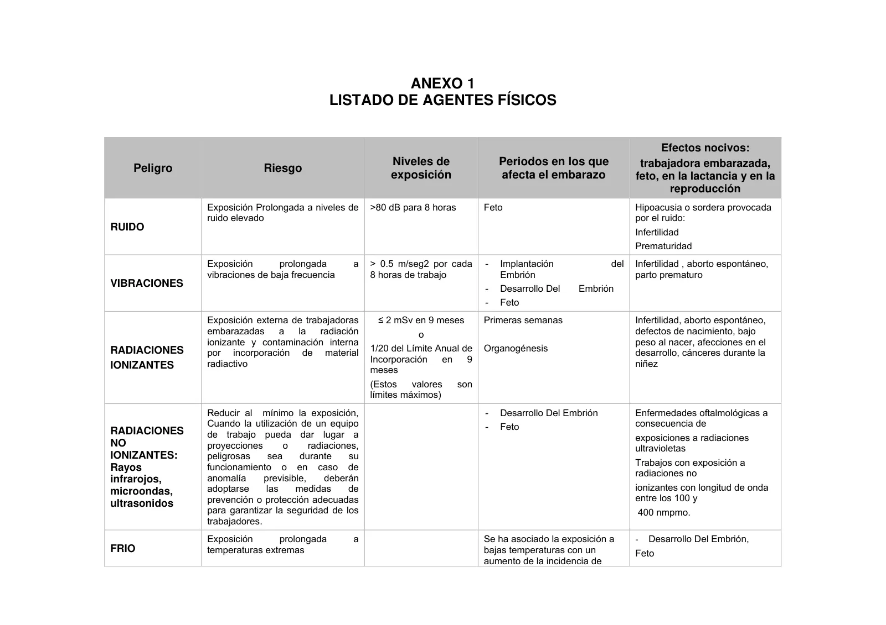

**Cuadro del documento (filas: 9; columnas: 7):**

| Peligro | Riesgo | Niveles de / exposición | Periodos en los que / afecta el embarazo | Columna 5 | Efectos nocivos: |
| --- | --- | --- | --- | --- | --- |
|  |  |  |  |  | trabajadora embarazada, |
|  |  |  |  |  | feto, en la lactancia y en la |
|  |  |  |  |  | reproducción |
| RUIDO | Exposición Prolongada a niveles de / ruido elevado | >80 dB para 8 horas | Feto | Hipoacusia o sordera provocada / por el ruido: / Infertilidad / Prematuridad |  |
| VIBRACIONES | Exposición prolongada a / vibraciones de baja frecuencia | > 0.5 m/seg2 por cada / 8 horas de trabajo | - Implantación del / Embrión / - Desarrollo Del Embrión / - Feto | Infertilidad , aborto espontáneo, / parto prematuro |  |
| RADIACIONES / IONIZANTES | Exposición externa de trabajadoras / embarazadas a la radiación / ionizante y contaminación interna / por incorporación de material / radiactivo | ≤ 2 mSv en 9 meses / o / 1/20 del Límite Anual de / Incorporación en 9 / meses / (Estos valores son / límites máximos) | Primeras semanas / Organogénesis | Infertilidad, aborto espontáneo, / defectos de nacimiento, bajo / peso al nacer, afecciones en el / desarrollo, cánceres durante la / niñez |  |
| RADIACIONES / NO / IONIZANTES: / Rayos / infrarojos, / microondas, / ultrasonidos | Reducir al mínimo la exposición, / Cuando la utilización de un equipo / de trabajo pueda dar lugar a / proyecciones o radiaciones, / peligrosas sea durante su / funcionamiento o en caso de / anomalía previsible, deberán / adoptarse las medidas de / prevención o protección adecuadas / para garantizar la seguridad de los / trabajadores. |  | - Desarrollo Del Embrión / - Feto | Enfermedades oftalmológicas a / consecuencia de / exposiciones a radiaciones / ultravioletas / Trabajos con exposición a / radiaciones no / ionizantes con longitud de onda / entre los 100 y / 400 nmpmo. |  |
| FRIO | Exposición prolongada a / temperaturas extremas |  | Se ha asociado la exposición a / bajas temperaturas con un / aumento de la incidencia de | - Desarrollo Del Embrión, / Feto |  |

### ANEXO 1 LISTADO DE AGENTES FÍSICOS

Peligro Riesgo Niveles de

Reducir al  mínimo la exposición, Cuando la utilización de un equipo de trabajo pueda dar lugar a proyecciones o radiaciones, peligrosas sea durante su funcionamiento o en caso de anomalía previsible, deberán adoptarse las medidas de prevención o protección adecuadas para garantizar la seguridad de los trabajadores.

Exposición externa de trabajadoras embarazadas a la radiación ionizante y contaminación interna por incorporación de material radiactivo

RADIACIONES NO IONIZANTES: Rayos infrarojos, microondas, ultrasonidos

---

## Página 2

**Vista original del cuadro o formulario (para comprobar campos, filas, valores y diseño):**

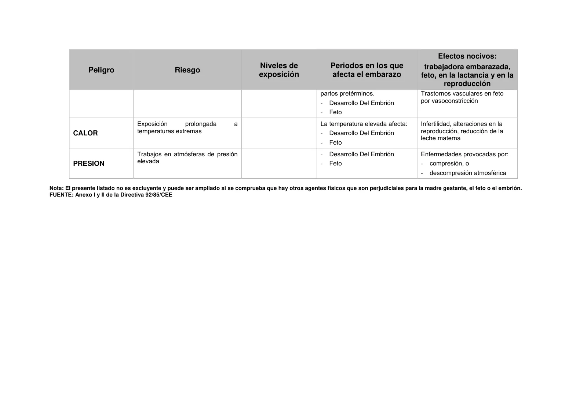

**Cuadro del documento (filas: 7; columnas: 7):**

| Peligro | Riesgo | Niveles de / exposición | Periodos en los que / afecta el embarazo | Columna 5 | Efectos nocivos: |
| --- | --- | --- | --- | --- | --- |
|  |  |  |  |  | trabajadora embarazada, |
|  |  |  |  |  | feto, en la lactancia y en la |
|  |  |  |  |  | reproducción |
|  |  |  | partos pretérminos. / - Desarrollo Del Embrión / - Feto | Trastornos vasculares en feto / por vasoconstricción |  |
| CALOR | Exposición prolongada a / temperaturas extremas |  | La temperatura elevada afecta: / - Desarrollo Del Embrión / - Feto | Infertilidad, alteraciones en la / reproducción, reducción de la / leche materna |  |
| PRESION | Trabajos en atmósferas de presión / elevada |  | - Desarrollo Del Embrión / - Feto | Enfermedades provocadas por: / - compresión, o / - descompresión atmosférica |  |

Nota: El presente listado no es excluyente y puede ser ampliado si se comprueba que hay otros agentes físicos que son perjudiciales para la madre gestante, el feto o el embrión. FUENTE: Anexo I y II de la Directiva 92/85/CEE

trabajadora embarazada,

Trabajos en atmósferas de presión elevada - Desarrollo Del Embrión - Feto Enfermedades provocadas por: - compresión, o - descompresión atmosférica

Efectos nocivos:

Exposición prolongada a temperaturas extremas La temperatura elevada afecta: - Desarrollo Del Embrión - Feto

exposición Periodos en los que

afecta el embarazo

partos pretérminos. - Desarrollo Del Embrión - Feto

Peligro Riesgo Niveles de

---

## Página 3

**Cuadro del documento (filas: 20; columnas: 15):**

| Nº | Nº CAS | AGENTE QUIMICO | Columna 4 | TLV | Columna 6 | Columna 7 | Columna 8 | Columna 9 | Columna 10 | Efectos nocivos: |
| --- | --- | --- | --- | --- | --- | --- | --- | --- | --- | --- |
|  |  |  |  | TWA |  | STEL |  |  |  | trabajadora embarazada, feto, en la |
|  |  |  | ppm |  | mg/m3 |  | ppm | mg/m3 |  | lactancia y en la reproducción |
| 1 | 112-07-2 | Acetato de 2-Butoxietilo | 20 |  | 131 |  | 50 |  | Afecta la fertilidad y desarrollo del / embrión |  |
| 2 | 111-15-9 | Acetato de 2-etoxietilo | 5 |  | 27 |  |  |  | Afecta la fertilidad y desarrollo del / embrión |  |
| 3 | 110-49-6 | Acetato de 2-Metoxietilo | 5 |  | 24 |  |  |  | Afecta la fertilidad y desarrollo del / embrión |  |
| 4 | 70657-70-4 | Acetato de 2-Metoxipropilo | 20 |  | 110 |  | 40 | 220 | Afecta la fertilidad y desarrollo del / embrión |  |
| 5 | 79-06-1 | Acrilamida |  |  | 0.03 |  |  |  | Afecta la fertilidad, causa alteraciones / genéticas |  |
| 6 | 711-36-3 | Alcohol n-Butilico | 20 |  | 61 |  | 50 | 152 | Afecta la fertilidad y desarrollo del / embrión |  |
| 7 | 67-63-0 | Alcohol Isopropilo | 200 |  | 491 |  | 400 | 983 | Afecta la fertilidad y desarrollo del / embrión |  |
| 8 | 67-56-1 | Alcohol Metilico | 200 |  | 262 |  | 250 | 328 | Afecta la fertilidad y desarrollo del / embrión |  |
| 9 | 62-53-3 | Anilina | 2 |  | 7.6 |  |  |  | Mutagenicidad para células |  |
| 10 | 7440-38-2 | Arsénico |  |  | 0.01 |  |  |  | Agente Cancerigeno, provoca aborto / espontáneo y muerte fetal |  |
| 11 | 71-43-2 | Benceno | 0.5 |  | 1.6 |  |  |  | Agente cancerigeno produce / mutagenicidad |  |
| 12 | 106-99-0 | 1,3-Butadieno | 2 |  | 4.4 |  |  |  | Afecta la fertilidad, causa alteraciones / genéticas |  |
| 13 | 111-76-2 | 2-Butoxietanol | 20 |  | 97 |  | 50 | 242 | Afecta la fertilidad y desarrollo del / embrión |  |
| 14 | 7440-43-9 | Cadmio, elemental / - fracción inhalable / - fracción respirable |  |  | 0.01 / 0.002 |  |  |  | Agente Cancerigeno, tóxico para la / reproducción |  |
| 15 | 108-90-7 | Cloro Benceno | 10 |  | 46 |  | 20 | 92 | Afecta la fertilidad y desarrollo del / embrión |  |
| 16 | 14977-61-8 | Cloruro de Cromilo | 0.025 |  | 0.16 |  |  |  | Causa alteraciones genéticas |  |

Nº Nº CAS AGENTE QUIMICO

14 7440-43-9 Cadmio, elemental - fracción inhalable - fracción respirable

**Gráfico o cuadro original:**

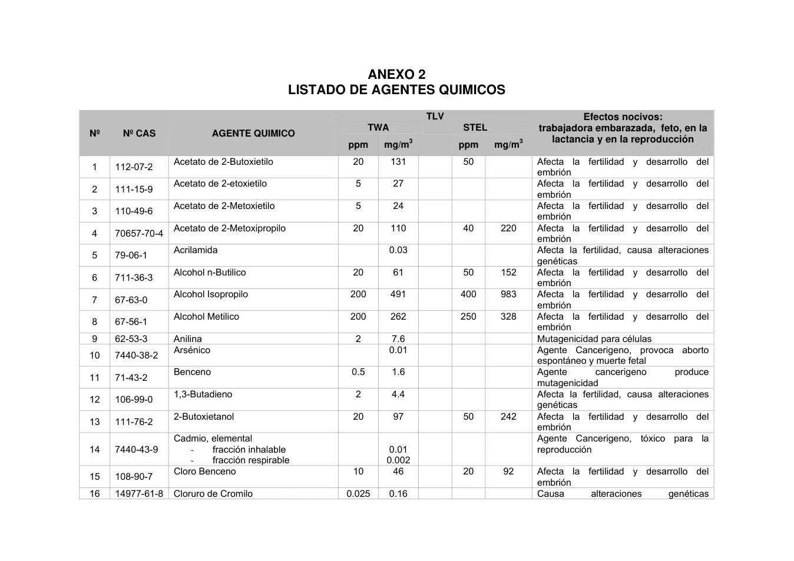

---

## Página 4

**Cuadro del documento (filas: 24; columnas: 15):**

| Nº | Nº CAS | AGENTE QUIMICO | Columna 4 | TLV | Columna 6 | Columna 7 | Columna 8 | Columna 9 | Columna 10 | Efectos nocivos: |
| --- | --- | --- | --- | --- | --- | --- | --- | --- | --- | --- |
|  |  |  |  | TWA |  | STEL |  |  |  | trabajadora embarazada, feto, en la |
|  |  |  | ppm |  | mg/m3 |  | ppm | mg/m3 |  | lactancia y en la reproducción |
|  |  |  |  |  |  |  |  |  | hereditarias |  |
| 17 | 7440-48-4 | Cobalto |  |  | 0.02 |  |  |  | Mutagenicidad para células |  |
| 18 | 7758-97-6 | Cromato de Plomo: / Como Cromo / Como Plomo |  |  | 0.012 / 0.05 |  |  |  | Afecta la fertilidad y es toxico para el / desarrollo fetal |  |
| 19 | 7789-00-6 | Cromato de Potasio |  |  | 0.01 |  |  |  | Cancerigeno, causa alteraciones / genéticas hereditarias |  |
| 20 | 7775-11-3 | Cromato de Sodio |  |  | 0.01 |  |  |  | Cancerigeno, causa alteraciones / genéticas hereditarias |  |
| 21 | 98-82-8 | Cumeno | 50 |  | 246 |  |  |  | Afecta la fertilidad y desarrollo del / embrión |  |
| 22 | 95-50-1 | o-Diclorobenceno | 25 |  | 150 |  | 50 | 301 | Afecta la fertilidad y desarrollo del / embrión |  |
| 23 | 106-46-7 | p-Diclorobenceno | 10 |  | 60 |  |  |  | Mutagenicidad para células |  |
| 24 | 75-09-2 | Diclorometano | 50 |  | 174 |  |  |  | Afecta la fertilidad y desarrollo del / embrión |  |
| 25 | 127-19-5 | N,N-Dimetilacetamida | 10 |  | 36 |  |  |  | Afecta la fertilidad y desarrollo del / embrión |  |
| 26 | 68-12-2 | N,N-Dimetilformamida | 10 |  | 30 |  |  |  | Afecta la fertilidad y desarrollo del / embrión |  |
| 27 | 75-15-0 | Disulfuro de carbono | 10 |  | 31 |  |  |  | Afecta la fertilidad y el desarrollo del / Feto |  |
| 28 | 556-52-5 | 2,3 Epoxi-1-Propanol | 2 |  | 6 |  |  |  | Cancerigeno |  |
| 29 | 100-42-5 | Estireno | 20 |  | 85 |  | 40 | 170 | Afecta la fertilidad y el desarrollo del / Feto |  |
| 30 | 100-41-4 | Etilbenceno | 100 |  | 434 |  | 125 | 543 | Afecta la fertilidad y el desarrollo del / Feto |  |
| 31 | 106-92-3 | Eter Alil Glicidilico | 1 |  | 4.7 |  |  |  | Causa infertilidad |  |
| 32 | 1589-47-5 | Eter 2 Metilico de Propilen Glicol | 20 |  | 75 |  |  |  | Causa efectos adversos para el feto |  |
| 33 | 151-56-4 | Etilenimina | 0.5 |  | 0.9 |  |  |  | Cancerigeno, causa alteraciones / genéticas hereditarias |  |
| 34 | 110-80-5 | Etoxietanol | 5 |  | 1.8 |  |  |  | Afecta la fertilidad y el desarrollo del feto |  |
| 35 | 7790-79-6 | Fluoruro de Cadmio |  |  |  |  |  |  | Causa alteraciones genéticas / hereditarias, infertilidad, efectos / adversos para el feto |  |

TLV Efectos nocivos:

Nº Nº CAS AGENTE QUIMICO

18 7758-97-6 Cromato de Plomo: Como Cromo Como Plomo

**Gráfico o cuadro original:**

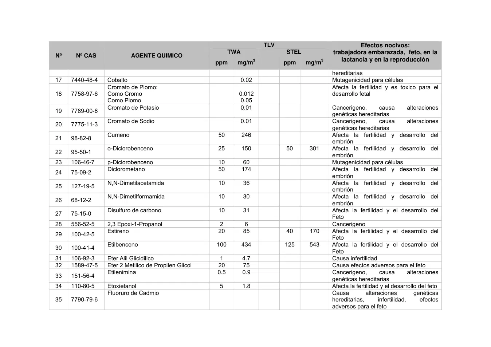

---

## Página 5

**Cuadro del documento (filas: 21; columnas: 15):**

| Nº | Nº CAS | AGENTE QUIMICO | Columna 4 | TLV | Columna 6 | Columna 7 | Columna 8 | Columna 9 | Columna 10 | Efectos nocivos: |
| --- | --- | --- | --- | --- | --- | --- | --- | --- | --- | --- |
|  |  |  |  | TWA |  | STEL |  |  |  | trabajadora embarazada, feto, en la |
|  |  |  | ppm |  | mg/m3 |  | ppm | mg/m3 |  | lactancia y en la reproducción |
| 36 | 7664-39-3 | Fluoruro de Hidrogeno | 1.8 |  | 1.5 |  | C3 | C2.5 | Afecta la fertilidad y el desarrollo del / Feto |  |
| 37 | 75-12-7 | Formamida | 10 |  | 19 |  |  |  | Causa efectos adversos para el feto |  |
| 38 | 84-74-2 | Ftalato de Dibutilo |  |  | 5 |  |  |  | Perjudicial para la fertilidad, efectos / adversos para el feto |  |
| 39 | 117-81-7 | Ftalato de di-2-etilhexilo |  |  | 5 |  |  |  | Perjudicial para la fertilidad, efectos / adversos para el feto |  |
| 40 | 151-67-7 | Halotano | 50 |  | 404 |  |  |  | Afecta la fertilidad y el desarrollo del / Feto |  |
| 41* | 118-74-1 | Hexaclorobenceno |  |  | 0.002 |  |  |  | Afecta la fertilidad y el desarrollo del / Feto |  |
| 42 | 110-54-3 | n-Hexano | 50 |  | 176 |  |  |  | Afecta la fertilidad y el desarrollo del / Feto |  |
| 43 | 7784-40-9 | Hexano Arseniato de Plomo |  |  | 0.15 |  |  |  | Perjudicial para la fertilidad, efectos / adversos para el feto |  |
| 44 | 58-89-9 | Lindano |  |  | 0.5 |  |  |  | Afecta la fertilidad y el desarrollo del / Feto |  |
| 45 | 7439-95-5 | Manganeso, elemental y comp. / Inorgánico como Mn |  |  | 0.2 |  |  |  | Puede dañar el desarrollo del cerebro e / interfiere con la reproducción. |  |
| 46 | 7439-97-6 | Mercurio elemental y / comp.inorg.como Hg / Mercurio: / Alquil-compuestos, como Hg / Aril-compuestos, como Hg |  |  | 0.025 / 0.01 / 0.1 |  |  | 0.03 | Vía dérmica, es tóxico para el desarrollo / cerebral del feto. |  |
| 47 | 591-78-6 | Metil-n-Butilcetona | 5 |  | 20 |  | 10 | 41 | Afecta la fertilidad |  |
| 48 | 78-93-3 | Metil Etilcetona | 200 |  | 590 |  | 300 | 885 | Afecta la fertilidad y el desarrollo del / Feto |  |
| 49 | 108-10-1 | Metilisobutilcetona | 50 |  | 205 |  | 75 | 307 | Afecta la fertilidad y el desarrollo del / Feto |  |
| 50 | 109-86-4 | 2-metoxietanol | 5 |  | 16 |  |  |  | Afecta la fertilidad y el desarrollo del / Feto |  |
| 51 | 630-08-0 | Monóxido de Carbono | 25 |  | 29 |  |  |  | Afecta la fertilidad y el desarrollo del / Feto |  |
| 52 | 98-95-3 | Nitrobenceno | 1 |  | 5 |  |  |  | Afecta la fertilidad y el desarrollo del / Feto |  |

TLV Efectos nocivos:

Mercurio elemental y comp.inorg.como Hg Mercurio: Alquil-compuestos, como Hg Aril-compuestos, como Hg

Nº Nº CAS AGENTE QUIMICO

**Gráfico o cuadro original:**

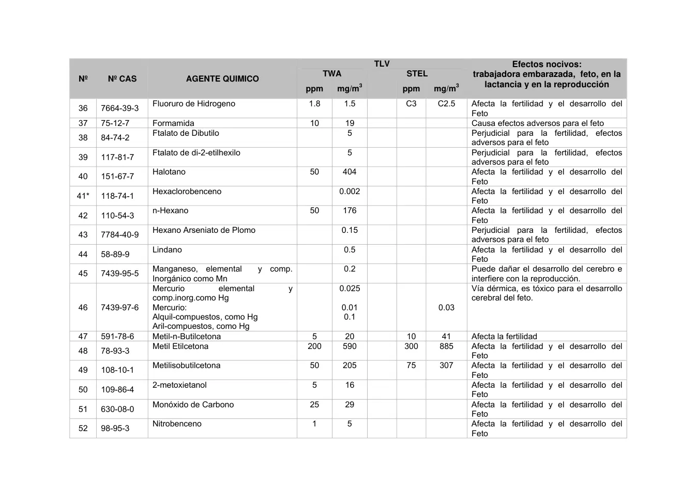

---

## Página 6

**Cuadro del documento (filas: 22; columnas: 15):**

| Nº | Nº CAS | AGENTE QUIMICO | Columna 4 | TLV | Columna 6 | Columna 7 | Columna 8 | Columna 9 | Columna 10 | Efectos nocivos: |
| --- | --- | --- | --- | --- | --- | --- | --- | --- | --- | --- |
|  |  |  |  | TWA |  | STEL |  |  |  | trabajadora embarazada, feto, en la |
|  |  |  | ppm |  | mg/m3 |  | ppm | mg/m3 |  | lactancia y en la reproducción |
| 53 | 13463-39-3 | Niquelcarbonilo como Ni | 0.05 |  | 0.35 |  |  |  | Perjudicial para la fertilidad, efectos / adversos para el feto |  |
| 54 | 75-21-8 | Oxido de Etileno | 1 |  | 1.8 |  |  |  | Cancerigeno, causa alteraciones / genéticas hereditarias |  |
| 55 | 75-56-9 | Oxido de Propileno | 2 |  | 5 |  |  |  | Cancerigeno, causa alteraciones / genéticas hereditarias |  |
| 56 | 56-38-2 | Paration |  |  | 0.05 |  |  |  | Afecta la fertilidad y el desarrollo del / Feto |  |
| 57 | 127-18-4 | Percloro Etileno | 25 |  | 170 |  | 100 | 678 | Afecta la fertilidad y el desarrollo del / Feto |  |
| 58 | 7439-92-1 | Plomo inorgánico y sus derivados / como Pb |  |  | 0.05 |  |  |  | Causa aborto espontáneo en mujeres |  |
| 59 | 78-00-2 | Plomo Tetraetilo |  |  | 0.1 |  |  |  | Afecta la fertilidad y el desarrollo del / Feto |  |
| 60 | 75-74-1 | Plomo Tetrametilo |  |  | 0.15 |  |  |  | Afecta la fertilidad y el desarrollo del / Feto |  |
| 61 | 56-23-5 | Tetracloruro de Carbono | 5 |  | 31 |  | 10 | 63 | Afecta la fertilidad y el desarrollo del / Feto |  |
| 62 | 109-99-9 | Tetra Hidrofurano | 200 |  | 590 |  | 250 | 737 | Afecta la fertilidad y el desarrollo del / Feto |  |
| 63 | 108-88-3 | Tolueno | 50 |  | 188 |  |  |  | Afecta la fertilidad y el desarrollo del / Feto |  |
| 64 | 71-55-6 | 1,1,1-Tricloetano | 350 |  | 1910 |  | 450 | 2455 | Afecta la fertilidad y el desarrollo del / Feto |  |
| 65 | 81-81-2 | Warfarina |  |  | 0.1 |  |  |  | Causa efectos adversos para el feto |  |
| 66 | 1330-20-7 | Xileno | 100 |  | 434 |  | 150 | 651 | Toxicidad prenatal |  |
| 67 | 143-50-0 | Clordecona (1,1a,3,3a,4,5,5,5a,5b,6- / Decacloro octahidro-1,3,4-meteno- / 2H-ciclobuta[cd]pentalen-2-ona) |  |  |  |  |  |  | Se usa como insecticida (Kepone), / afecta la reproducción y presenta riesgo / cancerigeno |  |
| 68 | 10108-64-2 | Cloruro de Cadmio |  |  |  |  |  |  | Cancerigeno, puede causar alteraciones / genéticas, afecta la fertilidad y causa / efectos adversos para el feto |  |
| 69 |  | Diclorobromopropano |  |  |  |  |  |  | Produce alteraciones en la fertilidad. |  |
| 70 | 7789-09-5 | Dicromato de Amonio |  |  |  |  |  |  | Cancerigeno, puede causar alteraciones |  |

TLV Efectos nocivos:

67 143-50-0 Clordecona (1,1a,3,3a,4,5,5,5a,5b,6- Decacloro octahidro-1,3,4-meteno- 2H-ciclobuta[cd]pentalen-2-ona)

Nº Nº CAS AGENTE QUIMICO

**Gráfico o cuadro original:**

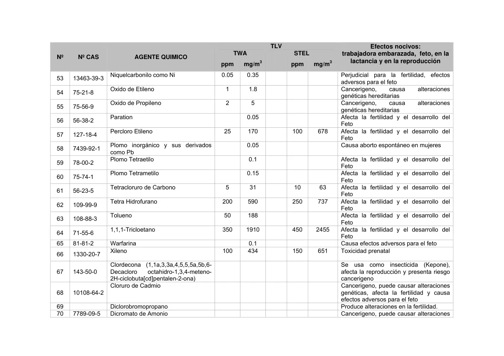

---

## Página 7

**Vista original del cuadro o formulario (para comprobar campos, filas, valores y diseño):**

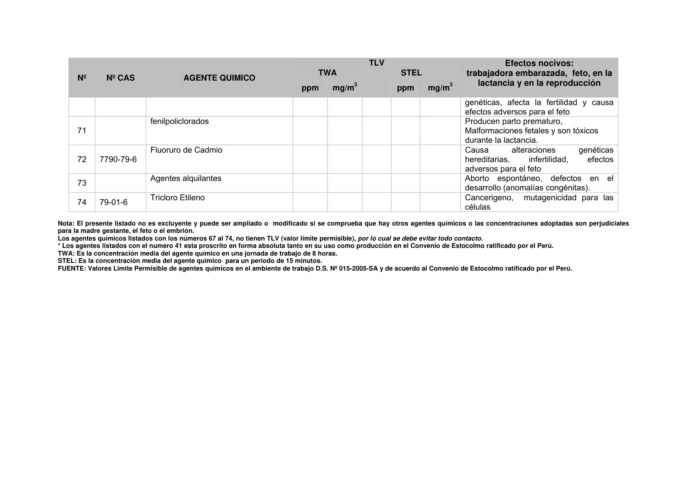

Nota: El presente listado no es excluyente y puede ser ampliado o  modificado si se comprueba que hay otros agentes químicos o las concentraciones adoptadas son perjudiciales para la madre gestante, el feto o el embrión. Los agentes químicos listados con los números 67 al 74, no tienen TLV (valor límite permisible), por lo cual se debe evitar todo contacto. * Los agentes listados con el numero 41 esta proscrito en forma absoluta tanto en su uso como producción en el Convenio de Estocolmo ratificado por el Perú. TWA: Es la concentración media del agente químico en una jornada de trabajo de 8 horas. STEL: Es la concentración media del agente químico  para un periodo de 15 minutos. FUENTE: Valores Limite Permisible de agentes químicos en el ambiente de trabajo D.S. Nº 015-2005-SA y de acuerdo al Convenio de Estocolmo ratificado por el Perú.

**Cuadro del documento (filas: 9; columnas: 15):**

| Nº | Nº CAS | AGENTE QUIMICO | Columna 4 | TLV | Columna 6 | Columna 7 | Columna 8 | Columna 9 | Columna 10 | Efectos nocivos: |
| --- | --- | --- | --- | --- | --- | --- | --- | --- | --- | --- |
|  |  |  |  | TWA |  | STEL |  |  |  | trabajadora embarazada, feto, en la |
|  |  |  | ppm |  | mg/m3 |  | ppm | mg/m3 |  | lactancia y en la reproducción |
|  |  |  |  |  |  |  |  |  | genéticas, afecta la fertilidad y causa / efectos adversos para el feto |  |
| 71 |  | fenilpoliclorados |  |  |  |  |  |  | Producen parto prematuro, / Malformaciones fetales y son tóxicos / durante la lactancia. |  |
| 72 | 7790-79-6 | Fluoruro de Cadmio |  |  |  |  |  |  | Causa alteraciones genéticas / hereditarias, infertilidad, efectos / adversos para el feto |  |
| 73 |  | Agentes alquilantes |  |  |  |  |  |  | Aborto espontáneo, defectos en el / desarrollo (anomalías congénitas). |  |
| 74 | 79-01-6 | Tricloro Etileno |  |  |  |  |  |  | Cancerigeno, mutagenicidad para las / células |  |

72 7790-79-6 Fluoruro de Cadmio Causa alteraciones genéticas hereditarias, infertilidad, efectos adversos para el feto

73 Agentes alquilantes Aborto espontáneo, defectos en el desarrollo (anomalías congénitas).

74 79-01-6 Tricloro Etileno Cancerigeno,  mutagenicidad para las células

71 fenilpoliclorados Producen parto prematuro, Malformaciones fetales y son tóxicos durante la lactancia.

TLV Efectos nocivos:

ppm mg/m3 ppm mg/m3

### TWA STEL

Nº Nº CAS AGENTE QUIMICO

---

## Página 8

**Vista original del cuadro o formulario (para comprobar campos, filas, valores y diseño):**

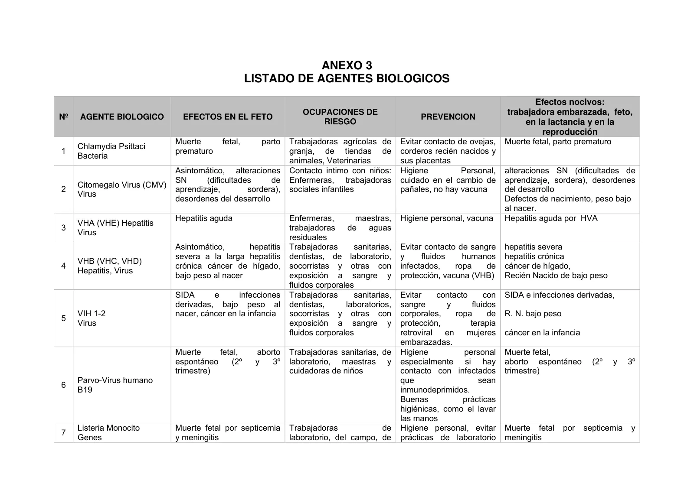

**Cuadro del documento (filas: 11; columnas: 8):**

| Nº | AGENTE BIOLOGICO | EFECTOS EN EL FETO | OCUPACIONES DE / RIESGO | PREVENCION | Columna 6 | Efectos nocivos: |
| --- | --- | --- | --- | --- | --- | --- |
|  |  |  |  |  |  | trabajadora embarazada, feto, |
|  |  |  |  |  |  | en la lactancia y en la |
|  |  |  |  |  |  | reproducción |
| 1 | Chlamydia Psittaci / Bacteria | Muerte fetal, parto / prematuro | Trabajadoras agrícolas de / granja, de tiendas de / animales, Veterinarias | Evitar contacto de ovejas, / corderos recién nacidos y / sus placentas | Muerte fetal, parto prematuro |  |
| 2 | Citomegalo Virus (CMV) / Virus | Asintomático, alteraciones / SN (dificultades de / aprendizaje, sordera), / desordenes del desarrollo | Contacto intimo con niños: / Enfermeras, trabajadoras / sociales infantiles | Higiene Personal, / cuidado en el cambio de / pañales, no hay vacuna | alteraciones SN (dificultades de / aprendizaje, sordera), desordenes / del desarrollo / Defectos de nacimiento, peso bajo / al nacer. |  |
| 3 | VHA (VHE) Hepatitis / Virus | Hepatitis aguda | Enfermeras, maestras, / trabajadoras de aguas / residuales | Higiene personal, vacuna | Hepatitis aguda por HVA |  |
| 4 | VHB (VHC, VHD) / Hepatitis, Virus | Asintomático, hepatitis / severa a la larga hepatitis / crónica cáncer de hígado, / bajo peso al nacer | Trabajadoras sanitarias, / dentistas, de laboratorio, / socorristas y otras con / exposición a sangre y / fluidos corporales | Evitar contacto de sangre / y fluidos humanos / infectados, ropa de / protección, vacuna (VHB) | hepatitis severa / hepatitis crónica / cáncer de hígado, / Recién Nacido de bajo peso |  |
| 5 | VIH 1-2 / Virus | SIDA e infecciones / derivadas, bajo peso al / nacer, cáncer en la infancia | Trabajadoras sanitarias, / dentistas, laboratorios, / socorristas y otras con / exposición a sangre y / fluidos corporales | Evitar contacto con / sangre y fluidos / corporales, ropa de / protección, terapia / retroviral en mujeres / embarazadas. | SIDA e infecciones derivadas, / R. N. bajo peso / cáncer en la infancia |  |
| 6 | Parvo-Virus humano / B19 | Muerte fetal, aborto / espontáneo (2º y 3º / trimestre) | Trabajadoras sanitarias, de / laboratorio, maestras y / cuidadoras de niños | Higiene personal / especialmente si hay / contacto con infectados / que sean / inmunodeprimidos. / Buenas prácticas / higiénicas, como el lavar / las manos | Muerte fetal, / aborto espontáneo (2º y 3º / trimestre) |  |
| 7 | Listeria Monocito / Genes | Muerte fetal por septicemia / y meningitis | Trabajadoras de / laboratorio, del campo, de | Higiene personal, evitar / prácticas de laboratorio | Muerte fetal por septicemia y / meningitis |  |

Nº AGENTE BIOLOGICO EFECTOS EN EL FETO OCUPACIONES DE

Asintomático, alteraciones SN (dificultades de aprendizaje, sordera), desordenes del desarrollo

Asintomático, hepatitis severa a la larga hepatitis crónica cáncer de hígado, bajo peso al nacer

Muerte fetal, aborto espontáneo (2º y 3º trimestre)

SIDA e infecciones derivadas, bajo peso al nacer, cáncer en la infancia

---

## Página 9

**Vista original del cuadro o formulario (para comprobar campos, filas, valores y diseño):**

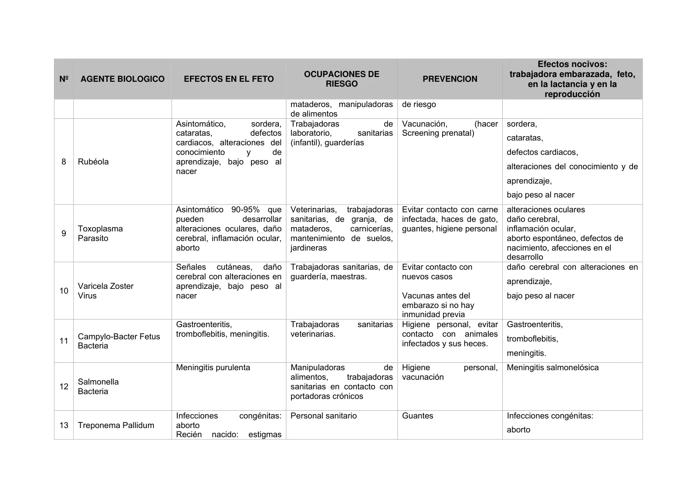

**Cuadro del documento (filas: 11; columnas: 8):**

| Nº | AGENTE BIOLOGICO | EFECTOS EN EL FETO | OCUPACIONES DE / RIESGO | PREVENCION | Columna 6 | Efectos nocivos: |
| --- | --- | --- | --- | --- | --- | --- |
|  |  |  |  |  |  | trabajadora embarazada, feto, |
|  |  |  |  |  |  | en la lactancia y en la |
|  |  |  |  |  |  | reproducción |
|  |  |  | mataderos, manipuladoras / de alimentos | de riesgo |  |  |
| 8 | Rubéola | Asintomático, sordera, / cataratas, defectos / cardiacos, alteraciones del / conocimiento y de / aprendizaje, bajo peso al / nacer | Trabajadoras de / laboratorio, sanitarias / (infantil), guarderías | Vacunación, (hacer / Screening prenatal) | sordera, / cataratas, / defectos cardiacos, / alteraciones del conocimiento y de / aprendizaje, / bajo peso al nacer |  |
| 9 | Toxoplasma / Parasito | Asintomático 90-95% que / pueden desarrollar / alteraciones oculares, daño / cerebral, inflamación ocular, / aborto | Veterinarias, trabajadoras / sanitarias, de granja, de / mataderos, carnicerías, / mantenimiento de suelos, / jardineras | Evitar contacto con carne / infectada, haces de gato, / guantes, higiene personal | alteraciones oculares / daño cerebral, / inflamación ocular, / aborto espontáneo, defectos de / nacimiento, afecciones en el / desarrollo |  |
| 10 | Varicela Zoster / Virus | Señales cutáneas, daño / cerebral con alteraciones en / aprendizaje, bajo peso al / nacer | Trabajadoras sanitarias, de / guardería, maestras. | Evitar contacto con / nuevos casos / Vacunas antes del / embarazo si no hay / inmunidad previa | daño cerebral con alteraciones en / aprendizaje, / bajo peso al nacer |  |
| 11 | Campylo-Bacter Fetus / Bacteria | Gastroenteritis, / tromboflebitis, meningitis. | Trabajadoras sanitarias / veterinarias. | Higiene personal, evitar / contacto con animales / infectados y sus heces. | Gastroenteritis, / tromboflebitis, / meningitis. |  |
| 12 | Salmonella / Bacteria | Meningitis purulenta | Manipuladoras de / alimentos, trabajadoras / sanitarias en contacto con / portadoras crónicos | Higiene personal, / vacunación | Meningitis salmonelósica |  |
| 13 | Treponema Pallidum | Infecciones congénitas: / aborto / Recién nacido: estigmas | Personal sanitario | Guantes | Infecciones congénitas: / aborto |  |

Nº AGENTE BIOLOGICO EFECTOS EN EL FETO OCUPACIONES DE

Señales cutáneas, daño cerebral con alteraciones en aprendizaje, bajo peso al nacer

13 Treponema Pallidum Infecciones congénitas: aborto Recién nacido: estigmas

Asintomático, sordera, cataratas, defectos cardiacos, alteraciones del conocimiento y de aprendizaje, bajo peso al nacer

Asintomático 90-95% que pueden desarrollar alteraciones oculares, daño cerebral, inflamación ocular, aborto

---

## Página 10

**Vista original del cuadro o formulario (para comprobar campos, filas, valores y diseño):**

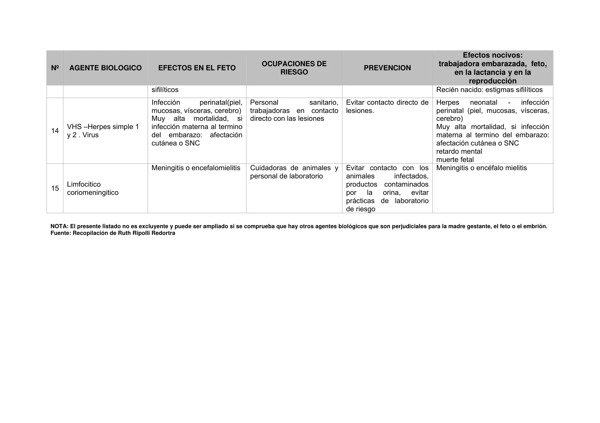

**Cuadro del documento (filas: 7; columnas: 8):**

| Nº | AGENTE BIOLOGICO | EFECTOS EN EL FETO | OCUPACIONES DE / RIESGO | PREVENCION | Columna 6 | Efectos nocivos: |
| --- | --- | --- | --- | --- | --- | --- |
|  |  |  |  |  |  | trabajadora embarazada, feto, |
|  |  |  |  |  |  | en la lactancia y en la |
|  |  |  |  |  |  | reproducción |
|  |  | sifilíticos |  |  | Recién nacido: estigmas sifilíticos |  |
| 14 | VHS –Herpes simple 1 / y 2 . Virus | Infección perinatal(piel, / mucosas, vísceras, cerebro) / Muy alta mortalidad, si / infección materna al termino / del embarazo: afectación / cutánea o SNC | Personal sanitario, / trabajadoras en contacto / directo con las lesiones | Evitar contacto directo de / lesiones. | Herpes neonatal - infección / perinatal (piel, mucosas, vísceras, / cerebro) / Muy alta mortalidad, si infección / materna al termino del embarazo: / afectación cutánea o SNC / retardo mental / muerte fetal |  |
| 15 | Limfocitico / coriomeningitico | Meningitis o encefalomielitis | Cuidadoras de animales y / personal de laboratorio | Evitar contacto con los / animales infectados, / productos contaminados / por la orina, evitar / prácticas de laboratorio / de riesgo | Meningitis o encéfalo mielitis |  |

NOTA: El presente listado no es excluyente y puede ser ampliado si se comprueba que hay otros agentes biológicos que son perjudiciales para la madre gestante, el feto o el embrión. Fuente: Recopilación de Ruth Ripolli Redortra

sifilíticos Recién nacido: estigmas sifilíticos

Meningitis o encefalomielitis Cuidadoras de animales y personal de laboratorio Evitar contacto con los animales infectados, productos contaminados por la orina, evitar prácticas de laboratorio de riesgo

### RIESGO PREVENCION

Personal sanitario, trabajadoras en contacto directo con las lesiones

Nº AGENTE BIOLOGICO EFECTOS EN EL FETO OCUPACIONES DE

Infección perinatal(piel, mucosas, vísceras, cerebro) Muy alta mortalidad, si infección materna al termino del embarazo: afectación cutánea o SNC

---

## Página 11

**Vista original del cuadro o formulario (para comprobar campos, filas, valores y diseño):**

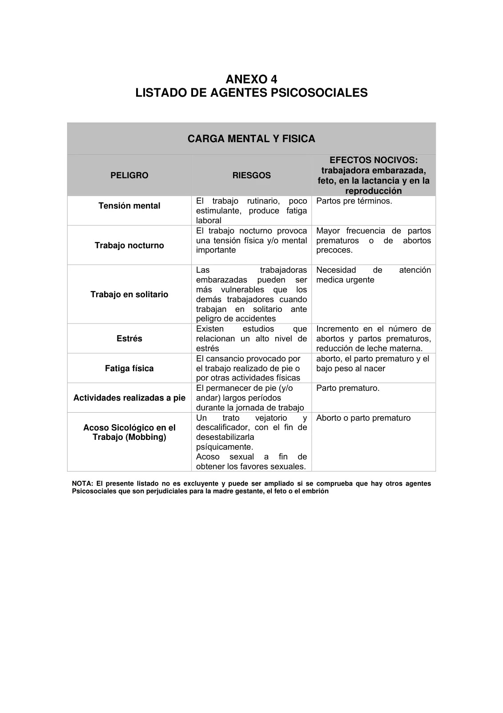

### ANEXO 4 LISTADO DE AGENTES PSICOSOCIALES CARGA MENTAL Y FISICA

**Cuadro del documento (filas: 14; columnas: 6):**

| Columna 1 | CARGA MENTAL Y FISICA | Columna 3 | Columna 4 | Columna 5 |
| --- | --- | --- | --- | --- |
| PELIGRO |  | RIESGOS |  | EFECTOS NOCIVOS: |
|  |  |  |  | trabajadora embarazada, |
|  |  |  |  | feto, en la lactancia y en la |
|  |  |  |  | reproducción |
| Tensión mental |  | El trabajo rutinario, poco / estimulante, produce fatiga / laboral | Partos pre términos. |  |
| Trabajo nocturno |  | El trabajo nocturno provoca / una tensión física y/o mental / importante | Mayor frecuencia de partos / prematuros o de abortos / precoces. |  |
| Trabajo en solitario |  | Las trabajadoras / embarazadas pueden ser / más vulnerables que los / demás trabajadores cuando / trabajan en solitario ante / peligro de accidentes | Necesidad de atención / medica urgente |  |
| Estrés |  | Existen estudios que / relacionan un alto nivel de / estrés | Incremento en el número de / abortos y partos prematuros, / reducción de leche materna. |  |
| Fatiga física |  | El cansancio provocado por / el trabajo realizado de pie o / por otras actividades físicas | aborto, el parto prematuro y el / bajo peso al nacer |  |
| Actividades realizadas a pie |  | El permanecer de pie (y/o / andar) largos períodos / durante la jornada de trabajo | Parto prematuro. |  |
| Acoso Sicológico en el / Trabajo (Mobbing) |  | Un trato vejatorio y / descalificador, con el fin de / desestabilizarla / psíquicamente. / Acoso sexual a fin de / obtener los favores sexuales. | Aborto o parto prematuro |  |

NOTA: El presente listado no es excluyente y puede ser ampliado si se comprueba que hay otros agentes Psicosociales que son perjudiciales para la madre gestante, el feto o el embrión

---

## Página 12

**Vista original del cuadro o formulario (para comprobar campos, filas, valores y diseño):**

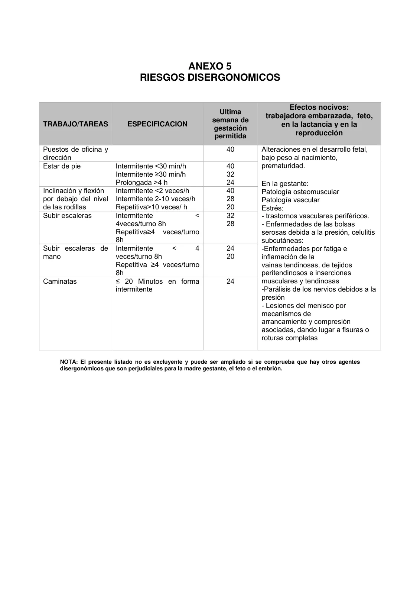

### ANEXO 5 RIESGOS DISERGONOMICOS

**Cuadro del documento (filas: 11; columnas: 6):**

| TRABAJO/TAREAS | ESPECIFICACION | Ultima / semana de / gestación / permitida | Columna 4 | Efectos nocivos: |
| --- | --- | --- | --- | --- |
|  |  |  |  | trabajadora embarazada, feto, |
|  |  |  |  | en la lactancia y en la |
|  |  |  |  | reproducción |
| Puestos de oficina y / dirección |  | 40 | Alteraciones en el desarrollo fetal, / bajo peso al nacimiento, / prematuridad. / En la gestante: / Patología osteomuscular / Patología vascular / Estrés: / - trastornos vasculares periféricos. / - Enfermedades de las bolsas / serosas debida a la presión, celulitis / subcutáneas: / -Enfermedades por fatiga e / inflamación de la / vainas tendinosas, de tejidos / peritendinosos e inserciones / musculares y tendinosas / -Parálisis de los nervios debidos a la / presión / - Lesiones del menisco por / mecanismos de / arrancamiento y compresión / asociadas, dando lugar a fisuras o / roturas completas |  |
| Estar de pie | Intermitente <30 min/h / Intermitente ≥30 min/h / Prolongada >4 h | 40 / 32 / 24 |  |  |
| Inclinación y flexión / por debajo del nivel / de las rodillas | Intermitente <2 veces/h / Intermitente 2-10 veces/h / Repetitiva>10 veces/ h | 40 / 28 / 20 |  |  |
| Subir escaleras | Intermitente < / 4veces/turno 8h / Repetitiva≥4 veces/turno / 8h | 32 / 28 |  |  |
| Subir escaleras de / mano | Intermitente < 4 / veces/turno 8h / Repetitiva ≥4 veces/turno / 8h | 24 / 20 |  |  |
| Caminatas | ≤ 20 Minutos en forma / intermitente | 24 |  |  |

NOTA: El presente listado no es excluyente y puede ser ampliado si se comprueba que hay otros agentes disergonómicos que son perjudiciales para la madre gestante, el feto o el embrión.

---

## Página 13

**Vista original del cuadro o formulario (para comprobar campos, filas, valores y diseño):**

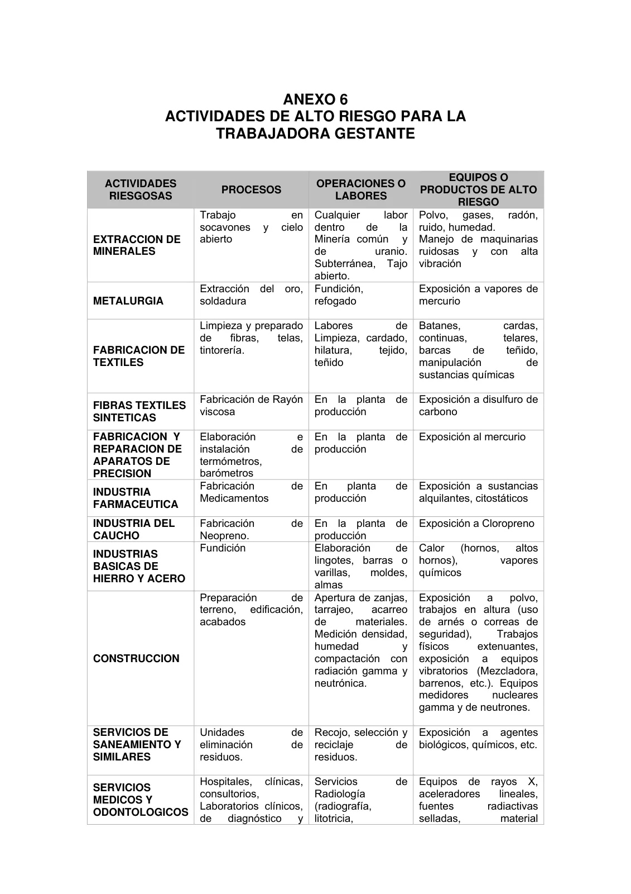

### ANEXO 6 ACTIVIDADES DE ALTO RIESGO PARA LA TRABAJADORA GESTANTE

**Cuadro del documento (filas: 12; columnas: 5):**

| ACTIVIDADES / RIESGOSAS | PROCESOS | OPERACIONES O / LABORES | EQUIPOS O / PRODUCTOS DE ALTO / RIESGO |
| --- | --- | --- | --- |
| EXTRACCION DE / MINERALES | Trabajo en / socavones y cielo / abierto | Cualquier labor / dentro de la / Minería común y / de uranio. / Subterránea, Tajo / abierto. | Polvo, gases, radón, / ruido, humedad. / Manejo de maquinarias / ruidosas y con alta / vibración |
| METALURGIA | Extracción del oro, / soldadura | Fundición, / refogado | Exposición a vapores de / mercurio |
| FABRICACION DE / TEXTILES | Limpieza y preparado / de fibras, telas, / tintorería. | Labores de / Limpieza, cardado, / hilatura, tejido, / teñido | Batanes, cardas, / continuas, telares, / barcas de teñido, / manipulación de / sustancias químicas |
| FIBRAS TEXTILES / SINTETICAS | Fabricación de Rayón / viscosa | En la planta de / producción | Exposición a disulfuro de / carbono |
| FABRICACION Y / REPARACION DE / APARATOS DE / PRECISION | Elaboración e / instalación de / termómetros, / barómetros | En la planta de / producción | Exposición al mercurio |
| INDUSTRIA / FARMACEUTICA | Fabricación de / Medicamentos | En planta de / producción | Exposición a sustancias / alquilantes, citostáticos |
| INDUSTRIA DEL / CAUCHO | Fabricación de / Neopreno. | En la planta de / producción | Exposición a Cloropreno |
| INDUSTRIAS / BASICAS DE / HIERRO Y ACERO | Fundición | Elaboración de / lingotes, barras o / varillas, moldes, / almas | Calor (hornos, altos / hornos), vapores / químicos |
| CONSTRUCCION | Preparación de / terreno, edificación, / acabados | Apertura de zanjas, / tarrajeo, acarreo / de materiales. / Medición densidad, / humedad y / compactación con / radiación gamma y / neutrónica. | Exposición a polvo, / trabajos en altura (uso / de arnés o correas de / seguridad), Trabajos / físicos extenuantes, / exposición a equipos / vibratorios (Mezcladora, / barrenos, etc.). Equipos / medidores nucleares / gamma y de neutrones. |
| SERVICIOS DE / SANEAMIENTO Y / SIMILARES | Unidades de / eliminación de / residuos. | Recojo, selección y / reciclaje de / residuos. | Exposición a agentes / biológicos, químicos, etc. |
| SERVICIOS / MEDICOS Y / ODONTOLOGICOS | Hospitales, clínicas, / consultorios, / Laboratorios clínicos, / de diagnóstico y | Servicios de / Radiología / (radiografía, / litotricia, | Equipos de rayos X, / aceleradores lineales, / fuentes radiactivas / selladas, material |

---

## Página 14

**Vista original del cuadro o formulario (para comprobar campos, filas, valores y diseño):**

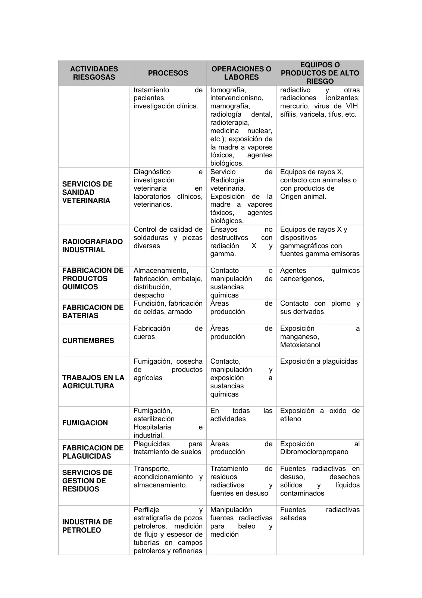

**Cuadro del documento (filas: 12; columnas: 5):**

| ACTIVIDADES / RIESGOSAS | PROCESOS | OPERACIONES O / LABORES | EQUIPOS O / PRODUCTOS DE ALTO / RIESGO |
| --- | --- | --- | --- |
|  | tratamiento de / pacientes, / investigación clínica. | tomografía, / intervencionisno, / mamografía, / radiología dental, / radioterapia, / medicina nuclear, / etc.); exposición de / la madre a vapores / tóxicos, agentes / biológicos. | radiactivo y otras / radiaciones ionizantes; / mercurio, virus de VIH, / sífilis, varicela, tifus, etc. |
| SERVICIOS DE / SANIDAD / VETERINARIA | Diagnóstico e / investigación / veterinaria en / laboratorios clínicos, / veterinarios. | Servicio de / Radiología / veterinaria. / Exposición de la / madre a vapores / tóxicos, agentes / biológicos. | Equipos de rayos X, / contacto con animales o / con productos de / Origen animal. |
| RADIOGRAFIADO / INDUSTRIAL | Control de calidad de / soldaduras y piezas / diversas | Ensayos no / destructivos con / radiación X y / gamma. | Equipos de rayos X y / dispositivos / gammagráficos con / fuentes gamma emisoras |
| FABRICACION DE / PRODUCTOS / QUIMICOS | Almacenamiento, / fabricación, embalaje, / distribución, / despacho | Contacto o / manipulación de / sustancias / químicas | Agentes químicos / cancerigenos, |
| FABRICACION DE / BATERIAS | Fundición, fabricación / de celdas, armado | Áreas de / producción | Contacto con plomo y / sus derivados |
| CURTIEMBRES | Fabricación de / cueros | Áreas de / producción | Exposición a / manganeso, / Metoxietanol |
| TRABAJOS EN LA / AGRICULTURA | Fumigación, cosecha / de productos / agrícolas | Contacto, / manipulación y / exposición a / sustancias / químicas | Exposición a plaguicidas |
| FUMIGACION | Fumigación, / esterilización / Hospitalaria e / industrial. | En todas las / actividades | Exposición a oxido de / etileno |
| FABRICACION DE / PLAGUICIDAS | Plaguicidas para / tratamiento de suelos | Áreas de / producción | Exposición al / Dibromocloropropano |
| SERVICIOS DE / GESTION DE / RESIDUOS | Transporte, / acondicionamiento y / almacenamiento. | Tratamiento de / residuos / radiactivos y / fuentes en desuso | Fuentes radiactivas en / desuso, desechos / sólidos y líquidos / contaminados |
| INDUSTRIA DE / PETROLEO | Perfilaje y / estratigrafía de pozos / petroleros, medición / de flujo y espesor de / tuberías en campos / petroleros y refinerías | Manipulación / fuentes radiactivas / para baleo y / medición | Fuentes radiactivas / selladas |

---

## Página 15

**Vista original del cuadro o formulario (para comprobar campos, filas, valores y diseño):**

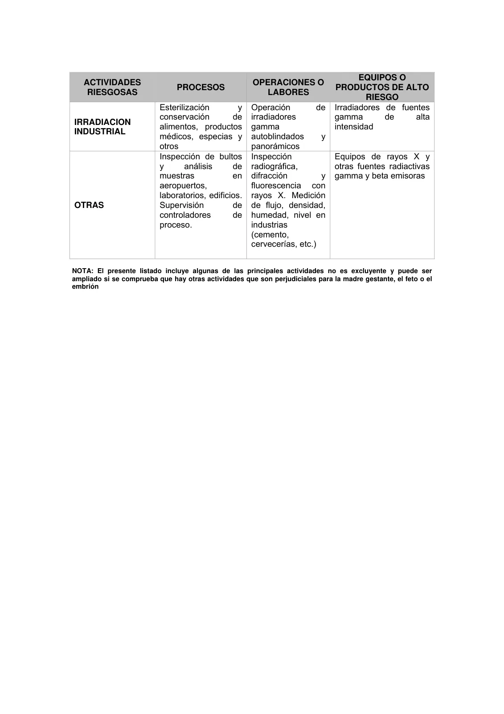

**Cuadro del documento (filas: 3; columnas: 5):**

| ACTIVIDADES / RIESGOSAS | PROCESOS | OPERACIONES O / LABORES | EQUIPOS O / PRODUCTOS DE ALTO / RIESGO |
| --- | --- | --- | --- |
| IRRADIACION / INDUSTRIAL | Esterilización y / conservación de / alimentos, productos / médicos, especias y / otros | Operación de / irradiadores / gamma / autoblindados y / panorámicos | Irradiadores de fuentes / gamma de alta / intensidad |
| OTRAS | Inspección de bultos / y análisis de / muestras en / aeropuertos, / laboratorios, edificios. / Supervisión de / controladores de / proceso. | Inspección / radiográfica, / difracción y / fluorescencia con / rayos X. Medición / de flujo, densidad, / humedad, nivel en / industrias / (cemento, / cervecerías, etc.) | Equipos de rayos X y / otras fuentes radiactivas / gamma y beta emisoras |

NOTA: El presente listado incluye algunas de las principales actividades no es excluyente y puede ser ampliado si se comprueba que hay otras actividades que son perjudiciales para la madre gestante, el feto o el embrión

---

## Página 16

ANEXO 7 LINEAMIENTOS PARA REALIZAR LA EVALUACION DE RIESGOS PARA LA SALUD DE LA MUJER GESTANTE El empleador debe realizar una evaluación de los riesgos por exposición a agentes físicos, químicos, biológicos, disergonómicos y psicosociales, procedimientos o condiciones de trabajo que, por el puesto de trabajo o por las labores que se realizan, puedan afectar la salud de la mujer gestante y/o el desarrollo normal del embrión o el feto, de manera cierta o potencial. Dicha evaluación debe contemplar:

a) Naturaleza, grado y duración de la exposición.

b) Valores límites permitidos de exposición.

c) Posibles efectos en la salud de las trabajadoras expuestas a riesgos particulares. Una vez conocido el resultado de la evaluación de riesgos que pueden afectar la salud de la mujer gestante y/o el desarrollo normal del embrión o del feto se debe poner en conocimiento del personal. Y se debe repetir la evaluación cada vez que se produzca un cambio en las condiciones de trabajo que pueda implicar una exposición de las trabajadoras gestantes. Para hacer la evaluación de riesgos se considerará como mínimo la siguiente metodología:

1.- Preparación En esta fase se deben recoger y analizar los antecedentes y datos necesarios sobre los puestos de trabajo a evaluar. Habrá que preparar un plan de acción, incluyendo una serie de medidas de las que podemos destacar las siguientes: Decidir quiénes han de realizar la evaluación y organizar cómo ha de llevarse a término: procedimiento, plazos, comunicación a los puestos afectados y las jefaturas correspondientes, entre otros). Proporcionar a los evaluadores toda la información, formación y medios necesarios para efectuar correctamente esta actividad (metodología de evaluación, elementos peligrosos, materiales, equipos, tecnología, organización del trabajo, frecuencia y duración de la exposición, etc.). Definir los mecanismos de control a seguir con los que se pretende evaluar la eficacia de esta actividad preventiva (cumplimiento del procedimiento establecido, ejecución de compromisos adquiridos en la resolución de deficiencias, etc.).

---

## Página 17

2.- Ejecución La ejecución de la evaluación requiere analizar sistemáticamente todos los aspectos del trabajo desde las actividades habituales a aquellas que son ocasionales o incluso anormales pero que pueden acontecer. Aplicando los criterios de evaluación que el procedimiento establezca, en la evaluación es necesario analizar:

a) Los aspectos materiales de las instalaciones, máquinas, equipos y herramientas.

b) El entorno del lugar de trabajo.

c) El comportamiento humano en la ejecución de las tareas.

d) Los aspectos relativos a la gestión y organización del trabajo.

e) El funcionamiento correcto de los sistemas de control de los riesgos. La realización de la evaluación no debería compartirse con otras actividades al mismo tiempo. Hay que dedicar el tiempo necesario y con la atención debida tanto por parte de quienes la ejecuten, como de quienes deben atenderles o ser consultados en los lugares de trabajo.

3.- Registro En cuanto a este punto, es necesario observar las siguientes pautas: Al finalizar el trabajo de evaluación en los puestos de trabajo, habrá que registrar y recoger documentalmente lo observado, contrastando resultados cuando se estime oportuno. En todos aquellos puestos de trabajo cuya evaluación ponga de manifiesto la necesidad de adoptar o controlar alguna medida preventiva, deberán quedar recogidos documentalmente los siguientes datos:

a) La identificación del puesto de trabajo.

b) Los riesgos existentes o potenciales.

c) La relación de trabajadoras afectadas.

d) El resultado de la evaluación.

e) Las medidas preventivas procedentes.

f) La referencia de los criterios y procedimientos de evaluación exigibles y aplicados.

g) Técnico responsable de la evaluación y competencia profesional para tal actividad.

---

## Página 18

Los registros de la evaluación estarán a disposición de los trabajadores y de la autoridad laboral competente.

4.- Control Tras la evaluación, se deberá programar, organizar y controlar la aplicación de las medidas de prevención y protección, con el fin de asegurar el mantenimiento de su eficacia en el tiempo y el control efectivo de los riesgos. El método de evaluación utilizado deberá proporcionar confianza sobre sus resultados. Incluirá la realización de las mediciones, análisis o ensayos que se consideren necesarios, salvo que se trate de operaciones, actividades o procesos en los que la directa apreciación profesional permita llegar a una conclusión sin necesidad de recurrir a aquéllos. A falta de un método de evaluación de riesgos normalizado se deberá escoger el método o los métodos más adecuados a las características de la empresa dentro de la variedad de metodologías existentes, pudiendo incluso elaborar un método propio de evaluación de riesgos. En tal planificación se englobarán el conjunto de actividades preventivas a aplicar a los diferentes elementos del sistema de gestión de la prevención de riesgos laborales determinando plazos, prioridades y especificaciones en función de la magnitud de los riesgos y del número de trabajadoras expuestas a riesgos. ¿Es tolerable y, por lo tanto, es asumible el riesgo residual? En el caso de que la adaptación de las condiciones o del tiempo de trabajo no fuera posible o si, a pesar de dichas modificaciones, se mantuvieran los riesgos para la trabajadora embarazada o feto se procederá al cambio de puesto de trabajo, de conformidad a lo establecido en el Decreto Supremo Nº 009-2005- TR.

---

## Página 19

### ANEXO 8 FORMULARIO DE EVALUACIÓN DE RIESGOS PARA LA SALUD DE LA MUJER GESTANTE Puesto de Trabajo:

Descripción de las Tareas:

Equipo de Protección :

### CONDICIONES GENERALES

O  Turno Fijo O  M  O  T O  N

O  Trabajo en altura

O  Servicios higiénicos no adecuados

O  Rotación turnos_________ Tiempo de Trabajo Horas/día_____________ Horas/semana:_________

O  Trabajo en aislamiento

O  Zonas de descanso inexistentes

O  Requiere equilibrio

O  No formación/información riesgos

O  Espacios reducidos

**Cuadro del documento (filas: 3; columnas: 11):**

| AGENTES FÍSICOS | AGENTES | AGENTES | AGENTES | ERGONOMÍA |
| --- | --- | --- | --- | --- |
|  | QUÍMICOS | BIOLÓGICOS | PSICOSOCIALES |  |

**Gráfico o cuadro original:**

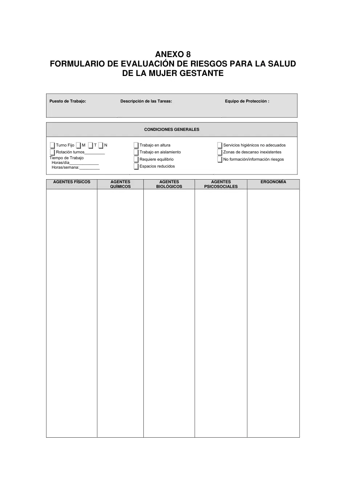

---
