# Anexo 1. Codificación de las indicaciones de peligro de las sustancias químicas

> **Conversión de PDF escaneado a Markdown.** Se transcriben las clasificaciones y los códigos H en tablas editables, junto con una imagen de cada página para cotejar celdas fusionadas, observaciones y citas bibliográficas. Las tablas conservan los códigos del archivo proporcionado; este documento no constituye una validación normativa externa.

**Documento original:** 31 páginas. **Ediciones comparadas del Sistema Globalmente Armonizado (SGA):** sexta, séptima, octava, novena y décima.

## Índice

- [Página 1: A1.1 — Explosivos](#pagina-1)
- [Página 2: A1.2 — Gases inflamables](#pagina-2)
- [Página 3: A1.3 — Aerosoles y productos químicos a presión](#pagina-3)
- [Página 4: A1.4 — Gases comburentes](#pagina-4)
- [Página 5: A1.5 — Gases a presión](#pagina-5)
- [Página 6: A1.6 — Líquidos inflamables](#pagina-6)
- [Página 7: A1.7 — Sólidos inflamables](#pagina-7)
- [Página 8: A1.8 — Sustancias y mezclas que reaccionan espontáneamente](#pagina-8)
- [Página 9: A1.9 — Líquidos pirofóricos](#pagina-9)
- [Página 10: A1.10 — Sólidos pirofóricos](#pagina-10)
- [Página 11: A1.11 — Sustancias y mezclas que experimentan calentamiento espontáneo](#pagina-11)
- [Página 12: A1.12 — Sustancias y mezclas que, en contacto con el agua, desprenden gases inflamables](#pagina-12)
- [Página 13: A1.13 — Líquidos comburentes](#pagina-13)
- [Página 14: A1.14 — Sólidos comburentes](#pagina-14)
- [Página 15: A1.15 — Peróxidos orgánicos](#pagina-15)
- [Página 16: A1.16 — Sustancias y mezclas corrosivas para los metales](#pagina-16)
- [Página 17: A1.17 — Explosivos insensibilizados](#pagina-17)
- [Página 18: A1.18 — Toxicidad aguda](#pagina-18)
- [Página 19: A1.19 — Corrosión/irritación cutáneas](#pagina-19)
- [Página 20: A1.20 — Lesiones oculares graves/irritación ocular](#pagina-20)
- [Página 21: A1.21 — Sensibilización respiratoria](#pagina-21)
- [Página 22: A1.22 — Sensibilización cutánea](#pagina-22)
- [Página 23: A1.23 — Mutagenicidad en células germinales](#pagina-23)
- [Página 24: A1.24 — Carcinogenicidad](#pagina-24)
- [Página 25: A1.25 — Toxicidad para la reproducción](#pagina-25)
- [Página 26: A1.26 — Toxicidad sistémica específica de órganos diana tras una exposición única](#pagina-26)
- [Página 27: A1.27 — Toxicidad sistémica específica de órganos diana tras exposiciones repetidas](#pagina-27)
- [Página 28: A1.28 — Peligro por aspiración](#pagina-28)
- [Página 29: A1.29 a — Peligro a corto plazo (agudo) para el medio ambiente acuático](#pagina-29)
- [Página 30: A1.29 b — Peligro a largo plazo (crónico) para el medio ambiente acuático](#pagina-30)
- [Página 31: A1.31 — Peligro para la capa de ozono](#pagina-31)

---

## Página 1. A1.1 — Explosivos

### Clasificación y códigos de peligro

### SGA 6.ª, 7.ª y 8.ª ediciones

| Clasificación de explosivos | SGA 6.ª | SGA 7.ª | SGA 8.ª |
| --- | --- | --- | --- |
| Explosivo inestable | H200 | H200 | H200 |
| División 1.1 | H201 | H201 | H201 |
| División 1.2 | H202 | H202 | H202 |
| División 1.3 | H203 | H203 | H203 |
| División 1.4 | H204 | H204 | H204 |
| División 1.5 | H205 | H205 | H205 |
| División 1.6 | Ninguno | Ninguno | Ninguno |

### SGA 9.ª y 10.ª ediciones

| Categoría SGA | Clase/división ONU indicada | 9.ª | 10.ª |
| --- | --- | --- | --- |
| 1 | No se aplica | H209; H210b; H211b | H209; H210b; H211b |
| 2A | 1.1, 1.2, 1.3, 1.5 | H209 | H209 |
| 2B | 1.6 | H204 | H204 |
| 2C | 1.4 | H204 | H204 |

### Observaciones y revisiones

- **Revisión 9:** Se incorpora una columna «Clase o División de la Reglamentación Modelo de las Naciones Unidas».
- **Revisión 9:** Se redistribuye la palabra «PICTOGRAMA» en las columnas de «Etiquetado».
- El cuadro de revisión describe supresiones y sustituciones de códigos de peligro en la revisión 9 y referencias a códigos suprimidos en la revisión 10; cotejar las anotaciones de la imagen.

### Página original (tabla, notas y fuentes impresas)

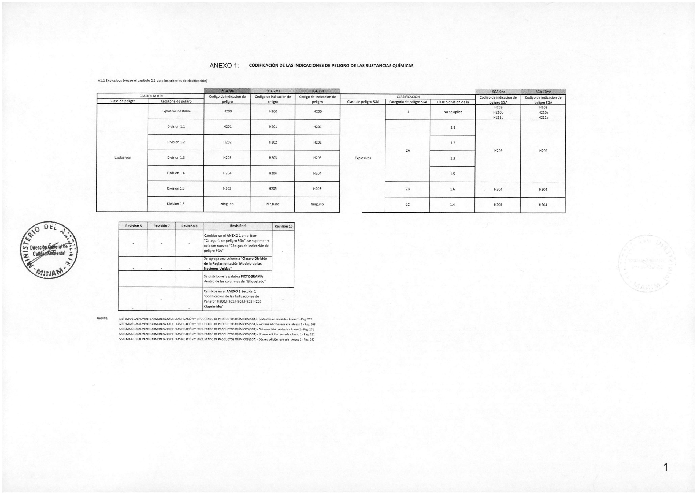

---

## Página 2. A1.2 — Gases inflamables

### Clasificación y códigos de peligro

### SGA 6.ª edición

| Categoría | Código |
| --- | --- |
| 1 | H220 |
| 2 | H221 |
| Gas pirofórico | H232 |
| Gas químicamente inestable A | H230 |
| Gas químicamente inestable B | H231 |

### SGA 7.ª a 10.ª ediciones

| Clasificación/categoría | SGA 7.ª | SGA 8.ª | SGA 9.ª | SGA 10.ª |
| --- | --- | --- | --- | --- |
| 1A — Gas inflamable | H220 | H220 | H220 | H220 |
| 1A — Gas pirofórico | H220; H232 | H220; H232 | H220; H232 | H220; H232 |
| 1A — Gas químicamente inestable A | H220; H230 | H220; H230 | H220; H230 | H220; H230 |
| 1A — Gas químicamente inestable B | H220; H231 | H220; H231 | H220; H231 | H220; H231 |
| 1B | H221 | H221 | H221 | H221 |
| 2 | H221 | H221 | H221 | H221 |

*En las ediciones 9.ª y 10.ª algunas celdas agrupan las categorías 1B y 2.*

### Observaciones y revisiones

- **Revisión 9:** Se incorpora una columna «Clase o División de la Reglamentación Modelo de las Naciones Unidas».
- **Revisión 9:** Se redistribuye la palabra «PICTOGRAMA» en las columnas de «Etiquetado».
- Se reorganizan las categorías de gases inflamables y los códigos combinados para gas pirofórico y gases químicamente inestables.

### Página original (tabla, notas y fuentes impresas)

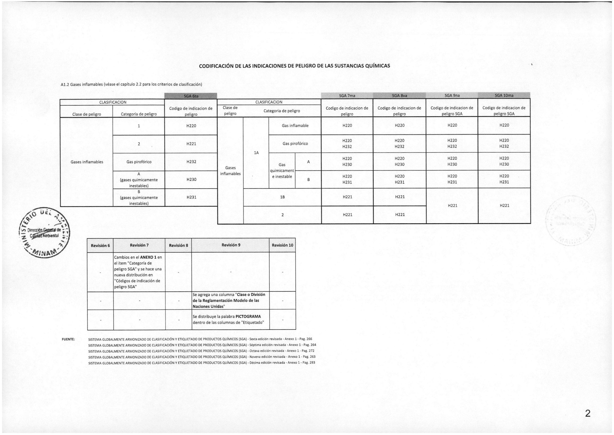

---

## Página 3. A1.3 — Aerosoles y productos químicos a presión

### Clasificación y códigos de peligro

| Clase | Categoría | SGA 6.ª | SGA 7.ª | SGA 8.ª | SGA 9.ª | SGA 10.ª |
| --- | --- | --- | --- | --- | --- | --- |
| Aerosoles | 1 | H222; H229 | H222; H229 | H222; H229 | H222; H229 | H222; H229 |
| Aerosoles | 2 | H223; H229 | H223; H229 | H223; H229 | H223; H229 | H223; H229 |
| Aerosoles | 3 | H229 | H229 | H229 | H229 | H229 |

**Clase incorporada en SGA 8.ª–10.ª:**

| Productos químicos a presión | SGA 8.ª | SGA 9.ª | SGA 10.ª |
| --- | --- | --- | --- |
| Categoría 1 | H282 | H282 | H282 |
| Categoría 2 | H283 | H283 | H283 |
| Categoría 3 | H284 | H284 | H284 |

### Observaciones y revisiones

- **Revisión 9:** Se incorpora una columna «Clase o División de la Reglamentación Modelo de las Naciones Unidas».
- **Revisión 9:** Se redistribuye la palabra «PICTOGRAMA» en las columnas de «Etiquetado».
- La revisión 8 incorpora la clase «Productos químicos a presión» (categorías 1 a 3).

### Página original (tabla, notas y fuentes impresas)

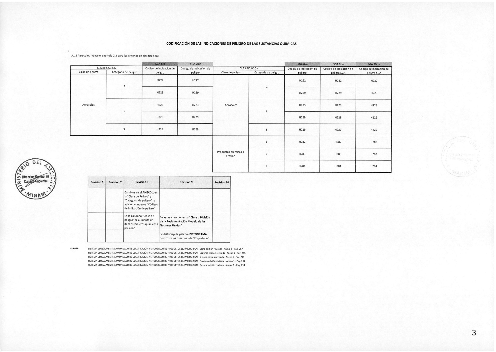

---

## Página 4. A1.4 — Gases comburentes

### Clasificación y códigos de peligro

| Categoría | SGA 6.ª | SGA 7.ª | SGA 8.ª | SGA 9.ª | SGA 10.ª |
| --- | --- | --- | --- | --- | --- |
| 1 | H270 | H270 | H270 | H270 | H270 |

### Observaciones y revisiones

- **Revisión 9:** Se incorpora una columna «Clase o División de la Reglamentación Modelo de las Naciones Unidas».
- **Revisión 9:** Se redistribuye la palabra «PICTOGRAMA» en las columnas de «Etiquetado».

### Página original (tabla, notas y fuentes impresas)

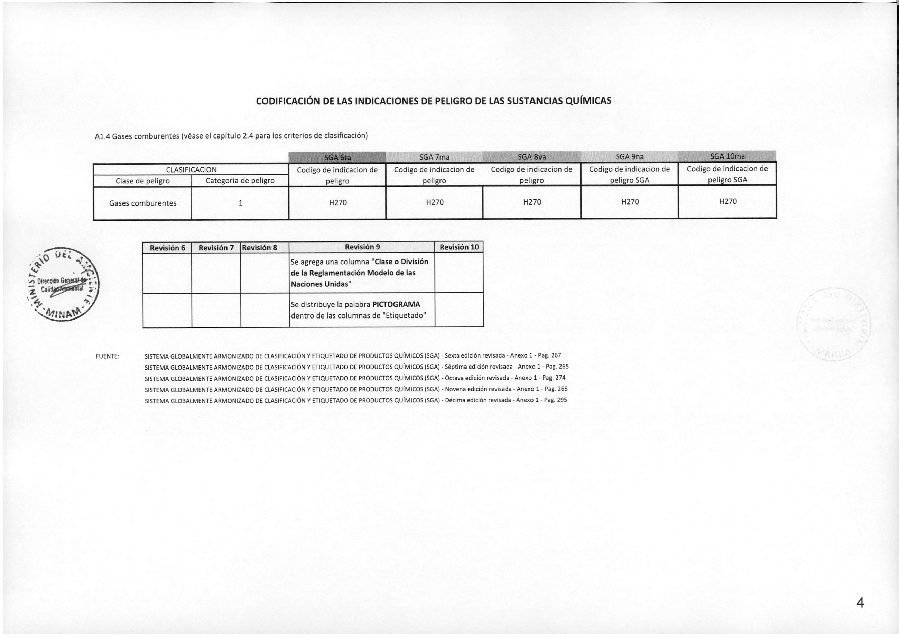

---

## Página 5. A1.5 — Gases a presión

### Clasificación y códigos de peligro

| Categoría | SGA 6.ª | SGA 7.ª | SGA 8.ª | SGA 9.ª | SGA 10.ª |
| --- | --- | --- | --- | --- | --- |
| Gas comprimido | H280 | H280 | H280 | H280 | H280 |
| Gas licuado | H280 | H280 | H280 | H280 | H280 |
| Gas licuado refrigerado | H281 | H281 | H281 | H281 | H281 |
| Gas disuelto | H280 | H280 | H280 | H280 | H280 |

*Nota de lectura:* una misma celda del cuadro original puede abarcar varias categorías. Aquí se repite el código aplicable para facilitar consultas y filtrado.

### Observaciones y revisiones

- **Revisión 9:** Se incorpora una columna «Clase o División de la Reglamentación Modelo de las Naciones Unidas».
- **Revisión 9:** Se redistribuye la palabra «PICTOGRAMA» en las columnas de «Etiquetado».
- Las revisiones 9 y 10 presentan celdas unificadas para categorías con igual código H280.

### Página original (tabla, notas y fuentes impresas)

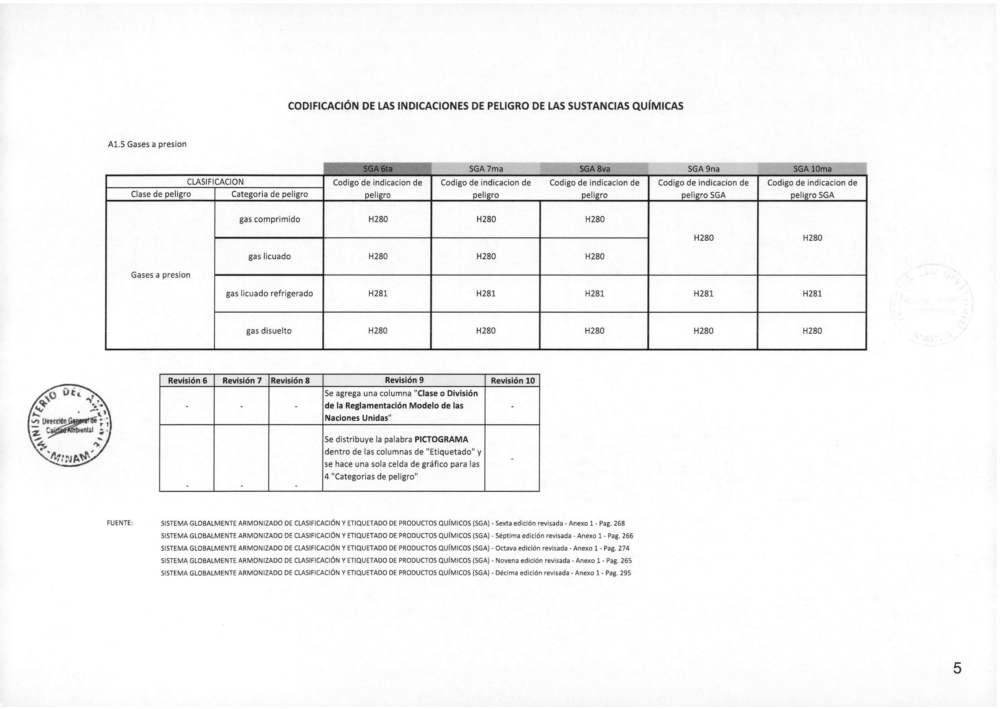

---

## Página 6. A1.6 — Líquidos inflamables

### Clasificación y códigos de peligro

| Categoría | SGA 6.ª | SGA 7.ª | SGA 8.ª | SGA 9.ª | SGA 10.ª |
| --- | --- | --- | --- | --- | --- |
| 1 | H224 | H224 | H224 | H224 | H224 |
| 2 | H225 | H225 | H225 | H225 | H225 |
| 3 | H226 | H226 | H226 | H226 | H226 |
| 4 | H227 | H227 | H227 | H227 | H227 |

### Observaciones y revisiones

- **Revisión 9:** Se incorpora una columna «Clase o División de la Reglamentación Modelo de las Naciones Unidas».
- **Revisión 9:** Se redistribuye la palabra «PICTOGRAMA» en las columnas de «Etiquetado».

### Página original (tabla, notas y fuentes impresas)

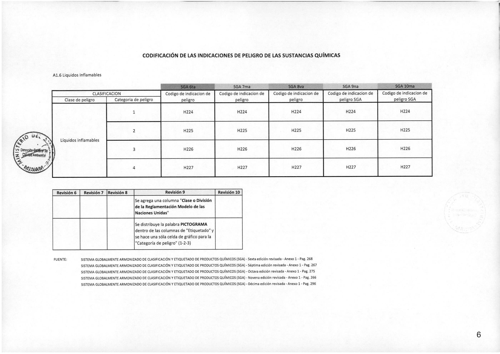

---

## Página 7. A1.7 — Sólidos inflamables

### Clasificación y códigos de peligro

| Categoría | SGA 6.ª | SGA 7.ª | SGA 8.ª | SGA 9.ª | SGA 10.ª |
| --- | --- | --- | --- | --- | --- |
| 1 | H228 | H228 | H228 | H228 | H228 |
| 2 | H228 | H228 | H228 | H228 | H228 |

### Observaciones y revisiones

- **Revisión 9:** Se incorpora una columna «Clase o División de la Reglamentación Modelo de las Naciones Unidas».
- **Revisión 9:** Se redistribuye la palabra «PICTOGRAMA» en las columnas de «Etiquetado».

### Página original (tabla, notas y fuentes impresas)

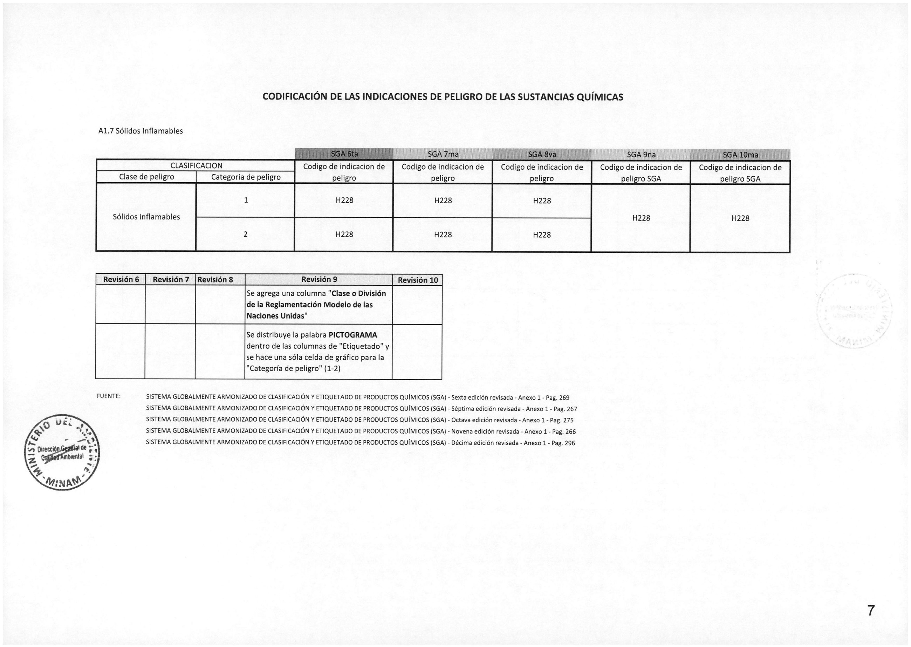

---

## Página 8. A1.8 — Sustancias y mezclas que reaccionan espontáneamente

### Clasificación y códigos de peligro

| Categoría | SGA 6.ª | SGA 7.ª | SGA 8.ª | SGA 9.ª | SGA 10.ª |
| --- | --- | --- | --- | --- | --- |
| Tipo A | H240 | H240 | H240 | H240 | H240 |
| Tipo B | H241 | H241 | H241 | H241 | H241 |
| Tipo C y D | H242 | H242 | H242 | H242 | H242 |
| Tipo D y F | H242 | H242 | H242 | H242 | H242 |
| Tipo G | Ninguno | Ninguno | Ninguno | Ninguno | Ninguno |

*Nota de lectura:* una misma celda del cuadro original puede abarcar varias categorías. Aquí se repite el código aplicable para facilitar consultas y filtrado.

### Observaciones y revisiones

- **Revisión 9:** Se incorpora una columna «Clase o División de la Reglamentación Modelo de las Naciones Unidas».
- **Revisión 9:** Se redistribuye la palabra «PICTOGRAMA» en las columnas de «Etiquetado».
- El cuadro de cambios señala incorporaciones a la categoría de peligro y ajustes de pictogramas; véase el texto original de la imagen.

### Página original (tabla, notas y fuentes impresas)

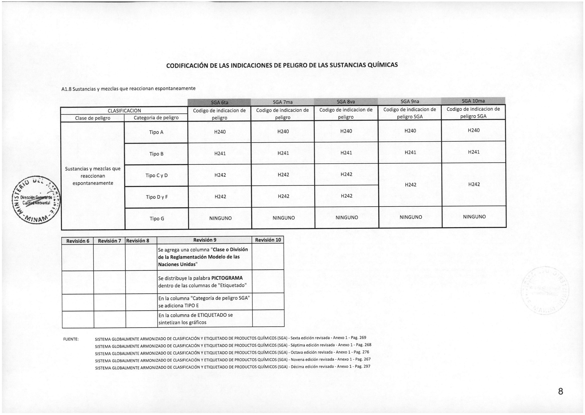

---

## Página 9. A1.9 — Líquidos pirofóricos

### Clasificación y códigos de peligro

| Categoría | SGA 6.ª | SGA 7.ª | SGA 8.ª | SGA 9.ª | SGA 10.ª |
| --- | --- | --- | --- | --- | --- |
| 1 | H250 | H250 | H250 | H250 | H250 |

### Observaciones y revisiones

- **Revisión 9:** Se incorpora una columna «Clase o División de la Reglamentación Modelo de las Naciones Unidas».
- **Revisión 9:** Se redistribuye la palabra «PICTOGRAMA» en las columnas de «Etiquetado».

### Página original (tabla, notas y fuentes impresas)

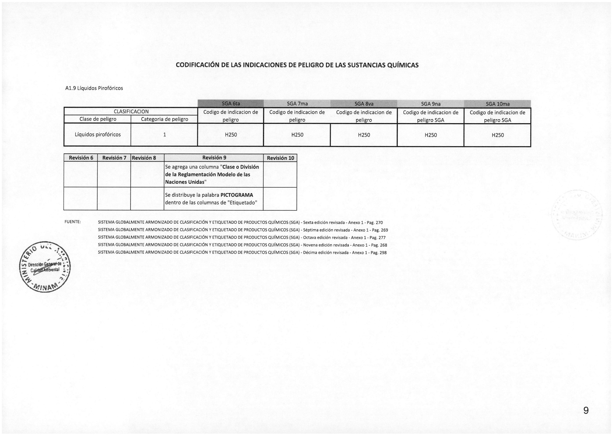

---

## Página 10. A1.10 — Sólidos pirofóricos

### Clasificación y códigos de peligro

| Categoría | SGA 6.ª | SGA 7.ª | SGA 8.ª | SGA 9.ª | SGA 10.ª |
| --- | --- | --- | --- | --- | --- |
| 1 | H250 | H250 | H250 | H250 | H250 |

### Observaciones y revisiones

- **Revisión 9:** Se incorpora una columna «Clase o División de la Reglamentación Modelo de las Naciones Unidas».
- **Revisión 9:** Se redistribuye la palabra «PICTOGRAMA» en las columnas de «Etiquetado».

### Página original (tabla, notas y fuentes impresas)

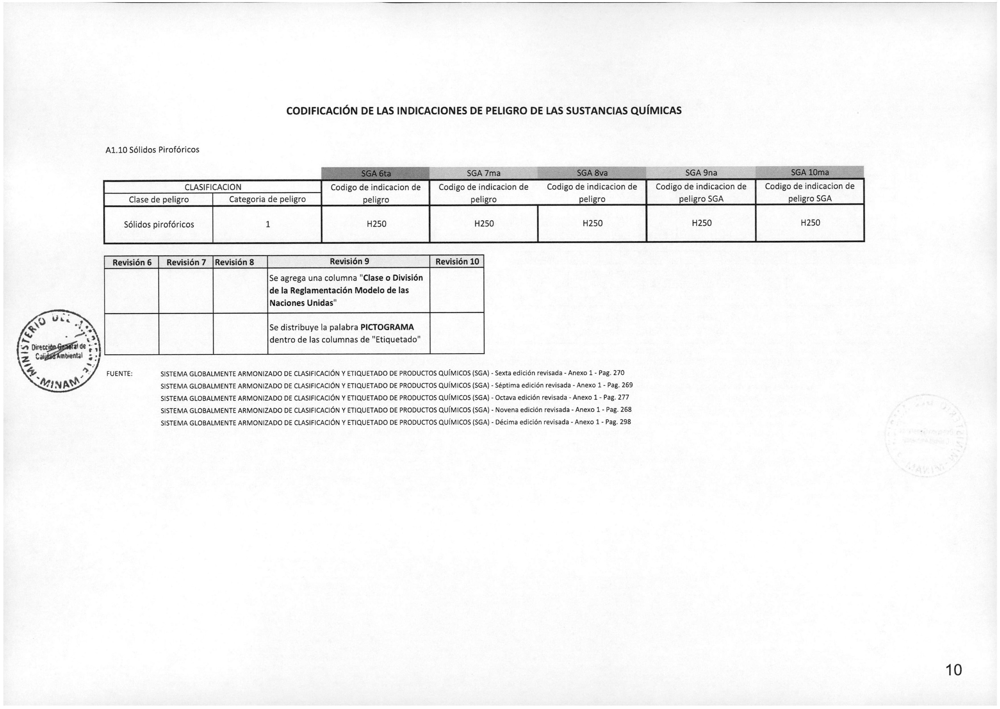

---

## Página 11. A1.11 — Sustancias y mezclas que experimentan calentamiento espontáneo

### Clasificación y códigos de peligro

| Categoría | SGA 6.ª | SGA 7.ª | SGA 8.ª | SGA 9.ª | SGA 10.ª |
| --- | --- | --- | --- | --- | --- |
| 1 | H251 | H251 | H251 | H251 | H251 |
| 2 | H252 | H252 | H252 | H252 | H252 |

### Observaciones y revisiones

- **Revisión 9:** Se incorpora una columna «Clase o División de la Reglamentación Modelo de las Naciones Unidas».
- **Revisión 9:** Se redistribuye la palabra «PICTOGRAMA» en las columnas de «Etiquetado».

### Página original (tabla, notas y fuentes impresas)

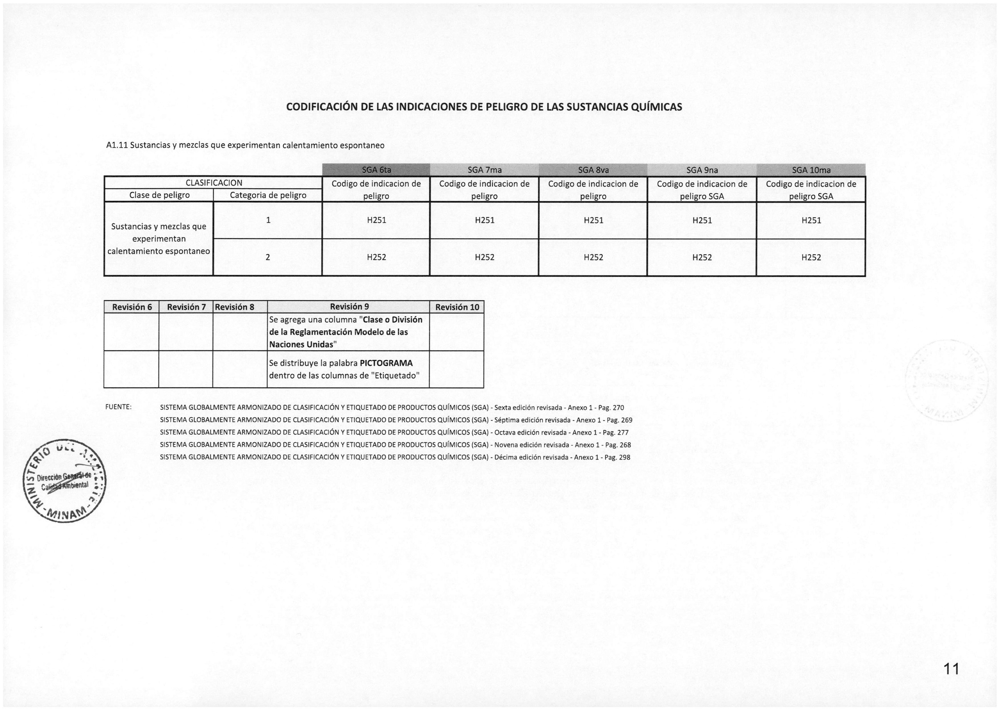

---

## Página 12. A1.12 — Sustancias y mezclas que, en contacto con el agua, desprenden gases inflamables

### Clasificación y códigos de peligro

| Categoría | SGA 6.ª | SGA 7.ª | SGA 8.ª | SGA 9.ª | SGA 10.ª |
| --- | --- | --- | --- | --- | --- |
| 1 | H260 | H260 | H260 | H260 | H260 |
| 2 | H261 | H261 | H261 | H261 | H261 |
| 3 | H261 | H261 | H261 | H261 | H261 |

*Nota de lectura:* una misma celda del cuadro original puede abarcar varias categorías. Aquí se repite el código aplicable para facilitar consultas y filtrado.

### Observaciones y revisiones

- **Revisión 9:** Se incorpora una columna «Clase o División de la Reglamentación Modelo de las Naciones Unidas».
- **Revisión 9:** Se redistribuye la palabra «PICTOGRAMA» en las columnas de «Etiquetado».
- Las categorías 2 y 3 utilizan H261 con celdas combinadas en algunas ediciones.

### Página original (tabla, notas y fuentes impresas)

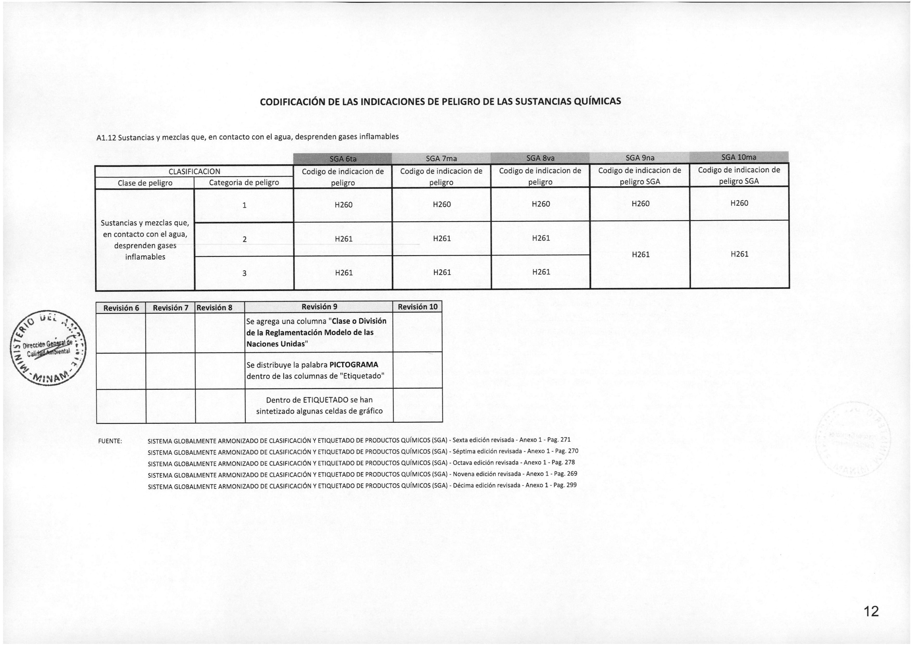

---

## Página 13. A1.13 — Líquidos comburentes

### Clasificación y códigos de peligro

| Categoría | SGA 6.ª | SGA 7.ª | SGA 8.ª | SGA 9.ª | SGA 10.ª |
| --- | --- | --- | --- | --- | --- |
| 1 | H271 | H271 | H271 | H271 | H271 |
| 2 | H272 | H272 | H272 | H272 | H272 |
| 3 | H272 | H272 | H272 | H272 | H272 |

*Nota de lectura:* una misma celda del cuadro original puede abarcar varias categorías. Aquí se repite el código aplicable para facilitar consultas y filtrado.

### Observaciones y revisiones

- **Revisión 9:** Se incorpora una columna «Clase o División de la Reglamentación Modelo de las Naciones Unidas».
- **Revisión 9:** Se redistribuye la palabra «PICTOGRAMA» en las columnas de «Etiquetado».
- Las categorías 2 y 3 utilizan H272 con celdas combinadas en algunas ediciones.

### Página original (tabla, notas y fuentes impresas)

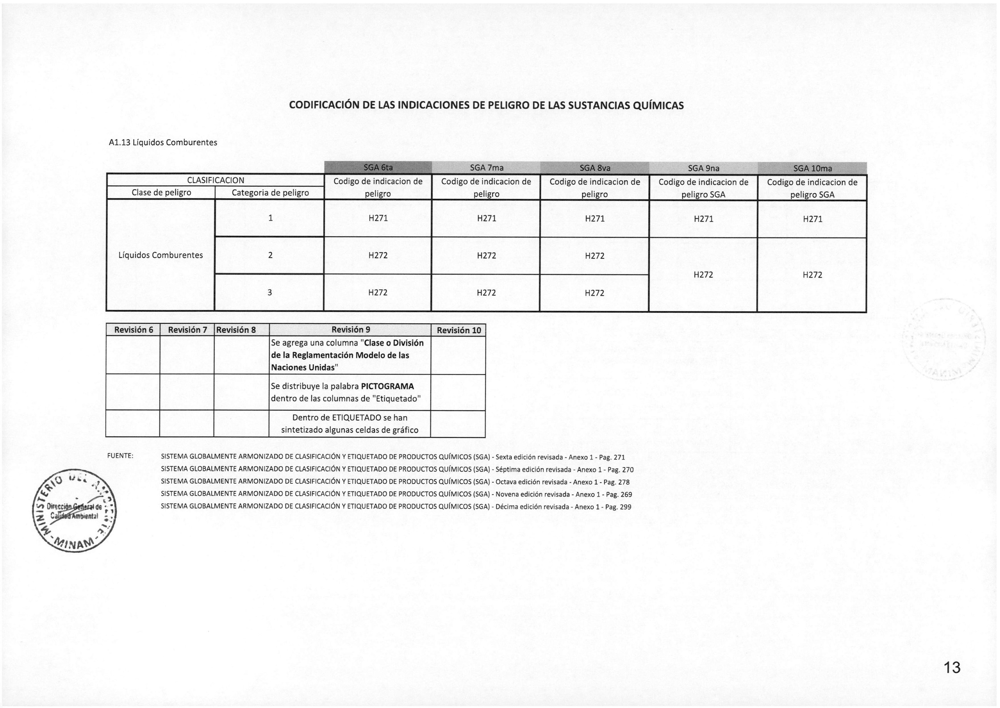

---

## Página 14. A1.14 — Sólidos comburentes

### Clasificación y códigos de peligro

| Categoría | SGA 6.ª | SGA 7.ª | SGA 8.ª | SGA 9.ª | SGA 10.ª |
| --- | --- | --- | --- | --- | --- |
| 1 | H271 | H271 | H271 | H271 | H271 |
| 2 | H272 | H272 | H272 | H272 | H272 |
| 3 | H272 | H272 | H272 | H272 | H272 |

*Nota de lectura:* una misma celda del cuadro original puede abarcar varias categorías. Aquí se repite el código aplicable para facilitar consultas y filtrado.

### Observaciones y revisiones

- **Revisión 9:** Se incorpora una columna «Clase o División de la Reglamentación Modelo de las Naciones Unidas».
- **Revisión 9:** Se redistribuye la palabra «PICTOGRAMA» en las columnas de «Etiquetado».
- Las categorías 2 y 3 utilizan H272 con celdas combinadas en algunas ediciones.

### Página original (tabla, notas y fuentes impresas)

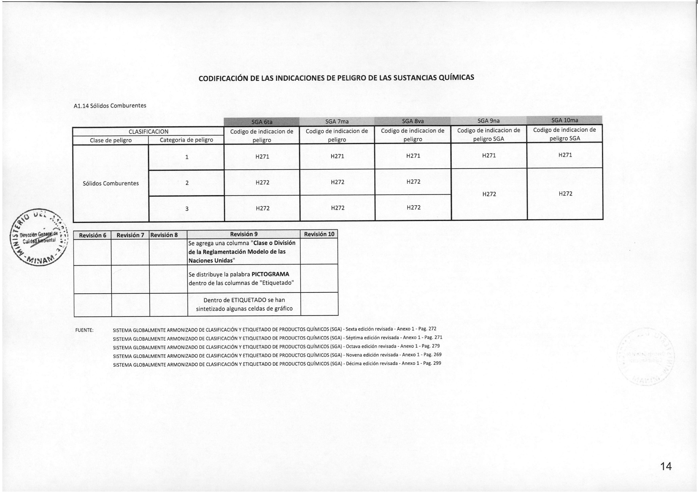

---

## Página 15. A1.15 — Peróxidos orgánicos

### Clasificación y códigos de peligro

| Categoría | SGA 6.ª | SGA 7.ª | SGA 8.ª | SGA 9.ª | SGA 10.ª |
| --- | --- | --- | --- | --- | --- |
| Tipo A | H240 | H240 | H240 | H240 | H240 |
| Tipo B | H241 | H241 | H241 | H241 | H241 |
| Tipo C y D | H242 | H242 | H242 | H242 | H242 |
| Tipo D y F | H242 | H242 | H242 | H242 | H242 |
| Tipo G | Ninguno | Ninguno | Ninguno | Ninguno | Ninguno |

*Nota de lectura:* una misma celda del cuadro original puede abarcar varias categorías. Aquí se repite el código aplicable para facilitar consultas y filtrado.

### Observaciones y revisiones

- **Revisión 9:** Se incorpora una columna «Clase o División de la Reglamentación Modelo de las Naciones Unidas».
- **Revisión 9:** Se redistribuye la palabra «PICTOGRAMA» en las columnas de «Etiquetado».
- El cuadro de cambios registra ajustes en categorías y pictogramas.

### Página original (tabla, notas y fuentes impresas)

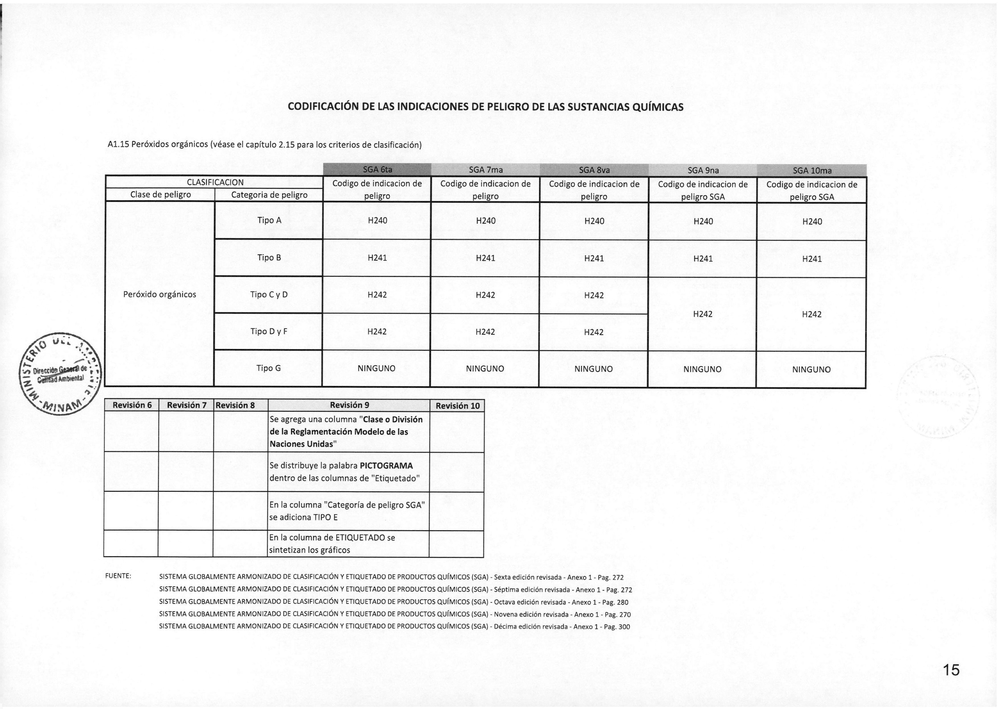

---

## Página 16. A1.16 — Sustancias y mezclas corrosivas para los metales

### Clasificación y códigos de peligro

| Categoría | SGA 6.ª | SGA 7.ª | SGA 8.ª | SGA 9.ª | SGA 10.ª |
| --- | --- | --- | --- | --- | --- |
| 1 | H290 | H290 | H290 | H290 | H290 |

### Observaciones y revisiones

- **Revisión 9:** Se incorpora una columna «Clase o División de la Reglamentación Modelo de las Naciones Unidas».
- **Revisión 9:** Se redistribuye la palabra «PICTOGRAMA» en las columnas de «Etiquetado».

### Página original (tabla, notas y fuentes impresas)

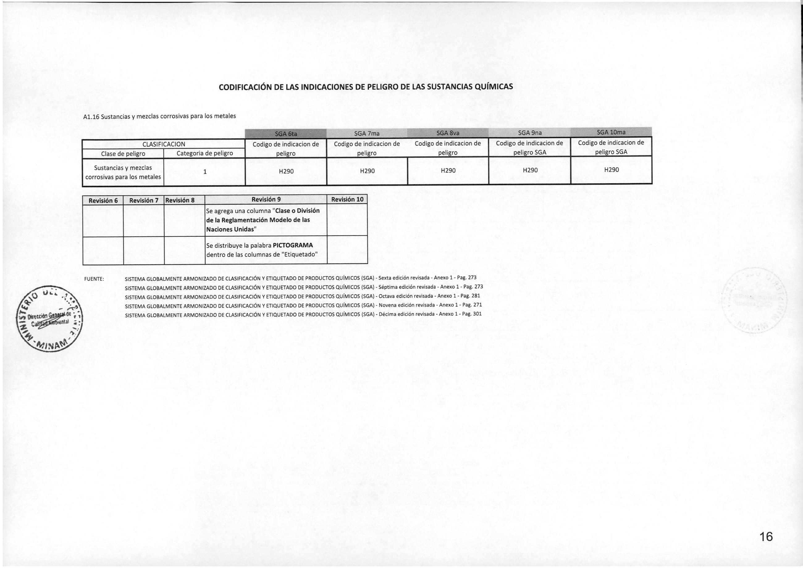

---

## Página 17. A1.17 — Explosivos insensibilizados

### Clasificación y códigos de peligro

| Categoría | SGA 6.ª | SGA 7.ª | SGA 8.ª | SGA 9.ª | SGA 10.ª |
| --- | --- | --- | --- | --- | --- |
| 1 | H206 | H206 | H206 | H206 | H206 |
| 2 | H207 | H207 | H207 | H207 | H207 |
| 3 | H207 | H207 | H207 | H207 | H207 |
| 4 | H208 | H208 | H208 | H208 | H208 |

*Nota de lectura:* una misma celda del cuadro original puede abarcar varias categorías. Aquí se repite el código aplicable para facilitar consultas y filtrado.

### Observaciones y revisiones

- **Revisión 9:** Se incorpora una columna «Clase o División de la Reglamentación Modelo de las Naciones Unidas».
- **Revisión 9:** Se redistribuye la palabra «PICTOGRAMA» en las columnas de «Etiquetado».
- Las categorías 2 y 3 utilizan H207 con celdas combinadas en las revisiones más recientes.

### Página original (tabla, notas y fuentes impresas)

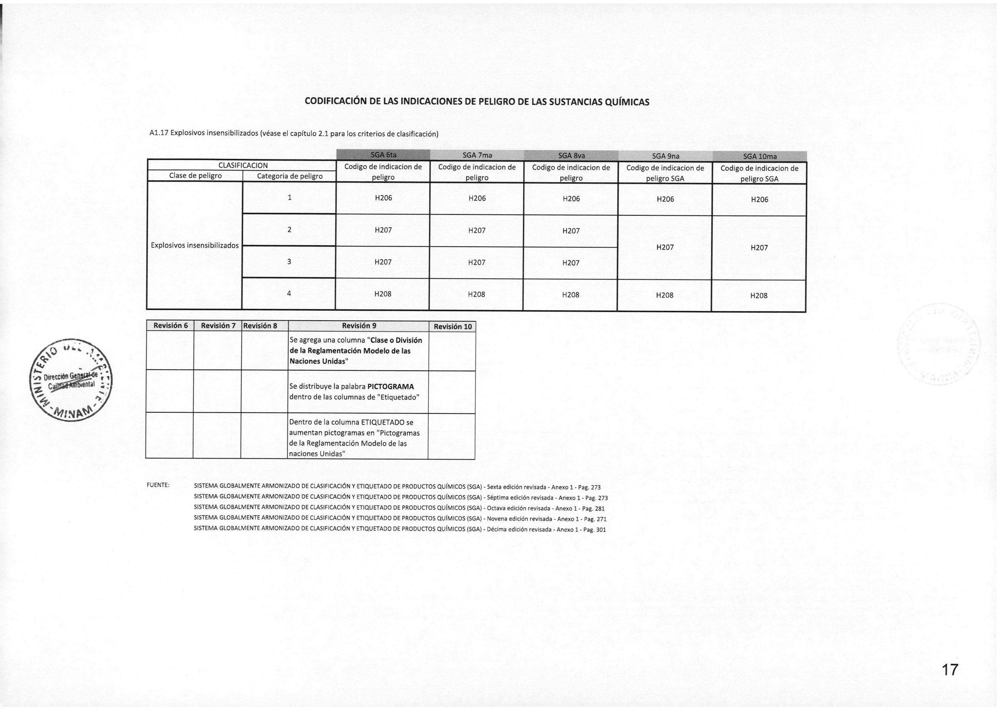

---

## Página 18. A1.18 — Toxicidad aguda

### Clasificación y códigos de peligro

### SGA 6.ª, 7.ª y 8.ª

| Categoría | Vía de exposición | SGA 6.ª | SGA 7.ª | SGA 8.ª |
| --- | --- | --- | --- | --- |
| 1 | Ingestión | H300 | H300 | H300 |
| 1 | Vía cutánea | H310 | H310 | H310 |
| 1 | Inhalación | H330 | H330 | H330 |
| 2 | Ingestión | H300 | H300 | H300 |
| 2 | Vía cutánea | H310 | H310 | H310 |
| 2 | Inhalación | H330 | H330 | H330 |
| 3 | Ingestión | H301 | H301 | H301 |
| 3 | Vía cutánea | H311 | H311 | H311 |
| 3 | Inhalación | H331 | H331 | H331 |
| 4 | Ingestión | H302 | H302 | H302 |
| 4 | Vía cutánea | H312 | H312 | H312 |
| 4 | Inhalación | H332 | H332 | H332 |
| 5 | Ingestión | H303 | H303 | H303 |
| 5 | Vía cutánea | H313 | H313 | H313 |
| 5 | Inhalación | H333 | H333 | H333 |

### SGA 9.ª y 10.ª

| Categoría | Vía de exposición | SGA 9.ª | SGA 10.ª |
| --- | --- | --- | --- |
| 1, 2 | Ingestión | H300 | H300 |
| 1, 2 | Vía cutánea | H310 | H310 |
| 1, 2 | Inhalación | H330 | H330 |
| 3 | Ingestión | H301 | H301 |
| 3 | Vía cutánea | H311 | H311 |
| 3 | Inhalación | H331 | H331 |
| 4 | Ingestión | H302 | H302 |
| 4 | Vía cutánea | H312 | H312 |
| 4 | Inhalación | H332 | H332 |
| 5 | Ingestión | H303 | H303 |
| 5 | Vía cutánea | H313 | H313 |
| 5 | Inhalación | H333 | H333 |

### Observaciones y revisiones

- **Revisión 9:** Se incorpora una columna «Clase o División de la Reglamentación Modelo de las Naciones Unidas».
- **Revisión 9:** Se redistribuye la palabra «PICTOGRAMA» en las columnas de «Etiquetado».

### Página original (tabla, notas y fuentes impresas)

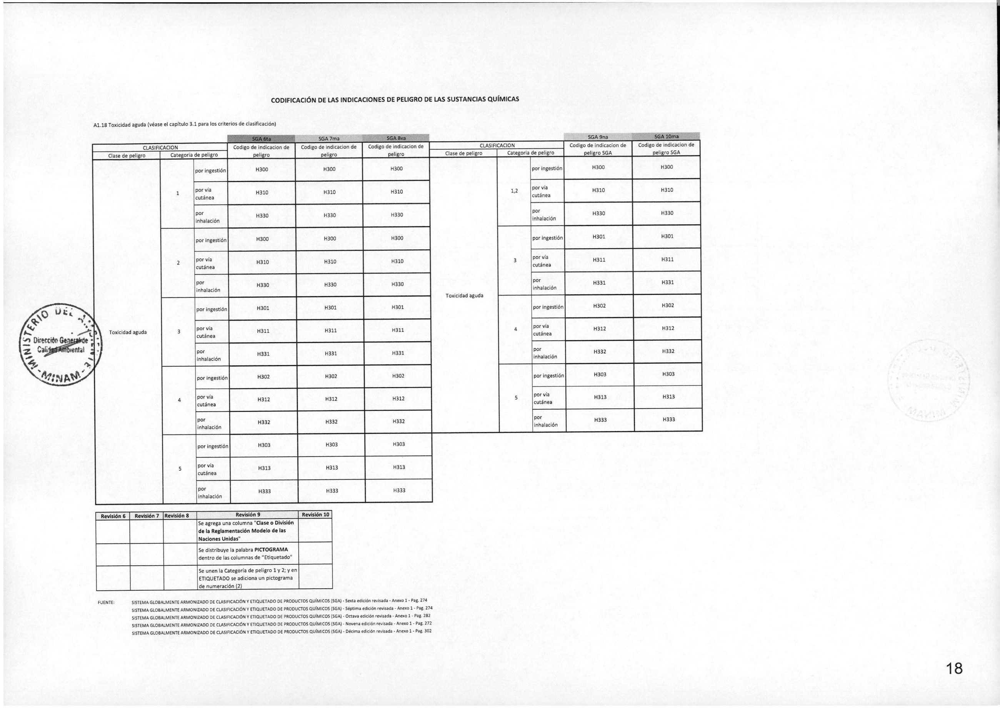

---

## Página 19. A1.19 — Corrosión/irritación cutáneas

### Clasificación y códigos de peligro

| Categoría SGA 6.ª/7.ª | Categoría SGA 8.ª/9.ª/10.ª | SGA 6.ª | SGA 7.ª | SGA 8.ª | SGA 9.ª | SGA 10.ª |
| --- | --- | --- | --- | --- | --- | --- |
| 1 | 1, 1A, 1B, 1C | H314 | H314 | H314 | H314 | H314 |
| 2 | 2 | H315 | H315 | H315 | H315 | H315 |
| 3 | 3 | H316 | H316 | H316 | H316 | H316 |

### Observaciones y revisiones

- **Revisión 9:** Se incorpora una columna «Clase o División de la Reglamentación Modelo de las Naciones Unidas».
- **Revisión 9:** Se redistribuye la palabra «PICTOGRAMA» en las columnas de «Etiquetado».
- Las revisiones 8 y 9 modifican la presentación de las subcategorías 1A, 1B y 1C.

### Página original (tabla, notas y fuentes impresas)

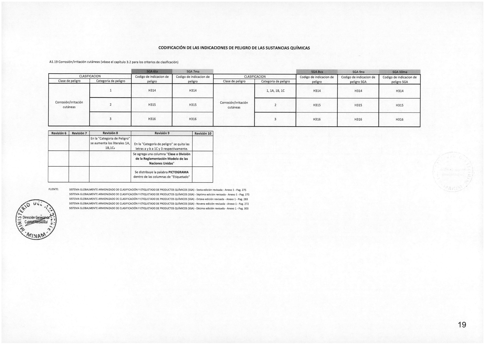

---

## Página 20. A1.20 — Lesiones oculares graves/irritación ocular

### Clasificación y códigos de peligro

| Categoría | SGA 6.ª | SGA 7.ª | SGA 8.ª | SGA 9.ª | SGA 10.ª |
| --- | --- | --- | --- | --- | --- |
| 1 | H318 | H318 | H318 | H318 | H318 |
| 2/2A | H319 | H319 | H319 | H319 | H319 |
| 2B | H320 | H320 | H320 | H320 | H320 |

### Observaciones y revisiones

- **Revisión 9:** Se incorpora una columna «Clase o División de la Reglamentación Modelo de las Naciones Unidas».
- **Revisión 9:** Se redistribuye la palabra «PICTOGRAMA» en las columnas de «Etiquetado».

### Página original (tabla, notas y fuentes impresas)

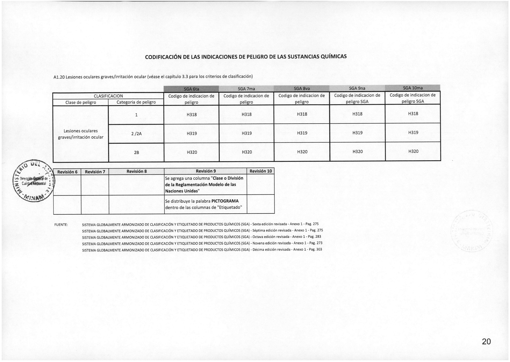

---

## Página 21. A1.21 — Sensibilización respiratoria

### Clasificación y códigos de peligro

| Categoría SGA 6.ª/7.ª/8.ª | SGA 6.ª | SGA 7.ª | SGA 8.ª |
| --- | --- | --- | --- |
| 1 | H334 | H334 | H334 |
| 1A | H334 | H334 | H334 |
| 2B | H334 | H334 | H334 |

**SGA 9.ª y 10.ª:** categoría conjunta `1, 1A, 1B`, con código `H334` en ambas revisiones.

### Observaciones y revisiones

- **Revisión 9:** Se incorpora una columna «Clase o División de la Reglamentación Modelo de las Naciones Unidas».
- **Revisión 9:** Se redistribuye la palabra «PICTOGRAMA» en las columnas de «Etiquetado».
- La revisión 9 agrupa la categoría 1 y sus subcategorías, y sustituye 2B por 1B.

### Página original (tabla, notas y fuentes impresas)

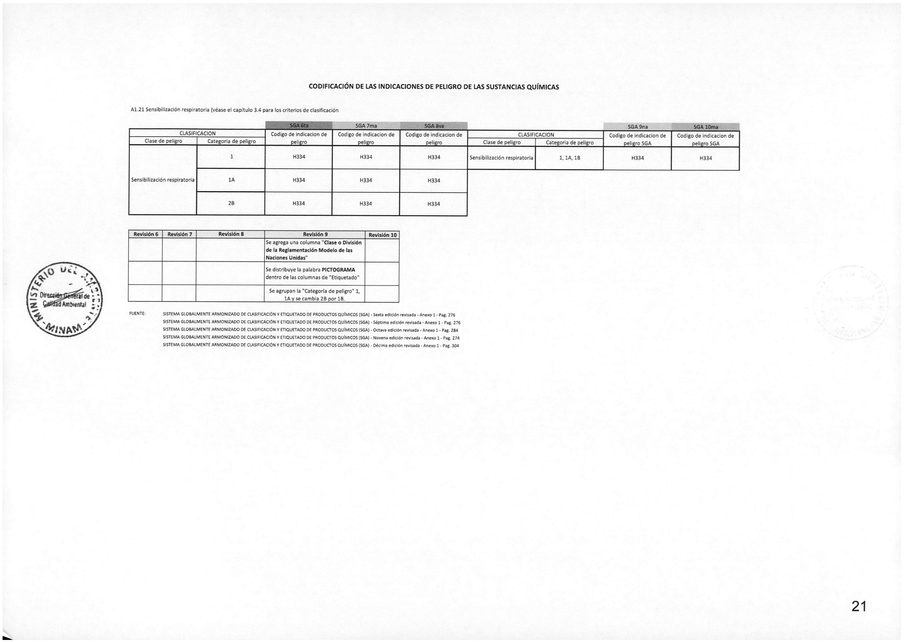

---

## Página 22. A1.22 — Sensibilización cutánea

### Clasificación y códigos de peligro

| Categoría SGA 6.ª/7.ª/8.ª | SGA 6.ª | SGA 7.ª | SGA 8.ª |
| --- | --- | --- | --- |
| 1 | H317 | H317 | H317 |
| 1A | H317 | H317 | H317 |
| 2B | H317 | H317 | H317 |

**SGA 9.ª y 10.ª:** categoría conjunta `1, 1A, 1B`, con código `H317` en ambas revisiones.

### Observaciones y revisiones

- **Revisión 9:** Se incorpora una columna «Clase o División de la Reglamentación Modelo de las Naciones Unidas».
- **Revisión 9:** Se redistribuye la palabra «PICTOGRAMA» en las columnas de «Etiquetado».
- La revisión 9 agrupa las subcategorías y agrega la referencia a categoría 2; véase el cuadro original.

### Página original (tabla, notas y fuentes impresas)

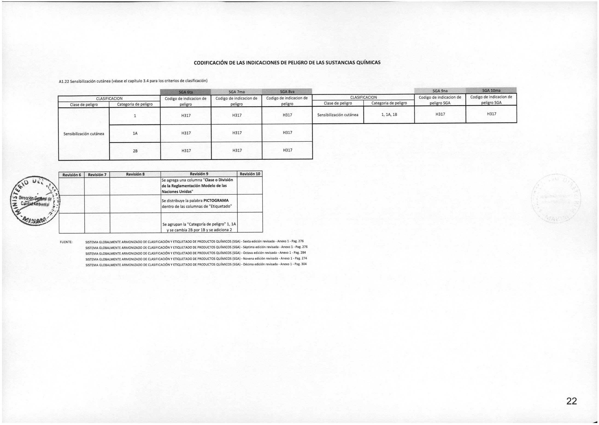

---

## Página 23. A1.23 — Mutagenicidad en células germinales

### Clasificación y códigos de peligro

| Categoría | SGA 6.ª | SGA 7.ª | SGA 8.ª | SGA 9.ª | SGA 10.ª |
| --- | --- | --- | --- | --- | --- |
| 1 (tanto 1A como 1B) | H340 | H340 | H340 | H340 | H340 |
| 2 | H341 | H341 | H341 | H341 | H341 |

### Observaciones y revisiones

- **Revisión 9:** Se incorpora una columna «Clase o División de la Reglamentación Modelo de las Naciones Unidas».
- **Revisión 9:** Se redistribuye la palabra «PICTOGRAMA» en las columnas de «Etiquetado».
- La tabla de revisión registra cambios en la escritura de subcategorías 1A y 1B.

### Página original (tabla, notas y fuentes impresas)

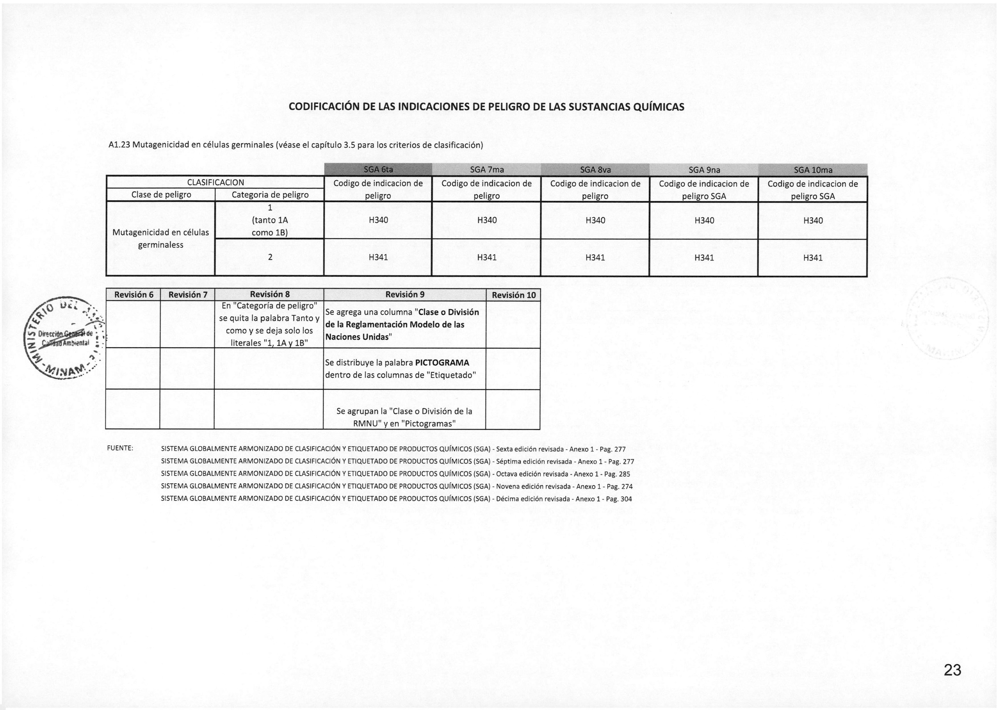

---

## Página 24. A1.24 — Carcinogenicidad

### Clasificación y códigos de peligro

| Categoría | SGA 6.ª | SGA 7.ª | SGA 8.ª | SGA 9.ª | SGA 10.ª |
| --- | --- | --- | --- | --- | --- |
| 1 (tanto 1A como 1B) | H350 | H350 | H350 | H350 | H350 |
| 2 | H351 | H351 | H351 | H351 | H351 |

### Observaciones y revisiones

- **Revisión 9:** Se incorpora una columna «Clase o División de la Reglamentación Modelo de las Naciones Unidas».
- **Revisión 9:** Se redistribuye la palabra «PICTOGRAMA» en las columnas de «Etiquetado».
- La tabla de revisión registra cambios en la escritura de subcategorías 1A y 1B.

### Página original (tabla, notas y fuentes impresas)

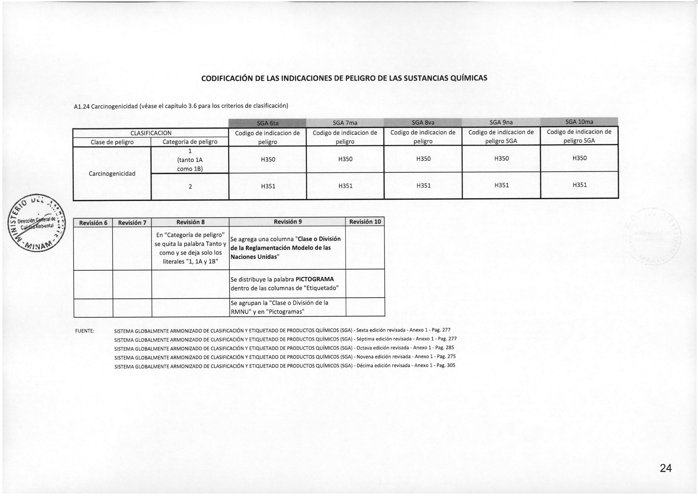

---

## Página 25. A1.25 — Toxicidad para la reproducción

### Clasificación y códigos de peligro

| Categoría | SGA 6.ª | SGA 7.ª | SGA 8.ª | SGA 9.ª | SGA 10.ª |
| --- | --- | --- | --- | --- | --- |
| 1 (tanto 1A como 1B) | H360 | H360 | H360 | H360 | H360 |
| 1A | H361 | H361 | H361 | H361 | H361 |
| Con efectos sobre o a través de la lactancia (categoría adicional) | H362 | H362 | H362 | H362 | H362 |

### Observaciones y revisiones

- **Revisión 9:** Se incorpora una columna «Clase o División de la Reglamentación Modelo de las Naciones Unidas».
- **Revisión 9:** Se redistribuye la palabra «PICTOGRAMA» en las columnas de «Etiquetado».
- La revisión 8 describe un ajuste en la redacción de las categorías de peligro.

### Página original (tabla, notas y fuentes impresas)

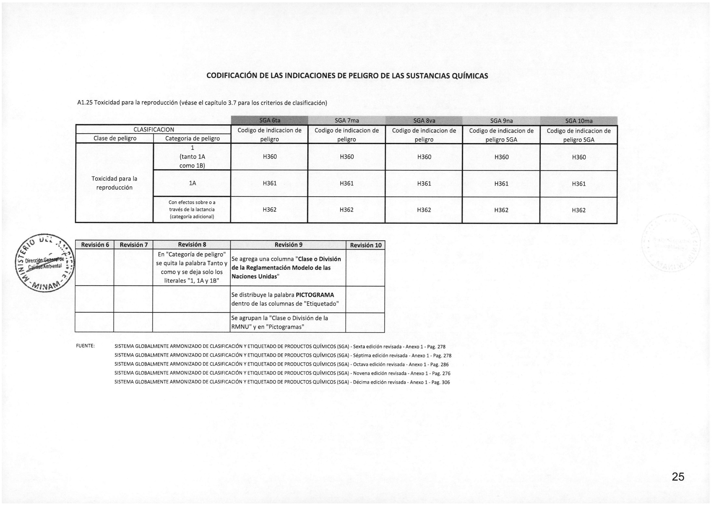

---

## Página 26. A1.26 — Toxicidad sistémica específica de órganos diana tras una exposición única

### Clasificación y códigos de peligro

| Categoría | SGA 6.ª | SGA 7.ª | SGA 8.ª | SGA 9.ª | SGA 10.ª |
| --- | --- | --- | --- | --- | --- |
| 1 | H370 | H370 | H370 | H370 | H370 |
| 2 | H371 | H371 | H371 | H371 | H371 |
| 3 (irritación respiratoria o efectos narcóticos) | H335 / H336 | H335 / H336 | H335 / H336 | H335 / H336 | H335 / H336 |

### Observaciones y revisiones

- **Revisión 9:** Se incorpora una columna «Clase o División de la Reglamentación Modelo de las Naciones Unidas».
- **Revisión 9:** Se redistribuye la palabra «PICTOGRAMA» en las columnas de «Etiquetado».
- La tabla de revisión hace referencia a la agrupación de categorías de la Reglamentación Modelo de las Naciones Unidas y pictogramas.

### Página original (tabla, notas y fuentes impresas)

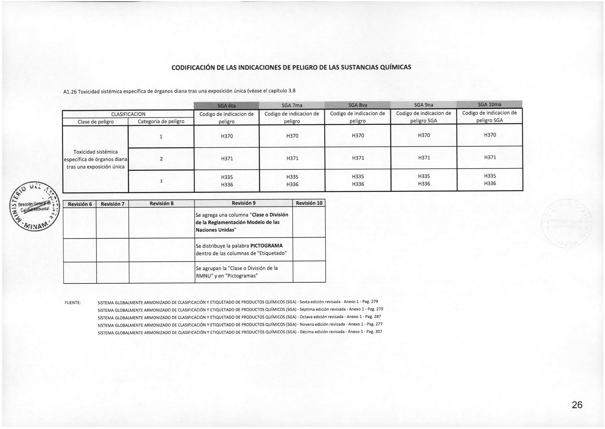

---

## Página 27. A1.27 — Toxicidad sistémica específica de órganos diana tras exposiciones repetidas

### Clasificación y códigos de peligro

| Categoría | SGA 6.ª | SGA 7.ª | SGA 8.ª | SGA 9.ª | SGA 10.ª |
| --- | --- | --- | --- | --- | --- |
| 1 | H372 | H372 | H372 | H372 | H372 |
| 2 | H373 | H373 | H373 | H373 | H373 |

### Observaciones y revisiones

- **Revisión 9:** Se incorpora una columna «Clase o División de la Reglamentación Modelo de las Naciones Unidas».
- **Revisión 9:** Se redistribuye la palabra «PICTOGRAMA» en las columnas de «Etiquetado».
- La tabla de revisión hace referencia a la agrupación de categorías de la Reglamentación Modelo de las Naciones Unidas y pictogramas.

### Página original (tabla, notas y fuentes impresas)

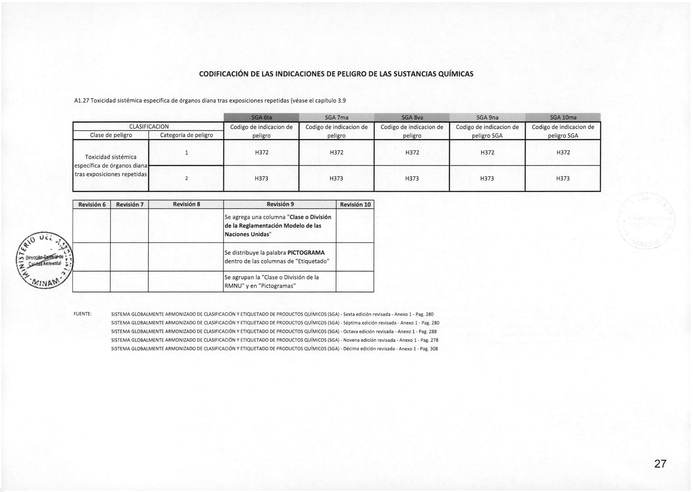

---

## Página 28. A1.28 — Peligro por aspiración

### Clasificación y códigos de peligro

| Categoría | SGA 6.ª | SGA 7.ª | SGA 8.ª | SGA 9.ª | SGA 10.ª |
| --- | --- | --- | --- | --- | --- |
| 1 | H304 | H304 | H304 | H304 | H304 |
| 2 | H305 | H305 | H305 | H305 | H305 |

### Observaciones y revisiones

- **Revisión 9:** Se incorpora una columna «Clase o División de la Reglamentación Modelo de las Naciones Unidas».
- **Revisión 9:** Se redistribuye la palabra «PICTOGRAMA» en las columnas de «Etiquetado».
- La tabla de revisión hace referencia a la agrupación de categorías de la Reglamentación Modelo de las Naciones Unidas y pictogramas.

### Página original (tabla, notas y fuentes impresas)

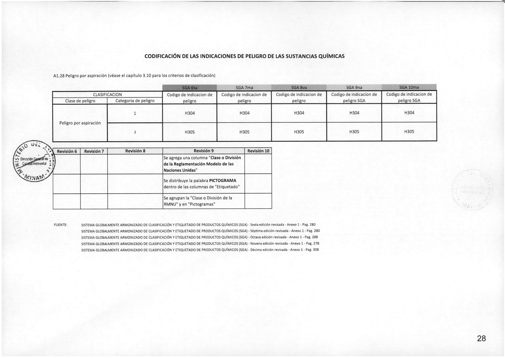

---

## Página 29. A1.29 a — Peligro a corto plazo (agudo) para el medio ambiente acuático

### Clasificación y códigos de peligro

| Categoría | SGA 6.ª | SGA 7.ª | SGA 8.ª | SGA 9.ª | SGA 10.ª |
| --- | --- | --- | --- | --- | --- |
| Agudo 1 | H400 | H400 | H400 | H400 | H400 |
| Agudo 2 | H401 | H401 | H401 | H401 | H401 |
| Agudo 3 | H402 | H402 | H402 | H402 | H402 |

### Observaciones y revisiones

- **Revisión 9:** Se incorpora una columna «Clase o División de la Reglamentación Modelo de las Naciones Unidas».
- **Revisión 9:** Se redistribuye la palabra «PICTOGRAMA» en las columnas de «Etiquetado».
- Se registra una reorganización de pictogramas de peligro acuático.

### Página original (tabla, notas y fuentes impresas)

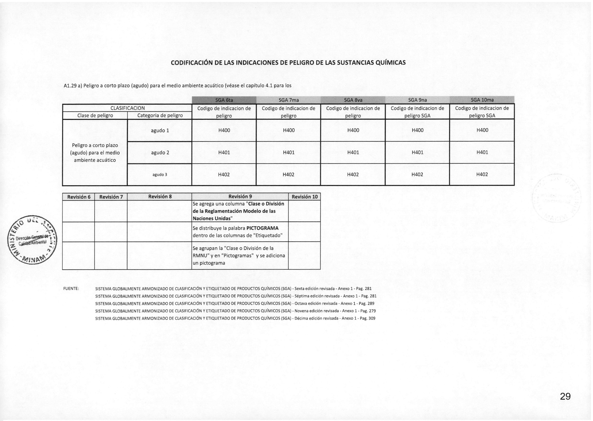

---

## Página 30. A1.29 b — Peligro a largo plazo (crónico) para el medio ambiente acuático

### Clasificación y códigos de peligro

| Categoría | SGA 6.ª | SGA 7.ª | SGA 8.ª | SGA 9.ª | SGA 10.ª |
| --- | --- | --- | --- | --- | --- |
| Crónico 1 | H410 | H410 | H410 | H410 | H410 |
| Crónico 2 | H411 | H411 | H411 | H411 | H411 |
| Crónico 3 | H412 | H412 | H412 | H412 | H412 |
| Crónico 4 | H413 | H413 | H413 | H413 | H413 |

### Observaciones y revisiones

- **Revisión 9:** Se incorpora una columna «Clase o División de la Reglamentación Modelo de las Naciones Unidas».
- **Revisión 9:** Se redistribuye la palabra «PICTOGRAMA» en las columnas de «Etiquetado».
- Se registra una reorganización de pictogramas de peligro acuático.

### Página original (tabla, notas y fuentes impresas)

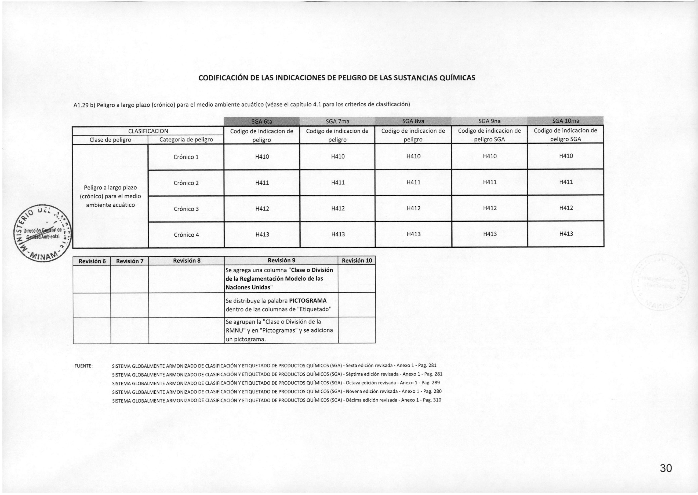

---

## Página 31. A1.31 — Peligro para la capa de ozono

### Clasificación y códigos de peligro

| Categoría | SGA 6.ª | SGA 7.ª | SGA 8.ª | SGA 9.ª | SGA 10.ª |
| --- | --- | --- | --- | --- | --- |
| 1 | H420 | H420 | H420 | H420 | H420 |

### Observaciones y revisiones

- **Revisión 9:** Se incorpora una columna «Clase o División de la Reglamentación Modelo de las Naciones Unidas».
- **Revisión 9:** Se redistribuye la palabra «PICTOGRAMA» en las columnas de «Etiquetado».

### Página original (tabla, notas y fuentes impresas)

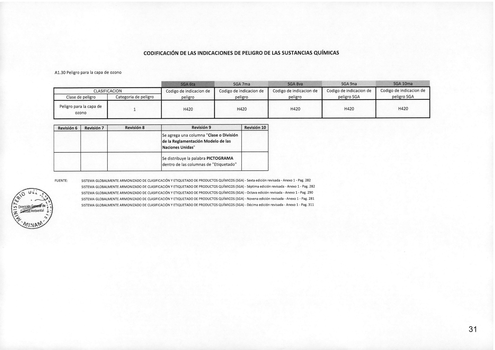

---

## Advertencias de transcripción

- La columna de códigos corresponde a las indicaciones H tal como aparecen en las tablas. Los cambios de clasificación por edición se documentan específicamente cuando el cuadro cambia de estructura.
- Las anotaciones de revisión y referencias bibliográficas se preservan íntegramente en las imágenes de cada página; las observaciones escritas son transcripciones resumidas y no sustituyen el cuadro original.
- En procedimientos de seguridad, comparar los códigos con el PDF de origen y con la norma aplicable antes de utilizarlos.

