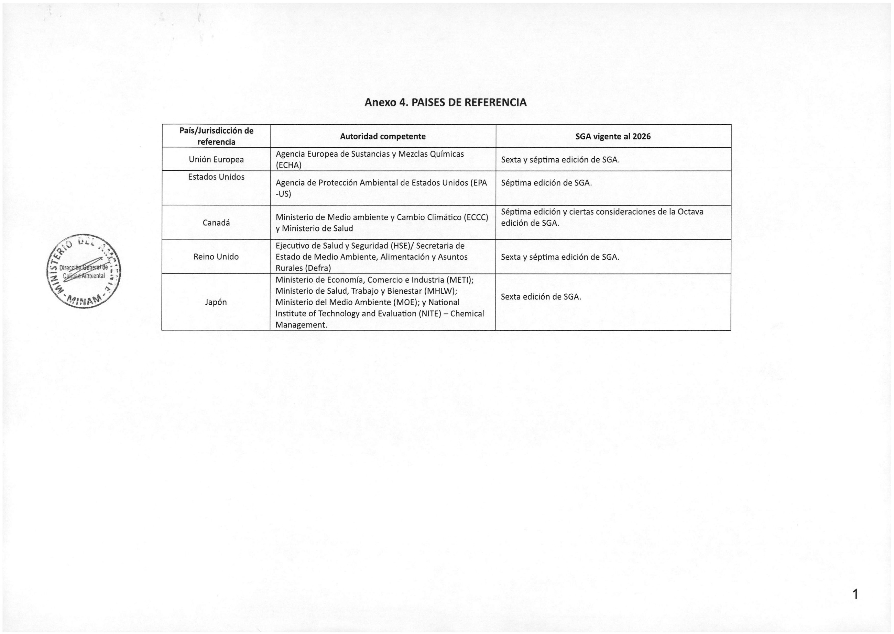

# Anexo 4. Países de referencia

**Tabla de países/jurisdicciones de referencia, autoridades competentes y ediciones del Sistema Globalmente Armonizado (SGA)**, según documento proporcionado.

| País/jurisdicción de referencia | Autoridad competente | SGA vigente al 2026 (según el documento) |
| --- | --- | --- |
| Unión Europea | Agencia Europea de Sustancias y Mezclas Químicas (ECHA) | Sexta y séptima edición de SGA. |
| Estados Unidos | Agencia de Protección Ambiental de Estados Unidos (EPA-US) | Séptima edición de SGA. |
| Canadá | Ministerio de Medio Ambiente y Cambio Climático (ECCC) y Ministerio de Salud | Séptima edición y ciertas consideraciones de la octava edición de SGA. |
| Reino Unido | Ejecutivo de Salud y Seguridad (HSE) / Secretaría de Estado de Medio Ambiente, Alimentación y Asuntos Rurales (Defra) | Sexta y séptima edición de SGA. |
| Japón | Ministerio de Economía, Comercio e Industria (METI); Ministerio de Salud, Trabajo y Bienestar (MHLW); Ministerio del Medio Ambiente (MOE); y National Institute of Technology and Evaluation (NITE) - Chemical Management | Sexta edición de SGA. |

> El dato de vigencia corresponde literalmente al corte mencionado por el archivo; no se ha contrastado con publicaciones normativas posteriores.

## Tabla original

